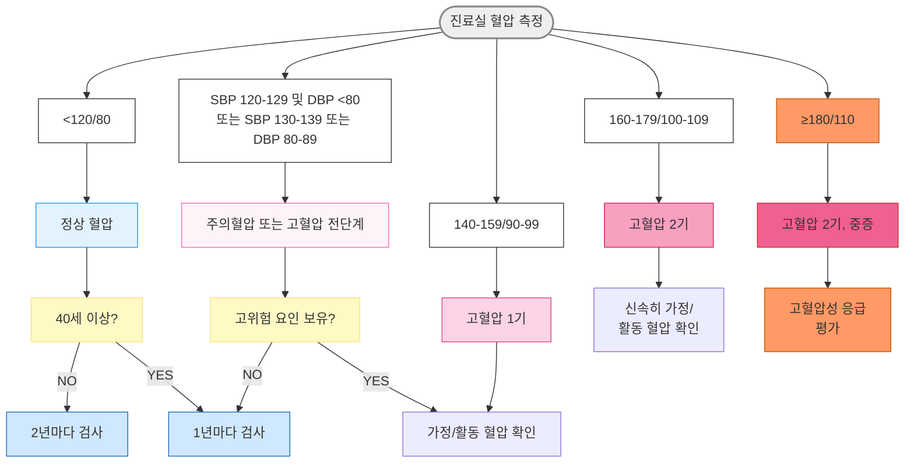
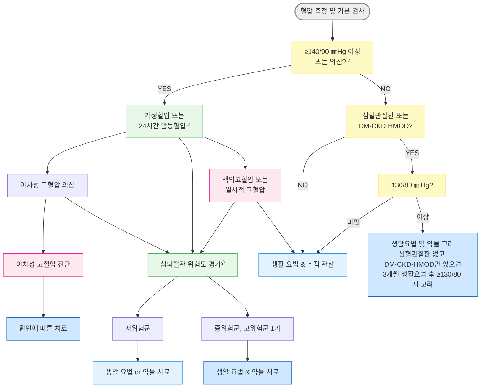
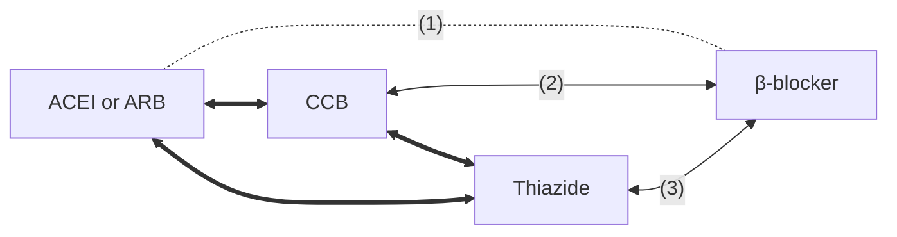
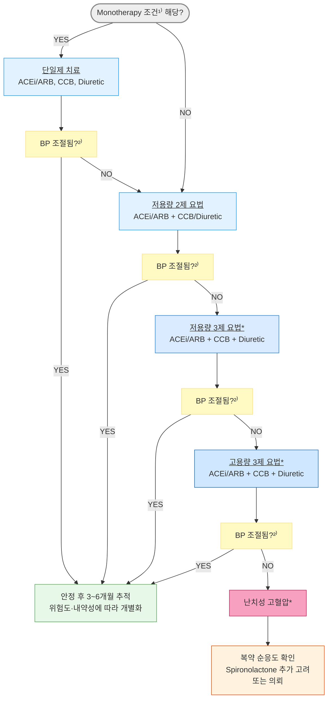
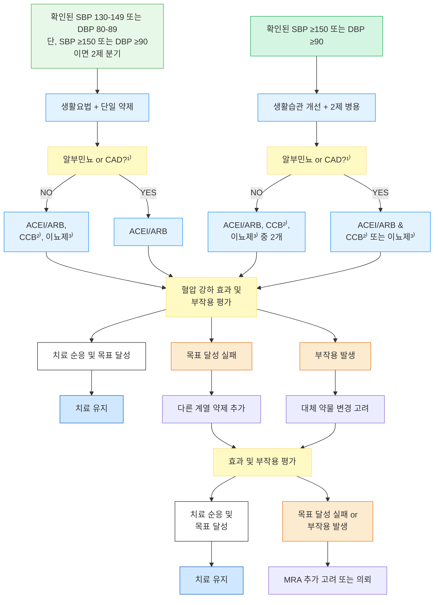
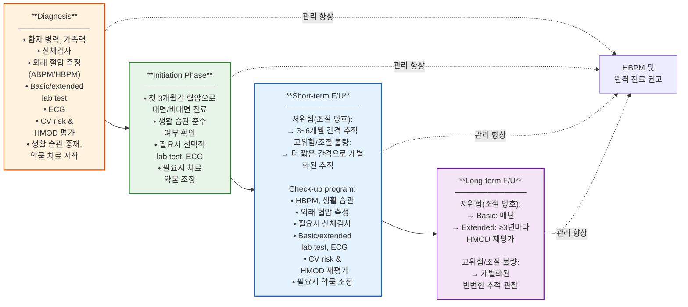

# 고혈압 Hypertension

## <mark style="color:green;">일반 사항</mark>

* 전 세계 질병 부담에서 가장 중요한 수정 가능한 위험 인자 중 하나
* 유병률 : 140/90 ㎜Hg 기준 시 ≥60세의 ＞60%; 130/80 ㎜Hg 기준 시 ≥75세의 ＞80%
  * 우리나라 ≥20세 (2023년, 140/90 기준) : 유병률 28.8%, 인지율 78.6%, 치료율 76.0%, 조절률 62.2%; 고혈압 환자 약 1,260만 명
* 성별 : 남성에서 높다가, 폐경 이후 여성에서 증가하여 65세 이상에서는 여성에서 더 높음
* 연령 : SBP는 연령에 따라 상승; DBP는 50\~60세까지만 상승하고 이후 약간 감소
* 변동성 : 여름이 낮고 겨울이 높음; 야간에는 주간보다 10\~20% 낮음(dipper)
* 혈압과 위험
  * BP 115/75 ㎜Hg부터 20/10 ㎜Hg 증가마다 심혈관 질환 사망률이 2배씩 증가
  * SBP 10\~20 ㎜Hg, DBP 5\~10 ㎜Hg 하락 시 뇌졸중 30\~40%, 허혈성 심질환 15\~20% 감소
  * 치료 시작과 강화 시점은 혈압 수준, 급성 장기 손상 및 심혈관 위험도에 따라 결정; 고위험군에서 불필요한 치료 지연을 피함
  * 고령자에서 지나친 혈압 하강은 어지럼, 실신, 낙상 위험을 높일 수 있으므로 노쇠도·기립성 저혈압·치료 내약성을 고려하여 개별화
  * 낮은 DBP와 심혈관 위험의 J-curve는 주로 관찰연구에서 보고됨; 기저 질환·동맥 경직·역인과의 영향을 고려하며 DBP ＜70 ㎜Hg만으로 자동 감량·중단하지 않음 <mark style="color:$info;">\[2024 ESC]</mark>
    * DBP가 낮으면 증상, 기립 혈압, 관상동맥질환, 장기 관류 및 내약성을 함께 평가하여 목표와 약제를 조정
  * 젊은 연령에서는 SBP와 DBP 상승 모두 CV event 위험 증가와 관련되고, ≥50세에서는 SBP와 맥압(SBP와 DBP의 차이)이 DBP보다 CV event에 대해 더 큰 예측력을 가짐
* 증상
  * 이차성 및 장기 손상 이외에는 보통 무증상
  * 두통, 어지럼, 두근거림 등은 비특이적이며 고혈압의 진단 증상은 아님; 심한 혈압 상승과 함께 신경학적 증상·흉통·호흡곤란·시야 변화 등이 동반되면 급성 표적장기 손상 여부 평가
* 진단 시 활동 또는 가정혈압을 측정하여 '백의 고혈압' 및 '가면 고혈압'을 감별
* 진단 시 이차성 고혈압, 생활 습관, 심뇌혈관 질환 및 위험 인자, 치료에 영향을 줄 수 있는 동반 질환, 무증상 장기 손상 유무 등 확인

#### <mark style="color:$primary;">지속되는 고혈압의 영향</mark>

<table><thead><tr><th width="136">영역</th><th width="400">병태생리 변화 → 구조적/기능적 결과</th><th>임상적 의미</th></tr></thead><tbody><tr><td>Brain</td><td>소혈관 손상, 내피기능장애 → 백질병변, 미세경색, 미세출혈, 뇌위축</td><td>인지저하, 혈관성 치매, 뇌졸중</td></tr><tr><td>Eye</td><td>미세혈관 재형성 → 고혈압망막병증</td><td>전신 미세혈관 손상의 지표</td></tr><tr><td>Heart</td><td>압력 과부하, 혈관경직 증가 → LVH, LA/LV 확장, CAD</td><td>AF, MI, HF 위험 증가</td></tr><tr><td>Kidney</td><td>사구체내압 상승, 세동맥 경화 → 알부민뇨, 사구체경화, GFR 감소</td><td>CKD 진행 및 CV risk 증가</td></tr><tr><td>Large/medium arteries</td><td>죽상경화, 혈관 석회화 → 동맥경직 증가</td><td>pulse pressure 상승, ASCVD 증가</td></tr><tr><td>Micro-circulation</td><td>내피기능장애, 혈관반응성 증가, 혈관 재형성, 섬유화/염증 → 말초혈관저항 증가</td><td>고혈압의 지속 및 장기 손상 악순환</td></tr></tbody></table>

#### <mark style="color:$primary;">심뇌혈관질환(CVD)의 위험 인자</mark> <mark style="color:$info;">\[대한고혈압학회]</mark>

* 연령 : 남 ≥45세, 여 ≥55세; ≥65세는 2개의 위험 인자로 간주
* 조기(남 ＜55세, 여 ＜65세) 심혈관 질환 부모/형제 가족력
* 흡연
* 비만 (BMI ≥25 ㎏/㎡) 또는 복부비만 (허리둘레 남 ≥90 ㎝, 여 ≥85 ㎝)
* 이상지질혈증 : total-C ≥220, LDL-C ≥150, HDL-C ＜40, TG ≥200 ㎎/㎗
* 당뇨병전단계 : 공복혈당장애 (공복 혈당 100\~125) 또는 내당능장애 (식후 혈당 140\~199 ㎎/㎗)
* 당뇨병 (2개의 위험 인자로 간주)

#### <mark style="color:$primary;">고혈압의 표적 장기 손상 (Hypertension-mediated organ damage, HMOD)</mark>

* Heart : LVH, angina/prior MI, prior coronary revascularization, heart failure
* Brain : stroke, transient ischemic attack, dementia
* CKD
* Blood vessel : peripheral arterial disease
* Eye : retinopathy

###  <mark style="color:$danger;">🚩 Red Flags!</mark>

<mark style="color:$danger;">**즉각 조치 또는 응급 의뢰**</mark>

* (SBP ≥180 또는 DBP ≥110 ㎜Hg)이면서 급성 표적 장기 손상(HMOD)이 의심되거나 확인된 경우: 고혈압성 응급으로 즉시 평가·입원 치료
  * 뇌증/급성 신경학적 이상, 급성 심부전·폐부종, ACS, AKI, 급성 대동맥증후군, 자간증/중증 전자간증 등
* 심한 고칼륨혈증, 고칼륨혈증 관련 ECG 변화 또는 급격한 신 기능 악화·핍뇨 → 긴급 평가; 혈압 수치와 관계없이 판단

<mark style="color:$warning;">**당일 또는 조기 의뢰**</mark>

* 이뇨제를 포함하여 3제 이상 항고혈압제 투여에도 조절되지 않는 고혈압
* 급격한 발생, 젊은 연령, 저칼륨혈증, 치료 저항 → 이차성 고혈압

<mark style="color:$info;">**조기 평가 및 추적**</mark> <mark style="color:$info;">- 즉각 위험 낮으나 악화되면 의뢰</mark>

* 지속적인 eGFR ＜30 또는 뚜렷한 단백뇨 → 신장 전문 평가 계획; 급성 악화 여부에 따라 의뢰 시점 조정
* 잘 조절되던 혈압이 뚜렷한 이유 없이 상승

### <mark style="color:orange;">고혈압 유형</mark>

#### <mark style="color:$primary;">수축기 단독 고혈압 (Isolated systolic hypertension, ISH)</mark>

* 정의 : SBP ≥140 ㎜Hg & DBP ＜90 ㎜Hg
* 역학 : 고령자 고혈압의 60\~80% 해당
* 원인 : arterial compliance 감소 - 연령 증가에 따라 SBP↑·DBP↓; 심박출량 증가 - 예) 빈혈, 갑상선항진증, aortic insufficiency, arteriovenous fistula, Paget Dz
* 예후 : MI, LVH, 신부전, 뇌졸중, 심혈관 사망률 증가
* 조치 : 생활 습관 중재; 젊은 환자의 경우 원인 감별 필요
  * 약물 치료 : 일반 고혈압 환자와 동일; DBP ＜70 ㎜Hg 시 주의

#### <mark style="color:$primary;">이완기 단독 고혈압 (Isolated diastolic hypertension, IDH)</mark>

* 정의 : SBP ＜140 ㎜Hg & DBP ≥90 ㎜Hg (ACC/AHA 기준: SBP ＜130 ㎜Hg & DBP ≥80 ㎜Hg)
* 역학 : 젊은 성인에서 흔함
* 원인 : 말초혈관 저항 증가가 주된 기전; 비만, 과도한 음주, 흡연, 스트레스, 수면 무호흡증; 이차성 원인 - 신실질 질환, 신혈관성 고혈압, 원발성 알도스테론증, 갑상선 기능 저하증
* 예후 : DBP ≥90 ㎜Hg에서는 장기적으로 심혈관 위험이 증가할 수 있음; 단, DBP 80\~89 ㎜Hg 단독 상승의 임상적 중요성은 논란
* 조치 : 원인 감별, 생활 습관 중재
  * 약물 치료 : 혈압 수준 및 CV risk에 따라 결정; 원인 질환 동반 시 원인 치료 우선

#### <mark style="color:$primary;">백의 고혈압 (White coat hypertension)</mark>

* 정의 : 진료실 혈압은 ≥140/90 ㎜Hg이나 진료실 외 주간 활동 혈압은 ＜135/85 ㎜Hg
  * 고혈압 치료 상태에서는 HT with white coat effect 또는 white coat uncontrolled HT으로 표현
* 역학 : 진료실 진단 고혈압 환자의 17%, 조절되지 않는 고혈압 환자의 21%; 여성, 비만도가 낮은 인구에서 흔함
* 예후 : 5년 이내 단기적인 임상 경과는 비교적 양호; 장기적으로 고혈압으로 진행하거나 심/뇌혈관 질환이 발병할 위험이 있음
* 진단 : 진료실 1기 고혈압(140\~159/90\~99 ㎜Hg)인 경우 일시적 혈압 상승 감별 → 활동 or 가정혈압 측정
  * 외래의 의료진이 없는 빈 방에서 휴식하면서 전자 혈압계로 측정하면 백의 효과가 줄어든다는 보고가 있음
* 조치 : CV risk 및 표적 장기 손상(HMOD) 평가, 생활 습관 개선, 매년 또는 3\~6개월마다 혈압 측정
  * 약물 치료 : 일반적으로 권고하지 않으며, HMOD 또는 CV risk가 높은 환자에서 고려

#### <mark style="color:$primary;">가면 고혈압 (Masked hypertension)</mark>

* 정의 : 진료실 SBP ＜140 및 DBP ＜90 ㎜Hg이나 가정혈압 또는 주간 ABPM 평균 SBP ≥135 또는 DBP ≥85 ㎜Hg; 야간·24시간 ABPM은 각각의 진단 기준을 적용
  * 고혈압 치료 상태에서는 HT with reverse white coat effect 또는 masked uncontrolled HT으로 표현
* 역학 : 조절되는 고혈압 환자의 35%; 고혈압 약제의 개수, 높은 공복혈당에서 더 흔함
* 예후 : 일중 고혈압이 과소 평가되어 심혈관 질환의 발생 위험이 증가될 수 있음
* 의심 : 진료실 혈압은 정상이지만 표적 장기 미세 손상이 있거나 심혈관 위험도가 높은 경우, 또는 진료실 혈압이 고혈압 전단계인 경우 가면 고혈압 감별 필요
* 조치 : 생활 습관 개선
  * 약물 치료 : 혈압 수준에 따라, HMOD가 있거나 CV risk가 높은 경우 고려

#### <mark style="color:$primary;">가성 고혈압 (Pseudohypertension)</mark>

* 정의 : 동맥 경화, 석회화 등에 의해 말초혈관이 딱딱해져 혈압이 높게 측정됨; 고령에서 흔함
* 원인 : 고령, 동맥 경화·석회화로 인한 말초혈관 경결 (→ 커프 압박으로 혈관이 충분히 압박되지 않아 실제보다 높게 측정됨)
* 예후 : 실제 혈압은 낮으므로 오진 시 불필요한 약물 투여 → 저혈압·어지럼증·낙상 위험 (특히 고령)
* 의심 : 고령 환자에서 높은 진료실혈압과 달리 항고혈압제 치료 중 어지럼증·실신·저혈압 증상이 불일치하게 나타나는 경우 고려; Osler sign만으로 확진할 수 없음
* 진단 : 검증된 상완 커프 혈압계와 HBPM/ABPM을 우선 사용하며, 실제 혈압과 진료실혈압의 불일치가 지속되면 전문적인 추가 평가 고려
* 조치 : 실제 혈압을 확인하기 전에 항고혈압제를 임의로 감량·중단하지 않음

#### <mark style="color:$primary;">청소년·젊은 성인의 수축기 단독 고혈압 (ISH in the young)</mark>

* 특징 : 일부에서는 말초 맥압파 증폭으로 상완 SBP가 중심동맥압보다 높게 측정되나, 백의 고혈압·지속성 고혈압 등 다양한 표현형이 포함됨
* 예후 : 일률적으로 양성이거나 성인기에 정상화되는 상태로 간주하지 않음; 혈압의 지속성, 비만, 중심동맥압·동맥 경직 및 HMOD에 따라 위험이 다름 <mark style="color:$info;">\[2024 ESC]</mark>
* 진단 : 반복 진료실혈압과 ABPM으로 백의효과·지속성 고혈압을 구분; 필요 시 중심동맥압·동맥 경직 평가 및 이차성 고혈압 감별
  * 청소년은 연령·성별·키에 맞는 소아청소년 혈압 기준과 검증된 ABPM 해석 기준을 적용
  * DBP 동반 상승, 비만, 현저한 SBP 상승, 성장 지연, 단백뇨·좌심실비대 등 HMOD 의심 시 전문의 평가
* 조치 : 체중·염분·운동 등 생활요법과 주기적 추적; ABPM에서 정상이고 HMOD가 없으면 약물 없이 관찰 가능
  * 약물 치료 : 지속성 고혈압, HMOD 및 위험도에 따라 개별화하며 '원칙적으로 불필요'로 단정하지 않음

#### <mark style="color:$primary;">야간 혈압 강하 부재 (Non-dipper)</mark>

* 정의 : 주간 혈압 대비 야간 혈압의 감소가 ＜10%
* 원인 : 중증 HMOD, 심혈관계 질환 동반, 좌심실비대, 당뇨병, 신질환, 이차성 고혈압
  * Non-dipper 자체는 원인이라기보다 동반 질환 및 24시간 혈압 패턴을 반영하는 지표이며, 복용 시간과의 관계는 일관되지 않음
* 예후 : 좌심실 비대 및 심뇌혈관 사건 위험 증가와 연관되며, 위험의 크기는 동반 질환과 야간 혈압 수준에 따라 다름
* 진단 : (재현성이 떨어지므로) 반복하여 24시간 활동혈압 측정(ABPM) 측정
* 조치 : 당뇨병, 신질환, 수면무호흡증, 이차성 고혈압 등 동반 원인을 평가·치료; 야간 혈압이 높으면 약제의 지속시간·복약 순응도·투여 시각을 개별적으로 재평가

#### <mark style="color:$primary;">Reverse dipper</mark>

* 정의 : 야간 혈압이 주간 혈압에 비해 상승 (야간 강하율 ＜0%, 즉 야간 혈압 ＞ 주간 혈압)
* 원인 : 수면 무호흡증, 자율신경 이상, 만성 신질환, 당뇨병성 신경병증, 야간 고나트륨 섭취
* 예후 : 출혈성 뇌졸중 위험 증가; Non-dipper보다 심혈관 예후 불량; HMOD(좌심실비대, 단백뇨) 진행 위험
* 의심 : 진료실 혈압은 조절되나 HMOD가 진행하는 경우, 새벽 두통·기상 직후 혈압 상승, 수면 무호흡증 동반 고혈압, 당뇨병·만성 신질환 환자에서 혈압 조절 불량
* 진단 : ABPM으로 확인; 재현성 확인을 위해 반복 측정 권고
* 조치 : 수면 무호흡증·자율신경 이상 등 원인 질환 평가 및 치료
  * 약물 치료 : 야간 혈압 상승이 확인되면 약효 지속시간과 환자의 활동·수면 패턴을 고려하여 투여 시각을 개별화

#### <mark style="color:$primary;">Extreme dipper</mark>

* 정의 : 야간 혈압이 주간 혈압 대비 20% 이상 심하게 감소 (야간 강하율 ≥20%)
* 원인 : 자율신경 기능 이상, 기립성 저혈압을 유발하는 질환·약제, 고령 등; 단일 원인으로 설명되지 않는 경우가 많음
* 예후 : 허혈성 뇌졸중·TIA 위험 증가; 야간 과도한 혈압 강하로 인한 관상동맥·뇌혈관 관류 저하; 동맥경화증 환자에서 특히 위험
* 의심 : 항고혈압제 복용·노인·뇌혈관 질환자에서 야간 저혈압 증상(새벽 어지럼증·기립성 저혈압), 기상 직후 피로감·두통(뇌혈류 저하), 진료실 혈압은 잘 조절되나 허혈성 뇌졸중·TIA 발생
* 조치 : 항고혈압제 복용 시간·용량 재검토; 뇌혈류 저하 증상(새벽 두통, 어지럼증) 확인; 활동혈압 반복 측정
  * 약물 치료 : 야간 저혈압 또는 증상이 확인되면 약제 용량·투여 시각을 개별적으로 조정

#### <mark style="color:$primary;">아침 고혈압 (Morning hypertension)</mark>

* 정의 : 기상 직후 혈압이 높게 측정되는 상태로, 가정혈압에서는 아침 평균 혈압 ≥135/85 ㎜Hg 등을 이용하여 평가
* 예후 : 뇌졸중 등 심혈관 사건 및 HMOD 위험 증가와 관련; 아침고혈압과 기상 전후의 혈압 상승폭(morning surge)을 구분
* 원인 및 대처
  * 약효 지속 부족 : 장시간 작용 약제로 변경 또는 투여 시각 조정
  * 야간 고혈압 동반 : ABPM으로 야간 혈압 확인 - non-dipper 패턴 평가
  * 수면무호흡증(OSA) : STOP-BANG 스크리닝 → 수면다원검사 의뢰; CPAP 치료
  * 염분 과다 섭취 : 저염식 강화 (소금 5 g/d 이하, 나트륨 2,000 ㎎/d 이하)
  * 교감신경 과활성 : 운동, 체중 감량, 스트레스 관리; 필요 시 β-차단제 고려

#### <mark style="color:$primary;">기립성 저혈압</mark> <mark style="color:$primary;">(Orthostatic hypotension)</mark>

* 앙와위에서 5분 이상 안정 후 기립 1분 및 3분에 혈압·맥박을 측정; 3분 이내 지속적인 SBP ≥20 또는 DBP ≥10 ㎜Hg 감소 시 진단하며 증상은 필수 조건이 아님. 좌위 검사가 음성이어도 의심되면 앙와위에서 재검. 기립 SBP ＜90 ㎜Hg와 저관류 증상도 임상적으로 중요 (☞ [기립성 저혈압](096_-orthostatic-hypotension.md))

## <mark style="color:green;">원인</mark>

### <mark style="color:orange;">1차성 (본태성) 고혈압 (Primary or Essential hypertension)</mark>

* 불명
* 관련 인자 : 연령, 비만, 가족력, 고염식이, 과음, 비활동

### <mark style="color:orange;">이차성 고혈압 (Secondary hypertension)</mark>

* 비율 : 전체 고혈압 환자의 약 5\~10%; 젊은 연령이나 난치성(혹은 저항성) 고혈압에서는 10\~35%까지 높게 보고됨
* 원인 : 폐쇄수면무호흡증, 콩팥 질환, 갑상선 질환, 부갑상선항진증, 원발성 aldosteronism, 쿠싱증후군, 갈색세포종, 대동맥 축착, 약물
  * 유발 약물 : 경구 피임제 (특히 고에스트로겐제), 스테로이드, NSAID 장기 투여, 식욕 억제제, TCA, SNRI(venlafaxine 등), pseudoephedrine, clozapine, olanzapine, cyclosporine, tacrolimus, erythropoietin, amphetamine류(ADHD 약제), VEGF 억제제·TKI, 안드로겐 차단요법(ADT), tizanidine·clonidine의 갑작스러운 중단, MAOI
    * 대안 <mark style="color:$info;">\[2025 ACC/AHA]</mark> : NSAID → 국소 NSAID·acetaminophen(＜4 g/d); 비충혈제거제 → 생리식염수·비강 스테로이드; cyclosporine → tacrolimus; 조절 안 되는 여성의 경구피임제 → 저용량 또는 progestin-only; 경구 clonidine은 서서히 감량 후 중단
  * OSA 감별 : STOP-BANG 점수 ≥3점 시 수면다원검사 고려
    * OSA 동반 과체중 고혈압은 체중 감량 + CPAP; 저항성 고혈압 + 중등도 이상 OSA는 CPAP 치료 <mark style="color:$info;">\[2025 ACC/AHA]</mark>
* 감별 검사 대상
  1. 갑자기 발생한 고혈압
  2. 연령, 병력, 신체 진찰, 고혈압의 중증도나 기본 검사실 검사상 이차성 고혈압이 의심됨
  3. 혈압이 약물 치료에 잘 반응하지 않음
  4. 잘 조절되던 혈압이 뚜렷한 이유 없이 상승


**\[젊은 고혈압 환자]** 장기적 심혈관질환 위험 감소와 조기 예방 효과 강화를 위하여 20\~39세 젊은 고혈압 환자를 핵심 관리 대상으로 제시; 40세 미만 고혈압 환자에서 이차성 고혈압 선별검사를 적극 권고, 젊은 고혈압 환자에서 표적장기 손상 평가를 통해 고위험군을 조기 선별하고 필요 시 신속한 약물 치료 시작 고려 <mark style="color:$info;">\[2026 대한고혈압학회]</mark>



**\[난치성 고혈압 환자]** 저칼륨혈증 여부와 관계없이 원발성 aldosteronism을 감별; 아래 중 하나라도 해당하는 경우 혈장 알도스테론 농도, 혈장 레닌 활성, 알도스테론/레닌 비율(ARR) 측정을 권고 <mark style="color:$info;">\[대한고혈압학회]</mark>

• 난치성(저항성) 고혈압\
• 부신 우연종(adrenal incidentaloma)\
• 조기 발병 고혈압\
• 저칼륨혈증 (자발성 또는 이뇨제 유발)\
• 폐쇄성 수면무호흡증\
• 40세 미만 뇌졸중 가족력 또는 일차성 알도스테론증 가족력

✽ <mark style="color:$info;">\[2025 ACC/AHA]</mark> 2기 고혈압(≥140/90 ㎜Hg)에서도 선별 고려; 선별 양성 시 고혈압 전문의 또는 내분비내과 의뢰\
✽ 초기 ARR 선별은 대부분의 항고혈압제를 유지한 상태에서 시행 가능; MRA는 안전하게 중단할 수 있으면 통상 4주 이상 중단 후 검사. 저칼륨혈증을 교정하고, 간섭 약물·검사법·레닌 억제 여부를 함께 해석. 중단이 어렵거나 결과가 임상상과 맞지 않으면 전문의와 무중단 검사 또는 약물 조정 후 재검을 계획 <mark style="color:$info;">\[대한고혈압학회 2026; Endocrine Society 2025]</mark>
* Endocrine Society 2025는 모든 고혈압 환자의 PA 선별을 조건부로 제안하나, 국내 지침은 고위험군 중심 선별을 권고; 자원·전문성 및 검사 실행 가능성을 고려


#### <mark style="color:$primary;">이차성 고혈압의 주요 원인과 진단 접근법</mark>

<table><thead><tr><th width="124">원인</th><th width="203">과거력</th><th width="123">신체 진찰</th><th>진단 검사</th></tr></thead><tbody><tr><td><strong>콩팥 실질병</strong></td><td>요로감염 또는 폐색 병력, 진통제 남용, 다낭콩팥병 가족력</td><td>복부 중앙 (다낭콩팥병)</td><td>•콩팥 초음파, 콩팥병에 대한 세부 검사<br>•소변 내 단백질·적혈구·백혈구 양성, eGFR 감소</td></tr><tr><td><strong>콩팥 동맥 협착</strong></td><td>섬유근육 형성이상·고혈압 조기 발현(여성), 죽상동맥경화증·갑자기 발현, 악화 및 치료 저항성·반복적 폐부종</td><td>복부 잡음</td><td>•양측 콩팥 크기 차이 ＞1.5 cm; Duplex 도플러 콩팥 초음파, CT, MR Angiography, 동맥 내 혈관 조영<br>•ACEI/ARB 투여 후 eGFR 급감</td></tr><tr><td><strong>원발성 알도스테론증</strong></td><td>근력 저하, 고혈압 조기 발병 ≤40세</td><td>-</td><td>•알도스테론·레닌·ARR로 선별; 필요 시 알도스테론 억제 검사<br>•부신 CT 및 부신정맥채혈(AVS)은 수술을 고려할 때 병변·편측성 평가<br>•저칼륨혈증이 없어도 배제 불가</td></tr><tr><td><strong>갈색세포종</strong></td><td>발작 또는 지속적인 고혈압에 동반되는 두통, 발한, 심계항진; 가족력</td><td>신경섬유종증 징후 (café-au-lait 반점)</td><td>•24시간 소변 내 메타네프린 및 노르메타네프린 (상승); 복부·골반 CT 또는 MRI (부신 종양)</td></tr><tr><td><strong>쿠싱증후군</strong></td><td>빠른 체중 증가, 다모, 다낭성 난소 병력</td><td>중심성 비만, 달 얼굴, 복부 선홍색 선조, 근력 저하</td><td>•24시간 소변 내 유리 코티솔 (상승); 덱사메타손 억제 검사 (비억제); 심야 타액 코티솔 (상승)<br>•고혈당</td></tr></tbody></table>

_ARR=aldosterone-to-renin ratio_


**신동맥 협착의 관리** <mark style="color:$info;">\[2025 ACC/AHA]</mark>

• 죽상경화성 : RAS 차단제 포함 강압 치료 + 고강도 스타틴 + 금연 + 항혈소판제 + (당뇨병 시) 혈당 조절\
• 내과 치료 실패(조절 불량·저항성 고혈압, 신기능 악화, 급성 심부전) 시 재관류(PTRA/스텐트) 의뢰 고려\
• 비죽상경화성(FMD, 타카야수 동맥염) : PTRA 의뢰 고려


#### <mark style="color:$primary;">연령별 이차성 고혈압 원인</mark>

<table data-header-hidden><thead><tr><th width="312"></th><th width="77"></th><th width="77"></th><th width="77"></th><th width="77"></th><th width="73"></th></tr></thead><tbody><tr><td><strong>질환명 / 연령 (yr)</strong> [2023 ESH]</td><td><strong>1~12</strong></td><td><strong>13~18</strong></td><td><strong>19~40</strong></td><td><strong>41~65</strong></td><td><strong>＞65세</strong></td></tr><tr><td>Mid-aortic syndrome</td><td>●</td><td>●</td><td></td><td></td><td></td></tr><tr><td>Coarctation of aorta</td><td>●</td><td>●</td><td></td><td></td><td></td></tr><tr><td>Renal parenchymal disease</td><td>●</td><td>●</td><td>●</td><td>●</td><td>●</td></tr><tr><td>Renovascular HT - FMD</td><td>●</td><td>●</td><td>●</td><td>●</td><td></td></tr><tr><td>RV HT - Atherosclerotic Dz.</td><td></td><td></td><td></td><td>●</td><td>●</td></tr><tr><td>Monogenic disorders</td><td>●</td><td>●</td><td>●</td><td></td><td></td></tr><tr><td>Pheochromocytoma &#x26; paraganglioma</td><td></td><td>●</td><td>●</td><td>●</td><td></td></tr><tr><td>Primary aldosteronism</td><td></td><td></td><td>●</td><td>●</td><td></td></tr><tr><td>Cushing Syndrome</td><td></td><td></td><td></td><td>●</td><td></td></tr></tbody></table>

## <mark style="color:green;">진단</mark>

<table data-header-hidden><thead><tr><th width="150"></th><th width="106"></th><th width="51"></th><th width="96"></th><th width="155"></th><th></th></tr></thead><tbody><tr><td><strong>대한고혈압학회</strong></td><td><strong>SBP</strong></td><td></td><td><strong>DBP</strong></td><td><strong>ESH/ISH</strong> (2023)</td><td><strong>AHA</strong> (2025)</td></tr><tr><td>정상 혈압¹⁾</td><td>&#x3C;120</td><td>&#x26;</td><td>&#x3C;80</td><td>Optimal</td><td>Normal</td></tr><tr><td>주의 혈압</td><td>120~129</td><td>&#x26;</td><td>&#x3C;80</td><td>Normal</td><td>Elevated</td></tr><tr><td>고혈압 전단계</td><td>130~139</td><td>or</td><td>80~89</td><td>High normal</td><td>Stage 1 HT</td></tr><tr><td>고혈압 1기</td><td>140~159</td><td>or</td><td>90~99</td><td>Grade 1 HT</td><td>Stage 2 HT</td></tr><tr><td>고혈압 2기</td><td>≥160</td><td>or</td><td>≥100</td><td>Grade 2 HT²⁾</td><td>Stage 2 HT</td></tr><tr><td>ISH</td><td>≥140</td><td>&#x26;</td><td>&#x3C;90</td><td></td><td></td></tr><tr><td>IDH</td><td>&#x3C;140</td><td>&#x26;</td><td>≥90</td><td></td><td></td></tr></tbody></table>

　_¹⁾ 심혈관 질환의 발병 위험이 가장 낮은 최적 혈압. ²⁾ ≥180/110 시 Grade 3 HT로 분류_\
　_✽ 2024 ESC 지침은 ＜120/70을 Non-elevated BP, 120-139/70-89를 Elevated BP로 구분하는 2단계 체계를 채택하고, 내약 시 목표 SBP를 120\~129 ㎜Hg로 제시(본 챕터는 대한고혈압학회 기준을 우선 적용)_

* ≥1주 간격(ESH에서는 1\~4주)으로 ≥2회 방문 측정하여 모두 고혈압 기준에 해당되면 진단
* ≥180/110 ㎜Hg, 혈압 관련 증상, HMOD, CVD 등이 있는 경우에는 바로 진단 가능
* 고혈압으로 진단하기 전에 진료실 이외 혈압(활동/가정혈압) 측정을 권고
* ESH는 혈압 수준으로 Grade 1·2·3을, HMOD·동반 질환에 따라 Stage를 구분
  * Stage 1 : 합병증 없는 고혈압; HMOD 또는 확인된 CVD 없음, CKD stage 1 또는 2
  * Stage 2 : HMOD 있음, CKD grade 3, 당뇨병 등이 있음
  * Stage 3 : 확인된 CVD, CKD stage 4 또는 5

#### <mark style="color:$primary;">측정 장소에 따른 대응 혈압</mark>

<table><thead><tr><th width="108">구분</th><th width="100">의료기관</th><th width="100">HBPM</th><th width="114">주간 ABPM</th><th width="114">야간 ABPM</th><th width="114">아침 ABPM</th><th>24시간 ABPM</th></tr></thead><tbody><tr><td><strong>정상 혈압</strong></td><td>120/80</td><td>120/80</td><td>120/80</td><td>100/65</td><td>120/80</td><td>115/75</td></tr><tr><td><strong>고혈압</strong></td><td>140/90</td><td>135/85</td><td>135/85</td><td>120/70</td><td>135/85</td><td>130/80</td></tr></tbody></table>

　_HBPM/ABPM=Home/Ambulatory BP monitoring._\
　_✽ 2026년 대한고혈압학회 : 아침 평균 혈압 기준(≥135/85_ ㎜_Hg)을 진단 기준표에 신규 추가_

***



<p align="center"><strong>고혈압 선별 검사 알고리즘</strong> <em><mark style="color:$info;">Ref. 대한고혈압학회 고혈압 진료지침 2026 분류 기준 적용; 알고리듬 구조는 2023 ESH Guidelines</mark></em></p>

_서로 다른 범주에 속하면 높은 혈압 범주를 적용; 고혈압 범주를 먼저 판정함_

***

### <mark style="color:orange;">혈압 측정</mark>

#### <mark style="color:$primary;">선별 측정 대상</mark>

* ≥20세 모든 성인에 대하여 2년마다 진료실혈압 측정 <mark style="color:$info;">\[대한고혈압학회]</mark>
  * 고혈압 또는 고혈압전단계 진단 시 가정혈압 또는 활동혈압 측정
* 다음의 경우에는 매년 진료실혈압 측정 : 고혈압전단계, ≥40세, 고혈압 가족력, 비만

#### <mark style="color:$primary;">준비 단계</mark>

* 측정 30분 전에는 카페인 섭취/음주/흡연/운동/목욕을 삼가; 필요하면 배뇨 후 측정
* 측정 전 최소 3\~5분간 앉아서 (말을 하지 말고) 휴식
* 측정 중에는 대화나 문자 작성을 하지 않음
* 커프 크기 : 폭은 위팔 둘레의 40%(37\~50%), 길이는 위팔 둘레의 75\~100%인 bladder을 가진 커프를 선택; 표준 cuff size- 12\~13 × 35 ㎝
  * 팔에 비해 커프가 작은 경우에는 혈압이 높게 측정됨

#### <mark style="color:$primary;">측정 방법</mark>

1. 측정 자세 : 등받이에 등을 기대고 다리를 꼬지 않은 상태에서 발이 바닥에 닿게 앉음
   * 등받이가 없는 의자에서 측정 시 DBP 6 ㎜Hg, 다리를 꼰 상태에서 측정 시 SBP 2\~8 ㎜Hg, 팔이 지지되지 않은 상태에서 측정 시 \~10% 상승됨
2. 커프 감기 : 맨팔에, cuff 하단을 위팔의 팔꿈치 주름(elbow crease) 2\~3 ㎝ 상부에 위치
3. 팔의 위치 : mid-arm이 심장 높이(흉골의 중간 부위)가 되고 팔을 힘이 들어가지 않게 약간 구부려 책상 위에 얹어 놓은 상태에서 측정
   * 팔이 심장 높이보다 아래에 위치하면 혈압이 높게 측정됨
4. 측정 : 손목 맥박이 사라지고 나서 20\~30 ㎜Hg 더 올린 후 매 박동 또는 1초마다 2 ㎜Hg 정도로 서서히 감압하며 측정; 분명한 심박동음이 들리기 시작하는 Korotkoff 음 1기를 SBP로, 심박동음이 사라지는 Korotkoff 음 5기를 DBP로 정함; 2 ㎜Hg 단위로 기록
   * 0 ㎜Hg까지 감압하였는데도 심박동음이 들리는 경우(예: 임신, 동맥-정맥 단락, 만성 대동맥판 폐쇄부전)에는 심박동음이 갑자기 작아지는 시기를 DBP로 정함
5. 반복 측정 : 1\~2분 간격으로 2회 측정하여 평균을 냄; 부정맥이 있으면 3회 이상 측정하여 평균을 냄
   * \[ISH, ESC] 3회 측정하여 2nd & 3rd 측정치의 평균을 냄
6. 양팔 측정 : 처음에는 양팔 모두 측정하고 높은 쪽 혈압을 기준으로 판정하며, 일관되게 ＞10 ㎜Hg 높은 쪽이 있으면 이후 측정은 높은 쪽 팔에서 시행
   * 양팔의 혈압 차이가 지속적으로 SBP ≥20 ㎜Hg 또는 DBP ≥10 ㎜Hg이면 대동맥 축착증과 상지동맥 질환의 가능성을 확인해야 함
7. 맥박 측정 : 맥박수를 함께 측정하여 기록하고, 심방세동 등 부정맥 여부를 확인함

**측정 유의 사항**

* <mark style="color:$info;">\[2025 ACC/AHA]</mark> 진료실에서는 청진법보다 검증된 자동(oscillometric) 혈압계를 우선 사용; 측정 결과는 환자에게 구두 및 서면으로 알림
* 심박동음이 너무 약한 경우 커프를 풀고 팔을 위로 들고 주먹을 쥐었다 펴는 동작을 10회 정도 반복한 후 측정
* 누워서 측정하는 경우에는 상지에 베개를 받침
  * 누운 자세가 선 자세보다 SBP로 8 ㎜Hg 높음
* 진료실자동혈압(Automatic office BP) 측정 : white coat effect를 제거하기 위한 방법으로, 의료진이 없는 별도의 방에서 5분간 휴식 후 1분 간격으로 연속 3회 측정하여 평균을 냄; ≥135/85 ㎜Hg 시 고혈압으로 진단
* 다음의 경우 기립성 저혈압 감별 필요 : 당뇨병, 고령 (≥80세), 기립 시 어지럼/두근거림/구역

#### <mark style="color:$primary;">가정혈압 측정</mark>

* 진료실혈압보다 심혈관 질환과의 연관성이 높음
* 대상 : 모든 고혈압 환자; 특히 백의/가면 고혈압 의심, 심한 진료실혈압 변동, 약제 반응 미흡 시
  * <mark style="color:$info;">\[2025 ACC/AHA]</mark> 진료실 SBP 130\~160 또는 DBP 80\~100 ㎜Hg → 백의 고혈압 배제; 진료실 혈압 ＜130/80 ㎜Hg(미치료 또는 치료 중) → 가면(비조절) 고혈압 배제
* 심한 부정맥이나 임신 중에는 부정확할 수 있음
* 혈압계 선택 : 위팔 혈압계를 권고; 위팔이 매우 굵은 경우에는 손목 혈압계를 고려; 손가락 혈압계는 측정 오차가 많아 권고하지 않음; 혈압계의 주기적 점검을 권고
* 측정 시각
  1. 아침 : 기상 후 1시간 이내, 배뇨 후, 식사 전, 혈압약 복용 전
  2. 저녁 : 취침 1시간 이내에 안정한 상태에서 측정
* 측정 주기 : 적어도 5일 이상 측정; 처음 고혈압 진단 시에는 적어도 1주일 동안 측정; 치료 결과 평가 시에는 가능한 여러날(외래 방문 직전 5\~7일) 측정; 혈압이 안정된 경우 3일/주 측정

#### <mark style="color:$primary;">커프리스(무커프) 혈압계 (Cuffless Blood Pressure Monitor)</mark>

* 원리 : 맥파전도시간(PTT), 광혈류측정(PPG) 기반 맥파 속도 및 파형 분석으로 혈압 추정; 스마트워치·반지형 혈압계 등으로 상용화
* 장점 : 커프 압박 없이 일상생활·수면 중 연속 측정 가능; 혈압 변동성 평가 및 자가관리 향상에 기여 가능
* 국내 현황 : 반지형 혈압계는 식약처 허가 + 24시간 활동혈압감시 건강보험 수가 적용
* 한계 및 주의 : 기기별 정확도 차이가 크며, 표준화된 임상 적용 지침 미비; SBP가 매우 높거나 낮은 경우, 심방세동·말초혈관질환·당뇨병·말기 신부전·임신 등에서는 기기별 정확도가 저하될 수 있으므로 특히 주의; 진료실 밖 혈압 측정 시 보조적 혈압 감시 수단으로 활용을 고려할 수 있음<mark style="color:$info;">\[2026 대한고혈압학회]</mark>. 단, 진단·치료 결정은 검증된 커프형 혈압계 기준으로 판단
* <mark style="color:$info;">\[2025 ACC/AHA]</mark> 정확도 검증이 미흡하여 커프리스 혈압계는 사용하지 않도록 권고 - 대한고혈압학회(보조적 활용 고려)와 입장이 다름

#### <mark style="color:$primary;">활동 혈압 측정</mark>

* 15\~30분 간격(야간 30\~60분 간격)으로 반복 측정하여 평균치를 계산; 통상 24시간 측정
* 대상 : 조절되지 않는 고혈압, 백의 또는 가면 고혈압 의심, 간헐적 고혈압, 자율 신경 장애, 혈압 변동성 평가, 심혈관 위험도 평가
* 의의 : 표적 장기 손상, 심혈관 질환 사망률 예측에 진료실혈압보다 연관성이 높음

### <mark style="color:orange;">병력 청취</mark>

1. 환자 병력 및 가족력
2. 이차성 고혈압 의심 병력
3. 무증상 장기 손상\* 의심 병력
4. 심혈관 질환 위험 인자 유무
5. 동반 질환 병력
6. 식이, 흡연, 음주, 신체 활동, 운동 및 수면 등의 생활 습관, 성격과 심리 상태
7. 과거 고혈압의 유병 기간, 치료 여부, 결과 및 부작용
8. 소염진통제, 경구 피임약, 한약 등 약물 사용력
9. 사회 경제적 상태


**무증상 장기 손상 정의** <mark style="color:$info;">\[대한고혈압학회]</mark>

• 뇌 : 뇌실 주위 백질 고강도 신호, 미세 출혈, 무증상 뇌경색\
• 심장 : 좌심실 비대\
• 혈관 : 죽상경화반(경동맥초음파), 경동맥-대퇴동맥 간 맥파 전달 속도 ＞10 m/sec, 위팔 동맥-발목 동맥 간 맥파 전달 속도 ＞18 m/sec\
• 관상 동맥 석회화 점수 ＞400 (중증 석회화)\
• 콩팥 : 알부민뇨, eGFR 감소


### <mark style="color:orange;">검사</mark>

#### <mark style="color:$primary;">신체검사</mark>

* 좌우 양팔의 혈압, 맥박수
* 키, 몸무게, BMI, 허리둘레
* 경동맥, 복부 및 대퇴부 잡음
* 갑상선 촉진
* 심장과 폐의 진찰
* 복부 진찰 : 콩팥/방광 비대, 비정상적 대동맥 박동
* 하지 부종 및 맥박 촉진
* 신경학적 검사

#### <mark style="color:$primary;">기본 검사</mark>

* 12-유도 심전도
* 소변검사 : 단백뇨, 혈뇨, 당뇨병
* 혈색소(빈혈), 적혈구 용적률
* K, Na, Ca, Cr, eGFR, 요산
* 공복혈당, 지질 (총콜레스테롤, HDL-콜레스테롤, LDL-콜레스테롤, 중성지방)
* TSH
* 흉부 X선
* 미세알부민뇨 : 단회뇨 중 Alb/Cr ratio (✽eGFR ＜60 시 3\~6개월 간격으로 추적 관찰)
* [ASCVD 10년 위험도](https://www.mdcalc.com/calc/3398/ascvd-atherosclerotic-cardiovascular-disease-2013-risk-calculator-aha-acc) (또는 [PREVENT 위험도](https://www.mdcalc.com/calc/10491/predicting-risk-cardiovascular-disease-events-prevent)) 계산

　<mark style="color:purple;">※ 적어도 진단 시점 및 매년 재검; K과 Cr은 1년에 최소 1\~2번 측정</mark>

#### <mark style="color:$primary;">권장 검사</mark>

* 심장 초음파 : 심전도 이상, 좌심실 기능 이상 또는 비대 의심 시
* 경동맥 초음파 : 동맥경화반 진단을 위해 고려
  * 내중막 두께 검사는 근거가 부족하여 권고 안 함
* 발목-위팔 혈압 지수
* 맥파전달속도
* 안저 검사 (당뇨병 환자에서는 필수)
* 75 g 경구 당부하 검사 또는 당화혈색소 : 공복혈당 100 ㎎/㎗ 이상 시
* 24시간 소변 단백뇨 : 소변 시험지봉 검사에서 단백뇨(+) 시 고려
* [cystatin C](../227_/109_.md#cystatin-c) : s-Cr으로 신 기능 평가가 어려운 경우; 근육량이 많은 젊은 환자 또는 근육량이 적은 노인 환자에서 유용

#### <mark style="color:$primary;">확대 검사</mark>

* 무증상 장기 손상에 대한 뇌, 심장, 콩팥, 혈관 검사
* 이차성 고혈압의 진단을 위한 검사
  * <mark style="color:$info;">\[2025 ACC/AHA]</mark> UACR(또는 UPCR)과 혈청 Ca은 기본 검사에 포함 (2017 지침의 선택 검사에서 상향)
* 심혈관 사망률을 예측하는 무증상 표적 장기 손상 지표 : ⓵ (미세)알부민뇨, ⓶ 경동맥-대퇴 맥파 전달 속도 증가, ⓷ 좌심실비대, ⓸ 경동맥 플라크

　<mark style="color:purple;">※ 단백뇨↑와 GFR↓가 모두 있는 경우에 어느 하나만 있는 경우보다 심혈관 및 신질환 위험이 크게 증가함</mark>


**HMOD 외래 체크 리스트** : 아래 검사 결과 중 하나라도 이상 소견이 있으면 심혈관 위험도가 크게 상승

• EKG - LVH\
• eGFR ＜60, UACR(Urine Alb-Cr Ratio) ≥30 ㎎/g\
• 경동맥 초음파 - 경동맥 플라크\
• ABI (고령/흡연자) - ＜0.9\
• 안저 검사 - 고혈압망막병증


***

## <mark style="background-color:yellow;">Management</mark>

### <mark style="color:orange;">치료 방침</mark>

* 목표 혈압 설정
* 고혈압의 문제 및 혈압 조절의 이익을 이해시킴
* 생활 습관 조절 : 금연, 체중 조절, 활발한 신체 활동, 건강 식이
* 고혈압 및 ASCVD 위험 인자와 표적 장기 손상 여부 평가 및 관리
* 약물 치료
  * 비약물 치료를 동시에 시행
  * 약물 치료 전 백의 고혈압 등 일시적 혈압 상승을 감별
  * 저위험·중위험 고혈압전단계는 생활요법 우선; 심혈관질환 또는 당뇨병·CKD·HMOD 동반 시 아래 치료 시작 기준을 적용
  * 혈압 수준 및 심뇌혈관질환의 위험 인자, 표적 장기 손상 유무를 고려하여 치료 방법 결정
  * 심한 야간 저혈압 주의 (허혈성 시신경증 유발 가능)


**<mark style="color:$info;">\[2025 ACC/AHA]</mark>** 주요 변경 사항 : ⓵ 치료 기준으로 ASCVD 계산기 대신 PREVENT (Predicting Risk of CVD Events) 위험 계산기 사용 권고 - 심장·콩팥·대사 건강 지표를 통합하고 더 다양한 인종·민족 데이터 포함; ⓶ 치료 시작 기준 위험도를 ≥10% → ≥7.5%로 낮춤; ⓷ 원발성 알도스테론증 스크리닝 강화; ⓸ β-차단제는 강한 적응증(허혈성 심질환, 부정맥, 심부전) 없이는 1차 약제로 사용하지 않음; atenolol은 임신 계획·임신 중 금기



**<mark style="color:$info;">\[2026 대한고혈압학회]</mark>** 주요 변경 사항 : ⓵ 혈압 분류에 이완기단독고혈압(IDH) 추가; ⓶ 소금 섭취 권고량 6 g → 5 g(나트륨 2,000 ㎎) 하향 조정; ⓷ 모든 당뇨병 환자의 목표 혈압 ＜130/80 ㎜Hg로 단일화; ⓸ 뇌졸중 목표 수축기혈압 ＜140 → ＜130 ㎜Hg; ⓹ 만성콩팥병 목표 혈압 ＜140/90 → ＜130/80 ㎜Hg; ⓺ 운동 권고 유산소 중강도 주 150분 이상 + 저항성 운동 병행; ⓻ 전자담배도 중단 권고; ⓼ ARNI, SGLT2 억제제, 피네레논, 알도스테론합성효소 억제제를 항고혈압제로 추가


#### <mark style="color:$primary;">목표 혈압</mark>

**대한고혈압학회** (2026)

<table><thead><tr><th width="317.952392578125">대상</th><th width="116.666748046875">목표 혈압</th><th>약제 선택 / 비고</th></tr></thead><tbody><tr><td>저위험군 및 중위험군 고혈압, 노인 고혈압</td><td>&#x3C;140/90</td><td>-</td></tr><tr><td>임신</td><td>&#x3C;140/90</td><td>nifedipine ER, amlodipine (1차); labetalol (주사제); methyldopa·hydralazine</td></tr><tr><td>고위험군 고혈압¹⁾, 당뇨병, 심혈관질환(관상동맥질환·말초혈관질환·복부대동맥류·심부전), 만성콩팥병, 뇌졸중</td><td>&#x3C;130/80²⁾</td><td>알부민뇨 동반 CKD/DM 시 ACEI/ARB; 만성콩팥병에 SGLT2 억제제</td></tr></tbody></table>

　_¹⁾ 고위험군: 무증상 장기 손상 또는 심뇌혈관질환 위험 인자 3개 이상 동반_\
　_²⁾ 만성콩팥병에서 표준화된 진료실혈압 측정법으로 혈압 측정 시 SBP ＜120_ ㎜_Hg 조절 고려 가능. 뇌졸중 중 두개내혈관협착 동반 뇌경색은 ＜140/90_ ㎜_Hg 권고_

**ESH** (2023)

<table><thead><tr><th width="392.19049072265625">대상</th><th width="219.5238037109375">목표 혈압</th></tr></thead><tbody><tr><td>General (18~64세)</td><td>&#x3C;130/80</td></tr><tr><td>65~79세 (치료에 잘 견디는 경우)</td><td>&#x3C;140/80 (130/80)</td></tr><tr><td>65~79세 수축기 단독 고혈압 (치료에 잘 견디는 경우)</td><td>SBP 140~150 (130~139)</td></tr><tr><td>≥80세 (치료에 잘 견디는 경우)</td><td>140~150/&#x3C;80 (130~139)</td></tr></tbody></table>

　※ _SBP ＜120 또는 DBP ＜70을 목표로 하지 않음_\
　※ _5개 계열(ACEI/ARB·CCB·이뇨제·BB) 동등 권고, 계열 간 우선순위 없음_

**ACC/AHA** (2025)

<table><thead><tr><th width="338.90478515625">대상</th><th width="120">목표 혈압</th><th>주요 원칙</th></tr></thead><tbody><tr><td>대부분의 성인</td><td>&#x3C;130/80</td><td>-</td></tr><tr><td>CVD, 당뇨, CKD 또는 PREVENT 10년 위험도 ≥7.5%</td><td>&#x3C;130/80</td><td>thiazide-type diuretics, 장기작용 DHP-CCB, ACEI/ARB</td></tr><tr><td>2기 고혈압 (≥140/90)</td><td>&#x3C;130/80</td><td>서로 다른 2개 1차 약제의 SPC 선호</td></tr><tr><td>고위험 1기 고혈압 (130~139/80~89)</td><td>&#x3C;130/80</td><td>서로 다른 2개 1차 약제의 초기 병용(SPC) 고려</td></tr><tr><td>고령·요양시설 거주·여명 제한·임신 등</td><td>개별화</td><td>-</td></tr></tbody></table>

　_PREVENT 위험도 계산기를 사용하여 치료 필요성을 평가; 저위험(PREVENT ＜7.5%)에서 평균 혈압이 ≥130/80 ㎜Hg로 지속되면 3~6개월 생활요법 후 약물 치료 시작 권고_\
　_✽ 내약성이 좋은 선택된 환자에서는 SBP ＜120 ㎜Hg의 보다 적극적인 목표가 적절할 수 있음_

**ADA** (2026)

<table><thead><tr><th width="277.19049072265625">대상</th><th width="127.6190185546875">목표 혈압</th><th width="335.5557861328125">주요 원칙</th></tr></thead><tbody><tr><td>당뇨병 + 고혈압</td><td>&#x3C;130/80¹⁾</td><td>개별화된 목표; ACEI/ARB는 CKD(알부민뇨 포함) 또는 CAD에서 우선 고려</td></tr><tr><td>고위험 당뇨병</td><td>SBP &#x3C;120 고려</td><td>안전하게 달성 가능한 경우에 한함</td></tr></tbody></table>

　_¹⁾ ADA 2026: 치료 목표는 개별화하며 안전하게 달성 가능한 경우 &#x3C;130/80 ㎜Hg; 고심혈관·신장 위험에서는 SBP &#x3C;120 ㎜Hg를 고려_

***



<p align="center"><strong>고혈압 치료 계획</strong></p>

<p align="center"><em><mark style="color:$info;">Ref. 대한고혈압학회 고혈압 진료지침 2026, 권고 8 및 그림 13을 바탕으로 재구성.</mark></em></p>

　_¹⁾ 일부 환자는 목표 혈압에 따라 고혈압전단계부터 약물 치료를 고려함. ²⁾ 권장 검사._\
　_³⁾ 심뇌혈관 위험도 평가 : 위험 인자, 무증상 장기 손상, 심혈관 질환 유무 평가_

***

**혈압과 동반 질환에 따른 치료 시작 요약**

<table><thead><tr><th>상황</th><th>치료 시작</th></tr></thead><tbody><tr><td>주의혈압·저위험/중위험 고혈압전단계</td><td>생활요법 및 추적</td></tr><tr><td>심혈관질환 동반 고혈압전단계</td><td>SBP ≥130 또는 DBP ≥80 ㎜Hg에서 생활요법과 약물 치료 고려</td></tr><tr><td>당뇨병·CKD·HMOD 동반 고혈압전단계 (기존 심혈관질환 없음)</td><td>3개월 생활요법 후에도 SBP ≥130 또는 DBP ≥80 ㎜Hg이면 약물 치료 고려 가능</td></tr><tr><td>1기 고혈압, 저위험군</td><td>생활요법 우선; 수주~3개월 후에도 미조절이면 약물 치료 고려</td></tr><tr><td>1기 고혈압, 중위험·고위험군</td><td>생활요법과 약물 치료 병행</td></tr><tr><td>2기 고혈압</td><td>생활요법과 약물 치료 즉시 병행; 저용량 2제 병용 우선 고려</td></tr></tbody></table>

<mark style="color:$info;">\[대한고혈압학회 2026]</mark>

* 단일제 또는 병용 여부는 시작 혈압, 목표와의 차이, HMOD, 노쇠도·기립성 저혈압 및 내약성에 따라 결정; 신장·심장 보호 적응증의 약물은 해당 질환 지침도 함께 적용

## <mark style="color:green;">비-약물 치료 및 예방</mark>

### <mark style="color:orange;">생활 요법 및 효과</mark>

<table data-header-hidden><thead><tr><th width="135.857177734375"></th><th width="334.952392578125"></th><th width="126"></th><th width="125"></th></tr></thead><tbody><tr><td><strong>권고 내용</strong></td><td><strong>목표</strong></td><td><strong>SBP 강하 효과 - 고혈압 환자</strong></td><td><strong>SBP 강하 효과 - 정상 혈압자</strong></td></tr><tr><td><strong>체중 감량</strong></td><td>BMI ＜25; 허리둘레 남 ＜90/여 ＜85 ㎝</td><td>-5¹⁾</td><td>-2/3</td></tr><tr><td><strong>건강 식이</strong><br>(DASH diet)</td><td>권장: 식이섬유, 과일, 야채, 통곡물, 저지방 유제품, 생선; 제한: 포화 지방, 총지방</td><td>-11</td><td>-3</td></tr><tr><td><strong>Na 섭취 제한</strong></td><td>소금 섭취 제한 5 g/d (나트륨 2,000 ㎎)</td><td>-5~6</td><td>-2~3</td></tr><tr><td><strong>K 섭취 권장</strong></td><td>3.5~5 g/d; K 풍부 식이 권장</td><td>-4~5</td><td>-2</td></tr><tr><td><strong>금연/절주</strong></td><td>남 ≤2 SD/d, 여 ≤1 SD/d</td><td>-4</td><td>-3</td></tr><tr><td><strong>유산소 운동</strong></td><td>중강도 ≥150분/주 또는 고강도 ≥75분/주; 가급적 주 5~7일 분산; 강도는 체력·동반 질환에 따라 조정²⁾</td><td>-5~8</td><td>-2~4</td></tr><tr><td><strong>동적 저항 운동</strong></td><td>90~150분/주; 1RM³⁾의 50~80%; 6종목 × 3set × 10회 반복/set</td><td>-4</td><td>-2</td></tr><tr><td><strong>등척성 저항 운동</strong></td><td>4×2분(hand grip), 운동 사이 1분 휴식, 최대 수축력의 30~40%; 3sessions/주, 8~10주</td><td>-5</td><td>-4</td></tr></tbody></table>

　_¹⁾ 체중 1 kg 감량 시 SBP 1 mmHg 감소 효과_\
　_²⁾ 강도는 말하기 검사·운동자각도와 증상으로 개별화하며, β-차단제 복용 시 심박수 반응만으로 판단하지 않음_\
　_³⁾ 1RM (one-repetition maximum): 올바른 자세로 1회 들어 올릴 수 있는 최대 중량_


**칼륨 기반 소금 대체제**(예: KCl 혼합 저나트륨 소금) 사용이 고혈압 관리에 유용. 단, CKD 환자 또는 칼륨 배출을 억제하는 약제(ACEI/ARB/MRA) 복용 환자에서는 제외 <mark style="color:$info;">\[2025 ACC/AHA]</mark>. 사용 시 24시간 요 Na·K 또는 혈청 K 모니터링 고려


### <mark style="color:orange;">운동 요법</mark>

　☞ [운동 지침](../231_/216_-physical-activity-guideline.md)

* 효과 : 수축기 및 이완기 혈압 감소, 심혈관 질환 발병 위험 감소
* 유산소운동 : 중강도 150분/주 이상 또는 고강도 75분/주 이상 (걷기, 뛰기, 자전거타기, 수영 등); 주 5\~7일 분산 권고 <mark style="color:$info;">\[2026 대한고혈압학회]</mark>
* 저항성 운동 병행 : 스쿼트, 팔굽혀펴기, 덤벨 등 주요 근육군 운동을 주 2일 이상 유산소운동과 병행함. 비활동자·고령자는 낮은 저항과 적은 세트에서 시작함. 위 표의 시간·중량·세트 구성은 운동 프로토콜 예시이며 모든 환자에게 요구되는 최소량은 아님
* 힘을 쓸 때 내쉬며 숨을 참는 발살바 호흡을 피함. 등척성 운동도 적절한 강도·호흡·혈압 관찰하에 선택할 수 있으며 일률적인 금기는 아님
* 고혈압·이상지질혈증 등 위험인자만으로 일률적인 운동부하검사를 요구하지 않음. 현재 활동량, 알려진 심혈관질환, 의심 증상과 시작하려는 강도에 따라 임상평가·검사 필요성을 결정함. 흉통·실신·설명되지 않는 호흡곤란 또는 갑작스러운 운동능력 감소가 있으면 운동을 보류하고 평가함
* 운동 전 안정 시 혈압을 확인하고 현저히 높으면 휴식 후 재측정함. 수축기혈압 ＞200 ㎜Hg 또는 이완기혈압 ＞110 ㎜Hg에서는 계획된 운동을 보류하고 혈압 평가·조절을 우선함. 이 수치 미만이라도 증상이나 불안정 심혈관질환이 있으면 운동 허용을 의미하지 않음
* β-차단제 등 심박수 반응에 영향을 주는 약물을 복용하면 말하기 검사·운동자각도와 증상으로 강도를 정함. 운동 후 5\~10분간 점진적으로 정리하며 기립성 저혈압·어지럼을 관찰함

<mark style="color:$info;">운동 전 평가·혈압 기준: Myers J, et al. ACC 운동처방 성명, 2026.10.15. [doi:10.1016/j.jacc.2026.09.008](https://doi.org/10.1016/j.jacc.2026.09.008). 상세 강도 설정과 질환별 조정은 216장 참조.</mark>

### <mark style="color:orange;">금연</mark>

* 모든 흡연자에서 금연 권고; 전자담배 흡연자도 금연 권고 - 전자담배도 혈압·맥박수 상승 및 심혈관질환 발생 증가와 연관

### <mark style="color:orange;">마음 요법 (Mind-body Therapy)</mark>


스트레스 완화가 혈압 감소에 도움이 된다는 근거에 기반하여 비약물 치료 전략에 마음 요법을 추가 <mark style="color:$info;">\[대한고혈압학회]</mark>


* 호흡 훈련 : 완서호흡(slow breathing) 연습; 기기 보조 호흡 훈련 포함
* 마음챙김(Mindfulness) : 마음챙김 명상(MBSR), 마음챙김 기반 인지치료
* 명상 : 초월 명상, 집중 명상 등
* 처방 예 <mark style="color:$info;">\[2025 ACC/AHA]</mark> : 초월 명상 20분 × 2회/일, 기기 보조 호흡 훈련 ＜10회/분 × 15분/일, 요가
* 효과 : SBP 평균 약 4\~5 ㎜Hg 감소 (개인차 있음); 불안·스트레스 감소 부가 이점
* 적용 대상 : 스트레스 요인이 뚜렷한 고혈압 환자, 비약물 치료를 선호하는 환자, 약제 부작용으로 약물 용량 제한이 있는 경우

### <mark style="color:orange;">식사 요법</mark>

* 칼로리/동물성 지방 섭취↓, 야채/과일/생선류/견과류/저지방유제품 섭취↑; DASH diet 권고

#### <mark style="color:$primary;">DASH(Dietary Approaches to Stop Hypertension) diet</mark>

　☞ [영양 지침](../231_/217_-nutritiondiet-guideline.md#dash-diet-the-dietary-approaches-to-stopping-hypertension)

* 권장 : 과일 및 채소(8\~10 serv./d), 저지방 유제품(2\~3 serv./d), 생선(2회/wk)
* 제한 : 음주(금주 권고; 어려우면 남 ≤2 SD/d, 여 ≤1 SD/d 및 음주량 50% 이상 감소 <mark style="color:$info;">\[2025 ACC/AHA]</mark>), 소금(＜5 g/d, 나트륨으로 ＜2 g; 2022년 기준 6 g/d에서 하향 조정), 단순 당(예: 설탕), 포화지방, 붉은 고기
  * 카페인 : 일시적으로 혈압을 상승시킬 수 있음; 하루 2잔의 커피는 일반적으로 고혈압의 위험 인자는 아님; 카페인 ＜300 ㎎/d, 중증 비조절 고혈압에서는 커피 1잔/d 이하 <mark style="color:$info;">\[2025 ACC/AHA]</mark>

#### <mark style="color:$primary;">저염 식이</mark>

* 저염 식이 방법
  1. 국물은 싱겁게 만들고 적게 먹는다 (다 마시지 않는다)
  2. 김치는 덜 짜게 먹는다
  3. 음식을 먹을 때 추가로 소금이나 간장을 넣지 않는다
     * '칼륨소금'을 일반 소금 대신 사용할 수 있음. 단, CKD 환자나 칼륨 배출 저해 약제를 사용하는 경우는 제외
  4. 피할 음식 : 라면, 햄, 소시지, 젓갈, 장아찌, 외식/패스트푸드
* 소금 1 g (Na 400 ㎎)에 해당하는 조미료의 양 : 진간장 5 g(1 작은 술), 된장 10 g(½ 큰 술), 고추장 10 g(½ 큰 술), 토마토케첩 30 g(2 큰 술), 마요네즈 40 g(2.5 큰 술), 우스타 소스 40 g(2.5 큰 술), 마가린 50 g(3 큰 술), 버터 50 g(3 큰 술)

**음식 속의 소금의 양**

<table data-search="false"><thead><tr><th width="180">식품명</th><th width="100">목측량</th><th width="110">총량(g)</th><th width="113.2225341796875">소금량(g)</th></tr></thead><tbody><tr><td>풀무원 막국수</td><td>1인분</td><td>200</td><td>3.5</td></tr><tr><td>신라면</td><td>1봉지</td><td>120</td><td>5</td></tr><tr><td>PB 우유식빵</td><td>1봉지</td><td>400</td><td>0.8</td></tr><tr><td>PB 소보로빵</td><td>1개</td><td>85</td><td>0.6</td></tr><tr><td>리츠 크래커</td><td>10개</td><td>32</td><td>0.65</td></tr><tr><td>농심 새우깡</td><td>1개</td><td>90</td><td>0.37</td></tr><tr><td>동서 콘푸라이트</td><td>1회</td><td>40</td><td>0.7</td></tr><tr><td>서울슬라이스치즈</td><td>1장</td><td>20</td><td>0.5</td></tr><tr><td>스팸 클래식</td><td>1캔</td><td>340</td><td>12</td></tr><tr><td>콩자반</td><td>1접시</td><td>25</td><td>0.7</td></tr><tr><td>건멸치</td><td>½컵</td><td>20</td><td>0.4</td></tr><tr><td>명란젓</td><td>1종지</td><td>15</td><td>1.3</td></tr><tr><td>오이지</td><td>1접시</td><td>40</td><td>1.1</td></tr><tr><td>열무김치</td><td>1접시</td><td>60</td><td>1.3</td></tr><tr><td>배추김치</td><td>1접시</td><td>60</td><td>1.7</td></tr><tr><td>깍두기</td><td>1접시</td><td>50</td><td>0.7</td></tr><tr><td>단무지</td><td>1접시</td><td>50</td><td>1.4</td></tr><tr><td>마늘장아찌</td><td>1접시</td><td>30</td><td>0.8</td></tr><tr><td>빅맥 햄버거</td><td>1개</td><td>210</td><td>2.5</td></tr><tr><td>피자헛 팬피자(M)</td><td>1쪽</td><td>100</td><td>1.7</td></tr><tr><td>롯데리아 감자튀김</td><td>1봉</td><td>90</td><td>0.65</td></tr><tr><td>KFC 프라이드치킨</td><td>1조각</td><td>100</td><td>1.2</td></tr></tbody></table>

## <mark style="color:green;">약물 치료</mark>

### <mark style="color:orange;">약물 치료 대상</mark>

<mark style="color:$primary;">**대한고혈압학회**</mark> (2026)

* 고혈압 전단계 (130\~139/80\~89 ㎜Hg)
  * 적극적 생활요법 시행
  * 심혈관질환 동반 시 약물 치료 고려
    * _심혈관질환 : 관상동맥질환, 심부전, 복부대동맥류, 말초혈관질환_
  * 심혈관질환이 없는 당뇨병·CKD·HMOD 동반 고위험군 → 3개월 생활요법 후에도 SBP ≥130 또는 DBP ≥80 ㎜Hg이면 약물 치료 고려 가능
* 1기 고혈압 (140\~159/90\~99 ㎜Hg)
  * 저위험군 : 적극적 생활요법 우선, 효과 미흡 시 약물 치료 고려
  * 중위험군 또는 고위험군 : 생활요법 + 약물 치료 즉시 병행
* 2기 고혈압 (≥160/100 ㎜Hg)
  * 생활요법 + 약물 치료를 즉시 병행; 서로 다른 2개 1차 약제의 저용량 병용(SPC 선호)을 우선 고려
* 노인 고혈압
  * 건강한 지역사회 거주 ≥65세 : SBP ≥140 ㎜Hg에서 약물 치료 고려
  * CVD 또는 CKD를 동반한 고위험 ≥65세 : SBP ＜130 ㎜Hg 목표를 개별적으로 고려
  * 노쇠, ≥85세, 여명 <3년, 증상성 기립성 저혈압 : 치료 시작과 목표를 개별화

<mark style="color:$primary;">**ACC/AHA**</mark> (2025)

* 평균 ≥140/90 ㎜Hg : 위험도와 관계없이 약물 치료 시작 (서로 다른 2개 1차 약제의 SPC 선호)
* CVD 병력, 당뇨병, CKD, PREVENT 10년 위험도 ≥7.5% 중 하나 이상 해당되는 고위험군 : ≥130/80 ㎜Hg (초기 2제 병용 고려)
* 위 조건 모두 해당 없는 저위험군 : ≥130/80 ㎜Hg; 단 3\~6개월 생활요법 선행 후 목표미달 시 약물 치료
* 노쇠·요양시설 거주·여명 제한 고령자 : 고정된 수치 목표 없이 개별화

**ESH** (2023)

* 18\~79세 : 모든 grade 1 이상 (≥140/90 ㎜Hg)의 고혈압 환자에서 CV risk와 관계없이 생활 습관 중재와 약물 치료를 시작
  * HMOD가 없고 CV risk가 낮은 낮은 BP 범위에 있는 grade 1 환자에서는 생활 습관 중재만으로 시작할 수 있지만 수개월 (예: 6개월) 내 조절되지 않으면 약물 치료를 요함
* ≥80세 : SBP 160 ㎜Hg; SBP 140\~160 ㎜Hg에서도 고려할 수 있음
* CVD 병력이 있는 경우 : ≥130/80 ㎜Hg

## <mark style="color:green;">항고혈압제 종류</mark>

### <mark style="color:orange;">고혈압 치료제들의 효과</mark>

* 주요 항고혈압제 분류 : ACEI/ARB, BB, CCB, Thiazide/Thiazide-like diuretic
* 동일 기전의 약제들 간의 강압 효과는 비슷; 단, 환자에 따른 효과 차이는 있음
* 강압 효과 : 표준 용량의 단일제(보통 1T)로 SBP 8\~10 ㎜Hg, DBP 4\~7 ㎜Hg 강하됨
  * 표준 용량의 50% 투여 시 표준 용량 투여 효과의 80%까지 나타남

### <mark style="color:orange;">이뇨제 (Diuretics)</mark>

#### <mark style="color:$primary;">Thiazide/Thiazide-like(T/TL) diuretic</mark>

* 효과 : plasma volume 감소, 말초혈관 저항 감소
* 대상 : 1차 선택제; 고령의 수축기 고혈압에서도 유용
* 부작용 : K↓, 내당능 저하, 부정맥, 지질대사장애, 요산↑, 통풍, 발기 저하
  * 대부분의 환자에서 공복 혈당에 대한 유의미한 영향은 없다는 보고가 있음
* 약제 선택 : hydrochlorothiazide(HCTZ), chlorthalidone, indapamide 중에서 선택 - 3종 동등하게 고려
  * chlorthalidone : 반감기가 HCTZ보다 길어 24시간 조절에 유리; eGFR ＜30에서도 선택 가능
  * chlorthalidone·indapamide : HCTZ보다 강압 효과가 우수하다고 알려져 있으나, 저나트륨혈증·저칼륨혈증 등 전해질 이상 발생 주의
    * 강압 효과는 chlorthalidone ≥ indapamide ＞ HCTZ 순이라는 인식이 있으나, 실제 임상 결과(심혈관사건 감소) 면에서 우월성이 입증되지 않았고 부작용은 HCTZ보다 많다는 연구 결과가 나오면서 선호 제제를 지정할 근거가 없어짐

<table><thead><tr><th width="220">성분명</th><th width="130">상품명</th><th>용량/일 [투여횟수]</th></tr></thead><tbody><tr><td>hydrochlorothiazide</td><td><mark style="color:blue;">[다이크로짇]</mark></td><td>6.25~50 [1]</td></tr><tr><td>chlorthalidone</td><td><mark style="color:blue;">[하이그로톤]</mark></td><td>12.5~50 [1]</td></tr><tr><td>indapamide</td><td><mark style="color:blue;">[후루덱스서방정]</mark></td><td>서방형 1.5 ㎎ [1]; 속방형 용량과 구분</td></tr><tr><td>metolazone</td><td><mark style="color:blue;">[메토라]</mark></td><td>2.5~10 [1]</td></tr></tbody></table>

#### <mark style="color:$primary;">Potassium-sparing agent</mark>

* 혈압 강하 효과는 적음
* 대상 : thiazide 사용 시 저칼륨혈증을 예방하기 위해 병용
* 주의/금기 : GFR ＜45, 고칼륨혈증

<table><thead><tr><th width="220">성분명</th><th width="130">상품명</th><th>용량/일 [투여횟수]</th></tr></thead><tbody><tr><td>amiloride</td><td><mark style="color:blue;">[아미로]</mark></td><td>2.5~10 [1~2]</td></tr><tr><td>triamterene</td><td>-</td><td>25~100 [1~2]</td></tr></tbody></table>

#### <mark style="color:$primary;">Loop diuretics</mark>

* 대상 : 수축기 기능 부전에 의한 CHF, sodium 저류, 부종
* 혈압 강하를 위한 단독 선택은 안 함
* furosemide : 작용 시간이 짧고 전해질/체액 고갈을 초래할 수 있음

<table><thead><tr><th width="220">성분명</th><th width="130">상품명</th><th>용량/일 [투여횟수]</th></tr></thead><tbody><tr><td>bumetanide</td><td>-</td><td>0.5~4 [2~3]</td></tr><tr><td>furosemide</td><td><mark style="color:blue;">[라식스]</mark></td><td>40~80 [2~3]</td></tr><tr><td>torsemide</td><td><mark style="color:blue;">[토르세미드]</mark></td><td>2.5~5 [1]</td></tr></tbody></table>

#### <mark style="color:$primary;">Mineralocorticoid receptor antagonist (MRA, Aldosterone antagonist)</mark>

* 대상 : 원발성 aldosteronism, 난치성(혹은 저항성) 고혈압, 수축기 기능 부전에 의한 CHF, 저레닌형 고혈압
* 보통 다른 약제 (특히 thiazide 이뇨제)에 추가 투여
* 부작용 : K↑, 남성에서 여성형 유방, 발기 부전; 여성에서 월경불순
* 주의/금기 : 신부전, 고칼륨혈증

<table><thead><tr><th width="220">성분명</th><th width="130">상품명</th><th>용량/일 [투여횟수]</th></tr></thead><tbody><tr><td>spironolactone</td><td><mark style="color:blue;">[알닥톤]</mark></td><td>25~50 [1~2]</td></tr><tr><td>eplerenone</td><td>-</td><td>25~100 [1]</td></tr></tbody></table>


**Baxdrostat (<mark style="color:blue;">[BAXFENDY]</mark>)** - aldosterone synthase inhibitor (ASI). MRA가 수용체에서 알도스테론을 차단하는 것과 달리 부신에서 알도스테론 합성 자체를 억제함. 2026년 미국 FDA 승인: 다른 항고혈압제와 병용하여 다른 약제로 충분히 조절되지 않는 성인 고혈압의 혈압 강하에 사용; 초기 2 ㎎ 1일 1회(고칼륨혈증·저나트륨혈증 위험이 높은 경우 1 ㎎). 시작 전 및 치료 중 K·Na 모니터링이 필요하며, eGFR ＜45 ㎖/min/1.73㎡에서의 초기 투여 안전성·유효성은 확립되지 않음. 임상시험에서 고칼륨혈증 발생률은 1 ㎎ 투여군 6.6%, 2 ㎎ 투여군 10.2%로 보고됨. 국내는 2026년 9월 현재 품목허가 전으로 확인되므로 국내 처방 불가


### <mark style="color:orange;">Renin-Angiotensin 시스템 차단제</mark>

* 효과 : 인슐린 작용 개선, 단백뇨 개선, 신부전 진행 억제, 심부전 환자 사망률 감소
* 주의/금기 : 임신, 탈수·저혈량, 양측성 신동맥협착 또는 기능하는 단일 신장의 신동맥협착, 고칼륨혈증; 치료 시작 후 Cr/eGFR 및 K의 변화를 확인
  * s-Cr 3.0 ㎎/㎗ 이상이라는 단일 수치만으로 절대 금기로 판단하지 않으며, CKD 중증도와 변화 양상을 고려하여 개별화
  * 투여 전 및 시작·증량 2\~4주 후 Cr/eGFR·K 확인; CKD 중증, 고령, 저혈량 또는 이뇨제·MRA 병용 등 고위험군은 1\~2주 내 조기 확인
  * 시작·증량 후 4주 이내 s-Cr ＞30% 상승 시 저혈량·NSAID·신동맥협착 등 원인을 재평가; 증상성 저혈압 또는 교정되지 않는 고칼륨혈증 시 감량·중단 고려. 경미하고 안정적인 초기 eGFR 감소만으로 자동 중단하지 않음 <mark style="color:$info;">\[KDIGO 2024]</mark>
  * 당뇨병 환자에서 투여 시 eGFR, s-K 모니터링
  * eGFR ＜30인 환자에서도 신질환의 추가 손상 없이 심혈관 이득을 얻을 수 있다는 보고가 있음
  * ACEI와 ARB의 병용은 피하며, ACEI/ARB와 direct renin inhibitor의 병용도 피함
* 당뇨병 동반 고혈압에서 UACR ≥30 ㎎/g의 지속적 알부민뇨 또는 eGFR ＜60인 CKD가 있으면 ACEI/ARB 우선 고려; UACR ＜30은 정상~경도 증가(A1)이며 신장 보호만을 위한 별도 우선 적응증으로 간주하지 않음
* CKD G1\~G4에서 A2(30\~299 ㎎/g) 또는 A3(≥300 ㎎/g) 알부민뇨가 있으면 eGFR이 보존되어도 ACEI/ARB 고려; 당뇨병 및 알부민뇨 등급에 따라 권고 강도가 다름 <mark style="color:$info;">\[KDIGO 2024]</mark>

#### <mark style="color:$primary;">Angiotensin-Converting Enzyme Inhibitor (ACEI) / Angiotensin II Receptor Blocker (ARB)</mark>

* 대상 : 심근경색 후, 관상동맥병, 저박출에 의한 CHF, 신장병증
* 부작용 : 마른기침 (20%; 특히 여성, 고령), 혈관부종; ARB는 기침 부작용은 드묾
* 임신 금기 : ACEI, ARB, direct renin inhibitor는 임신 중 절대 금기. 태아 신독성·저혈압·사망 위험
* ACEI+ARB는 효과가 미약하고 부작용이 증가하므로 선택 안함

**ACEI**

<table><thead><tr><th width="180">성분명</th><th width="130">상품명</th><th>용량/일 [투여횟수]</th></tr></thead><tbody><tr><td>alacepril</td><td><mark style="color:blue;">[세타프릴]</mark></td><td>25~75 [1 or 2]</td></tr><tr><td>captopril</td><td><mark style="color:blue;">[카프릴]</mark></td><td>25~200 [2]</td></tr><tr><td>cilazapril</td><td><mark style="color:blue;">[실라자프릴]</mark></td><td>서방형 1.5 ㎎ [1]; 속방형 용량과 구분</td></tr><tr><td>enalapril</td><td><mark style="color:blue;">[레니프릴]</mark></td><td>5~40 [1 or 2]</td></tr><tr><td>fosinopril</td><td><mark style="color:blue;">[포시릴]</mark></td><td>10~40 [1 or 2]</td></tr><tr><td>imidapril</td><td><mark style="color:blue;">[타나트릴]</mark></td><td>2.5~10 [1]</td></tr><tr><td>lisinopril</td><td><mark style="color:blue;">[제스트릴]</mark></td><td>5~40 [1]</td></tr><tr><td>perindopril</td><td><mark style="color:blue;">[아서틸]</mark></td><td>4~8 [1]</td></tr><tr><td>quinapril</td><td><mark style="color:blue;">[아큐프릴]</mark></td><td>5~80 [1 or 2]</td></tr><tr><td>ramipril</td><td><mark style="color:blue;">[트리테이스]</mark></td><td>2.5~20 [1 or 2]</td></tr></tbody></table>

**ARB**

<table><thead><tr><th width="180">성분명</th><th width="130">상품명</th><th>용량/일 [투여횟수]</th></tr></thead><tbody><tr><td>candesartan</td><td><mark style="color:blue;">[아타칸]</mark></td><td>8~32 [1 or 2]</td></tr><tr><td>eprosartan</td><td><mark style="color:blue;">[테베텐]</mark></td><td>600 [1]</td></tr><tr><td>fimasartan</td><td><mark style="color:blue;">[카나브]</mark></td><td>30~120 [1]</td></tr><tr><td>irbesartan</td><td><mark style="color:blue;">[아프로벨]</mark></td><td>150~300 [1]</td></tr><tr><td>losartan</td><td><mark style="color:blue;">[코자]</mark></td><td>25~100 [1 or 2]</td></tr><tr><td>olmesartan</td><td><mark style="color:blue;">[올메텍]</mark></td><td>20~40 [1]</td></tr><tr><td>telmisartan</td><td><mark style="color:blue;">[미카르디스]</mark></td><td>40~80 [1]</td></tr><tr><td>valsartan</td><td><mark style="color:blue;">[디오반]</mark></td><td>80~320 [1]</td></tr></tbody></table>

#### <mark style="color:$primary;">직접 레닌차단제 (Direct renin inhibitor)</mark>

* 효과 : 단독 사용으로 ARB, ACEI와 유사한 혈압 강하 효과
* 현재 고혈압의 일반적인 1차 치료제로 사용하지 않으며, 당뇨병성 신장병증의 치료 목적으로 권고하지 않음
* ACEI/ARB와 병용하지 않음; 특히 당뇨병 또는 신장질환에서 병용은 신장 이상반응·고칼륨혈증 위험을 증가시킬 수 있음
* 임신 금기

<table><thead><tr><th width="180">성분명</th><th width="130">상품명</th><th>용량/일 [투여횟수]</th></tr></thead><tbody><tr><td>aliskiren</td><td>-</td><td>150~300 [1]</td></tr></tbody></table>

### <mark style="color:orange;">칼슘차단제 (Calcium channel blocker, CCB)</mark>

* 효과 : 말초혈관 확장
* 대상 : 수축기 고혈압, 협심증, 편두통; 허혈성 심질환, 비후성 심근증, post-MI, 심실위 빈맥증
* 속효성 차단제는 권하지 않음; 시판 제품은 대부분 장기 작용 약제임
* non-DHP계 : 반사성 빈맥이 없고 심박수·방실전도를 억제하여 비후성 심근증이나 일부 빈맥성 부정맥에 사용; 2~3도 방실전도 장애, 심한 서맥, HFrEF에서는 피함
* 부작용
  * non-DHP계 : 변비, 심장 전도 장애, 서맥성 부정맥
  * DHP계 : 안면 홍조, 두통, 말초 부종; 부종은 주로 모세혈관 정수압 변화에 의하며 체액 과다와 구분. 감량·약제 변경 또는 ACEI/ARB 병용 고려; 부종만을 이유로 이뇨제를 추가하지 않음

**DHP 계**

<table data-search="false"><thead><tr><th width="180">성분명</th><th width="130">상품명</th><th>용량/일 [투여횟수]</th></tr></thead><tbody><tr><td>amlodipine</td><td><mark style="color:blue;">[노바스크]</mark></td><td>2.5~10 [1]</td></tr><tr><td>barnidipine</td><td><mark style="color:blue;">[올데카]</mark></td><td>5~15 [1]</td></tr><tr><td>benidipine</td><td><mark style="color:blue;">[코디핀]</mark></td><td>2~8 [1]</td></tr><tr><td>cilnidipine</td><td><mark style="color:blue;">[시나롱]</mark></td><td>5~20 [1]</td></tr><tr><td>efonidipine</td><td><mark style="color:blue;">[핀디]</mark></td><td>20~60 [1]</td></tr><tr><td>felodipine</td><td><mark style="color:blue;">[무노발]</mark></td><td>2.5~10 [1]</td></tr><tr><td>lacidipine</td><td><mark style="color:blue;">[박사르]</mark></td><td>2~4 [1]</td></tr><tr><td>lercanidipine</td><td><mark style="color:blue;">[자니딘]</mark></td><td>5~20 [1]</td></tr><tr><td>manidipine</td><td><mark style="color:blue;">[마디핀]</mark></td><td>5~20 [1]</td></tr><tr><td>nicardipine</td><td><mark style="color:blue;">[페리디핀]</mark></td><td>60~90 [2]</td></tr><tr><td>nifedipine ER</td><td><mark style="color:blue;">[아달라트오로스]</mark></td><td>30~90(최대 120) [1]</td></tr><tr><td>nisoldipine</td><td><mark style="color:blue;">[씨스코]</mark></td><td>10~60 [1]</td></tr></tbody></table>

**non-DHP 계**

<table><thead><tr><th width="180">성분명</th><th width="130">상품명</th><th>용량/일 [투여횟수]</th></tr></thead><tbody><tr><td>diltiazem</td><td><mark style="color:blue;">[헤르벤]</mark></td><td>180~420 [1]</td></tr><tr><td>verapamil</td><td><mark style="color:blue;">[이솦틴]</mark></td><td>120~360 [1 or 2]</td></tr></tbody></table>

### <mark style="color:orange;">β-차단제 (β-adrenergic receptor blocker, BB)</mark>

* 효과 : 심박동 감소, 심박출량 감소
* 뇌졸중, LVH, MI 예방 효과는 적음
* 적응증 : 협심증, 심근경색 후, 박출률감소심부전(HFrEF), 심방세동의 치료 및 심박수 조절이 필요한 고혈압 환자에서 1차 적응증으로 권고
* 세대 구분 : 적응증으로 사용 시 2세대 β1-선택성 베타차단제(bisoprolol, metoprolol, nebivolol 등) 또는 3세대 혈관확장성 베타차단제(carvedilol, nebivolol)를 우선 고려
* 부작용 : 서맥, 전도 장애, 좌심실부전, 기관지 경련 악화, 레이노 현상, 파행 악화, 코 막힘, 발기부전, 피로, 우울, 악몽, 흥분; 지질/당 대사 영향
* 주의/금기 : 심한 서맥, 2~3도 전도 장애, 비대상성 HFrEF 등; 기관지천식·COPD, 말초혈관질환, 레이노병, 당뇨병에서는 약제의 선택성과 임상 상황을 고려하여 신중히 사용
  * 갑작스런 중단 시 급성 관상동맥 질환과 혈압의 상승을 유발하므로 tapering 필요
* ISA(+) 제제(Intrinsic sympathomimetic activity) : 약간의 교감 신경 활성 효과; β-차단제 치료 시 서맥증을 보이는 환자들에게 유용; 심근경색 환자에서는 금기


**<mark style="color:$info;">\[2025 ACC/AHA]</mark>** β-차단제는 강한 적응증이 없으면 1차 약제로 권고하지 않음. 적응증으로 사용할 경우 cardioselective BB 중 bisoprolol, metoprolol succinate, nebivolol 선호. Atenolol은 뇌졸중, LVH, MI 예방 효과가 다른 BB보다 열등하다는 근거가 있어 가급적 피함. 특히 고령자·당뇨병·대사증후군 환자에서는 혈관 확장 효과가 있는 nebivolol 또는 carvedilol이 대사적으로 더 유리함.


**Cardioselective**

<table><thead><tr><th width="160">성분명</th><th width="80">ISA</th><th width="130">상품명</th><th>용량/일 [투여횟수]</th></tr></thead><tbody><tr><td>atenolol</td><td>-</td><td><mark style="color:blue;">[테놀민]</mark></td><td>25~100 [1]</td></tr><tr><td>betaxolol</td><td>-</td><td><mark style="color:blue;">[켈론]</mark></td><td>5~20 [1]</td></tr><tr><td>bevantolol</td><td>-</td><td><mark style="color:blue;">[칼반]</mark></td><td>100~200 [2]</td></tr><tr><td>bisoprolol</td><td>-</td><td><mark style="color:blue;">[콩코르]</mark></td><td>2.5~10 [1]</td></tr><tr><td>celiprolol</td><td>+</td><td><mark style="color:blue;">[셀렉틸]</mark></td><td>200~600 [1]</td></tr><tr><td>metoprolol</td><td>-</td><td><mark style="color:blue;">[베타록]</mark></td><td>25~400 [1 or 2]</td></tr><tr><td>nebivolol¹⁾</td><td>-</td><td><mark style="color:blue;">[네비레트]</mark></td><td>2.5~5 [1]</td></tr></tbody></table>

**Non-cardioselective**

<table><thead><tr><th width="160">성분명</th><th width="80">ISA</th><th width="130">상품명</th><th>용량/일 [투여횟수]</th></tr></thead><tbody><tr><td>carteolol</td><td>+</td><td><mark style="color:blue;">[미케란]</mark></td><td>2.5~10 [1]</td></tr><tr><td>propranolol</td><td>-</td><td><mark style="color:blue;">[인데랄]</mark></td><td>40~160 [2]</td></tr></tbody></table>

**Combined α/β**²⁾

<table><thead><tr><th width="160">성분명</th><th width="80">ISA</th><th width="130">상품명</th><th>용량/일 [투여횟수]</th></tr></thead><tbody><tr><td>arotinolol</td><td>-</td><td><mark style="color:blue;">[알마]</mark></td><td>10~30 [1 or 2]</td></tr><tr><td>carvedilol</td><td>-</td><td><mark style="color:blue;">[딜라트렌]</mark></td><td>12.5~50 [1 or 2]</td></tr><tr><td>labetalol</td><td>-</td><td>-</td><td>200~800 [2] (경구제 국내 상업적 유통 없음; KOEDC 수입 필요)</td></tr></tbody></table>

　_¹⁾ 파행 환자에서 적용 가능_\
　_²⁾ α/β 차단 작용으로 말초혈관 저항을 줄여줌_

### <mark style="color:orange;">α-차단제 (α-adrenergic receptor blocker)</mark>

* 효과 : 평활근 이완, 말초혈관 저항 감소; 당, 지질 대사 개선 (HDL↑)
* 대상 : BPH, 갈색세포종
* 부작용 : 기립성 저혈압 (부작용 방지를 위하여 초기에는 취침 시 투여), 심부전 악화, 두근거림, 두통, 신경과민

**Selective α-blockers**

<table><thead><tr><th width="180">성분명</th><th width="130">상품명</th><th>용량/일 [투여횟수]</th></tr></thead><tbody><tr><td>doxazosin</td><td><mark style="color:blue;">[카두라]</mark></td><td>1~16 [1]</td></tr><tr><td>prazosin</td><td><mark style="color:blue;">[프라조신]</mark></td><td>2~20 [2 or 3]</td></tr><tr><td>terazosin</td><td><mark style="color:blue;">[하이트린]</mark></td><td>1~10 [1 or 2]</td></tr></tbody></table>

**Nonselective α-blockers**

<table><thead><tr><th width="180">성분명</th><th width="130">상품명</th><th>용량/일 [투여횟수]</th></tr></thead><tbody><tr><td>phenoxybenzamine</td><td><mark style="color:blue;">[디베닐린]</mark></td><td>20~120 [2 or 3]</td></tr></tbody></table>

### <mark style="color:orange;">중추성 교감 신경 작용제 (Central sympatholytic agent)</mark>

* 효과 : CNS에서 efferent peripheral sympathetic outflow를 감소시킴
* 대상 : 변동성이 심한 고혈압, autonomic neuropathy, 임신부 (methyldopa)
* 부작용 : 졸음, 입마름, 반동성 혈압 상승, 기립성 저혈압, 성기능장애, 여러 약물 상호 작용
* clonidine : 0.1\~0.6 ㎎/d #2 (국내 경구 강압제 상업적 유통 없음; 수입 필요); weekly patch 0.1\~0.3 ㎎/d
* guanfacine : 1\~3 ㎎ qd
* methyldopa : 초기 250 ㎎ bid\~tid; 통상 총 500\~2,000 ㎎/d을 2\~4회 분복, 최대 3,000 ㎎/d (국외 용법; 국내 상업적 유통 없음)

### <mark style="color:orange;">혈관 확장제 (Direct vasodilator)</mark>

* 효과 : 수용체 차단이 아닌 평활근에 직접 작용하여 arteriole만 선택적으로 이완시킴
  * 신체는 다음의 보상 기전을 작동시킴
    * 반사성 빈맥 → 교감신경 활성화로 심박수·심박출량 증가; β-차단제 병용 필요
    * 수분·나트륨 저류 → 혈관 확장에 대한 신장의 보상 반응으로 체액량 증가; 이뇨제 병용 필요
* 대상 : 중등증\~중증 고혈압 환자에서 보조 요법으로 사용
* 부작용 : hydralazine - 빈맥, 루프스양증후군; minoxidil - 안면부 발모, 심장막성 삼출
* 주의/금기 : 심한 관상동맥병
* hydralazine : 임신 중독에 의한 고혈압; 25\~50 ㎎/d #3\~4
* minoxidil : 다른 모든 강압제에 저항을 보이는 신 기능 저하 환자; 5\~40 ㎎/d #1\~2 <mark style="color:blue;">\[미녹시딜]</mark>

### <mark style="color:orange;">안지오텐신수용체-네프릴리신억제제 (ARNI)</mark>


심부전이 동반된 고혈압 환자에서 ACEI 또는 ARB보다 우선 권고; 염분 감수성이 높은 고혈압 환자에서 사용 고려; 난치성(혹은 저항성) 고혈압 환자에서 ACEI/ARB를 ARNI로 변경 고려 가능 <mark style="color:$info;">\[2026 대한고혈압학회]</mark>


* 성분명 : sacubitril/valsartan <mark style="color:blue;">\[엔트레스토]</mark>
* Sacubitril : Neprilysin(중성 엔도펩티다제) 억제제
  * BNP, ANP(나트륨이뇨펩타이드), Bradykinin, Adrenomedullin, Substance P의 분해/불활성화 억제 → 이뇨·나트륨 배설↑, 혈관 확장, 심장 섬유화·비대 억제, 교감신경 억제
  * Angiotensin II도 분해하므로 단독 사용 시 Angiotensin II가 축적되어 RAS가 오히려 활성화되기 때문에 반드시 ARB와 병용
* 용법 : 49/51 ㎎ bid로 시작 → 2\~4주 간격으로 증량 → 최대 97/103 ㎎ bid
* 주의/금기 : ACEI와 병용 금지(최소 36시간 간격), 임신, 혈관부종 병력
* 국내 허가사항상 적응증은 만성 심부전이며, 고혈압 단독을 적응증으로 한 허가·급여는 아님 (심부전 동반 고혈압에서 사용)

### <mark style="color:orange;">나트륨-포도당 공동수송체 2 억제제 (SGLT2 inhibitor)</mark>


심부전이 동반되었거나, 알부민뇨가 존재하거나, eGFR이 감소한 CKD 동반 고혈압 환자에서 사용 권고; ASCVD이 동반된 당뇨병 환자에서 GLP-1 수용체작용제 또는 SGLT2 억제제를 포함한 치료 권고 <mark style="color:$info;">\[2026 대한고혈압학회]</mark>


* 부가 강압 효과 : 평균 SBP 3\~5 ㎜Hg 감소
* empagliflozin <mark style="color:blue;">\[자디앙]</mark>, dapagliflozin <mark style="color:blue;">\[포시가]</mark>, canagliflozin <mark style="color:blue;">\[인보카나]</mark> (☞ [당뇨병](../226_/101_.md#sglt2i-sodium-glucose-cotransporter-2-inhibitor))
* 주의 : 체액 감소·증상성 저혈압(특히 고령·이뇨제 병용 시); 체액 상태·기립혈압을 확인하고 필요 시 이뇨제 조정. 요로 감염, 생식기 진균 감염; eGFR ＜45에서 혈당 강하 효과 감소 (심혈관·신장 보호 효과는 유지); 케톤산증 주의

## <mark style="color:green;">항고혈압제 선택 Tips</mark>

### <mark style="color:orange;">약물 선택의 원칙</mark>

* 1차 선택 : T/TL diuretic, CCB, ACEI, ARB
  * ESH에서는 BB도 1차 선택제에 포함시킴
* 저용량으로 시작 (특히 고령에서)
* 복용 방법 : 특별한 사유가 없는 한 가급적 single pill을 선택하고 1일 1회 투여; 투여 시각은 약제 특성, 야간 혈압, 기립성 저혈압, 생활 패턴 및 순응도를 고려하여 개별화; 이뇨제는 야뇨를 고려하여 대개 아침 투여

#### <mark style="color:$primary;">병용 요법</mark>

1. 단일제 : 표적 장기 손상이 없고 평균 혈압이 목표보다 20/10 ㎜Hg 이내로 높은 경우에 단일제로 시작 → 2\~4주 후 혈압·내약성을 평가하고 목표 미달 시 증량 또는 약제 추가
2. 병용 요법 : 2기 고혈압(≥160/100 ㎜Hg)에서는 저용량 2제 요법을 우선 고려하고, 1기 고혈압에서도 HMOD·고위험군 또는 목표보다 크게 높은 혈압에서는 병용을 고려; 가능하면 SPC를 선택
   * 1차 병용 : ACEI/ARB + CCB 또는 T/TL diuretic
   * 저위험 1기 고혈압에서는 단일제로 시작할 수 있으며, 추적 중 목표 미달 시 다른 계열을 추가
3. 3제 요법 : 2제 요법을 사용함에도 목표 이하로 조절이 되지 않는 경우
   * 예) 금기가 없으면 ARB + CCB + HCTZ
   * 저용량 HCTZ로 조절이 안 되는 경우 증량 또는 chlorthalidone이나 indapamide 사용을 고려
   * 2제 요법을 증량하는 것보다 3제 요법이 효과적이라는 보고가 있음



<p align="center"><strong>항고혈압제 병용 요법</strong></p>

_굵은 실선 - 권고; 보통 실선 - 가능, 점선 - 권고 안 함_\
_(1) ACEI/ARB+BB :_ 단순 고혈압의 우선 병용 조합은 아니나, HFrEF·관상동맥질환·맥박 조절 등 적응증이 있으면 병용\
_(2) non-DHP CCB + BB : 회피 (심장 전도 장애)_\
_(3) thiazide+구세대 BB(atenolol 등) : 회피 (인슐린 저항성 증가, 이상지질혈증 발생 위험 증가)_<br>

***

**ARB + Thiazide**

* candesartan/HCTZ <mark style="color:blue;">\[아타칸 플러스]</mark>
* losartan/HCTZ <mark style="color:blue;">\[코자 플러스]</mark>
* telmisartan/HCTZ <mark style="color:blue;">\[미카르디스 플러스]</mark>
* fimasartan/HCTZ <mark style="color:blue;">\[카나브 플러스]</mark>
* olmesartan/HCTZ <mark style="color:blue;">\[올메텍 플러스]</mark>
* valsartan/HCTZ <mark style="color:blue;">\[코디오반]</mark>

**ARB + CCB**

* fimasartan/amlodipine <mark style="color:blue;">\[듀카브]</mark>
* losartan/amlodipine <mark style="color:blue;">\[아모잘탄]</mark>
* olmesartan/amlodipine <mark style="color:blue;">\[세비카]</mark>
* telmisartan/amlodipine <mark style="color:blue;">\[트윈스타]</mark>
* valsartan/amlodipine <mark style="color:blue;">\[엑스포지]</mark>
* valsartan/lercanidipine <mark style="color:blue;">\[레바캄]</mark>

**BB + Diuretics**

* 당뇨병 발생 위험이 높은 환자에서는 피함
* hydrochlorothiazide/metoprolol <mark style="color:blue;">\[베타자이드]</mark>

**BB + CCB**

* felodipine/metoprolol <mark style="color:blue;">\[로지맥스 서방]</mark>

**3제 복합제**

* losartan/amlodipine/chlorthalidone <mark style="color:blue;">\[아모잘탄 플러스]</mark>
* olmesartan/amlodipine/HCTZ <mark style="color:blue;">\[세비카 에이치씨티]</mark>
* telmisartan/amlodipine/chlorthalidone <mark style="color:blue;">\[트루셋]</mark>

<mark style="color:cyan;">**단일제형복합제**</mark><mark style="color:cyan;">(SPC,</mark> <mark style="color:cyan;">Single-Pill Combination)</mark> <mark style="color:cyan;">**분류 체계**</mark> <mark style="color:$info;">\[대한고혈압학회]</mark>

* 통상적인 시작 용량을 기준으로 4단계로 분류
* 임상적 의의 : 초저·저용량 SPC가 부작용 증가 없이 우수한 혈압 조절 효과를 보일 수 있음, 단일제형으로 약물 개수·복용 횟수를 줄여 치료 지속성(adherence) 향상; 저용량 복합제로 치료 시작 고려

<table><thead><tr><th>분류</th><th>정의</th></tr></thead><tbody><tr><td>초저용량 SPC</td><td>포함 약제 절반 이상이 통상 시작 용량의 ⅓ 이하</td></tr><tr><td>저용량 SPC</td><td>포함 약제 절반 이상이 통상 시작 용량의 ½</td></tr><tr><td>표준용량 SPC</td><td>포함 약제 절반 이상이 통상 시작 용량</td></tr><tr><td>고용량 SPC</td><td>포함 약제 절반 이상이 통상 시작 용량의 2배 내지 최대 용량</td></tr></tbody></table>

<mark style="color:$info;">\[대한고혈압학회 2026, 표 17]</mark>


***



<p align="center"><strong>항고혈압제 단계적 치료 알고리듬</strong> <em><mark style="color:$info;">Ref. 2023 ESH Guidelines</mark></em></p>

_¹⁾ 약물 치료 적응증이 있으면서 목표에 가까운 경도 혈압 상승, 중등도 이상의 쇠약, 증상이 있는 기립성 저혈압, ≥85세_\
_²⁾ 시작·조정 후 2\~4주에 혈압·내약성 평가_\
_\*어느 단계에서든 적응증(angina, post-myocardial infarction, systolic heart failure, or heart rate control) 해당 시 BB 추가_

#### <mark style="color:$primary;">상황별 약제 선택</mark>

<table><thead><tr><th width="167">상황</th><th width="116">ACEI/ARB</th><th width="106">베타차단제</th><th width="106">칼슘차단제</th><th width="88">이뇨제</th><th>기타</th></tr></thead><tbody><tr><td>심부전 (HFrEF)</td><td>○</td><td>○</td><td></td><td>○</td><td>ARNI 우선*</td></tr><tr><td>좌심실비대</td><td>○</td><td></td><td>○</td><td></td><td></td></tr><tr><td>관상동맥질환</td><td>○</td><td>○</td><td>○</td><td></td><td></td></tr><tr><td>만성콩팥병</td><td>○</td><td></td><td></td><td></td><td>SGLT2i*</td></tr><tr><td>뇌졸중</td><td>○</td><td></td><td>○</td><td>○</td><td></td></tr><tr><td>노인 ISH</td><td>○</td><td></td><td>○</td><td>○</td><td></td></tr><tr><td>심근경색 후</td><td>○</td><td>○</td><td></td><td></td><td></td></tr><tr><td>심방세동 예방/조절</td><td>○ (예방)</td><td>○ (조절)</td><td></td><td></td><td></td></tr><tr><td>당뇨병 + 알부민뇨</td><td>○ (1차)</td><td></td><td>○</td><td>○</td><td>SGLT2i*</td></tr></tbody></table>

_\*ARNI(심부전 동반 시 ACEI/ARB보다 우선), SGLT2i(CKD·심부전·알부민뇨) <mark style="color:$info;">\[2026 대한고혈압학회]</mark>_

#### <mark style="color:$primary;">고혈압 약제의 절대적/상대적 금기</mark>

<table><thead><tr><th>계열</th><th>금기·피해야 하는 상황</th><th>주의 / 예외</th></tr></thead><tbody><tr><td>ACEI</td><td>임신, ACEI 관련 혈관부종 병력</td><td>양측 또는 기능성 단일 신장의 신동맥협착·고칼륨혈증·저혈량에서는 피하거나 원인 교정 및 전문 평가</td></tr><tr><td>ARB</td><td>임신, 해당 ARB 관련 혈관부종 병력</td><td>ACEI 혈관부종 병력을 모든 ARB의 절대 금기로 일반화하지 않으며, 필요한 경우 위험 설명 후 신중히 대체; 신동맥협착·고칼륨혈증 주의</td></tr><tr><td>β-차단제</td><td>심한 서맥, 심박동기 없는 2~3도 방실차단, 쇼크·급성 비대상성 심부전; 비선택성 제제는 천식에서 피함</td><td>기관지경련 질환에서 반드시 필요한 경우 β1 선택성 제제의 적응증·제품별 금기 확인; COPD를 일괄 금기로 간주하지 않음</td></tr><tr><td>DHP-CCB</td><td>중증 저혈압·쇼크 등 제품별 금기</td><td>말초 부종; amlodipine 등의 HFrEF 사용을 non-DHP와 동일하게 금기 처리하지 않음</td></tr><tr><td>non-DHP CCB</td><td>HFrEF, 심한 서맥, 심박동기 없는 2~3도 방실차단</td><td>β-차단제와 병용 시 서맥·전도장애·심부전 위험</td></tr><tr><td>T/TL·loop 이뇨제</td><td>심한 체액·전해질 고갈, 무뇨 등 제품별 금기</td><td>통풍·고요산혈증은 대체약·요산 조절 여부를 고려; 저칼륨혈증을 교정하고 Na·K·Cr 추적</td></tr><tr><td>K 보존성 이뇨제·MRA</td><td>고칼륨혈증, 제품별 중증 신장애 금기</td><td>ACEI/ARB 병용 시 K·신 기능 면밀히 추적; 저칼륨혈증을 이 계열 전체의 금기로 쓰지 않음</td></tr></tbody></table>

### <mark style="color:orange;">고혈압 약제의 대표적 부작용</mark>

<table data-header-hidden><thead><tr><th width="172"></th><th></th></tr></thead><tbody><tr><td><strong>약제</strong></td><td><strong>부작용</strong></td></tr><tr><td>Thiazide</td><td>통풍, 요산↑, Ca↑, K↓, Na↓, 이상지질혈증, 내당능장애, 발기 장애</td></tr><tr><td>베타차단제</td><td>천식, 방실 차단, 서맥, 이상지질혈증, 내당능장애, 발기 장애</td></tr><tr><td>칼슘차단제</td><td>말초 부종, 두통, 안면 홍조, 잇몸 비대</td></tr><tr><td>ACEI, ARB</td><td>K↑, 양측 신동맥 협착증에서 급성 신부전, 이상 미각, Plt↓, 혈관 부종, 발진</td></tr><tr><td>알도스테론차단제</td><td>급성 신부전, K↑, 여성형유방증(남성의 경우)</td></tr></tbody></table>

## <mark style="color:green;">기타 고혈압 관련 약제</mark>

### <mark style="color:orange;">당뇨병 치료제</mark>

* 혈당 및 HbA1c 목표는 당뇨병의 유형, 연령, 동반 질환, 저혈당 위험 및 기대여명 등에 따라 개별화하며, 이 장에서는 고혈압 치료와 관련된 혈압 목표만 다룸 (☞ [당뇨병](../226_/101_.md))

### <mark style="color:orange;">Aspirin</mark>

　☞ [항혈소판제](../231_/214_-anti-thrombotics-anti-coagulants.md#aspirin)

* 고혈압 자체는 aspirin의 적응증이 아님. 심혈관질환이 있는 경우에는 2차 예방 목적으로 사용
* 1차 예방 : 출혈 위험이 낮은 40~70세의 고위험 고혈압 환자에서 개별적으로 고려할 수 있으나, routine 사용은 권고하지 않음; USPSTF는 ≥60세에서 1차 예방 목적으로 새로 시작하지 않도록 권고 (아래 국내 권고와 구분)
* 금기 : 높은 위장 출혈 위험 (예: 활동성 소화성 궤양), 출혈성 소인, aspirin 과민
* 용량 : 100 ㎎ (75\~162 ㎎)
* aspirin 과민 ASCVD 환자에서 clopidogrel (75 ㎎/d) <mark style="color:blue;">\[플라빅스]</mark> 고려

**대한고혈압학회**

* 심혈관 질환이 있는 고혈압 환자에서 2차 예방을 위해 aspirin 투여를 권고
* 심뇌혈관 질환이 없는 40\~70세의 고위험의 고혈압 환자에서 1차 예방 목적의 저용량 aspirin 투여는 심혈관 질환을 감소시킬 수 있으므로 고려할 수 있음
* 70세 이상의 심혈관 질환이 없는 중저위험도 고혈압 환자들은 1차 예방 목적으로 저용량 aspirin 투여를 시작하지 않음

**USPSTF**

* ≥60세에서의 CVD 일차 예방을 위한 저용량 aspirin 투여 개시는 권고하지 않음
* ASCVD 10년 위험도가 ≥10%인 40\~59세에서의 CVD 일차 예방을 위한 저용량 aspirin 투여 시작 결정은 개별적으로 결정되어야 함 (이득에 대한 증거가 적음; 출혈 위험이 높지 않고 매일 저용량 aspirin을 복용할 의사가 있는 사람들은 이득이 보다 많을 수 있음)

### <mark style="color:orange;">항콜레스테롤제</mark>

* 대상 : 중등도 이상 위험도를 가진 고혈압 환자, 심혈관 질환이 있는 고혈압 환자
*   LDL-C 치료 시작과 목표 수치는 심혈관질환 발생 위험도와 기저 심혈관질환 유무에 따라 결정 <mark style="color:$info;">\[2026 대한고혈압학회]</mark> (이전 기준: CVD가 없는 경우 ＜130, CVD가 있는 경우 ＜70으로 고정)

    (☞ 이상지질혈증 [LDL-C 목표](099_-dyslipidemia.md#undefined-11))

## <mark style="color:green;">특별한 상황에서의 고혈압 관리</mark>

### <mark style="color:orange;">비만과 고혈압</mark>

* 비만은 고혈압 환자에서 독립적인 핵심 관리 대상임 <mark style="color:$info;">\[2026 대한고혈압학회]</mark>
* 체중 감량 우선 : 과체중·비만 고혈압 환자에서 체중 감량을 통한 혈압 강하 권고
  * 체중 5\~10% 감량 시 SBP 5\~20 ㎜Hg 감소 기대; 체중 1 ㎏ 감량마다 SBP \~1 ㎜Hg 감소
  * 목표 BMI ＜25 ㎏/㎡, 허리둘레 남 ＜90 ㎝/여 ＜85 ㎝
* 약제 선택 : 비만 고혈압에서 'RAS 차단제(ACEI/ARB) + CCB' 조합이 대사적으로 유리
  * β-차단제·thiazide는 인슐린 저항성 악화 가능성 주의
* <mark style="color:$info;">\[2025 ACC/AHA]</mark> 당뇨병 유무와 관계없이 BMI ≥27 ㎏/㎡에서 GLP-1 RA 등 인크레틴 제제, BMI ≥35 ㎏/㎡에서 비만대사수술 고려 (국내 비만 적응증은 비급여)

<mark style="color:cyan;">**당뇨병 동반 비만 고혈압**</mark> <mark style="color:$info;">\[2026 대한고혈압학회]</mark>

* [GLP-1 수용체작용제](../230_/191_-obesity.md#glp-1-receptor-agonist-glp-1-ra) : 체중 및 혈압 동시 감소 효과; ASCVD 동반 당뇨병에서 권고
* [SGLT2 억제제](../226_/101_.md#sglt2i-sodium-glucose-cotransporter-2-inhibitor) : 체중 감량(약 2\~4 ㎏) + 혈압 강하(SBP 3\~5 ㎜Hg) + 심장·신장 보호 효과
* 두 약제 병용 시 상가적 체중 감량 및 혈압 강하 효과 기대

### <mark style="color:orange;">고령자</mark>

* 목표 혈압 : 일반적으로 ＜140/90 ㎜Hg를 기본으로 하되, 고위험·CVD·CKD가 있는 ≥65세에서는 SBP ＜130 ㎜Hg를 개별적으로 고려; 노쇠, ≥85세, 여명 제한, 증상성 기립성 저혈압에서는 개별화
* 무증상 기립성 저혈압은 강압 치료를 보류할 이유가 아니며, 이 경우에도 SBP ＜130 ㎜Hg를 목표로 함; 약제 시작·추가 시 증상성 기립성 저혈압 평가 <mark style="color:$info;">\[2025 ACC/AHA]</mark>
* 건강한 ≥65세는 SBP ≥140 ㎜Hg에서 약물 치료를 고려; 노쇠·≥85세·여명 제한·증상성 기립성 저혈압에서는 치료 시작과 목표를 개별화
* 초고령자나 노쇠한 고령자에 대해서는 추가 연구 필요

<mark style="color:cyan;">**고령자의 특징**</mark>

* 수축기 단독 고혈압이 많음, 맥압이 증가함
* 혈압의 변동이 현저할 수 있음
* 기립성 저혈압이 흔함
* 백의 고혈압 및 가성 고혈압으로 인하여 과잉 치료가 될 수 있음
* 적극적 강압은 다제약물 복용 및 약물 상호 작용과 관련되며 낙상과 신 기능 악화를 초래할 수 있음

<mark style="color:cyan;">**치료**</mark>

* 젊은 성인 용량의 ½로 시작하여 서서히 증량
* β-차단제는 일반적인 1차 약제로는 선택하지 않되, 협심증·심근경색 후·HFrEF·빈맥성 부정맥 등 적응증이 있으면 사용
* 기립 혈압을 주기적으로 측정; 표준 검사 외에 아침·식후 등 실제 증상 발생 시간에도 추가 측정하고 식사·복약·자세와 증상을 함께 기록

### <mark style="color:orange;">임신</mark>

* 임신 중 만성 고혈압 : 임신 20주 이전에 이미 고혈압(SBP ≥140 &/or DBP ≥90)이 있거나 고혈압 약을 복용하고 있는 경우
* 임신성 고혈압 : 임신 20주 이후에 새로운 고혈압이 진단되었으나 단백뇨가 없는 경우
* 전자간증 : 임신 20주 이후 새로 발생한 고혈압과 단백뇨(≥300 ㎎/d 또는 u-Prot/Cr ≥300 ㎎/g) 또는 단백뇨가 없더라도 혈소판감소, 신장·간 기능 이상, 폐부종, 지속적인 두통·시각 증상 등 모체 장기 기능 이상을 동반한 경우
* 약물 치료 대상 : 고혈압이 있는 임신부에서 SBP ≥140 또는 DBP ≥90 시 약물 치료 시작 또는 강화
  * 15분 내 반복 측정에서 SBP ≥160 또는 DBP ≥110 으로 확인된 임산부(중증 고혈압)는 즉각적인 입원 치료 권고
  * 수유기 : 혈압 ≥140/90 ㎜Hg 시 약물 치료 유지 또는 시작
* 목표 혈압 : ＜140/90 ㎜Hg <mark style="color:$info;">\[2026 대한고혈압학회]</mark>; DBP ＜80 ㎜Hg까지 과도하게 낮추지 않도록 주의
* 혈압 측정은 임신부에서 정확도가 검증된 혈압계 사용 <mark style="color:$info;">\[2025 ACC/AHA]</mark>
* 조기에 고혈압 치료 시작, 병용요법보다 단일요법 증량 우선 고려
* 전자간증 위험이 중등도 이상인 고위험 임신부에서 저용량 아스피린 75\~150 ㎎/d 투여 권고; 임신 12\~16주경 시작하여 분만 전까지(대개 36주경까지) 지속

#### <mark style="color:$primary;">약제 선택</mark>


임신 중 사용 가능한 항고혈압제 순서 및 국내 이용 가능성이 변경됨. 니페디핀 서방형과 암로디핀이 1차 선택제로 공식 추가됨 <mark style="color:$info;">\[2026 대한고혈압학회]</mark>


<table><thead><tr><th width="155">약제</th><th width="100">국내 이용성</th><th width="100.142822265625">수유 안전성</th><th>주요 사항</th></tr></thead><tbody><tr><td><strong>nifedipine ER</strong><br><mark style="color:blue;">[아달라트 오로스]</mark></td><td>매우 원활</td><td><p>L2</p><p>Safe</p></td><td>임부금기 2등급(사유 입력 필요); 동물 기형 보고 있으나 임상에서 1차 치료제로 널리 사용; 모유 이행 극미량</td></tr><tr><td><strong>amlodipine</strong><br><mark style="color:blue;">[노바스크]</mark></td><td>매우 원활</td><td><p>L3</p><p>Caution</p></td><td>DUR 임부금기 2등급; 허가사항상 임부 신중 투여; 니페디핀 부작용 시 효과적 대안; 최근 임신 중 안전성 자료 축적; 반감기가 길지만 부작용 보고 드뭄; 국내 허가사항상 수유부는 여전히 투여 금지</td></tr><tr><td><strong>labetalol</strong><br><mark style="color:blue;">[라베신 주]</mark></td><td>제한적</td><td><p>L2</p><p>Safe</p></td><td>α/β 차단제; 임신성 고혈압 1차 권고 약제; 경구 제형은 국내 시판 안됨 → 한국희귀·필수의약품센터(KOEDC) 신청 필요</td></tr><tr><td><strong>methyldopa</strong></td><td>제한적</td><td>-</td><td>중추성 α2 작용제; 국내 상업적 유통 중단; 긴급도입 의약품으로 KOEDC 신청 시 1~2주 내 도입 가능</td></tr><tr><td><strong>hydralazine</strong></td><td>제한적</td><td>-</td><td>혈관확장제; 경구제 2024년 국내 공급 중단·허가 자진 취하; 주사제도 KOEDC 수입 필요; 응급 시 사용</td></tr></tbody></table>

<mark style="color:cyan;">**금기**</mark>

* 임신 전 또는 임신 확인 시 중단/대체 : ACEI, ARB, MRA(스피로놀락톤), 직접레닌억제제, nitroprusside, atenolol
* DBP ＜80 ㎜Hg까지 과도한 강압은 권고하지 않음; 치료 목표는 모체·태아 상태를 고려하여 개별화

<mark style="color:cyan;">**응급 상황 (중증 고혈압 ≥160/110)**</mark>

* labetalol 정주, 경구 nifedipine 또는 hydralazine 정주 등으로 신속히 혈압을 낮추며, 일반적으로 30\~60분 이내에 SBP ＜160 및 DBP ＜110 ㎜Hg를 목표로 함 <mark style="color:$info;">\[2025 ACC/AHA]</mark>
  * 임신 응급 시 경구 속효성 nifedipine 사용은 일반 성인의 급성 중증 고혈압(설하 투여 비권고)과 구분; 빈맥 시 속효성 nifedipine, 천식·심근질환·심차단·서맥 시 labetalol은 피함
* Magnesium sulphate : 전자간증·자간증 예방 및 경련 치료

<mark style="color:cyan;">**수유기 약제 선택**</mark> <mark style="color:$info;">\[2026 대한고혈압학회]</mark>

* 우선 권장 : nifedipine ER (L2, 모유 이행 극미량), enalapril (L2, 만삭아 수유 시 안전), amlodipine (L3), labetalol (L2)
* 주의 : hydrochlorothiazide (L3, 모유량 감소 위험)
* 비선호 : atenolol은 영아에 대한 축적·서맥 위험 때문에 피하는 것이 바람직하며, ARB는 수유 중 자료가 제한되어 대체 약제가 있으면 우선하지 않음


**국내 공급 현황** <mark style="color:$info;">\[2026년 기준]</mark>: labetalol 경구제·methyldopa·hydralazine 경구제는 국내 상업 유통이 없어 [KOEDC](https://www.kodc.or.kr/index)를 통해 병원 단위로 수입 신청 필요. 현실적으로는 nifedipine ER 또는 amlodipine이 1차 선택 됨


### <mark style="color:orange;">수술</mark>

* 수술이 예정되어 있는 고혈압 환자는 HMOD 및 CV risk 관련 검사를 권고
* 기존의 복용 약물은 지속
* 심장 외 수술의 경우 ACEI/ARB, 이뇨제 등은 일시 중단을 고려할 수 있음
* BB이나 중추성 교감 신경 작용제는 갑자기 중단하지 않음 (교감 신경계 과활성, 반동성 혈압 상승, angina 위험)
* SBP ≥180 또는 DBP ≥110 ㎜Hg이면 주요 정규 수술 연기 고려; β-차단제 미복용자에게 수술 당일 β-차단제를 새로 시작하지 않음 <mark style="color:$info;">\[2025 ACC/AHA]</mark>

#### <mark style="color:$primary;">수술 후(Postoperative) 고혈압</mark>

* 술후 고혈압은 흔함(입원 환자의 최대 72%까지 보고); 통증·불안·저체온·저산소증·수분 과다·항고혈압제 중단 등이 다인성으로 작용
* 무증상 술후 고혈압에 대한 as-needed(PRN) 정맥/경구 항고혈압제 투여는 권장되지 않음 - 급성 신손상 위험 증가(VA 코호트, HR 1.23) 및 재원 기간 연장과 관련
* 자동 혈압계 단회 측정은 SBP ±14\~33 ㎜Hg의 오차가 있을 수 있음 - 통증·방광팽만·체위 등 교란 요인 확인 없이 수치만으로 치료 결정을 내리지 않음
* 증상 또는 급성 표적 장기 손상 의심 소견(뇌증, AKI, 심근허혈, 대동맥박리 등)이 있으면 즉시 평가·치료; 무증상 수치 상승만으로 PRN 급강압하지 않으며, 반복 측정·유발 요인 교정·기존 약제 재개 및 지속성 고혈압의 장기 치료 계획을 수립
* ACEI/ARB 등 기존 항고혈압제는 임상적으로 가능한 한 조기에 재개 (재개 지연이 30일 사망률 증가와 연관된 관찰 연구 있음)
* hydralazine은 반응 예측이 어렵고 작용 지속이 길어 급성 치료의 1차 약제로 권장되지 않음 <mark style="color:$info;">\[2025 ACC/AHA]</mark>


**입원 중 무증상 고혈압 과다치료의 흔한 원인** <mark style="color:$info;">\[JAMA Surg 2026]</mark>
측정 오류(체위·통증·방광팽만 등 미고려) · 일괄 PRN 처방 세트 · 간호 알림에 대한 진찰 없는 원격 처방 · 최신 관리 지침에 대한 숙지 부족


### <mark style="color:orange;">만성콩팥병</mark>

* 목표 혈압 (☞ [만성콩팥병](../227_/112_-chronic-kidney-disease-ckd.md))
  * 만성콩팥병 동반 고혈압 : 내약 시 ＜130/80 ㎜Hg; 노쇠·증상성 OH·투석 등은 개별화
  * 비투석 CKD에서 표준화된 진료실혈압으로 측정하고 내약성이 있으면 SBP ＜120 ㎜Hg 목표 고려


<mark style="color:$info;">\[KDIGO 2021, 2024 CKD]</mark> 비투석 CKD의 SBP ＜120 ㎜Hg 목표는 표준화된 준비·자세·커프·반복 측정 절차와 내약성을 전제로 함. AOBP는 선호할 수 있는 방법이며 표준 절차를 지킨 청진법도 가능; 비표준화된 일상 진료실 측정치에 그대로 적용하지 않음


#### <mark style="color:$primary;">약제 선택</mark>

* ACEI 또는 ARB : 1차 선택
  * 고칼륨혈증 발생 주의; 급성 신 손상 환자에서는 삼가
* 이뇨제 : ACEI 또는 ARB에 추가
  * 단백뇨가 없고 부종이 있는 CKD에서는 부종이 해소될 때까지 1차 선택제로 고려
  * 일반적으로 eGFR이 낮아지면 loop diuretic을 고려하며, chlorthalidone은 eGFR ＜30에서도 혈압 조절 목적으로 선택적으로 고려할 수 있음
* non-DHP CCB (diltiazem, verapamil) : 혈압이 조절되지 않거나 s-Cr 상승이 지속되는 경우 고려


<mark style="color:$info;">\[2026 대한고혈압학회]</mark> **CKD 동반 고혈압**

• SGLT2 억제제 : CKD 동반 고혈압 환자에서 권고 (심혈관 보호 및 신장 보호 효과 입증; SBP 3\~5 ㎜Hg 강압 효과)\
• Finerenone - 비스테로이드성 MRA : 당뇨병 + 고혈압 + 알부민뇨 + eGFR ≥25인 CKD 환자에서 권고\
• Chlorthalidone : eGFR ＜30에서도 혈압 조절 목적으로 고려 가능\
• 목표 혈압 : CKD 동반 고혈압에서 내약 시 ＜130/80 ㎜Hg; 비투석 CKD에서 표준화 진료실혈압 SBP ＜120 ㎜Hg 고려


### <mark style="color:orange;">관상동맥병</mark>

* ≥130/80 ㎜Hg에서 치료 시작, 목표 혈압 ＜130/80 ㎜Hg <mark style="color:$info;">\[2026 대한고혈압학회]</mark>
* 목표 맥박수 60\~80/분 \[ESH]
* 선택 약제 : ACEI/ARB, BB
  * angina가 있는 CAD 환자의 경우 BB, DHP/non-DHP CCB
  * BB와 non-DHP CCB (diltiazem, verapamil) 병용은 금기
  * 맥박수가 ＜50/분인 경우 BB 또는 non-DHP는 시작하지 않음

#### <mark style="color:orange;">심부전</mark>

* 목표 혈압 : 고혈압 동반 심부전 또는 심부전 고위험 환자에서 일반적으로 ＜130/80 ㎜Hg를 고려하되, 증상·관류 상태 및 약제 내약성을 고려하여 개별화 <mark style="color:$info;">\[2026 대한고혈압학회]</mark>
* 심부전 예방을 위하여 SGLT-2i 고려

<mark style="color:cyan;">**치료**</mark>

* ejection fraction 감소 시(HFrEF) : 사망률·재입원률 감소가 입증된 약제(ARNI/ACEI/ARB, β-차단제, MRA, SGLT2i)를 우선 사용
  * ARNI(sacubitril/valsartan)는 ACEI/ARB보다 우선 권고 <mark style="color:$info;">\[2026 대한고혈압학회, I/A]</mark>; ARNI 사용 불가 시 ACEI 또는 ARB로 대체
  * 1차 병용 : ARNI(또는 ACEI/ARB) + β-차단제 + spironolactone + SGLT2i
  * 위 병용에도 미조절 시 → thiazide계 이뇨제 추가 → 그래도 미조절 시 → DHP-CCB 추가
* HFpEF <mark style="color:$info;">\[2025 ACC/AHA]</mark> : 체액 과부하에는 이뇨제; β-차단제는 부정맥·ACS 등 특정 적응증 외에는 피함; 당뇨병 유무와 관계없이 SGLT2i 고려(저혈압 모니터링)
* 증상이 있는 hypervolemia(폐 &/또는 말초 부종) 시 : 이뇨제
* non-DHP CCB(verapamil, diltiazem)는 좌심실 수축 기능을 저하시킬 수 있으므로 주의
* α-차단제는 신경호르몬계 활성화, 수분 저류, 심부전 악화를 유발할 수 있어 사용에 주의 <mark style="color:$info;">\[2026 대한고혈압학회]</mark>
* 어지럼증 등 증상을 동반한 심부전 환자에서 ＜120/60 ㎜Hg으로 과도하게 저하되는 경우 사망률 증가와 관련될 수 있으므로 주의

#### <mark style="color:orange;">심방세동</mark>

* 목표 혈압 ＜130/80 ㎜Hg, 특히 심부전 동반 시; 생활습관 개선을 통한 혈압 강하는 심방세동 재발 감소에 도움 <mark style="color:$info;">\[2025 ACC/AHA]</mark>
* 심방세동 동반 고혈압 환자에서는 ARB가 심방세동 재발 감소에 도움이 될 수 있어 사용을 고려 <mark style="color:$info;">\[2026 대한고혈압학회]</mark>
* 항응고제 사용 여부는 혈압 수치만으로 결정하지 않으며, 검증된 혈전색전 위험도(예: CHA₂DS₂-VASc 또는 CHA₂DS₂-VA)와 출혈 위험을 종합하여 결정. 혈압은 출혈 위험을 줄이기 위해 적극적으로 조절
* β-차단제 : 안정 시 심박수 110회/분 미만 유지가 80회/분 미만 유지에 비해 심혈관 사건 예방에 불리하지 않음; 증상이 있고 교감신경이 활성화된 경우에는 안정 시 심박수를 80회/분 미만으로 관리

### <mark style="color:orange;">기타 동반 질환</mark>

* 대동맥 질환 : ＜130/80 ㎜Hg; 혈압 10 ㎜Hg 상승마다 AAA 파열 위험 30% 증가; β-차단제 사용
* 말초동맥질환 : ＜130/80 ㎜Hg; ACEI/ARB 1차
* 뇌졸중·TIA·뇌내출혈 이차 예방 : thiazide계 이뇨제, ACEI 또는 ARB로 ＜130/80 ㎜Hg; 고혈압 병력이 없어도 평균 ≥130/80 ㎜Hg이면 약물 고려
* 치매·경도인지장애 예방 : SBP ＜130 ㎜Hg 목표

　_<mark style="color:$info;">\[2025 ACC/AHA]</mark>_

### <mark style="color:orange;">당뇨병</mark>

* 당뇨병 환자의 목표 혈압
  * <mark style="color:$info;">\[2026 대한고혈압학회]</mark> 모든 당뇨병 환자 - ＜130/80 ㎜Hg; 위험인자 유무와 무관하게 목표 혈압 단일화
  * <mark style="color:$info;">\[ADA 2026]</mark> 안전하게 달성 가능한 경우 ＜130/80 ㎜Hg; 고심혈관·신장 위험에서는 SBP ＜120 ㎜Hg를 고려할 수 있으며, 개별화 필요

#### <mark style="color:$primary;">ADA 권고안</mark>



<p align="center"><strong>당뇨병 동반 고혈압 치료 알고리듬 (ADA)</strong></p>

<p align="center"><em><mark style="color:$info;">Ref. ADA. Standards of Care in Diabetes 2026. 권고 10.6~10.9 및 Fig 10.2에 따라 재구성; 비임신 성인에 적용</mark></em></p>

_CAD = coronary artery disease_\
_¹⁾ ACEi 또는 ARB : CAD 또는 u-Alb/Cr ratio 30\~299 ㎎/g 동반 환자에서 제안; u-Alb/Cr ratio ≥300 ㎎/g 환자에서 강력히 권고_\
_²⁾ Dihydropyridine calcium channel blocker_\
_³⁾ Thiazide-like diuretic : 장기 작용제 (예: chlorthalidone, indapamide)가 심혈관 질환을 감소시키는 효과가 있어 선호_

***

#### <mark style="color:$primary;">AACE 권고안</mark>

* 1차 선택 : ACEI 또는 ARB (특히 알부민뇨 동반 시)
* ＞150/100 ㎜Hg 시 2제 요법 : ACEI 또는 ARB + CCB 또는 β-차단제 또는 thiazide
* 2\~3개월 후 목표에 도달하지 못하면 약제 추가 → 3제 요법 후 목표에 도달 못하면 α-차단제, central agent, 혈관 확장제, 또는 aldosterone 차단제 추가

### <mark style="color:orange;">난치성 고혈압 (Difficult-to-control Hypertension)</mark>


난치성 고혈압은 일반적인 약물 치료에도 조절되지 않아 지속적인 치료 개입이 필요한 포괄적 개념; 임상연구에서는 통상 2제 이상에도 목표 미달인 경우를 포함. 이뇨제 포함 3제 최적 용량에도 미조절인 저항성과 5제 이상에도 미조절인 불응성을 구분 <mark style="color:$info;">\[2026 대한고혈압학회]</mark>

• 저항성 고혈압 : 3제(이뇨제 포함) 최대 내약 용량에도 목표 혈압 미달\
• 불응성 고혈압 : 5제 이상에도 목표 혈압 미달\
• 난치성 고혈압 : 2제 이상에도 미조절인 경우부터 평가를 시작할 수 있는 상위 개념; 4차 약제 추가는 기본 3제·복약·진료실 밖 혈압 확인 후 결정\
• <mark style="color:$info;">\[2025 ACC/AHA]</mark> 4제 이상으로 목표 혈압에 도달한 경우도 저항성 고혈압(조절된 저항성)에 포함


* 저항성 고혈압 \[ESH 기준] : ACEI/ARB + CCB + Thiazide 3제 최대 내약 용량에도 ≥140/90 ㎜Hg; 고혈압 환자의 \~5%
* 가성 저항성(복약 순응도 문제, 백의 고혈압 등) 및 이차성 고혈압 배제가 선행 필요

#### <mark style="color:$primary;">원인</mark>

* 부적절한 측정/진단 : 백의 고혈압, 노년층의 가성 고혈압, 팔 굵기 대비 작은 커프 사용
* 부적절한 치료 : 순응도 부족, 적은 용량, 부적절한 병용 요법, 약 부작용
* 부적절한 생활 습관 : 음주, 비만
* 과잉 체액 : 소금 섭취 과다, 신장 질환에 의한 수분 저류, 부적절한 이뇨제 사용
* 약물 : 한약제 (예: 감초, 마황), NSAID, 피임약, 스테로이드, 혈관 수축제, 감기약/코 울혈 제거제, cyclosporine, tacrolimus, erythropoietin, MAOI, midodrine
* 이차성 고혈압 : 수면무호흡증, 신 실질 질환, 신동맥 협착, 원발성 aldosteronism

#### <mark style="color:$primary;">대처</mark>

* 순응도 점검, HBPM 또는 24시간 ABPM 측정 (백의 고혈압 배제), 생활 습관 교정
* 약물 조정 : 이뇨제 추가(예: 저용량 spironolactone) 또는 교체, 다른 기전의 약제 추가(예: bisoprolol, doxazosin)
* 검사 : 전해질, 혈당, BUN, Cr, U/A; 모든 난치성(혹은 저항성) 고혈압 환자에서 aldosterone-to-renin ratio (ARR) 측정 고려; 기타 이차성 고혈압 감별 검사
* 의뢰

**난치성**(또는 저항성) **고혈압 단계별 치료 요약** <mark style="color:$info;">\[2026 대한고혈압학회]</mark>

1. ACEI/ARB + CCB + T/TL 정규 용량 3제 요법 → 미조절 시 이뇨제 최적화: T/TL 정규 용량 조절 또는 eGFR ＜30 시 loop diuretic으로 변경
2. → 4차 약제로 Spironolactone 추가 (eGFR ≥45에서 권고 <mark style="color:$info;">\[2025 ACC/AHA]</mark>); 투여 1\~2주 내 혈청 K 확인
3. → Spironolactone 사용 어려운 경우(여성형유방 등) → Amiloride 추가 고려 또는 대안으로 α-차단제, β-차단제 등 고려
4. 추가 치료 고려(병행 가능)
   * ACEI/ARB를 ARNI로 변경 고려
   * 알도스테론합성효소억제제(ASI) 추가 고려 - 표준 치료 최적화 후 제한적 사용 권고
   * 콩팥교감신경차단술(renal sympathetic denervation, RDN) 고려 - 초음파·고주파 기반 카테터 시술; 약제 최적화에도 불응하거나 약제 불내성이 있는 환자에서 공유의사결정을 거쳐 선별적으로 고려
     * <mark style="color:$info;">\[2025 ACC/AHA]</mark> 대상 - 진료실 SBP 140\~180 & DBP ≥90 ㎜Hg, eGFR ≥40; 제외 - 신경성 기립성 저혈압, 임신, FMD, 신동맥 스텐트·동맥류·유의한 협착, 신장 종양 또는 기능성 부신 종양
5. 의뢰

### <mark style="color:orange;">고혈압성 위기</mark>


기존 '고혈압성 긴박(Hypertensive urgency)' 용어는 개념적 혼란을 방지하기 위해 폐지하고, 급성 장기 손상 유무에 따라 '고혈압성 응급'과 '급성 중증 고혈압'으로 구분함 <mark style="color:$info;">\[2026 대한고혈압학회]</mark>


#### <mark style="color:$primary;">고혈압성 응급 (Hypertensive emergency)</mark>

* 심한 고혈압 (SBP ≥180 또는 DBP ≥110 ㎜Hg)과 함께 급성 고혈압성 표적장기 손상(HMOD)이 발생한 상태
* 뇌증, 급성 뇌졸중/뇌내출혈, 급성 심부전·폐부종, ACS, AKI, 급성 대동맥증후군, 자간증/중증 전자간증 등이 해당

<mark style="color:cyan;">**조치**</mark>

* 입원하여 연속적인 혈압 및 표적장기 상태를 모니터링하면서 임상 상황에 맞는 정주용 단시간 작용 약제로 치료
* 대동맥박리가 없으면 일반적으로 첫 1시간 동안 MAP를 약 20~25% 감소시키는 것을 고려하되, 질환별 목표를 우선 적용
  * <mark style="color:$info;">\[2025 ACC/AHA]</mark> SBP 기준 첫 1시간 ≤25% 감소 → 2\~6시간 내 ＜160/100 → 24\~48시간 동안 130\~140 ㎜Hg; 대동맥박리는 첫 1시간 내 SBP ＜120
* 급격한 과도한 강압은 콩팥·뇌·심근의 관류 저하를 초래할 수 있으므로 피함

<mark style="color:cyan;">**임상 양상별 정맥내 강압제 선택**</mark>

<table><thead><tr><th>임상 양상</th><th width="187.619140625">Timeline/Target</th><th width="198.3809815625">주요 정주 약제</th><th width="149.317626953125">핵심 사항</th></tr></thead><tbody><tr><td>악성 고혈압 TMA/AKI</td><td>첫 1시간 MAP 약 20~25% 감소</td><td>labetalol, nicardipine</td><td>장기 관류를 고려하여 점진적 강압</td></tr><tr><td>고혈압성 뇌증</td><td>첫 1시간 MAP 약 20~25% 감소</td><td>labetalol, nicardipine</td><td>과도한 급강압 금지</td></tr><tr><td>급성 뇌경색, 재관류치료 없음</td><td>BP ≥220/120이면 초기 약 15% 감소 고려</td><td>labetalol, nicardipine 등</td><td>＜220/120이면 일반적으로 급성기 강압하지 않음</td></tr><tr><td>급성 뇌경색, IV thrombolysis</td><td>치료 전 ＜185/110; 치료 후 ＜180/105</td><td>labetalol, nicardipine 등</td><td>2026 AHA/ASA</td></tr><tr><td>급성 뇌경색, EVT 후</td><td>SBP ＜140의 집중 강압은 피함</td><td>개별화</td><td>2026 AHA/ASA: 집중 강압은 기능적 예후 악화 가능</td></tr><tr><td>급성 뇌내출혈</td><td>SBP 150~220이면 130~＜140 ㎜Hg로 낮추어 ≥7일 유지; ＜130이면 강압제 보류</td><td>nicardipine, labetalol 등</td><td>2025 ACC/AHA 기준; 2022 AHA/ASA의 목표·유지 범위와 구분</td></tr><tr><td>급성 관상동맥증후군/폐부종</td><td>임상 상황에 따라 신속한 강압</td><td>NTG, nicardipine 등</td><td>허혈·관류 상태를 함께 고려</td></tr><tr><td>급성 대동맥증후군</td><td>SBP ＜120, HR ＜60</td><td>esmolol 또는 labetalol + 혈관확장제</td><td>즉시 치료</td></tr><tr><td>자간증/중증 전자간증/HELLP</td><td>SBP ＜160 및 DBP ＜110</td><td>labetalol, nifedipine 또는 hydralazine + Mg sulphate</td><td>신속한 강압 및 경련 예방</td></tr></tbody></table>

_TMA=thrombotic micro-angiopathy, AKI=acute kidney injury, MAP=mean arterial pressure, NTG=Nitroglycerin_

<p align="center"><em><mark style="color:$info;">Ref. 2026 KSH; 2025 AHA/ACC high BP guideline; 2026 AHA/ASA acute ischemic stroke guideline; 2022 AHA/ASA spontaneous ICH guideline.</mark></em></p>

※ 급성 자발성 ICH에서 SBP 150~220 ㎜Hg이면 SBP 130~＜140 ㎜Hg로 낮추어 최소 7일 유지하고 혈압 변동을 최소화; SBP ＜130 ㎜Hg이면 강압제를 보류 <mark style="color:$info;">\[2025 ACC/AHA]</mark>. 2022 AHA/ASA는 경도~중등도 ICH에서 목표 140, 유지 범위 130~150 ㎜Hg를 제시하며 중증·큰 혈종·수술 필요 환자는 개별화

#### <mark style="color:$primary;">급성 중증 고혈압 (Acute Severe Hypertension)</mark>

* 정의 : SBP ≥180 또는 DBP ≥110 ㎜Hg로 급격히 상승하였으나 고혈압에 의한 급성 장기 손상이 명확히 확인되지 않은 경우

<mark style="color:cyan;">**조치**</mark>

* 급성 표적 장기 손상이 없으면 즉각적인 정주용 항고혈압제 또는 급격한 강압은 권고하지 않음
* 안정된 상태에서 반복 측정으로 실제 혈압을 확인하고, 기존 약제의 재개·증량·병용 등 경구 치료를 적시에 조정
* 외래에서 관리 가능한 경우에는 적시에 외래 치료를 시행
* short-acting nifedipine 설하 투여는 권고하지 않음
* 급성 표적 장기 손상의 증거 없이 비심장 질환으로 입원 중인 중증 고혈압 환자에게 PRN 방식으로 정맥 또는 경구 항고혈압제를 추가 투여하여 급격히 낮추는 것은 피함

### <mark style="color:orange;">모니터링 및 약제 조절</mark>

* 목표 혈압 도달 시까지 2\~4주 간격 방문 (약물 새로 시작하거나 조정 시); 안정 후 3\~6개월 간격 추적 관찰
* 약물 투여 후 1개월 내 목표 혈압에 도달하지 못하면 증량 또는 다른 계열의 추가 약제 투여
* 이뇨제·ACEI/ARB·MRA 시작 또는 증량 2\~4주 후 전해질·eGFR 확인; 새로 시작하거나 강화한 경우 조절될 때까지 매월 추적 <mark style="color:$info;">\[2025 ACC/AHA]</mark>
* 안정 후 전해질과 콩팥 기능 검사는 연 1\~2회 시행 고려

***



<p align="center"><strong>고혈압 환자의 추적 관리</strong></p>

<p align="center"><em><mark style="color:$info;">Ref. 2023 ESH Guidelines. Fig 21.</mark></em></p>

***

#### <mark style="color:$primary;">목표 혈압 달성을 위한 팁</mark>

1. 생활 습관 교정
2. 고혈압이 일으키는 문제를 설명하고 혈압약의 이득이 부작용보다 더 많음을 강조
3. 최소한의 목표 혈압 설정; 목표보다 15/10 ㎜Hg 이상 높은 경우에는 병합 요법 고려
4. 특별한 경우를 제외하고는 약물 투여 1개월(4\~6주) 관찰 후 증량 고려
5. 당뇨병, 비만, 신 기능 저하, 단백뇨 등을 동반하는 경우에는 대부분 병합 요법이 필요
6. 잘 조절되지 않는 경우에는 서로 다른 기전의 권고 약제를 조합하고, non-DHP CCB는 서맥·전도장애·HFrEF 여부를 확인하여 선택
7. 병용 처방 시 신 기능 수준에 맞춰 이뇨제를 처방, 가능한 한 단일제형복합제(SPC) 선택
8. 가능한 한 1일 1회 복용 약제를 선택하여 매일 규칙적으로 하는 활동과 연계하여 복용
9. 신 기능 저하 (eGFR ＜60) 시 NSAID 사용을 최소화함
10. 신 기능 저하 시 체액 저류와 eGFR을 고려하여 이뇨제 종류·용량을 개별화; eGFR ＜30에서는 loop diuretic을 고려하고, chlorthalidone도 선택적으로 고려 가능
11. 환자에게 피드백 제공, IT 기반 모니터링
12. 가정 혈압 모니터링
13. 3가지 이상의 항고혈압제를 최대 용량으로 사용해도 목표 혈압 달성에 실패 시 의뢰 고려

#### <mark style="color:$primary;">고혈압 치료제의 감량 및 휴약</mark>

* 고려 대상 : 상당 기간 안정적으로 목표 혈압에 도달하고, 심혈관질환·HMOD 등 강한 약물 적응증이 없으며, 생활 습관이 안정된 환자에서 개별적으로 고려
* 방법 : 생활 습관 조절을 철저하게 하면서 서서히 감량 & 혈압 모니터링 - 자가 혈압 측정 및 최소 3개월 간격으로 병원 방문
* 주의 : 갑자기 혈압이 상승할 수 있으며, 중단 6개월\~1년 후 혈압이 다시 상승하는 경우가 많음

#### <mark style="color:$primary;">환자 중심 진료 (Patient-centered Care)</mark>

* 공유의사결정 (Shared Decision-making) : 환자의 요구와 이해 수준에 맞춘 심혈관질환 위험도 및 치료 이점 설명을 고혈압 관리의 일환으로 권고
* 가정혈압 자가 측정 : 혈압 조절 향상을 위해 적극 권고; 진단 정확도 향상, 환자 역량 강화 및 치료 지속성 향상 효과
* 다학제 팀 접근 : 의사·간호사·약사·영양사 등이 참여하는 다학제 팀 기반 접근을 혈압 조절 및 심혈관사건 예방을 위해 권고

#### <mark style="color:$primary;">상황별 처방 요약표</mark>

<table><thead><tr><th width="208.5714111328125">임상 상황</th><th width="240">우선 선택 약제</th><th>목표 혈압 / 비고</th></tr></thead><tbody><tr><td>DM + 알부민뇨</td><td>ACEI 또는 ARB</td><td>&#x3C;130/80; SGLT2i 병용 권고</td></tr><tr><td>만성콩팥병 (CKD)</td><td>ACEI/ARB + SGLT2i</td><td>&#x3C;130/80; chlorthalidone은 eGFR&#x3C;30에서도 선택적 고려</td></tr><tr><td>심부전 (HFrEF)</td><td>ARNI 우선 → ACEI/ARB 대체</td><td>&#x3C;130/80; BB + MRA + SGLT2i 병용</td></tr><tr><td>관상동맥질환</td><td>β-차단제 + ACEI/ARB</td><td>&#x3C;130/80</td></tr><tr><td>심방세동</td><td>β-차단제 (맥박 조절)</td><td>항응고 여부는 혈전색전 위험도와 출혈 위험으로 결정</td></tr><tr><td>뇌졸중</td><td>ACEI/ARB + CCB 또는 이뇨제</td><td>대부분 SBP &#x3C;130; 급성기 및 두개내혈관협착은 개별화</td></tr><tr><td>난치성(혹은 저항성) 고혈압</td><td>3제 기반 + Spironolactone</td><td>가성 저항성·이차성 원인 배제 후 추가; 필요 시 신장신경차단술 고려</td></tr><tr><td>Spironolactone 불내성</td><td>Amiloride</td><td>대안으로 고려</td></tr><tr><td>비만 고혈압</td><td>체중 감량 + RAS 차단제 + CCB</td><td>당뇨병 동반 시 GLP-1RA 또는 SGLT2i 고려</td></tr><tr><td>염분 감수성 고혈압</td><td>ARNI 고려</td><td>선별된 환자에서 고려</td></tr><tr><td>임신 고혈압</td><td>Nifedipine ER / Amlodipine (1차 고려)</td><td>&#x3C;140/90; ACEI·ARB·MRA 금기</td></tr><tr><td>고령 고혈압 (≥65세)</td><td>CCB 또는 이뇨제 또는 RAS 차단제</td><td>목표는 위험도·노쇠도·기립성 저혈압을 고려하여 개별화</td></tr></tbody></table>

_<mark style="color:$info;">\[2026 대한고혈압학회]</mark> SGLT2i - 심부전·CKD·DM 동반 시; ARNI - 심부전 동반 시 ACEI/ARB보다 우선_

***

### <mark style="color:red;">질병코드</mark>

I10 본태성(원발성) 고혈압

I10.1 악성 고혈압

I10.9 상세불명의 본태성(원발성) 고혈압

I15 이차성 고혈압

O13 임신\[임신-유발] 고혈압

R03.0 고혈압의 진단 없이 혈압수치 상승

***

## <mark style="color:purple;">처방례</mark>

> **처방례 1. 1기 고혈압, 단독 요법**
>
> ```
> amlodipine 5 mg  1T  qd (아침)
> ```
>
> _✽CCB 단독으로 시작; 2\~4주 후 혈압 재평가. 말초 부종 발생 시 ACEI/ARB로 전환 또는 병용 고려._

> **처방례 2. 1기 고혈압, 고위험군 (당뇨병 동반 + 미세알부민뇨)**
>
> ```
> telmisartan 40 mg  1T  qd (아침)
> ```
>
> _✽2026년 대한고혈압학회 기준 - 당뇨병 동반 고혈압은 조건 없이 모두 목표 혈압 ＜130/80 mmHg. 알부민뇨 동반 시 ARB 또는 ACEI 1차 선택. 4주 후 eGFR, K 재확인. 목표 달성 실패 시 amlodipine 추가._

> **처방례 3. 2기 고혈압, 2제 병용요법 (CCB + ARB)**
>
> ```
> valsartan/amlodipine (160/5 mg)  1T  qd (아침)
>     → 4주 후 혈압 미달 시 160/10 mg으로 증량 또는
>       valsartan/amlodipine/HCTZ 복합제로 교체 고려
> ```
>
> _✽단일 제형 복합제 선택으로 순응도 향상. 말초 부종은 체액 과다와 구분하여 CCB 감량·변경을 고려하고, 부종만을 이유로 이뇨제를 추가하지 않음._

> **처방례 4. 2기 고혈압, 3제 병용요법 (조절 불량)**
>
> ```
> olmesartan/amlodipine/hydrochlorothiazide (40/5/12.5 mg)  1T  qd (아침)
> ```
>
> _✽3제 복합제로 순응도 유지. eGFR, K, Na 정기 모니터링 필요. 3제 요법에도 불량 시 난치성(혹은 저항성) 고혈압 평가 및 의뢰 고려._

> **처방례 5. 고혈압 + 만성콩팥병 (eGFR 35\~59, 미세알부민뇨)**
>
> ```
> ramipril 5 mg  1T  qd (아침)
> amlodipine 5 mg  1T  qd (아침)
> ```
>
> _✽CKD stage 3 + 알부민뇨: ACEI 또는 ARB를 우선 선택하고 필요 시 CCB 등을 추가. 투여 2주 후 s-K, Cr 재확인._

> **처방례 6. 고령자 (75세) 수축기 단독 고혈압**
>
> ```
> 후루덱스서방정 1.5 mg  1T  qd (아침)
> ```
>
> _✽고령자 저용량으로 시작, 기립성 저혈압 모니터링. DBP가 낮으면 증상·기립혈압·관상동맥질환·관류 상태를 함께 평가하여 조정; DBP ＜70만으로 자동 감량·중단하지 않음. 서방정은 쪼개지 않고 복용._

***

### <mark style="color:$success;">핵심 복약 지도</mark>

* **규칙적 복용이 핵심** : 고혈압약은 혈압이 정상처럼 느껴져도 매일 같은 시간에 복용; 임의 중단 시 혈압이 급격히 상승하거나 심혈관 사고 위험이 있음
* **이뇨제 (thiazide, furosemide)** : 탈수·저칼륨혈증 증상 (근육 경련, 피로, 불규칙 맥박) 발생 시 알릴 것; 야간 배뇨 증가를 줄이려면 아침에 복용
* **ACEI (예: enalapril, ramipril)** : 마른기침이 생기면 ARB로 교체 가능; 임신 중에는 절대 복용하지 않음
* **ARB (예: losartan, telmisartan)** : 기침은 드물지만 안면 붓기·호흡 곤란이 생기면 즉시 응급실 방문 (혈관부종); 임신 중 금기
* **CCB (예: amlodipine)** : 발목 부종이 생길 수 있음; 일반적으로 위험하지 않으나 심하면 알릴 것; 자몽 주스와의 상호 작용 주의 (특히 felodipine, nifedipine)
* **β-차단제 (예: bisoprolol, carvedilol)** : 갑자기 중단하면 혈압이 반등하거나 협심증이 악화될 수 있으므로 반드시 의사와 상의하여 서서히 감량; 천식·COPD가 있으면 복용 전 알릴 것
* **성기능** : 이뇨제·β-차단제(nebivolol 제외)는 성기능 저하와 관련될 수 있으므로 불편하면 임의 중단하지 말고 상의; ARB가 가장 유리
* **가정 혈압 모니터링** : 아침(기상 후 1시간 이내, 혈압약 복용 전)과 저녁(취침 1시간 전)에 측정하여 기록; 측정 전 5분 이상 안정 필요
* **생활 습관** : 저염식 (1일 소금 **5 g 이하**, 나트륨 2,000 ㎎ 이하), 음주 줄이기/가능하면 금주, 금연(전자담배 포함), 규칙적 운동 병행이 약물 효과를 높임
* **기립성 저혈압 동반 시** : 소금·물을 임의로 늘리거나 혈압약을 중단하지 말고, 누운 혈압·선 혈압과 증상을 함께 기록하여 상담

***

### <mark style="color:blue;">환자 안내서</mark>

**고혈압이란?**

혈관 벽을 압박하는 힘(혈압)이 지속적으로 높은 상태입니다. 대부분 증상이 없어 '침묵의 살인자'라고 불리지만, 치료하지 않으면 뇌졸중, 심근경색, 신부전 같은 심각한 합병증이 생길 수 있습니다.

**혈압 목표는?**

대부분의 저위험·중위험 고혈압에서는 140/90 ㎜Hg 미만을 목표로 하며, 고위험군·당뇨병·심혈관질환·만성콩팥병·뇌졸중에서는 130/80 ㎜Hg 미만을 목표로 합니다. 개인의 나이, 노쇠도, 기립성 저혈압 등에 따라 목표는 달라질 수 있습니다. 가정 혈압이 반복해서 135/85 ㎜Hg 이상이면 의사에게 알리세요.

**가정 혈압 측정 방법**

1. 측정 전 5분 이상 앉아서 안정
2. 커피, 담배, 운동은 30분 전에 삼가
3. 아침 기상 후 1시간 이내, 혈압약 복용 전에 측정
4. 저녁은 취침 1시간 전 측정
5. 하루 2번, 각 2회씩 측정하여 기록

**생활 속 혈압 관리**

| 실천 방법                       | 효과                              |
| --------------------------- | ------------------------------- |
| 소금 줄이기 (국물 줄이기, 가공식품 제한)    | SBP 5\~6 ㎜Hg 감소 (목표: 1일 5 g 이하) |
| 체중 감량 (1 kg 감량마다)           | SBP 1 ㎜Hg 감소                    |
| 유산소 운동 (주 5회 이상, 30분 이상)    | SBP 5\~8 ㎜Hg 감소                 |
| 음주 줄이기/가능하면 금주 | SBP 감소 및 심혈관 위험 감소 |
| 금연                          | 심혈관 위험 현저히 감소                   |

**즉시 병원에 오세요**

* 갑작스러운 심한 두통, 시야 흐림
* 호흡 곤란, 흉통
* 얼굴이나 팔다리 마비, 말이 어눌함 (뇌졸중 의심)
* 혈압이 반복해서 180/110 ㎜Hg 이상이면서 심한 두통, 시야 변화, 호흡 곤란, 흉통, 의식 변화, 마비·언어장애 등이 동반됨
* 증상이 없더라도 180/110 ㎜Hg 이상이 반복되면 신속한 의료 평가가 필요

**약 복용 시 주의사항**

* 혈압이 정상으로 느껴져도 처방된 약은 매일 빠짐없이 복용하세요
* 의사와 상의 없이 임의로 감량·중단하지 마세요
* 새로운 약(소염진통제, 한약, 건강기능식품 포함)을 시작하기 전에 반드시 의사에게 알려주세요
* 일어설 때 어지럽다면 식사·복약 시간과 혈압을 기록해 상담하세요. 누웠을 때 고혈압이 동반될 수 있으므로 소금·물 섭취나 약 용량을 임의로 바꾸지 마세요

고혈압 관리는 단기간에 끝나는 치료가 아닙니다. 가정 혈압 기록을 외래에 가져오면 약 조절과 합병증 예방에 큰 도움이 됩니다.


***

## <mark style="color:green;">주요 참고문헌 및 확인 자료</mark>

### 임상 근거

* 대한고혈압학회. 고혈압 진료지침 2026. 제6판 수정본. - 국내 진단·목표 혈압·치료 시작, SPC 분류, 난치성 고혈압 및 임신 관리
  * https://www.koreanhypertension.org/reference/guide?idno=10446&mode=read
* Lee EM, et al. Highlights of the 2026 Korean Society of Hypertension guidelines for the management of hypertension: what's new and what has changed. Clin Hypertens. 2026;32:e31.
  * https://doi.org/10.5646/ch.2026.32.e31
* AHA/ACC et al. 2025 Guideline for the Prevention, Detection, Evaluation, and Management of High Blood Pressure in Adults. - PREVENT, 약물 치료 및 급성 ICH 혈압 관리
  * https://doi.org/10.1161/CIR.0000000000001356
* McEvoy JW, et al. 2024 ESC Guidelines for the management of elevated blood pressure and hypertension. Eur Heart J. 2024;45:3912–4018.
  * https://doi.org/10.1093/eurheartj/ehae178
* Mancia G, et al. 2023 ESH Guidelines for the management of arterial hypertension. J Hypertens. 2023;41:1874–2071.
  * https://doi.org/10.1097/HJH.0000000000003480
* American Diabetes Association. Cardiovascular Disease and Risk Management: Standards of Care in Diabetes—2026. Diabetes Care. 2026;49(Suppl 1):S216–S245.
  * https://doi.org/10.2337/dc26-s010
* KDIGO. 2021 Clinical Practice Guideline for the Management of Blood Pressure in CKD; 2024 Clinical Practice Guideline for the Evaluation and Management of CKD. - 표준화 혈압, RAS 차단제 및 신장 보호 약물
  * https://kdigo.org/guidelines/blood-pressure-in-ckd/
  * https://kdigo.org/guidelines/ckd-evaluation-and-management/
* Endocrine Society. Primary Aldosteronism: An Endocrine Society Clinical Practice Guideline. 2025. - ARR 선별, 간섭 약물, 확진·편측성 평가
  * https://www.endocrine.org/clinical-practice-guidelines/primary-aldosteronism-2
* Juraschek SP, et al. Orthostatic Hypotension in Adults With Hypertension: A Scientific Statement From the AHA. Hypertension. 2024;81:e16–e30.
  * https://doi.org/10.1161/HYP.0000000000000236
* AHA/ASA. 2022 Guideline for the Management of Patients With Spontaneous Intracerebral Hemorrhage; 2026 Guideline for the Early Management of Patients With Acute Ischemic Stroke. - 급성 뇌졸중 유형별 혈압 관리
  * https://doi.org/10.1161/STR.0000000000000407
  * https://doi.org/10.1161/STR.0000000000000513
* USPSTF. Aspirin Use to Prevent Cardiovascular Disease: Preventive Medication. 2022. - 국내 권고와 연령 기준의 차이를 구분
  * https://www.uspreventiveservicestaskforce.org/uspstf/recommendation/aspirin-to-prevent-cardiovascular-disease-preventive-medication

### 허가·급여 확인 자료

* 식품의약품안전처. 의약품안전나라 - 의약품 품목허가정보. - 국내 제품별 적응증·용법·금기 및 허가 상태
  * https://nedrug.mfds.go.kr/index
* 건강보험심사평가원. 약제 급여기준 및 DUR 정보. - 고혈압약제 급여, 임부금기 및 용량·제형 관련 사항
  * https://www.hira.or.kr
* 한국희귀·필수의약품센터. - 국내 미유통 경구 labetalol·methyldopa 및 hydralazine 등 공급 경로
  * https://www.kodc.or.kr/index
* US FDA / DailyMed. BAXFENDY (baxdrostat) prescribing information, 2026. - 미국 승인 적응증·용법·전해질 모니터링; 국내 처방과 구분
  * https://dailymed.nlm.nih.gov/dailymed/drugInfo.cfm?setid=b1fc1ee7-facc-4099-b3db-a4c1daeaa4be
