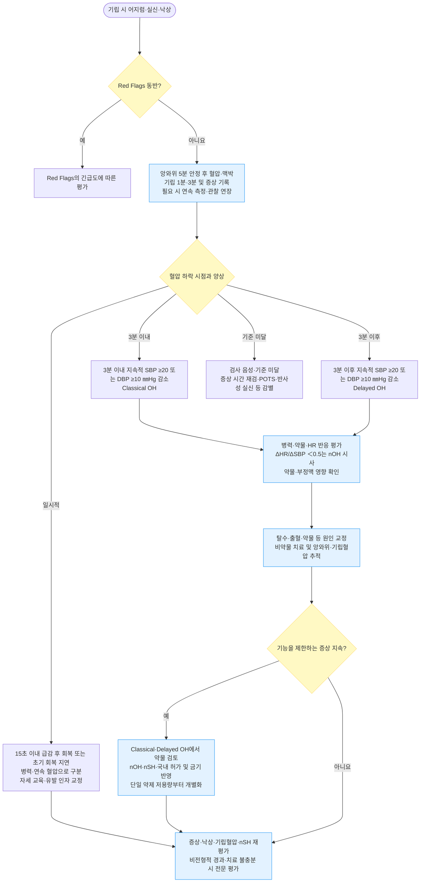

# 기립성 저혈압 Orthostatic Hypotension, OH

## <mark style="color:green;">일반 사항</mark>

* 진단 기준 : 5분 이상 앙와위 안정 후 기립 3분 이내에 지속적인 SBP ≥20 또는 DBP ≥10 ㎜Hg 감소; 기립 1분·3분에 측정하며 증상 유무와 관계없이 진단 가능. 좌위 검사는 대안이나 음성이라도 의심되면 앙와위에서 재검
* 어지럼·실신·시야 흐림 등의 증상이 동반될 수 있음
* 다른 이름 : 체위저혈압 (Postural hypotension)
* 유병률은 연령·진료 환경·측정법에 따라 다름; 지역사회 거주 60세 이상에서 약 20%, 장기요양 시설 입소자에서 약 25%로 보고됨 <mark style="color:$info;">\[Lancet Neurol 2022]</mark>
* 무증상인 경우가 흔함; OH는 MI·뇌졸중·심부전·심방세동 및 사망 위험 증가와 연관되지만, 이러한 연관성은 인과관계를 의미하지 않음

### <mark style="color:orange;">발생 시점에 따른 분류</mark>

<mark style="color:cyan;">**Initial OH**</mark>

* 기립 후 15초 이내 SBP ＞40 또는 DBP ＞20 ㎜Hg의 일시적 급감 후 대개 30\~60초 내 회복; 일반 커프 혈압계로 포착하기 어려우며 객관적 확인에는 active standing 중 연속 beat-to-beat 혈압 측정이 필요 <mark style="color:$info;">\[Lancet Neurol 2022]</mark>
* 청소년·젊은 성인에서 흔하나 임상적 의미는 제한적인 경우가 많음(대부분 양성 경과)
* 전형적인 병력과 양성 경과에서는 불필요한 검사 회피; 반복 실신·외상·비전형적 증상이나 심장성 실신 의심 소견이 있으면 추가 평가

<mark style="color:cyan;">**Delayed blood pressure recovery (혈압 회복 지연)**</mark>

* 기립 직후 낮아진 혈압이 약 30초에도 충분히 회복되지 않다가 3분 이내 회복하는 양상; 3분 이후 새롭게 발생하는 Delayed OH와 구분함
* 1분·3분 커프 측정만으로 놓칠 수 있어 즉시 발생하는 증상이나 설명되지 않는 낙상이 반복되면 연속 혈압 측정으로 평가할 수 있음 <mark style="color:$info;">\[Lancet Neurol 2022]</mark>

<mark style="color:cyan;">**Classical OH**</mark>

* 기립 후 3분 이내 지속적인 SBP ≥20 또는 DBP ≥10 ㎜Hg 감소로 OH 기준 충족
* 앙와위 고혈압에서는 높은 기저혈압으로 인한 과대진단을 줄이기 위해 SBP ≥30 ㎜Hg 감소 기준을 고려할 수 있음. 이는 모든 환자의 20/10 기준을 대체하는 것은 아니며, 30 ㎜Hg 미만 하락이라도 증상·기립 저혈압을 함께 평가 <mark style="color:$info;">\[AHA 2024]</mark>

<mark style="color:cyan;">**Delayed OH**</mark>

* 기립 3분 이후 새롭게 지속적인 SBP ≥20 또는 DBP ≥10 ㎜Hg 감소가 발생; 10분 이후에도 나타날 수 있음
* 일부에서 교감신경 기능장애의 초기 형태이며, 원인·경과에 따라 장기 추적 고려
* 3분 검사 음성이나 의심되면 5\~10분 이상 연장 측정; 필요 시 기립경사검사로 더 오래 관찰


**기립 시 맥박 반응으로 병인 추정**

• 혈압 하강 + HR 증가가 뚜렷함 → non-neurogenic OH 가능성이 높음. 단, β차단제·심방세동·서맥성 부정맥·심박동기 등 HR 반응 해석을 방해하는 요인을 확인\
• ΔHR은 기립 후 HR 증가량, ΔSBP는 앙와위 SBP에서 기립 SBP를 뺀 양의 혈압 감소량임\
• **ΔHR/ΔSBP ＜0.5 bpm/㎜Hg** → neurogenic OH를 강하게 시사; 단독 진단 기준은 아님\
• 단순한 경험적 기준으로 ΔHR ＜15 bpm은 neurogenic, ≥15 bpm은 non-neurogenic을 시사할 수 있으나 ΔHR/ΔSBP 비율이 더 유용함\
• 지속성 OH 없이 기립 10분 이내 HR ≥30 bpm(12\~19세 ≥40 bpm) 상승과 기립불내증이 있으면 [POTS](../221_/030_-autonomic-dysfunction.md) 의심. 확진에는 증상 ≥3개월 및 탈수·빈혈·갑상선항진증·약물 등 다른 빈맥 원인 배제가 필요


### <mark style="color:orange;">식후 저혈압 (Postprandial Hypotension)</mark>

* 정의가 완전히 표준화되지는 않았으나, 식후 2시간 이내에 SBP가 식전보다 ≥20 ㎜Hg 감소하는 경우가 흔히 사용되는 기준. 식전 SBP ≥100 ㎜Hg인 환자에서 식후 SBP ＜90 ㎜Hg로 떨어지는 경우도 임상적으로 중요
* 흔히 식후 30\~90분에 가장 뚜렷하지만 2시간까지 발생할 수 있음
* 추정 기전 : 식후 내장 혈류 증가와 정맥 저류에 대한 교감신경 보상이 불충분하고, insulin 또는 vasoactive gastrointestinal peptide 등에 의한 혈관 확장이 더해져 발생
* 고령자, 고혈압, 당뇨병, Parkinson병·MSA·PAF 등 자율신경기능장애, 고탄수화물 식사 후에 흔함
* 임상 양상 : 식후 어지럼, 졸림, 쇠약, 전실신·실신, 낙상 또는 협심증·일과성 신경학적 증상 악화
* 삼킴·식도 자극과 동시에 발생하는 상황성 반사 실신과 달리, 식후 일정 시간이 지나면서 혈압 감소가 확인됨(☞ [반사성 실신](../221_/022_-reflex-syncope-neurally-mediated-syncope.md))

## <mark style="color:green;">원인</mark>

<mark style="color:cyan;">**Neurogenic OH (nOH)**</mark>

* 원발성 또는 이차성 자율신경 부전에 의한 기립성 저혈압 - Baroreceptor reflex arc의 efferent sympathetic pathway가 손상되어 기립 시 보상성 혈관 수축이 충분히 일어나지 않음
* 원인
  * 원발성 : 순수자율신경부전(PAF), 다발계통위축(MSA), Parkinson병 등 Lewy소체 질환
  * 이차성 : 당뇨병성 신경병증, 아밀로이드증, 자가면역 신경병증
* 약 50%에서 neurogenic supine hypertension 동반 - 5분 이상 앙와위 후 SBP ≥140 ㎜Hg 또는 DBP ≥90 ㎜Hg (Autonomic Society 기준); 기립성 저혈압과 야간 고혈압이 공존하는 치료적 딜레마 상태

<mark style="color:cyan;">**Non-neurogenic OH**</mark>

* 혈량·심박출량 부족 또는 정맥 저류·약물 작용이 주요 원인; 노화·당뇨병 등의 자율신경 기능 저하와 복합적으로 작용할 수 있음
* 원인
  * 혈액량 감소 (Hypovolemia) : 수분 섭취 부족, 출혈, 발열, 심한 설사·구토, 과도한 발한, 이뇨제 과다 사용 (배뇨·배변 관련 반사성 실신과는 구분)
  * 정맥 저류 증가 : 음주, 식사(→ 식후 저혈압), 격렬한 운동, 기온 상승, 장기간 와상·기립, 패혈증, 임신
  * 심장 기능 이상 : 서맥(동기능 부전, 방실 차단), 심장 판막 질환, 심부전, 심근경색
  * 약물 : 항고혈압제(특히 α1-차단제·이뇨제), β차단제, nitrate, 일부 CCB·ACEi·ARB, PDE-5 억제제, 진정제·수면제, 항우울제·항정신병제, opioid, 항파킨슨병제(levodopa, dopamine agonist), 알코올
  * 기타 : 노화(압반사 기능 저하), 신체 탈조건화, 빈혈, 부신기능저하 등; 긴장·통증·배뇨·배변과 관련된 반사성 실신은 별도로 감별함
* 임상에서 가장 흔한 유형이며, 원인 교정만으로 호전되는 경우가 많음
* nOH와의 감별에는 기립 시 HR 보상 반응이 유용하나, 약물·부정맥 등으로 HR 반응이 제한될 수 있어 단독 기준으로 사용하지 않음

## <mark style="color:green;">임상 양상</mark>

* 전형적 증상 : 기립 시 어지럼·현기증, 힘없음, 불안정감, 두근거림, 떨림, 구역
* 뇌·망막 저관류 증상 : 시야 흐림·눈앞이 캄캄함, 집중력 저하, 청각 둔화; 목·어깨의 옷걸이 모양 통증(coat-hanger pain)이 동반될 수 있음
* 뚜렷한 발한·오심·두근거림은 반사성 실신이나 POTS에서도 흔하므로 OH에 특이적인 증상으로 해석하지 않음
* 중증 증상 : 인지 장애(일시적 혼돈), 실신·낙상·골절; 특히 nOH에서는 저혈압을 인지하지 못하여 어지럼 없이 낙상·보행 악화만 나타날 수 있음
* 증상은 기상 직후 아침에 가장 심하고, 식후·더운 환경·운동 후에 악화됨

## <mark style="color:$danger;">🚩 Red Flags!</mark>

<mark style="color:$danger;">**즉각 조치**</mark>

* 실신·전실신에 흉통·호흡곤란 또는 급성 허혈성 심전도 변화 동반 → 응급 평가·이송  `급성 관상동맥증후군·폐색전증`
* 운동 중 또는 누운 자세에서 실신, 실신 직전 갑작스러운 심계항진, 중증 구조적 심질환과 실신 동반 → 심장성 원인에 대한 응급 평가  `심장성 실신`
* 실신 후 의식 회복 지연, 지속적인 국소 신경학적 이상 또는 지속적 경련 → 응급 평가·이송  `뇌졸중·발작`
* 급성 출혈·심한 탈수·감염과 함께 저혈압·말초관류 저하 등 쇼크 소견 → 원인 평가와 소생술, 응급 이송  `출혈성·저혈량성·패혈성 쇼크`
* 실신과 연관된 고도 방실차단·중증 서맥·심실성 부정맥, 또는 심한 두통·흉통·호흡곤란·신경학적 이상을 동반한 혈압 상승 → 응급 평가·이송  `위험 부정맥·고혈압 응급증`

<mark style="color:$warning;">**당일~수일 내 평가**</mark>

* 항고혈압제·α1-차단제·이뇨제 시작 또는 증량 후 반복 실신·낙상 → 당일 약물·체액 상태 평가  `약물 관련 OH`
* 새로 확인된 QT 연장·전도 장애 또는 설명되지 않는 반복 실신이 있으나 현재 안정적임 → 당일 심전도·심장성 원인 평가  `부정맥 의심`
* 앙와위 SBP ≥180 또는 DBP ≥110 ㎜Hg가 반복되나 급성 장기손상 증상은 없음 → 당일 승압제·야간 혈압·치료 조정 평가  `중증 앙와위 고혈압`
* 빠르게 진행하는 OH에 요저류·심한 위장관 운동장애·광범위 발한 이상 등 새 자율신경 증상 동반 → 수일 내 전문 평가  `진행성 자율신경부전`

<mark style="color:$info;">**조기 평가 및 추적**</mark>

* 비약물 치료와 유발 약물 조정에도 증상 지속 → 원인·치료 재평가; 반복 실신·낙상이 있으면 위 긴급도에 따라 평가  `지속성 OH`
* 파킨슨 증상·소뇌 실조·감각 이상·배뇨 장애 동반 → 신경학적·자율신경 평가  `신경퇴행성 질환·말초신경병증`
* 젊은 환자에서 원인 불명의 지속성 OH → 초기형 OH·POTS·내분비질환 등 감별  `이차성 OH`
* 당뇨병 환자에서 nOH 의심 → 자율신경 기능과 당뇨병 관리 평가  `당뇨병성 자율신경병증`

## <mark style="color:green;">진단</mark>

### <mark style="color:orange;">Active Standing Test (기본 진단 방법)</mark>

1. 앙와위에서 5분 이상 안정 후 혈압·맥박 측정(필요 시 배뇨 후 시행); 같은 팔·적절한 커프를 사용하고 기립 시에도 팔을 심장 높이로 지지함. 낙상 위험이 있으면 검사자가 곁에서 보조함; 좌위 검사가 음성이어도 의심되면 앙와위에서 재검
2. 기립 후 아래 시점에서 혈압·맥박과 증상을 함께 기록함. 1분에 이미 지속성 OH 기준을 충족하면 3분까지 기다려야만 진단할 수 있는 것은 아님

<table><thead><tr><th width="167.6190185546875">측정 시점</th><th width="170.47625732421875">임상적 의미</th><th>비고</th></tr></thead><tbody><tr><td>기립 직후(≤15초)</td><td>Initial OH 평가</td><td>SBP ＞40 또는 DBP ＞20 감소 후 빠른 회복; 일반 커프 측정으로 확인하기 어려워 필요 시 연속 beat-to-beat 측정</td></tr><tr><td>약 30초(선택)</td><td>혈압 회복 지연 평가</td><td>가능하면 연속 혈압 측정; 단일 커프 측정으로 초기형·회복 지연을 배제할 수 없음</td></tr><tr><td>1분</td><td>초기 혈압 적응 평가</td><td>Classical OH 조기 발견</td></tr><tr><td>3분</td><td>Classical OH 확인</td><td>SBP ≥20 또는 DBP ≥10 감소 시 진단</td></tr><tr><td>5~10분 이상</td><td>Delayed OH 평가</td><td>3분 정상이나 증상 지속 시 연장; 필요 시 기립경사검사로 더 오래 관찰</td></tr></tbody></table>

* 검사 음성이라도 전형적 병력이 있으면 아침·증상 발생 시간·식후에 반복하거나 가정혈압·ABPM과 자세·증상 일지를 활용함. ABPM만으로 초기형 OH를 확진하거나 배제하지 않음
* 혈압 하강이 확인되어도 실신의 유일한 원인으로 단정하지 않으며, 운동 중·앙와위 실신 등 심장성 위험 소견을 따로 평가함


**진단 시 주의** : 고혈압 환자에서 OH가 발견되었다고 강압제를 자동으로 감량·중단하지 않음. 무증상 OH만으로 강압 치료를 보류하지 않으며, 증상성 OH·낙상 위험·실제 기립혈압·약물 시작 또는 증량과의 시간적 관계를 평가하여 개별화함 <mark style="color:$info;">\[2025 AHA/ACC]</mark>. 증상성 OH에서는 더 완화된 목표를 고려할 수 있음 <mark style="color:$info;">\[2024 ESC]</mark>.


### <mark style="color:orange;">Neurogenic vs. Non-neurogenic OH 감별</mark>

<table><thead><tr><th width="187.142822265625">특징</th><th width="210">Neurogenic OH</th><th>Non-neurogenic OH</th></tr></thead><tbody><tr><td>기립 시 HR 증가</td><td>감소 또는 부적절하게 작음</td><td>대체로 뚜렷함</td></tr><tr><td>ΔHR/ΔSBP</td><td>＜0.5 bpm/㎜Hg가 강하게 시사</td><td>≥0.5 bpm/㎜Hg가 시사</td></tr><tr><td>주요 원인</td><td>자율신경 부전(파킨슨병, MSA, PAF, 당뇨 신경병증)</td><td>탈수, 약물, 심장 질환</td></tr><tr><td>발한</td><td>감소·분포 이상이 가능하나 정상일 수도 있음</td><td>대체로 보존됨</td></tr><tr><td>Supine hypertension</td><td>흔함 (약 50%)</td><td>기저 고혈압에 동반될 수 있음; nOH에 특이적인 소견은 아님</td></tr><tr><td>약물 원칙</td><td>비약물 치료 후 Midodrine/Droxidopa 등 개별화</td><td>원인 교정이 우선; 필요 시 약물 고려</td></tr></tbody></table>

### <mark style="color:orange;">검사</mark>

* 기본 평가 : 복용약·출혈·체액 상태·심장 및 신경학적 진찰, CBC(빈혈), 혈당, 전해질, BUN/Cr
* 선택 검사 : 임상 소견에 따라 TSH, vitamin B12, 부신기능 평가 등을 추가함; 모든 환자에게 일괄 호르몬·자가면역 검사를 시행하지 않음
* ECG : 실신·반복 전실신 또는 심장성 원인 의심 시 시행하여 서맥·전도 장애·QT 연장 확인; 간헐적 부정맥 의심 시 발생 빈도에 맞춰 Holter 또는 장기 심전도 감시를 선택함
* 심초음파 : 심잡음, 구조적 심질환 병력·소견, 심장성 실신 의심 등 임상적 적응증이 있는 경우 선택적으로 시행
* 자율신경 기능검사 : nOH가 의심되거나 진단이 불명확하고 치료 결정에 도움이 될 때 선택적으로 시행
  * 심호흡 시 HR 변동 등 심혈관 자율신경 반사검사(단순한 웨어러블 HRV 수치와 구분)
  * Sudomotor function(발한 기능)
  * Tilt-table test : 일반 커프 검사가 음성이나 지연형 OH가 의심되거나 안전한 능동 기립이 어려운 경우에 유용함. 초기형 OH 확인에는 수동 경사보다 능동 기립 중 연속 혈압 측정이 필요함 <mark style="color:$info;">\[EFAS/AAS/EAN 2021]</mark>
  * Valsalva response
* 모든 환자에게 자율신경검사를 일률적으로 시행하지 않으며, 식사·온수 목욕·운동은 병력상 유발 상황을 확인하는 데 활용

### <mark style="color:orange;">식후 저혈압 평가</mark>

* 식사와 증상의 시간적 관계, 식사량·탄수화물 비중·음주, 식후 자세·활동 및 복용약 시간을 확인
* 증상이 반복되면 5분 이상 안정한 상태에서 식전 혈압·맥박을 측정하고, 동일한 식사 후 30·60·90·120분에 반복 측정
* 측정 중 어지럼·졸림·전실신 등 증상과 자세를 함께 기록하여 혈압 감소와 증상의 연관성을 확인
* 진료실 검사로 포착되지 않거나 야간·기립 혈압 변동이 함께 의심되면 식사·증상 일지를 병행한 24시간 활동혈압 모니터링(ABPM) 고려
* 식후 증상만으로 진단하지 말고 저혈당, 부정맥, 약물 부작용 및 삼킴 실신 등 반사성 실신을 감별

### <mark style="color:orange;">감별</mark>

<table><thead><tr><th width="196.19049072265625">감별 질환</th><th width="404.761962890625">감별 포인트</th><th>추가 평가·참고</th></tr></thead><tbody><tr><td>반사성 실신 (미주신경성)</td><td>오래 서 있기·통증·공포 등이 유발; 오심·발한·열감 후 비교적 갑작스러운 혈압·맥박 감소가 나타날 수 있음</td><td>(☞ <a href="../221_/022_-reflex-syncope-neurally-mediated-syncope.md">반사성 실신</a>)</td></tr><tr><td>POTS</td><td>기립 10분 내 HR ≥30 bpm(12~19세 ≥40)의 지속적 상승; 지속성 OH 없음; 증상 ≥3개월 및 다른 빈맥 원인 배제</td><td>신경과 협진</td></tr><tr><td>Initial OH</td><td>기립 15초 이내 급감 후 자연 회복; 일반적인 측정으로 놓칠 수 있음</td><td>전형적 병력 확인; 필요 시 연속 beat-to-beat 측정</td></tr><tr><td>심장성 어지럼·실신</td><td>서맥/빈맥, ECG 이상 동반</td><td>의뢰</td></tr><tr><td>전정계 어지럼 (BPPV 등)</td><td>회전성 어지럼, 체위 변환 시 유발; 혈압 변화 없음</td><td>(☞ 어지럼증(020장))</td></tr><tr><td>저혈당</td><td>공복 또는 인슐린 사용 중; 혈당 측정으로 감별</td><td>혈당 측정</td></tr></tbody></table>

***



<p align="center"><strong>기립성 저혈압 진단 및 관리 알고리듬</strong></p>

***

## <mark style="background-color:$warning;">Management</mark>

### <mark style="color:orange;">치료 방침</mark>

* 치료 목표 : 증상·기립 내성·일상 기능 개선과 실신·낙상 감소. OH 약물 치료가 심혈관 사건·사망을 예방하는지는 확립되지 않음. 원인 교정·비약물 치료를 우선하되, 반복 실신·낙상 등 중증 증상에서는 약물 치료를 함께 검토함
* 급성 증상 발생 시 : **즉시 앉거나 눕고** 가능하면 다리를 올려 낙상을 예방함. 안전하게 앉거나 누운 뒤 의식이 명료하고 삼킬 수 있으며 수분 제한이 없는 경우 물 약 500 ㎖를 2\~5분에 걸쳐 마시는 방법을 고려할 수 있음.
* 기저 질환 치료 : 당뇨병(혈당 조절), 파킨슨병, 심장 질환, 빈혈
* 복용 중인 모든 약물 검토 - 유발 또는 악화 약물을 최소화하거나 대체. α1-차단제(전립선 치료제 포함), β차단제·중추성 교감신경 억제제·이뇨제 및 비강압제 유발 약물을 우선 검토하되, 필수 심혈관 치료를 일률적으로 중단하지 않음
* 혈압 모니터링 : 앙와위·좌위·기립 자세와 취침 전 등 다양한 상황에서 측정. 식후 증상이 의심되면 식전 및 식후 30·60·90·120분에 측정
* 고혈압 치료 환자 : OH만으로 강압제를 일률적으로 감량하지 않음. 비강압제 유발 약물·탈수 등을 먼저 교정하고 증상·낙상 위험·기립 및 좌위/앙와위 혈압을 함께 보아 개별화 <mark style="color:$info;">\[AHA 2024; ESC 2024]</mark>

### <mark style="color:orange;">Supine Hypertension 관리 (nOH 환자)</mark>

* nOH 환자의 약 50%에서 동반
* OH 치료와 상충되므로 개별화된 접근 필요; 아래 혈압 범주는 nSH의 중증도 분류이며, 약물 개시의 절대 기준은 아님. 특히 160~179/100~109 ㎜Hg에서는 장기손상 위험과 기립 시 혈압 하강 정도를 함께 판단함
* 낮에는 장시간 편평하게 눕는 것을 피하고 승압제 투여 시간·필요성을 재검토함
* 24시간 활동혈압 모니터링(ABPM)으로 야간 혈압 패턴을 평가하면 치료 조정에 유용

<table><thead><tr><th width="210">앙와위 BP</th><th>관리</th></tr></thead><tbody><tr><td>SBP 140~159 또는 DBP 90~99 ㎜Hg</td><td>내약 범위에서 침상 머리 올림(아래 자세·행동 교정 참조), pressor 약물의 늦은 시간 복용 회피, 경과 관찰</td></tr><tr><td>SBP 160~179 또는 DBP 100~109 ㎜Hg</td><td>침상 머리 올림, 야간 BP·ABPM 확인; 증상과 nOH 중증도에 따라 개별화</td></tr><tr><td>SBP ≥180 또는 DBP ≥110 ㎜Hg</td><td>자율신경 전문 진료를 고려하고, 필요 시 취침 전 단시간 작용 항고혈압제를 선택적으로 사용. 장시간 작용 약물로 아침 OH를 악화시키지 않도록 주의</td></tr></tbody></table>

* SBP와 DBP가 다른 범주이면 높은 범주 적용; 급성 장기손상 의심 증상은 Red Flags에 따라 평가함
* 밤중에 일어설 때 저혈압·낙상 위험을 안내하고, 취침 전 약물 조정 후 아침 기립혈압 재평가

## <mark style="color:green;">비-약물 치료 및 예방</mark>

### <mark style="color:orange;">자세·행동 교정</mark>

* 천천히 일어남 (특히 아침 기상 시) : 수 분간 앉아 있은 후 기립; 지지가 될 가구·벽체를 잡고 일어남; 누운 상태에서 가벼운 운동 후 기립
* [Counter-pressure maneuver](../221_/022_-reflex-syncope-neurally-mediated-syncope.md) (기립 직전·직후 시행) - 하지 정맥 환류를 증가시켜 즉각적 혈압 유지에 효과적 : 하지·둔부 등척성 수축, 발목 펌핑, 지지물을 잡은 다리 꼬기 등을 교육함. 균형 장애가 있으면 서서 다리 꼬기·쪼그려 앉기를 피하고, 전실신 시에는 동작을 시도하느라 지체하지 말고 안전하게 앉거나 누움
* 취침 시 베개만 높이기보다 침상 머리 쪽을 약 15\~23 ㎝ 올리는 방법부터 내약성·침상 안전성에 따라 개별화함. 기울임 각도와 머리 쪽 상승 높이(㎝)를 구분함
* 침상 기울임의 효과를 단정하지 않음. 2026년 PD/MSA 및 OH·nSH 동반 환자 20명의 Heads-Up 시험에서는 기립 내성 등이 개선되었으나 **평균 야간 SBP 감소는 확인되지 않았고**, 큰 경사에서는 불편감·미끄러짐이 증가함. 모든 환자에게 10\~20° 경사를 일률적으로 권하지 않음 <mark style="color:$info;">\[npj Parkinsons Dis 2026]</mark>

### <mark style="color:orange;">환경·식이 관리</mark>

* 더운 환경 회피 (목욕탕, 찜질방, 더운 날씨의 야외 운동)
* 수분 제한이 없는 경우 하루 약 2.0\~2.5 L의 수분 섭취를 고려. 물 약 500 ㎖를 2\~5분에 걸쳐 마시면 수분 부하와 별개로 일시적인 승압 반응이 나타날 수 있으나 개인차가 크며, 수분 제한·연하 곤란·nSH를 함께 고려함
* 염분 증량은 모든 환자에게 일률적으로 권하지 않으며, 혈압이 낮고 체액·염분 제한이 없는 환자에서 음식에 포함된 양까지 합한 **하루 총 식염 6\~10 g** 정도를 선택적으로 고려(나트륨 약 2.4\~4.0 g; 추가로 이만큼 섭취하라는 의미가 아님). 고혈압·앙와위 고혈압·심부전·CKD에서는 저염 치료와 상충할 수 있어 임의 증량하지 않고 개별화
* 과음 회피. 카페인은 효과가 일관되지 않아 routine 권고하지 않음
* 복대(abdominal binder)를 우선 고려하고, 필요 시 복부까지 포함하는 허리 높이 압박 스타킹(보통 30\~40 ㎜Hg)을 선택함. 무릎 높이 제품의 효과는 제한적이며 허벅지 높이 제품만으로 복부 압박을 대체하지 않음. 압박의 목적은 정맥 저류 감소이며 하지 부종 자체의 치료 목적은 아님

### <mark style="color:orange;">운동</mark>

* 종아리 근육 강화 운동 (발목 펌핑)
* 운동은 비기립 자세를 우선 권고 : recumbent bicycle·rowing 등 유산소 운동과 앉아서 하는 근력 운동을 선택함. 수중 운동은 수압으로 증상이 덜할 수 있으나 물 밖으로 나올 때 혈압이 떨어질 수 있어 보조를 받으며, 실신 위험이 있으면 혼자 수영하지 않음
* 지상 운동(달리기, 빠른 걷기)은 증상이 충분히 조절된 후 단계적으로 도입

### <mark style="color:orange;">식후 저혈압 예방</mark>

* 한 번에 많이 먹지 않고 소량씩 자주 식사하며, 고탄수화물·고혈당지수 식사와 과식을 피함
* 심부전·CKD 등 수분 제한이 없으면 식전 물 약 500 ㎖를 2\~5분에 걸쳐 마시는 방법을 고려
* 식사 중·식후 음주를 피하고, 식후 혈압이 떨어지는 시간에는 갑자기 일어서지 않음
* 증상이 발생하는 시간 동안 앉거나 상체를 올린 자세로 쉬고, nSH가 있으면 편평하게 눕는 것을 피함; 전실신 시에는 낙상 예방을 위해 안전하게 앉거나 누운 후 재평가함
* 카페인의 효과는 일관되지 않으므로 routine 권고하지 않으며, 수면·부정맥·혈압을 고려하여 오전에 제한적으로 고려
* 비약물 치료에도 실신·낙상이 반복되는 중증 자율신경부전 환자에서는 전문 진료하에 약물 치료를 고려

## <mark style="color:green;">약물 치료</mark>

* 아래 용법은 성인 기준임

* 원인 교정·비약물 치료에도 일상 기능을 제한하는 증상 또는 반복 실신·낙상이 있는 경우 고려함. 무증상 혈압 하강 수치만으로 승압제를 시작하지 않으며, 단일 약제를 낮은 용량부터 조정함
* 국제 문헌에서 nOH의 주요 약제는 Midodrine·Droxidopa임. 국내에서는 Midodrine의 허가·금기를 따르고, Droxidopa는 긴급도입 공급 범위·용법을 구분함. Fludrocortisone은 선별 환자의 후순위·보조요법임
* 2025년 CONFORM-OH는 13명만 무작위 배정된 내부 예비시험 단계에서 종료되어 약제 간 우열이나 장기 예후 효과를 확정하지 못함 <mark style="color:$info;">\[Pilot Feasibility Stud 2025]</mark>

#### <mark style="color:$primary;">Midodrine</mark>

* nOH 1차 선택제 (비신경성 OH에도 사용)
* 기전 : 활성 대사체 desglymidodrine이 말초 선택적 α1 수용체를 자극 → 혈관 저항 증가; 중추신경계 작용은 제한적임
* 부작용 : supine hypertension, 소름(piloerection), 가려움, 요저류, 위장 장애, 반사성 서맥
* 국내 허가사항상 금기 : 고혈압, 심한 심질환, 급성 신장염, 갑상선기능항진증, 갈색세포종, 폐쇄각 녹내장, 혈관경련·혈관폐색, 배뇨장애(특히 전립선종), 빈맥성 부정맥
* 신중 투여 : 심한 신장애, 부정맥; 신 기능·배뇨 및 앙와위·기립혈압 확인
* 국제 nOH 문헌에는 nSH 동반 시 전문적으로 용량·시각을 조절한 사용이 제시되나, 국내의 고혈압 금기와 구분하며 nSH 환자의 일반 외래 처방으로 적용하지 않음
* 국내 허가사항 용법 : 성인 1회 2.5 ㎎(2.5 ㎎정 1정), 1일 2\~3회 경구투여; 연령·증상에 따라 증감함. 장기치료 시 최소 유효량 사용. 누운 자세 고혈압 위험을 줄이기 위해 늦어도 취침 4시간 전 복용을 마치며, 복용 후 약효가 지속되는 동안 장시간 편평하게 눕지 않음 <mark style="color:blue;">\[미드론]</mark>

#### <mark style="color:$primary;">Droxidopa</mark>

* 기전 : norepinephrine 전구물질; 국제 문헌에서 증상성 nOH의 주요 치료약으로 사용함
* **국내 공급** : 한국희귀필수의약품센터의 긴급도입품목 <mark style="color:blue;">\[돕스오디정 100 ㎎]</mark>이 비급여로 공급됨; 대상 질환과 공급 절차는 일반 허가약과 구분함
* 국내 공급 자료의 대상은 파킨슨병에서 보행동결·기립 시 현기증 개선임 <mark style="color:$info;">\[삼성서울병원 약제부 공급 안내]</mark>. 공급 용법은 **100 ㎎ qd 시작 → 격일로 하루 총량 100 ㎎씩 증량, 최대 900 ㎎/d**로 안내되어 있으며, 실제 도입품의 공급 조건·첨부문서에 맞춰 전문 진료하에 사용함
* **미국 nOH 허가 용법과 구분** : 100 ㎎ tid 시작, 반응에 따라 증량하여 최대 600 ㎎ tid(1,800 ㎎/d); 마지막 투여는 취침 최소 3시간 전으로 함. 이 용법을 국내 긴급도입품의 용법으로 옮겨 적용하지 않음
* 앙와위 고혈압, 허혈성 심질환·부정맥·심부전 악화 가능성에 주의함. 미국 허가문서상 2주를 넘는 유효성이 확립되지 않았으므로 지속 효과를 주기적으로 평가함 <mark style="color:$info;">\[DailyMed]</mark>

#### <mark style="color:$primary;">Fludrocortisone</mark>

* 수분·염분 보충 후에도 증상이 지속되는 선별된 만성 OH에서 고려할 수 있으나, 급성 출혈·탈수 교정을 대체하지 않음. **장기 근거가 제한적**이고 부종·supine hypertension·저칼륨혈증·심부전 악화 위험이 있어 nOH의 routine 1차제로는 후순위
* 기전 : 합성 mineralocorticoid → 신장 Na 재흡수 증가 → 혈장 용량 확장
* 부작용 : supine hypertension, 저칼륨혈증, 부종, 두통, 심부전 악화
  * 시작 전 및 시작·증량 후 초기에 혈중 K·Cr, 앙와위·기립혈압·체중을 확인하고 이후 정기 추적함; 저칼륨혈증은 식이 또는 K 보충을 임의로 시행하지 말고 검사 결과에 따라 조정
  * 급격한 체중 증가, 부종, 호흡곤란은 체액 과다·심부전 악화 가능성이 있으므로 감량 또는 중단을 검토
* OH 치료 목적에서 심부전 동반 시 사용을 피함 <mark style="color:$info;">\[AHA 2024]</mark>. CKD·저칼륨혈증·supine hypertension에서는 위험을 면밀히 평가. 국내 허가 적응증은 부신피질 기능부전 관련 질환이며 **OH 치료는 허가 적응증 외 사용**
* 용법 : 일반적으로 0.05\~0.1 ㎎ qd로 시작하여 반응에 따라 최대 0.2 ㎎/d까지 개별화함. 0.2 ㎎/d 초과는 추가 이득 없이 부작용 위험이 증가할 수 있어 권하지 않음; OH에 대한 허가 외 용량임 <mark style="color:blue;">\[플로리네프]</mark>

* 보관 : 국내 플로리네프정은 **2\~8℃ 냉장 보관** 제제임; 허가문서상 25℃에서 최대 30일 보관 가능하며, 실온 보관한 약을 다시 냉장하지 않고 30일 경과 후 남은 약은 폐기함

#### <mark style="color:$primary;">Pyridostigmine</mark>

* 기전 : acetylcholinesterase 억제로 자율신경절의 콜린성 전달을 강화 → 잔여 교감신경 반응을 이용하여 기립혈압 개선
* 특징 : supine hypertension을 상대적으로 덜 악화시키는 것으로 알려져 있어 nOH + 앙와위 고혈압에서 선택적 보조요법으로 고려
* 부작용 : 콜린성 증상(침·기관지 분비 증가, 발한, 설사·복통, 근경련·섬유성연축, 서맥)
* 국내 허가사항상 금기 : 기질적 소화기·요로 폐색/협착/경련, 기관지천식·경련성 기관지염, 파킨슨증후군, 갑상선기능항진증 등. 서맥·부정맥·신 기능 저하에서도 주의; Parkinson병 관련 nOH에 일반적인 대안으로 제시하지 않음
* 국내 허가 적응증은 중증근무력증이며 **OH 치료는 허가 적응증 외 사용**. 연구에서는 30\~60 ㎎ bid\~tid 범위가 사용됨; 국내 메스티논은 60 ㎎정으로, 1회 30 ㎎ 투여 시 ½정에 해당 <mark style="color:blue;">\[메스티논]</mark>

* 효과는 제한적이며 잔여 자율신경 기능에 따라 다름; 38명 자료의 후향 분석에서 중증 자율신경부전·nSH 동반군의 효과가 제한적이었으므로 nSH 여부만으로 자동 선택하지 않음 <mark style="color:$info;">\[Hypertension 2025]</mark>

#### <mark style="color:$primary;">Octreotide</mark>

* 기전 : somatostatin analogue → gastrointestinal peptide 분비 억제 → 내장 혈관 확장 억제
* 생활요법에도 중증 식후 저혈압이 반복되는 자율신경부전 환자에서 전문적으로 고려하며 routine 외래 치료로 사용하지 않음
* 부작용 : 구역, 복통, 설사, 서맥, 고혈당·저혈당, 담석 및 앙와위 고혈압 악화 가능
* 국내 허가 적응증은 식후 저혈압이 아니므로 **허가 적응증 외 사용**. 전문 진료하에 주 식사 전 저용량 피하 투여를 고려할 수 있으나, 국내 제제의 허가사항·제형을 확인하여 사용 <mark style="color:blue;">\[산도스타틴 주]</mark>
* 당뇨병, 특히 당뇨병성 위마비가 있으면 혈당 변동·위장관 부작용 때문에 식후 저혈압 치료제로 일반적으로 권하지 않음. 혈당·맥박·앙와위 혈압을 추적하고 장기 사용 시 담낭 이상을 확인함 <mark style="color:$info;">\[J Neural Transm 2017]</mark>

### <mark style="color:orange;">기타 약물</mark>

* Acarbose : 생활요법에도 식후 저혈압이 지속되는 선택된 자율신경부전·당뇨병 환자에서 전문적으로 고려 가능; 소규모 시험에서 식후 혈압 하락 감소가 보고됨. 식후 저혈압 치료는 허가 외 사용이며 복부팽만·설사 등 내약성 및 당뇨병 치료와 함께 판단 <mark style="color:$info;">\[Hypertension 2007; J Investig Med 2017]</mark>

* Desmopressin(dDAVP) : OH 치료는 허가 외 사용이며, 저나트륨혈증·수분 저류·앙와위 고혈압 악화 위험 때문에 routine 사용을 권하지 않음. 야간 다뇨가 뚜렷한 일부 환자에서만 전문적으로 검토하며, OH의 수분 증량 교육을 그대로 병행해서는 안 됨
* Atomoxetine : OH 치료는 허가 외 사용임. 단회 승압 반응과 달리 2024년 40명 무작위 교차시험에서 2주·4주 증상 개선이 위약보다 우월하지 않아 routine 처방을 권하지 않음 <mark style="color:$info;">\[Clin Auton Res 2024]</mark>
* NSAID, ephedrine/pseudoephedrine, yohimbine, fluoxetine 등은 제한된 연구 또는 부작용 문제로 **routine OH 치료약으로 권하지 않음**

***

## <mark style="color:green;">시술 및 기타 처치</mark>

* 기립성 저혈압 자체에 routine 시술 적응증은 없음. 심박동기 등은 확인된 원인 부정맥의 별도 적응증에 따라 판단함

***

### <mark style="color:red;">질병코드</mark>

I95.1 기립성 저혈압 Orthostatic hypotension

### <mark style="color:orange;">국내 허가·보험 적용</mark>

* Midodrine : 국내 허가 적응증은 저혈압(기립성·본태성·증후성)임. 고혈압·배뇨장애 등 국내 금기를 우선 적용함
* Fludrocortisone·Pyridostigmine의 OH 치료, Octreotide·Acarbose의 식후 저혈압 치료는 허가 적응증 외 사용임. 약제의 급여 등재와 해당 허가 외 처방의 급여 인정은 별개이며, 허가초과 사용 절차·인정 범위와 환자 비용 부담을 구분함
* Droxidopa : 긴급도입 공급품이며 비급여 공급·병원 사용 자료가 확인됨. 미국 FDA의 nOH 적응증이 국내 급여 적응증을 의미하지 않음

***

## <mark style="color:purple;">처방례</mark>

> **처방례 1. 증상이 뚜렷한 기립성 저혈압 - Midodrine**
>
> ```
> 미드론 2.5 ㎎/T　　2T　#2 (아침, 점심)
> ```
>
> _✽ 원인 교정 및 비약물 치료에도 증상이 지속되는 경우 고려. 국내 허가 용량으로 시작하며 고혈압·배뇨장애 등 금기가 없어야 함. 늦어도 취침 4시간 전 복용을 종료함. 앙와위·기립 혈압과 요저류 여부를 추적._

> **처방례 2. 보충·원인 교정 후에도 지속되는 만성 OH - Fludrocortisone 선택적 사용**
>
> ```
> 플로리네프 0.1 ㎎/T　　1T　qd
> ```
>
> _✽ 수분·염분 보충이 가능한 환자에서 체액 감소가 지속되고 다른 원인 교정만으로 불충분하며 심부전이 없는 선별 환자에서 전문적으로 고려. 국내에서는 OH가 허가 적응증 외 사용이므로 허가초과 사용 절차·비용 부담 및 부작용을 확인함. 부종·저칼륨혈증·앙와위 혈압 상승·심부전 악화를 모니터링._

> **처방례 3. Neurogenic OH - Midodrine**
>
> ```
> 미드론 2.5 ㎎/T　　1회 2T (5 ㎎)　bid (아침, 점심)
> ```
>
> _✽ 국내 금기가 없는 환자에서 1회 2.5 ㎎으로 시작 후 증상이 지속될 때 증량한 예. nOH라는 이유만으로 처음부터 고용량을 사용하지 않음. 취침 4시간 전까지 투여를 마치고 앙와위·기립혈압·배뇨를 추적; nSH 발생 시 재평가._

> **처방례 4. Neurogenic OH + Supine Hypertension - Pyridostigmine 선택적 사용**
>
> ```
> 메스티논 60 ㎎/T　　1회 ½T (30 ㎎)　bid (아침, 점심)
> ```
>
> _✽ 파킨슨증후군·천식·기질적 장/요로 폐색 등 국내 금기가 없는 선별 환자에서 전문적으로 고려하는 보조요법; nSH가 있다는 이유만으로 선택하지 않음. OH는 허가 외 사용. 효과·서맥·복통·설사·발한을 평가._

> **처방례 5. 중증 식후 저혈압 - Octreotide 저용량 시작 예(전문치료)**
>
> ```
> 산도스타틴주사 0.1 ㎎/㎖ (1 ㎖/앰플)
> 　　1회 0.25 ㎖ (25 ㎍)　주 식사 전 SC (전문의 지시)
> ```
>
> _✽ 생활요법에도 반복적인 실신·낙상이 발생하는 중증 자율신경부전의 식후 저혈압에서 전문 진료하에 고려. 국내 허가 적응증 외 사용이므로 제제 허가사항과 급여 여부를 확인하고, 단회 저용량으로 혈압·혈당 반응을 평가한 후 조정함. 당뇨병, 특히 당뇨병성 위마비 환자에서는 일반적으로 회피함; 미사용 잔액은 폐기하며 혈당·맥박·앙와위 혈압을 추적함._

### <mark style="color:$success;">핵심 복약 지도</mark>

> **Midodrine (미드론)**
>
> * 혈관을 수축시켜 일어설 때 혈압이 떨어지는 것을 줄이는 약입니다.
> * **늦어도 취침 4시간 전에는 복용을 마치십시오.** 복용 후 약효가 있는 동안에는 오래 편평하게 눕지 마십시오. 어지러워 쓰러질 것 같으면 우선 안전하게 앉거나 누워 넘어지는 것을 피하십시오.
> * 소름(입모), 가려움·두피 이상감각이 나타날 수 있습니다.
> * 소변이 잘 나오지 않거나 심한 두통·두근거림이 생기면 알려 주세요.
> * 누운 자세와 기립 자세의 혈압을 함께 확인하십시오.

> **Fludrocortisone (플로리네프)**
>
> * 혈액 내 수분과 염분을 늘려 기립 시 혈압을 유지하는 데 도움을 줄 수 있습니다.
> * 복용 중 **발목·다리 부종, 체중 증가, 두통, 숨참**이 생기면 알려 주세요.
> * 혈압과 혈중 칼륨·신장기능을 정기적으로 확인하십시오.
> * 플로리네프정은 냉장 보관하며, 실온 보관이 필요하면 약사의 안내를 받으십시오.
> * 칼륨 보충제나 고칼륨 식품을 임의로 늘리기보다 혈액검사 결과에 따라 의사의 지시에 따르십시오.

> **공통 - 일상 주의사항**
>
> * 아침에 일어날 때 **천천히**, 침대 가장자리에 잠시 앉았다가 기립하십시오.
> * 증상이 생기면 즉시 앉거나 누워 낙상을 피하십시오.
> * 물 약 500 ㎖를 2\~5분에 걸쳐 마시는 방법은 일시적으로 혈압을 올리는 데 도움이 될 수 있습니다. 단, 심부전·신장질환 등으로 수분 제한을 받는 경우에는 의사의 지시를 따르십시오.
> * 더운 환경(찜질방, 뜨거운 욕조)은 피하고, 오래 서 있는 것을 줄이십시오.
> * 복대나 복부까지 포함하는 허리 높이 압박 스타킹을 적절히 사용하십시오.

> **식후 저혈압이 있는 경우**
>
> * 한 번에 많이 먹지 말고 탄수화물이 많은 식사와 과식을 피하여 소량씩 나누어 드십시오.
> * 수분 제한이 없다면 식사 전에 물 약 500 ㎖를 2\~5분에 걸쳐 마시는 방법을 고려하십시오.
> * 식후 혈압이 떨어지는 시간에는 갑자기 일어서지 말고 앉거나 상체를 올린 자세로 쉬십시오. 누운 자세의 고혈압이 있으면 오래 편평하게 눕지 마십시오.
> * 식사 전과 식후 30·60·90·120분 혈압 및 증상을 기록하면 치료 조정에 도움이 됩니다.

> **언제 다시 병원을 방문해야 하나요?**
>
> * 치료 중에도 **반복 실신 또는 낙상**이 발생하는 경우
> * 약 복용 후 **누운 자세에서 혈압이 반복적으로 매우 높아지는 경우**, 특히 SBP ≥180 ㎜Hg
> * **심한 두통, 흉통, 호흡곤란, 심한 두근거림**이 새로 발생하는 경우
> * 다리 부종이 심해지거나 체중이 급격히 증가하는 경우

### <mark style="color:blue;">환자 안내서</mark>


**기립성 저혈압, 일어설 때 어지러운 이유가 있습니다**

앉거나 누운 상태에서 일어설 때 혈압이 떨어지면서 어지럼증, 눈앞이 흐려지거나 캄캄해지는 증상이 생기는 상태입니다. 원인에 따라 생활습관 조절만으로 좋아지기도 하지만, 반복적인 실신이나 낙상을 예방하기 위해 원인과 약물을 확인하는 것이 중요합니다.


#### <mark style="color:$primary;">왜 이런 증상이 생기나요?</mark>

* 사람이 일어설 때 중력에 의해 혈액이 다리와 배 쪽으로 이동합니다. 정상적으로는 자율신경이 혈관을 수축시키고 심박수를 조절하여 혈압을 유지하지만, 이 반응이 충분하지 않으면 어지럼증이나 실신이 생길 수 있습니다.
* **노화, 탈수, 당뇨, 파킨슨병**, 또는 **혈압약·이뇨제·전립선 치료에 사용하는 α1-차단제 등의 약물**이 원인이 되거나 악화 요인이 될 수 있습니다.

#### <mark style="color:$primary;">일상생활에서 어떻게 관리하나요?</mark>

* **천천히 일어나십시오.** 아침에는 침대 가장자리에 잠시 앉아 있다가 천천히 기립하세요.
* 증상이 생기면 즉시 앉거나 누워서 넘어지는 것을 피하십시오.
* 일어나기 전 앉은 상태에서 발목을 위아래로 움직이거나 허벅지·엉덩이 근육에 힘을 주면 도움이 될 수 있습니다. 서서 다리를 꼬는 동작은 균형이 안전하게 유지되는 경우에만 하십시오.
* 수분 제한이 없다면 하루 **2.0\~2.5 L 정도의 물**을 고려할 수 있습니다. **고혈압·누운 자세의 고혈압·심부전·신장질환**이 있으면 소금이나 물을 임의로 늘리지 말고 담당 의사의 지시를 따르십시오.
* 수분 제한·삼킴 곤란이 없다면 아침이나 활동 전에 **물 약 500 ㎖를 2\~5분에 걸쳐** 마시면 일시적으로 혈압을 올리는 데 도움이 될 수 있습니다.
* **복대나 복부까지 포함하는 허리 높이 압박 스타킹**을 사용하면 다리와 배에 혈액이 고이는 것을 줄이는 데 도움이 될 수 있습니다.
* 더운 목욕, 찜질방은 피하고 오래 서 있는 시간을 줄이십시오.
* 식후 어지럼·졸림·실신이 반복되면 한 번에 많이 먹지 말고 탄수화물이 많은 식사와 과식을 피하십시오.
* 낙상 예방을 위해 욕실 미끄럼 방지, 야간 조명, 침대 주변 정리 등 집안 환경을 점검하십시오.

#### <mark style="color:$primary;">식후에 어지럽거나 쓰러진다면</mark>

* 식후저혈압은 식사 후 내장으로 혈액이 많이 이동하면서 혈압을 충분히 유지하지 못해 발생할 수 있으며, 고령자·당뇨병·파킨슨병 등에서 흔합니다.
* 증상이 반복되면 식사 전과 식후 30·60·90·120분 혈압을 재고, 먹은 음식과 증상을 함께 기록하여 진료 시 보여주십시오.
* **삼키는 순간 바로 실신하는 경우**는 식후저혈압과 다른 상황성 반사 실신일 수 있으므로 진료받으십시오.
* 실신, 낙상, 흉통, 호흡곤란, 말이 어눌해지거나 한쪽 힘이 빠지는 증상이 동반되면 즉시 진료받으십시오.

#### <mark style="color:$primary;">약은 어떻게 복용하나요?</mark>

* 처방받은 약은 **지정된 시간**에 복용하십시오.
* 특히 Midodrine은 누운 자세에서 혈압을 높일 수 있으므로 **취침 4시간 전 이후에는 복용하지 마십시오.**
* 어지럼 증상이 좋아졌다고 임의로 중단하거나 용량을 변경하지 말고 담당 의사와 상의하십시오.

#### <mark style="color:$primary;">이럴 때는 즉시 병원을 방문하세요</mark>

* 일어서다가 **실신(의식 소실)**이 발생하거나 넘어져 다쳤을 때
* **가슴 통증이나 호흡 곤란**이 함께 생길 때
* 실신이 운동 중 또는 누워 있는 상태에서 발생했을 때
* 말이 어눌해지거나 한쪽 팔다리에 힘이 빠지는 등 새로운 신경학적 증상이 있을 때
* 치료 중에도 반복 실신·낙상이 계속되거나 증상이 빠르게 악화될 때


***

## <mark style="color:green;">참고문헌 및 확인 자료</mark>

### 임상 근거

* Thijs RD, et al. Recommendations for tilt table testing and other provocative cardiovascular autonomic tests in conditions that may cause transient loss of consciousness. Clin Auton Res. 2021;31:369–384. - EFAS/AAS/EAN 합의문; 능동 기립·연속 혈압 및 기립경사검사의 역할 구분
  * https://doi.org/10.1007/s10286-020-00738-6
* van der Stam AH, et al. Tolerability and efficacy of full-body head-up tilt sleeping in Parkinson’s disease and multiple system atrophy. npj Parkinsons Dis. 2026;12:184. - Heads-Up 시험 20명; 기립 내성 개선과 평균 야간 SBP 결과를 구분
  * https://doi.org/10.1038/s41531-026-01359-y
* Mwesigwa N, et al. Atomoxetine on neurogenic orthostatic hypotension: a randomized, double-blind, placebo-controlled crossover trial. Clin Auton Res. 2024;34:561–569. - 40명 무작위 배정; 2주·4주 증상 개선에서 위약 대비 우월성 없음
  * https://doi.org/10.1007/s10286-024-01051-2
* Mossop H, et al. Control, Fludrocortisone or Midodrine for the treatment of Orthostatic Hypotension (CONFORM-OH): results from an internal pilot randomised controlled trial. Pilot Feasibility Stud. 2025;11:118. - 13명 예비시험; 효능 비교의 확정 근거로 사용하지 않음
  * https://doi.org/10.1186/s40814-025-01704-7
* Eschlböck S, Wenning G, Fanciulli A. Evidence-based treatment of neurogenic orthostatic hypotension and related symptoms. J Neural Transm. 2017;124:1567–1605. - 복부 압박 및 식후 저혈압 치료, Octreotide의 당뇨병 관련 주의
  * https://doi.org/10.1007/s00702-017-1791-y

* Juraschek SP, et al. Orthostatic Hypotension in Adults With Hypertension: A Scientific Statement From the AHA. Hypertension. 2024;81:e16–e30. - 고혈압과 OH 병존, 강압제 조정, 비약물·약물 치료
  * https://doi.org/10.1161/HYP.0000000000000236
* Wieling W, et al. Diagnosis and treatment of orthostatic hypotension. Lancet Neurol. 2022;21:735–746. - Initial·classical·delayed OH 및 연속 혈압 측정
  * https://doi.org/10.1016/S1474-4422(22)00169-7
* Gibbons CH, et al. The recommendations of a consensus panel for the screening, diagnosis, and treatment of neurogenic orthostatic hypotension and associated supine hypertension. J Neurol. 2017;264:1567–1582.
  * https://doi.org/10.1007/s00415-016-8375-x
* Fanciulli A, et al. Consensus statement on the definition of neurogenic supine hypertension in cardiovascular autonomic failure. Clin Auton Res. 2018;28:355–362. - nSH 정의 및 중증도
  * https://doi.org/10.1007/s10286-018-0529-8
* 대한고혈압학회. 고혈압 진료지침 2026. 제6판 수정본. - 국내 고혈압 환자의 기립혈압 평가와 목표 개별화
  * https://www.koreanhypertension.org/reference/guide?idno=10446&mode=read
* AHA/ACC et al. 2025 Guideline for the Prevention, Detection, Evaluation, and Management of High Blood Pressure in Adults.
  * https://doi.org/10.1161/CIR.0000000000001356
* McEvoy JW, et al. 2024 ESC Guidelines for the management of elevated blood pressure and hypertension. Eur Heart J. 2024;45:3912–4018.
  * https://doi.org/10.1093/eurheartj/ehae178
* NICE. Hypertension in adults: diagnosis and management. NG136. - 앙와위·기립 측정, 좌위 검사 음성 시 재검
  * https://www.nice.org.uk/guidance/ng136/chapter/recommendations
* Vernino S, et al. Postural orthostatic tachycardia syndrome (POTS): State of the science and clinical care from a 2019 NIH Expert Consensus Meeting - Part 1. Auton Neurosci. 2021;235:102828.
  * https://doi.org/10.1016/j.autneu.2021.102828
* Okamoto LE, et al. Clinical Correlates of Efficacy of Pyridostigmine in the Treatment of Orthostatic Hypotension. Hypertension. 2025;82:489–497. - 자율신경 기능·nSH에 따른 효과 차이; 38명 자료의 후향 분석
  * https://doi.org/10.1161/HYPERTENSIONAHA.124.24050
* Shibao C, et al. Acarbose, an alpha-glucosidase inhibitor, attenuates postprandial hypotension in autonomic failure. Hypertension. 2007;50:54–61.
  * https://pubmed.ncbi.nlm.nih.gov/17515447/
* Effectiveness of acarbose in treating elderly patients with diabetes with postprandial hypotension. J Investig Med. 2017. - 고령 당뇨병 환자 무작위시험
  * https://pubmed.ncbi.nlm.nih.gov/28213385/

### 허가·급여 확인 자료

* 식품의약품안전처. 의약품안전나라 - 의약품 품목허가정보. - 국내 제품별 적응증·용법·금기 및 허가 상태; 미드론·플로리네프·메스티논·산도스타틴의 제형·함량·보관 및 국내 금기와 국제 문헌을 구분
  * https://nedrug.mfds.go.kr/index
* 건강보험심사평가원. 약제 급여기준 및 DUR 정보. - 허가 외 사용과 국내 급여 적용 구분
  * https://www.hira.or.kr
* 한국희귀필수의약품센터. 긴급도입의약품 면세 적용 품목 안내(2026-08-07 기준) - 돕스오디정 포함
  * https://wos.kodc.or.kr/Contents/Popup/popup.asp?rsNum=31
* 삼성서울병원 약제부. 한국희귀필수의약품센터 공급의약품 코드오픈공지: Droxidopa 100 mg(2021-02-10) - 공급 대상·시작 용량·최대 900 ㎎/d
  * https://www.samsunghospital.com/dept/main/bbsView.do?CID=32496&DP_CODE=PH&MENU_ID=006029&cPage=52
* 분당서울대학교병원. 비급여항목안내 - 돕스오디정 100 mg 등재(2026-05-01 변경)
  * https://snubh.org/medical/out/clinic05_2.do?CG_CD=03&cPage=31
* US FDA / DailyMed. Droxidopa prescribing information. - 미국 nOH 적응증·용법; 국내 일반 처방과 구분
  * https://dailymed.nlm.nih.gov/dailymed/drugInfo.cfm?setid=aa3ce55a-1ea9-4b50-b682-6f25398bcc29
