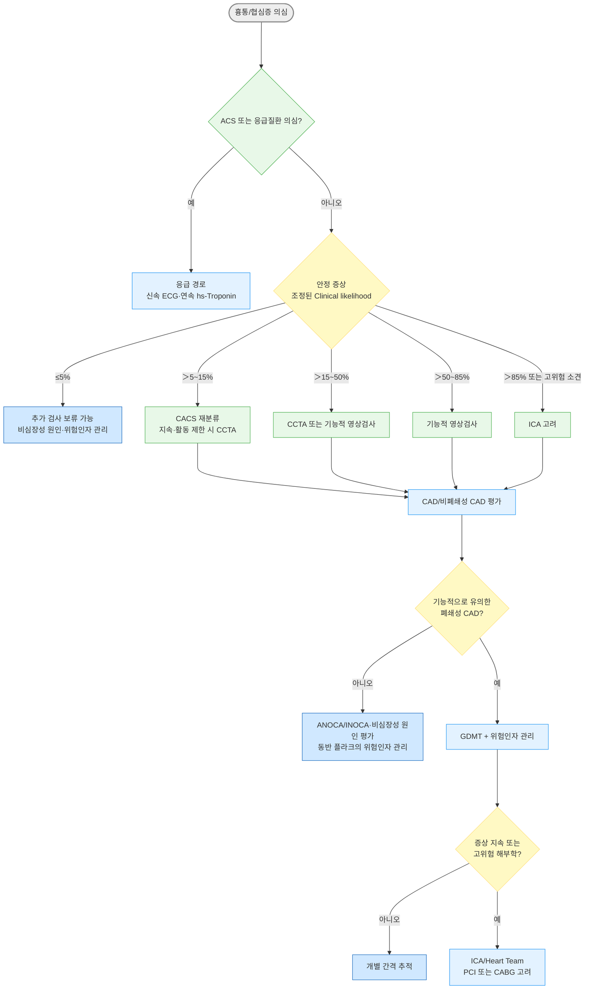
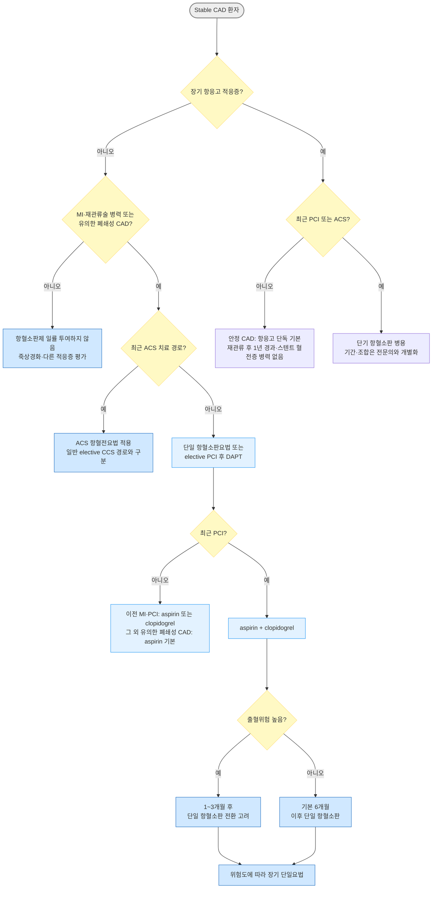
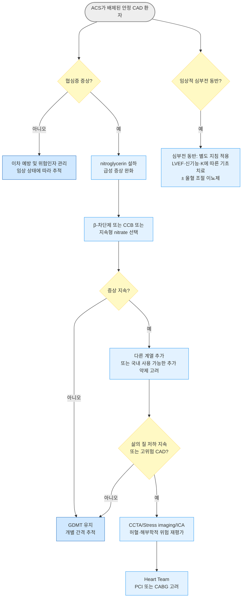

# 협심증 Angina Pectoris

## <mark style="color:green;">일반 사항</mark>

* **관상동맥병 (coronary artery disease, CAD)** : 관상동맥의 구조적 또는 기능적 이상으로 발생하는 심근 허혈/관상동맥 질환의 총칭; 죽상경화성 CAD가 가장 흔함
  * stable/chronic coronary syndrome 및 acute coronary syndrome을 포함
  * **폐쇄성 CAD** : 일반적으로 관상동맥 직경 협착 ≥50%를 의미하며, 병변의 기능적 유의성은 FFR/iFR 등으로 별도 평가할 수 있음
  * **비폐쇄성 CAD** : 주요 관상동맥에 ≥50% 협착이 없으나 죽상경화 플라크가 존재할 수 있는 상태; 미세혈관 기능장애나 관상동맥 연축에 의한 허혈이 동반될 수 있음
* **만성 관상동맥병 (chronic coronary disease, CCD)** : 이전의 stable ischemic heart disease(SIHD) 개념을 대체하는 광의의 용어 \[AHA/ACC]
  * CAD, 이전 MI/재관류술, 비침습적 검사로 진단된 허혈성 심장병, 만성 협심 증후군 등 포함
  * ESC는 동일한 개념 범위를 만성 관상동맥증후군(chronic coronary syndromes, CCS)으로 명명
* **안정 협심증 (stable angina)** : 계단 오르기, 성관계 등 일정 수준 이상의 활동 또는 감정적 스트레스, 추위, 과식 등에서 반복되는 협심증; 이전 증상과 대체로 유사한 양상
  * 폐쇄성 CAD뿐 아니라 관상동맥 미세혈관 기능장애나 연축 등으로도 발생할 수 있으며, 해부학적 협착 정도와 기능적 허혈의 정도가 항상 일치하지는 않음
  * 휴식 또는 nitroglycerin으로 호전되는 것이 전형적임
* **불안정 협심증 (unstable angina)** : 휴식 시 발생하거나, 새로 발생한 중증 협심증 또는 빈도·중증도·기간이 뚜렷하게 악화되는 급성 심근 허혈 증상 중 급성 심근 손상의 증거가 없는 상태
  * hs-Troponin의 상승·하강과 심근 허혈 증거로 심근경색 기준을 충족하면 NSTEMI 등으로 분류함. 새로 발생한 모든 운동성 흉통을 불안정 협심증으로 분류하지 않음
  * MI 및 cardiac death 위험 증가 상태
* **혈관연축 협심증 (vasospastic angina, VSA)** : 관상동맥 연축에 의해 발생하는 협심증; Prinzmetal/variant angina는 전통적으로 일시적 ST 상승을 동반하는 유형을 지칭함
  * 휴식 시, 특히 야간이나 이른 아침에 발생하는 경우가 많으며, 일시적인 ST-segment elevation 또는 depression이 나타날 수 있음
  * 심실 부정맥 및 급성 심장사의 위험이 있어 진단과 치료가 중요함
  * 반복적인 발작과 무증상 기간이 교대로 나타날 수 있음
* **ANOCA/INOCA** : 주요 관상동맥에 유의한(≥50%) 폐쇄성 협착이 없으면서 심근 허혈과 관련된 증상 또는 소견이 있는 상태
  * **ANOCA (angina with no obstructive coronary arteries)** : 폐쇄성 CAD가 없으면서 협심증이 의심되는 증상
  * **INOCA (ischaemia with no obstructive coronary arteries)** : 폐쇄성 CAD가 없으면서 객관적으로 심근 허혈이 확인된 상태
  * 미세혈관 기능장애(CMD)와 vasospastic angina가 대표적인 기전이며, 두 기전이 함께 존재할 수 있음
  * 여성에서 상대적으로 흔하며, 반복적인 증상과 삶의 질 저하가 흔함


**ANOCA/INOCA의 기전별 접근**

* **Vasospastic angina** : 심외막 또는 미세혈관 연축 → CCB 1차 선택, 필요 시 nitrate 추가
* **Coronary microvascular dysfunction(CMD)** : 혈류예비력 저하/미세혈관 저항 증가 등 → β-차단제, CCB 등을 증상 및 혈역학에 따라 선택; 미세혈관 연축이면 CCB를 우선 고려
* **Overlap endotype** : 연축과 비연축성 CMD가 함께 존재할 수 있어 기전에 따른 병합 치료 고려

* 2024 ESC CCS 가이드라인은 적절한 약물치료에도 증상이 지속되고 삶의 질이 저하된 의심 ANOCA/INOCA에서 전문기관의 침습적 관상동맥 기능검사(CFR, IMR, acetylcholine 유발검사 등)로 endotype을 규명하는 접근을 권고함. 정상 CCTA/ICA만으로 CMD나 연축을 배제하지 않음
* Vasospastic angina에서는 β-차단제를 일률적인 1차 치료로 사용하지 않으며, 연축을 악화시킬 가능성이 있어 피하는 것이 일반적임. 반면 CMD에서는 β-차단제가 증상 조절에 유용할 수 있음


* **Acute coronary syndrome (ACS)** : 관상동맥의 급성 폐쇄 또는 불안정한 죽상경화성 병변으로 발생하는 급성 허혈성 증후군
  * STEMI, NSTEMI, unstable angina 포함
* **전형적 협심증 (typical angina)** : 전형적 특징 3가지를 모두 충족
* **전형적 특징 중 2가지인 흉통** : 전통적으로 atypical angina로 분류하였으나, AHA/ACC 2021은 증상을 cardiac/possibly cardiac/noncardiac으로 표현하도록 권고함. **Possibly cardiac은 단순히 2개 특징과 일대일로 대응하는 진단명이 아님** (☞ [흉통](../220_/002_-chest-pain.md))
* **비협심증성 양상의 흉통** : 전형적 협심증 특징이 0~1개인 전통적 분류; 이 개수만으로 심장성 원인을 배제하지 않음. 비심장성 흉통(non-cardiac chest pain)은 병력·위험도·검사를 종합하여 심장질환 가능성이 낮다고 판단한 경우에 사용 <mark style="color:$info;">[AHA/ACC 흉통 2021]</mark>
* **협심증 유사 증상 (angina equivalent)** : 힘든 활동/스트레스와 관련하여 흉통 없이 호흡 곤란, 발한, 피로감, 구역, 소화불량, 복통 등의 비특이적 증상 발생; 여성, 고령, 당뇨병 환자에서 더 흔함 (☞ [흉통](../220_/002_-chest-pain.md))

### <mark style="color:orange;">Angina 분류 및 활동 제한 \[Canadian Cardiovascular Society, CCS]</mark>

<table><thead><tr><th width="75.71429443359375">Class</th><th width="525.238037109375">증상 유발 활동 강도</th><th>일상생활 제한</th></tr></thead><tbody><tr><td><strong>I</strong></td><td>일상 활동(걷기, 계단 오르기)에서는 증상 없음; 힘들거나 빠르거나 오래 지속되는 작업·운동에서만 발생</td><td>제한 없음</td></tr><tr><td><strong>II</strong></td><td>빠르게 걷기/계단 오르기, 오르막길, 식후·추위·바람·정서적 스트레스 상황, 또는 기상 후 몇 시간 이내; 평지에서 2블록(약 340 m) 이상 걷거나 1개 층 이상 계단을 보통 속도로 오를 때 발생</td><td>약간 제한</td></tr><tr><td><strong>III</strong></td><td>평지에서 1~2블록 걷기 또는 1개 층 계단을 보통 속도·조건에서 오를 때 발생</td><td>상당한 제한</td></tr><tr><td><strong>IV</strong></td><td>어떤 신체 활동에도 불편감 없이 수행 불가능; 휴식 시에도 증상 발생 가능</td><td>모든 활동 제한</td></tr></tbody></table>

## <mark style="color:green;">원인 및 위험 인자</mark>

### <mark style="color:orange;">직접 원인</mark>

* 관상동맥 죽상경화증 (가장 흔함), 관상동맥 연축, 미세혈관 질환, endothelial dysfunction
* 기타 : 대동맥판 협착증, 비대 심근병증, 폐고혈압, 판막심장병, volume overload

### <mark style="color:orange;">위험 인자</mark>

* 생활 습관 : 흡연, 과음, 스트레스, 신체 활동 부족
* 대사 인자 : 비만, 조절되지 않는 고혈압/당뇨병, 이상지질혈증(HDL↓, LDL↑), 고 Lipoprotein(a)
* 인구학적 : 연령 증가, 남성; 여성에서도 폐경 후 위험이 증가하며 성별만으로 배제하지 않음
* 가족력 : 1차 친족(부모·형제자매·자녀)의 조기 CAD 발생 (남 ＜55세, 여 ＜65세)
* 동반 질환 : 뇌졸중, 말초혈관 질환, CKD, RA, SLE, Takayasu동맥염, Kawasaki병, 갑상선항진증, 중증 빈혈, 적혈구증가증, 중증 폐질환(저산소증)
* vasospasm 유발 약물 : cocaine, amphetamine, triptan·ergot계 약제 등; 흡연은 관상동맥 연축의 중요한 위험 인자임

## <mark style="color:green;">임상 양상</mark>

### <mark style="color:orange;">전형적 특징</mark>

(☞ [흉통](../220_/002_-chest-pain.md))

1. **흉부 증상** : 흉골 뒤 조임감, 압박감, 무게감, 작열감; 대개 수분(약 2\~15분) 지속; 턱/등/어깨/한쪽 또는 양쪽 팔로 방사 가능
   * Sharp or stabbing pain은 드묾
2. **유발 요인** : 어떤 수준 이상의 힘든 작업이나 운동, 정서적 스트레스
3. **완화 요인** : 휴식 또는 nitroglycerin 설하 투여로 30초\~수 분 이내 호전
   * 보통 자세나 호흡에 따라 달라지지 않음
   * Nitroglycerin에 반응해도 식도 연축 등 다른 원인일 수 있으므로, 반응만으로 심근 허혈을 확진하지 않음 <mark style="color:$info;">[AHA/ACC 흉통 2021]</mark>

* 20분 이상 지속되는 흉통은 ACS 가능성을 높이지만, **짧은 지속시간이나 일시적 호전만으로 ACS를 배제하지 않음** (☞ [흉통](../220_/002_-chest-pain.md))

### <mark style="color:orange;">기타 증상</mark>

* 호흡 곤란, 구역, 구토, 발한, 추운 느낌, 어지럼

### <mark style="color:orange;">고령에서의 특징</mark>

* 비전형적 증상을 보임; 호흡 곤란 및 비특이적 증상만 나타날 수 있음
* 육체 활동이 저하되어 있어 발견이 지연될 수 있음
* 치료 약제에 대한 부작용이 민감하게 발생할 수 있음


**"흉통이 없다고 해서 협심증을 배제할 수 없다"** - 고령, 당뇨병, 여성 환자에서는 전형적 흉통 없이 호흡 곤란, 피로, 식은땀, 소화불량 등 angina equivalent만 나타날 수 있음; 비전형 증상도 협심증으로서 적극 평가 필요.\
여성은 흉통과 함께 호흡 곤란, 피로, 구역 등 동반 증상을 호소하는 경우가 남성보다 많을 수 있음


## <mark style="color:$danger;">🚩 Red Flags!</mark>

<mark style="color:$danger;">**즉각 조치**</mark>

* 새로 발생한 심한 흉통, 휴식 시 지속/반복되는 흉통, 이전보다 적은 활동에서 발생하거나 빠르게 악화되는 증상 → 즉시 119 연락 또는 응급 이송; nitroglycerin 반응을 기다리느라 이송을 늦추지 않음  `ACS`
* 알려진 안정 협심증에서 휴식 또는 첫 nitroglycerin 설하 투여 후 5분에도 통증이 호전되지 않거나 악화됨 → 즉시 119 연락; 이후 추가 투여는 응급의료 지시에 따름  `ACS`
* 흉통 또는 협심증 유사 증상과 함께 저혈압·쇼크, 의식 변화, 실신, 심한 호흡 곤란, 청색증, 급격한 식은땀 또는 혈역학적 불안정 부정맥 → 응급 이송  `ACS·급성 심부전·중증 부정맥`
* 갑자기 시작된 심한 흉통/등통증과 맥박·혈압 비대칭 또는 신경학적 이상 → 응급 이송  `급성 대동맥증후군`
* 갑작스러운 흉통·호흡 곤란과 한쪽 호흡음 감소 또는 저산소증 → 응급 평가/이송  `기흉·폐색전증`
* 흉통·저혈압에 새 수축기 잡음, 또는 경정맥 팽창·기이맥(pulsus paradoxus: 흡기 시 SBP ＞10 ㎜Hg 감소) 동반 → 응급 평가/이송  `급성 판막/기계적 합병증·심낭 압전`

<mark style="color:$warning;">**당일 평가**</mark>

* 현재 증상과 혈역학적 불안정은 없으나, 새로 발생한 휴식/야간 흉통 또는 협심증 악화 병력 → 당일 평가; 최근 ACS가 의심되면 응급실에서 평가  `ACS·혈관연축 협심증`
* 처음 발견된 허혈 의심 ECG 변화 또는 새 심잡음 → 당일 평가; 진행 중인 허혈 증상·불안정 소견 동반 시 즉각 조치 단계 적용  `심근 허혈·구조적 심질환`

<mark style="color:$info;">**조기 평가 및 추적**</mark>

* 안정된 운동성 흉통 또는 반복되는 호흡 곤란·피로감 등 협심증 유사 증상 → 조기 평가; 여성·고령·당뇨병에서도 흉통 유무만으로 판단하지 않음  `폐쇄성 CAD·ANOCA/INOCA`
* 항협심증 치료에도 안정된 증상이 지속되거나 활동 범위가 제한됨 → 복약·용량·허혈 기전을 재평가하고 전문진료 연계  `치료 불충분 CCS`
* 반복되는 어지럼, 증상성 서맥 또는 기립성 저혈압 → 약물과 혈압·맥박 평가; 실신·불안정 활력징후가 있으면 즉각 조치 단계 적용  `약물 이상반응·전도장애`

## <mark style="color:green;">진단</mark>

### <mark style="color:orange;">Clinical Likelihood 평가</mark>

* 2024 ESC CCS 가이드라인은 기존의 단순 PTP 대신 **Risk Factor-weighted Clinical Likelihood(RF-CL)** 모델을 사용하여 폐쇄성 CAD 가능성을 추정하도록 권고함
* 연령, 성별, 협심증 증상에 더하여 흡연, 고혈압, 이상지질혈증, 당뇨병, 조기 CAD 가족력 등의 위험 인자를 반영하며, ECG·심초음파·말초혈관 소견·기존 CT의 관상동맥 석회화 등으로 임상 가능성을 추가 조정할 수 있음
* 아래 구간은 **추가 임상 자료로 조정한 폐쇄성 CAD의 임상 가능성**임. RF-CL 추정치만으로 CAD를 확진하거나 ANOCA/INOCA를 배제하지 않음

<table><thead><tr><th width="98">Clinical likelihood</th><th width="126">CAD 가능성</th><th>권장 전략</th></tr></thead><tbody><tr><td><strong>≤5%</strong></td><td>매우 낮음</td><td>비심장성 원인 평가 후 추가 검사 보류 가능; 위험 인자 관리</td></tr><tr><td><strong>＞5~15%</strong></td><td>낮음</td><td>필요 시 CACS로 재분류; 증상이 지속되거나 일상생활을 제한하면 CCTA 고려</td></tr><tr><td><strong>＞15~50%</strong></td><td>중간</td><td>CCTA 또는 기능적 영상검사(CMR, PET/SPECT, stress echo)</td></tr><tr><td><strong>＞50~85%</strong></td><td>높음</td><td>기능적 영상검사 우선</td></tr><tr><td><strong>＞85%</strong></td><td>매우 높음</td><td>고위험 소견 또는 치료 불응 증상이 있으면 invasive coronary angiography(ICA) 직접 고려</td></tr></tbody></table>

_CCTA=Coronary CT angiography, CACS=coronary artery calcium score, ICA=invasive coronary angiography_


ESC 2024에서는 **≤5%**이면 추가 검사를 보류할 수 있고, **＞5\~15%**이면 CACS를 이용한 재분류를 고려함. **＞5\~50%**에서는 CCTA가 폐쇄성 CAD 배제에 유용하며, **＞15\~85%**에서는 기능적 영상검사가 허혈 평가에 유용함. 특히 **＞50\~85%**에서는 기능적 영상검사를 우선 고려함. **＞85%**, 저강도 운동에서의 협심증, 약물치료 불응 또는 고위험 소견에서는 ICA를 고려함.


### <mark style="color:orange;">검사 전략 - CCTA or 기능적 영상검사</mark>

1. CAD가 의심되는 증상 환자에서는 임상 가능성과 기존 CAD 여부를 함께 고려하여 검사를 선택
2. CCTA는 폐쇄성 CAD를 배제하고 비폐쇄성 plaque도 확인하는 데 유리하며, 기능적 영상검사는 유발 허혈의 존재와 정도 및 사건 위험 평가에 유리함

<table><thead><tr><th width="346">상황</th><th>우선 고려 검사</th></tr></thead><tbody><tr><td>CAD 미확진, clinical likelihood ＞5~50%</td><td>CCTA 우선 고려; 기능적 영상검사도 가능</td></tr><tr><td>CAD 미확진, clinical likelihood ＞15~85%</td><td>Stress echo/PET/SPECT/CMR; 특히 ＞50~85%이면 기능적 영상검사 우선</td></tr><tr><td>기존 obstructive CAD에서 증상 재발 또는 허혈 평가 필요</td><td>Stress imaging 등 기능적 검사</td></tr><tr><td>CCTA에서 40~90% 중간 정도 협착의 기능적 의미가 불확실</td><td>기능적 영상검사 또는 적절한 경우 FFR-CT; 재관류를 고려하면 ICA ± FFR/iFR</td></tr><tr><td>고가능성·저강도 활동에서도 발생하는 협심증 또는 고위험 해부학적 소견</td><td>ICA 및 필요 시 revascularization 평가</td></tr></tbody></table>


**기능적 영상검사** : stress echocardiography, PET/SPECT myocardial perfusion imaging, stress CMR. 운동부하 심전도는 별도의 검사이며, CCTA 또는 기능적 영상검사가 가능한 경우 저\~중간 가능성 환자에서 CAD 배제를 위한 1차 검사로는 권장되지 않음.


### <mark style="color:orange;">신체 검사</mark>

* 고혈압, arcus senilis, xanthelasma, carotid or peripheral bruit, prominent S4, murmur
* 많은 환자들이 정상 이학적 소견을 보임

### <mark style="color:orange;">실험실 검사</mark>

* 기본 : CBC, lipid profile, HbA1c 또는 공복혈당, 신기능(eGFR), 전해질
* **hs-Troponin** : 급성 흉통/ACS가 의심될 때 0/1시간 또는 0/2시간 등 **검증된 serial protocol**에 따라 측정; 안정 협심증의 일상적인 외래 평가에서 반복 측정하는 검사는 아님
* **Lipoprotein(a)** : 성인에서 평생 1회 측정을 고려/권고; ≥50 ㎎/㎗ 또는 ≥125 nmol/L는 대표적인 위험 증가 기준임. 입자 크기와 검사법 차이 때문에 두 단위를 고정 환산하지 않음
  * Lp(a) 상승만으로 PCSK9 억제제 치료를 결정하지 않으며, LDL-C 및 전체 ASCVD 위험을 기준으로 지질강하치료를 결정
* 선택 : TFT(갑상선질환 의심), BNP/NT-proBNP(심부전 의심), 기타 검사는 임상 상황에 따라 시행
* hs-CRP 등 염증표지자는 협심증의 일상적인 진단검사로 권고되지 않음

### <mark style="color:orange;">심전도</mark>

* 안정 협심증이 의심되면 **12-lead resting ECG를 기본 검사**로 시행
* 급성 흉통 또는 ACS가 의심되면 첫 의료 접촉/응급실 도착 후 **10분 이내 12유도 ECG**를 목표로 함. 초기 ECG가 정상/비진단적이어도 ACS를 배제하지 못하며, 증상이 지속·재발하면 반복함. 외래 troponin 결과를 기다리는 것이 응급 이송을 지연시켜서는 안 됨
* 안정 시 ECG가 정상이라고 CAD를 배제할 수 없음
* 운동부하 ECG는 선택적으로 사용할 수 있으나, CCTA 또는 기능적 영상검사가 가능한 경우 CAD 배제를 위한 일반적인 1차 검사로는 선호되지 않음

### <mark style="color:orange;">영상 검사</mark>

* **경흉부 심초음파** : CCS 의심 환자의 초기 평가에서 좌심실 수축기 기능, 국소 벽운동, 판막질환 및 다른 구조적 심질환을 평가함
* **CCTA** : 폐쇄성/비폐쇄성 CAD의 해부학적 평가; 심한 석회화·빈맥/부정맥 등으로 영상의 질이 낮을 수 있으며, 요오드 조영제 과민반응과 신기능을 고려하여 기능적 영상검사와 선택함
* **Stress imaging** : stress echo, PET/SPECT MPI, stress CMR
* **흉부 X선** : 심부전, 폐질환, 대동맥질환 등 다른 진단이 의심될 때 선택적으로 시행
* **ICA** : 매우 높은 임상 가능성, 고위험 해부학적/기능적 소견, 저강도에서도 발생하는 증상, 또는 revascularization이 예상되는 경우 고려

### <mark style="color:orange;">흉통 소견의 해석 및 감별</mark>

* 운동 유발·흉골 뒤 압박감·휴식 호전은 심근 허혈을 시사함. Levine 징후나 과거와 같은 통증만으로 MI를 진단하지 않음
* 촉진으로 재현되거나 호흡·체위에 따라 변하는 통증은 다른 원인 가능성을 높이지만 ACS를 단독으로 배제하지 못함
* ACS 외에 급성 대동맥증후군, 폐색전증, 기흉, 심낭염·심근염, 대동맥판 협착증·비대 심근병증, 식도질환·근골격 통증 등을 감별함
* 급성 심근경색은 troponin의 급성 변화와 심근 허혈 증거를 종합하여 진단함. CKD 등에서의 단독 troponin 상승은 곧바로 MI를 뜻하지 않음

<mark style="color:cyan;">**흉통의 비심장성 원인**</mark>

☞ [흉통](../220_/002_-chest-pain.md#noncardiac)

***



<p align="center"><strong>Stable Chest Pain 진단 및 치료 알고리듬</strong></p>

<p align="center"><em><mark style="color:$info;">Ref. 2024 ESC Guidelines for the management of chronic coronary syndromes</mark></em></p>

_PCI=Percutaneous Coronary Intervention, CABG=Coronary Artery Bypass Grafting_

***

## <mark style="background-color:$warning;">Management</mark>

### <mark style="color:orange;">치료 목표</mark>

1. 심혈관 사건(MI, 심장 사망) 예방 - 생존율 향상
2. 협심증 증상 완화 - 삶의 질 향상
3. 심혈관 위험 인자의 최적 관리

### <mark style="color:orange;">치료 방침 \[AHA/ACC 2023; ESC 2024]</mark>

<table><thead><tr><th width="73">항목</th><th width="186">핵심 내용</th><th>주요 치료</th></tr></thead><tbody><tr><td><strong>A</strong></td><td>Antiplatelet</td><td>장기 항응고 적응증이 없으면 이전 MI/PCI 후 aspirin 또는 clopidogrel 단독; MI/재관류술 병력 없는 유의한 폐쇄성 CAD는 aspirin을 기본으로 고려. PCI 후 초기 DAPT</td></tr><tr><td><strong>B</strong></td><td>Blood pressure / Beta-blocker</td><td>혈압은 동반 고혈압 진료지침에 따라 개별화; β-차단제는 협심증 증상, 최근 MI, LVEF 저하, 부정맥 등 적응증에 따라 사용</td></tr><tr><td><strong>C</strong></td><td>Cholesterol / Cigarette smoking</td><td>고강도 statin을 기본으로 LDL-C를 적극적으로 낮추고 금연</td></tr><tr><td><strong>D</strong></td><td>Diet / Diabetes</td><td>지중해식 등 심혈관 보호 식이; 당뇨병 동반 시 심혈관 이득이 입증된 SGLT2i 또는 GLP-1RA 고려</td></tr><tr><td><strong>E</strong></td><td>Exercise / Education</td><td>규칙적 유산소·저항운동 및 적절한 환자 교육; 적격 환자는 심장재활 참여</td></tr><tr><td><strong>F</strong></td><td>Follow-up / Flu vaccination</td><td>증상·복약·위험인자에 따른 개별 추적; 매년 인플루엔자 예방접종, COVID-19 예방접종은 공중보건 권고에 따름</td></tr></tbody></table>

### <mark style="color:orange;">CCD 이차 예방 목표 요약</mark>

<table data-search="false"><thead><tr><th width="200">항목</th><th>목표</th></tr></thead><tbody><tr><td>LDL-C</td><td><strong>＜55 ㎎/㎗ 및 기저치 대비 ≥50% 감소</strong> (죽상경화성 관상동맥질환: KSoLA 2026/ESC 2024 기준)</td></tr><tr><td>혈압</td><td>대체로 ＜130/80 ㎜Hg; 고령·쇠약·기립성 저혈압 및 낮은 이완기혈압에서는 내약성에 따라 개별화</td></tr><tr><td>HbA1c</td><td>개별화 (일반적으로 ＜7%)</td></tr><tr><td>운동</td><td>≥150분/주 (중등 강도 유산소)</td></tr><tr><td>금연</td><td>필수</td></tr><tr><td>Statin</td><td>고강도 (atorvastatin 40~80 ㎎ 또는 rosuvastatin 20 ㎎/d [국내 허가용량]); 목표 미달성 시 ezetimibe 등 추가</td></tr><tr><td>항혈소판</td><td>적응증에 따라 aspirin 75~100 ㎎/d(국내 제시 제품 100 ㎎) 또는 clopidogrel 75 ㎎/d; 비폐쇄성 CAD/연축만으로 일률 투여하지 않음</td></tr><tr><td>예방 접종</td><td>Influenza 매년; Pneumococcal 적응증 확인</td></tr></tbody></table>


재발성 ASCVD 사건이 있는 매우 고위험 환자에서는 더 낮은 LDL-C 목표를 개별적으로 고려할 수 있으나, 국내 진료에서는 [이상지질혈증](099_-dyslipidemia.md) 장의 최신 목표를 우선 적용


### <mark style="color:orange;">Stable Angina 접근 \[AHA/ACC 2023; ESC 2024]</mark>

**1단계 - ACS 및 비심장성 흉통 배제**

* 급성 흉통, 휴식 시 새로 발생한 통증, 점점 악화되는 증상 또는 불안정한 활력징후가 있으면 ACS 등 응급질환을 우선 평가
* 안정 환자에서는 병력, 신체검사, resting ECG를 시행하고 clinical likelihood를 추정

**2단계 - 기저 위험 및 구조적 심질환 평가**

* CBC, HbA1c/혈당, lipid profile, eGFR 등 위험인자 평가
* 심초음파 : 초기 평가에서 LV systolic dysfunction, 국소 벽운동 이상, 판막질환 등 확인
* Lipoprotein(a)는 성인에서 평생 1회 측정을 고려

**3단계 - CCTA 또는 기능적 영상검사 선택**

* CAD 미확진 : clinical likelihood에 따라 CCTA 또는 기능적 영상검사를 선택
* 기존 obstructive CAD : 증상과 위험도에 따라 기능적 영상검사를 우선 고려
* CCTA에서 중간 정도 협착의 기능적 의미가 불확실하면 FFR-CT 또는 기능적 영상검사를 고려
* 매우 높은 가능성, 저강도 활동에서도 발생하는 협심증, 고위험 해부학적 소견 또는 revascularization 가능성이 높은 경우 ICA를 고려
* 매우 낮은(≤5%) 가능성에서는 증상이 지속되지 않는 한 추가 검사를 보류할 수 있음

**4단계 - 최적 약물 치료**

* 증상 완화 : β-차단제, CCB 또는 지속형 nitrate 중 환자의 심박수·혈압·좌심실 기능·동반질환에 맞춰 선택
* 증상 지속 시 혈압·심박수·LVEF를 고려하여 다른 계열의 국내 사용 가능한 항협심증제를 추가
* 2차 예방 : aspirin 또는 clopidogrel, 고강도 statin 및 적응증에 따른 ACEi/ARB, SGLT2i/GLP-1RA 등
* 저용량 colchicine은 선택된 죽상경화성 CAD에서 추가 예방요법으로 고려할 수 있으나 국내 심혈관 예방 사용은 **허가 외**임; 아래 용량·금기 항목 참조

**5단계 - 혈관 재관류 고려**

* 지속적인 협심증/anginal equivalent가 GDMT에도 삶의 질을 저해하고 기능적으로 유의한 폐쇄성 CAD가 있으면 revascularization을 고려
* 좌주간부 질환, 광범위한 기능적 허혈/다혈관 질환, LVEF 저하 등에서는 예후 개선 목적의 재관류를 평가함. Proximal LAD 병변이라는 사실만으로 모든 환자의 생존 이득을 단정하지 않고 해부학·허혈·심기능을 종합하여 Heart Team에서 결정함
* ISCHEMIA trial은 left main disease와 LVEF ＜35%를 제외한 안정 CAD에서 일률적인 초기 침습전략이 모든 환자의 사망·MI를 감소시키지 못함을 보여주었으므로, 해부학적·기능적 위험도와 환자 선호를 함께 고려함

## <mark style="color:green;">비-약물 치료 및 예방</mark>

#### <mark style="color:$primary;">기저 질환 관리</mark>

* [고혈압](095_-hypertension.md), [당뇨병](../226_/100_-diabetes-mellitus.md), [이상지질혈증](099_-dyslipidemia.md) 관리

#### <mark style="color:$primary;">금연 및 음주 제한</mark>

* [금연](../230_/190_-smoking.md) : 전자담배는 장기 안전성 자료 부족; 금연의 1차 방법으로 권고하지 않음
* [음주](../230_/189_-alcohol-use-disorder.md) 제한

#### <mark style="color:$primary;">체중 관리</mark>

* 과체중/비만에서는 초기 체중의 약 5\~10% 감량을 목표로 개별화 (☞ [비만](../230_/191_-obesity.md))

#### <mark style="color:$primary;">식이 조절</mark>

* 권장 : [지중해식 식이](../231_/217_-nutritiondiet-guideline.md#undefined-6) (과일/채소, 콩류/견과류, 통곡류, 살코기, 복합 탄수화물, 식이섬유, 올리브유, 생선)
* 제한 : 포화지방, 가공육, 정제 탄수화물, 설탕 첨가 음료, 과도한 알코올; 소금은 가능하면 ＜5 g/d 수준으로 제한
* 금지 : 트랜스지방 (쇼트닝/hydrogenated oil)

#### <mark style="color:$primary;">운동</mark>

* 최근 MI/PCI/CABG 후 또는 안정 협심증 등 심장 재활(cardiac rehabilitation, CR) 적응증이 있는 CCD 환자에게 참여를 권고함. 운동 처방 전 임상적 안정성과 허혈/부정맥 위험을 평가하며, 국내 재활 급여 적격성은 임상적 운동 권고와 구분함
* 유산소 운동 : 중등 강도(예: 빠르게 걷기)로 1일 30\~60분씩, 주 5일 이상 (총 ≥150분/주)
* 저항 훈련 : 주 2회
* 운동 강도는 협심증 역치, 기능능력, LV 기능 및 동반질환에 따라 개별화함. 안정 환자에서 증상 유발 역치 이하로 시작하며, 운동 중 흉통·실신성 전조·심한 호흡 곤란이 있으면 운동을 중단하고 평가함

#### <mark style="color:$primary;">스트레스 관리</mark>

* 직업/주거 환경 변화를 포함한 스트레스 감소 조치
* 명상, 정신 상담 등 스트레스 관리

#### <mark style="color:$primary;">협심증 유발 활동 제한</mark>

* 활동 강도를 능력에 맞게 조절; 급하게 서두르지 않음
* 오전, 식사 직후, 추운 날씨에는 활동 강도를 줄임

#### <mark style="color:$primary;">인플루엔자 예방 접종</mark>

* 모든 CCD 환자에게 매년 인플루엔자 백신 접종 권고

## <mark style="color:green;">약물 치료</mark>

* 항협심증제 선택은 증상의 빈도와 중증도뿐 아니라 심박수, 혈압, LVEF, 신기능, 천식/COPD, vasospastic angina 여부 및 약물 상호작용을 함께 고려하여 개별화
* 1차 항협심증 치료 : **β-차단제 또는 CCB**를 기본으로 하며, **지속형 nitrate**도 적절한 환자에서 선택 가능
* 초기 치료에도 증상이 지속되면 다른 계열의 국내 사용 가능한 항협심증제를 추가하거나 조합을 조정
* 약물치료에도 삶의 질을 해치는 협심증이 지속되면 허혈 및 해부학적 위험도를 재평가하여 revascularization을 고려

### <mark style="color:orange;">항협심증제 상황별 선택</mark>

<table data-search="false"><thead><tr><th width="220">상황</th><th>우선 고려</th></tr></thead><tbody><tr><td>빈맥/고혈압 동반</td><td>β-차단제</td></tr><tr><td>서맥, 혈압 유지</td><td>Amlodipine 등 DHP-CCB 고려; β-차단제·non-DHP CCB는 서맥 악화에 주의</td></tr><tr><td>저혈압 경향</td><td>혈압 저하 원인을 먼저 평가하고 혈관확장제 용량을 조절; 추가 항협심증제는 혈역학과 국내 사용 가능성을 고려하여 선택</td></tr><tr><td>Vasospastic angina</td><td>CCB 1차; 필요 시 nitrate 추가. β-차단제는 일반적으로 피함</td></tr><tr><td>HFrEF</td><td>예후 개선 근거가 있는 β-차단제(carvedilol, bisoprolol, metoprolol succinate); CCB는 약제별 주의</td></tr><tr><td>활동성/중증 천식</td><td>β-차단제를 피하고 CCB 또는 다른 항협심증제 고려</td></tr><tr><td>COPD (심혈관 적응증 있음)</td><td>필요 시 심선택적 β₁-차단제를 우선 고려; 호흡기 증상 모니터링</td></tr></tbody></table>

✽ 2024 ESC는 항협심증제를 고정된 1·2차 순서보다 환자의 혈압·심박수·좌심실 기능·동반질환과 허혈 기전에 맞추어 조합하는 'diamond' 접근을 강조함.

### <mark style="color:orange;">β-차단제</mark>

* 작용 : 심박수·심근 수축력 및 혈압을 감소시켜 심근 산소 요구량↓
* 적응증 : 협심증 증상, 최근 MI, LVEF 저하/HFrEF, 심방세동 등
* AHA/ACC 2023은 최근 1년 내 MI, LVEF ≤50% 또는 다른 적응증이 없는 CCD에서 예후 개선만을 위한 장기 β-차단제 사용을 권고하지 않음. 협심증·부정맥·고혈압 치료의 필요성은 별도로 판단함
* HFrEF 또는 LVEF ＜50%에서 예후 개선 목적으로는 carvedilol, bisoprolol, metoprolol succinate가 근거가 확립된 약제
* 부작용 : 피로, 운동능 저하, 성기능 장애, 서맥, 저혈압, 방실전도 장애, 기관지경련
* 금기/주의 : 고도 방실차단, sick sinus syndrome(박동기 없는 경우), 심한 서맥, 급성 비보상성 심부전 등; 활동성/중증 기관지경련성 천식에서는 피하는 것이 일반적
  * 임상 지침상 COPD와 안정된 PAD 자체는 계열 전체의 일률적 금기가 아니나, 국내 개별 품목 금기를 우선 확인함(아래 설명 참조)
  * 당뇨병에서는 저혈당 증상을 가릴 수 있어 주의
* 용량은 고정된 맥박 목표보다 증상, 혈압, 심박수 및 내약성을 기준으로 조절
* β-차단제 갑작스런 중단은 rebound tachycardia/ischemia를 유발할 수 있으므로 필요 시 보통 1\~2주 이상에 걸쳐 감량
* cardioselective β₁-차단제를 선호할 수 있으며, ISA가 있는 약제는 허혈성 심질환의 장기 치료에는 일반적으로 선호하지 않음 (☞ [β-차단제](095_-hypertension.md#v-v-adrenergic-receptor-blocker-bb))
* atenolol : 국내 협심증 허가용량 100 ㎎/d를 1\~2회 분할, **최대 100 ㎎/d**; 고령·신장애에서는 저용량으로 개별화 <mark style="color:blue;">\[테놀민]</mark>
  * 국내 허가상 CrCl 15\~35 ㎖/분/1.73㎡이면 50 ㎎/d, ＜15이면 25 ㎎/d 또는 50 ㎎ 격일 투여
* bisoprolol : 2.5\~10 ㎎/d <mark style="color:blue;">\[콩코르]</mark>
* carvedilol : <mark style="color:blue;">\[딜라트렌]</mark> 속방형과 <mark style="color:blue;">\[딜라트렌에스알정]</mark> 서방형의 용량을 구분함
  * 서방형의 **만성 안정 협심증** 허가용량 : 처음 2일 32 ㎎ qd, 이후 64 ㎎ qd; 64 ㎎으로 2주 투여 후 필요 시 비고령자에서 128 ㎎ qd까지 증량 가능. 식사와 함께 정제 전체를 삼킴
  * 속방형 12.5 ㎎ bid는 서방형 32 ㎎ qd, 속방형 25 ㎎ bid는 서방형 64 ㎎ qd에 상응함. **mg 대 mg으로 대체하지 않음**; 심부전의 시작·증량 일정은 별도임
* metoprolol succinate 서방형 : 국외 근거 용량과 국내 제품의 염·함량 표기를 구분하여 사용; HFrEF 용량은 심부전 챕터 참조


**COPD와 β-차단제** : 임상 지침상 COPD 자체는 모든 β-차단제의 일률적 금기가 아니며, 심혈관 적응증이 있으면 심선택적 β₁-차단제를 고려할 수 있음. 다만 **국내 테놀민 허가사항에는 중증 기관지천식·만성 폐쇄성 폐질환 등이 금기**로 기재되어 있으므로 계열의 지침 권고로 개별 품목의 금기를 무시하지 않음. 활동성/중증 기관지경련에서는 피함.



**정상 LVEF의 MI 후 β-차단제: 2025\~2026 근거**

5개 무작위시험의 개별환자자료 메타분석(17,801명)에서, MI 후 **LVEF ≥50%이고 다른 β-차단제 적응증이 없는 환자**의 사망·MI·심부전 복합위험 감소는 입증되지 않았음(HR 0.97, 95% CI 0.87\~1.07). 협심증 증상 조절 목적은 유효할 수 있으며, 이 결과를 LVEF ＜50% 또는 증상성 심부전 환자에게 일반화하거나 복용 중인 약의 갑작스런 중단 근거로 사용하지 않음.

<mark style="color:$info;">[Kristensen et al. NEJM 2026; 온라인 2025-11-09]</mark>


### <mark style="color:orange;">칼슘통로차단제 (CCB)</mark>

* 작용 : DHP계는 주로 혈관을 확장하며, non-DHP계는 심박수·방실전도·심근 수축력도 감소시킴
* 적응증 : β-차단제의 대체 또는 추가, 고혈압 동반, vasospastic angina 등
* **Vasospastic angina에서는 CCB가 1차 치료**이며 필요 시 nitrate를 추가
* Long-acting 제제를 사용하며, 급격한 혈압 저하나 서맥이 발생하지 않도록 개별화

#### <mark style="color:$primary;">DHP계 CCB</mark>

* amlodipine : 5\~10 ㎎/d <mark style="color:blue;">\[노바스크]</mark>
* felodipine : 5\~10 ㎎/d <mark style="color:blue;">\[무노발]</mark>
* nifedipine : 안정 협심증에서는 단시간 작용 제제를 피하고 서방형 제제를 사용; 30\~90 ㎎/d <mark style="color:blue;">\[아달라트오로스정]</mark>
* 부작용 : 안면 홍조, 두통, 말초 부종

#### <mark style="color:$primary;">Non-DHP계 CCB</mark>

* diltiazem : <mark style="color:blue;">\[헤르벤서방정90㎎]</mark> 90 ㎎ bid, 필요 시 180 ㎎ bid까지 증량(최대 360 ㎎/d). 1일 1회 캡슐제와 구분하며, 90 ㎎ 서방정은 분할·분쇄하지 않음
* verapamil 서방형 : 180 또는 240 ㎎ qd로 시작하며 필요 시 최대 480 ㎎/d를 2회 분할 <mark style="color:blue;">\[이솦틴 서방]</mark>
* 작용 : negative chronotropic/dromotropic 및 negative inotropic effect
* 부작용 : 서맥, 방실전도 장애, 변비, 말초 부종
* 금기/주의 : 고도 방실전도 장애, sick sinus syndrome, 심한 서맥, 좌심실 수축기 기능저하(특히 LVEF ＜40%) 또는 비보상성 심부전에서는 피함


**β-차단제와 non-DHP CCB 병용** : 둘 다 심박수와 AV conduction을 억제하므로 서맥·방실차단 위험이 증가함. 일반적인 일차의료에서는 병용을 피하고, 꼭 필요한 경우 ECG·맥박·혈압을 면밀히 모니터링.


### <mark style="color:orange;">ACE 억제제 / ARB</mark>

* 작용 : 혈압↓, afterload↓, MI 후 cardiac remodeling 억제
* 적응증 : 고혈압, 당뇨병, CKD, 심부전 또는 좌심실 수축기 기능 저하 동반 시; 동반질환이 없더라도 심혈관 위험이 매우 높은 CCS에서 ACEi를 고려할 수 있음
* 부작용 : 기침(ACEi), 고칼륨혈증, 혈관부종; 단순 ACEi 기침이면 ARB 전환 가능. 혈관부종 병력이 있으면 ACEi를 재투여하지 않고 ARB도 위험을 평가하여 선택함
* 시작·증량 후 대개 1\~2주 내 혈압·Cr/eGFR·K⁺를 확인함. 임신 중 사용 금기이며 ACEi+ARB를 병용하지 않음
* enalapril : 5\~40 ㎎/d <mark style="color:blue;">\[레니프릴]</mark>
* lisinopril : 5\~40 ㎎/d <mark style="color:blue;">\[제스트릴]</mark>
* ramipril : 2.5\~10 ㎎/d <mark style="color:blue;">\[트리테이스]</mark>

### <mark style="color:orange;">Nitrate</mark>

* 작용 : smooth muscle 이완 → 동맥/정맥 혈관 확장, preload↓, 혈압↓, 심근 산소 요구량↓ → 협심증 완화 및 예방
* 부작용 : 두통, 어지럼, 저혈압(특히 고령), 홍조 - 두통은 지속 복용 시 완화될 수 있음; 탈수 여부를 평가하되 심부전 동반 시 일률적인 수분 증량은 피함
* 금기/주의 : **PDE5 억제제(sildenafil, tadalafil, vardenafil, avanafil, udenafil, mirodenafil 등) 및 riociguat와 병용 금기**. 쇼크·중증 저혈압·충만압 저하/우심실경색이 의심되면 사용하지 않음; 중증 대동맥판 협착·비후성 폐쇄성 심근병증 등 preload 의존 상태에서도 피하거나 전문적으로 판단함

#### <mark style="color:$primary;">속효성 제제 (급성 발작 치료)</mark>

* 증상 치료 또는 예방 (스트레스 발생 예상 5분 전 투여); 30\~40분간 유효
* nitroglycerin : 0.3\~0.6 ㎎을 앉은 자세에서 설하에 녹임 <mark style="color:blue;">\[명문니트로글리세린설하정0.6㎎]</mark>
  * 허가상 증상이 완화될 때까지 5분 간격으로 반복 가능하나 **15분 동안 총 3회를 초과하지 않음**. 증상이 소실되면 추가 투여하지 않음
  * 첫 투여 5분 후에도 호전이 없거나 악화되면 Red Flags의 응급 경로를 적용하며, 이송 중 추가 투여는 혈압·금기 확인 및 응급의료 지시에 따름
  * 증상 발생 전 유발 활동을 예상할 수 있는 경우 예방적으로 사용할 수 있음
  * 원래의 밀폐·차광 용기에 보관하고 다른 약통으로 옮기지 않음; 개봉 후 사용기간·교체는 제품 지침에 따름

#### <mark style="color:$primary;">지속성 제제 (예방 목적)</mark>

* 장기 사용 시 내성 예방을 위해 제형·복용시간을 조정하여 하루 약 8~12시간의 nitrate-free 또는 저농도 구간을 확보함. 1일 1회 서방형은 보통 아침에 복용하며, 모든 제형에 12시간의 완전 무약물 상태를 일률적으로 적용하지 않음 <mark style="color:$info;">[KSIC CCS 2026]</mark>
* isosorbide dinitrate : 40\~80 ㎎/d <mark style="color:blue;">\[이소켓 서방]</mark>
* isosorbide-5-mononitrate 서방형 : 보통 60 ㎎ qd(아침), 필요 시 **최대 120 ㎎ qd** <mark style="color:blue;">\[이소트릴지속정]</mark>; 초기 2\~4일은 30 ㎎으로 두통·저혈압을 줄이도록 조절. 씹거나 분쇄하지 않음

### <mark style="color:orange;">콜레스테롤 저하제</mark>

* 적응증 : 지질 수준에 관계없이 죽상경화성 CAD 환자에서 고강도/최대내약 statin 권고 (☞ [이상지질혈증](099_-dyslipidemia.md#undefined-17))
* 목표 : **LDL-C ＜55 ㎎/㎗ 및 기저치 대비 ≥50% 감소** (죽상경화성 관상동맥질환; KSoLA 2026/ESC 2024)
* Statin 보조제 (add-on) : 최대내약 statin으로 목표 미달성 또는 조기 목표 달성이 필요하면 ezetimibe 등 비statin 병용; 추가 강하가 필요하면 PCSK9 항체(evolocumab, alirocumab) 등 선택. 모든 약제를 반드시 순서대로 추가하는 것은 아니며, 사건 감소 근거·필요한 LDL 강하폭·복약·국내 허가/공급을 함께 고려함
* Lipoprotein(a) 상승 : PCSK9 억제제가 Lp(a)를 일부 낮출 수 있으나, **Lp(a) 자체만으로 PCSK9 억제제를 시작하는 적응증은 아님**
* 약물 상호작용 : 자몽주스는 simvastatin/atorvastatin 등의 농도를 높일 수 있으므로 과량 섭취를 피하고 약제별 상호작용을 확인
* ANOCA/INOCA의 statin·ACEi/ARB는 죽상경화 플라크, 이상지질혈증, 고혈압, CKD 등 개별 적응증과 허혈 기전에 따라 선택함. 모든 환자에서 고강도 statin·ACEi/ARB·aspirin의 일률적 병합이 사건을 감소시키는 것으로 기술하지 않음; WARRIOR에서는 여성 의심 ANOCA/INOCA 환자에서 해당 집중치료 전략의 우월성이 입증되지 않았음 <mark style="color:$info;">[WARRIOR 2026]</mark>

#### <mark style="color:$primary;">고강도 Statin</mark>

* atorvastatin : 40\~80 ㎎/d <mark style="color:blue;">\[리피토]</mark>
* rosuvastatin : 국내 고강도 용량 **20 ㎎/d** <mark style="color:blue;">\[크레스토]</mark>; 국내 최대 허가용량 20 ㎎/d, 아시아계 환자에서 40 ㎎ 투여 금기 <mark style="color:$info;">[국내 허가사항]</mark>

#### <mark style="color:$primary;">Ezetimibe 및 복합제</mark>

* ezetimibe : 10 ㎎/d <mark style="color:blue;">\[이지트롤]</mark>
* statin/ezetimibe 복합제 : <mark style="color:blue;">\[로수젯]</mark>(rosuvastatin/ezetimibe), <mark style="color:blue;">\[아토젯]</mark>(atorvastatin/ezetimibe) - 복약 순응도 향상

#### <mark style="color:$primary;">PCSK9 표적 약제 및 기타 비statin 치료</mark>

* evolocumab : 140 ㎎ q2wk 또는 420 ㎎ q4wk SC <mark style="color:blue;">\[레파타]</mark>
* alirocumab : 75\~150 ㎎ q2wk SC <mark style="color:blue;">\[프랄런트]</mark>
* inclisiran : PCSK9 mRNA 표적 siRNA; **284 ㎎ SC**(inclisiran sodium **300 ㎎/1.5 ㎖**, 1프리필드시린지), 의료진이 최초·3개월 후·이후 6개월마다 투여 <mark style="color:blue;">\[렉비오프리필드시린지]</mark>. **국내 허가 약제이며 약학정보원 제품정보상 비급여** <mark style="color:$info;">[약학정보원, 2026-10-27 확인]</mark>. LDL 강하 효과와 PCSK9 항체의 확립된 심혈관 사건 감소 근거를 동일시하지 않음
* bempedoic acid : **2026-10-14 국내 허가** <mark style="color:blue;">\[넥스레톨정180㎎]</mark>. 최대내약 statin 병용에도 LDL 조절이 불충분하거나 statin 불내성/금기인 성인의 지질저하 적응증, 권고 statin을 사용할 수 없는 고위험 성인의 심혈관 위험 감소 적응증이 있음. 허가 취득과 실제 공급·급여 등재를 구분하며, 이 장의 일반 처방례에는 포함하지 않음 <mark style="color:$info;">[수입사 허가 공지 2026-10-15]</mark>


**Evolocumab HIRA 급여 기준** : 초고위험 ASCVD 성인에서 최대내약 statin+ezetimibe에도 기저치 대비 LDL-C가 50% 이상 감소하지 않거나 LDL-C ≥70 ㎎/㎗이면 추가 투여 급여 인정. 여기서 초고위험군은 **주요 ASCVD ≥2개 또는 주요 ASCVD 1개+고위험요인 ≥2개**임. 단순 안정 협심증 진단만으로 해당하지 않음. HeFH·statin 불내성·HoFH는 별도 조건이며, 이 기준을 inclisiran에 그대로 적용하지 않음 <mark style="color:$info;">[HIRA 고시 제2024-37호, 2024-03-01 시행]</mark>

**Lp(a) 표적치료** : Lp(a)를 낮추는 것과 심혈관 사건을 줄이는 것은 별도 검증이 필요함. **Lp(a)HORIZON은 2026-09-04 제조사 topline 발표에서 주요 심혈관 복합평가변수를 충족하지 못했음**; 상세 결과 논문과 구분함. Pelacarsen 등 연구약을 승인된 협심증/이차 예방 치료제로 제시하지 않음 <mark style="color:$info;">[Novartis 2026-09-04]</mark>


### <mark style="color:orange;">항혈소판제</mark>

* 아래 항혈전요법은 주로 **죽상경화성 CAD**의 사건 예방 원칙임. 순수 연축·미세혈관기능장애 등 비죽상경화성 기전은 적응증을 개별 판단함


**AF 등으로 장기 항응고가 필요한 CAD 환자**

* 아래 단일 항혈소판/DAPT 원칙은 **별도의 장기 항응고 적응증이 없는 환자**를 기본 대상으로 함
* AF + 안정 CAD에서 재관류술 후 1년이 지났거나 재관류술이 필요하지 않고 스텐트 혈전증 병력이 없으면 **항응고제 단독**이 기본임. Aspirin 또는 clopidogrel을 자동으로 장기 추가하지 않음
* 최근 PCI/ACS에서는 항응고제와 항혈소판제의 병용을 개별화함. 보통 짧은 삼중요법 후 항응고제 + clopidogrel로 전환하며, 시술 상황·허혈 및 출혈위험에 따라 기간을 결정함. 장기 항응고가 필요한 환자에게 일반 DAPT 기간을 그대로 적용하지 않음
* CAD 사건 예방용 rivaroxaban 2.5 ㎎ bid + aspirin은 AF 뇌졸중 예방용 항응고 용량을 대체하지 않음

<mark style="color:$info;">[ACC/AHA AF 2023; ESC AF 2024]</mark>


#### <mark style="color:$primary;">Aspirin</mark>

* 작용 : 혈소판 COX-1 불가역 억제 → 혈소판 응집 방해
* 금기/주의 : 활동성 출혈, 소화성 궤양, aspirin/NSAID 유발 천식 또는 과민반응, 출혈성 질환, 중증 간·신·심기능부전, methotrexate ≥15 ㎎/주 병용, 임신 3기 등 국내 품목 금기 고려
* 용량 : 임상 권고 75\~100 ㎎/d; 제시 제품은 **100 ㎎ qd** <mark style="color:blue;">\[아스피린 프로텍트]</mark>
* aspirin 불내성 또는 특정 임상 상황에서는 clopidogrel 75 ㎎/d 단독을 대안으로 사용할 수 있음


**장기 단일 항혈소판요법** : ESC 2024는 prior MI/PCI 환자에서 초기 DAPT 이후 aspirin 75\~100 ㎎/d 또는 clopidogrel 75 ㎎/d를 장기 단독요법으로 권고. MI/재관류술 병력 없이 유의한 폐쇄성 CAD가 있으면 aspirin을 기본으로 하며, **죽상경화성 CAD/다른 적응증이 없는 순수 혈관연축·ANOCA/INOCA에 aspirin을 일률 투여하지 않음**. HOST-EXAM은 PCI 후 안정된 환자에서 clopidogrel이 aspirin보다 순복합임상결과가 우수했지만, 이를 모든 CCS 환자에서 clopidogrel이 aspirin보다 우선이라는 의미로 해석해서는 안 됨.


#### <mark style="color:$primary;">P2Y12 수용체 차단제</mark>

* 적응증 : 이전 MI/PCI에서 초기 DAPT 후 장기 clopidogrel 단독은 aspirin의 대안이며 aspirin 불내성 때만으로 제한되지 않음; CCS PCI 후 DAPT에는 보통 clopidogrel을 사용
* clopidogrel : 75 ㎎/d <mark style="color:blue;">\[플라빅스]</mark>
* prasugrel, ticagrelor는 주로 ACS 후 DAPT에서 사용하므로 급성관상동맥증후군 치료 원칙에 따름
* DAPT 기간은 허혈위험·출혈위험·PCI 상황에 따라 개별화

<table><thead><tr><th width="248">상황</th><th>DAPT 기간 기준</th></tr></thead><tbody><tr><td>CCS에서 elective PCI</td><td>aspirin + clopidogrel을 기본으로 <strong>6개월</strong>; 고출혈위험에서는 1~3개월로 단축 고려</td></tr><tr><td>ACS 후 PCI</td><td>기본적으로 12개월; 출혈위험이 높으면 단축 고려</td></tr><tr><td>MI/PCI 후 장기 허혈위험이 높고 출혈위험이 낮음</td><td>1년 이후 추가 항혈전요법을 개별적으로 고려; aspirin + ticagrelor 60 ㎎ bid 또는 다른 전략을 위험도에 따라 선택</td></tr></tbody></table>


**BMS(bare-metal stent)를 기준으로 DAPT 기간을 별도 제시하는 방식은 현재 실무에서 더 이상 적절하지 않음.** 최신 DES가 표준이며, 2024 ESC는 CCS elective PCI 후 DAPT 기본 6개월, 고출혈위험에서는 1\~3개월 단축을 권고함.


* 위장관 출혈 병력·소화성 궤양 등 출혈위험이 높은 항혈전 치료 환자에서는 PPI 병용을 고려함. Clopidogrel과 omeprazole/esomeprazole 병용은 피하고, 필요한 경우 상호작용이 적은 PPI를 선택함
* NSAID·항응고제·스테로이드 등의 중복과 출혈위험을 점검하며, PCI 후 항혈소판제 중단/변경은 시술 담당의와 협의함

***



<p align="center"><strong>Stable CAD 환자의 항혈소판제 알고리듬</strong></p>

<p align="center"><em><mark style="color:$info;">Ref. 2024 ESC Guidelines for the management of chronic coronary syndromes; 2023 AHA/ACC/ACCP/ASPC/NLA Guideline for the Management of Patients With Chronic Coronary Disease</mark></em></p>

***

### <mark style="color:orange;">Ranolazine (국외 치료 선택지)</mark>

* 작용 : late sodium current 억제 → 심근 Ca 과부하 감소; 심박수·혈압에 미치는 영향이 작아 국외에서는 기존 항협심증제에 대한 추가 요법으로 사용
* **국내 라넥사서방정은 2026-03-23 허가 취하**. 국내 비급여 처방 가능 약제로 제시하지 않음 <mark style="color:$info;">[식약처 품목정보]</mark>
* 국내 일반 처방례에서는 제외하며, 국외 용량·적응증을 국내 허가용량으로 혼용하지 않음
* 부작용 : 어지럼, 변비, 구역, 두통, QT 연장; 강력한 CYP3A 억제제 병용 및 신·간기능 장애에 주의

### <mark style="color:orange;">Ivabradine</mark>

* 작용 : SA node의 funny current(If) 억제 → 심박수↓ (혈압/심수축력에 영향 없음)
* 심부전에서 고려 : 안정된 증상성 HF, LVEF ≤35%, **동성리듬**, 안정 시 HR ≥70회/분에서 최대 내약 β-차단제 등 표준치료 후 고려하거나 β-차단제를 사용할 수 없을 때 고려; **국내 심부전 허가·급여의 심박수 기준은 ≥75회/분** (☞ 심부전)
* 투여 전 안정 시 **HR ＜70회/분은 국내 허가상 금기**; sick sinus syndrome, 중증 저혈압, verapamil/diltiazem 병용 등에도 금기. AF 심박수 조절에는 사용하지 않으며 동성리듬 여부를 확인함
* 투여 중 지속적인 HR ＜50회/분 또는 서맥 증상 발생 시 감량하고, 감량에도 지속되면 중단함 <mark style="color:$info;">[국내 허가사항]</mark>
* 시작 5 ㎎ bid, 최대 7.5 ㎎ bid; **75세 이상은 2.5 ㎎ bid 시작 고려** <mark style="color:blue;">\[프로코라란]</mark>. 협심증에서 3개월 이내 증상 개선이 없으면 중단함


**정상 LV 기능을 가진 협심증 환자에서 Ivabradine 추가는 권고되지 않음** - SIGNIFY trial(NEJM, 2014)에서 임상적 심부전이 없는 안정 CAD 환자(LVEF ＞40%)에 ivabradine을 추가했을 때 전체적으로 예후 개선이 없었고, 활동제한성 협심증(CCS ≥II) 하위군에서는 오히려 1차 종료점이 증가하는 위해 신호가 관찰됨. 이를 반영해 \[AHA/ACC 2023]은 정상 LV 기능 CCD 환자에서 표준 항협심증 치료에 ivabradine을 추가하는 것을 "potentially harmful"로 명시함. 국내에는 동성리듬·HR ≥70회/분인 만성 안정형 협심증의 증상적 치료 적응증이 별도로 남아 있으나, 이는 정상 LV 기능 CCD에서의 추가 투여를 지지하는 지침 권고 또는 예후 개선 근거와 동일하지 않음. 허가와 지침 권고를 구분하여 판단함


### <mark style="color:orange;">GLP-1RA 및 SGLT2i</mark>

* 당뇨병이 있는 CCD 환자에서 SGLT2i 또는 GLP-1RA 사용 권고 (주요 CV event 감소)
* LVEF ≤40%인 CCD 환자에서 SGLT2i 사용 권고 (CV 사망, 심부전 입원 감소; 당뇨병 유무 무관)
* 당뇨병이 없더라도 **임상적 심부전이 동반된 CCD**에서는 보존/저하 LVEF에 걸쳐 SGLT2i가 권고됨. 심부전 또는 다른 적응증 없이 단순히 LVEF ＞40%인 CCD라는 이유만으로 추가하지 않음

* **비당뇨 과체중/비만 + 기존 ASCVD** : SELECT에서 BMI ≥27 kg/m², 기존 심혈관질환이 있는 비당뇨 성인에 semaglutide 2.4 ㎎ 주 1회 투여 시 MACE가 감소함. 당뇨병이나 HF가 없는 환자에서도 해당 임상 특성·국내 적응증에 따라 고려할 수 있으며, 모든 GLP-1RA의 계열 효과로 일반화하지 않음 <mark style="color:$info;">[SELECT 2023]</mark>


**심부전 분류와 근거의 LVEF 기준** : ESC 2026은 HFrEF를 LVEF ＜50%, HFpEF를 ≥50%로 단순화함. 기존 AHA/ACC 2023 CCD 및 약제 임상시험의 HFrEF/적격성 기준은 다를 수 있으므로 **이 장에 병기한 실제 LVEF 수치**를 기준으로 해석함. 이 명칭 변화가 ivabradine의 LVEF ≤35% 등 개별 치료의 근거·급여 기준을 자동으로 바꾸지는 않음. <mark style="color:$info;">[ESC HF 2026]</mark>


### <mark style="color:orange;">Aldosterone 차단제 (MRA)</mark>

* 적응증 : CCD와 임상적 심부전이 함께 있거나 MI 후 LVEF ≤40%에 심부전/당뇨병이 동반되는 적절한 환자 등에서 사용. 심부전 표현형별 MRA 선택은 심부전 장의 기준을 따르며, spironolactone을 모든 CCD에 일률 투여하지 않음; 신기능과 혈청 K⁺를 확인
* spironolactone : 보통 25\~50 ㎎/d <mark style="color:blue;">\[알닥톤]</mark>; 세부 용량은 심부전 상태와 신기능에 따라 조절

### <mark style="color:orange;">Low-dose Colchicine</mark>

* 임상시험/국외 심혈관 예방 용량은 **0.5 ㎎ qd**임. 국내 <mark style="color:blue;">\[콜킨정]</mark>은 0.6 ㎎ 제형이며 통풍 적응증으로, **심혈관 이차 예방은 허가 외 사용**임. 0.5 ㎎ 근거를 0.6 ㎎ 처방으로 자동 치환하지 않음
* 2024 ESC CCS : 죽상경화성 CAD가 있는 CCS 환자에서 MI, stroke 및 revascularization 위험 감소를 위해 고려할 수 있음(Class IIa, Level A)
* 2023 AHA/ACC : CCD 이차 예방에서 재발성 ASCVD 위험을 낮추기 위해 선택적으로 고려(Class IIb)
* hs-CRP ≥2 ㎎/L을 투여 시작의 필수 기준으로 보지는 않음
* 금기/주의 : 국내 콜킨정은 중증 위장관·간·신·심·혈액질환, 임부·수유부 등에 금기임. **신/간장애와 강력한 CYP3A4/P-gp 억제제 병용은 금기**; clarithromycin, azole 항진균제, ritonavir, cyclosporine 및 diltiazem/verapamil 등과의 상호작용을 점검함. Statin 병용 시 근병증, 장기 투여 시 혈구·신기능·간기능 및 위장관 독성에 유의함
* CLEAR-SYNERGY trial에서는 급성 MI 직후 시작한 colchicine이 1차 복합 심혈관 결과를 감소시키지 못했으므로, 급성 MI 직후의 일률적인 추가요법으로 해석하지 않음

### <mark style="color:orange;">기타 약물</mark>

#### <mark style="color:$primary;">Molsidomine</mark>

* 작용 : nitrate와 유사한 약리 작용; nitrate 내성 없음
* 2\~4 ㎎ bid\~tid <mark style="color:blue;">\[몰시톤]</mark>

#### <mark style="color:$primary;">Trimetazidine</mark>

* 작용 : 당 대사 활성도 증가 → 항협심증 효과; 예후에 관한 근거 부족
* 적응증 : β-차단제/CCB로 충분히 조절되지 않거나 내약성이 없는 환자에서 2차 추가(add-on) 요법으로 사용
* 속방형 20 ㎎ tid, 식사 시 복용 <mark style="color:blue;">\[바스티난]</mark>; **CrCl 30\~60 ㎖/분이면 20 ㎎ bid로 감량, CrCl ＜30 ㎖/분은 금기**


**운동 장애 부작용 경고 (EMA/식약처 안전성 서한) :** 파킨슨 증후군, 진전(떨림), 보행 장애, 하지불안증후군 등 운동 장애 보고에 따라 **1차 선택제 또는 단독 요법으로는 사용하지 않음** - 다른 항협심증제에 대한 반응이 불충분하거나 내약성이 없는 환자의 추가 요법으로만 제한적으로 사용. 파킨슨병·기존 진전·하지불안증후군 등 운동 장애 및 CrCl ＜30 ㎖/분에서는 금기; 고령·중등도 신장애는 감량을 고려함. 새 운동장애가 나타나면 완전히 중단하고 평가함. 중증 피부 이상반응(DRESS·AGEP)도 보고됨. 급성 협심증 통증의 치료제가 아니며 불안정 협심증·심근경색의 1차 치료제로 사용 금지


#### <mark style="color:$primary;">Nicorandil</mark>

* 작용 : 관동맥 확장 효과
* 기존 항협심증제로 증상이 충분히 조절되지 않는 환자에서 추가 증상 완화 목적으로 고려; 사망 감소 효과가 확립된 약제로 기술하지 않음
* 주의 : 구강·위장관·피부 등의 궤양, 출혈·천공 가능; 궤양 의심 시 약제 관련성을 평가하고 중단·대체 고려. PDE5 억제제와 병용 금기 <mark style="color:$info;">[KSIC CCS 2026]</mark>
* 국내 허가용량 : 5 ㎎ tid, 연령·증상에 따라 조절 <mark style="color:blue;">\[시그마트]</mark>

#### <mark style="color:$primary;">오메가-3 (ω-3 지방산)</mark>

* 일반 보충제(생선 기름) : CV event 감소 효과 없음; 심방세동 발생 증가와 연관 → CCD 환자에게 권고하지 않음
* **국외 근거: icosapent ethyl(고순도 EPA)** 2 g bid : REDUCE-IT에서 statin 치료 중 TG 135\~499 ㎎/㎗, LDL-C 41\~100 ㎎/㎗인 고위험 환자의 주요 심혈관 복합사건 상대위험이 약 25% 감소함. 일반 EPA/DHA 혼합제에 적용하지 않으며, 심방세동·출혈 위험과 국내 적응증/공급을 구분하여 판단함

#### <mark style="color:$primary;">항-호모시스테인제</mark>

* Vit B6, B12, folate : 단순 호모시스테인 상승 또는 CCD 사건 예방만을 목적으로 일률 보충하지 않음. 확인된 영양 결핍 등 별도 적응증이 있으면 치료함

#### <mark style="color:$primary;">NSAID 사용 제한</mark>

* CCD에서 비aspirin NSAID의 만성 사용은 심혈관 사건·출혈·신장/심부전 악화 위험 때문에 피함. 꼭 필요한 경우 대안을 평가하고 최소 용량·최단 기간으로 사용함. **Celecoxib은 국내 허가상 허혈성 심장질환에 금기**이며, 단순히 저용량이면 사용 가능한 것으로 제시하지 않음

#### <mark style="color:$primary;">효과가 검증되지 않은 치료</mark>

* 마늘, 항산화제 (Vit C/E, 베타 카로틴), HRT, chelation

### <mark style="color:orange;">무증상 또는 안정 상태의 CAD 환자에서 이차 예방</mark>

* **확인된 죽상경화성 CAD는 증상이 없더라도 이차 예방 원칙을 적용** : 고강도 statin을 기본으로 LDL-C 목표에 맞춰 ezetimibe/PCSK9 억제제 등을 추가
* 별도의 장기 항응고 적응증이 없는 이전 MI/PCI에서는 aspirin 또는 clopidogrel, MI/재관류술 병력 없는 유의한 폐쇄성 CAD에서는 aspirin을 기본으로 함. 순수 연축/ANOCA·비폐쇄성 플라크에 일률 투여하지 않으며 AF 동반 시 위 항혈전요법 원칙 적용
* β-차단제는 최근 MI, LVEF ≤50%, 협심증, 부정맥, 조절되지 않는 고혈압 등 명확한 적응증이 있을 때 사용
* ACEi/ARB는 고혈압, 당뇨병, CKD, 심부전/LV dysfunction 등 동반질환에 따라 사용
* SGLT2i/GLP-1RA는 당뇨병·심부전·CKD 또는 위에 제시한 비당뇨 과체중/비만+ASCVD 등 **약제별 근거와 적응증**에 따라 사용
* 증상이나 임상·기능 상태의 변화가 없는 안정 CAD에서 일률적인 반복 CCTA, stress test 또는 ICA는 권고하지 않음

## <mark style="color:green;">시술 및 기타 처치</mark>

### <mark style="color:orange;">Percutaneous Coronary Intervention (PCI)</mark>

* 적응증 : 기능적으로 유의한 폐쇄성 CAD에서 GDMT에도 삶의 질을 해치는 협심증/anginal equivalent가 지속되는 경우
* PCI는 증상 개선에 효과적이며, 일부 고위험 해부학적 상황에서는 예후 개선 목적의 revascularization 전략에 포함될 수 있음
* FFR/iFR 또는 FFR-CT : 중간 정도 협착의 기능적 의미가 불확실할 때 활용함. 침습적 **FFR ≤0.80 또는 iFR ≤0.89**는 기능적으로 유의한 협착의 대표적 기준이나 증상·비침습 허혈 소견과 함께 해석함
* 최신 DES가 표준이며, elective CCS PCI 후 DAPT 기간은 일반적으로 6개월, 고출혈위험에서는 1\~3개월 단축을 고려
* ISCHEMIA trial은 left main disease와 LVEF ＜35%를 제외한 안정 CAD에서 모든 환자에게 일률적인 초기 침습전략을 적용해도 사망·MI가 유의하게 감소하지 않음을 보여줌
* **ORBITA-2** : 항협심증제를 거의 사용하지 않은 안정 협심증 환자에서 PCI가 가짜 시술보다 협심증 증상을 유의하게 개선함. 약물 부작용·내약성 문제 또는 환자 선호가 큰 경우에도 revascularization의 선택지를 개별적으로 논의할 수 있음

### <mark style="color:orange;">Coronary Artery Bypass Graft Surgery (CABG)</mark>

* Heart Team을 통해 관상동맥 해부학, LVEF, 당뇨병, 수술 위험, 완전 재관류 가능성 및 환자 선호를 종합하여 PCI와 비교
* 예후 개선이 중요한 대표적 상황 : 유의한 left main disease, 기능적으로 유의한 3혈관 질환, proximal LAD를 포함한 고위험 다혈관 질환, LVEF 저하를 동반한 다혈관 질환
* **당뇨병 + 다혈관 CAD**, 높은 SYNTAX score 또는 복잡한 해부학에서는 CABG가 PCI보다 장기 성적에서 우월한 경우가 많아 선호
* LVEF ≤35%의 다혈관 CAD에서는 수술 가능하면 CABG가 의학적 치료보다 생존 개선에 유리하며, PCI는 수술 고위험 또는 수술 불가능한 선택적 환자에서 대안으로 고려

<table><thead><tr><th width="260">상황</th><th width="150" align="center">PCI</th><th width="150" align="center">CABG</th></tr></thead><tbody><tr><td>단일/단순 병변의 증상 조절</td><td align="center">선호 가능</td><td align="center">선택적</td></tr><tr><td>Left main disease</td><td align="center">저복잡도·적절한 해부학에서 대안</td><td align="center">대부분 선호</td></tr><tr><td>다혈관 질환 + DM</td><td align="center">선택적</td><td align="center">선호</td></tr><tr><td>높은 SYNTAX score/복잡 다혈관</td><td align="center">선택적</td><td align="center">선호</td></tr><tr><td>LVEF ≤35% + 다혈관 질환</td><td align="center">수술 고위험/불가능 시 고려</td><td align="center">수술 가능하면 선호</td></tr></tbody></table>

## <mark style="color:green;">추적 관찰</mark>

* 안정 시 적어도 연 1회 임상 평가를 고려하고, 약물 시작·증량/사건 직후에는 더 짧게 추적함. 증상, 기능 상태, 위험인자 조절, 약물 부작용 및 순응도에 따라 개별화
* 외래 방문 시 확인 사항
  1. 협심증/anginal equivalent의 빈도·중증도·유발 역치 변화
  2. 약물 순응도, 부작용 및 상호작용
  3. 혈압, 심박수, 체중 및 위험인자 관리
  4. LDL-C, 당뇨병, 신기능 등 치료 목표의 달성 여부
  5. 심부전, 부정맥 또는 다른 심혈관질환의 새 발생 여부
* 증상 또는 임상/기능 상태가 변화하면 CCTA, stress imaging 또는 ICA 등을 재평가
* **임상 또는 기능 상태의 변화가 없는 안정 CCD 환자에서 일률적인 반복 CCTA, stress test, LV 기능 재평가 또는 ICA는 권고하지 않음** \[AHA/ACC 2023]

***



<p align="center"><strong>Stable CAD 환자의 관리 알고리듬</strong></p>

<p align="center"><em><mark style="color:$info;">Ref. 2023 AHA/ACC/ACCP/ASPC/NLA Guideline for the Management of Patients With Chronic Coronary Disease; 2024 ESC Guidelines for the management of chronic coronary syndromes</mark></em></p>

***

## <mark style="color:purple;">처방례</mark>

> **처방례 1. 급성 협심증 발작 - 설하 nitroglycerin**
>
> ```
> 명문니트로글리세린설하정 0.6 ㎎/T  1T  즉시
> (5분 후에도 호전되지 않거나 악화되면 즉시 119; 이후 추가 투여는 응급의료 지시에 따름)
> ```
>
> _✽알려진 안정 협심증에서의 발작 완화 예시. 새로 발생한 심한 흉통·호흡 곤란·실신 등은 투약 반응을 기다리지 않고 119에 연락함. 금기를 먼저 확인하며, 첫 투여 후 5분에도 호전되지 않으면 즉시 119; 이후 추가 투여는 응급의료 지시에 따름. 15분 내 총 3회 초과 금지. 증상이 사라지면 추가하지 않으며 제조사 보관·교체 지침을 따름._

> **처방례 2. 안정 협심증 - β-차단제 증량 및 지속형 nitrate 병용 예시**
>
> ```
> 딜라트렌에스알정 32 ㎎/T   1T   qd  (처음 2일, 식사와 함께)
> 이후 64 ㎎/T                1T   qd  (내약성 확인 후)
> 이소트릴지속정 60 ㎎/T     1T   qd  (아침에 복용)
> ```
>
> _✽β-차단제를 기반으로 증상을 조절하고, 치료에도 증상이 남으면 지속형 nitrate를 추가하는 예시. 새로 시작할 때에는 혈압·맥박과 내약성에 따라 단계적으로 도입함. 위 carvedilol SR 용량은 안정 협심증 용법이며 심부전 시작용량과 다름. Nitrate 신규 시작 시 초기 2\~4일은 30 ㎎ qd를 고려함._\
> _※ 모니터링 : 복용 초기 기립성 저혈압·서맥 증상(어지럼, 실신성 전조) 확인; 고정된 맥박 목표보다는 증상과 혈압·심박수에 따라 용량 조절_

> **처방례 3. 기관지경련으로 β-차단제 사용 곤란, 서맥·전도장애·LV 수축기 기능저하 없음 - Non-DHP CCB + 지속형 nitrate**
>
> ```
> 헤르벤서방정 90 ㎎/T        1T   bid
> 이소트릴지속정 60 ㎎/T     1T   qd  (아침에 복용)
> ```
>
> _✽기관지경련 때문에 β-차단제 사용이 어려우며 혈압·심박수가 유지되는 경우의 예시. 중증 서맥·전도장애 또는 좌심실 수축기 기능저하 또는 비보상성 심부전에서는 diltiazem을 선택하지 않음. Nitrate를 처음 시작하면 초기 2\~4일 30 ㎎ qd를 고려함. COPD의 임상 지침과 개별 품목의 국내 금기를 구분함._\
> _※ 모니터링 : 서맥·방실차단 징후(맥박, 실신) 확인; β-차단제와의 중복 병용 시작하지 않음_

> **처방례 4. β-차단제 사용 곤란 + 서맥, 혈압 유지 - DHP CCB**
>
> ```
> 노바스크 5 ㎎/T   1T   qd
> ```
>
> _✽Amlodipine은 심박수를 직접 낮추지 않으므로 서맥 환자에서 고려할 수 있으나, 저혈압이 있으면 적합하지 않을 수 있음. 증상성 서맥·실신은 원인 평가가 우선임. 혈압·말초 부종 및 협심증 증상에 따라 용량을 조절함._

> **처방례 5. 이차 예방 - 기본 약물**
>
> ```
> 아스피린 프로텍트 100 ㎎/T   1T   qd
> 리피토정 40 ㎎/T             1T   qd
> ```
>
> _✽장기 항응고 적응증이 없고, 이전 MI/PCI 또는 유의한 폐쇄성 CAD가 확인된 환자의 이차 예방 예시. 순수 혈관연축/ANOCA에 일률 적용하지 않음. LDL-C 목표 미달성 시 ezetimibe 등 추가. β-차단제는 최근 MI, LVEF 저하, 협심증, 부정맥 등 적응증이 있을 때 추가하고, ACEi/ARB도 고혈압·당뇨병·CKD·심부전/LV dysfunction 등의 적응증에 따라 추가._\
> _※ 모니터링 : 위장관 출혈 징후, statin 관련 근육 증상 및 LDL-C 추적_

> **처방례 6. 이차 예방 + 당뇨병 동반 - SGLT2i 병용**
>
> ```
> 아스피린 프로텍트 100 ㎎/T   1T   qd
> 크레스토정 20 ㎎/T           1T   qd
> 자디앙 10 ㎎/T                1T   qd
> ```
>
> _✽장기 항응고 적응증이 없고 이전 MI/PCI 또는 유의한 폐쇄성 CAD가 확인된 2형당뇨병 환자의 예시. 당뇨병이 동반된 CCD에서는 심혈관 이득이 입증된 SGLT2i 또는 GLP-1RA를 고려. SGLT2i는 심부전이 동반되면 당뇨병 유무와 관계없이 적응증에 따라 사용. ACEi/ARB와 β-차단제는 별도 적응증에 따라 추가._\
> _※ 모니터링 : 생식기 진균감염·탈수·기립성 저혈압, 신기능 및 혈당 추적. 급성 질환·금식·수술 시 일시 중단 기준을 교육하며, 예정 수술 전 empagliflozin은 통상 최소 3일 중단; 정상 혈당 케톤산증 가능성에 유의함_

***

### <mark style="color:$success;">핵심 복약 지도</mark>

* **Nitroglycerin 설하정** : 알려진 안정 협심증 증상에는 앉아서 혀 밑에 녹임. 증상이 사라지면 반복하지 않음. 첫 투여 후 5분에도 호전되지 않거나 악화되면 즉시 119; 이후 추가 투여는 응급의료 지시에 따르며 15분 내 총 3회 초과 금지. 새롭거나 심한 흉통/호흡 곤란·실신에는 처음부터 응급 경로 적용. **PDE5 억제제·riociguat 병용 금지**; sildenafil/vardenafil 후 최소 24시간, tadalafil 후 최소 48시간 이내 사용하지 않음. 다른 PDE5 억제제도 금기이며 약명·복용시각을 의료진에게 알림
* **β-차단제** : 임의로 중단하지 않도록 교육; 갑자기 끊으면 심근 허혈 유발 가능; 맥박이 50회/분 미만이면 의사와 상담
* **지속형 Nitrate** : 두통이 흔히 발생하나 계속 복용하면 호전됨; 제형·복용시간에 따라 하루 약 8~12시간의 무약물 또는 저농도 구간 확보 (내성 예방); 1일 1회 서방형은 보통 아침 복용
* **Aspirin** : 제시한 아스피린 프로텍트는 장용정으로 충분한 물과 함께 식전 복용 가능; 일률적인 식후 복용을 요구하지 않음. 평상시 씹거나 부수지 않으며, 흑색변·토혈 등 출혈 징후와 임의 중단 위험을 교육함
* **Statin** : 처방된 시간에 규칙적으로 복용; 근육통/근력저하/짙은 소변이 나타나면 상담. 자몽주스는 일부 statin(simvastatin, atorvastatin 등)과 상호작용할 수 있으므로 과량 섭취를 피함
* **ACEi/ARB** : 기침(ACEi), 어지럼 발생 시 의사와 상담; 임의 중단 금지

***

### <mark style="color:blue;">환자 안내서</mark>

**협심증이란?**\
협심증은 심장에 혈액을 공급하는 큰 관상동맥이 좁아지거나 경련을 일으키거나, 작은 혈관의 기능에 문제가 생겨 심장 근육에 산소가 부족해질 때 생기는 증상입니다. 흉통 외에 숨참·피로·소화불량으로 나타나기도 합니다.

**주요 증상**

* 가슴 중앙의 조임감, 압박감, 무게감 (대개 수분간 지속)
* 팔, 어깨, 턱, 등으로 퍼지는 불편감
* 계단 오르기, 급하게 걷기, 스트레스 상황에서 주로 발생

**응급 상황 - 즉시 119에 연락하세요**

* 새로 생긴 심한 흉통, 평소보다 심하거나 적은 활동에서도 생기는 통증, 휴식 중 지속·반복되는 통증
* 휴식 또는 첫 번째 니트로글리세린 투여 후 5분이 지나도 흉통이 호전되지 않거나 악화 → 즉시 119에 연락하세요. 이후 니트로글리세린 추가 투여와 아스피린 복용은 응급의료 지시에 따르세요
* 식은땀, 구역, 호흡 곤란이 동반
* 기운이 없고 의식이 흐릿해지는 느낌


⚠️ 발기부전 치료제(비아그라·시알리스 등)를 복용 중이면 니트로글리세린을 절대 사용하지 마세요 - 실데나필 복용 후 24시간 이내, 타다라필 복용 후 48시간 이내에는 병용 시 위험한 저혈압이 발생할 수 있습니다. 흉통이 있으면 니트로글리세린을 복용하지 말고 즉시 119에 신고하여 복용 약과 시각을 알리세요. 다른 발기부전/폐고혈압 치료제도 함께 복용할 수 없는 경우가 있으므로 처방받은 모든 약을 알려주세요


**생활 수칙**

1. 금연 - 흡연은 관상동맥 협착을 악화시키는 가장 중요한 위험 인자입니다.
2. 규칙적인 운동 - 의사와 상담 후 적절한 강도로 매일 걷기 운동을 실천하세요.
3. 식이 관리 - 짠 음식, 기름진 음식을 줄이고 채소, 생선, 견과류를 늘리세요.
4. 스트레스 관리 - 무리한 활동, 급하게 서두르는 행동을 피하세요.
5. 체중 관리 - 과체중이라면 체중 감량이 증상 개선에 도움이 됩니다.
6. 고혈압, 당뇨, 고지혈증 관리 - 처방된 약을 빠짐없이 복용하세요.
7. 오전 이른 시간, 식사 직후, 추운 날씨에는 과격한 활동을 삼가세요.

**약 복용에 관하여**\
처방된 모든 약은 임의로 중단하지 마세요. 특히 니트로글리세린은 항상 지참하고, 제조사 권고에 따라 정기적으로 새 약으로 교체하세요.

***

### <mark style="color:red;">질병코드 — KCD-9</mark>

| 코드 | 한글명 | 영문명 |
| --- | --- | --- |
| I20 | 협심증 | Angina pectoris |
| I20.0 | 불안정협심증 | Unstable angina |
| I20.1 | 연축의 기재가 있는 협심증 | Angina pectoris with documented spasm |
| I20.8 | 기타 형태의 협심증(상위분류) | Other forms of angina pectoris |
| I20.80 | 비정형협심증 | Atypical angina |
| **I20.81** | **안정협심증 — KCD-9 신설** | **Stable angina** |
| I20.88 | 기타 형태의 협심증 | Other forms of angina pectoris |
| I20.9 | 상세불명의 협심증 | Angina pectoris, unspecified |
| I25 | 만성 허혈심장병 | Chronic ischaemic heart disease |
| I25.1 | 죽상경화성 심장병(상위분류) | Atherosclerotic heart disease |
| I25.2 | 오래된 심근경색증 | Old myocardial infarction |
| I25.5 | 허혈성 심근병증 | Ischaemic cardiomyopathy |

* 안정협심증은 KCD-9에서 I20.88로부터 **I20.81**로 분리 신설됨. 임상적으로 안정 협심증이 확진된 경우에 적용하며, 증상만으로 확진 코드를 부여하지 않음
* I25.1 등 세분류가 있는 범주는 해당 혈관/이식편 등 기록에 맞는 하위코드를 적용함. 미국 ICD-10-CM의 I20.81(미세혈관기능장애 관련 코드)과 국내 KCD-9 I20.81을 혼동하지 않음

### <mark style="color:red;">보험 적용 시 구분</mark>

* LDL-C 임상 목표(＜55 ㎎/㎗)와 약제 급여 개시 기준은 서로 다름. 단순 협심증 진단 또는 목표 미달성만으로 모든 비statin 약제의 급여가 인정되는 것은 아님
* 위 evolocumab 기준은 해당 품목의 급여 조건이며, 다른 PCSK9 표적 약제에 자동 적용하지 않음. **Inclisiran(렉비오프리필드시린지)은 약학정보원 제품정보상 비급여**임(2026-10-27 확인); 약제급여평가위원회 평가 이력과 실제 급여 적용을 혼동하지 않음
* Colchicine의 심혈관 이차 예방은 국내 허가 외 사용으로, 통풍의 허가·급여를 그대로 적용하지 않음

***

## <mark style="color:orange;">주요 참고문헌 및 확인 자료</mark>

### 임상 근거

- AHA/ACC. Guideline for the Evaluation and Diagnosis of Chest Pain. 2021. doi:10.1016/j.jacc.2021.07.053.
- AHA/ACC et al. Guideline for the Management of Patients With Chronic Coronary Disease. 2023. doi:10.1161/CIR.0000000000001168.
- ESC. Guidelines for the management of chronic coronary syndromes. 2024. doi:10.1093/eurheartj/ehae177.
- Korean Society of Interventional Cardiology. Expert Consensus for the Management of Chronic Coronary Syndrome: Part 1; Part 2. 2026. doi:10.4070/kcj.2026.0191; doi:10.4070/kcj.2026.0192.
- Women’s IschemiA TRial to Reduce Events In Non-ObstRuctive CAD (WARRIOR): a randomised controlled trial. 2026. https://pubmed.ncbi.nlm.nih.gov/41932694/ — 여성 의심 ANOCA/INOCA의 일률적 집중 약물치료 전략 평가.
- Lincoff AM et al. Semaglutide and Cardiovascular Outcomes in Obesity without Diabetes. N Engl J Med. 2023. doi:10.1056/NEJMoa2307563.
- ACC/AHA/ACCP/HRS. Guideline for the Diagnosis and Management of Atrial Fibrillation. 2023. doi:10.1016/j.jacc.2023.08.017.
- ESC/EACTS. Guidelines for the management of atrial fibrillation. 2024. doi:10.1093/eurheartj/ehae176.
- ESC. Guidelines for the management of heart failure. 2026. doi:10.1093/eurheartj/ehag100.

- 한국지질·동맥경화학회. 이상지질혈증 진료지침 2026. 요약슬라이드 16쪽(관상동맥질환), 2026-09-10 게시. https://lipid.or.kr/reference/guideline.php?boardid=guideline&category=&idx=1454&mode=view
- ACC/AHA et al. Guideline on the Management of Dyslipidemia. 2026. doi:10.1161/CIR.0000000000001423.
- Rao SV et al. 2025 ACC/AHA/ACEP/NAEMSP/SCAI Guideline for the Management of Patients With Acute Coronary Syndromes. doi:10.1161/CIR.0000000000001309.
- Kristensen AMD et al. Beta-Blockers after Myocardial Infarction with Normal Ejection Fraction. N Engl J Med. 2026;394:540–550. doi:10.1056/NEJMoa2512686. (온라인 2025-11-09)
- Bhatt DL et al. Cardiovascular Risk Reduction with Icosapent Ethyl for Hypertriglyceridemia. N Engl J Med. 2019;380:11–22. doi:10.1056/NEJMoa1812792.
- Novartis. Lp(a)HORIZON Phase III topline results. 2026-09-04. 제조사 발표로, 상세 동료심사 논문과 구분함. https://www.novartis.com/news/media-releases/novartis-announces-lpahorizon-phase-iii-topline-results-pelacarsen-patients-elevated-lpa-and-established-cardiovascular-disease-cvd

- Jolly SS et al. Colchicine in Acute Myocardial Infarction (CLEAR-SYNERGY). N Engl J Med. 2025;392:633–642. doi:10.1056/NEJMoa2405922.

### 허가·급여 확인 자료

- 식품의약품안전처. 의약품안전나라 — 국내 제품별 적응증·용법·금기 및 허가 상태. https://nedrug.mfds.go.kr/index
- 건강보험심사평가원. Evolocumab 주사제 고시 제2024-37호(2024-03-01 시행). https://www.hira.or.kr/rc/insu/insuadtcrtr/InsuAdtCrtrPopup.do?mtgHmeDd=20240301&mtgMtrRegSno=0004&sno=1
- 건강보험심사평가원. Inclisiran sodium 약제급여평가위원회 공개자료(2026-06-12): 최종 급여 등재와 구분. https://www.hira.or.kr/bbsDummy.do?brdBltNo=47088&brdScnBltNo=4&pgmid=HIRAA030014040000
- 약학정보원. 렉비오프리필드시린지 제품정보 — 인클리시란나트륨 300 ㎎/1.5 ㎖(인클리시란 284 ㎎), 투여 일정 및 비급여 표시 확인(2026-10-27).
- 종근당. 딜라트렌 SR정 제품설명서(적응증별 용법·용량). https://www.ckdpharm.com/product/productView.do?prodCode=CKD0000541
- HK이노엔. 헤르벤서방정90㎎ 용법 및 분할 금지 안내. https://www.inno-n.com/pr/notice/medicine/view/88
- 한국유니팜. 이소트릴지속정60㎎ 제품정보(코오롱제약 품목). https://www.unipharmkorea.co.kr/sub/sub02_02.php?cat_no=&idx=50&mode=view
- 한국다이이찌산쿄. 넥스레톨정180㎎ 수입품목허가 안내(허가 2026-10-14, 공지 2026-10-15). https://www.daiichisankyo.co.kr/news/notice/229
- 통계청. 제9차 한국표준질병·사인분류 개정자료: 안정협심증 I20.81 분리 신설(2026-01-01 시행). https://sri.kostat.go.kr/boardDownload.es?bid=11103&list_no=443895&seq=1
