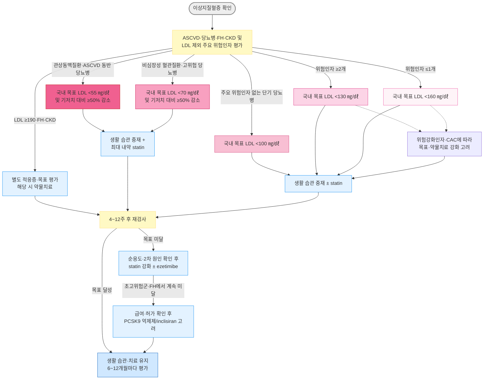

# 이상지질혈증 Dyslipidemia

## <mark style="color:green;">일반 사항</mark>

* LDL-cholesterol(LDL) 증가, 중성지방(TG) 증가, HDL-cholesterol(HDL) 감소, 또는 이들의 복합 이상
* 자체로는 증상을 일으키지 않지만 atherosclerotic cardiovascular disease(ASCVD)의 중요한 위험 인자임; 연령 증가에 따라 유병률 증가

**대사증후군 관련 국내 역학** (19세 이상; 대사증후군 팩트 시트 2026, 심장대사증후군학회)

<table data-search="false"><thead><tr><th width="260">구성 요소</th><th width="120">전체</th><th width="120">남성</th><th>여성</th></tr></thead><tbody><tr><td>대사증후군 (19세 이상)</td><td>21.5%</td><td>28.5%</td><td>14.3%</td></tr><tr><td>대사증후군 (30세 이상)</td><td>25.7%</td><td>34.1%</td><td>17.4%</td></tr><tr><td>대사증후군 (65세 이상)</td><td>39.0%</td><td>39.3%</td><td>38.9%</td></tr><tr><td>복부비만</td><td>33.0%</td><td>41.5%</td><td>24.4%</td></tr><tr><td>고중성지방혈증 (TG ≥150 ㎎/㎗)</td><td>25.8%</td><td>36.3%</td><td>15.0%</td></tr><tr><td>저HDL 콜레스테롤혈증</td><td>17.8%</td><td>17.3%</td><td>18.5%</td></tr><tr><td>높은 혈압 (SBP ≥130 또는 DBP ≥85 ㎜Hg)</td><td>29.1%</td><td>34.9%</td><td>23.3%</td></tr><tr><td>고혈당 (FBS ≥100 ㎎/㎗)</td><td>29.1%</td><td>35.6%</td><td>22.4%</td></tr></tbody></table>

**대사증후군과 심혈관 질환 발생 위험** (국내 코호트, KNHANES–NHIS/HIRA 연계)

* 대사증후군이 있는 경우 주요 심혈관 질환 발생 위험이 뚜렷하게 증가함
  * 위험비(HR) : 모든 원인 사망 1.15, 심뇌혈관질환(전체) 1.77, 심근경색 1.78, 협심증 1.75, 허혈성뇌졸중 1.69, 대장암 1.39, 위암 1.31, 신장암 1.89
* LDL은 ASCVD의 주요 위험 인자이며, 현재까지는 매우 낮은 LDL-C 수준에서도 ASCVD 위험 감소가 지속되는 것으로 보고됨
  * 관찰연구의 LDL–전체 사망률 관계에는 동반 질환·영양 상태·역인과 등이 영향을 줄 수 있으므로 이를 치료 목표로 적용하지 않음
  * ≥75세에서도 지질 저하의 심혈관 이득이 확인됨. 다만 ASCVD가 없는 고령자의 일차예방은 근거의 불확실성, 노쇠·기대여명·병용약·환자 선호를 고려하여 개별화함
* non-HDL 수준이 CVD의 1st event와 강력하게 관련되어 있고 이를 조기에 낮추면 그 위험이 크게 감소한다는 보고가 있음

### <mark style="color:orange;">이상지질혈증 진단 기준 (분류)</mark>

<table><thead><tr><th>항목</th><th>기준 수치 (㎎/㎗)</th></tr></thead><tbody><tr><td>총콜레스테롤(TC)</td><td>＜200 적정 / 200~239 경계 / ≥240 높음</td></tr><tr><td>LDL 콜레스테롤</td><td>＜100 적정 / 100~129 정상 / 130~159 경계 / 160~189 높음 / ≥190 매우 높음</td></tr><tr><td>중성지방(TG)</td><td>＜150 적정 / 150~199 경계 / 200~499 높음 / ≥500 매우 높음(췌장염 위험 증가)</td></tr></tbody></table>

* 위 수치 분류 자체를 약물치료 목표로 사용하지 않음. HDL은 국내 2026 분류표에서 제외되었으나 위험평가에는 계속 사용함. 대사증후군의 낮은 HDL 기준(남 ＜40, 여 ＜50)과 주요 ASCVD 위험인자 계수 기준(남녀 모두 ＜40)을 구분함
* TG 135~149도 선택된 고위험 환자의 IPE 추가치료 판단에 사용될 수 있으며, 일반 인구의 고중성지방혈증 진단 기준이 낮아진 것은 아님

_<mark style="color:$info;">Ref. 한국지질·동맥경화학회. 이상지질혈증 진료지침 2026</mark>_

### <mark style="color:orange;">심혈관 위험도 분류</mark>


**가이드라인마다 위험도 분류 체계가 다름.**\
한국지질·동맥경화학회 2026 지침은 동반 질환과 LDL을 제외한 주요 위험인자 개수에 따라 치료 목표를 정함. ESC/EAS는 SCORE2/SCORE2-OP를, ACC/AHA 2026은 PREVENT-ASCVD를 사용함. SCORE는 치명적 사건만, SCORE2와 PREVENT-ASCVD는 치명적·비치명적 사건을 포함하므로 산출값과 구간을 직접 비교하면 안 됨. 아래 국내 치료에서는 한국지침 분류와 목표를 우선 제시하고, 외국 지침은 별도 절에서 구분함.


#### <mark style="color:$primary;">한국지질·동맥경화학회 질환·위험군 분류 (2026)</mark>

* **관상동맥질환군**
* **비심장성 혈관질환군** : 죽상경화성 허혈뇌졸중/TIA, 유의한 경동맥질환, 말초동맥질환, 복부대동맥류
* **당뇨병군** : ASCVD 동반 여부, 표적장기손상, 주요 위험인자, 당뇨병 유형·유병기간에 따라 세분화
* **중등도위험군** : LDL을 제외한 주요 위험인자 2개 이상
* **저위험군** : LDL을 제외한 주요 위험인자 1개 이하
* 위험강화인자가 있으면 중등도·저위험군에서도 치료목표 강화를 고려; 세부 목표는 아래 국내 관리 목표 표 참조


**2026 ACC/AHA/Multisociety 이상지질혈증 가이드라인 - PREVENT-ASCVD 위험도 구간**\
2018년 가이드라인의 Pooled Cohort Equations(PCE)를 대체하여 [**PREVENT-ASCVD 방정식**](https://professional.heart.org/en/guidelines-and-statements/prevent-calculator)을 1차 예방 위험도 산출에 사용하도록 권고함(30\~79세 적용). PCE 대비 위험도가 40\~50% 낮게 산출되는 경향이 있어 위험 구간 자체를 하향 재조정함\
• **＜3%- 저위험(Low); 3\~＜5% - 경계(Borderline); 5\~＜10% - 중등도(Intermediate); ≥10% - 고위험(High)**


## <mark style="color:green;">원인</mark>

* 유전 : LDL ≥190 ㎎/㎗ or TG ≥500 ㎎/㎗ 시 유전적 원인 고려
* 신체 활동 부족, 비만, 과음, 흡연, 포화지방·트랜스지방 및 정제 탄수화물이 많은 식사
* 갑상선저하증, 당뇨병, 간질환, 신증후군, 만성 신부전
* 약물 : thiazide, cyclosporine, progestin, steroid, protease inhibitor(항바이러스제), isotretinoin

#### <mark style="color:$primary;">2차성 이상지질혈증 원인별 지질 패턴 (선별 체크리스트)</mark>

<table data-search="false"><thead><tr><th width="342">원인</th><th>특징적 지질 패턴</th></tr></thead><tbody><tr><td>갑상선저하증(hypothyroidism)</td><td>LDL↑</td></tr><tr><td>신증후군(nephrotic syndrome)</td><td>LDL↑↑(현저한 상승)</td></tr><tr><td>만성콩팥병(CKD)</td><td>TG↑</td></tr><tr><td>담즙정체(cholestasis)</td><td>TC↑</td></tr><tr><td>과음(alcohol)</td><td>TG↑</td></tr><tr><td>steroid</td><td>LDL↑, TG↑</td></tr><tr><td>HIV 치료제(protease inhibitor 등)</td><td>TG↑</td></tr></tbody></table>

_✽새롭게 발견된 이상지질혈증에서 이 패턴에 해당하는 병력·검사 소견이 있으면 2차성 원인을 우선 감별_

### <mark style="color:orange;">위험 인자</mark>

#### <mark style="color:$primary;">LDL을 제외한 ASCVD의 주요 위험 인자</mark>

_\*위험 인자의 정량적으로 개수를 셀때 적용되는 목록_

1. 흡연
2. 고혈압 : SBP ≥140 ㎜Hg 또는 DBP ≥90 ㎜Hg 또는 항고혈압제 복용
3. 낮은 HDL : ＜40 ㎎/㎗
   * HDL 60~100 ㎎/㎗ 범위에서만 보호 인자로 간주하여 총 위험인자 개수에서 한 개를 차감함; ＞100에서는 차감하지 않음
4. 연령 : 남 ≥45세, 여 ≥55세
5. 조기 관상동맥병 가족력 : 부모나 형제자매 중 남 ＜55세, 여 ＜65세에서 관상동맥병 발병

#### <mark style="color:$primary;">국내 위험강화인자 (2026)</mark>

* 스트레스·우울증 등 주요 정신질환, 비만, 신체활동 부족, 만성 염증질환, 조기폐경, 전자간증·임신성 고혈압 병력, 수면무호흡증, HIV 감염
* Lp(a) ≥50 ㎎/㎗, hsCRP ≥2 ㎎/L, ApoB 상승
* 주요 위험인자 개수에 단순 합산하지 않고 치료목표 강화 판단에 활용. 중등도위험군은 LDL 100~129 ㎎/㎗에서도 statin을 고려할 수 있으며, 결정이 불확실하면 CAC를 이용한 위험 재분류를 고려

_<mark style="color:$info;">Ref. 한국지질·동맥경화학회. 이상지질혈증 진료지침 2026</mark>_

#### <mark style="color:$primary;">관상동맥에 영향을 주는 위험 인자 \[ESC/EAS]</mark>

_\*정량적으로 개수를 세는 위험 인자가 아니라, 경계/중등위험군 환자의 위험도를 상향 재분류할지 판단할 때 참고하는 정성적 위험 수정 인자(risk modifier)_

* 비만 & 중심 비만
* 신체 비활동
* 정신적 스트레스(활력 고갈 포함), social deprivation
* 주요 정신 질환
* 심방세동, 좌심실 비대
* 만성 신질환
* 만성 면역 매개 염증 장애
* 폐쇄수면무호흡증
* 대사이상지방간질환(MASLD)
* HIV 감염 치료
* 조기 CVD 가족력(남 ＜55세, 여 ＜60세)
* 만성 염증질환(류마티스관절염, 건선 등)은 지속적 염증 신호전달을 통해 ASCVD 위험을 증폭시킴; 암, 심부전, HIV 감염도 위험 증폭 동반질환으로 함께 고려 <mark style="color:$info;">[2026 ACC/AHA]</mark>

## <mark style="color:green;">임상 양상</mark>

* 대부분 무증상 - 건강검진 등 우연한 혈액 검사에서 발견되는 경우가 대부분
* 중증 고중성지방혈증(TG ≥1,000 ㎎/㎗) 시사 소견
  * 급성 췌장염(심와부 통증, 오심, 구토)
  * eruptive xanthoma(발진성 황색종) : 몸통·사지 신전부의 다발성 황색 구진
  * lipemia retinalis(안저 검사 시 혈관이 우유빛으로 관찰됨)
* 가족성 고콜레스테롤혈증(FH) 등 중증·유전성 이상지질혈증 시사 소견
  * tendon xanthoma(건 황색종) : 아킬레스건, 손등 신전건에 호발
  * xanthelasma(눈꺼풀 황색종)
  * corneal arcus(각막환) - 특히 ＜45세에서 관찰 시
* 상기 소견 없이도 조기 ASCVD(협심증, 간헐성 파행 등)가 이상지질혈증의 첫 임상 발현일 수 있음

### <mark style="color:$danger;">🚩 Red Flags!</mark>

<mark style="color:$danger;">**즉각 조치 또는 의뢰**</mark>

* 새로 발생한 심한 상복부 통증·지속적인 구토 → 급성 췌장염 등 급성 복증 평가; TG ≥1,000 ㎎/㎗이면 고중성지방혈증성 췌장염을 강하게 의심하며, 그보다 낮은 수치도 췌장염을 배제하지 않음
* 흉통 또는 신경학적 결손 → 급성 관상동맥증후군, 급성 뇌졸중

<mark style="color:$warning;">**당일~수일 내 평가**</mark>

* TG ≥500 ㎎/㎗ → 금주·식이 교정·2차 원인 평가와 췌장염 예방 치료; ≥1,000, 급격한 상승, 조절되지 않는 당뇨병 또는 임신이 동반되면 더욱 신속히 평가
* LDL ≥190 ㎎/㎗ → 2차 원인·FH 평가 및 지연 없이 약물치료 계획 수립

<mark style="color:$info;">**조기 평가 및 추적**</mark>

* 건황색종, 조기(＜45세) 각막환, LDL ≥190 ㎎/㎗ 또는 조기 ASCVD 가족력 → 가족성 고콜레스테롤혈증(FH) 평가 및 필요 시 지질 전문 진료 의뢰(눈꺼풀 황색종 단독은 비특이적)
* 최대 내약 용량의 statin ± ezetimibe 치료 후에도 LDL 목표에 도달하지 못하는 경우(초고위험군·FH에서는 1년을 기다리지 말고 조기 강화/의뢰)
* Statin 관련 근육통 등 부작용으로 순응도가 지속적으로 낮은 경우
* 치료에도 불구하고 조절되지 않는 이상지질혈증이나 조절되지 않는 당뇨병 동반
* 적정 지질 수준 도달에도 불구하고 죽상 혈전 질환이 영상학적으로 진행하는 경우

## <mark style="color:green;">진단</mark>

### <mark style="color:orange;">지질 검사</mark>

* 일반 선별 검사는 비공복으로도 가능함. 다만 비공복 TG ≥400 ㎎/㎗, 중증 고중성지방혈증 의심, 췌장염 병력 또는 치료 결정에 정확한 TG가 필요한 경우에는 9\~12시간 공복으로 재검
* 안정된 환자는 치료 방침 결정 전 서로 다른 시점에 최소 2회 반복 시행; 결과 간 현저한 차이가 있으면 추가 측정. ACS 등 즉시 치료가 필요한 경우 재검을 기다리며 치료를 지연하지 않음

#### <mark style="color:$primary;">기본 검사</mark>

* TC : 심혈관 질환 위험의 포괄적인 추정에 이용
* LDL : 선별, 진단, 관리에 이용
* HDL : 위험 추정을 더욱 구체화하는 데 이용
* TG : 일상적인 지질 분석 프로세스로 이용

#### <mark style="color:$primary;">선택적 검사</mark>

* non-HDL(= 총 콜레스테롤 - HDL) : 모든 죽종 형성 지질단백질(LDL, VLDL, IDL)을 반영
  * 높은 TG, 매우 낮은 LDL, 당뇨병, 비만 등에서 위험 평가에 이용
* ApoB : 높은 TG, 매우 낮은 LDL, 비만, 당뇨병, 만성콩팥병(CKD), 대사증후군 등에서 위험 평가에 이용
  * 위 상황들은 작고 밀도 높은 LDL 입자(small dense LDL)가 많아 LDL-C 수치가 실제 죽상경화 부담을 과소평가할 수 있음 - 이런 경우 입자 수를 직접 반영하는 ApoB가 더 정확함
  * LDL-C·non-HDL-C와 입자 수가 불일치하는 경우 보완 지표로 사용; LDL-C가 기본 치료 목표임
  * 2026 ACC/AHA 가이드라인은 지질단백질 이상 진단 보조를 위한 ApoB 측정을 명시적으로 권고함


**Lp(a)**

• <mark style="color:$info;">\[2026 ACC/AHA]</mark> 성인에서 평생 1회 보편적 선별 검사를 권고(유전적 영향이 큰 지표로 통상 반복 측정하지 않으나, 급성 질환·임신·신장질환 등으로 해석이 불확실하거나 치료 반응 평가가 필요한 경우 재검을 개별화)\
• Risk enhancer 역치 : ≥50 ㎎/㎗ 또는 ≥125 nmol/L - 경계/중등위험군을 상위 위험군으로 재분류할지 판단하는 데 활용\
• 매우 높은 수치(＞180 ㎎/㎗ 또는 ＞430 nmol/L)는 평생 ASCVD 위험이 매우 높음을 시사하지만, 그 자체만으로 임상 ASCVD와 같은 초고위험군으로 자동 분류하지는 않음\
• LDL이 목표에 도달한 상태에서도 Lp(a) 상승은 독립적인 잔여 위험 인자로 작용함\
• 특히 조기 CVD 가족력이 있거나 경계/중등위험군 재분류가 필요한 환자에서 우선 고려\
• ㎎/㎗와 nmol/L는 고정 환산계수로 변환하지 않음


#### <mark style="color:$primary;">LDL</mark>

* 직접 측정 또는 계산
* [Friedewald 계산](https://www.mdcalc.com/calc/70/friedewald-equation-low-density-lipoprotein-cholesterol-ldl-c) 공식 : LDL = TC − HDL − (TG÷5)
  * TG가 증가할수록 정확도가 떨어지며, TG ≥400 ㎎/㎗에서는 사용하지 않음
  * [Martin-Hopkins equation](https://www.msdmanuals.com/professional/multimedia/clinical-calculator/martin-equation-for-low-density-lipoprotein-ldl-c), [Sampson equation](https://www.mdcalc.com/calc/10669/sampson-equation-low-density-lipoprotein-cholesterol-ldl-c) 등 TG 수준에 따라 보정 계수를 달리하는 계산식이 Friedewald 공식보다 정확도가 높은 것으로 알려져 있음
* 고중성지방혈증, 당뇨병, 혈관질환, 비공복 채혈 등 계산값의 신뢰도가 떨어질 수 있는 상황에서는 직접 측정 또는 위 대체 계산식 사용을 고려; 특정 수치를 절대 기준으로 단정하기보다 임상 상황에 따라 판단
* TG가 매우 높을 때는 직접 측정 또한 부정확할 수 있음. Sampson-NIH 또는 확장 Martin-Hopkins는 TG 약 800 ㎎/㎗까지 검증되었으나 일반 Martin-Hopkins와 구분해야 하며, 검사실의 검증 범위를 확인하고 추적 시 산출 방법을 함께 기록함

### <mark style="color:orange;">지질 외 검사</mark>

* 더 적극적인 ASCVD 위험 평가 및 교정 목적으로 다음 검사들을 고려
  * arterial plaque burden 평가(경동맥 &/or 대퇴동맥 초음파), CAC(coronary artery calcium) 점수(CT), high sensitivity CRP
* 2차성 이상지질혈증 가능성 및 치료 중 안전성 감별을 위해 다음을 고려 : 혈압, 혈당, TSH, eGFR

### <mark style="color:orange;">가족성 고콜레스테롤혈증(FH) 진단</mark>

* LDL ≥190 ㎎/㎗이거나 조기 ASCVD/조기 가족력이 있는 경우 FH를 감별을 요함

#### [<mark style="color:$primary;">DLCN(Dutch Lipid Clinic Network) Score</mark>](https://www.mdcalc.com/calc/3818/dutch-criteria-familial-hypercholesterolemia-fh)

* 가족력·본인 병력·신체 소견·치료 전 LDL·유전자검사의 5개 범주에서 각각 해당하는 가장 높은 점수 하나만 선택한 뒤 합산함. 같은 범주의 행을 중복 합산하지 않음

<table><thead><tr><th>범주</th><th>항목</th><th>점수</th></tr></thead><tbody><tr><td>가족력</td><td>1촌 조기 관상동맥/혈관질환(남 ＜55세, 여 ＜60세) 또는 LDL ＞95백분위수</td><td>1</td></tr><tr><td>가족력</td><td>1촌 건황색종/각막환 또는 18세 미만 자녀의 LDL ＞95백분위수</td><td>2</td></tr><tr><td>본인 병력</td><td>조기 관상동맥질환(남 ＜55세, 여 ＜60세)</td><td>2</td></tr><tr><td>본인 병력</td><td>조기 뇌혈관/말초혈관질환</td><td>1</td></tr><tr><td>신체 소견</td><td>건황색종</td><td>6</td></tr><tr><td>신체 소견</td><td>45세 미만 각막환</td><td>4</td></tr><tr><td>치료 전 LDL (㎎/㎗)</td><td>＞325</td><td>8</td></tr><tr><td>치료 전 LDL (㎎/㎗)</td><td>251~325</td><td>5</td></tr><tr><td>치료 전 LDL (㎎/㎗)</td><td>191~250</td><td>3</td></tr><tr><td>치료 전 LDL (㎎/㎗)</td><td>155~190</td><td>1</td></tr><tr><td>유전자검사</td><td>LDLR/APOB/PCSK9의 병원성 기능 변이 확인</td><td>8</td></tr></tbody></table>

* 판정 : ＞8점(≥9점)=확정(definite), 6~8점=가능성 높음(probable), 3~5점=가능성 있음(possible), ＜3점=가능성 낮음(unlikely)
* 표의 LDL 구간은 인용 원전의 ㎎/㎗ 표기 기준임. 단위 변환·반올림한 다른 표와 경계값을 섞지 않음
* Probable 이상이면 1촌 가족의 캐스케이드 선별검사(지질 검사 ± 유전자검사)를 권고

_<mark style="color:$info;">Ref. 한국지질·동맥경화학회 FH 합의문(2022); DLCN 기준</mark>_

### <mark style="color:orange;">선별 검사 대상 및 주기</mark>

<table><thead><tr><th width="188">가이드라인</th><th width="321">대상</th><th>검사 주기</th></tr></thead><tbody><tr><td><strong>한국지질·동맥경화학회</strong> (2026)</td><td>20세 이상 모든 성인; 조기 ASCVD·중증 이상지질혈증 가족력 등이 있으면 더 젊은 연령에서도 검사</td><td>적어도 4~6년마다; 위험도·치료 여부에 따라 더 자주</td></tr><tr><td><strong>ESC/EAS</strong> (2025)</td><td>≥40세 남성, ≥50세 여성 (SCORE2/SCORE2-OP 적용)</td><td>위험 인자 평가 시 포함</td></tr><tr><td><strong>ACC/AHA</strong> (2026)</td><td>소아 9~11세 1회 선별; 19세부터 성인 선별 시작</td><td>19세 이후 적어도 5년마다; 위험인자가 있으면 더 자주</td></tr></tbody></table>

_✽ACC/AHA의 PREVENT-ASCVD 위험도 구간(저/경계/중등도/고위험)은 위 "심혈관 위험도 분류" 섹션 참조_

***



<p align="center"><strong>이상지질혈증 위험도 평가 및 치료 알고리듬</strong></p>

_<mark style="color:$info;">저자 재구성(한국지질·동맥경화학회 2026). 재발 위험이 높은 허혈뇌졸중·표적장기손상/위험인자 ≥3개 동반 당뇨병의 LDL ＜55 선택적 목표는 관리 목표 표 참조.</mark>_

***

## <mark style="background-color:$warning;">Management</mark>

### <mark style="color:orange;">한국지질·동맥경화학회 권고안 (2026)</mark>

#### <mark style="color:$primary;">관리 목표치</mark>

* 1차 관리 대상은 LDL-C, 2차 관리 대상은 non-HDL-C임. 질환·위험군별 절대 목표치와 아래에 표시한 감소율을 함께 평가

<table><thead><tr><th>질환·위험군</th><th>LDL 목표 (㎎/㎗)</th><th>non-HDL 목표 (㎎/㎗)</th><th>기저치 대비 LDL ≥50% 감소</th></tr></thead><tbody><tr><td>관상동맥질환</td><td>＜55</td><td>＜85</td><td>동시에 목표</td></tr><tr><td>비심장성 혈관질환: 죽상경화성 허혈뇌졸중/TIA, 유의한 경동맥질환, 말초동맥질환, 복부대동맥류</td><td>＜70</td><td>＜100</td><td>동시에 목표</td></tr><tr><td>ASCVD 동반 당뇨병</td><td>＜55</td><td>＜85</td><td>동시에 목표</td></tr><tr><td>고위험 당뇨병: 표적장기손상 또는 주요 위험인자 동반, 또는 유병기간 ≥10년인 2형 당뇨병</td><td>＜70</td><td>＜100</td><td>동시에 목표</td></tr><tr><td>유병기간 ＜10년이고 주요 위험인자·표적장기손상·ASCVD가 없는 당뇨병</td><td>＜100</td><td>＜130</td><td>별도 감소율 목표 없음</td></tr><tr><td>중등도위험군: 주요 위험인자 ≥2개</td><td>＜130</td><td>＜160</td><td>별도 감소율 목표 없음</td></tr><tr><td>저위험군: 주요 위험인자 ≤1개</td><td>＜160</td><td>＜190</td><td>별도 감소율 목표 없음</td></tr></tbody></table>

* 죽상경화성 허혈뇌졸중/TIA 중 재발 위험이 높은 경우 LDL ＜55를 선택적으로 고려(IIa, B)
* 표적장기손상 또는 주요 위험인자 ≥3개를 동반한 당뇨병은 LDL ＜55 및 ≥50% 감소를 선택적으로 고려(IIa, B). 조기 발현 1형 당뇨병이 20년 이상이고 표적장기손상이 있으면 강력한 조절을 개별적으로 고려
* 주요 위험인자 : 연령(남 ≥45세, 여 ≥55세), 조기 관상동맥질환 가족력, 고혈압, 현재 흡연, HDL ＜40. HDL 60~100이면 한 개 차감
* 중등도위험군에서 LDL 100~129라도 위험강화인자가 있으면 더 적극적인 치료를 고려; 저위험군도 위험강화인자에 따라 목표 강화 가능
* FH·CKD는 별도 절 참조. CKD만으로 위 표의 특정 LDL 목표를 자동 배정하지 않음
* TG ＜150은 일반적인 적정 수치이나 HDL 상승 자체를 약물치료 목표로 삼지 않음
* LDL 상승과 TG 200~499가 동반되면 LDL 목표 달성이 우선. 이후 non-HDL·ApoB 등 잔여 위험과 선택적 IPE 치료 적응증을 평가
* 최대 내약 statin ± ezetimibe에도 목표 미달이면 순응도·2차 원인을 확인하고 신속히 강화; 필요 시 지질 전문 진료 의뢰

_<mark style="color:$info;">Ref. [한국지질·동맥경화학회. 이상지질혈증 진료지침 2026](https://lipid.or.kr/reference/guideline.php?boardid=guideline&idx=1456&mode=view)</mark>_

### <mark style="color:orange;">ACC/AHA 권고안 (2026)</mark>

#### <mark style="color:$primary;">1차 예방 (30\~79세, ASCVD 병력 없음)</mark>

* 위험 평가에 [PREVENT-ASCVD 방정식](https://professional.heart.org/en/guidelines-and-statements/prevent-calculator) 사용(30\~79세 적용); 결과가 애매한 경우(경계 위험) risk enhancer(조기 심혈관질환 가족력, 만성 염증질환, Lp(a) ≥125 nmol/L 또는 ≥50 ㎎/㎗, hs-CRP 연속 2회 ≥2 ㎎/L, ApoB ≥120 ㎎/㎗, **South Asian 혈통**, **임신 관련 위험 인자**(임신성 고혈압·전자간증·임신성 당뇨·조산) 등) 또는 CAC score(30\~45세 [CAC](https://www.cac-tools.com/), 45세 이상 [MESA](https://mesa-nhlbi.org/researchers/tools/mesa-score-risk-calculator-nr))로 재평가
* LDL-C 70\~189 ㎎/㎗ 성인에서 위험도별 권고
  * 저위험(＜3%) : 생활 습관 중재 우선; 단 **LDL-C 160\~189 ㎎/㎗ 또는 30년 위험 ≥10%**인 경우 중강도 statin 고려(COR 2a) - 10년 위험은 낮아도 장기 누적 위험이 높은 30\~59세 젊은 환자에서 특히 중요
  * 경계위험(3\~＜5%) : 중강도 statin 고려, ≥30% LDL 감소 & ＜100 ㎎/㎗ 목표
  * 중등도위험(5\~＜10%) : 중강도 statin(30~49% 감소) 권고, ＜100 ㎎/㎗ 목표
  * 고위험(≥10%) : 고강도 statin 권고, ＜70 ㎎/㎗ 목표
* LDL-C ≥190 ㎎/㎗(중증 고콜레스테롤혈증) : 최대 내약 용량 statin 우선 투여 후 ezetimibe(COR 2a), PCSK9 억제제 또는 bempedoic acid 추가 고려; 임상 ASCVD 동반 시 목표 LDL-C ＜55 ㎎/㎗
* 관상동맥석회화점수(CAC score) : 10년 위험 ≥3%이면서 statin 시작 여부나 치료 강도가 불확실한 경우 위험 재분류에 활용. CAC=0이면 당뇨병, 현재 흡연, 강한 조기 ASCVD 가족력 등 고위험 조건이 없는 일부 환자에서 약물치료 연기를 고려할 수 있으며, CAC ≥100 AU 또는 ≥75th percentile이면 statin 시작·강화 근거가 됨
* 40\~75세 당뇨병 성인 : 중강도 statin으로 LDL-C ＜100 ㎎/㎗ 목표(대부분 중등도\~고위험으로 간주); 다중 위험인자 동반 시 고강도 statin & ＜70 ㎎/㎗ 고려
* 20\~39세 당뇨병 : 즉시 치료보다는 당뇨병 특이 risk enhancer(2형 유병기간 ≥10년, 1형 ≥20년 등) 평가 후 결정

#### <mark style="color:$primary;">2차 예방 (임상 ASCVD 기왕력)</mark>

* 초고위험군(very high-risk) 정의
  * 주요 ASCVD 사건(최근 12개월 내 ACS, 그 외 심근경색·허혈성 뇌졸중 병력, 증상성 말초동맥질환) ≥2회 또는
  * 주요 사건 1회 + 고위험 조건(65세 이상, 관상동맥 재관류술 병력, 현재 흡연, 당뇨병, 심부전 병력, 고혈압, 최대 내약 용량 statin+ezetimibe 투여 중에도 LDL-C ≥100 ㎎/㎗) ≥2개 동반
* 초고위험군 관리 : 목표 LDL-C ＜55 ㎎/㎗ & non-HDL-C ＜85 ㎎/㎗
  * 고강도 statin 우선; ezetimibe &/or PCSK9 억제제 병용 강력 권고
  * 목표 미달 시 bempedoic acid 추가를 고려하며, inclisiran은 아래 조건에 해당할 때 선택적으로 고려
    * Inclisiran은 evolocumab/alirocumab 사용이 어렵거나 불내성이거나 투여 빈도가 적은 것을 선호하는 환자에서 선택적으로 고려 (상대적으로 임상 근거가 아직 충분히 축적되지 않았기 때문)
* 초고위험군이 아닌 임상 ASCVD : ezetimibe, PCSK9 억제제, bempedoic acid 중 환자 상황에 맞게 선택하여 statin과 병용; 목표 LDL-C ＜70 ㎎/㎗(유럽 가이드라인보다 다소 완화된 기준)

#### <mark style="color:$primary;">비스타틴계 약제 권고 요약</mark>

* Ezetimibe : statin 1차 병용제로 높은 권고 수준(COR 1)
* PCSK9 억제제(evolocumab, alirocumab) : 초고위험군 COR 1, 그 외 COR 2a
* Bempedoic acid : statin 관련 근육 증상(SAMS) 환자에서 COR 1, 병용요법으로는 COR 2a
* Inclisiran : PCSK9 억제제 사용이 어려운 환자에서 선택적으로 COR 2a

#### <mark style="color:$primary;">신규 지표</mark>

* Lp(a) : 모든 성인에서 ASCVD 위험 평가를 위해 최소 1회 측정 권고; 100 ㎎/㎗에서 상대위험 약 2배, 180 ㎎/㎗에서 약 4배 이상 증가
* ApoB : atherogenic lipid burden을 대표하는 지표로, 특히 고TG혈증·당뇨병·CKD 등 LDL-C와 실제 위험도가 불일치할 수 있는 상황에서 유용

_<mark style="color:$info;">Ref. ACC/AHA et al. 2026 Guideline on the Management of Dyslipidemia; [ACC 요약](https://www.acc.org/Latest-in-Cardiology/Articles/2026/07/01/01/Prioritizing-Health)</mark>_

### <mark style="color:orange;">ESC/EAS 권고안 (2025)</mark>


**2025 Focused Update 핵심 변화**\
LDL 목표치는 2019년판과 동일하게 유지함. 1차 예방에서는 SCORE2/SCORE2-OP와 위험 수정 인자를 활용하고, ACS 입원 중 조기 치료 강화, bempedoic acid, 고위험 환자의 icosapent ethyl 및 Lp(a) 관련 새 근거를 반영함. Inclisiran은 LDL을 낮추지만 심혈관 사건 감소 결과가 아직 확립되지 않았음을 구분함.


#### <mark style="color:$primary;">LDL 관리 목표</mark>

* 초고위험 환자 : 기저치 대비 ≥50% 강하 & ＜55 ㎎/㎗
* 고위험 환자 : 기저치 대비 ≥50% 강하 & ＜70 ㎎/㎗
* 중등위험 환자 : ＜100 ㎎/㎗
* 저위험 환자 : ＜116 ㎎/㎗

#### <mark style="color:$primary;">기타 목표</mark>

* non-HDL : 초고위험/고위험/중등위험 환자의 2차 목표치 - 각각 85/100/130 ㎎/㎗ 미만
* ApoB : 초고위험/고위험/중등위험 환자의 2차 목표치 - 각각 65/80/100 ㎎/㎗ 미만
* TG 상승 시 다른 위험인자·2차 원인을 확인. Statin 치료 중 TG 135~499 ㎎/㎗가 지속되는 고위험·초고위험군에서 IPE 2 g bid 추가를 고려
* 혈압·HbA1c 목표는 각각의 최신 질환 지침과 환자 상태에 따라 개별화

#### <mark style="color:$primary;">초고위험 ASCVD 정의</mark>&#x20;

* 관상동맥 영상 : 의미 있는 plaque(단일 혈관 ＞50% 협착도 포함)
* 말초 영상 : 경동맥 또는 대퇴동맥 초음파(≥50% 협착)
* CAC는 독립된 자동 초고위험군 기준이라기보다 치료 결정이 불확실한 경우 활용하는 위험 수정 인자임
* SCORE2/SCORE2-OP의 위험 구간은 연령과 유럽 지역 위험도에 따라 달라지므로 단일 절단값만으로 분류하지 않음

_<mark style="color:$info;">Ref. [2025 Focused Update of the 2019 ESC/EAS Guidelines](https://www.escardio.org/guidelines/clinical-practice-guidelines/all-esc-practice-guidelines/dyslipidaemias/)</mark>_

### <mark style="color:orange;">가이드라인별 LDL 조절 전략 비교</mark>

<table><thead><tr><th>구분</th><th>ESC/EAS 2025</th><th>ACC/AHA 2026</th><th>한국지질·동맥경화학회 2026</th></tr></thead><tbody><tr><td>위험도 평가</td><td>SCORE2/SCORE2-OP와 위험 수정 인자</td><td>PREVENT-ASCVD(30~79세), 위험강화인자·CAC</td><td>질환군·주요 위험인자 개수 + 위험강화인자·CAC</td></tr><tr><td>LDL ＜55 목표</td><td>초고위험군; 기저치 대비 ≥50% 감소</td><td>Very high-risk 임상 ASCVD</td><td>관상동맥질환·ASCVD 동반 당뇨병; 재발 위험 높은 허혈뇌졸중 및 일부 고위험 당뇨병은 선택적</td></tr><tr><td>그 밖의 LDL 목표</td><td>고위험 ＜70, 중등도 ＜100, 저위험 ＜116</td><td>비-초고위험 임상 ASCVD ＜70; 1차예방은 위험도별 목표</td><td>비심장성 혈관질환·고위험 당뇨병 ＜70; 위험인자 없는 단기 당뇨병 ＜100; 중등도 ＜130; 저위험 ＜160</td></tr><tr><td>Ezetimibe</td><td>목표 미달 시 추가; ACS 조기 병용 고려</td><td>목표 미달 시 병용 약제로 권고</td><td>목표 미달 시 추가; ACS 초기 병용 고려</td></tr><tr><td>PCSK9 단클론항체</td><td>고위험 상황에서 목표 미달 시 추가</td><td>ASCVD 위험·필요 강하율에 따라 추가</td><td>최대 내약 statin+ezetimibe에도 목표 미달 시 고려</td></tr><tr><td>Inclisiran</td><td>LDL 저하 효과; 심혈관 사건 결과와 구분</td><td>PCSK9 단클론항체 사용 곤란·저빈도 투여 선호 등에서 선택적 고려</td><td>LDL 저하 약제로 소개; 국내 허가 있음</td></tr><tr><td>Bempedoic acid</td><td>Statin 불내성 등의 치료 선택지</td><td>Statin 근육 증상 및 목표 미달 상황에 따라 선택</td><td>Statin 불내성·목표 미달에서 고려하는 국외 치료 선택지</td></tr><tr><td>영상/CAC</td><td>위험 수정·재분류에 활용</td><td>CAC 부담별 치료 강화</td><td>중등도·저위험군의 치료 결정에 활용</td></tr><tr><td>IPE</td><td>Statin 치료 후 TG 135~499인 고위험군에서 4 g/d 고려</td><td>선택된 ASCVD 또는 당뇨병 환자에서 TG 150~499 시 고려</td><td>Statin 치료 후 TG 135~499인 ASCVD·고위험 당뇨병에서 4 g/d 고려</td></tr></tbody></table>

_✽위험군 명칭·대상·권고 강도가 서로 다르므로 동일 명칭만으로 목표를 대응시키지 않음. 국외 약제 근거와 국내 허가·급여는 별개임 - 저자 편집_

_✽본 표는 저자가 여러 가이드라인 원문을 비교·요약한 것임(저자 편집). 개별 가이드라인의 세부 권고 등급(Class/Level of Evidence)은 원문 확인 필요._

## <mark style="color:green;">비-약물 치료 및 예방</mark>

* 금연 : 모든 형태의 담배/흡연 금지
* 식이 : 포화지방산 제한; 전곡류, 채소, 과일, 생선 권장
* 신체 활동 : 주 150~300분 중등 강도 또는 75~150분 고강도 유산소 운동 + 주 2일 이상 근력 운동; 좌식 시간을 줄임
* 체중 관리 : 비만 시 현재 체중의 5\~10% 감량 또는 평소보다 500 ㎉/d 감량 섭취

### <mark style="color:orange;">생활 습관 중재 방법과 효과</mark>

<table data-header-hidden><thead><tr><th width="126"></th><th width="462"></th><th></th></tr></thead><tbody><tr><td><strong>목표 항목</strong></td><td><strong>방법</strong></td><td><strong>효과</strong></td></tr><tr><td><strong>TC 및 LDL 낮추기</strong></td><td>트랜스지방 섭취 회피, 포화지방 섭취 제한, 식이 섬유 섭취 증가, 체중 감량, 규칙적 신체활동, 알코올 제한</td><td>++</td></tr><tr><td><strong>TG-rich lipoprotein 낮추기</strong></td><td>규칙적 신체활동, 총 탄수화물·단순당 및 알코올 제한, 체중 감량, 포화지방을 불포화지방으로 대체</td><td>++</td></tr><tr><td><strong>HDL 높이기</strong></td><td>규칙적 신체활동, 트랜스지방 섭취 회피, 체중 감량, 탄수화물 섭취 제한, 불포화지방 섭취 증가, 금연</td><td>+</td></tr></tbody></table>

_✽홍국(red yeast rice)·일반 오메가-3 등 건강기능식품은 성분·용량의 표준화와 임상 사건 감소 근거가 부족하므로 지질 저하 약물의 대체제로 권고하지 않음._

_<mark style="color:$info;">++ = 5\~10%; + = ＜5%</mark>_

### <mark style="color:orange;">식이</mark>

* 특정 식이 콜레스테롤 섭취 제한 목표를 제시하지 않으며 지중해식 식단 또는 DASH 다이어트를 권고함
  * 계란을 포함한 식이 콜레스테롤과 심혈관 위험의 연관성은 일반 인구에서는 명확히 확인되지 않았음; 관련 근거는 제한적이고 연구마다 결과가 엇갈림
* 권장 : 과일 및 채소 섭취(8\~10 servings/d), 저지방 유제품(2\~3 servings/d), 생선(2회/wk)
* 제한 : 음주는 시작을 권하지 않으며 가급적 금주 또는 최소화(TG ≥500에서는 금주), 소금(＜5 g/d), 첨가당·설탕 가미 음료, 포화지방·트랜스지방, 가공육·과도한 붉은 고기
  * 지나친 지방 섭취 제한은 탄수화물 섭취를 증가시켜 TG 상승을 유발할 수 있음
  * 우리나라 권고 지방 섭취 비율 : 15\~25%
* 식이 섬유 : 1일 25\~40 g의 식이 섬유 섭취(최소 7\~13 g의 수용성 식이 섬유 포함) <mark style="color:$info;">\[ESC]</mark>
  * 수용성 식이 섬유 : 성분 예) 실리움, 베타 글루칸, 펙틴, 구아검, 알긴산; 식품 예) 잡곡, 전곡류, 해조류, 채소, 과일

<table data-header-hidden data-search="false"><thead><tr><th></th><th></th><th></th><th></th></tr></thead><tbody><tr><td><strong>구분</strong></td><td><strong>충분히 섭취</strong></td><td><strong>적당히 섭취</strong></td><td><strong>제한적 섭취</strong></td></tr><tr><td><strong>곡물</strong></td><td>전곡류(현미, 귀리, 통밀빵 등)</td><td>정제된 빵, 쌀, 파스타, 비스킷, 콘플레이크</td><td>페이스트리, 머핀, 파이, 크루아상</td></tr><tr><td><strong>채소</strong></td><td>생채소, 조리 채소</td><td>감자</td><td>버터·크림으로 조리된 채소</td></tr><tr><td><strong>콩류</strong></td><td>완두콩, 병아리콩, 대두, 렌틸콩</td><td>-</td><td>-</td></tr><tr><td><strong>과일</strong></td><td>생과일, 냉동 과일</td><td>말린·통조림 과일, 젤리, 잼, 셔벗, 아이스롤리·과일주스</td><td>-</td></tr><tr><td><strong>감미료</strong></td><td>제로칼로리 감미료</td><td>설탕, 꿀, 사탕</td><td>케이크, 아이스크림, 과자, 청량음료</td></tr><tr><td><strong>고기·생선</strong></td><td>생선, 껍질 없는 가금류</td><td>저지방 육류, 해산물</td><td>소시지, 베이컨, 핫도그, 햄, 갈비</td></tr><tr><td><strong>유제품·계란</strong></td><td>무지방 우유·요구르트</td><td>저지방 유제품, 계란</td><td>전유, 크림, 고지방 치즈</td></tr><tr><td><strong>조리 지방·드레싱</strong></td><td>식물성 지방, 머스터드, 무지방 드레싱</td><td>올리브유, 견과류유, 마요네즈, 연질 마가린, 샐러드드레싱</td><td>트랜스지방, 경화마가린, 야자유, 코코넛유, 라드</td></tr><tr><td><strong>견과류·씨앗</strong></td><td>모든 종류(무염, 코코넛 제외)</td><td>-</td><td>코코넛</td></tr><tr><td><strong>조리 방법</strong></td><td>굽기, 찌기, 끓이기</td><td>볶기, 오븐 구이</td><td>튀김</td></tr></tbody></table>

### <mark style="color:orange;">운동</mark>

* LDL 감소 효과는 제한적이나 TG 감소와 심혈관 위험 감소 효과는 충분히 입증되어 있어 권고
* 유산소 운동은 TG·체력·심혈관 위험 개선에 유익하며, 저항성운동을 함께 시행하여 근력·체성분·대사 건강을 개선함

### <mark style="color:orange;">생활습관 중재 실천 로드맵</mark>

1. **평가 단계** : 체중·허리둘레·혈압·혈당·지질 수치 측정, 흡연·음주·식습관·신체활동 수준 평가, 심혈관질환 위험도 분류
2. **식이 중재 단계**
   * LDL 저하 : 포화지방·트랜스지방 제한, 식이섬유·phytosterol 섭취 증가, 지중해식 식사
   * TG 저하 : 단당류·이당류 제한, 오메가-3 지방산 섭취, 체중 감량
   * HDL 상승 : 불포화지방 섭취, 금연, 규칙적 운동
3. **신체 활동 단계** : 유산소 운동(주 5회 이상, 30\~60분 - 걷기, 자전거, 수영 등), 근력 운동(주 2\~3회 병행), 좌식 생활 감소(1시간 이상 앉아 있을 경우 5분 이상 스트레칭)
4. **체중 및 음주 관리 단계** : 과체중·비만에서는 초기 6개월 체중 5~10% 감량을 목표로 개별화하고 허리둘레·대사 지표 개선을 평가(복부비만 기준: 남 ≥90 ㎝, 여 ≥85 ㎝), 음주는 HDL 상승 효과보다 전체 심혈관 위험을 고려하여 절주 또는 금주 권장
5. **추적 및 강화 단계** : 생활습관 단독 중재는 약 3~6개월 후, 약물 시작·용량 변경은 4~12주 후 지질 재평가, 개선 미흡 시 영양사·운동 전문가 연계, 필요 시 약물치료 병행

## <mark style="color:green;">약물 치료</mark>

### <mark style="color:orange;">약물 치료 방침</mark>

#### <mark style="color:$primary;">약물 치료 대상</mark>

* 저·중등도위험군에서 생활습관을 수주~수개월 교정한 후에도 목표에 도달하지 못하면 약물치료 고려; 위험강화인자가 있으면 더 이른 치료를 개별화
* LDL ≥190 ㎎/㎗, ASCVD, 치료 적응증이 있는 당뇨병·CKD 등은 생활습관 단독 치료 3~6개월을 일률적으로 기다리지 않음
* TG ≥500 ㎎/㎗가 지속되면 췌장염 예방을 위한 식이·금주·2차 원인 교정과 약물치료를 신속히 평가

#### <mark style="color:$primary;">LDL 조절을 위한 약물 요법 원칙</mark>

* 질환·위험군의 LDL 목표와 필요한 강하율에 맞는 statin 시작; 관상동맥질환·ASCVD 등 큰 강하가 필요하면 최대 내약 고강도 요법 우선
* 목표 미달이면 순응도·2차 원인·상호작용을 확인하고 statin 증량 또는 ezetimibe 추가; ACS 등에서는 처음부터 병용 가능
* 최대 내약 statin+ezetimibe에도 목표 미달이면 ASCVD·FH·필요 강하율을 평가하여 PCSK9 단클론항체 등 추가를 고려. 진료지침상 적응증과 급여 인정 대상은 별개임
* Statin 불내성은 저용량·다른 statin 재시도와 함께 ezetimibe·PCSK9 단클론항체 등 대체/병용 치료를 선택; inclisiran은 단클론항체 사용 곤란 등에서 선택적으로 고려
* 담즙산결합수지는 TG가 높지 않고 다른 약제 사용이 어려운 경우 선택적으로 고려

#### <mark style="color:$primary;">TG 조절을 위한 약물 요법 - 단계별 접근</mark>

* **TG 150~199 ㎎/㎗** : 생활습관·2차 원인 교정이 기본. TG 수치만으로 저하제를 일률적으로 시작하지 않으며 ASCVD 위험에 따른 statin 적응증을 별도로 평가
* **TG 200~499 ㎎/㎗** : LDL·non-HDL 조절과 ASCVD 예방을 위한 statin이 우선
* **TG 500~999 ㎎/㎗** : 췌장염 예방을 위해 금주, 첨가당·정제 탄수화물 제한, 저지방식과 총지방 제한의 개별화; 2차 원인을 교정하고 지속 상승 시 fibrate 또는 처방용 omega-3 고려
* **TG ≥1,000 ㎎/㎗** : 매우 저지방식(총에너지의 약 10~15%, 대개 지방 ≤20~30 g/d), 금주·첨가당 제한, 고혈당 신속 교정 및 TG 저하 치료; 복통·구토 시 췌장염을 즉시 평가
* **ASCVD 잔여 위험 감소를 위한 IPE** : 최대 내약 statin 치료 후에도 TG 135~499 ㎎/㎗가 지속되는 ASCVD·고위험 당뇨병 환자에서 2 g bid(총 4 g/d)를 고려. 국외 EPA 단독 IPE의 근거이며 국내 EPA+DHA 혼합제·일반 보충제로 대체하여 같은 사건 감소 효과를 기대하지 않음

_<mark style="color:$info;">Ref. 한국지질·동맥경화학회 2026; ACC/AHA 2026; REDUCE-IT</mark>_

### <mark style="color:orange;">지질 저하제 효과 비교</mark>

<table data-header-hidden data-search="false"><thead><tr><th width="130"></th><th width="102"></th><th width="102"></th><th width="102"></th><th></th></tr></thead><tbody><tr><td><strong>약물군</strong></td><td><strong>LDL 변화</strong></td><td><strong>HDL 변화</strong></td><td><strong>TG 변화</strong></td><td><strong>비고</strong></td></tr><tr><td><strong>Statin</strong></td><td>↓ 21–55%</td><td>↑ 2–10%</td><td>↓ 6–30%</td><td>중등강도 ≈30%, 고강도 ≈50%, 고강도+ezetimibe ≈65%</td></tr><tr><td><strong>Ezetimibe</strong></td><td>↓ 10–18%</td><td>-</td><td>-</td><td>단독 시 15%, statin 병용 시 추가 15%</td></tr><tr><td><strong>Fibrate</strong></td><td>변동</td><td>↑ 6–18%</td><td>↓ 약 25–50%</td><td>TG 중심 개선, LDL은 변동 가능</td></tr><tr><td><strong>Niacin</strong></td><td>↓ 10–25%</td><td>↑ 10–35%</td><td>↓ 20–30%</td><td>HDL 상승 효과 뚜렷하나 부작용으로 사용 제한</td></tr><tr><td><strong>Bile acid sequestrant</strong></td><td>↓ 15–25%</td><td>-</td><td>↑(경향)</td><td>TG 상승 가능성 주의</td></tr><tr><td><strong>PCSK9 억제제(단클론항체)</strong></td><td>↓ 48–71%</td><td>-</td><td>-</td><td>단독 ≈60%, 고강도 statin 병용 ≈75%, +ezetimibe ≈85%</td></tr><tr><td><strong>Inclisiran(siRNA)</strong></td><td>↓ 약 50%</td><td>-</td><td>-</td><td>statin 병용 시 지속적 LDL 감소; 연 2회 투여</td></tr><tr><td><strong>Bempedoic acid</strong></td><td>↓ 17–28%</td><td>-</td><td>-</td><td>Statin 불내성 등에서 고려하는 국외 치료 선택지</td></tr><tr><td><strong>처방용 Omega-3</strong></td><td>DHA 함유 시 ↑ 가능</td><td>-</td><td>↓ 약 20–45%</td><td>EPA 단독 IPE와 EPA+DHA 혼합제의 사건 감소 근거를 구분</td></tr></tbody></table>

### <mark style="color:orange;">Statin (HMG-CoA reductase inhibitor)</mark>

* ASCVD 예방의 근거가 확립된 1차 선택제; 위험도와 필요한 LDL 강하율에 따라 용량·병용요법 선택
* 약제 용량 2배 증량 시 LDL 강하 효과 약 6%p 추가 감소("rule of 6")
* 부작용 : 소화 장애, 두통, 피로감, 근육통, 관절통, 간 독성, 근육병증(빈도＜0.1%), 혈당 상승
  * 설명할 수 없는 근육통이 있으면 진료 받도록 교육
  * statin과 당뇨병 : 용량 의존적으로 T2DM 발생 위험이 있으나 statin의 ASCVD 위험 감소 효과가 이를 상회함; pitavastatin, pravastatin에서 상대적으로 적게 발생
* 주의/금기 : 활동성 간질환, 임신, 수유
  * 출혈성 뇌졸중 병력은 절대 금기가 아니라 위험-편익을 고려하여 결정하는 사안임(SPARCL 이후에도 이 원칙은 유지됨)
* 심부전 자체만을 이유로 statin을 새로 시작하지는 않으나, ASCVD 등 다른 적응증이 있으면 치료함. 투석 중 일률적 신규 시작은 권고하지 않으며, 투석 전부터 복용하던 치료의 지속은 개별 판단
* 약물 상호작용 : simvastatin·lovastatin·atorvastatin은 강한 CYP3A4 억제제(clarithromycin 등 macrolide, azole 항진균제, 일부 protease inhibitor 등)와 병용 시 혈중 농도와 근육병증 위험이 증가함. Cyclosporine, gemfibrozil 및 자몽도 약제별 상호작용·용량 제한을 확인
  * pravastatin·pitavastatin·rosuvastatin은 CYP3A4 영향이 적지만, 수송체 상호작용과 신기능에 따른 용량 조절은 별도로 확인

#### <mark style="color:$primary;">Statin의 작용 강도에 따른 분류</mark>

<table data-header-hidden><thead><tr><th width="91"></th><th width="90"></th><th></th><th width="220"></th></tr></thead><tbody><tr><td><strong>강도 분류</strong></td><td><strong>LDL</strong> <br><strong>강하율</strong></td><td><strong>약제 및 용량</strong></td><td><strong>비고</strong></td></tr><tr><td><strong>고강도</strong></td><td>≥50%</td><td>atorvastatin 40–80 ㎎, rosuvastatin 20 ㎎(국외 40 ㎎)</td><td>심혈관질환 2차 예방에 우선 사용</td></tr><tr><td><strong>중등강도</strong></td><td>30–50%</td><td>atorvastatin 10–20 ㎎, rosuvastatin 5–10 ㎎, simvastatin 20–40 ㎎, pravastatin 40 ㎎(국외 80 ㎎), lovastatin 40–80 ㎎, fluvastatin XL 80 ㎎(또는 40 ㎎ bid), pitavastatin 1–4 ㎎</td><td>RCT에서 주요 심혈관 사건 감소 입증된 용량대</td></tr><tr><td><strong>저강도</strong></td><td>&#x3C;30%</td><td>simvastatin 10 ㎎, pravastatin 10–20 ㎎, lovastatin 20 ㎎, fluvastatin 20–40 ㎎</td><td>고령·저위험군에서 고려 가능</td></tr></tbody></table>

_<mark style="color:$info;">Ref. 한국지질·동맥경화학회 2026; ACC/AHA. 강도 분류의 국외 용량과 국내 허가용량을 구분함.</mark>_

#### <mark style="color:$primary;">Statin의 효과 비교</mark>

<table data-header-hidden data-search="false"><thead><tr><th></th><th width="84"></th><th width="72"></th><th width="81"></th><th width="75"></th><th width="74"></th><th width="87"></th><th width="106"></th></tr></thead><tbody><tr><td><strong>성분명(코드)</strong></td><td><strong>용량(㎎/d)</strong></td><td><strong>섭취 시각</strong></td><td><strong>신 배설(%)</strong></td><td><strong>간 대사(CYP)</strong></td><td><strong>LDL 변화</strong></td><td><strong>TG 변화</strong></td><td><strong>HDL 변화</strong></td></tr><tr><td><strong>Lovastatin(LVS)</strong></td><td>20–40</td><td>저녁</td><td>10</td><td>3A4</td><td>↓24–28%</td><td>↓8%</td><td>↑4%</td></tr><tr><td><strong>Pravastatin(PVS)</strong></td><td>40</td><td>저녁</td><td>20</td><td>-</td><td>↓30–36%</td><td>↓13–20%</td><td>↑6%</td></tr><tr><td><strong>Simvastatin(SVS)</strong></td><td>20–40</td><td>저녁</td><td>13</td><td>3A4</td><td>↓39–45%</td><td>↓13–23%</td><td>↑5–8%</td></tr><tr><td><strong>Fluvastatin(FVS)</strong></td><td>40</td><td>저녁</td><td>10</td><td>2C9</td><td>↓24–28%</td><td>↓13–20%</td><td>↑6%</td></tr><tr><td><strong>Atorvastatin(AVS)</strong></td><td>10–80</td><td>무관</td><td>2</td><td>3A4</td><td>↓36–55%</td><td>↓20–28%</td><td>↑2–10%</td></tr><tr><td><strong>Rosuvastatin(RSVS)</strong></td><td>2.5–20(국내)</td><td>무관</td><td>10</td><td>2C9/2C19(일부)</td><td>↓38–55%</td><td>↓20–28%</td><td>↑2–10%</td></tr><tr><td><strong>Pitavastatin(PTVS)</strong></td><td>1–4</td><td>무관</td><td>15</td><td>2C9(일부)</td><td>↓31–47%</td><td>↓20–28%</td><td>↑2–10%</td></tr></tbody></table>

_<mark style="color:$info;">Ref. 한국지질·동맥경화학회 2026; ACC/AHA. 강도 분류의 국외 용량과 국내 허가용량을 구분함.</mark>_

#### <mark style="color:$primary;">약제 종류</mark>

* lovastatin : 통상 시작 용량 20 ㎎(범위 10\~80 ㎎), 저녁 식사와 함께 복용 <mark style="color:blue;">\[로바로드]</mark>
* simvastatin : 심장 약물(amiodarone, amlodipine, diltiazem, dronedarone, ranolazine, verapamil) 병용 시 용량 제한; 20 ㎎(5\~40 ㎎), 저녁 복용 <mark style="color:blue;">\[조코]</mark>
* pravastatin : 40 ㎎(국내 10~40 ㎎), 저녁 복용 <mark style="color:blue;">\[메바로친]</mark>
* fluvastatin : 40 ㎎(20\~80 ㎎), 저녁 복용 <mark style="color:blue;">\[레스콜]</mark>
* atorvastatin : 10\~20 ㎎(10\~80 ㎎), 복용 시간 무관(저녁 권고) <mark style="color:blue;">\[리피토]</mark>
* rosuvastatin : 5~10 ㎎으로 시작(국내 최대 20 ㎎/d), 복용 시간 무관 <mark style="color:blue;">\[크레스토]</mark>
* pitavastatin : 2 ㎎(1\~4 ㎎), 복용 시간 무관 <mark style="color:blue;">\[리바로]</mark>

**Statin/항고혈압제 복합제**

* rosuvastatin/candesartan <mark style="color:blue;">\[투게논]</mark>
* rosuvastatin/fimasartan <mark style="color:blue;">\[투베로]</mark>
* rosuvastatin/valsartan <mark style="color:blue;">\[로바티탄]</mark>
* rosuvastatin/losartan/amlodipine <mark style="color:blue;">\[아모잘탄 큐]</mark>
* rosuvastatin/telmisartan <mark style="color:blue;">\[듀오웰]</mark>
* rosuvastatin/telmisartan/amlodipine <mark style="color:blue;">\[텔로스톱 플러스]</mark>
* pitavastatin/valsartan <mark style="color:blue;">\[리바로 브이]</mark>
* pitavastatin/valsartan/amlodipine <mark style="color:blue;">\[리바로 하이]</mark>
* rosuvastatin/ezetimibe/losartan/amlodipine <mark style="color:blue;">\[아모잘탄엑스큐]</mark>
* rosuvastatin/ezetimibe/telmisartan/amlodipine <mark style="color:blue;">\[누보로젯]</mark>

**Statin/항당뇨병제 복합제**

* rosuvastatin/gemigliptin <mark style="color:blue;">\[제미로우]</mark>

### <mark style="color:orange;">콜레스테롤 흡수 억제제</mark>

* 효과 : LDL↓; statin 복합 시 LDL 34\~61%↓, fenofibrate 복합 시 LDL 20\~22%↓
* statin과 병합 사용(statin에 대한 우선 병용 약제) 또는 statin 과민 환자에서 단독 사용
* 부작용 : 복통, 설사, 부글거림, 피로감, 근육병증(드묾)
* 금기 : 임신, 수유, 심한 간질환
* ezetimibe : 10 ㎎/d qd, 식사 무관 복용 <mark style="color:blue;">\[이지트롤]</mark>

### <mark style="color:orange;">Fibrate (fibric acid derivative)</mark>

* 효과 : TG↓; LDL 변화는 기저 TG 등에 따라 달라짐. ASCVD 감소 효과는 전체 대상에서 대체로 중립적이며, 일부 고TG·저HDL 하위군의 이득 가능성도 확립되지 않음(PROMINENT에서도 사건 감소를 입증하지 못함)
* TG ≥500 ㎎/㎗, 특히 ≥1,000 ㎎/㎗에서 췌장염 예방 목적으로 고려. ASCVD 예방 목적의 기본 약제는 statin이며, statin과 fibrate를 모든 고중성지방혈증 환자에게 일률적으로 병용하지 않음
* 부작용 : 소화 장애, 담석, 간염, 근육병증
* 주의/금기 : warfarin 병용(항응고작용↑), statin 병용(근육병증↑), 심한 간/신질환, 담석
* fenofibrate : statin 병용에 상대적으로 안전; 160 ㎎ qd 식후 즉시(제형 간 함량·생체이용률이 달라 임의 환산하지 않음) <mark style="color:blue;">\[리피딜 슈프라]</mark>
* bezafibrate : 200\~600 ㎎ #2\~3 식후 <mark style="color:blue;">\[베자립]</mark>
* ciprofibrate : 100 ㎎ qd <mark style="color:blue;">\[리파놀]</mark>
* gemfibrozil : 근육병증 위험이 상대적으로 높음; statin 병용 회피; 600 ㎎ bid, 식전 30분 <mark style="color:blue;">\[로피드]</mark>

### <mark style="color:orange;">Bile acid sequestrant (담즙산 분리제)</mark>

* 효과 : LDL 감소, HDL 증가
* statin 사용이 어려운 경우 또는 statin과 병용
* 부작용 : 변비, 복부 팽만, 담석증
* 타 약제 흡수 억제 : digitalis, warfarin, propranolol, thiazide, amiodarone, thyroxine, acetaminophen, NSAID, steroid, folic acid, Vit A/D/K, penicillin G, tetracycline
* TG를 높일 수 있어 TG ≥300 ㎎/㎗에서는 사용을 피하며, TG 상승 환자에서 LDL 저하 목적으로 우선 선택하지 않음
* cholestyramine : 4\~24 g/d, #2\~3, 식사와 함께 복용 <mark style="color:blue;">\[퀘스트란 현탁용산]</mark>
* colestipol, colesevelam : ezetimibe와 비슷한 효과가 있으나 tolerability가 낮다는 보고가 있음(국내 유통 제한적 - 처방 전 확인 필요)

### <mark style="color:orange;">Niacin (Nicotinic acid)</mark>

* 효과 : TG↓, HDL↑; statin에 추가하여 ASCVD 사건을 줄이는 이득은 확립되지 않아 일률적 병용은 권고하지 않음
* 부작용 : 홍조, 복부 불편감, 구역, 소화성 궤양, 심방세동, 간 독성, (고용량 시) 혈당↑, 요산↑
  * 홍조는 서방형 제제, 지속 사용, 식사와 함께 복용, 복용 1시간 전 aspirin 투여 시 감소
* 주의/금기 : warfarin 병용, 당뇨병, 고요산혈증, 소화성 궤양 환자, 간질환, 심한 통풍
* immediate release nicotinic acid(crystalline niacin) : 1.5\~3 g/d #3
* 서방형 nicotinic acid : 저용량 시작, 1주 단위 증량, 1\~2 g qd, 식후 취침 전 복용 <mark style="color:blue;">\[엑스립]</mark>
* acipimox : nicotinic acid analog; 250 ㎎ bid\~tid <mark style="color:blue;">\[올베탐]</mark>

### <mark style="color:orange;">PCSK9 억제제 (단클론항체)</mark>

* proprotein convertase subtilisin/kexin type 9 inhibitor, monoclonal antibody
* 효과 : LDL 48\~71%↓, non-HDL 49\~58%↓, TC 36\~42%↓
  * 최대 내약 statin 치료에 추가했을 때 LDL 강하와 함께 ASCVD 사건을 감소시킴
* 가족성 고콜레스테롤혈증 등에서 statin에 추가 고려
* 부작용 : 주사 부위 반응
* alirocumab : 75 ㎎ 격주로 시작하여 필요 시 150 ㎎ 격주 또는 300 ㎎ 4주마다 피하주사(국내 허가·유통 여부 확인)
* evolocumab : 140 ㎎ 격주 또는 420 ㎎ 매월 피하주사 <mark style="color:blue;">\[레파타 주]</mark> (ASCVD 급여 경로: 급여상 초고위험군이면서 최대 내약 statin+ezetimibe에도 LDL ≥70 또는 감소율 ＜50%. 주요 ASCVD ≥2개 또는 주요 ASCVD 1개+고위험요인 ≥2개 등 급여상 위험군 정의가 선행하며, HeFH·HoFH·불내성 경로는 별도임)
* **FOURIER 시험(NEJM 2017)** : statin 치료 중인 ASCVD 환자(LDL ≥70 ㎎/㎗) 27,564명을 evolocumab군과 위약군으로 무작위 배정; 심혈관 사망·심근경색·뇌졸중·불안정 협심증 입원·관상동맥 재관류술의 복합 발생률이 evolocumab군 9.8% vs 위약군 11.3%(HR 0.85, 95% CI 0.79\~0.92, P<0.001) - PCSK9 억제제 중 심혈관 사건 감소를 전향적으로 입증한 근거

* **VESALIUS-CV(NEJM 2026)** : 이전 심근경색·뇌졸중이 없지만 죽상경화증 또는 고위험 당뇨병이 있고 LDL ≥90인 환자에서 evolocumab이 3-point MACE를 감소시킴(5년 추정 6.2% vs 8.0%, HR 0.75). 일반 저위험 일차예방 환자에게 그대로 확대 적용하지 않음

_<mark style="color:$info;">Ref. Bohula EA et al. N Engl J Med. 2026;394:117–127. doi:10.1056/NEJMoa2514428</mark>_

### <mark style="color:orange;">경구 PCSK9 억제제 (엔리시타이드)</mark>


**국내 미허가 - 2026년 7월 미국 FDA 승인**\
MSD가 개발한 macrocyclic peptide 계열의 **경구용** PCSK9 억제제로, 2026년 7월 15일 FDA가 고콜레스테롤혈증(HeFH 포함) 성인의 식이·운동요법 보조제로 승인함(상품명 Lipfendra, 성분명 enlicitide decanoate). 기존 PCSK9 억제제가 주사제인 것과 달리 20 ㎎을 1일 1회 아침 공복에 물·블랙커피·무첨가 차와 함께 통째로 복용하며, 음식과 그 밖의 음료는 최소 30분 뒤 섭취함(미국 허가용법).


* 효과(CORALreef Lipids, ASCVD/고위험 고콜레스테롤혈증 환자 대상, statin 병용) : 24주 LDL-C의 보정된 군 간 차이 55.8%p 감소(57.1%↓ vs 위약군 3.0%↑, P<0.001)
* 효과(CORALreef HeFH, HeFH 성인 대상) : 24주 LDL-C 위약 대비 59.4%p 감소(58.2%↓ vs 위약군 2.6%↑, P<0.001)
* 부작용 : 설사(7% vs 위약 2%), 어지럼증(9% vs 위약 4%); 이상반응에 따른 치료 중단율은 위약군과 유사
* **심혈관 사건 감소 효과는 아직 입증되지 않음**(CORALreef Outcomes 연구 진행 중) - 장기 심혈관 이득이 확인된 evolocumab·alirocumab과는 근거 수준이 다르므로 이 점을 감안하여 참고할 것

_<mark style="color:$info;">Ref. [FDA. Lipfendra(enlicitide) approval, 2026](https://www.fda.gov/news-events/press-announcements/fda-approves-first-oral-pcsk9-inhibitor-lower-ldl-cholesterol-adults-high-cholesterol)</mark>_

### <mark style="color:orange;">Inclisiran (siRNA 기반 PCSK9 억제제)</mark>

* 기전 : 간세포 ASGPR을 통해 흡수되어 RNA 간섭으로 PCSK9 mRNA를 분해 → PCSK9 단백질 생성 억제 → LDL 수용체 재활용 증가 → LDL-C 감소
* 효과 : statin 병용 시 LDL 약 50% 감소, 1회 투여 후 효과가 수개월 지속
* inclisiran : 1회 284 ㎎/1.5 ㎖(inclisiran sodium 300 ㎎), 최초 및 3개월 후 투여하고 이후 6개월마다 의료기관에서 피하주사 <mark style="color:blue;">\[렉비오프리필드시린지]</mark>
* LDL 저하 효과는 확립되어 있으나 심혈관 사건 감소 결과는 단클론항체와 구분함; evolocumab/alirocumab과의 일률적 중복 투여는 권고하지 않음

### <mark style="color:orange;">Bempedoic acid</mark>

* 효과 : LDL 17\~28%↓; ezetimibe와 복합제(국외)로도 사용됨 (국외 치료 선택지)
* 주 대상 : statin 불내성 환자, statin 병용 시 추가 LDL 강하가 필요한 환자
* 부작용 : 요산 상승/통풍, 건 파열(드묾)

### <mark style="color:orange;">Omega-3 지방산</mark>

* 처방용 제제는 중증 고중성지방혈증에서 fibrate와 함께 고려할 수 있는 치료 선택지임
* 고 TG에 대하여 2\~4 g/d
  * AHA는 중성지방 강하를 위하여 4 g/d(＞3 g/d)의 EPA+DHA 또는 EPA 단독 투여를 권고
* 부작용 : 관절통, 트림, 소화불량, 변비, 가려움, 출혈 위험 증가 가능성(항혈전제 병용 시 주의), (간 장애 환자에서) ALT↑
  * 1 g 이상의 해양 오메가-3 보충제 복용은 용량에 비례하여 심방세동 위험 증가와 관련이 있다는 보고가 있음
* omega-3-acid ethyl esters(EPA+DHA) : 2 g/d, 필요 시 4 g/d로 증량하여 1~2회 식사와 함께 복용 <mark style="color:blue;">\[오마코]</mark>
* DHA 함유 제제는 LDL을 높일 수 있음. EPA 단독 IPE의 ASCVD 사건 감소 근거와 EPA+DHA 제제의 TG 저하 효과를 구분함

### <mark style="color:orange;">병용 요법</mark>

* 대상 : 콜레스테롤 수치가 현저하게 높음, 단일 제제로 조절되지 않음, 혼합형 이상지질혈증
  * 당뇨병 동반 시 일차예방 고위험군 LDL ＜70, ASCVD 동반 시 ＜55 등 해당 위험군의 목표 미달 여부로 판단
* 장점 : 서로 다른 기전으로 추가 LDL 강하를 얻으며, 일부 조합에서는 statin 증량 부담을 줄일 수 있음; 부작용은 조합별로 평가
* statin/ezetimibe 또는 statin/PCSK9i
* statin/ezetimibe : ezetimibe/simvastatin <mark style="color:blue;">\[바이토린]</mark>, ezetimibe/rosuvastatin <mark style="color:blue;">\[로수젯]</mark>
* statin/omega-3 : omega-3/rosuvastatin <mark style="color:blue;">\[로수메가]</mark>
* statin + fibrate 또는 niacin : ASCVD 예방 목적으로 일률적 병용은 권고하지 않음. 다만 TG ≥500 ㎎/㎗에서 췌장염 위험을 낮추려는 경우에는 fenofibrate 병용을 개별적으로 고려할 수 있음(gemfibrozil 병용은 회피)

### <mark style="color:orange;">기타 보완 요법 (근거 제한적)</mark>

* 칼슘 : 일부 연구에서 콜레스테롤 저하에 기여하나 심혈관계 질환 예방 효과는 불확실(일부 연구에서는 위험 증가)
* soy protein : LDL을 소폭 낮출 수 있으며, 콩류는 포화지방이 많은 식품을 대체하는 건강한 식사에 포함할 수 있음. 보충제를 지질 저하 약물 대신 사용하지 않음
* 마늘 : 콜레스테롤 저하 효과 입증 안 됨
* plant stanol & sterol : 장에서의 콜레스테롤 흡수 방해; 일부 과일, 채소, 견과류, 씨앗, 콩류에 함유; 과잉 섭취 시 문제가 알려져 있음

## <mark style="color:green;">특수 상황별 관리</mark>

### <mark style="color:orange;">당뇨병 환자의 이상지질혈증 <mark style="color:$info;">\[ADA]</mark></mark>

#### <mark style="color:$primary;">1차 예방</mark>

* ASCVD가 없는 40\~75세 : 생활 습관 중재에 추가하여 중강도 statin 치료
* ASCVD 위험 인자가 있는 20\~39세 : 생활 습관 중재에 추가하여 statin 치료를 고려
* ASCVD 위험 인자 ≥1개의 40\~75세 : LDL ≥50% 줄임 & LDL ＜70 ㎎/㎗ 목표 statin 치료
* 40\~75세 ASCVD 고위험군(특히 복수의 위험 인자 & LDL ≥70 ㎎/㎗) : statin 최대 내약 용량 & {ezetimibe or PCSK9i}
* ＞75세 : 이미 statin 복용 중인 경우 유지; 새로운 시작은 이익-위해를 비교하여 결정(노쇠·기대여명·병용약·환자 선호를 함께 평가)

#### <mark style="color:$primary;">2차 예방</mark>

* ASCVD와 당뇨병이 있는 모든 연령의 환자 : 생활 습관 중재 및 고강도 statin 치료
* ASCVD와 당뇨병이 있는 경우 LDL ≥50% 줄임 & LDL ＜55 ㎎/㎗ 목표의 고강도 statin 치료 권고; 최대 내약 용량의 statin에도 목표를 달성하지 못할 경우 ezetimibe 또는 PCSK9i 추가

### <mark style="color:orange;">대사증후군 및 T2DM에서의 non-HDL과 ApoB 관리 목표 [ESC/EAS]</mark>

* 대사증후군만으로 아래 목표를 일률 적용하지 않고 ASCVD·동반 질환에 따른 ESC/EAS 위험군을 먼저 결정; 국내 목표와 구분함

* 고위험군 : non-HDL ＜100 ㎎/㎗, ApoB ＜80 ㎎/㎗
* 초고위험군 : non-HDL ＜85 ㎎/㎗, ApoB ＜65 ㎎/㎗
* 재발성 ASCVD가 있는 초고위험군 : non-HDL ＜70 ㎎/㎗, ApoB ＜55 ㎎/㎗

### <mark style="color:orange;">Acute coronary syndrome 환자</mark>

* LDL 수치와 관계없이 금기가 없으면 가능한 빨리 고강도 statin 시작
* 초기부터 최대 내약 statin+ezetimibe 병용을 고려하여 LDL ＜55 ㎎/㎗ 및 ≥50% 감소 목표의 조기 달성을 도모
* 기존 치료·기저 LDL·필요 강하율에 따라 입원 중 치료 강화와 PCSK9 단클론항체 추가를 개별화. 각 약제를 반드시 4~6주씩 순서대로 기다리는 방식으로 지연하지 않음
* 치료 시작·강화 후 약 4~6주에 지질·안전성을 평가하고 목표 미달이면 순응도·2차 원인 확인 후 강화
* Statin을 사용할 수 없으면 ezetimibe·PCSK9 단클론항체 등 비스타틴 요법을 필요한 강하율에 맞추어 선택

_<mark style="color:$info;">Ref. 한국지질·동맥경화학회 2026; ESC/EAS 2025</mark>_

### <mark style="color:orange;">만성 심부전 환자</mark>

* 관상동맥병이 없는 aortic valvular stenosis 환자 또는 적응증에 해당되지 않는 심부전 환자에서 지질 저하 치료는 권고하지 않음

### <mark style="color:orange;">신 기능 저하 환자</mark>

* CKD는 ASCVD 위험을 높이지만 국내·KDIGO 접근에서는 CKD만으로 단일 LDL 수치 목표를 일률 배정하지 않음; ASCVD·당뇨병 등 동반 질환의 적응증·목표를 함께 적용
* 투석을 하지 않는 stage 3\~5 CKD 환자에서 statin±ezetimibe 권고
* 투석 중인 환자에서는 statin±ezetimibe의 일률적 신규 시작을 권고하지 않으며, 최근 ASCVD 사건 등 별도 상황은 개별 판단
* 투석 시작 전 이미 statin &/or ezetimibe를 투여받던 환자(특히 ASCVD가 있는 환자)는 지속 투여를 고려

### <mark style="color:orange;">말초동맥 질환</mark>

* ASCVD를 예방하기 위하여 지질 저하 치료를 권고
* 선택 약제 : statin, ezetimibe, PCSK9i

### <mark style="color:orange;">이형접합 가족성 고콜레스테롤혈증 (Heterozygous FH)</mark>

* ASCVD 및 주요 위험인자가 없는 성인 HeFH는 LDL ＜70 ㎎/㎗ 및 ≥50% 감소 목표. ASCVD 또는 주요 위험인자가 있으면 ＜55 ㎎/㎗ 및 ≥50% 감소를 고려
* 초고위험 FH 환자에서 최대 내약 용량의 statin+ezetimibe로 치료 목표 달성 실패 시 PCSK9i 치료를 권고
* 진단 확실성 평가는 (☞ 위 진단 섹션의 Dutch Lipid Clinic Network Score) 참조; probable 이상이면 1촌 가족(1st-degree relative) 캐스케이드 선별검사 권고

## <mark style="color:green;">모니터링</mark>

#### <mark style="color:$primary;">지질</mark>

* 치료 시작·용량 변경 4~12주 후 지질 검사; 이후 위험도·치료 반응에 따라 3~12개월 간격(안정적으로 목표 달성 시 6~12개월)으로 추적
* 빈번한 지질 평가 대상 : 치료 방침 변경, 당뇨병 악화, 지질에 영향을 주는 새로운 약물 투여, 죽상 혈전 질환 진행, 상당한 체중 증가, 예상 외의 지질 악화, 새로운 CAD 위험 인자 발생
* LDL이 매우 낮게 측정되더라도 수치만을 이유로 일률적으로 감량하지 않으며, 전체 위험도·부작용·환자 선호와 측정 정확도를 함께 평가

#### <mark style="color:$primary;">간 효소 (AST/ALT)</mark>

* 약물 투여 전 ALT를 측정하고, 국내 2026 지침에 따라 투여 시작·증량 후 초기 지질 재검 시 간효소도 함께 평가. 이후 안정된 무증상 환자의 장기 검사 간격은 개별화
* 다음의 경우에는 예정된 추적일을 기다리지 않고 검사 고려
  1. 간 기능 이상이 발생할 가능성이 높은 경우
  2. statin 치료 중 이유 없는 피로감, 식욕 감소, 복통, 짙은 색 소변, 또는 황달 발생
  3. fibrate 투여 중에는 ALT 검사를 권고
* 치료 중 상승 시 대처
  * ＜3×ULN(정상 상한값의 3배 미만) : 투약을 지속하며 4\~6주 후 재검
  * ≥3×ULN : 투약을 중단 또는 감량하고 4\~6주 후 재측정 → ALT 정상 회복 시 주의하며 치료 재개 고려(저용량 또는 다른 약제 선택), ALT 증가가 지속되는 경우 다른 원인 조사

#### <mark style="color:$primary;">혈중 근육 효소 (creatine kinase, CK)</mark>

* 근육질환 병력, 이전 statin 근육 증상, 상호작용 약물 등 위험이 높으면 기저 CK를 측정. 유의하게 상승한 경우 운동·갑상선질환 등 원인을 평가하고 재검 후 시작 여부 결정
* 투여 중 모든 환자의 CK를 일률적으로 반복 측정하지 않으며 근육통·뭉침·위약감·전신 피로감 발생 시 평가
* **CK ＜4×ULN** : 증상이 없으면 지속 가능. 증상이 있으면 중증도·ASCVD 위험에 따라 일시 중단 또는 감량을 개별화하고 다른 원인을 교정; 회복 후 저용량·다른 statin으로 재시도
* **CK 4~＜10×ULN** : 우선 statin 중단, 운동·약물 상호작용·갑상선질환 등 평가. 임상 상태에 따라 더 이른 재검이 필요할 수 있으며, 안정된 경우 2~6주 내 재평가하여 정상화 후 다른 statin 또는 저용량 재투여 고려
* **CK ≥10×ULN 또는 횡문근융해증 의심** : 즉시 중단하고 **신기능·전해질·소변 및 횡문근융해증 평가**. 진한 소변·심한 위약·소변 감소·AKI 등이 있으면 신속한 응급 평가·치료; 단순히 2주 후 CK 재검만 계획하지 않음
* 중단 후에도 CK 상승·근위부 위약이 지속되면 면역매개 괴사성 근육병증 등 감별을 위해 의뢰

_<mark style="color:$info;">Ref. 한국지질·동맥경화학회 2026; ESC/EAS 2019 안전성 모니터링</mark>_

#### <mark style="color:$primary;">Creatinine (fibrate 투여 시)</mark>

* fibrate 투약 전, 약 3개월 후 및 이후 약 6개월마다 creatinine/eGFR 평가; 위험이 높거나 신기능이 변하면 더 일찍 확인

#### <mark style="color:$primary;">HbA1c 또는 혈당</mark>

* 당뇨병 발생 위험이 높은 경우 또는 고용량 statin 투여 시 규칙적으로 당 검사
* statin 투여 중 새롭게 당뇨병이 진단된 경우 심/뇌혈관 질환 예방을 위해 투여를 중단하기보다 당뇨병에 대한 생활 습관 중재를 하면서 statin 투여를 지속함

### <mark style="color:orange;">Statin 불내성(intolerance) 시 대처</mark>

1. 근육 증상·중증도와 CK를 평가하고 횡문근융해증 등 즉시 중단이 필요한 상황을 먼저 감별
2. 갑상선저하증, 과도한 운동, 약물 상호작용 등 다른 원인 확인·교정. Vit D는 결핍이 의심될 때 평가하며 보충제를 근육 증상 예방 목적으로 일률 사용하지 않음
3. 회복 후 저용량·다른 statin으로 재시도하며 필요 시 간헐적 투여를 고려. 불내성 판단에는 보통 최소 2종의 statin 시도(그중 1종은 최저 용량)를 평가
4. 필요한 LDL 강하율과 사용 가능성에 따라 ezetimibe 또는 PCSK9 단클론항체 등 비스타틴 요법을 선택. 고위험 환자는 재시도 과정에서 LDL 치료를 장기간 비워두지 않음
5. Bempedoic acid는 국외 치료 선택지로, 이를 반드시 거쳐야 PCSK9 단클론항체를 사용할 수 있는 것은 아님. Inclisiran은 단클론항체 사용 곤란·저빈도 투여 선호 등을 고려하여 선택

_<mark style="color:$info;">Ref. 한국지질·동맥경화학회 2026; ACC/AHA 2026</mark>_

### <mark style="color:orange;">치료 종료 또는 중단</mark>

* ASCVD, 가족성 고콜레스테롤혈증, 당뇨병 등 지속되는 위험이 있으면 장기 치료가 원칙임
* 생활 습관 개선 후 수치가 낮아졌더라도 약물 효과가 포함된 결과일 수 있으므로 임의 중단하지 않음. 위험 인자와 치료 적응증이 소실된 저위험 환자에서만 공유 의사결정으로 감량·중단을 고려하고, 중단 후 4\~12주 내 재검

***

### <mark style="color:red;">질병코드</mark>

E78.0 - 순수 고콜레스테롤혈증 - Pure hypercholesterolemia

E78.1 - 순수 고글리세라이드혈증 - Pure hyperglyceridemia

E78.2 - 혼합성 고지질혈증 - Mixed hyperlipidemia

E78.5 - 상세불명의 고지질혈증 - Hyperlipidemia, unspecified

***

## <mark style="color:purple;">처방례</mark>

> **처방례 1. 경도-중등도 고콜레스테롤혈증 (중등위험군)**
>
> ```
> 리바로 2 ㎎/T  1T  qd
> ```
>
> _✽pitavastatin 2 ㎎으로 시작하는 중등강도 statin 단독요법; CYP450 상호작용이 적어 다제약물 복용 고령자에서 선호됨. 4\~12주 후 지질 재검사하여 목표 달성 여부 확인_

> **처방례 2. 관상동맥질환에서 statin+ezetimibe 병용**
>
> ```
> 로수젯 정 10/10 ㎎/T  1T  qd
> ```
>
> _✽rosuvastatin 10 ㎎은 중등강도 statin 용량이며 ezetimibe 병용으로 추가 LDL 강하를 기대할 수 있음. 초고위험군에서는 필요한 강하율을 계산하여 rosuvastatin 20 ㎎ 또는 atorvastatin 40\~80 ㎎ 기반의 고강도 요법을 우선 고려_

> **처방례 3. 최대 내약 용량 statin+ezetimibe로 목표 미도달 시 (초고위험군)**
>
> ```
> 크레스토 20 ㎎/T  1T  qd
> 이지트롤 10 ㎎/T  1T  qd
> 레파타 주 140 ㎎  2주마다 피하주사
> ```
>
> _✽고강도 statin+ezetimibe 최대 용량 투여 4\~6주 후에도 LDL 목표 미도달 시 PCSK9 억제제 병용; 급여상 초고위험군 정의와 치료 반응 요건을 함께 적용하며, LDL ≥70 또는 감소율 ＜50%만으로 모든 ASCVD 환자에게 급여가 인정되는 것은 아님_

> **처방례 4. 중증 고중성지방혈증 (TG ≥500 ㎎/㎗, 췌장염 위험)**
>
> ```
> 리피딜 슈프라 160 ㎎/T  1T  qd(식후 즉시)
> ```
>
> _✽급성 췌장염 예방이 1차 목표. 음주·고탄수화물 식사 제한과 2차 원인 교정을 병행하고, 신기능에 따라 fenofibrate 용량을 조절하거나 피함. 반응이 불충분하면 처방용 omega-3 4 g/d 병용을 고려_

> **처방례 5. 혼합형 고지질혈증 (LDL 높음 + TG 200~499 ㎎/㎗)**
>
> ```
> 리피토 20 ㎎/T  1T  qd
> ```
>
> _✽1차 목표는 LDL 조절이므로 statin과 생활 습관 중재를 우선함. TG가 ≥500 ㎎/㎗로 상승하거나 선택된 고위험 환자에서 잔여 위험 치료 적응증이 있을 때만 추가 약제를 검토. Statin+gemfibrozil 조합은 회피_

***

### <mark style="color:$success;">핵심 복약 지도</mark>

> **Statin - 언제, 어떻게 복용하나요**
>
> * simvastatin, lovastatin, pravastatin, fluvastatin은 콜레스테롤 합성이 야간에 활발하므로 **저녁 복용**을 권장; atorvastatin, rosuvastatin, pitavastatin은 반감기가 길어 **복용 시간과 무관**
> * 매일 같은 시간에 복용하도록 안내 - 순응도가 LDL 목표 달성률에 직접 영향을 미침
> * 자몽(grapefruit) 및 자몽 주스는 simvastatin, lovastatin, atorvastatin과 상호작용할 수 있어 다량 섭취 회피

> **근육 증상 모니터링**
>
> * 설명되지 않는 근육통, 근력 저하, 진한 갈색뇨가 발생하면 즉시 내원하도록 교육(횡문근융해증 감별)
> * 임의로 용량을 늘리거나 다른 statin과 중복 복용하지 않도록 안내
> * fibrate, cyclosporine, macrolide계 항생제, azole계 항진균제 등 병용 시작 시 반드시 처방의에게 알리도록 교육

> **병용 약물 및 상호작용**
>
> * warfarin 복용 중인 환자에서 fibrate, niacin 병용 시 INR 변동 가능 - 병용 시작·중단 시 INR 재확인
> * cholestyramine과 다른 경구약은 다른 약을 최소 1시간 먼저 또는 cholestyramine 복용 4~6시간 뒤 투여하도록 간격을 둠(흡수 방해 예방)
> * PCSK9 억제제·inclisiran은 자가/의료기관 주사 스케줄을 놓치지 않도록 다음 투여일을 명확히 안내

> **언제 다시 병원을 방문해야 하나요?**
>
> * 설명되지 않는 근육통·근력 저하·진한 갈색뇨가 발생하는 경우 - 즉시 내원
> * 피로감·식욕 부진·복통·황달 등 간 기능 이상이 의심되는 증상이 발생하는 경우 - 즉시 내원
> * 심한 복통(특히 등으로 방사하는 통증)이 발생하는 경우 - 급성 췌장염 감별을 위해 즉시 내원
> * 처방된 약물을 3개월 이상 복용했음에도 지질 수치가 목표에 도달하지 않는 경우 - 예정보다 조기 내원

***

### <mark style="color:blue;">환자 안내서</mark>


**이상지질혈증, 증상이 없어도 관리가 필요합니다**

콜레스테롤이나 중성지방 수치가 높다고 해서 당장 몸에 이상을 느끼지는 않습니다. 하지만 오랜 시간 방치하면 혈관 벽에 콜레스테롤이 쌓여 심근경색, 뇌졸중 같은 심각한 질환으로 이어질 수 있습니다. 꾸준한 관리가 미래의 큰 병을 예방하는 가장 확실한 방법입니다.


#### <mark style="color:$primary;">왜 콜레스테롤 수치가 높아지나요?</mark>

* 유전적인 체질(가족성 고콜레스테롤혈증)이 원인일 수 있습니다.
* 기름진 음식, 운동 부족, 비만, 과음, 흡연이 원인이 될 수 있습니다.
* 갑상선 기능 저하, 당뇨병, 신장·간 질환이 있으면 이상지질혈증이 동반될 수 있습니다.

#### <mark style="color:$primary;">일상생활에서 어떻게 관리하나요?</mark>

* **금연하십시오.** 담배는 나쁜 콜레스테롤(LDL)을 늘리고 좋은 콜레스테롤(HDL)을 줄입니다.
* **포화지방과 트랜스지방을 줄이십시오.** 튀김류, 가공육, 버터·크림 대신 생선, 채소, 통곡물, 올리브유 위주의 식단을 권합니다.
* **매일 30분 이상 걷기 등 유산소 운동을 하십시오.** 주 5회 이상이 이상적입니다.
* **적정 체중을 유지하십시오.** 과체중·비만이라면 현재 체중의 5~10%를 줄여도 지질 수치가 눈에 띄게 좋아집니다.
* **술은 줄이거나 끊으십시오.** 술이 HDL을 올린다는 이야기가 있지만, 전체적인 심혈관 위험을 고려하면 이득보다 해가 큽니다.

#### <mark style="color:$primary;">약은 어떻게 복용해야 하나요?</mark>

* 콜레스테롤 약(statin 등)은 **평생 꾸준히 복용하는 것이 원칙**인 경우가 많습니다. 수치가 좋아졌다고 임의로 중단하지 마십시오.
* 저녁 복용이 권장되는 약과 시간에 상관없이 복용 가능한 약이 있으니, 처방받은 방법대로 매일 같은 시간에 복용하십시오.
* 자몽이나 자몽 주스는 일부 콜레스테롤 약과 상호작용할 수 있으니 많이 섭취하지 않도록 주의하십시오.

#### <mark style="color:$primary;">이럴 때는 즉시 병원을 방문하세요</mark>

* 원인 없이 심한 **근육통이나 힘이 빠지는 느낌**이 들 때, 소변 색이 진해질 때
* 피로감·입맛 저하·복통·눈이나 피부가 노랗게 변하는 증상(황달)이 나타날 때
* 등으로 뻗치는 심한 복통이 있을 때 - 특히 중성지방이 매우 높다고 들으신 경우
* 갑작스러운 가슴 통증, 팔·턱으로 퍼지는 통증, 편측 마비나 언어 장애가 생길 때 - 즉시 119


***

## <mark style="color:green;">주요 참고문헌 및 확인 자료</mark>

### 임상 근거

* 한국지질·동맥경화학회. **이상지질혈증 진료지침 2026**. 국내 위험군·치료목표·위험강화인자·약제 및 모니터링 기준.
  [학회 원문](https://lipid.or.kr/reference/guideline.php?boardid=guideline&idx=1456&mode=view)
* ACC/AHA et al. **2026 Guideline on the Management of Dyslipidemia**. PREVENT-ASCVD, Lp(a), CAC 및 위험도별 치료.
  [AHA 지침 자료](https://professional.heart.org/en/science-news/2026-guideline-on-the-management-of-dyslipidemia)
* ESC/EAS. **2025 Focused Update of the 2019 ESC/EAS Guidelines for the management of dyslipidaemias**.
  [ESC 원문 안내](https://www.escardio.org/guidelines/clinical-practice-guidelines/all-esc-practice-guidelines/dyslipidaemias/)
* 한국지질·동맥경화학회 FH 태스크포스. **2022 Consensus statement on the management of familial hypercholesterolemia in Korea**. DLCN·가족 선별·치료목표.
  [원문](https://www.kjim.org/journal/view.php?number=170712)
* ADA. **Standards of Care in Diabetes—2026**, Cardiovascular Disease and Risk Management.
  [doi:10.2337/dc26-S010](https://doi.org/10.2337/dc26-S010)
* Sabatine MS et al. **Evolocumab and Clinical Outcomes in Patients with Cardiovascular Disease**. N Engl J Med. 2017;376:1713–1722.
  [doi:10.1056/NEJMoa1615664](https://doi.org/10.1056/NEJMoa1615664)
* Bohula EA et al. **Evolocumab in Patients without a Previous Myocardial Infarction or Stroke**. N Engl J Med. 2026;394:117–127.
  [doi:10.1056/NEJMoa2514428](https://doi.org/10.1056/NEJMoa2514428)
* Bhatt DL et al. **Cardiovascular Risk Reduction with Icosapent Ethyl for Hypertriglyceridemia**. N Engl J Med. 2019;380:11–22.
  [doi:10.1056/NEJMoa1812792](https://doi.org/10.1056/NEJMoa1812792)
* Das Pradhan A et al. **Triglyceride Lowering with Pemafibrate to Reduce Cardiovascular Risk**. N Engl J Med. 2022;387:1923–1934.
  [doi:10.1056/NEJMoa2210645](https://doi.org/10.1056/NEJMoa2210645)
* Navar AM et al. **A Placebo-Controlled Trial of the Oral PCSK9 Inhibitor Enlicitide**. N Engl J Med. 2026;394:529–539.
  [doi:10.1056/NEJMoa2511002](https://doi.org/10.1056/NEJMoa2511002)
* Cholesterol Treatment Trialists’ Collaboration. **Efficacy and safety of statin therapy in older people**. Lancet. 2019;393:407–415.
  [PubMed](https://pubmed.ncbi.nlm.nih.gov/30712900/)
* 심장대사증후군학회. **대사증후군 팩트시트 2026**. 국내 대사증후군 역학 자료.
  [학회 자료](https://www.kscms.org/Fact-sheet)

### 허가·급여 확인 자료

* 식품의약품안전처. **의약품안전나라 — 의약품 품목허가정보**. 국내 제품별 적응증·용법·금기 및 허가 상태.
  [의약품안전나라](https://nedrug.mfds.go.kr/index)
* 건강보험심사평가원. **약제 급여기준 및 약제급여평가 자료**. Evolocumab 등 약제별 인정 대상·치료 반응 요건과 급여평가 자료.
  [건강보험심사평가원](https://www.hira.or.kr/)
* FDA. **Lipfendra(enlicitide), NDA 220848 승인 자료 및 처방정보**. 미국 허가·용법 확인 자료로, 국내 허가와 구분.
  [FDA 승인 안내](https://www.fda.gov/news-events/press-announcements/fda-approves-first-oral-pcsk9-inhibitor-lower-ldl-cholesterol-adults-high-cholesterol)
