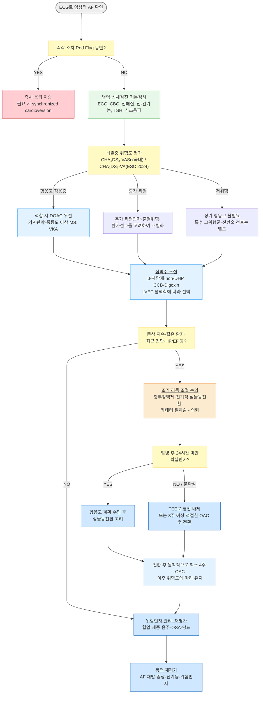

# 심방세동 Atrial Fibrillation, AF

## <mark style="color:green;">일반 사항</mark>

* 심방의 무질서한 전기 활동으로 인해 심방이 효과적으로 수축하지 못하고 심실 박동이 불규칙해지는 부정맥; 가장 흔한 지속성 부정맥
* 유병률 : 조사 연도·대상 연령·확인 방법에 따라 차이가 큼. 2024 대한부정맥학회 지침은 20세 이상 인구에서 약 3%를 제시하며, 국내에서도 고령화와 함께 증가하는 추세임
* 핵심 위험 : 임상적으로 진단된 AF는 허혈성 뇌졸중 위험을 크게 증가시키며, 위험도는 동반 질환과 위험인자에 따라 달라짐. 기기에서 우연히 발견되는 AHRE/subclinical AF는 임상적 AF와 뇌졸중 위험 및 항응고의 순이득이 다를 수 있으므로 별도로 평가해야 함

#### <mark style="color:$primary;">분류</mark>

<table><thead><tr><th width="228">유형</th><th>정의</th></tr></thead><tbody><tr><td><strong>처음 진단된(First diagnosed)</strong></td><td>이전에 진단된 적이 없는 AF; 지속기간이나 증상 유무와 관계없이 적용</td></tr><tr><td><strong>발작성(Paroxysmal)</strong></td><td>대부분 48시간 이내 자연 종료되며, 최대 7일까지 지속될 수 있음; 7일 이내에 중재 없이 또는 중재 후 동율동으로 회복되는 경우 포함</td></tr><tr><td><strong>지속성(Persistent)</strong></td><td>7일 이상 지속되는 AF; 7일 이상 지속된 뒤 약물 또는 전기적 심율동전환으로 동율동으로 회복한 경우도 포함</td></tr><tr><td><strong>장기 지속성(Long-standing persistent)</strong></td><td>1년 이상 지속되는 AF에서 동율동 회복을 시도하기로 한 경우</td></tr><tr><td><strong>영구성(Permanent)</strong></td><td>환자와 의료진이 동율동으로 회복하기 위한 추가 시도를 하지 않기로 결정한 AF</td></tr></tbody></table>


**AHRE/subclinical AF는 위 임상적 AF 분류와 별도로 평가**

삽입형 심장기기에서 발견되는 AHRE(atrial high-rate episode) 또는 기기 감지 subclinical AF는 임상적 AF와 동일하게 취급하지 않음. 심전도에서 임상적 AF가 확진되면 일반적인 AF 관리 원칙을 적용함. AHRE/subclinical AF에서는 에피소드 지속시간, 뇌졸중 위험인자 및 환자 선호도를 함께 고려하여 추적 또는 선택적 항응고를 결정함.


## <mark style="color:green;">원인 및 위험 인자</mark>

* 고혈압 : 가장 흔한 동반 위험인자
* 심부전, 관상동맥 질환, 판막 질환(특히 승모판 협착), 비후성 심근병증
* 갑상선 기능 항진증 : 신규 AF의 초기 평가에서 갑상선 기능 검사 시행
* 수면무호흡증(OSA) : 중요한 동반 위험인자; 치료 시 AF 재발 감소와 연관된 관찰 근거가 있음
* 과도한 음주
* 비만, 당뇨병, 만성 신장 질환
* 고령, 흡연, 좌심방 확장 등

## <mark style="color:green;">임상 양상</mark>

* 두근거림(palpitation), 불규칙한 맥박감
* 호흡곤란, 운동 내성 저하, 피로감, 흉부 불편감
* 어지럼, 실신 또는 실신 전구 증상 : 동반 시 혈역학적 불안정, 빈맥, 다른 부정맥 등을 평가
* 상당수는 무증상이며 건강검진 ECG, 웨어러블 ECG 또는 삽입형 기기에서 우연히 발견될 수 있음
* EHRA 증상 점수(1\~4등급)로 AF 관련 증상과 일상생활 제한 정도를 평가

## <mark style="color:$danger;">🚩 Red Flags!</mark>

<mark style="color:$danger;">**즉각 조치**</mark>

* 저혈압·의식 저하·쇼크 징후 → 응급 이송; AF가 불안정의 원인이면 동기화 전기적 심율동전환  `[혈역학적 불안정]`
* 급성 흉통, 급성 심부전·폐부종 또는 심한 호흡곤란 → 응급 평가  `[급성관동맥증후군·급성 심부전]`
* 매우 빠른 심실 반응과 함께 실신·심한 어지럼 → 응급 이송  `[빈맥성 부정맥]`
* WPW 동반 pre-excited AF 또는 불규칙한 넓은 QRS 빈맥 → 응급 이송; AV node 차단제 및 정맥 amiodarone 금지  `[조기흥분성 심방세동]`
* 편측 마비·언어 장애·시야 장애 등 급성 신경학적 결손 → 뇌졸중 응급 경로 적용  `[급성 뇌졸중]`
* 항응고 중 혈역학적 이상을 동반한 출혈, 토혈 또는 갑작스러운 심한 두통·신경학적 이상 → 응급 이송  `[중대한 출혈·두개내출혈]`

<mark style="color:$warning;">**당일~수일 내 평가**</mark>

* 신규 또는 발병 시점 불명 AF에서 조기 심율동전환 판단이 필요함 → 당일 평가  `[신규 심방세동]`
* 심박수 조절에도 빠른 심실 반응·증상이 지속됨 → 당일 평가  `[조절되지 않는 심방세동]`
* 구조적 심장 질환·심부전·비후성 심근병증·유의한 판막 질환이 의심됨 → 수일 내 심초음파 및 전문 평가; 악화 증상 동반 시 당일 평가  `[구조적 심장 질환]`
* 조기 리듬 조절·절제술 논의가 필요한 안정된 증상성 AF → 수일 내 순환기내과 평가  `[증상성 심방세동]`
* 항응고 적응증이 있으나 출혈 위험·상호작용·중증 신기능 저하로 선택이 복잡함 → 당일~수일 내 평가하여 치료 지연 최소화  `[항응고 치료 결정]`

<mark style="color:$info;">**조기 평가 및 추적**</mark>

* 증상이 경미하나 재발이 반복되거나 AF burden이 증가함 → 조기 외래 추적  `[재발성 심방세동]`
* 웨어러블·삽입형 기기에서 AHRE/subclinical AF가 반복 발견됨 → 기록 확인 및 뇌졸중 위험 평가  `[기기 감지 심방세동]`
* 혈압·체중·음주·수면무호흡증 관리가 불충분함 → 외래 추적 및 위험인자 교정  `[교정 가능한 위험인자]`

## <mark style="color:green;">진단</mark>

### <mark style="color:orange;">진단 기준</mark>

* **국내 2024 지침 기준** : 12-유도 ECG 전체에서 AF가 확인되거나, 의료진이 판독한 단일 유도 ECG rhythm strip에서 30초 이상 AF가 확인되면 임상적 AF로 진단
  * 전형적으로 뚜렷한 반복성 P파가 없고 RR 간격이 불규칙하게 불규칙(irregularly irregular)함. 완전 방실차단 또는 심실 조율 시에는 RR 간격이 규칙적일 수 있음
  * 스마트워치 등 wearable ECG는 진단에 유용한 자료가 될 수 있으나, 자동 알고리즘의 AF 알림만으로 확진하지 않음
  * 삽입형 심장기기의 AHRE는 기기에서 정의된 심방빈맥 에피소드이며 임상적 AF와 동일하게 취급하지 않음. 전문의의 electrogram/ECG 확인과 에피소드 지속시간 및 뇌졸중 위험도 평가가 필요함


2024 ESC도 의료진의 ECG 확인을 요구하나, 보행 ECG에서 진단에 필요한 최소 지속시간은 임상 맥락에 따라 다르며 일률적으로 확정되지 않았다고 기술함. **30초는 국내 실무 기준으로 유지하되, 생물학적으로 절대적인 경계 또는 자동 항응고 시작 기준으로 해석하지 않음.** 무증상으로 발견된 임상적 AF와 기기 감지 subclinical AF는 구별함.


#### <mark style="color:$primary;">선별검사(Screening)</mark>

* 65세 이상에서는 진료 시 맥박 촉지 또는 리듬 스트립을 이용한 기회적 선별을 고려
* 75세 이상이거나 뇌졸중 고위험군에서는 장기 ECG 모니터링(패치·홀터·삽입형 기록계) 기반의 체계적 선별을 고려할 수 있음
* 스마트워치 등 소비자용 웨어러블의 AF 알림은 선별 단서로 활용할 수 있으나, 반드시 12-유도 ECG 또는 리듬 스트립으로 확진 후 진단

### <mark style="color:orange;">초기 평가</mark>

* 병력 : 증상 시작 시점 및 AF 발생 시점, 발작성 여부, 두근거림·흉통·호흡곤란·실신, 음주, 수면무호흡증, 갑상선 질환, 심혈관 질환 및 복용약물
* 신체 검진 : 맥박(불규칙성·맥박 결손), 혈압, 경정맥, 심부전 징후, 심잡음
* 기본 검사
  * 12-유도 ECG
  * CBC, 전해질(K 등), 신기능(Cr/eGFR; NOAC 처방 시 Cockcroft-Gault CrCl 별도 산출), 간기능
  * 갑상선 기능 검사(TSH ± free T4)
  * 혈당 등 심혈관 위험인자 평가
* 경흉부 심초음파 : 좌심실 수축기능, 심방 크기, 판막 질환 및 기타 구조적 심장 질환 평가; 신규 AF에서 원칙적으로 시행
* 필요 시 Holter 또는 patch ECG : 발작성 AF, 증상-리듬 상관관계 및 AF burden 평가
* EHRA 증상 점수 : AF 관련 증상의 중증도와 일상생활 제한 정도 평가
* 흉부 X선은 호흡곤란, 심부전, 폐질환 등 임상적 적응증이 있을 때 시행하며 모든 AF 환자에서 일률적으로 필요하지는 않음

### <mark style="color:orange;">감별</mark>

* 불규칙한 맥박·두근거림으로 내원 시 아래 부정맥과 감별

<table><thead><tr><th width="140">질환</th><th width="238">AF와의 차이점</th><th>핵심 감별 포인트</th></tr></thead><tbody><tr><td>심방조동<br>(Atrial flutter)</td><td>규칙적 또는 일정한 전도비의 심방조동파(F파)가 보일 수 있음</td><td>II·III·aVF에서 sawtooth pattern이 흔함; 심방조동도 항응고 및 심박수/율동 조절 원칙을 적용하며 전형적 조동은 카테터 절제술 효과가 높음</td></tr><tr><td>발작성 상심실성 빈맥 (PSVT)</td><td>대개 규칙적인 좁은 QRS 빈맥; 역행성 P파가 보이거나 P파가 QRS에 묻힘</td><td>갑작스러운 시작·종료, 규칙적인 RR 간격, 필요 시 adenosine으로 진단·치료에 도움</td></tr><tr><td>빈번한 심실조기수축 (PVC)</td><td>불규칙하게 느껴질 수 있으나 기저 리듬이 존재하고 조기 넓은 QRS가 반복됨</td><td>ECG/Holter에서 PVC 확인 및 burden 평가</td></tr><tr><td>동성빈맥 (Sinus tachycardia)</td><td>정상 P파가 선행하고 RR 간격이 규칙적</td><td>발열·빈혈·갑상선기능항진증·탈수·불안 등 유발 원인 확인</td></tr><tr><td>다소성 심방빈맥(MAT)·빈번한 심방조기수축(PAC)</td><td>불규칙한 RR 간격이 있으나 구별 가능한 P파가 존재함</td><td>MAT는 서로 다른 P파 형태가 3가지 이상; 저산소증·폐질환·전해질 이상 등을 평가하며 AF 항응고 원칙을 자동 적용하지 않음</td></tr></tbody></table>

***



<p align="center"><strong>신규 심방세동 초기 평가 및 치료 알고리듬</strong></p>

***

## <mark style="background-color:$warning;">Management</mark>

<mark style="color:cyan;">**AF-CARE**</mark> (2024 ESC/EACTS)

<table><thead><tr><th width="64"></th><th width="154">핵심</th><th>1차 진료 포인트</th></tr></thead><tbody><tr><td><strong>C</strong></td><td>Comorbidity and risk factor management</td><td>고혈압·비만·음주·OSA·당뇨 등 위험인자와 동반질환 관리</td></tr><tr><td><strong>A</strong></td><td>Avoid stroke and thromboembolism</td><td>뇌졸중 위험도 평가 후 적응증에 따라 항응고</td></tr><tr><td><strong>R</strong></td><td>Reduce symptoms by rate and rhythm control</td><td>심박수 조절과 조기·선택적 리듬 조절을 환자 특성에 맞게 시행</td></tr><tr><td><strong>E</strong></td><td>Evaluation and dynamic reassessment</td><td>증상·AF burden·신기능·복약 순응도·위험인자 및 치료 결과를 정기 재평가</td></tr></tbody></table>


**AF burden 개념**

AF를 단순히 "있다/없다"로만 보지 않고, 모니터링 기간 동안 AF가 차지하는 시간 또는 에피소드의 지속시간을 함께 평가하는 개념임. AF burden은 혈전색전 위험과 연관될 수 있으나, 임상적 AF에서 항응고 여부를 AF burden만으로 결정하지는 않음.


## <mark style="color:green;">비-약물 치료 및 예방</mark>

### <mark style="color:orange;">C - Comorbidity and risk factor management</mark>

* 고혈압 : 혈압을 현재 고혈압 진료지침에 따라 적절히 조절
* 수면무호흡증 : 의심 환자는 선별 및 진단검사를 고려하고, OSA가 확인되면 적절히 치료; CPAP 치료와 AF 재발 감소의 연관성은 주로 관찰 연구 근거
* 과체중·비만 : 체중 감량을 권장하며, 가능한 경우 초기 체중의 **10% 이상 감량**을 목표로 개별화함. 고령·노쇠·근감소증에서는 영양 및 근기능을 함께 평가함
* 음주 : 금주를 권장함. 음주를 지속하면 2024 ESC 기준 **순수 알코올 주 30 g 이하(해당 지침의 표준잔 3잔 이하)**로 줄임. 국내 술잔 크기와 표준잔 정의가 다르므로 단순히 소주 3잔 등으로 환산하지 않음
* 갑상선 기능 항진증 : 갑상선 기능 정상화 후 AF 지속 여부 및 리듬 조절 필요성을 재평가
* 당뇨, 심부전, 관상동맥 질환, 만성 신장 질환의 최적 관리
* 신체 활동 부족 교정 : 규칙적인 중등도 운동 권장; 만성적인 과도한 지구력 운동은 AF 위험과 연관될 수 있음
* 흡연 중단 및 전반적인 심혈관 위험인자 관리

<table><thead><tr><th width="110">항목</th><th width="180">권장</th><th>비고</th></tr></thead><tbody><tr><td>체중</td><td>과체중·비만이면 10% 이상 감량 목표를 개별화</td><td>체중 감소가 AF burden 및 재발 감소와 연관</td></tr><tr><td>혈압</td><td>적절한 혈압 조절</td><td>뇌졸중 및 AF 위험인자 관리의 핵심</td></tr><tr><td>음주</td><td>금주 권장; 지속 시 순수 알코올 주 30 g 이하</td><td>음주량이 많을수록 AF 및 출혈 위험 증가</td></tr><tr><td>운동</td><td>중등도 규칙적 운동</td><td>과도한 장기 지구력 운동은 피하도록 권고</td></tr><tr><td>수면무호흡</td><td>선별 및 적절한 치료</td><td>치료가 AF 재발 감소와 연관될 수 있음</td></tr></tbody></table>

## <mark style="color:green;">약물 치료</mark>

### <mark style="color:orange;">A - Avoid stroke and thromboembolism : 뇌졸중 예방</mark>

#### <mark style="color:$primary;">CHA₂DS₂-VASc 점수 계산</mark>

<table data-header-hidden data-search="false"><thead><tr><th width="214"></th><th width="60"></th><th width="326"></th></tr></thead><tbody><tr><td><strong>항목</strong></td><td><strong>점수</strong></td><td><strong>내용</strong></td></tr><tr><td><strong>C</strong>ongestive Heart Failure</td><td>1</td><td>임상적 심부전 또는 유의한 좌심실 기능 저하; 비후성 심근병증은 국내 지침에서 C 항목에 포함</td></tr><tr><td><strong>H</strong>ypertension</td><td>1</td><td>고혈압</td></tr><tr><td><strong>A₂</strong> (Age ≥75)</td><td>2</td><td>75세 이상</td></tr><tr><td><strong>A</strong> (Age 65–74)</td><td>1</td><td>65~74세</td></tr><tr><td><strong>D</strong>iabetes Mellitus</td><td>1</td><td>당뇨병</td></tr><tr><td><strong>S₂</strong> (Stroke/TIA/TE)</td><td>2</td><td>뇌졸중, TIA 또는 전신 혈전색전증 과거력</td></tr><tr><td><strong>V</strong>ascular disease</td><td>1</td><td>심근경색, 말초동맥질환 또는 대동맥 죽상경화반</td></tr><tr><td><strong>Sc</strong> (Sex category)</td><td>1</td><td>여성; 다른 뇌졸중 위험인자가 없는 여성의 단독 성별 점수는 항응고 적응증이 되지 않음</td></tr></tbody></table>

* 남성 0점, 여성 1점(성별만) : 장기 항응고 불필요. 특수 고위험군·전환술 전후는 별도 판단
* 남성 1점, 여성 2점 : 항응고를 고려할 수 있으며 추가 위험인자·출혈위험·환자선호를 함께 평가
* 남성 ≥2점, 여성 ≥3점 : 항응고 권고
* **AF 동반 비후성 심근병증 또는 심장 아밀로이드증** : 점수가 낮아도 항응고를 권고함(2024 ESC). 기계판막·중등도 이상 승모판 협착도 일반 점수만으로 결정하지 않음
* 발작성·지속성·영구성 여부 또는 동율동 회복 여부만으로 항응고 적응증을 낮추지 않음. Aspirin 단독 또는 aspirin+clopidogrel은 AF 항응고를 대체하지 못함


**CHA₂DS₂-VA (성별 항목 제외) - 2024 ESC/EACTS**

2024 ESC/EACTS는 성별 항목을 제외한 CHA₂DS₂-VA를 권고함. **0점은 항응고를 권고하지 않으며, 1점은 항응고를 고려하고, ≥2점은 항응고를 권고**함. 반면 2024 대한부정맥학회 일반 치료 지침은 CHA₂DS₂-VASc를 사용함. 따라서 이 책에서는 **국내 실무는 CHA₂DS₂-VASc, ESC 2024는 CHA₂DS₂-VA**로 구분함.


#### <mark style="color:$primary;">직접 경구 항응고제(DOAC/NOAC) 선택 및 처방</mark>


중등도 이상의 승모판 협착 또는 기계판막을 동반한 AF에서는 **NOAC 대신 VKA(와파린)**를 사용함.

생체판막(Bioprosthetic valve) 또는 판막성형술(repair)은 기계판막과 동일하게 취급하지 않음. 다만 수술 시기, 판막 종류 및 동반 질환에 따라 항응고 전략이 달라질 수 있으므로 순환기내과와 상의함.


<table><thead><tr><th width="177">약제</th><th>용량</th><th>비고</th></tr></thead><tbody><tr><td>Dabigatran <mark style="color:blue;">[프라닥사]</mark></td><td>1회 150 ㎎, 1일 2회(표준); 출혈위험 증가 시 1회 110 ㎎, 1일 2회 고려</td><td>국내 허가상 75세 이상, CrCl 30 이상~50 미만 ㎖/min, 50 ㎏ 미만 또는 verapamil 등 병용 시 출혈위험 평가 후 110 ㎎ bid 고려; CrCl ＜30 ㎖/min 금기</td></tr><tr><td>Rivaroxaban <mark style="color:blue;">[자렐토]</mark></td><td>1회 20 ㎎, 1일 1회 식사와 함께</td><td>CrCl 15 이상~50 미만 ㎖/min이면 15 ㎎ qd; 15~29에서는 특히 주의. CrCl ＜15에서는 권장되지 않음</td></tr><tr><td>Apixaban <mark style="color:blue;">[엘리퀴스]</mark></td><td>1회 5 ㎎, 1일 2회</td><td>다음 3가지 중 2가지 이상 해당 시 1회 2.5 ㎎, 1일 2회 : ① 연령 ≥80세, ② 체중 ≤60 ㎏, ③ 혈청 크레아티닌 ≥1.5 ㎎/㎗. <strong>CrCl 15~29 ㎖/min이면 연령·체중과 무관하게 2.5 ㎎ bid</strong>; CrCl ＜15 또는 투석에서는 권장되지 않음</td></tr><tr><td>Edoxaban <mark style="color:blue;">[릭시아나]</mark></td><td>1회 60 ㎎, 1일 1회</td><td>CrCl 15~50 ㎖/min, 체중 ≤60 ㎏ 또는 사이클로스포린·드로네다론·에리트로마이신·케토코나졸 병용 중 하나라도 해당하면 30 ㎎ qd. CrCl ＜15 또는 투석은 금기. 특정 출혈 고위험 고령자의 15 ㎎ 용법은 아래 참조</td></tr></tbody></table>


**에독사반 15 ㎎ qd — 국내 허가상 제한된 고령자 용법**

약 80세 이상 비판막성 AF 환자 중 **① 출혈위험 때문에 에독사반 상용량 또는 다른 경구 항응고제의 허가 용량을 사용할 수 없고, ② 다음 중 하나 이상**이면 유익성과 위험을 평가하여 고려함: 중요 장기 출혈 병력, 체중 ≤45 ㎏, CrCl 15 이상~30 미만 ㎖/min, NSAID의 주기적 사용 또는 항혈소판제 사용. **나이·낙상 우려만으로 15 ㎎을 선택하지 않으며, 표준 60/30 ㎎ 요법의 일률적 대체가 아님.** <mark style="color:$info;">[릭시아나 국내 허가사항; ELDERCARE-AF]</mark>


* **국내 NOAC 급여와 임상적 항응고 적응증은 구분**함. 비판막성 AF에서 다음 중 하나에 해당하는 고위험군에 급여 인정 <mark style="color:$info;">[HIRA 고시 제2022-184호, 비판막성 AF 기준]</mark>
  * 뇌졸중·TIA·혈전색전증 병력 또는 75세 이상
  * 또는 6가지 위험인자(심부전, 고혈압, 당뇨병, 혈관성질환, 65~74세, 여성) 중 2가지 이상
  * 또는 진료기록부에 전기적 심율동전환술/도자절제술 시행·예정이 확인되는 경우의 별도 인정기간: 심율동전환술 3주 전~4주 후, 도자절제술 3주 전~8주 후
  * 단순히 CHA₂DS₂-VASc 1점이거나 전문의 의뢰 예정이라는 이유만으로 급여 인정으로 기술하지 않음
* **NOAC 용량은 eGFR이 아니라 각 약제 허가사항과 지침에서 제시하는 CrCl 기준을 우선 사용**하고, Cockcroft-Gault 방식의 CrCl을 확인하여 처방
* 신기능 및 간기능 확인 후 약제 선택; 고령자·저체중·신기능 저하에서는 특히 주의
* **감량 기준에 해당하지 않는 임의 저용량 처방을 피함.** 고령·HAS-BLED 고점수 자체가 모든 NOAC의 감량 기준은 아님
* 와파린을 사용하는 일반적인 AF에서는 INR 2.0~3.0을 목표로 관리함. 기계판막의 목표 INR은 판막 종류·위치·혈전 위험에 따라 별도로 정함
* 출혈 위험 평가(HAS-BLED)를 참고하되, 출혈 위험이 높다는 이유만으로 항응고 치료를 배제하거나 중단하지 않음. 활동성 중대한 출혈 등 실제 금기는 별도로 평가함. 교정 가능한 출혈 위험인자(혈압 조절, NSAID/항혈소판제 병용, 음주, 약물 상호작용 등)를 먼저 교정
* HAS-BLED는 항응고 여부를 결정하는 점수가 아니라 교정 가능한 출혈 위험인자를 확인하고 추적 빈도를 정하는 데 활용

<table data-header-hidden data-search="false"><thead><tr><th width="214"></th><th width="60"></th><th width="326"></th></tr></thead><tbody><tr><td><strong>항목</strong></td><td><strong>점수</strong></td><td><strong>내용</strong></td></tr><tr><td><strong>H</strong>ypertension</td><td>1</td><td>조절되지 않는 고혈압(수축기 ＞160 mmHg)</td></tr><tr><td><strong>A</strong>bnormal renal/liver function</td><td>1 또는 2</td><td>신기능 이상(투석·이식·Cr ＞2.26 ㎎/㎗) 1점, 간기능 이상(간경변 또는 빌리루빈 ＞정상상한 2배이면서 AST/ALT/ALP ＞정상상한 3배) 1점 - 각각 해당 시 가산</td></tr><tr><td><strong>S</strong>troke</td><td>1</td><td>뇌졸중 과거력</td></tr><tr><td><strong>B</strong>leeding</td><td>1</td><td>출혈 병력 또는 출혈 소인</td></tr><tr><td><strong>L</strong>abile INR</td><td>1</td><td>불안정한 INR(와파린 복용 시 TTR ＜60%)</td></tr><tr><td><strong>E</strong>lderly</td><td>1</td><td>65세 이상(국내 2024 지침)</td></tr><tr><td><strong>D</strong>rugs/alcohol</td><td>1 또는 2</td><td>출혈 유발 약물(항혈소판제·NSAID) 병용 1점, 과음 1점 - 각각 해당 시 가산</td></tr></tbody></table>

* 3점 이상이면 출혈 고위험군으로 간주하여 더 자주 추적하고 교정 가능한 위험인자를 재평가; 최대 9점이며 신·간기능 및 약물·음주는 각각 가산함


**기기 감지 subclinical AF/AHRE의 항응고 — 무증상 임상적 AF와 구별**

삽입형 심장기기에서 발견된 AHRE/subclinical AF에서는 일률적인 항응고의 근거가 부족함. ARTESiA·NOAH-AFNET 6의 2024년 메타분석에서 DOAC은 허혈성 뇌졸중 상대위험을 약 32% 낮추고 주요 출혈 상대위험을 약 62% 높였음. 절대 이득은 기저 뇌졸중 위험에 따라 달라짐. 따라서 특히 짧은 에피소드에서는 뇌졸중 위험도, AHRE 지속시간, 출혈위험 및 환자 선호도를 함께 고려하여 선택적으로 결정함. 국내 2024 대한부정맥학회 지침도 24시간 이상 지속되는 AHRE/subclinical AF이면서 뇌졸중 위험이 높은 환자에서 순임상적 이익과 환자 선호도를 고려한 선택적 항응고를 제시함.



**관상동맥질환 동반 시 항혈전요법**

* 장기 항응고가 필요한 AF + 안정 CAD에서, 재관류술 후 1년 경과 또는 재관류술이 필요하지 않은 CAD이고 스텐트 혈전증 병력이 없으면 **항응고제 단독**이 기본임. Aspirin/clopidogrel을 자동으로 장기 추가하지 않음
* 최근 PCI/ACS에서는 보통 짧은 삼중요법(항응고제 + aspirin + clopidogrel) 후 항응고제 + clopidogrel로 전환함. Aspirin은 일반적으로 1주 이내 중단을 고려하되, 스텐트 혈전증 위험이 높은 경우 최대 1개월 등으로 개별화함. 이후 병용 기간도 elective PCI/ACS·출혈위험에 따라 결정함
* CAD 예방용 rivaroxaban 2.5 ㎎ bid + aspirin은 AF 항응고 용량을 대체하지 않음 (☞ [협심증](097_-angina-pectoris.md))

<mark style="color:$info;">[ACC/AHA AF 2023; ESC AF 2024]</mark>


### <mark style="color:orange;">R - Reduce symptoms by rate and rhythm control</mark>

#### <mark style="color:$primary;">심박수 조절 (Rate Control)</mark>

* 심박수 조절은 많은 AF 환자에서 중요한 초기 치료이며, 리듬 조절을 시행하는 환자에서도 필요할 수 있음
* 목표 : lenient control - 안정 시 맥박수 ＜110회/분을 초기 목표로 하며, 증상이 지속되거나 좌심실 기능이 저하되는 경우 더 엄격한 조절을 고려

<mark style="color:cyan;">**1차 약제**</mark>

<table><thead><tr><th width="146">약제</th><th>경구 처방 예시</th><th>주의</th></tr></thead><tbody><tr><td>β-차단제<br>Bisoprolol <mark style="color:blue;">[콩코르정]</mark></td><td>1.25~2.5 ㎎ qd부터 시작하여 심박수·혈압에 따라 증량(통상 유지 1.25~10 ㎎/일)</td><td>AF 심박수 조절은 지침 기반 허가 외 사용. 콩코르정2.5 ㎎의 국내 허가는 안정형 만성 심부전임. HFrEF 신규 시작은 안정된 상태에서 1.25 ㎎부터; 쇼크·급성 비대상성 심부전·중증 기관지경련에서는 시작·증량하지 않음</td></tr><tr><td>non-DHP CCB<br>Diltiazem / Verapamil</td><td><mark style="color:blue;">[헤르벤서방정90 ㎎]</mark> 1회 1T bid 또는<br><mark style="color:blue;">[이솦틴서방정180 ㎎]</mark> 1회 1T qd</td><td>헤르벤 경구 서방제의 AF 심박수 조절은 허가 외 사용(국내 허가: 협심증·본태성고혈압); 이솦틴 서방제는 부정맥 적응증이 있음. 2024 AF 지침상 LVEF ≤40%에서 사용하지 않음. 심부전 동반 시 2026 ESC HFrEF(LVEF ＜50%)의 회피 권고를 함께 적용</td></tr><tr><td>Digoxin <mark style="color:blue;">[디고신정]</mark></td><td>지침상 경구 유지 0.0625~0.25 ㎎ qd; 고령·신기능 저하 시 저용량</td><td>국내 허가에 심방세동 포함(허가 유지량 0.25~0.5 ㎎/일, 연령·증상에 따라 증감); 표의 저용량은 현대 지침 기반임. HFrEF 또는 다른 약제의 효과·내약성이 제한될 때 고려; 운동 시 조절 효과가 제한됨. 신기능·K·Mg 및 독성 증상을 확인하고 필요 시 혈중농도 측정</td></tr></tbody></table>

* 위 경구 용량은 안정된 환자의 유지 치료 예시임. β-차단제와 non-DHP CCB 병용은 서맥·방실차단 위험 때문에 전문 감시하에 제한적으로 사용함. Digoxin 혈중농도를 측정할 때는 마지막 복용 후 최소 6시간 뒤 채혈하며, AF에서는 1.2 ng/㎖ 미만을 지향함. 디고신정은 0.25 ㎎ 제형이므로 저용량 처방 시 조제 가능한 분할·투여간격을 확인함

#### <mark style="color:$primary;">리듬 조절 (Rhythm Control)</mark>

* 증상성 AF, 심박수 조절에도 증상이 지속되는 경우, 빈맥유발 심근병증, HFrEF 등에서는 적극적으로 고려
* **조기 리듬 조절** : 진단 후 1년 이내의 AF에서 적절한 환자를 대상으로 조기에 리듬 조절을 시행하면 심혈관 사망·뇌졸중·심부전 또는 급성관동맥증후군 입원의 복합 위험을 줄일 수 있음(EAST-AFNET 4; 심혈관 위험이 있는 환자가 대상이며 모든 젊은 저위험 AF에 같은 예후 이득을 단정하지 않음)
* 2024 ESC는 적절한 환자에서 리듬 조절을 증상 완화뿐 아니라 질병 진행 및 예후 개선을 위한 전략으로 고려
* 카테터 절제술 : 약물 치료에 실패하거나 불내성이 있는 증상성 AF에서 권고되며, **증상성 발작성 AF에서는 항부정맥제보다 먼저 시행하는 1차 치료 옵션도 가능**(2024 ESC Class I); 특히 주요 재발 위험인자가 없는 환자에서 고려. HFrEF 또는 빈맥유발 심근병증이 의심되는 경우에는 더 적극적으로 고려
* 방법 : 항부정맥제, 전기적 심율동전환, 카테터 절제술

<table><thead><tr><th width="150">구조적 심질환/상황</th><th width="220">주요 선택지</th><th>비고</th></tr></thead><tbody><tr><td>구조적 심질환 없음</td><td>플레카이나이드, 프로파페논 등</td><td>Class Ic; 허혈성 심질환 또는 유의한 좌심실 기능 저하에서는 피함. 1:1 심방조동 전도 예방을 위해 AV node 차단제를 병용</td></tr><tr><td>HFrEF 또는 유의한 구조적 심질환</td><td>아미오다론 등</td><td>장기 사용 시 갑상선·폐·간 독성 및 QT 등을 모니터링; 환자에 따라 카테터 절제술을 적극 고려</td></tr><tr><td>증상성 발작성 AF</td><td>카테터 절제술 또는 항부정맥제</td><td>환자 선호·위험·재발 가능성을 고려하여 1차 카테터 절제술을 선택할 수 있음</td></tr></tbody></table>


**Pill-in-the-pocket 전략**

구조적 심질환이 없고 드물게 재발하는 증상성 발작성 AF 환자 중 일부에서, 증상 발생 시 플레카이나이드 또는 프로파페논을 자가 단회 복용하는 전략을 고려할 수 있음. 심실 반응이 과도하게 빨라지는 것을 막기 위해 AV node 차단제 병용이 필요하며, 첫 투여는 반드시 의료진 감시하에 안전성(저혈압·서맥·심실 리듬 이상)을 확인한 후 자가 투여로 전환함.


## <mark style="color:green;">시술 및 기타 처치</mark>

### <mark style="color:orange;">심율동전환과 항응고</mark>

* 심율동전환 전 혈전 확인 원칙(전기적·약물적 전환 모두) : **AF 지속시간이 24시간 이상이거나 시작 시점이 불명확한 경우**(2024 ESC 알고리듬 기준), 경식도 심초음파(TEE)로 좌심방 내 혈전을 배제하거나 3주 이상 적절한 치료 용량의 항응고를 시행한 후 계획된 심율동전환을 시행
* 발병 24시간 미만이 명확한 경우에도 항응고 계획을 먼저 수립함. TEE 음성은 전환 전 3주 항응고 대기의 대안이며, 전환 전후 항응고 자체를 생략하는 근거가 아님
* 전환 전 NOAC 복용 누락 여부를 확인함. 최근 3주간 치료 용량의 연속 복용이 확실하지 않으면 TEE 또는 전환 연기를 고려함; 좌심방 혈전 확인 시 전환을 보류하고 항응고 후 재영상 평가함
* 혈역학적 불안정이 AF에 의해 발생한 경우에는 항응고 여부 때문에 심율동전환을 지연하지 않고 즉시 synchronized electrical cardioversion 시행; 항응고는 가능한 한 빨리 시작함
* 심율동전환 후 **원칙적으로 최소 4주간 항응고**를 유지함. 2024 ESC는 발병 24시간 미만이 확실하고 혈전색전 위험인자가 없는 경우에만 생략을 선택적으로 허용함. 이후 장기 항응고는 뇌졸중 위험도에 따라 결정함

* 최근 발생한 혈역학적으로 안정된 AF에서는 적절한 항응고·심박수 관리와 추적 계획하에 발병 후 48시간까지 자연 전환을 기다리는 전략도 고려함. 이는 24시간 이상 AF의 계획된 전환 전 항응고·TEE 원칙과 구분함

### <mark style="color:orange;">카테터 절제술·좌심방이 폐쇄술</mark>

* 절제술은 증상·심기능·동반질환·환자 선호에 따라 결정함. 선택된 증상성 발작성 AF의 1차 치료 및 HFrEF·빈맥유발 심근병증에서 적극적으로 논의함
* 경피적 좌심방이 폐쇄술(LAAO) : 장기 항응고 금기 또는 중대한 출혈 위험으로 항응고 유지가 어려운 환자에서 전문 평가 후 고려함. 시술 위험과 시술 후 단기 항혈전요법 가능 여부도 함께 평가함


**2026 LAAO 연구 — 대상군에 따라 결과가 다름**

CHAMPION-AF는 항응고 가능한 환자에서 LAAO가 NOAC 대비 심혈관 사망·뇌졸중·전신색전증 복합 결과에 비열등하고 비시술 관련 출혈을 줄였음. 반면 고령의 뇌졸중·출혈 고위험군을 대상으로 한 CLOSURE-AF는 최적 내과 치료 대비 복합 임상 결과의 비열등성을 입증하지 못했음. 따라서 **출혈 고위험이라는 이유만으로 LAAO가 우월하다고 단정하거나 모든 AF에서 NOAC을 대체하지 않음.** <mark style="color:$info;">[CHAMPION-AF 2026; CLOSURE-AF 2026]</mark>


### <mark style="color:orange;">E - Evaluation and dynamic reassessment</mark>

* NOAC 복용 환자 : 신기능·간기능·혈압·복약 순응도 및 출혈 여부를 정기적으로 확인; 신기능 저하, 고령 또는 임상 상태 변화가 있으면 더 자주 평가
* 심박수 모니터링 : 맥박 측정 또는 ECG; 목표 달성 및 서맥 여부 확인
* 위험인자(C) 관리 목표 달성 여부 정기 평가 - 혈압, 체중, 음주, OSA, 당뇨, 신장질환 등
* 리듬 조절 시행 후에도 증상 및 재발 감시(ECG·Holter·patch·기기 데이터)
* 수술·감염·갑상선기능항진증 등 유발인자와 함께 발생한 AF도 유발인자 교정 후 재발할 수 있음. 일회성으로 단정하지 않고 리듬 및 장기 항응고 필요성을 재평가함
* 카테터 절제술 후 항응고는 **국내 2024·ESC 2024 지침상 최소 2개월**, 미국 2023 지침상 최소 3개월 유지함. 이후에는 기본적으로 뇌졸중 위험도를 기준으로 지속 여부를 결정함. 급여상의 별도 인정기간 8주가 모든 환자의 임상적 중단 시점은 아님
* 새로운 증상(뇌졸중 증상, 중대한 출혈, 심부전 악화) 발생 시 즉시 평가


**절제술 후 장기 항응고 중단: ALONE-AF·OCEAN**

* **ALONE-AF(2025, 국내 840명)** : 절제술 후 1년 이상 재발이 기록되지 않은 환자(평균 CHA₂DS₂-VASc 2.1점)에서 2년 뇌졸중·전신색전증·주요 출혈 복합 결과가 중단군 0.3%, 지속군 2.2%였음. 차이는 주로 주요 출혈 감소에 의한 것으로 해석됨
* **OCEAN(2025 온라인/2026 권호, 1,284명)** : 성공적 절제술 후 1년 이상 경과한 환자에서 rivaroxaban 15 ㎎ qd는 aspirin 대비 3년 뇌졸중·전신색전증·새로운 무증상 색전성 뇌경색 복합 결과를 유의하게 줄이지 못했음
* **실무 적용** : 사건 수가 적고 선정된 환자에서 얻은 결과임. 모든 고위험군의 안전한 중단이나 aspirin 대체를 입증한 것은 아님. 장기간 재발이 없고 위험도가 낮거나 중간인 일부 환자에서, 전문의가 잔여 뇌졸중 위험·출혈 위험·지속적 리듬 감시 가능성을 검토하여 공동 결정하는 근거로 활용함


***

## <mark style="color:red;">질병코드</mark>

I48.0 발작성 심방세동 Paroxysmal atrial fibrillation\
I48.1 지속성 심방세동 Persistent atrial fibrillation\
I48.2 만성 심방세동 Chronic atrial fibrillation\
I48.90 상세불명의 심방세동 Atrial fibrillation, unspecified

I48.9는 상세불명의 심방세동 및 심방조동의 상위 분류임. AF로 확인된 상세불명 사례는 I48.90을 사용함

_(감별진단에서 다룬 심방조동은 I48.3 전형적 심방조동, I48.4 비전형심방조동; 상세불명 심방조동은 I48.91로 별도 코딩)_

***

## <mark style="color:purple;">처방례</mark>

✽처방 전 재확인 : NOAC 용량은 eGFR이 아니라 Cockcroft-Gault 방식의 CrCl 및 각 약제의 국내 허가사항을 기준으로 결정

> **처방례 1. 심방세동 - 심박수 조절 + 뇌졸중 예방(NOAC)**
>
> _(CHA₂DS₂-VASc 고위험군, 신기능 정상, 비판막성 AF; 체중 ＞60 ㎏, apixaban 감량 기준 미충족, 혈역학적으로 안정됨)_
>
> ```
> 콩코르정 2.5 ㎎/T  1T  qd
> 엘리퀴스정 5 ㎎/T  1T  bid
> ```

> **처방례 2. 심방세동 - 심박수 조절 + NOAC**
>
> _(75세 이상, CrCl 30 이상~50 미만 ㎖/min, 출혈위험을 평가하여 110 ㎎ bid 선택, 혈역학적으로 안정됨)_
>
> ```
> 콩코르정 2.5 ㎎/T  1T  qd
> 프라닥사캡슐 110 ㎎/C  1C  bid
> ```
>
> ※ 다비가트란 110 ㎎ bid는 국내 허가상 75세 이상 또는 CrCl 30 이상~50 미만 ㎖/min 등 출혈위험 증가 시 고려함. CrCl ＜30 ㎖/min은 금기임. 콩코르정의 AF 심박수 조절은 허가 외 사용이며, HFrEF 신규 시작은 1.25 ㎎부터 고려함(처방례 1에도 적용).

> **처방례 3. 신규 진단 발작성 AF - 조기 리듬 조절 논의를 위한 의뢰 전 처방**
>
> _(60세 남성, 고혈압 동반, CrCl ≥50 ㎖/min, 증상성 발작성 AF, 심초음파상 구조적 이상 없음, 진단 후 1년 이내; CHA₂DS₂-VASc 1점)_
>
> ```
> 자렐토정 20 ㎎/T  1T  qd 식사와 함께
> ```
>
> ※ 이 예시는 임상적 판단에 따른 항응고 고려 사례이며 자동 급여 인정 사례는 아님. 단순 의뢰 예정은 심율동전환술/절제술 전후 급여 요건과 다름. CHA₂DS₂-VASc 1점(남성)은 항응고를 고려할 수 있는 구간으로, 추가 위험인자·출혈위험·환자선호를 함께 평가하여 결정함. 위험인자가 전혀 없는 경우에는 항응고제 없이 리듬 조절 논의를 위한 의뢰만 진행함. 젊고 증상성인 조기 AF에서는 항부정맥제 또는 카테터 절제술을 통한 조기 리듬 조절 여부를 순환기내과와 상의함.


**WPW 증후군 동반 AF - AV node 차단제 금기**

pre-excited AF에서는 β-차단제·non-DHP CCB·Digoxin·adenosine 등 AV node 차단제를 사용하지 않음. **정맥 amiodarone도 피함**. 부전도로를 통한 심실 전도가 증가하여 VF 위험이 있으므로 **혈역학적 불안정 시 동기화 전기적 심율동전환**이 원칙임. 안정된 환자도 전문 감시하에 부전도로 전도를 차단하는 치료 또는 전기적 전환을 시행함.



**NOAC 처방 전 필수 확인**

* **CrCl** : 각 약제별 감량·금기 기준 상이
* 간기능 : 응고장애와 임상적으로 유의한 출혈 위험을 동반한 간질환에서는 사용하지 않음. 특히 rivaroxaban은 Child-Pugh B·C에서 피하며, 다른 NOAC도 중증 간장애 등 품목별 기준 적용
* 병용 약물 : 강한 P-gp/CYP3A4 억제제(ritonavir 포함)·유도제, 항혈소판제·NSAID, 다른 항응고제 병용 여부 확인. 약제별 병용금기·감량 기준이 다름
* 판막성 AF 여부 : 기계판막·중등도 이상 승모판 협착에서는 와파린
* 리바록사반의 일반적인 AF 용량인 15·20 ㎎은 음식과 함께 복용


***

### <mark style="color:$success;">핵심 복약 지도</mark>

> **NOAC (다비가트란·리바록사반·아픽사반·에독사반)**
>
> * 이 약은 혈전이 생기는 것을 억제하여 뇌졸중을 예방합니다. **임의로 중단하면 뇌졸중 위험이 증가할 수 있습니다.** 반드시 의사와 상의 후 중단 여부를 결정하십시오.
> * 출혈이 멈추지 않거나, 소변이 붉거나, 대변이 검고 끈적하거나, 피를 토하거나, 갑작스러운 심한 두통·시야 이상·언어 장애가 생기면 즉시 진료를 받으십시오.
> * 수술·시술·발치가 필요한 경우 항응고제 복용 사실을 미리 알리십시오.
> * 리바록사반(자렐토)은 AF 용량인 15 ㎎ 또는 20 ㎎을 음식과 함께 복용하십시오.
> * 다비가트란(프라닥사)은 캡슐을 열거나 씹지 말고 그대로 삼키십시오(개봉 시 흡수율 증가로 출혈 위험 상승). 습기에 민감하므로 원래 포장(블리스터)에 보관하고 미리 다른 약통에 옮겨 담지 마십시오.
> * **다비가트란 복용 누락** : 다음 복용까지 6시간 이상 남았으면 복용하고, 6시간 미만이면 건너뛴 뒤 다음 정규 시간에 복용하십시오. 누락분을 보충하려고 두 배로 복용하지 마십시오.
> * **아픽사반 복용 누락** : 기억나는 즉시 복용하고 기존 1일 2회 일정을 계속하십시오. 두 배로 복용하지 마십시오. 다음 복용 시점이 임박했거나 복용 여부가 불확실하면 의료진·약사에게 확인하십시오.
> * **리바록사반·에독사반(AF 1일 1회 용법) 복용 누락** : 당일 중 기억나면 복용하고 다음날에는 정해진 용량을 복용하십시오. 다음날로 넘어간 누락분을 보충하거나 두 배로 복용하지 마십시오.

> **콩코르(비소프롤롤) / 헤르벤(딜티아젬) - 심박수 조절제**
>
> * 약을 갑자기 중단하지 마십시오. 중단이 필요하면 의사와 상의하십시오.
> * 맥박이 지나치게 느려지거나 심한 어지럼·실신·호흡곤란이 생기면 즉시 진료를 받으십시오.

***

### <mark style="color:blue;">환자 안내서</mark>


**심방세동은 뇌졸중 예방과 위험인자 관리가 중요합니다**

심방세동이 있어도 뇌졸중 위험을 평가하고 적절히 관리하면 합병증 위험을 줄일 수 있습니다.


#### <mark style="color:$primary;">심방세동이란 무엇인가요?</mark>

* 심장 윗부분(심방)이 불규칙하게 움직이는 부정맥입니다
* 불규칙한 두근거림, 숨 가쁨, 어지럼, 피로감이 생길 수 있으며 증상 없이 발견되는 경우도 많습니다
* 중요한 위험 중 하나는 심방 내 혈전이 생겨 뇌로 이동하면서 뇌졸중을 일으키는 것입니다

#### <mark style="color:$primary;">왜 항응고제를 먹어야 하나요?</mark>

* 심방세동이 있으면 심방 안에 혈전이 생길 위험이 증가합니다
* 항응고제는 혈전이 생기는 것을 줄여 뇌졸중 위험을 낮춥니다
* 모든 심방세동 환자가 항응고제를 먹는 것은 아니며, 나이·고혈압·당뇨·심부전·과거 뇌졸중 등의 위험인자를 종합하여 결정합니다
* 스마트워치나 삽입형 기기에서 우연히 발견된 짧은 무증상 AF/AHRE는 일반적인 심방세동과 항응고 결정이 다를 수 있으므로 담당 의사와 상의하십시오


**아스피린은 심방세동의 뇌졸중 예방을 위한 항응고제를 대신할 수 없습니다.**

항응고제가 필요한 심방세동에서 아스피린만 복용하는 것은 적절하지 않을 수 있습니다. 항응고제 복용 여부는 담당 의사와 상의하십시오.


#### <mark style="color:$primary;">생활 속 실천 사항</mark>

* **음주 줄이기** : 술은 심방세동을 유발·악화할 수 있습니다. 가능하면 금주하거나 최소화하십시오
* **커피·카페인** : 음주와 달리 적당량의 커피 섭취가 심방세동 재발을 늘린다는 근거는 부족하므로, 증상을 악화시키지 않는다면 반드시 끊을 필요는 없습니다
* **고혈압 관리** : 혈압약을 꾸준히 복용하고 적절한 목표 혈압을 유지하십시오
* **체중 조절** : 과체중·비만이라면 체중을 줄이는 것이 심방세동의 증상과 재발을 줄이는 데 도움이 될 수 있습니다
* **수면무호흡증 치료** : 코골이가 심하거나 수면 중 숨이 멎는다는 말을 들으면 진료를 받으십시오
* **규칙적인 운동** : 적당한 강도의 운동은 도움이 되지만, 장기간의 과도한 지구력 운동은 피하십시오
* **금연** : 심방세동뿐 아니라 뇌졸중·심근경색 등 심혈관 위험을 낮추기 위해 금연하십시오

#### <mark style="color:$primary;">이럴 때는 즉시 119를 부르거나 응급실로 가세요</mark>

* 갑작스러운 한쪽 팔다리 마비, 발음 이상, 시야 장애 등 뇌졸중 증상
* 극심한 흉통 또는 심한 호흡 곤란
* 두근거림과 함께 실신 또는 심한 어지럼이 발생할 때
* 대변이 검고 끈적거리거나 피를 토하는 등 심한 출혈이 의심될 때

***

## <mark style="color:orange;">주요 참고문헌 및 확인 자료</mark>

### 임상 근거

- 대한부정맥학회. 2024 심방세동 일반 치료 진료지침; 심방세동 NOAC 치료 진료지침. https://k-hrs.org/expert/guide/atrial
- ACC/AHA/ACCP/HRS. Guideline for the Diagnosis and Management of Atrial Fibrillation. 2023. doi:10.1016/j.jacc.2023.08.017.
- ESC/EACTS. Guidelines for the management of atrial fibrillation. 2024. doi:10.1093/eurheartj/ehae176.
- ESC. Guidelines for the management of heart failure. 2026. doi:10.1093/eurheartj/ehag100. — HF 동반 AF의 심박수 조절 및 non-DHP CCB 회피 원칙.
- McIntyre WF, et al. Direct Oral Anticoagulants for Stroke Prevention in Patients With Device-Detected Atrial Fibrillation: A Study-Level Meta-Analysis of the NOAH-AFNET 6 and ARTESiA Trials. Circulation. 2024;149:981–988. doi:10.1161/CIRCULATIONAHA.123.067512.
- Okumura K, et al. Low-Dose Edoxaban in Very Elderly Patients with Atrial Fibrillation. N Engl J Med. 2020;383:1735–1745. doi:10.1056/NEJMoa2012883.
- Kim D, et al. Long-Term Anticoagulation Discontinuation After Catheter Ablation for Atrial Fibrillation: The ALONE-AF Randomized Clinical Trial. JAMA. 2025;334:1246–1254. doi:10.1001/jama.2025.14679.
- Verma A, et al. Antithrombotic Therapy after Successful Catheter Ablation for Atrial Fibrillation. N Engl J Med. 2026. Published online November 8, 2025. doi:10.1056/NEJMoa2509688.
- Doshi SK, et al. Left Atrial Appendage Closure or Anticoagulation for Atrial Fibrillation. N Engl J Med. 2026;394:2083–2094. doi:10.1056/NEJMoa2517213.
- Landmesser U, et al. Left Atrial Appendage Closure or Medical Therapy in Atrial Fibrillation. N Engl J Med. 2026;394:1270–1280. doi:10.1056/NEJMoa2513310.

### 허가·급여 확인 자료

- 식품의약품안전처. 의약품안전나라 — 국내 제품별 적응증·용법·금기 및 허가 상태. https://nedrug.mfds.go.kr/index
- 건강보험심사평가원. 고시 제2022-184호(2022.8.1. 시행), 경구 항응고제의 비판막성 AF 및 심율동전환술·도자절제술 전후 급여기준 — 임상적 권고·품목허가와 구분하여 적용. [Rivaroxaban 급여기준](https://www.hira.or.kr/rc/insu/insuadtcrtr/InsuAdtCrtrPopup.do?mtgHmeDd=20220801&mtgMtrRegSno=0006&sno=4)
- 국가데이터처(구 통계청). [제9차 한국표준질병·사인분류 개정고시](https://www.mods.go.kr/board.es?act=view&bid=246&list_no=437418&mid=a10301150000). 2025.7.1. 고시, 2026.1.1. 시행.
- 건강보험심사평가원. [진단코딩 사례집](https://www.hira.or.kr/ebooksc/ebook_698/ebook_698_202208260357334990.pdf) — I48.90(상세불명의 심방세동) 세분류 확인.
