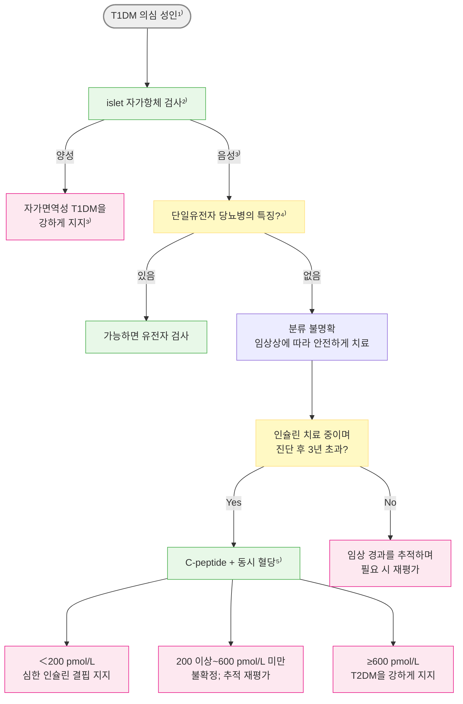
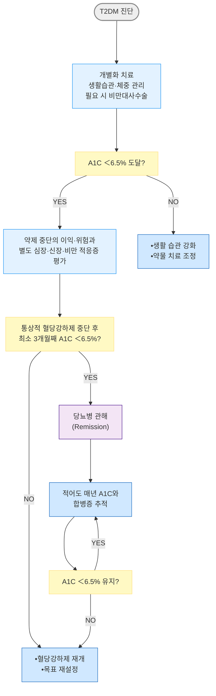
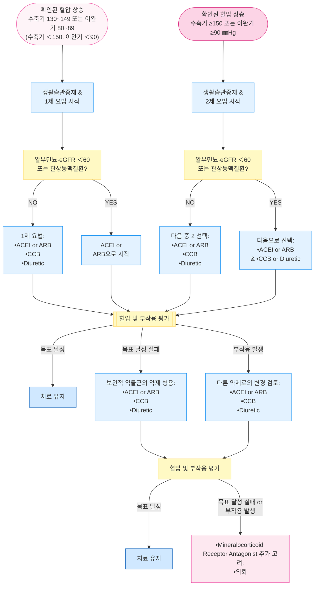
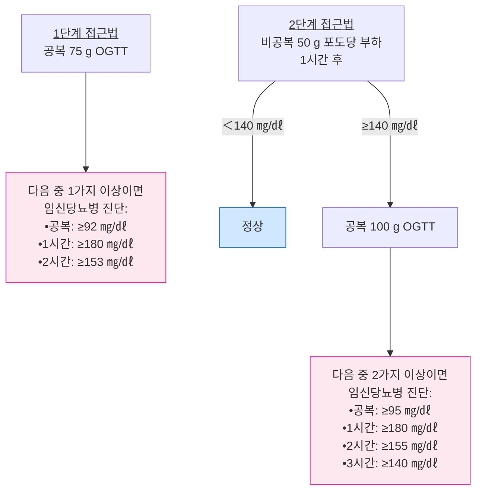

# 당뇨병 Diabetes Mellitus

## <mark style="color:green;">일반 사항</mark>

* 인슐린 분비 결함, 인슐린 작용 이상(인슐린 저항성) 또는 둘 다에 의해 발생하는 만성 고혈당 상태를 특징으로 하는 대사질환군
* 국내 유병률(2023\~2024년 통합, 당화혈색소 포함 기준) : ≥30세 성인의 당뇨병 **16.3%**(남 19.3%, 여 13.3%; 약 565만 명), 당뇨병전단계 **33.9%**(남 36.8%, 여 31.0%; 약 1,177만 명). ≥65세의 당뇨병 유병률은 29.1%임  <mark style="color:$info;">[대한당뇨병학회. Diabetes Fact Sheet in Korea 2026]</mark>
* T2DM이 전체 당뇨병의 90% 이상을 차지함  <mark style="color:$info;">[IDF 2025]</mark>
* 호발 연령
  * T1DM : 소아·청소년기(4\~6세, 10\~14세 이중 정점)에 호발하나, 성인 발병도 드물지 않음 - 전체 T1DM 중 상당수가 성인기에 처음 진단된다는 보고가 있음 _<mark style="color:$info;">[JAMA 2026 Type 1 Diabetes Review]</mark>_
  * T2DM : ＞40세에 호발하나, 비만이 있는 소아·청소년 발병이 증가 추세 (KDA는 10세 이상 또는 사춘기 시작 과체중 소아청소년부터 선별검사를 권고)
* 당뇨병전단계에서 당뇨병으로의 진행 위험은 비만도·혈당 수준·연령에 따라 다름. 특히 고령자는 기대여명·노쇠·영양 상태를 고려하여 예방 중재와 검사 강도를 개별화함
* T1DM은 일반 인구보다 조기 사망 위험이 높고 심혈관 질환이 중요한 원인이지만, 기대여명 차이는 진단 연령·국가·시기·혈당 및 위험 인자 관리에 따라 크게 다름

### <mark style="color:orange;">분류</mark>

1. 제1형 당뇨병 (T1DM) : 자가면역성 β-cell 파괴에 의해 절대적 인슐린 결핍이 발생하는 당뇨병
   * 자가항체 음성이면서 원인 불명의 절대적 인슐린 결핍을 보이는 특발성(idiopathic) T1DM도 존재함. 성인 발병 T1DM의 약 5\~10%는 자가항체 음성일 수 있으나, 항체 음성이라는 이유만으로 특발성으로 확정하지 않음
2. 제2형 당뇨병 (T2DM) : 인슐린 저항성을 배경으로 β-cell의 적절한 인슐린 분비 기능이 점진적으로 저하되는 당뇨병; 종종 대사증후군을 동반
3. 임신당뇨병 (GDM) : 임신 전 명백한 당뇨병이 없던 여성에서 임신 2\~3분기에 처음 진단된 당뇨병
4. 기타 특이 유형의 당뇨병
   * Monogenic diabetes syndrome : 신생아당뇨병, Maturity onset diabetes of youth(MODY)
   * 췌장질환 관련 당뇨병(Type 3c diabetes, pancreatic diabetes) : chronic pancreatitis, pancreatic cancer, cystic fibrosis, pancreatectomy, hemochromatosis 등 - ADA 2026은 이를 별도의 주요 항목으로 강조함
   * 내분비질환 : Cushing 증후군, acromegaly, glucagonoma, 갈색세포종
   * 약물·화학물질 유발 당뇨병 : glucocorticoid, calcineurin inhibitor, protease inhibitor, 비정형 항정신병제
   * 감염 : congenital rubella, CMV
   * 유전증후군 : Down 증후군, Turner 증후군, Wolfram 증후군

<mark style="color:cyan;">**Latent autoimmune diabetes in adults (LADA)**</mark>

* WHO 정의 : 성인에서 발생하는 진행이 느린 자가면역성 당뇨병(slowly progressive autoimmune diabetes) - 초기에는 인슐린 비의존성이나 결국 대부분 인슐린 의존성이 됨
* 초기에는 T2DM으로 오인되는 경우가 많으나 병태생리는 T1DM에 가까움; 일부에서는 비공식적으로 'T1.5DM'이라 부르기도 함
* 독립된 공식 분류라기보다 성인에서 서서히 진행하는 자가면역성 T1DM 표현형을 지칭하는 임상 용어임. ADA 분류에서는 발병 연령과 관계없이 자가면역성 β-cell 파괴에 의한 당뇨병을 T1DM으로 분류함
* 진단에는 **GAD 항체(GAD65 antibody)**가 가장 흔히 이용됨

<mark style="color:cyan;">**Nondiabetic glycosuria (Renal glycosuria)**</mark>

* 혈당은 정상인데 요당이 검출되는 상태. 고립성 신성 요당은 대개 양성이지만, 근위세뇨관병증 등 기저 질환이 있는 경우는 구분하여 평가함
* 원인 : SLC5A2(SGLT2) 유전자 변이, 근위 세뇨관 이상(예: Fanconi 증후군, Dent병, 약물 유발 세뇨관병증), 임신 중(특히 중기 이후 GFR 증가 시)
* SGLT2 억제제 복용 중에는 이 약제의 정상적인 작용 기전으로 인해 혈당이 정상이어도 요당이 검출될 수 있음 - 이 경우는 질환이 아니라 약리 작용의 예상된 결과임
* 당뇨병의 하위 유형이 아니라 정상 혈당에서 요당이 검출되는 경우의 중요한 감별 진단임

<mark style="color:cyan;">**간질환 관련 당뇨병 (hepatogenous diabetes)**</mark>

* ADA 공식 4대 분류에는 포함되지 않으나, 국내 임상에서 흔히 마주치는 diabetes secondary to liver disease(예: 간경변 동반)

<mark style="color:cyan;">**영양실조 관련 당뇨병 (Type 5 diabetes, malnutrition-related diabetes)**</mark>

* IDF가 2025년 별도 유형으로 공식 인정; 저체중·만성 영양실조 배경에서 발생하는 인슐린 결핍성 당뇨병으로 주로 저소득국에서 보고됨. ADA 공식 분류나 KCD에는 아직 별도 반영되지 않았으며 국내 임상 의의는 제한적이나 용어 문의 시 참고

## <mark style="color:green;">원인 및 위험 인자</mark>

* **공통** : 유전, 1촌 가족(first-degree relative)
* **T1DM** : 가장 확립된 위험 인자는 T1DM 가족력과 고위험 HLA 유전형이며, 췌도 자가항체(GAD65, IA-2, ZnT8, IAA) 양성은 자가면역 과정 및 진행 위험을 나타내는 표지자임. Enterovirus 감염, Vit D 결핍 및 일부 주산기 인자는 관찰연구에서 연관성이 보고되었으나 개인의 발병 원인으로 단정할 수 없음. Congenital rubella 등 감염에 의한 당뇨병은 다른 특정형 당뇨병으로 구분함
* **T2DM**
  * 체형/대사 : 비만/과체중(BMI ≥23)/복부비만, 인슐린 저항성 관련 질환(예: 다낭난소증후군, 흑색극세포증)
  * 혈당·심혈관 병력 : 공복혈당장애·내당능장애 또는 A1C 기준 당뇨병전단계(5.7\~6.4%) 과거력, 고혈압, 심혈관 질환(예: 뇌졸중, 관상동맥병), 지질 이상(HDL-C ＜35 ㎎/㎗ 또는 TG ≥250 ㎎/㎗)
  * 산과력 : 임신당뇨병, 거대아(≥4 ㎏) 출산력
  * 생활습관·인구학적 요인 : 비활동, 고령
  * 약물 : glucocorticoid, 비정형 항정신병제, thiazide계 이뇨제, 일부 statin(당뇨병 발생 위험은 소폭 증가하나 심혈관 이득이 더 큼)
  * MASLD(대사이상지방간질환)와는 양방향 연관성이 보고되며, KDA는 모든 T2DM 성인에게 MASLD 평가를 권고함

## <mark style="color:green;">임상 양상</mark>

* 전형적 증상 : 다뇨(polyuria, 야뇨 포함), 다음/갈증, 설명되지 않는 체중 감소
* 기타 증상 : 다식, 피로, 무기력, 근육 경련, 복부 불편, 구역, 시력 변화(흐림), 잦은 감염(피부·요로·질 칸디다증 등)
  * 과거에는 다뇨(polyuria)·다음(polydipsia)·다식(polyphagia)을 '3대 증상(3 Ps)'으로 설명하는 경우가 많았으나, 다식은 일관되게 나타나지 않으며 현재 진단 기준의 대표 증상에는 포함되지 않음

## <mark style="color:$danger;">🚩 Red Flags!</mark>

<mark style="color:$danger;">**즉각 조치**</mark>

* 구토·복통·Kussmaul 호흡·의식 변화 또는 중등도 이상/상승하는 케톤 → 즉시 응급실 평가. SGLT2i 사용 중에는 혈당 ＜200 ㎎/㎗이어도 가능하며 혈중 β-hydroxybutyrate를 우선 측정함  `DKA·정상혈당 DKA`
* 혈당 ≥600 ㎎/㎗, 심한 탈수 또는 의식 혼탁 → 즉시 응급실 평가. 의식이 명료해도 배제하지 않음  `HHS`
* 의식 저하·경련·자가 처치 불가 → 경구 섭취를 시키지 않고 보유 glucagon 투여 및 119 이송  `중증 저혈당`
* 갑작스러운 시력 저하·시야 결손 → 즉시 안과 응급 평가  `유리체출혈·망막박리 등`
* 당뇨발의 괴저·급격한 허혈 또는 발 감염과 전신 독성 징후 → 즉시 응급 평가  `중증 당뇨발·패혈증·급성 하지허혈`

<mark style="color:$warning;">**당일 평가**</mark>

* 경미한 케톤 양성이지만 전신 상태·수분 섭취가 양호함 → 당일 혈당·케톤 추적 및 인슐린 부족 평가. 케톤 증가·구토·호흡 이상·섭취 불가이면 즉각 조치 단계로 상향  `초기 케톤증`
* 원인 불명 혈당 급상승 또는 반복되는 혈당 ＜54 ㎎/㎗ → 당일 원인·치료요법 평가. 저혈당은 평가를 기다리지 않고 먼저 교정  `혈당 불안정`
* 발의 급성 발적·열감·부종, 궤양·봉와직염·허혈성 통증 → 당일 평가; 급성 Charcot 의심 시 평가 전 체중부하 회피  `당뇨발·Charcot 신경관절병증`
* 신기능 급격 악화 → 당일 체액 상태·약제·전해질 평가  `급성 콩팥손상`

<mark style="color:$info;">**조기 평가 및 추적**</mark>

* 적절한 생활습관 중재·약물 치료에도 개별 A1C 목표 미달 → 복약·병형·치료 강화 필요성 재평가  `지속적 혈당조절 불량`
* 새로 발견된 중등도 알부민뇨 또는 단백뇨 증가 → 반복 확인과 CKD 평가  `당뇨병콩팥병증`
* 망막병증 진행·서서히 발생한 시력 변화 → 조기 안과 평가  `당뇨망막병증`
* 발의 보호 감각 저하 → 족부 위험 분류·예방 교육·필요 시 전문 진료  `당뇨병성 신경병증`

* 상세 기준·처치: [당뇨병 합병증](102_-complications-of-diabetes.md), [저혈당, 당뇨병성](103_-hypoglycemia-diabetic.md)

## <mark style="color:green;">진단</mark>

### <mark style="color:orange;">선별 검사</mark>

#### <mark style="color:$primary;">선별 검사 대상 및 일정</mark>

<mark style="color:cyan;">**대한당뇨병학회**</mark> (2025)

* 35세 이상의 모든 성인 또는 다음 위험 인자 중 하나 이상이 있는 19세 이상
  1. 과체중 또는 비만(BMI ≥23)
  2. 복부비만(허리둘레 남 ≥90 ㎝, 여 ≥85 ㎝)
  3. 직계가족(부모, 형제자매) 중 당뇨 병력
  4. 공복혈당장애, 내당능장애 또는 당뇨병전단계(A1C 5.7\~6.4%) 과거력
  5. 임신당뇨병 또는 거대아(≥4 ㎏) 출산력
  6. 고혈압(140/90 ㎜Hg 이상 또는 약물 복용)
  7. HDL-C ＜35 ㎎/㎗ 또는 중성지방 ≥250 ㎎/㎗
  8. 인슐린저항성 관련 상태(다낭난소증후군, 흑색가시세포증 등)
  9. 심혈관질환(뇌졸중, 관상동맥질환 등)
  10. 약물(글루코코르티코이드, 비정형 항정신병약 등)
* 하나의 선별검사 결과가 당뇨병전단계에 해당하는 성인이 당뇨병이 의심되는 경우 다른 방법으로 추가 검사 시행
* 선별검사 결과 정상인 성인은 매년 재검사
* 임신당뇨병 병력자는 출산 4\~12주 후 75 g OGTT 시행을 권고함

<mark style="color:cyan;">**미국당뇨병학회**</mark> (ADA 2026)

1. 다음 중 하나 이상의 위험 인자가 있는 BMI ≥25 (Asian American ≥23) - 연령 무관 검사 시행, 정상 시 최소 매 3년마다 재검사(위험 요인 변화 시 더 자주)
   1. 1세대(부모, 형제) 당뇨병 가족력
   2. 고위험 인종(예: Asian American)
   3. CVD 병력
   4. 고혈압(≥130/80 ㎜Hg or 치료 중)
   5. HDL-C ＜35 ㎎/㎗ or 중성지방 ＞250 ㎎/㎗
   6. 다낭성난소증후군 여성
   7. 비활동적 생활
   8. 인슐린 저항성 관련 상태(예: 심한 비만, acanthosis nigricans)
2. 당뇨병전단계 환자(A1C 5.7\~6.4%, IFG 또는 IGT) - 매년
3. 임신당뇨병 병력자 - 평생 1\~3년마다
4. 위에 해당하지 않는 모든 사람 - 35세에 검사 시작, 정상 시 최소 매 3년마다 재검사
   * 체중 증가, 새로운 위험 인자 발생(고혈압·이상지질혈증 진단, 심혈관 질환 발생 등)으로 위험도가 높아진 경우에는 3년을 기다리지 않고 더 이른 재검사를 고려 (ADA 2026)
5. HIV 환자
6. 당뇨병 유발 약물(예: steroid, 항정신병제) 투여 중인 환자
7. 급성 췌장염 발생 후 3\~6개월 이내 및 매년; 만성 췌장염 환자 - 매년

#### <mark style="color:$primary;">당뇨병 위험도 체크 리스트</mark>

* 항목 및 점수 <mark style="color:$info;">[대한당뇨병학회. 2025]</mark>
  * 나이 : ＜35세(0점), 35\~44세(2점), ≥45세(3점)
  * 가족력(부모·형제 당뇨병력) : 아니오(0점), 예(1점)
  * 고혈압(≥140/90 ㎜Hg 또는 치료 중) : 아니오(0점), 예(1점)
  * 현재 흡연 : 아니오(0점), 예(1점)
  * 허리둘레
    * 남 : ＜84 ㎝(0점), 84\~89.9 ㎝(2점), ≥90 ㎝(3점)
    * 여 : ＜77 ㎝(0점), 77\~83.9 ㎝(2점), ≥84 ㎝(3점)
  * 1일 음주량(주종 무관) : ＜1잔 또는 비음주(0점), 1\~4.9잔(1점), ≥5잔(2점)
* 평가 : 합계 점수가 높을수록 당뇨병 발생 위험 증가; 5\~7점 대비 8\~9점 시 2배, ≥10점 시 ≥3배
  * 총점 ≥5점 시 혈당 검사(공복 혹은 식후 혈당)를 권고

### <mark style="color:orange;">진단 기준</mark>


<table><thead><tr><th width="200">판정</th><th width="185">공복 혈당¹⁾</th><th width="191">당부하검사²⁾</th><th>A1C</th></tr></thead><tbody><tr><td><ol><li><strong>정상</strong></li></ol></td><td>＜100 ㎎/㎗</td><td>＜140 ㎎/㎗</td><td>＜5.7%</td></tr><tr><td><ol start="2"><li><strong>당뇨병전단계</strong> (prediabetes)</li></ol></td><td>100~125 ㎎/㎗ [IFG]</td><td>140~199 ㎎/㎗ [IGT]</td><td>5.7~6.4%</td></tr></tbody></table>

**당뇨병**³⁾ (다음 어느 한 항목이라도 해당) ⓵ 공복 혈당 ≥126, ⓶ 당부하검사 혈당 ≥200, ⓷ A1C ≥6.5%, ⓸ 고혈당의 전형적인 증상(다뇨, 다음, 설명되지 않는 체중 감소) & 무작위 혈장 포도당 ≥200 ㎎/㎗

_**IFG** = impaired fasting glucose (공복혈당장애), **IGT** = impaired glucose tolerance (내당능장애)_\
¹⁾ 최소 8시간 공복(칼로리 섭취 중단)\
²⁾ 75 g OGTT 2시간 후 혈당\
³⁾ _각 진단 기준은 합병증 위험 자료를 기반으로 설정된 독립적인 절단값이며, 동일 환자에서 공복 혈당·OGTT 2시간 혈당·A1C가 서로 정확히 환산되는 값은 아님_

* 전형적 증상과 무작위 혈장 포도당 ≥200 ㎎/㎗의 조합 또는 고혈당 위기가 없는 경우에는 두 번째 비정상 결과로 신속히 확인함. 동일 검체 또는 동일 시점에 시행한 서로 다른 검사 두 가지가 모두 진단 기준에 해당하거나, 동일 검사가 서로 다른 시점에 두 번 진단 기준에 해당하면 진단할 수 있음. 검사 결과가 불일치하면 진단 기준을 넘은 검사를 우선 반복
* portable glucose meter로 당뇨병을 진단해서는 안 됨 <mark style="color:$info;">[ADA]</mark>
* 고혈당 증상이 있는 T1DM의 급성 발병은 A1C보다 혈당으로 판단
* 혈당과 A1C가 현저히 불일치하면 적혈구 수명·검사 간섭·최근 혈당 변화·측정 조건을 평가함. 빈혈·수혈·임신·진행된 CKD 등 A1C-혈당 관계가 달라지는 상황에서는 진단에 혈장 포도당 기준을 우선 적용
* A1C는 표준화된 검사실 방법(NGSP 인증·DCCT 추적성)으로 측정함. CGM 자료만으로 당뇨병을 진단하지 않음

### <mark style="color:orange;">검사 유의 사항</mark>

#### <mark style="color:$primary;">혈당</mark>

* 공복 : 최소 8시간 칼로리 섭취를 하지 않은 상태. 지나치게 긴 공복, 급성 질환, 스트레스 및 평소와 다른 식사·활동은 결과에 영향을 줄 수 있으므로 표준화된 조건에서 검사
* 식후 2시간은 식사 개시부터 2시간째를 의미(경구 당 부하 검사도 마시기 시작부터)
* 혈당 측정은 정맥 혈장 혈당을 이용하는 것을 원칙으로 함
* 검체와 식사 상태에 따라 전혈·혈장 및 정맥혈·모세혈관혈 사이에 차이가 있으므로 진단에는 표준화된 검사실 정맥 혈장 포도당을 사용
  * 일반적으로 손끝 전혈을 측정하는 혈당계는 혈장 혈당 값으로 보정되어 표시됨
* 신속 혈당 검사는 저산소증, 말초관류 저하, hematocrit 및 약물·당류 간섭의 영향을 받을 수 있으며 간섭 물질과 오차 방향은 기기·측정 원리에 따라 다름. 임상상과 맞지 않으면 해당 기기 설명서를 확인하고 검사실 혈장 혈당으로 재확인
* 당 부하 검사 : 검사 전 3일간 탄수화물 ≥150 g/d를 평소 활동과 함께 유지 → 전날 밤부터 금식 → 다음날 오전에 정해진 포도당(+물 300 ㎖)을 5분 내에 섭취하고 검사
  * 당 부하 검사 위양성 유발 인자 : 영양실조, 병상 생활, 감염, 심한 정서적 스트레스

#### <mark style="color:$primary;">당화혈색소(A1C)</mark>

* A1C는 최근 2\~3개월의 혈당 상태를 반영; 최근 수주간의 혈당 변화가 더 큰 비중으로 반영되며 정확한 기여율은 개인·상황별로 다름
* **적혈구 수명 연장으로 A1C가 높아질 수 있는 경우** : 철결핍·Vit B12·folate 결핍 빈혈 등
* **적혈구 수명 단축으로 A1C가 낮아질 수 있는 경우** : 급만성 실혈, 용혈성 빈혈, erythropoietin 치료, 임신 2·3분기/산욕기, 투석 등
* **방향이 일정하지 않거나 검사법 의존적인 경우** : 수혈, Hb variants, 진행된 CKD/uremia, 고중성지방혈증·고빌리루빈혈증, 일부 약물·보충제. 혈당 자료와 불일치하면 사용한 검사법의 간섭 여부를 확인하고 fructosamine/glycated albumin 또는 CGM 지표를 보조적으로 고려

<table data-search="false"><thead><tr><th width="111">A1C (%)</th><th width="191">평균 혈장 혈당 (㎎/㎗)</th></tr></thead><tbody><tr><td>5</td><td>97</td></tr><tr><td>6</td><td>126</td></tr><tr><td>7</td><td>154</td></tr><tr><td>8</td><td>183</td></tr><tr><td>9</td><td>212</td></tr><tr><td>10</td><td>240</td></tr><tr><td>11</td><td>269</td></tr><tr><td>12</td><td>298</td></tr></tbody></table>

<mark style="color:$info;">Ref. ADA. Standards of Medical Care in Diabetes. 2024. Table 6-1.</mark>

### <mark style="color:orange;">T1DM vs T2DM 감별</mark>

* 감별 검사 : islet auto-Ab(인슐린, glutamic acid decarboxylase(GAD), islet antigen 2(IA-2), zinc transporter 8(ZnT8)), c-peptide
  * C-peptide는 주로 인슐린 치료 중이면서 당뇨병 유형이 불확실한 환자의 분류에 사용함. 무작위 검체를 식후 5시간 이내에 동시 혈당과 함께 측정할 수 있으며, ＜200 pmol/L은 심한 인슐린 결핍을 지지하고, 200 이상\~600 pmol/L 미만은 불확정, ≥600 pmol/L은 T2DM을 강하게 지지함. 단일 수치만으로 확진하거나 인슐린을 중단하지 않음
    * 단위 환산 참고 : 1 ng/㎖ ≒ 331 pmol/L; 0.6 ng/㎖ ≒ 200 pmol/L; 1.8 ng/㎖ ≒ 600 pmol/L
    * 경계값 해석 시 인슐린 치료 여부, 유병 기간, 임상 맥락을 함께 고려해야 함; 단일 수치로 확정 진단은 위험
    * 국내 자료의 공복 C-peptide 200/330 pmol/L 절단값은 보조적으로 참고할 수 있으나, 검사 조건·유병 기간·신기능과 인슐린 치료 여부를 함께 해석하고 국제 알고리듬의 200/600 pmol/L 구간과 혼용하여 확정 진단하지 않음
  * 자가 항체 : 양성 시 면역 매개성 T1DM 가능성이 높으나 T2DM 진단 환자의 4\~25%에서도 항GAD Ab(+)이며, 이 경우 인슐린 치료를 받아야 할 가능성이 높음; T1DM과 겹치는 phenotype 위험이 있는 성인 당뇨병 환자(예: 진단 시 젊은 연령, 의도하지 않은 체중 감소, 인슐린 치료까지 짧은 시간)에서 분류를 위해 표준화된 islet auto-Ab 검사를 권고
* 대부분의 환자에서 islet autoantibodies, 인슐린, proinsulin, c-peptide의 일률적 검사는 권고하지 않음 <mark style="color:$info;">[ADA]</mark>

***



***

<p align="center"><strong>T1DM 의심 환자의 진단 알고리듬</strong></p>

¹⁾ T1DM 의심 기준(다음 중 하나 이상) : 젊은 발병 연령, BMI＜25 또는 의도치 않은 체중 감소, DKA 또는 현저한 고혈당, 급속한 인슐린 치료 전환, 당뇨병 유형에 대한 불확실성. 연령과 BMI를 기계적인 진단 기준으로 사용하지 않음\
²⁾ GAD 항체를 우선 검사; 음성 시 IA-2, ZnT8 추가 검사(가능한 경우)\
✽IAA(인슐린 자가항체)는 외인성 인슐린 치료 시작 전 검사에서만 해석 가능 - 치료 시작 후에는 자가면역 반응과 인슐린 노출에 의한 반응성 항체를 구별할 수 없음\
³⁾ 단일 항체 양성은 임상상·항체 종류·역가와 위양성 가능성을 함께 판단하고 필요 시 확인 검사. 성인 발병 T1DM의 5\~10%는 자가항체 음성일 수 있음\
⁴⁾ Monogenic diabetes 특징: 강한 가족력(다세대에 걸친 상염색체 우성 양상), 경미하고 안정적인 고혈당, 젊은 발병 연령, 상대적으로 적은 인슐린 요구량 등\
⁵⁾ C-peptide는 주로 인슐린 치료 중이면서 분류가 불확실한 환자에서 사용.\
✽검사 조건: 식후 5시간 이내 무작위 C-peptide와 동시 혈당을 측정할 수 있음. C-peptide가 ＜600 pmol/L이고 동시 혈당 ＜72 ㎎/㎗ 또는 공복 검체인 경우라면 적절한 조건에서 재검을 고려하고, DKA 등 고혈당 응급상황 후 2주 이내에는 검사하지 않음. 진행된 CKD에서는 제거 감소로 수치가 높게 측정될 수 있음. 검사 전 인슐린을 중단하지 않으며 결과만으로 인슐린 치료를 중단하지 않음\
✽한국인 기준값(국내연구) : 공복 C-peptide 200/330 pmol/L 절단값은 보조적으로 참고할 수 있으나, 국제 알고리듬의 200/600 pmol/L 구간과 혼용하여 확정 진단하지 않음 <mark style="color:$info;">[KDA]</mark>\
✽분류가 불확실하면 임상 경과와 함께 추적 재평가하며, 고혈당 악화 위험이 있는 환자에서 인슐린을 성급히 중단하지 않음

***

### <mark style="color:orange;">T1DM 병기(Staging)</mark>

* T1DM은 자가면역 β-cell 파괴가 시작된 시점부터 임상 발병까지 연속적인 병기로 진행하며, 자가항체가 확인된 무증상 단계에서도 조기 분류가 가능함

<table><thead><tr><th width="100">병기</th><th width="304">특징</th><th>비고</th></tr></thead><tbody><tr><td>Stage 1</td><td>islet 자가항체 ≥2개 양성 + 정상 혈당</td><td>무증상; 평생 임상적 T1DM 발생 위험이 매우 높으나 진행 속도에는 개인차가 있음</td></tr><tr><td>Stage 2</td><td>islet 자가항체 ≥2개 양성 + 이상 혈당(dysglycemia; 공복 100~125, OGTT 2시간 140~199, A1C 5.7~6.4% 또는 기준치 대비 A1C 10% 이상 상승)</td><td>무증상; Stage 3 진행 위험이 높으므로 전문 평가 및 추적</td></tr><tr><td>Stage 3</td><td>당뇨병 진단 기준 충족 + 증상(다뇨, 다음, 체중 감소) 동반 가능</td><td>임상적 T1DM; 무증상 발견도 가능하며 전문 평가 후 인슐린 치료 계획 수립</td></tr></tbody></table>

<mark style="color:$info;">Ref. Jacobsen LM, Schatz DA. Type 1 Diabetes: A Review. JAMA 2026.</mark>


**단일 IA-2 자가항체 양성자의 추적 (ADA 2026)** - IA-2만 단독 양성인 경우 이를 곧바로 Stage 2로 분류하지는 않지만, Stage 3 진행 위험이 높아 다중 자가항체 양성자와 유사하게 면밀히 모니터링함. 자가항체 양성이 확인된 무증상 성인·소아는 병기 평가와 추적 계획을 위해 조기 의뢰가 중요함 (ADA 2026 Recommendation 2.8a/2.8b/2.9).



**Teplizumab (anti-CD3 단클론항체; 미국 승인)** - Stage 2 T1DM에서 Stage 3 발병을 지연시키는 면역치료제. 2022년 최초 승인 당시 8세 이상이었으나 2026년에는 1세 이상으로 확대됨. 2026년 6월에는 최근 Stage 3 T1DM으로 진단된 8\~17세에서 내인성 인슐린 생성 감소를 지연시키는 적응증이 가속승인됨. 주요 초기 Stage 2 무작위시험의 발병까지 중앙값은 48.4개월(위약 24.4개월)이었으며 이를 확대된 모든 대상군의 효과로 일반화하지 않음. 전문기관 치료이며 인슐린을 대체하지 않음; 미국 승인과 국내 허가·도입 상태를 구분함. <mark style="color:$info;">[FDA 2026]</mark>


### <mark style="color:orange;">급성 고혈당 위기의 진단 원칙</mark>

* DKA는 당뇨병 또는 고혈당에 더해 케톤혈증과 대사성 산증을 확인하여 진단함. HHS는 현저한 고혈당·고삼투압을 확인하고 중증 케톤혈증·산증의 동반 여부로 DKA 중첩을 평가함. 증상만으로 확진하지 않으며 세부 기준은 102장 참조
* 국내 SGLT2 억제제는 T1DM 적응증이 없고 DKA 위험 때문에 T1DM 치료에 권고하지 않음

### <mark style="color:orange;">합병증</mark>

(☞ [당뇨병 합병증](102_-complications-of-diabetes.md))

* **혈관계** : 망막병증, 신경병증, 신장병증, 관상동맥병, 뇌혈관 질환, 말초혈관 질환, 인지기능 저하 및 치매 위험 증가(혈관성 치매, 알츠하이머병 포함)
* **비-혈관계** : 위장관 장애(예: 위마비, 설사), 비뇨생식기 장애(예: 배뇨, 성 기능 장애), 피부 질환, 감염, 백내장, 녹내장, 치주 질환, 청력 장애

***

## <mark style="color:$warning;">Management</mark>

### <mark style="color:orange;">치료 방침</mark>

* **모든 치료 목표와 약물 선택은 환자의 동반 질환, 저혈당 위험, 체중, 비용, 선호도를 종합적으로 고려하는 person-centered approach(환자 중심 접근)에 따라 개별화하여 결정** (ADA 2026이 지속적으로 강조하는 핵심 원칙)

1. **동반 질환 및 합병증 위험성 평가** : ASCVD 및 심부전 병력, ASCVD 위험 인자 및 10년 위험도 평가, CKD 단계 평가, 저혈당 위험 평가, 망막병증/신경병증 평가 (☞ [ASCVD 10년 위험도](https://tools.acc.org/ASCVD-Risk-Estimator-Plus/#!/calculate/estimate/))
2. **치료 목표 설정** : A1C/혈당 목표, 혈압, 당뇨병 자가 관리 목표 설정
3. **치료 계획 수립** : 생활 습관 중재, 항당뇨병제, 심혈관/신질환 관리, 혈당 측정 기기/인슐린 투여 기기 사용, (필요시) 의뢰\*

_\*다음의 경우에 교육 및 지원 필요 : ⓵ 진단, ⓶ 매년 &/or 목표 달성 실패, ⓷ 합병증/위험 요소 발생(의료, 신체, 정신 사회적), ⓸ 삶/관리에 변화 발생_

<mark style="color:cyan;">**당뇨병 자기 관리 교육**</mark>

* 당뇨병 진단 후 '매년' 자기 관리 교육; 1년 이내라도 '치료 목표에 도달하지 못하거나 자기 관리에 영향을 주는 문제가 발생했을 때'는 자기 관리 교육의 필요성을 평가하고 반복 재교육
* 환자 중심의 자기 관리 교육을 위해 의료, 간호, 영양, 운동, 약물, 사회복지 각 분야의 자격을 갖춘 교육자가 참여해야 함
* 당뇨병 자기 관리 교육에 디지털 기기 활용을 적극 고려

### <mark style="color:orange;">치료 목표</mark>

**A1C 목표**

<table><thead><tr><th width="213"><mark style="color:$info;">[대한당뇨병학회]</mark> (2025)</th><th width="90"></th><th width="247">[미국당뇨병학회] (ADA 2026)</th><th></th></tr></thead><tbody><tr><td>T2DM의 일반적 목표</td><td>＜6.5%</td><td>A1C 일반적 목표</td><td>＜7%</td></tr><tr><td>T2DM - 목표 개별화</td><td>저혈당 위험·동반 질환·기대여명에 따라 조정</td><td>건강·기능 상태가 좋고 저혈당 위험·치료 부담이 낮은 경우</td><td>＜6.5% 고려</td></tr><tr><td>T1DM의 일반적 목표</td><td>＜7.0%</td><td>고령 - 일반적 경우</td><td>＜7.0~7.5%</td></tr><tr><td>고령(≥65세) 일반적 경우</td><td>＜7.5%</td><td>고령 - 저혈당 위험, 특별한 경우¹⁾</td><td>＜8%</td></tr><tr><td>소아청소년 T2DM</td><td>＜6.5%</td><td></td><td></td></tr></tbody></table>

**혈당 목표** <mark style="color:$info;">[KDA·ADA]</mark> (일반적인 비임신 성인) : 공복 80\~130 ㎎/㎗, 식후²⁾ ＜180 ㎎/㎗

¹⁾ 제한된 기대 여명, 진행된 혈관 합병증, 심한 동반 질환, 복수의 만성 질환 동반, 인지 장애, 기능적 의존 상태, 적절한 치료(인슐린 포함)에도 불구하고 목표 도달이 어려운 오래된 당뇨병\
²⁾ 일반적으로 당뇨병 환자에서 peak level인 식후 1\~2시간에 측정

* 식전 포도당이 목표에 도달했음에도 A1C 목표가 달성되지 않을 경우 식후 포도당을 평가하고 치료를 조정함
* 반복되는 저혈당·쇠약·인지 저하 또는 치료 부담이 큰 경우에는 SU·glinide·인슐린의 감량·단순화를 고려함. A1C가 낮다는 이유만으로 심장·신장 보호 적응증의 약제를 일률적으로 중단하지 않음

**연속혈당측정기(CGM) 치료 목표 (Time-in-Range, TIR)**

<table><thead><tr><th width="194">지표</th><th width="200">목표</th><th>의미</th></tr></thead><tbody><tr><td>TIR (70~180 ㎎/㎗)</td><td>＞70% (하루 약 17시간)</td><td>목표 혈당 범위 내 시간</td></tr><tr><td>TAR (＞180 ㎎/㎗)</td><td>＜25%</td><td>고혈당 시간 (<em>Time Above Range)</em></td></tr><tr><td>TAR (＞250 ㎎/㎗)</td><td>＜5%</td><td>심한 고혈당 시간</td></tr><tr><td>TBR (＜70 ㎎/㎗)</td><td>＜4%</td><td>저혈당 시간 (<em>Time Below Range)</em></td></tr><tr><td>TBR (＜54 ㎎/㎗)</td><td>＜1%</td><td>2단계(임상적으로 유의한) 저혈당 시간</td></tr></tbody></table>

✽고령·고위험군(저혈당 위험이 높거나 기대여명이 제한된 경우)에서는 TIR ＞50%, TBR(＜70 ㎎/㎗) ＜1% 등으로 목표를 완화하여 개별화함

### <mark style="color:orange;">당뇨병 환자의 포괄적 관리</mark>

#### <mark style="color:$primary;">첫 방문 시 평가 항목</mark>

1. 당뇨병 진단 확인, 병형 분류, 혈당 상태
2. 당뇨병성 합병증, 동반 질환 및 위험 인자
3. (기존 DM 진단 시) 과거 치료 방법, 위험 인자 조절 방법, 당뇨병 교육 여부
4. 영양 상태
5. 자가 관리 수행 능력
6. 신체검사와 실험실 검사
7. 예방접종 및 정기검진 여부

#### <mark style="color:$primary;">재방문 시 평가 항목</mark>

1. 첫 방문 때 시행한 평가 항목 재검토
2. 지난 방문 이후 병력
3. 약물 복용에 대한 순응도 및 부작용
4. 적절한 주기의 HbA1c, 대사 지표 등 검사
5. 합병증 위험, 자가 관리 실천 여부, 다른 기관으로의 전원 필요성 평가

* T1DM 환자에서 소화기 증상 또는 셀리악병 의심 소견이 있는 경우 셀리악병 선별
* 직계 1대 중 T1DM 환자가 있는 경우에 자가항체 패널 검사 권고; 지속되는 자가항체는 임상적 당뇨병의 위험 인자이며 중재의 지표로 작용할 수 있음
* T2DM 또는 대사 위험이 높은 당뇨병전단계에서는 간효소가 정상이어도 진행된 간섬유화를 배제할 수 없음 (☞ [MASLD](../224_/093_-nafld.md))
* 성 기능 저하 등 hypogonadism 징후를 보이는 남성 환자에서 아침 s-testosterone 검사 고려
* 대사이상지방간질환(MASLD) 평가 : 모든 T2DM 성인에게 MASLD 평가를 권고 <mark style="color:$info;">[KDA]</mark>
  * 선별 검사: ALT + 복부 초음파 시행
  * 간섬유화 평가: FIB-4 등 비침습 점수로 일차 위험을 평가하고, 결과·연령·임상상에 따라 vibration-controlled transient elastography(VCTE, FibroScan) 등 추가 평가 또는 간 전문의 의뢰를 고려. KDA 2025의 VCTE 권고를 FIB-4의 역할이 없다는 의미로 해석하지 않음
  * T2DM + MASLD/MASH 동반 시 : MASH에 대한 이익이 입증된 GLP-1 RA 또는 GIP/GLP-1 이중작용제(tirzepatide)를 혈당·비만 치료 목적으로 고려. Resmetirom은 비간경변 MASH와 F2\~F3 섬유화가 확인된 성인에서 간 전문의 관리하에 고려하며, 국내 허가·도입 여부는 처방 시점에 확인 (☞ [MASLD](../224_/093_-nafld.md))

<table data-search="false"><thead><tr><th width="405">항목</th><th width="80">첫 방문</th><th width="80">매 방문</th><th width="80">매년</th></tr></thead><tbody><tr><td><strong>과거력·가족력: 당뇨병 병력</strong></td><td></td><td></td><td></td></tr><tr><td>• 발병 시 특징 (예: 나이, 증상)</td><td>○</td><td></td><td></td></tr><tr><td>• 이전 치료 방법 및 반응 검토</td><td>○</td><td></td><td></td></tr><tr><td>• 과거 입원 빈도/원인/중증도 평가</td><td>○</td><td></td><td></td></tr><tr><td><strong>과거력·가족력: 가족력</strong></td><td></td><td></td><td></td></tr><tr><td>• 1st-degree 당뇨병 가족력</td><td>○</td><td></td><td></td></tr><tr><td>• 자가면역 질환 가족력</td><td>○</td><td></td><td></td></tr><tr><td><strong>과거력·가족력: 합병증 및 동반 질환 병력</strong></td><td></td><td></td><td></td></tr><tr><td>• 동반 상태 (예: 비만, OSA, MASLD)</td><td>○</td><td></td><td></td></tr><tr><td>• 고혈압 or 이상지질혈증</td><td>○</td><td></td><td>○</td></tr><tr><td>• 대혈관 &#x26; 미세혈관 합병증</td><td>○</td><td></td><td>○</td></tr><tr><td>• 저혈당: 상황, 빈도, 원인, 자각 여부</td><td>○</td><td>○</td><td>○</td></tr><tr><td>• hemoglobinopathies or 빈혈</td><td>○</td><td></td><td>○</td></tr><tr><td>• 마지막 치과 진료</td><td>○</td><td></td><td>○</td></tr><tr><td>• 마지막 동공 확대 안과 검진</td><td></td><td></td><td>○</td></tr><tr><td>• visits to specialists</td><td></td><td></td><td>○</td></tr><tr><td>• 장애 평가 &#x26; 보조 기기 사용¹⁾</td><td>○</td><td>○</td><td>○</td></tr><tr><td>• 자가면역 질환 병력</td><td>○</td><td></td><td></td></tr><tr><td><strong>과거력·가족력: Interval Hx</strong></td><td></td><td></td><td></td></tr><tr><td>• 이전 방문 후 질병/가족 변화</td><td></td><td>○</td><td>○</td></tr><tr><td><strong>생활 습관 인자</strong></td><td></td><td></td><td></td></tr><tr><td>• 식사 습관 &#x26; 체중 변화력</td><td>○</td><td>○</td><td>○</td></tr><tr><td>• 탄수화물 계산 숙련도 평가</td><td>○</td><td></td><td>○</td></tr><tr><td>• 신체 활동, 수면 습관; OSA 평가</td><td>○</td><td>○</td><td>○</td></tr><tr><td>• 흡연, 음주, 약물 남용</td><td>○</td><td></td><td>○</td></tr><tr><td><strong>약물 및 예방접종 병력</strong></td><td></td><td></td><td></td></tr><tr><td>• 현재 투여 약물</td><td>○</td><td>○</td><td>○</td></tr><tr><td>• 약물 투여 행동(순응도)</td><td>○</td><td>○</td><td>○</td></tr><tr><td>• 약물 불내성 or 부작용</td><td>○</td><td>○</td><td>○</td></tr><tr><td>• 민간/대체 요법</td><td>○</td><td>○</td><td>○</td></tr><tr><td>• 예방접종 경력 및 필요성</td><td>○</td><td></td><td>○</td></tr><tr><td><strong>Technology use</strong></td><td></td><td></td><td></td></tr><tr><td>• 건강 앱, 온라인 교육, 환자 포털 이용</td><td>○</td><td></td><td>○</td></tr><tr><td>• 당 모니터링: 결과 및 데이터 활용</td><td>○</td><td>○</td><td>○</td></tr><tr><td>• 인슐린 펌프 셋팅 및 사용 검토</td><td>○</td><td>○</td><td>○</td></tr><tr><td><strong>사회 생활 평가: Social network</strong></td><td></td><td></td><td></td></tr><tr><td>• 사회적 지지 존재 확인</td><td>○</td><td></td><td>○</td></tr><tr><td>• 의사결정 대리인, 추가 관리계획 확인</td><td>○</td><td></td><td>○</td></tr><tr><td>• 건강의 사회적 요인 확인</td><td>○</td><td></td><td>○</td></tr><tr><td>• 일상 및 환경 평가</td><td>○</td><td>○</td><td>○</td></tr><tr><td><strong>신체검사</strong></td><td></td><td></td><td></td></tr><tr><td>• 신장, 체중, BMI; 혈압</td><td>○</td><td>○</td><td>○</td></tr><tr><td>• 기립 혈압(필요시)</td><td>○</td><td></td><td></td></tr><tr><td>• 안저검사(안과 전문의 의뢰)</td><td>○</td><td></td><td>○</td></tr><tr><td>• 갑상선 촉진</td><td>○</td><td></td><td>○</td></tr><tr><td>• 피부 검사(예: 인슐린 주사 부위)</td><td>○</td><td>○</td><td>○</td></tr><tr><td>• 포괄적 발 검사</td><td>○</td><td></td><td>○</td></tr><tr><td>　시진(예: 상처, 굳은살, 변형, 궤양, 발톱)</td><td>○</td><td>○</td><td>○</td></tr><tr><td>　말초동맥질환 선별(pedal pulses)²⁾</td><td>○</td><td></td><td>○</td></tr><tr><td>　감각 검사³⁾</td><td>○</td><td></td><td>○</td></tr><tr><td>• 우울, 불안, 저혈당공포, 식사장애 선별</td><td>○</td><td></td><td>○</td></tr><tr><td>• 인지 장애 평가 고려(≥65세)</td><td>○</td><td></td><td>○</td></tr><tr><td>• 기능 수행 평가 고려(≥65세)</td><td>○</td><td></td><td>○</td></tr><tr><td>• 골 통증 평가 고려</td><td>○</td><td></td><td>○</td></tr><tr><td><strong>검사실 검사</strong></td><td></td><td></td><td></td></tr><tr><td>• A1C (3개월 내 검사하지 않은 경우)</td><td>○</td><td>○</td><td>○</td></tr><tr><td>• 총/LDL/HDL-C, TG; LFT; Cr, eGFR⁴⁾</td><td>○</td><td></td><td>○</td></tr><tr><td>• T1DM에서 TSH; metformin 투여 시 Vit B12; CBC; ACEI/ARB/이뇨제 투여 시 혈청 K; 필요시 Ca, Vit D, P⁵⁾</td><td>○</td><td></td><td>○⁶⁾</td></tr><tr><td>• 소변 Alb/Cr ratio</td><td>○</td><td></td><td>○</td></tr></tbody></table>

¹⁾ 예: 신체, 인지, 시각, 청각, 골격, 국부 보호 기기\
²⁾ 감소 시 의뢰\
³⁾ 온도, 진동 or pinprick sense, 10-g monofilament exam\
⁴⁾ 당뇨, 혈압, 콜레스테롤, 갑상선 약물 등 검사 결과에 영향을 줄 수 있는 약물 투여 개시나 변경 시 검사 고려\
⁵⁾ 만성 신질환 또는 신경 및 K에 영향을 미치는 약물 투여 시 보다 빈번하게 검사할 수 있음\
⁶⁾ 이상지질혈증이 없는 환자에서는 지질 패널을 보다 드물게 검사할 수 있음

✽검사 시점은 당뇨병 유형·유병 기간과 이전 결과에 따라 조정함. T2DM은 진단 시 안저·uACR·eGFR을 평가함. T1DM은 첫 안저검사를 진단 5년 이내에, uACR 기반 신장병 선별은 일반적으로 진단 5년 후부터 시행하며, 약제 안전성을 위한 eGFR 확인은 이 시기와 별개임. 정상 안저 소견과 안정된 혈당이 지속되면 안과검사 간격을 1\~2년으로 연장할 수 있음.

#### <mark style="color:$primary;">예방접종</mark>

* 연령·과거 접종력·동반 질환별 적응증에 따라 [B형간염](../231_/210_-vaccination.md#b-hepb), [폐렴구균](../231_/210_-vaccination.md#pneumococcal-pneumonia), [독감](../231_/210_-vaccination.md#influenza), 대상포진, COVID-19 및 RSV 백신 접종
  * 대상포진 : 당뇨병 자체는 우선 접종 대상 기준이 아니나 연령 기준(예: 50세 이상)에 해당하면 재조합 대상포진 백신 접종 권고

## <mark style="color:green;">비-약물 치료 및 예방</mark>

* **생활 습관 개선** : 체중 감량, 운동, 식이/영양 관리, 금연(전자 담배 포함), 음주 제한, 수면 관리(일반 성인은 대개 7\~9시간 수면을 목표로 개별화, 폐쇄수면무호흡증(OSA) 선별)
* **효과** : 집중적 영양·생활습관 중재로 A1C 약 1\~2%p 감소 가능(기저 혈당·중재 강도에 따라 차이); 약물 치료 시작을 지연시키거나 약물 필요량 감소

### <mark style="color:orange;">식이/영양</mark>

* 개별화한 목표와 선호에 따라 지중해식, 채식, 저지방, DASH, 저탄수화물식 식이를 권고
  * 과도한 탄수화물 섭취는 제한하되, 치료 목표와 선호에 따라 개별화; 식이섬유가 풍부한 통곡류, 콩류, 채소, 생과일의 섭취를 통해 탄수화물의 질적 섭취를 충족하도록 권고
* [지중해식 식단](../231_/217_-nutritiondiet-guideline.md) : 채소·콩류·견과류·씨앗·과일·전곡류와 생선/해산물을 충분히 섭취하고, 주된 지방으로 올리브유를 사용하며, 붉은 고기·가공육·첨가당을 제한. 당뇨병 또는 심혈관 예방을 위해 음주를 새로 시작하도록 권고하지 않음
* 탄수화물, 단백질, 지방의 이상적인 고정 비율은 없으며 총열량, 식품의 질, 치료 목표·선호·동반 질환에 따라 개별화
* 식사량·탄수화물을 크게 줄이거나 끼니를 거를 때 인슐린·SU 등 저혈당 유발 약제의 용량과 식사 시간에 맞춘 투여 계획을 재평가하고 혈당 추적을 강화함. T1DM의 기저 인슐린을 임의로 중단하지 않음
* SGLT2 억제제 사용 중에는 케톤산증 위험 때문에 극저탄수화물식·케톤식을 피함. 장시간 금식·급성질환·탈수·섭취 저하 시 약물 관리와 케톤 평가 계획을 확인함  <mark style="color:$info;">[ADA 2026]</mark>

#### <mark style="color:$primary;">탄수화물</mark>

* 혈당 조절 및 관리를 위해 과도한 탄수화물 섭취는 제한하되, 치료 목표와 선호에 따라 개별화
* 식이섬유가 풍부한 통곡류, 콩류, 채소, 생과일의 섭취를 통해 탄수화물의 질적 섭취를 충족해야 함
* 첨가당 섭취를 최소화하기 위해 가당 음료 섭취를 줄임
* 낮은 당지수(glycemic index) 및 당부하지수(glycemic load) 식품 권고
* 정해진 용량의 인슐린 주사를 맞는 환자에서는 음식 섭취량과 시간을 일정하게 하도록 교육

#### 당지수(GI)와 실제 식사 선택

| 식품군 | 실용적 선택 원칙 |
| --- | --- |
| 밥·잡곡밥·빵·국수 | 품종·혼합비·제분·조리법에 따라 GI가 크게 달라짐. 통곡류·콩류를 활용하되 1회 총 탄수화물량을 함께 조절 |
| 감자·고구마·옥수수 | 채소 반찬처럼 무제한 섭취하지 않고 탄수화물 공급원으로 계산 |
| 귀리 | 설탕을 첨가하지 않은 제품을 선택하고 건조 중량과 조리 후 중량을 구분 |
| 생과일 | 주스보다 과일 자체를 선택하고 1회 섭취량을 조절. 특정 과일을 GI만으로 금지하거나 무제한 허용하지 않음 |
| 콩·견과류 | 식이섬유·단백질·불포화지방 공급에 활용. 견과류는 열량과 섭취량에 유의 |
| 우유·요구르트·두유 | 무가당 제품을 선택하고 실제 영양표시의 탄수화물량을 확인 |
| 비전분 채소 | 다양한 채소를 충분히 섭취하고 단맛·GI에 대한 우려로 불필요하게 제한하지 않음 |

* GI는 같은 양의 가용 탄수화물을 섭취했을 때의 혈당 증가곡선하면적을 기준 식품(통상 포도당=100)과 비교한 값임. 혈당 상승 속도만을 뜻하지 않음
* 낮은 GI는 일반적으로 ≤55, 중간은 56\~69, 높은 GI는 ≥70으로 구분함. **GL = GI × 1회 섭취 가용 탄수화물량(g) ÷ 100**
* 실제 혈당은 섭취량·조리법·혼합 식사·개인의 반응에 따라 달라짐. GI 자료는 제품·조리법이 명시된 검증 자료를 참고하며, 특정 음식명의 숫자를 국내 모든 제품에 적용하지 않음  <mark style="color:$info;">[International Tables of GI and GL; University of Sydney GI Database]</mark>

#### [<mark style="color:$primary;">식이 섬유</mark>](../231_/217_-nutritiondiet-guideline.md)

* 효과 : 당뇨병 발생 감소, 혈당 조절 개선, 심혈관 질환 감소
  * 대사에 있어서 수용성 식이 섬유의 효과에 대한 근거가 많으나 권장 섭취량은 일반적으로 수용성과 불용성을 구분하지 않음
* 당뇨병 영양상담 목표 : 최소 14 g/1,000 ㎉의 식이섬유를 포함한 식사를 권고함(예: 2,000 ㎉ 식사에서 ≥28 g/d). 현재 섭취량·위장관 증상·내약성에 따라 서서히 증량함  <mark style="color:$info;">[ADA 2026]</mark>
* 일반인용 2025 KDRI 충분섭취량은 성인 남성 30 g/d, 여성 19\~49세 20 g/d·50세 이상 25 g/d임. 위 당뇨병 식사 권고와 목적·산출 근거가 다르므로 구분하며, 충분섭취량을 최소량이나 상한으로 해석하지 않음  <mark style="color:$info;">[보건복지부·한국영양학회. 2025 KDRI; 217장]</mark>
  * <mark style="color:$info;">근거: [ADA Standards of Care 2026, Section 5](https://doi.org/10.2337/dc26-S005); [2025 한국인 영양소 섭취기준](https://www.kns.or.kr/fileroom/fileroom_view.asp?BoardID=Kdr&idx=167).</mark>
* 수용성 섬유 식품 : 가지, 귀리 가공식품, 콩, 보리
* 불용성 섬유 식품 : 전곡류, 짙은 색 채소, 단단한 줄기, 밀기울, 사과/배의 껍질, 감자류

#### <mark style="color:$primary;">단백질</mark>

* 단백질은 영양 상태에 맞춰 섭취함. 비투석 CKD G3 이상에서는 대개 약 0.8 g/㎏/d를 목표로 하고 과도한 섭취는 피함. 투석·노쇠·근감소증이 있으면 별도의 영양 처방을 적용
  * 단백질 섭취를 ＜0.8 g/㎏/d로 낮추는 것은 당 조절, 심혈관 질환 위험, GFR에 유의미한 영향을 주지 못하며 영양실조 위험을 높일 수 있음
* **단백질 식품을 저혈당의 초기 교정 수단으로 사용하지 않음**. 초기에는 빠르게 흡수되는 포도당으로 교정하며, 혈당 회복 후 다음 식사까지 1시간 이상 남으면 탄수화물과 단백질을 포함한 간식을 고려. 저혈당 위험만을 이유로 평소의 적정 단백질 섭취를 제한하지 않음 <mark style="color:$info;">[ADA 2026]</mark>

#### <mark style="color:$primary;">지방</mark>

* 불포화 지방산 풍부 식품(예: 등푸른 생선, 식물성 기름) 권고
* 포화지방 및 트랜스 지방(예: 돼지고기, 쇠고기, 닭 껍질, 버터, 마가린, 생크림, 쇼트닝, 치즈, 햄) 섭취 제한
  * 베이컨 등 가공육은 포화지방·나트륨 함량이 높아 이상지질혈증·심혈관 위험 관리 차원에서 별도 섭취 제한이 필요
* 지중해식 식단 권고, 오메가-3 풍부 식품(예: 생선, 견과류, 씨앗류) 권고

#### <mark style="color:$primary;">기타 식이</mark>

* [**음주**](../230_/189_-alcohol-use-disorder.md) : 금주 권고(특히 간질환, 고지혈증, 비만인 당뇨병 환자); 혈당 조절이 잘되는 경우에만 여 ≤1 SD/d, 남 ≤2 SD/d로 허용, 음주 후 당 모니터링 권고
  * 음주는 저혈당 위험을 증가시킴(특히 인슐린 or 인슐린 분비 촉진제 투여 환자)
* 항산화제, ω-3, Vit, 무기질 보충 : 혈당 개선 목적의 일상적 보충은 권고 안 함
  * 부족한 상태가 아닌 한 보충이 도움이 된다는 증거 없음; 결핍이나 제한적 식사 시 보충 고려
  * β-carotene 보충제는 이득이 없고 일부에서 해롭다는 증거가 있어 사용하지 않도록 함
  * Vit D 결핍은 일반 원칙에 따라 교정하되, 당뇨병 예방만을 목적으로 Vit D 보충제를 일률적으로 권고하지 않음
* Na : ADA 2026의 당뇨병 일반 권고는 임상적으로 적절한 범위에서 ＜2.3 g/d(소금 상당량 약 5.75 g)임. 고혈압 동반 시 아래 국내 권고를 적용하고 영양 상태·내약성에 따라 개별화 (☞ [저염 식이](../225_/095_-hypertension.md#undefined-28))


대한고혈압학회 "고혈압 진료지침 2026"에서는 **소금 섭취 권고를 6 g에서 5 g**(나트륨 2,000 ㎎)으로 하향 조정함. 고혈압을 동반한 당뇨병 환자에서는 소금 ＜5 g/d(나트륨 ＜2,000 ㎎/d)를 목표로 개별화함. ADA의 당뇨병 일반 권고 및 KDRI의 만성질환위험감소섭취량과 구분함.


### [<mark style="color:orange;">운동</mark>](../231_/216_-physical-activity-guideline.md)

* 효과 : T2DM 발병 위험 감소, 인슐린 감수성 개선; 적은 운동이라도 도움이 됨
* 유산소 운동 : 중등도 이상 강도로 ≥150분/주를 ≥3일에 나누어 시행하며, 연속해서 2일을 초과하여 쉬지 않음(3일 연속 비활동을 피함). 반드시 한 번에 30분 이상 해야 하는 것은 아니며 짧게 나누어 누적할 수 있음
  * 신체적으로 건강한 젊은 사람은 고강도의 짧은 시간(75분/주) 또는 간헐적 운동도 가능
* 저항성 운동 : 금기 사항이 없는 한 연속되지 않은 날로 2\~3 sessions/주 권고
* 유연성/균형 운동 : 고령자에서 주 2\~3회 이상 시행함(예: 요가, 태극권). 특히 낙상 위험·기능 저하가 있으면 기능적 균형과 근력을 강조하는 다중복합 활동을 주 3일 이상 포함함
* sedentary behavior(예: quiet sitting, lying, leaning) 최소화; 30분을 앉아 있었으면 일어나서 활동
* 인슐린·인슐린분비촉진제 사용자는 운동 전후 및 필요 시 운동 중 혈당 또는 CGM 추세를 확인함. 저혈당 위험이 낮은 약제만 사용하는 안정된 환자에게 모든 운동 전후의 혈당 측정을 일률적으로 요구하지 않으며, 증상·혈당 조절 상태·운동 강도와 시간에 따라 개별화함
* 처음 운동 시작 전 CVD, 고혈압, 미세혈관합병증 유무 평가, 금기사항 유무 확인
* 심한 당뇨망막병증은 망막출혈·망막박리 위험 때문에 고강도 또는 Valsalva를 유발하는 운동을 회피하고, 심한 말초신경병증이나 활동성 발 질환에서는 체중부하 운동을 조정. 안정된 무증상 CVD 고위험 환자에게 고강도 운동을 일률적으로 금지하지 말고 증상·운동 강도·기저 체력에 따라 평가 및 개별화

#### <mark style="color:$primary;">운동 전 혈당 수준에 따른 대처</mark>

<table><thead><tr><th width="148">운동 전 혈당</th><th>대처 방법</th></tr></thead><tbody><tr><td><strong>＜70 ㎎/㎗ 또는 저혈당 증상</strong></td><td>운동을 보류함. 의식이 명료하고 삼킬 수 있으면 빠르게 흡수되는 탄수화물 약 15 g을 섭취하고 15분 후 재측정하며, 저혈당이 지속되면 반복함. 회복·안정화 후 운동 재개 여부를 판단함. 의식 저하·연하 불가이면 경구 섭취를 시키지 않고 glucagon 및 응급 대응</td></tr><tr><td>70 이상~90 ㎎/㎗ 미만</td><td>인슐린 또는 저혈당 유발 약제 사용자는 운동 형태·활성 인슐린·혈당 추세에 따라 탄수화물 15~30 g을 고려하고 재측정함. 저혈당이 없고 혈당이 안정적인 일부 짧은 저항·인터벌운동에서는 보충이 불필요할 수 있으나, 낮거나 하강하는 혈당을 고강도 운동으로 교정하지 않음</td></tr><tr><td>90 이상~150 ㎎/㎗ 미만</td><td>대개 운동 가능. T1DM 또는 인슐린 치료 환자의 유산소운동에서는 인슐린 작용상태·예상 시간·강도에 따라 시작 시점부터 탄수화물이 필요할 수 있어 개별 보충 계획을 적용함</td></tr><tr><td>150 이상~250 ㎎/㎗ 미만</td><td>대개 운동 가능. 운동 중 혈당 추세를 확인하고 불필요한 탄수화물 섭취는 피함</td></tr><tr><td>250 이상~350 ㎎/㎗ 미만</td><td>특히 T1DM·인슐린 결핍, SGLT2 억제제 사용 또는 증상이 있으면 케톤을 확인함. 중등도 이상 소변 케톤, 혈중 케톤 ≥1.5 mmol/L 또는 전신상태 불량이면 운동하지 않음. 케톤이 없고 상태가 양호하면 저~중강도 운동을 신중히 고려하되 혈당이 250 ㎎/㎗ 미만으로 내려갈 때까지 고강도 운동을 피함</td></tr><tr><td>≥350 ㎎/㎗</td><td>자가운동을 연기하고 케톤·인슐린 부족·탈수·급성질환을 평가함. 케톤이 없더라도 개인별 수분 보충·교정 인슐린 계획으로 혈당을 먼저 교정한 뒤 재평가함. 총 인슐린 용량을 일률적으로 50% 감량하지 않음</td></tr></tbody></table>

✽위 표는 주로 T1DM 또는 인슐린 치료 환자를 위한 참고 기준임. 인슐린분비촉진제 사용자도 저혈당 예방을 개별화하되 모든 T2DM 환자에게 동일한 탄수화물 보충을 적용하지 않음. ≥350 ㎎/㎗의 자가운동 보류는 보수적인 외래 안전 기준이며, ADA 2016의 케톤 음성 시 선택적 저강도 운동 허용을 일률적으로 적용하지 않음.

* 저혈당 증상과 CGM 값이 맞지 않거나 포도당이 빠르게 변하면 가능한 경우 혈당계로 확인함. 뚜렷한 저혈당 증상의 처치를 확인 때문에 지연하지 않음
* 운동 후 지연성 저혈당은 흔히 6\~15시간 후 발생하고 최대 48시간까지 위험이 이어질 수 있음. 인슐린·저혈당 유발 약제 사용자는 특히 오후·저녁 또는 장시간 운동 후 취침 전·야간 관찰과 탄수화물·약물 조정 계획을 마련함
* T1DM에서 운동을 이유로 기저 인슐린을 임의로 중단하지 않음. 케톤이 검출되지만 1.5 mmol/L 미만인 경우도 상승 추세·인슐린 부족·증상을 함께 평가함
* T1DM·인슐린 결핍 또는 SGLT2 억제제 사용자는 혈당이 높지 않아도 오심·복통·구토·비정상 호흡이 있으면 케톤산증을 의심하고 운동을 보류하여 평가함

<mark style="color:$info;">상세 운동 전 혈당·케톤·지연성 저혈당 기준: ADA 운동 성명, Diabetes Care. 2016;39:2065–2079. [doi:10.2337/dc16-1728](https://doi.org/10.2337/dc16-1728). 최신 기본 운동량은 ADA 2026과 KDA 2025를 적용하며, 운동 처방·합병증별 조정은 216장 참조.</mark>

### <mark style="color:orange;">체중 관리</mark>

* **선별 검사** : 모든 당뇨병 성인에서 매년 BMI로 과체중·비만 선별; 가능한 경우 체지방 측정(인체계측 또는 직접 측정)을 추가하여 과다 체지방을 확인 (ADA 2026 Recommendation 8.2a - BMI만으로는 근육량이 많거나 적은 환자에서 체지방 과다를 놓칠 수 있음)
* 효과 : 인슐린 감수성, 혈당, 고혈압, 이상지질혈증 개선 (☞ [비만](../230_/191_-obesity.md))
* 목표 : 비만 또는 과체중 시 처음 체중에서 5\~7% 감량; 최소 5% 감량 후 유지
  * T2DM 환자에서 10% 이상 감량 시 당뇨 관해를 포함하는 질병 경과 변경 효과가 있을 수 있음
* 식이, 정기적 신체 활동/행동(200\~300 분/주) 전략으로 500\~750 ㎉/d의 에너지 손실을 유도
* 과체중/비만인 당뇨병전단계 성인에게 당뇨병 예방을 위해 metformin 사용을 고려할 수 있음 \[제한적권고]
* 비만한 T2DM 환자의 체중 감량을 위해 생활 습관 교정의 보조 요법으로 항비만제 사용을 고려
  * T2DM 환자에서 semaglutide와 tirzepatide가 체중 감량 효과가 큼
* 비만 수술 고려 기준 \[제한적권고] : BMI ≥30 ㎏/㎡인 T2DM 환자가 비수술 치료로 체중 감량, 혈당 조절 또는 대사이상지방간질환 개선에 실패한 경우 비만 수술을 고려
  * ✽국내 건강보험 급여 기준(수술 종류·BMI 구간·동반 질환 요건)은 KDA 권고와 별도로 정해지므로 HIRA 고시를 반드시 확인할 것

### <mark style="color:orange;">골절 관리</mark>

* 골절 위험 인자 : 골다공증성 골절 병력, ＞65세, 낮은 BMI, 여성, 흡수 장애, 잦은 낙상, steroid 투여, 가족력, 알코올 남용, 흡연, RA (☞ [골다공증](../228_/149_-osteoporosis.md))
* 당뇨 특이 골절 위험 인자 : T-score ≤-2.0, 잦은 저혈당, 당뇨 병력 ＞10년, 당뇨 강하제(인슐린, TZD, SU), A1C ＞8%, neuropathy, retinopathy, nephropathy
* DM 고령자(＞65세)에서 골절 위험 평가를 해야 함
* 고위험 DM 고령자와 DM 및 다중 위험 인자를 가진 젊은층에서 2\~3년마다 DEXA법으로 골밀도 모니터링
* 골절 위험이 높은 환자의 DM 치료 시 혈당 관리 목표를 개별화하고 약물 선택 시 골절 안전성 및 저혈당 위험을 고려
* 취약골절 병력 또는 T-score ≤-2.5이면 골다공증 약물 치료를 고려하며, T-score -2.0\~-2.5에서도 낙상·높은 FRAX 등 추가 골절 위험 인자가 있으면 치료를 고려함. 당뇨병에서는 BMD만으로 골절 위험을 과소평가할 수 있으며, 임상 권고와 국내 급여 기준은 구분함  <mark style="color:$info;">[ADA 2026, Section 4]</mark>

## <mark style="color:green;">약물 치료</mark>

☞ [당뇨병 약물 치료](101_-dmdrugs.md)

✽이 장에서 별도 표시가 없는 eGFR의 단위는 mL/min/1.73 ㎡이며, CrCl(mL/min)과 구분함.


**T2DM 약제 선택 패러다임 전환** <mark style="color:$info;">[KDA 2025 / ADA 2026]</mark>\
⓵ **초기 약제는 환자별로 선택** - KDA 2025는 모든 환자에게 metformin을 우선하도록 고정하지 않음. Metformin은 혈당강하 효과·낮은 저혈당 위험·비용 때문에 여전히 합리적인 초기 선택임. 비교 연구의 유의차 부재를 모든 약제의 동등성으로 해석하지 않음\
⓶ **ASCVD, 심부전(HF), CKD 동반 여부**가 초기 약물 선택의 가장 중요한 결정 요소. 이들 고위험 환자에서는 A1C와 무관하게 심혈관·신장 보호 효과가 입증된 SGLT2i 또는 GLP-1 RA를 우선 사용하고 금기·부작용 없는 한 유지\
⓷ **체중 감소 등 이화 증상·케톤증 또는 현저한 고혈당**이면 인슐린을 우선 고려함. ADA 2026은 A1C ＞10% 또는 혈당 ≥300 ㎎/㎗도 인슐린 시작 고려 기준으로 제시하며, 위기 상태·인슐린 결핍 의심 시 수치 확인을 기다리며 치료를 지연하지 않음.


* 초기 A1C가 개별 목표보다 상당히 높거나 단독요법으로 도달하기 어려우면 초기 병용요법을 고려함. 대개 3개월 내 효과·내약성·복약 상황을 재평가하고 목표 미달 시 치료 조정을 지연하지 않음
* 심한 고혈당·고혈당 위기가 없는 T2DM에서 주사 치료가 필요하면 GLP-1 기반 치료를 인슐린보다 우선 고려할 수 있음. GLP-1 기반 약제와 DPP-4 억제제는 병용하지 않으며, SU·glinide·인슐린 병용 시 저혈당 예방을 위해 용량을 재평가함  <mark style="color:$info;">[ADA 2026, Section 9]</mark>


**ADA/EASD 2026 합의문(2026.10.2.)** - 체중·혈당·심혈관·신장 위험을 함께 평가하고 조기 치료를 개별화함. ASCVD·CKD 등 고위험군에서는 이익이 입증된 SGLT2i와 GLP-1 기반 약제의 병용을 A1C와 별개로 고려할 수 있으나, 성분별 근거·허가·부담을 함께 판단함. 관해는 완치가 아니며 심장·신장 보호약의 중단 목표로 삼지 않음.


### <mark style="color:orange;">T2DM 임상 표현형(Phenotype)별 우선 선택 약제</mark>


오젬픽(semaglutide)은 2026년 2월부터 정해진 T2DM 조건에서 급여가 적용됨. Metformin+SU를 2\~4개월 이상 사용해도 A1C ≥7%이고 BMI ≥25 또는 인슐린 사용 불가인 환자의 3제 병용, 또는 정해진 기저 인슐린 병용 경로 등에 해당해야 함. 최초 객관 자료 제출과 3개월마다 A1C 평가가 필요하며, 첫 3개월 처방은 1회 최대 4\~6주분, 이후 최대 3개월분임. 임상적 우선 선택·국내 허가·급여 요건을 구분하고 비만 제품·용량의 급여로 확대 해석하지 않음. <mark style="color:$info;">[HIRA 당뇨병용제 일반원칙·오젬픽 개별 급여기준]</mark>


<table data-search="false"><thead><tr><th width="220">임상 상황 / Phenotype</th><th>우선 고려 약제</th></tr></thead><tbody><tr><td>비만 우세 (체중 감량 필요)</td><td>GLP-1 RA (semaglutide <mark style="color:blue;">[오젬픽]</mark>, liraglutide <mark style="color:blue;">[빅토자]</mark>), GIP+GLP-1 RA (tirzepatide <mark style="color:blue;">[마운자로]</mark>)</td></tr><tr><td>ASCVD 동반 또는 고위험</td><td>심혈관 이익이 입증된 GLP-1 RA(liraglutide, semaglutide, dulaglutide <mark style="color:blue;">[트루리시티]</mark>) 또는 SGLT2i</td></tr><tr><td>심부전(HF) 동반</td><td>SGLT2i (empagliflozin <mark style="color:blue;">[자디앙]</mark>, dapagliflozin <mark style="color:blue;">[포시가]</mark>); A1C 무관하게 우선 사용<br>· 증상성 HFpEF + 비만 동반 시: HFpEF 이익이 입증된 GIP/GLP-1 이중작용제(tirzepatide <mark style="color:blue;">[마운자로]</mark>) 또는 GLP-1 RA(semaglutide)를 비만·혈당 치료 계획에 포함 고려</td></tr><tr><td>CKD 동반 (알부민뇨·eGFR 감소)</td><td>심장·신장 이익이 입증된 SGLT2i를 A1C와 무관하게 우선 고려; 진행된 CKD(eGFR ＜30)에서는 비신배설 GLP-1 기반 약제를 우선 고려 가능. T2DM+CKD에서 최대내약 ACEI/ARB에도 알부민뇨가 지속되고 eGFR·혈청 K 조건을 충족하면 finerenone <mark style="color:blue;">[케렌디아]</mark> 고려</td></tr><tr><td>허혈성 뇌졸중 동반</td><td>GLP-1 RA 또는 pioglitazone 고려(KDA 2025 신규); pioglitazone은 심부전·부종·골절 위험을 평가</td></tr><tr><td>MASLD/MASH 동반</td><td>생검 확인 MASH 또는 간섬유화 고위험군: MASH에 대한 이득이 입증된 GLP-1 RA를 혈당 관리 목적으로 우선 사용; pioglitazone <mark style="color:blue;">[액토스]</mark> 또는 GLP-1/GIP 이중작용제(tirzepatide)도 고려 가능. 비간경변 MASH와 F2~F3 섬유화가 확인된 성인에서 resmetirom <mark style="color:blue;">[레즈디프라]</mark>을 간 전문의 관리하에 고려; 국내 허가·도입 여부는 처방 시점에 확인</td></tr><tr><td>저혈당 위험 높음</td><td>DPP-4i, GLP-1 RA, SGLT2i (SU/glinide 회피)</td></tr><tr><td>비용 제한</td><td>Metformin, SU (국내 사용 가능한 저용량 SU를 선택하되 고령·CKD·불규칙 식사에서는 저혈당 위험 때문에 신중히 판단)</td></tr><tr><td>혈당 관리 중심 (심장·신장 우선 적응증 없음)</td><td>Metformin <mark style="color:blue;">[다이아벡스]</mark>을 합리적 초기 선택으로 고려하고, 필요시 체중·효능·저혈당 위험에 맞춰 병용</td></tr></tbody></table>

## <mark style="color:green;">평가 및 모니터링</mark>

### <mark style="color:orange;">신체검사</mark>

* 매 진료 시 몸무게·BMI·혈압을 확인하고 신장은 정기적으로 측정함. 기립 혈압은 첫 평가 및 어지럼·낙상·자율신경병증 등 적응증이 있을 때 측정
* 갑상선 촉진
* 안저 검사 : T2DM은 진단 시, T1DM은 일반적으로 진단 5년 이내에 첫 동공확대 안저검사를 시행. 망막병증이 없고 혈당이 안정적이면 1\~2년 간격으로 연장할 수 있고, 이상이 있으면 중증도에 따라 더 자주 검사
* 피부 검사(인슐린 주사 부위 포함)
* 발 평가(족부 맥박 포함)
* patellar 및 Achilles 반사 평가
* proprioception, vibration, monofilament sensation 평가

### <mark style="color:orange;">실험실 검사</mark>

* 반복적인 자가 혈당 및 A1C로 혈당 조절 평가
* 처음 진단 시 또는 3개월 내 평가하지 않았다면 A1C 시행
* 지난 1년 내 평가하지 않았으면 지질·간 기능·uACR·eGFR을 고려함. 신장병 선별은 T2DM에서 진단 시부터, T1DM에서는 일반적으로 진단 5년 후부터 매년 시행. 단, eGFR은 약제 안전성을 위해 초기와 필요 시 별도로 확인함
* TSH는 T1DM에서 초기 및 이후 임상상에 따라 반복하며, 다른 환자에서는 갑상선 증상·징후 또는 설명되지 않는 지질·혈당 변화가 있을 때 검사함
* 아침 s-testosterone : hypogonadism 증상(예: 성욕 감퇴, 발기 장애)이 있는 남성 환자에서 고려

#### <mark style="color:$primary;">HbA1c</mark>

* 일반적인 당뇨병 성인은 2\~3개월마다; 혈당 조절이 안정적인 당뇨병 성인은 연 2회까지 줄여서 시행
* 혈당 변화가 심할 때, 약물을 변경했을 때, 철저한 혈당 조절이 필요할 때(예: 임신 시)는 2\~3개월보다 더 자주 시행

#### <mark style="color:$primary;">혈당</mark>

<mark style="color:cyan;">**자가 혈당 모니터링**</mark> <mark style="color:cyan;">(BGM, Blood Glucose Monitoring)</mark>

* 모든 환자에게 자가 혈당 검사 방법을 교육
* 자가 혈당 측정기 관리 : 정확도를 유지하기 위해 연 1회 이상 실험실 측정 혈당치와 비교
* 측정 시간 : 식사 전후, 취침 전, 새벽, 운동 전후, 저혈당 의심, 위험한 일 수행 전, 기타 필요시
* 측정 횟수 및 대상 (환자 상태에 따라 개별화)
  1. 인슐린 사용 환자 : 정기적 BGM 권고; CGM 미사용 다회 인슐린 요법에서는 매 식전·취침 전 및 증상·운동·운전 등 필요 시 측정(흔히 하루 4회 이상)
  2. 비인슐린 치료 T2DM : 일률적 매일 측정은 권고하지 않으며 혈당 변동이 크거나 치료 변경 시 선택적 시행
  3. 연속 혈당 검사 (CGM) : 혈당 조절 불량(저혈당 or 고혈당), 적극적 인슐린 요법 시행 환자

<mark style="color:cyan;">**연속 혈당 측정기**</mark> <mark style="color:cyan;">(CGM, Continuous Glucose Monitoring)</mark>


CGM은 인슐린 치료, 저혈당 위험, 혈당 변동, HbA1c 신뢰도 저하 등에서 적극적으로 제안할 수 있으나, 모든 환자에게 의무적으로 적용하는 검사는 아님. 도입 전 해결하려는 임상 문제, 환자의 사용 능력·선호, 부담·비용과 국내 급여 기준을 확인하고 이득을 주기적으로 재평가할 것.


* 대상 : 인슐린을 사용하거나 저혈당 유발 약제를 투여받는 환자, 혈당 변동·저혈당·HbA1c 불일치 등에서 CGM이 관리에 도움이 되고 안전하게 사용할 수 있는 환자에게 진단 시점부터 그 이후 언제든지 사용을 제안. CGM 사용자도 증상과 센서 값 불일치·급격한 변화·센서 고장 등에 대비해 혈당계와 시험지를 확보
  * \[고려] 비인슐린 치료 중인 T2DM 성인에서도 CGM 사용을 고려할 수 있음; 기저 인슐린만 사용하는 T2DM 환자에서도 CGM 고려 확대 (ADA 2026)
  * 근거의 크기(T2DM 연구에 한정) : 인슐린 사용 T2DM에서 CGM은 손끝 혈당 측정 대비 HbA1c를 평균 **약 0.3%p** 낮춤(다수 메타분석 종합, 중등도 근거 수준); 비인슐린 치료군에서도 유사한 −0.3\~0.4%p 개선이 보고되나, **중증 저혈당(3자 도움 필요) 발생을 줄인다는 무작위 연구 근거는 아직 없음**(사건 자체가 드물어 검정력 부족) _<mark style="color:$info;">[JAMA Intern Med 2026]</mark>_
  * 삶의 질·당뇨병 distress·저혈당 공포 등 환자 보고 결과는 여러 메타분석에서 대조군과 유의한 차이가 없었으며, 환자 만족도만 일부 연구에서 개선됨
* 저혈당이 문제가 되는 경우(예: 저혈당 무감지, 야간 저혈당)에는 간헐 스캔 연속 혈당 측정보다는 알람 기능이 있는 실시간 연속 혈당 측정을 권고
* 혈액·피하 센서 없이 혈당을 측정한다고 주장하는 스마트워치·반지의 수치를 당뇨병 진단·약물 조정에 사용하지 않음. 허가된 CGM 정보를 표시하는 기기와 구분
* 인슐린 치료를 하는 T2DM 성인 환자에서 실시간 연속혈당측정장치 권고
  1. 다회 인슐린 주사 또는 인슐린 펌프를 사용하는 T2DM 환자 - 실시간 CGM 상시적 사용
  2. 기저 인슐린 치료를 하는 T2DM 환자 - 실시간 CGM 상시적 사용 \[제한적권고]
  3. 고위험 직업군(상업 운전자, 중장비·건설 근로자 등) - 안전 목적의 저혈당 조기 발견; 생리적 타당성은 강하나 직접적 RCT 근거는 부족함
  4. HbA1c 신뢰도가 낮은 경우(중증 빈혈, 겸상적혈구병, 진행된 CKD, 잦은 수혈 등) - CGM 기반 TIR/GMI를 보조 지표로 활용
  5. Ramadan 등 장기 금식 기간 중 인슐린·저혈당 유발 약제를 사용하는 환자 - 국제 컨센서스에서 강하게 권고되며 금식 중 저혈당 발생률 증가가 보고됨

<mark style="color:cyan;">**당뇨병이 없거나 당뇨병전단계·비만 목적의 CGM 사용**</mark>

* CGM은 당뇨병이 없는 사람에게도 식이·활동이 혈당에 미치는 영향을 파악하는 웰니스 도구로 마케팅되고 있으나, 이 목적에 대한 근거는 부족함 _<mark style="color:$info;">[JAMA Intern Med 2026]</mark>_
* 과체중·비만·당뇨병전단계 대상 연구들에서 체중, BMI, 총 열량 섭취의 유의한 변화는 확인되지 않았음(다수 소규모 RCT 종합)
* 당뇨병이 없는 사람에서는 표준화된 정상 혈당 변동 범위가 확립되어 있지 않고, 동일한 식사에도 개인 간 식후 혈당 반응 편차가 매우 커서 특정 음식에 대한 "혈당 스파이크"를 임상적으로 해석하기 어려움
* 잠재적 위해 : 불필요한 불안, 과도한 식이 제한, 섭식 문제 악화 위험이 있으나 아직 충분히 연구되지 않았음 - prediabetes·비만·웰니스 목적의 CGM 사용은 신중히 접근할 것

#### <mark style="color:$primary;">Glycated protein (fructosamine) or Glycated albumin</mark>

* 반감기가 짧아 최근 2\~4주간의 혈당 상태를 반영
* A1C가 신뢰하기 어려운 상황에서 최근 혈당 상태를 평가하는 유용한 대체·보조 지표이나, 당뇨병 진단 기준으로 사용하지 않으며 A1C만큼 표준화되어 있지 않음
* 대상 : 혈당과 A1C 결과가 상충하거나 A1C에 영향을 주는 요인이 있는 경우, 최근 당 상태를 평가하고자 하는 경우 고려. 저알부민혈증·단백소실·간질환·갑상선질환 등 단백질 대사 이상에서는 해석에 주의 (보험 기준 확인)

#### <mark style="color:$primary;">지질</mark>

* 검사 빈도 : 당뇨병 진단 시 및 매년 1회 이상 <mark style="color:$info;">[KDA 2025]</mark>
  * ＜40세의 저위험군·지질약 미사용 시 최소 5년마다(소아·청소년기 발병 등 유병 기간이 긴 경우는 더 자주) <mark style="color:$info;">[ADA 2026]</mark>
* 검사 항목 : 총 콜레스테롤, HDL-콜레스테롤, LDL-콜레스테롤, 중성지방

### <mark style="color:orange;">기타</mark>

* 당뇨 합병증 모니터링 (☞ [당뇨병 합병증](102_-complications-of-diabetes.md))
* 불안, 우울, 섭식 장애 등 환자의 정신적/감정적 문제 모니터링

## <mark style="color:green;">특별한 상황에서의 당뇨병 관리</mark>

### <mark style="color:orange;">Prediabetes (당뇨병전단계)</mark>

* 적극적인 비-약물 치료 시행; 당뇨병 예방을 위해 주 150분 이상 중강도 이상 신체 활동, 과체중/비만 시 체중의 5% 이상 감량·유지
* 당뇨병전단계는 주로 T2DM 위험군이지만, 마른 체형·체중 감소·급속한 악화·자가면역 병력 등이 있으면 T1DM 등 다른 병형도 평가함. 일반적인 당뇨병전단계 자체를 T1DM 병기로 간주하지 않음
* 과체중/비만인 당뇨병전단계 성인에게 당뇨병 예방을 위해 metformin 사용을 고려할 수 있음 \[제한적권고]
* 고위험 비만 당뇨병전단계 환자에서는 GLP-1 RA 또는 tirzepatide 연구에서 체중 감량과 T2DM 발생 감소가 보고됨. 국내에서는 비만 등 승인 적응증에 따라 사용하며, 당뇨병 예방 자체를 허가·급여 적응증으로 해석하지 않음
* 매년 당 상태 검사

#### <mark style="color:$primary;">당뇨병 관해(Diabetes Remission)</mark>

* T2DM에서 통상적인 혈당강하제 없이 A1C ＜6.5%가 최소 3개월 지속되어, 중단 후 최소 3개월째 검사로 확인되면 '관해(remission)'로 정의 <mark style="color:$info;">[ADA 2021]</mark>. 10% 이상의 체중 감량, 비만대사수술 및 집중적 생활습관 중재는 관해를 유도할 수 있는 방법이지만 정의의 필수조건은 아님. 관해 후에도 재발과 합병증 위험이 남으므로 적어도 매년 A1C와 합병증을 추적
* 장기 경과 : ARMMS-T2D 연구에서 7년 시점 관해율은 대사수술군 18.1% vs 생활습관/약물치료군 6.2%였음 _(JAMA 2024)_; 관해를 처음 달성한 환자의 35\~50%는 결국 재발을 경험한다는 보고가 있어, 관해 달성 이후에도 장기적인 추적 관찰이 필요함을 뒷받침함 <mark style="color:$info;">[ADA 2026]</mark>

***



***

<p align="center"><strong>당뇨병 관해(Remission) 경로</strong></p>

<p align="center"><em><mark style="color:$info;">Ref. ADA Consensus Report. Diabetes Care 2021;44:2438–2444</mark></em></p>

***

### <mark style="color:orange;">T1DM 동반 비만 관리</mark>

* 비만(BMI ≥30 ㎏/㎡, 아시아계 ≥27.5 ㎏/㎡)이 동반된 T1DM 성인에서는 일반 성인의 비만 관리 전략(GLP-1 RA 기반 치료 및/또는 대사수술)을 전문팀과 고려할 수 있음. 이는 국내 T1DM 혈당 치료 적응증이나 비만약 허가 연령·BMI 기준의 확대를 의미하지 않음 (ADA 2026 Recommendation 8.29 신규)
  * 공동 의사결정에 따라 개별화; 저혈당·케톤증 위험에 대한 교육 및 모니터링 강화 필요 (상세 약물 선택 ☞ [당뇨병 약물 치료](101_-dmdrugs.md#1%ED%98%95-%EB%8B%B9%EB%87%A8%EB%B3%91-t1dm))

***

### <mark style="color:orange;">저혈당</mark>

* 매 진료 시 저혈당 사건·야간 저혈당·무감지 여부를 확인
* 중증 저혈당이 반복되는 환자에서 실시간 연속 혈당 측정 장치 권고; 저혈당무감지증 의심 환자에서 검증된 도구(Gold 또는 Clarke 점수표)를 사용하여 저혈당무감지증 평가
  * T1DM 추적 연구에서 중증 저혈당(의식소실/경련/혼수) 1회 이상 경험 시 인지·정신운동 기능 저하가 연령 4.6세 증가에 상응하는 정도로 관찰됨 - 반복 저혈당 예방 교육의 근거로 활용 가능
* **인슐린을 사용하는 모든 환자 또는 저혈당 고위험군**에게 glucagon을 처방(ADA 2026 Recommendation 6.16)하고, 가족·간병인·학교 직원 등 주변인들이 글루카곤의 보관 위치와 사용법을 숙지하도록 교육 (상세 용법·제품·처방례 ☞ [저혈당, 당뇨병성](103_-hypoglycemia-diabetic.md))
* 저혈당 위험이 높은 모든 환자 및 인슐린을 사용하는 환자에 대하여 저혈당 예방과 관리에 대한 체계적 교육; 특히 저혈당을 경험한 사람은 지속적으로 저혈당 교육
* 직장·학교·공공시설의 구급함에 포도당(oral glucose)을 비치하도록 권고

#### <mark style="color:$primary;">저혈당 치료</mark>

1. 의식이 명료하고 안전하게 삼킬 수 있는 환자에서 ＜70 ㎎/㎗ 시 포도당 15\~20 g 투여. 사탕·주스 등은 제품별 영양표시에서 당 함량을 확인
2. 포도당 투여 15분 후 저혈당 지속 시 포도당 반복 투여
3. 혈당이 정상으로 회복되면 음식 섭취; 다음 식사까지 1시간 이상 남은 경우 복합탄수화물 + 단백질(예: 크래커 + 치즈, 우유) 추가 섭취


**중증 저혈당(의식 저하, 경련)** : 환자가 스스로 경구 섭취 불가 시 보유한 glucagon 제제의 허가 용법에 따라 투여하고 119 이송. 가족/동거인에게 보관 위치와 사용법을 미리 교육하며, 국내 유통 제형은 처방 시점에 확인할 것.


### <mark style="color:orange;">수술</mark>

* 수술·시술 금식 중 혈당은 대개 2\~4시간마다 확인하고 수술 규모·혈당 상태에 따라 정맥 인슐린을 고려함. T1DM의 기저 인슐린은 유지하되 감량은 수술팀 계획에 따름
* Metformin 등 경구 혈당강하제는 수술 당일 보류하고, SGLT2i는 아래의 수술 전 중단 기준을 적용함. CGM만으로 수술 중 혈당을 판단하지 않고 현장 혈당 검사로 확인
* 수술 예정 시 A1C 목표 ＜8%, 수술 전후 혈당 목표 100\~180 ㎎/㎗를 권고. A1C만으로 수술을 일률적으로 연기하지 않고 수술 필요성과 혈당 관리 계획을 종합 평가
* GLP-1 기반 약제는 위배출 지연·흡인 위험을 마취팀과 평가하여 개별 관리. 저위험 환자는 지속할 수 있으며, 증량기·유의한 위장관 증상·위마비 등 고위험에서는 시술 전 24시간 액체식이, 필요 시 위초음파·마취 계획 조정 등을 고려. 주 1회 약제를 모든 환자에서 획일적으로 1주 중단하지 않음 <mark style="color:$info;">[ADA 2026, Hospital Care]</mark>

### <mark style="color:orange;">아픈 날 대처</mark>

* 혈당을 평소보다 자주(일반적으로 2\~4시간마다) 측정하고, T1DM 또는 SGLT2 억제제 사용자는 고혈당·구역·복통·권태가 있으면 혈중 또는 소변 케톤을 확인
* **T1DM의 기저 인슐린은 금식 중에도 중단하지 않음**. 혈당과 섭취량에 따라 추가 교정 및 식사 인슐린은 사전에 정한 sick-day plan에 따라 조절
* 약제별 일시 중단
  * **Metformin** : 지속적인 구토·설사, 탈수, 저산소증 또는 AKI 위험이 있으면 보류하고 회복 후 신기능과 섭취 상태를 확인하여 재개
  * **SGLT2 억제제** : 급성 중증질환·탈수·금식·수술 전후에는 euglycemic DKA 예방을 위해 중단. 계획 수술 전에는 일반적으로 3일 전(ertugliflozin은 4일 전)부터 중단하고, 임상적으로 안정되고 정상적인 경구 섭취가 재개된 뒤 투여
  * **SU/glinide** : 식사를 못하거나 저혈당 위험이 높으면 보류
  * **GLP-1 기반 약제** : 지속적인 구토·심한 위장관 증상 또는 탈수가 있으면 일시 중단 고려
* 탈수 예방을 위해 물 또는 무가당 음료를 조금씩 자주 섭취하되 심부전·신장질환으로 수분 제한 중이면 개별 계획을 따르고, 식사를 못하면서 인슐린을 사용하는 경우 저혈당 예방을 위한 탄수화물 섭취 계획을 적용
* 약제를 임의로 중단·재개하지 않도록 평상시에 환자별 sick-day plan과 연락 방법을 교육

<mark style="color:cyan;">**입원 치료 고려 대상**</mark>

* 중등도 이상의 케톤 또는 케톤 증가, 반복 구토·복통·호흡곤란, 의식 변화, 심한 탈수, 수분 섭취 불가, 교정에도 지속되는 현저한 고혈당·저혈당 → 응급실 평가

### <mark style="color:orange;">고혈압 관리</mark>

* T2DM 환자의 40%에서 당뇨병 진단 시 고혈압이 동반되어 있음
* 일상적인 병원 방문 때마다 혈압 측정; 가정혈압 또는 활동혈압 측정을 권고
* 목표 혈압
  * <mark style="color:$info;">[대한당뇨병학회 2025, 대한고혈압학회 2026]</mark> ＜130/80 ㎜Hg
  * <mark style="color:$info;">[ADA 2026]</mark> 안전하게 달성 가능하면 ＜130/80 ㎜Hg. 임신 중 만성 고혈압은 ＜140/90 ㎜Hg를 목표로 치료·조정하고 저혈압·태아 성장을 함께 평가
    * 심혈관 또는 신장 위험이 높은 환자에서는 안전하게 달성 가능하다면 수축기 혈압 ＜120 ㎜Hg를 목표로 하도록 권장 <mark style="color:$info;">[ADA 2026; BPROAD(2024 온라인 발표)]</mark>
* 선택 약제 : ACEI/ARB, thiazide 유사 이뇨제, dihydropyridine CCB 등 1차 항고혈압제 중 동반 질환에 따라 선택
  * 단, uACR(소변Alb/Cr ratio) ≥30 ㎎/g 또는 eGFR ＜60의 CKD가 있거나 관상동맥질환이 동반된 경우에는 ACEI 또는 ARB를 우선 고려
  * 아래 알고리듬은 **ADA 2026 기준**으로, 반복 측정으로 혈압 상승을 확인한 뒤 적용함. 국내 고혈압 진단 기준·치료 시작 판단은 095장과 구분함. 수축기 ≥150 또는 이완기 ≥90 ㎜Hg이면 처음부터 서로 다른 계열의 2제 병용을 고려
* ACEI와 ARB를 병용하지 않음. 시작·증량 후 Cr/eGFR·K를 확인하며, 저항성 고혈압에서는 복약·가정혈압·이차 원인·적절한 이뇨제 사용을 평가한 뒤 MRA를 고려

***



***

<p align="center"><strong>당뇨병 환자에서의 고혈압 치료 알고리듬</strong></p>

<p align="center"><em><mark style="color:$info;">Ref. ADA. Standards of Care in Diabetes. 2026. Fig 10.2.</mark></em></p>

***

### <mark style="color:orange;">지질 관리</mark>

#### <mark style="color:$primary;">T2DM 환자에서의 지질 치료 목표</mark>

* DM 유병 기간 ＜10년 & 주요 심혈관 질환(CVD) 위험 인자 없음 : LDL-C ＜100 ㎎/㎗ (☞ [이상지질혈증](../225_/099_-dyslipidemia.md))
* 심혈관 질환 동반 시 : LDL-C ＜55 ㎎/㎗ & 기저치보다 50% 이상 감소
* 유병 기간 ≥10년 또는 주요 CVD 위험 인자 or 표적 장기 손상 동반 : LDL-C ＜70 ㎎/㎗
* ASCVD가 없는 환자 중 표적 장기 손상 or 주요 CVD 위험 인자 ≥3개 동반 : 기본 LDL-C 목표 ＜70 ㎎/㎗보다 강화하여 **＜55 ㎎/㎗를 선택적으로 고려** \[제한적권고]
  * 주요 CVD 위험 인자 : 연령(남 ≥45세, 여 ≥55세), 관상동맥질환 조기발병 가족력(남 ＜55세, 여 ＜65세), 고혈압, 흡연, HDL-C ＜40 ㎎/㎗
  * 표적 장기 손상(KDA 지질 목표 정의) : 알부민뇨, eGFR ＜60, 망막병증, 좌심실비대증

#### <mark style="color:$primary;">모니터링 및 치료</mark>

* 당뇨병 진단 시 및 매년 1회 이상 지질 검사(총콜레스테롤, HDL-C, LDL-C, TG); 약물 치료 4\~12주 후 치료 반응 및 순응도 평가
* 1차 선택 : statin; LDL-C 목표치 도달을 우선으로 치료
* 심혈관 질환 동반 환자에서 최대 내약 statin에도 목표 미달 시 ezetimibe 추가, 이후에도 미달 시 PCSK9i 병용 고려
* Inclisiran : PCSK9을 표적으로 하는 siRNA계 약물; 6개월 간격 투여, LDL-C 49\~52% 감소 효과; 심혈관 질환 위험 감소에 대해서는 추가 근거 필요
* statin 치료 중인 환자에서 fibrate, niacin, 또는 ω-3 지방산 보충제를 추가 심혈관 위험 감소 목적으로 병용하는 것은 권하지 않음 - 추가적인 심혈관 이득이 확인되지 않음 (단, 공복 TG ≥500 ㎎/㎗의 급성 췌장염 예방 목적 사용은 별개의 적응증으로 아래 참조)
* TG ≥500 ㎎/㎗ 시 이차 원인 교정과 급성 췌장염 위험 감소를 위해 fenofibrate 또는 처방용 ω-3 지방산을 고려
* Statin으로 LDL-C가 조절되지만 TG 150\~499 ㎎/㎗이고 ASCVD 또는 추가 심혈관 위험 인자가 있으면 **icosapent ethyl** 추가를 고려할 수 있음. 이 근거를 일반 fish oil·EPA/DHA 혼합제에 적용하지 않으며, 국내 제품 허가·접근 가능성은 별도로 판단함  <mark style="color:$info;">[ADA 2026, Section 10]</mark>

#### <mark style="color:$primary;">ASCVD 예방</mark>  <mark style="color:$info;">[ADA]</mark>

<mark style="color:cyan;">**ASCVD가 없는 당뇨병 환자에서의 1차 예방**</mark>

* ASCVD가 없는 40\~75세 : 생활 습관 중재에 추가하여 중강도 statin 치료
* ASCVD 위험 인자가 있는 20\~39세 : 생활 습관 중재에 추가하여 statin 치료를 고려
* ASCVD 위험 인자 ≥1개의 40\~75세 : LDL ≥50% 줄임 & LDL ＜70 ㎎/㎗ 목표 statin 치료
* 40\~75세 ASCVD 고위험군(복수의 위험 인자 & LDL ≥70 ㎎/㎗) : 최대 내약 statin & ezetimibe or PCSK9i
* ＞75세 : 이미 statin 복용 중인 경우 유지; 신규 시작은 이익-위해를 비교하여 결정

<mark style="color:cyan;">**ASCVD 동반 당뇨병 환자에서의 2차 예방**</mark>

* ASCVD와 당뇨병이 있는 모든 연령의 환자 : 생활 습관 중재 및 고강도 statin 치료
* LDL ≥50% 줄임 & LDL ＜55 ㎎/㎗ 목표; 최대 내약 statin에도 목표 미달 시 ezetimibe or PCSK9i 추가

#### <mark style="color:$primary;">항혈소판제</mark>

* 심혈관 질환 동반 환자에서 2차 예방 목적으로 aspirin 100 ㎎/d 사용
* aspirin 알레르기가 있는 경우 clopidogrel 75 ㎎/d 사용을 고려
* 급성관상동맥증후군 후에는 aspirin과 P2Y12수용체대항제 병용을 기본으로 하되 기간·약제는 PCI 여부·허혈 및 출혈 위험·항응고제 병용에 따라 결정
* ASCVD가 없는 환자의 aspirin은 일률적으로 시작하지 않음. 심혈관 위험이 높고 출혈 위험이 낮은 선택된 환자에서 이득·출혈 위험을 설명한 뒤 100 ㎎/d를 고려하며, 특히 ＞70세에서는 일반적으로 1차 예방 사용을 권하지 않음  <mark style="color:$info;">[ADA 2026, Section 10]</mark>

### <mark style="color:orange;">신장 질환 위험 관리</mark>

* SGLT2i 시작 후 초기의 경미한 eGFR 감소만으로 중단하지 않으며 내약 시 신대체요법 전까지 유지 고려. 다만 급격하거나 큰 감소·저혈압·탈수·AKI 의심 시 원인을 평가하고 일시 보류 여부를 판단 (☞ [당뇨병 합병증](102_-complications-of-diabetes.md))
* T2DM+CKD에서 최대내약 ACEI/ARB 치료에도 알부민뇨가 지속되고 eGFR·혈청 K가 허가 기준을 충족하면, 당뇨병콩팥병증 진행 억제를 위해 심혈관 및 신장 이익이 입증된 nonsteroidal mineralocorticoid receptor antagonist(finerenone)를 고려. 고칼륨혈증 위험 때문에 시작·증량 후 혈청 K와 eGFR을 모니터링하며, 구체적 시작 용량·K 경계값은 101·102장과 성분별 국내 허가에 따름
* T2DM+CKD에서 이익이 입증된 GLP-1 RA는 혈당 조절뿐 아니라 신장병 진행·심혈관 위험 감소 목적으로도 권고됨. SGLT2i 사용 불가 또는 혈당 목표 미달에만 국한하지 않으며, 동반 질환에 따라 병용 고려. 전용 신장결과 시험 FLOW의 근거는 피하 semaglutide 1 ㎎/주에 해당함. 국내 오젬픽 허가에도 T2DM+CKD 성인의 신장병 진행·심혈관 사망 위험 감소가 포함되어 있으나 급여는 별도 조건을 적용 <mark style="color:$info;">[ADA 2026, CKD]</mark>
* 진행된 CKD(eGFR ＜30) 환자에서는 저혈당 위험이 낮고 심혈관 이익이 입증된 비신배설 GLP-1 기반 약제를 선호할 수 있음. ADA 2026은 투석 환자의 비신배설 GLP-1 기반 치료도 고려하나, **국내 오젬픽은 말기 신질환에서 사용이 권장되지 않음**. 해외 권고를 국내 일괄 처방으로 적용하지 않으며 성분별 국내 허가와 영양 상태·위장관 부작용을 평가

### <mark style="color:orange;">행동/정신 건강 상담</mark>

* 다음의 경우가 확인되거나 의심 시 행동/정신 건강 전문가에게 의뢰 고려
  * 당뇨병 고통, 우울, 불안, 저혈당 공포, 인지 장애
  * 불규칙하거나 건강에 해로운 식사 행동 또는 식사 패턴, 섭식 장애
  * 약물 투약의 고의적인 누락
  * 심각한 정신 질환
  * 행동의 자가 관리가 어려움, 당뇨병 케토산증으로 인한 반복적인 입원, 상당한 고통
  * 당뇨병 자가 관리 행동 수행 능력 저하 또는 장애
  * 조절 지원이 지속적으로 필요한 경우; 비만 또는 대사 수술 시행 전 및 수술 후

***

## ■ 임신 중 당뇨병 및 임신당뇨병

* GDM은 임신의 약 3\~14%에서 발생하며 진단 기준과 대상 집단에 따라 차이가 큼
* GDM의 영향 : 임신고혈압, 분만 시 손상, 난산, 임산부 당뇨병 발생과 관련; 거대아, 신생아 저혈당, 신생아 골절, 신경 손상 등 주산기 합병증 등 유발; 자녀의 비만 및 당뇨병 위험 증가
* **임신당뇨병(GDM)**은 임신 전 명백한 당뇨병이 없던 여성에서 주로 임신 2\~3분기에 진단되는 당뇨병이며, **임신 전 당뇨병(T1DM/T2DM)**과는 망막검사·aspirin·분만 후 약제 조정 등 관리가 다르므로 구분함

### <mark style="color:orange;">임신 전 관리</mark>

* 임신 전부터 당뇨병이 있는 여성은 임신 전 상담·피임 및 합병증 평가를 시행하고 유의한 저혈당 없이 A1C ＜6.5%를 목표로 함
* GLP-1 RA·tirzepatide·SGLT2i는 임신 계획에 맞춰 중단·대체하고 임신에 적합한 치료로 혈당을 안정화한 뒤 임신을 시도함. Semaglutide는 국내 허가상 계획 임신 최소 2개월 전에 중단함
* ACEI/ARB는 임신 전 중단·대체하며, statin 등 지질약도 임신 전 검토함. 상세 약제·수유 관리는 산과·당뇨 전문팀과 협의함  <mark style="color:$info;">[ADA 2026, Section 15; 국내 품목허가]</mark>

### <mark style="color:orange;">선별 검사 및 진단 기준</mark>

#### <mark style="color:$primary;">첫 번째 산전 진찰</mark>

* 모든 임신부를 대상으로 첫 산전 진찰 시 당뇨 검사(공복 혈당, 무작위 혈당, 또는 A1C) 시행
* 당뇨병의 일반 기준 적용

* 첫 산전 방문에서 일반 당뇨병 기준을 충족하면 임신 전부터 존재한 명백한 당뇨병으로 분류함. 무증상일 때는 두 가지 비정상 검사 또는 반복 검사로 확인하며, 증상 없는 무작위 혈당 ≥200 ㎎/㎗만으로 확진하지 않음
* 임신 초기 검사에서 정상이더라도 24\~28주 GDM 선별검사는 별도로 시행함. 이 시기의 75 g OGTT 절단값을 임신 초기 진단에 그대로 적용하지 않음

#### <mark style="color:$primary;">임신 24\~28주 OGTT</mark>

* 당뇨병이나 임신당뇨병이 없었던 임신부는 임신 24\~28주에 아래 방법 중 하나로 검사
* GDM 환자가 출산 후 상담 및 T2DM 예방 관리를 받는다면 1단계 접근법이 비용 효율적임 <mark style="color:$info;">[ADA]</mark>

***



***

<p align="center"><strong>임신당뇨병 진단 알고리듬 (임신 24~28주)</strong></p>

<p align="center"><em><mark style="color:$info;">Ref. 대한당뇨병학회. 당뇨병 진료지침 제9판. 2025. 그림 1-3.1</mark></em></p>

***

### <mark style="color:orange;">조절 목표 및 치료</mark>

* 목표 혈당 : 공복 또는 식전 ＜95 ㎎/㎗, 식후 1시간 ＜140 ㎎/㎗, 식후 2시간 ＜120 ㎎/㎗
  * 공복 또는 식전 혈당보다 식후 혈당 조절에 비중을 둠
* 목표 A1C : 유의한 저혈당 없이 가능하면 ＜6%; 저혈당 위험이 크면 ＜7%까지 개별화. 임신 중 A1C는 RBC turnover 증가로 낮아질 수 있어 식전·식후 혈당을 대신하지 않음
* 임신 T1DM에서는 CGM을 권고하며 목표 범위는 **63\~140 ㎎/㎗**, TIR ＞70%, TBR(＜63) ＜4%·TBR(＜54) ＜1%임. 일반 성인의 70\~180 범위와 구분하고, 이 시간 목표를 GDM·T2DM 임신부에게 일률 적용하지 않음
* 저혈당 주의 : T1DM 시 임신 중(특히 1분기) 저혈당 위험이 증가하며, 저혈당 인지가 저하됨; 저혈당 예방을 위하여 필요시 ＜7%를 목표로 관리
* 영양 상담으로 총열량·체중 증가·식사 구성을 개별화함. 임신 중 탄수화물은 일반적으로 최소 175 g/d를 확보하며, 극저탄수화물식·케톤식과 감량 목적의 과도한 제한은 피함
* 운동 : 금기 사항이 없는 경우 가벼운 운동 권고; 예) 1일 20\~30분씩 1\~2회 걷기
  * 운동 금기 : 임신고혈압, 조기양막파열, 조기진통, 자궁경관무력증, 자궁출혈, 자궁내 성장 제한
* 안저 검사 : **임신 전 T1DM/T2DM**에서는 임신 전 또는 첫 임신 진료 시 안저검사를 시행하고, 망막병증 정도에 따라 임신 중 및 출산 후 1년까지 추적. 단순 GDM에서는 일률적 검사가 필요하지 않음
* 자간전증 예방 : **임신 전 당뇨병** 등 고위험 임신부에서 금기가 없으면 임신 12\~16주부터 저용량 aspirin 100\~150 ㎎/d 고려
* prenatal vitamin은 일반 산전관리 지침에 따라 투여. Folic acid 400 ㎍/d를 기본으로 하되 고위험군은 별도 용량을 적용하며, iodine은 국내 섭취량·갑상선질환을 고려하여 필요 시 potassium iodide **150 ㎍/d**를 개별적으로 결정

#### <mark style="color:$primary;">항당뇨병제</mark>

* 인슐린 : 생활 요법으로 목표 혈당에 도달하기 어려운 경우 인슐린 치료 시행
  * GDM에서 임신 중 시작한 인슐린은 대개 분만 직후 중단하고 혈당을 재평가함
  * 임신 전 당뇨병에서는 출산 직후 인슐린 요구량이 급감하므로 임신 전 용량·분만 직후 혈당·수유 여부를 바탕으로 감량하며, 특히 T1DM에서는 기저 인슐린을 중단하지 않음
* 인슐린이 임신 중 약물 치료의 우선 선택이며, 경구 혈당강하제를 일률적인 1차 치료로 사용하지 않음. 약제별 임신 자료와 국내 허가사항을 확인
* 인슐린을 사용할 수 없거나 안전한 투여가 어려운 일부 환자에서 충분한 설명과 공동 의사결정 후 metformin을 고려할 수 있음. 고혈압·전자간증, 태반기능부전 또는 태아성장제한 위험이 있으면 사용하지 않음. 태반 통과와 자녀의 장기 안전성 불확실성을 설명하며, 국내 해당 품목의 임부 금기·권고를 우선 적용

#### <mark style="color:$primary;">출산 후 관리</mark>

* **최근 GDM 병력이 있는 여성**은 출산 4\~12주 후 75 g OGTT 시행을 권고 → 정상인 경우 이후 1\~3년마다 당뇨병 선별 검사
  * 소수에서 산후 OGTT를 견디지 못하거나 거부하는 경우, 출산 6\~12개월 시점의 A1C를 보조적 진단 정보로 고려할 수 있음; 단, 산욕기 이후에도 RBC turnover 변화가 남아있을 수 있어 해석에 주의가 필요함
* prediabetes가 있었던 GDM 병력의 여성은 출산 후 당뇨병 예방을 위하여 엄격한 생활 요법 중재 및 필요시 metformin 투여
* GDM이 있었던 산모는 대사 위험 요인을 개선시키기 위해 출산 후 체중 조절 및 수유를 권고

***

## ■ 소아청소년 T2DM 스크리닝 및 약물 치료

* 선별 검사 대상 : 10세 이상이거나 사춘기가 시작된 소아청소년이 과체중(BMI 85백분위수 이상)인 경우 당뇨병 선별 검사 시행
* 정상 선별 결과의 재검 간격은 위험도에 따라 정함. ADA 2026은 최소 2년마다, BMI 증가·새 위험 인자가 있으면 더 이른 재검사를 권고함
* 혈당 조절 목표 : A1C ＜6.5%
* 진단 즉시 생활습관 중재와 함께 약물 치료를 시작하고 췌도 자가항체 검사로 T1DM 감별
  * 케톤증/케톤뇨/케토산증이 있거나 A1C ≥8.5%이면 즉시 인슐린 치료
  * 당뇨병 증상이 없고 A1C ＜8.5%인 경우 metformin 단독 요법으로 치료; 목표 미달 시 기저 인슐린 병용 또는 소아청소년 T2DM 적응증이 있는 추가 약제(예: 일부 SGLT2i·GLP-1 RA 등 해외에서 10세 이상 소아 적응증이 승인된 성분)를 전문의와 고려하되 국내 허가와 구분함. 예를 들어 국내 자디앙·오젬픽·트루리시티는 이 장에서 확인한 국내 허가상 성인 T2DM 적응증임
* 비만 치료 목적으로 liraglutide를 고려할 때에는 당뇨병 치료 적응증과 비만 적응증의 제품·용량·연령이 다르므로 국내 허가사항을 확인

***

## ■ 고령자(≥65세)의 당뇨 관리

### <mark style="color:orange;">고령 당뇨병 환자의 당, 혈압, 지질 목표</mark>

<table><thead><tr><th width="152">건강 상태</th><th width="157">A1C 목표</th><th width="96">공복 혈당 ㎎/㎗</th><th width="100">취침 혈당 ㎎/㎗</th><th width="94">혈압 ㎜Hg</th><th>지질</th></tr></thead><tbody><tr><td><strong>Healthy</strong></td><td>＜7.0~7.5%</td><td>80~130</td><td>80~180</td><td>＜130/80</td><td>금기 등이 아니면 Statin 투여</td></tr><tr><td><strong>Complex / Intermediate</strong></td><td>＜8.0%</td><td>90~150</td><td>100~180</td><td>＜130/80</td><td>금기 등이 아니면 Statin 투여</td></tr><tr><td><strong>Very complex / Poor health</strong></td><td>A1C에 의존하지 않고 저혈당과 증상성 고혈당을 피하도록 조절</td><td>100~180</td><td>110~200</td><td>＜140/90</td><td>이익을 고려하여 statin 결정</td></tr></tbody></table>

_Healthy : 동반 만성 질환 거의 없음, 인지 및 신체 기능 양호_\
_Complex / Intermediate : ≥3개의 만성 질환 동반 or 2개 이상 IADL 장애 or 경도~중등도 인지 장애_\
_Very complex / Poor health : 장기요양 or 말기 질환 or 중등도 이상의 인지 장애 or 2+ ADL 장애_


1\. 반복/유의미한 저혈당 또는 치료 부담이 높은 경우 덜 엄격한 목표, 즉 더 높은 A1C 목표를 설정할 수 있음

2\. 생활 습관/약물 관리가 필요한 상태 : 관절염, 암, CHF, 우울, 폐기종, 낙상, 고혈압, 요실금, stage 3 이상의 CKD, MI, stroke

3\. ADL(activities of daily living) : 목욕, 옷 입기, 식사, 용변, 이동\
　IADL(instrumental ADL) : 식사 준비, 장보기, 자금 관리, 전화기 사용, 약물 관리

4\. Stage 3\~4 CHF, 산소 의존 폐질환, 투석이 필요한 CKD, 조절되지 않는 전이성 암


### <mark style="color:orange;">당뇨 선별 검사</mark>

* 공복 혈당 &/or A1C : 당뇨병이 없는 경우 매년 검사를 기본으로 하되 기대여명·기능 상태와 검사 결과에 따라 개별화
  * 고령에서는 RBC 수명에 영향을 주는 다른 질환 때문에 A1C가 부정확할 수 있음
  * 연령 증가에 따라 당뇨병 환자가 아닌 경우에도 A1C가 증가하므로 과잉 진단 및 치료가 되지 않도록 주의
* prediabetes로 진단된 다음의 경우에 2시간 OGTT 권고 : 고위험군(과체중, 비만, 1세대 내 당뇨병 병력, CVD 질환 병력, 고혈압), HDL-C ＜35 ㎎/㎗, TG ＞250 ㎎/㎗, 수면무호흡증, 비활동적 생활

### <mark style="color:orange;">인지 기능 및 전반적 건강 평가</mark>

* 당뇨병 자가 관리 및 삶의 질에 영향을 미치는 Geriatric syndromes(다제약물 복용, 인지 장애, 우울, 요실금, 낙상, 만성 통증) 평가
* ≥65세에서 '포괄적 평가-첫 방문'을 시행하고, 매년 경도인지장애 or 치매 선별 검사 시행

**전반적인 건강 평가**

1. General health assessment : 기능 상태(ADLs/IADLs), 우울, 인지 기능, 낙상 위험, BMI, 혈압, 흡연, 음주, 복용 약물, 암 선별, 청력, 시력, 동반 질환, frailty/physical performance
2. General health tests : 지질 패널 등 기본 검사를 시행하고, ECG·BMD·abdominal aortic aneurysm 초음파는 증상·연령·성별·흡연력·골절 위험 등 일반 적응증에 따라 선택
3. Diabetes-specific health : retinopathy, nephropathy, neuropathy, medical nutrition therapy, diabetes management, diabetes self-management training

### <mark style="color:orange;">치료 방침</mark>

* 환자의 상태에 따른 조절 목표 설정
* 치료 방법, 저혈당 위험 및 자가 관리 능력에 따라 혈당 측정 빈도를 개별화
* **저혈당 발생 주의** : 고령자는 저혈당 위험이 높고, 저혈당을 스스로 잘 인지하지 못하므로 치료 중재 및 목표 혈당 설정에 주의를 요함
  * 즉시 저혈당 처치 기준은 혈당 ＜70 ㎎/㎗. 반복되는 현저한 고혈당, 측정 한계 초과, 구토·탈수·의식 변화 또는 경구 섭취 불량은 별도의 신속 평가 대상

### <mark style="color:orange;">생활 습관 교정</mark>

* 적정 영양분 및 단백질 섭취, 규칙적 운동 권고
* 안전한 운동이 가능한 과체중/비만 T2DM 환자에서는 식이 조절, 신체 활동, 적당한 체중 감량(5\~7%)을 고려

#### <mark style="color:$primary;">영양</mark>

* 영양 상태 평가
  * [Mini nutritional assessment](https://www.mna-elderly.com/forms/MNA_korean.pdf)
  * Short nutritional assessment questionnaire (SNAQ) : 입원 환자 대상

<table><thead><tr><th width="494">SNAQ 문항</th><th width="160">점수</th></tr></thead><tbody><tr><td>⓵ 의도하지 않은 체중 감소가 있는가?</td><td></td></tr><tr><td>지난 6개월간 ＞6 ㎏</td><td>3점</td></tr><tr><td>지난 1개월간 ＞3 ㎏</td><td>2점</td></tr><tr><td>⓶ 지난 1개월간 식욕 저하를 경험했는가?</td><td>1점</td></tr><tr><td>⓷ 지난 1개월간 supplemental drink 또는 tube feeding을 했는가?</td><td>1점</td></tr></tbody></table>

* 판정 : 0\~1점 = 영양 위험 낮음, 2점 = 중등도 영양 위험; 영양 중재 필요, ≥3점 = 높은 영양 위험; 영양 중재 및 영양사 평가
* 영양실조 또는 그 위험이 있는 환자에서는 충분한 열량·단백질 섭취와 치료요법 단순화를 우선하며, 엄격한 식사 제한으로 섭취량이 더 감소하지 않도록 함
* 식이 변화 시 당의 변화를 세심히 관찰해야 함

#### <mark style="color:$primary;">운동</mark>

* 모든 고령자에게 안전하게 참여할 수 있는 범위에서 유산소 운동, 저항성 운동 등 활동을 권고

### <mark style="color:orange;">약물 치료</mark>

* 가능한 한 단순한 요법 선택; 특히 인지 장애, 말기/중증 질환자의 경우 단순한 관리 전략 수립
* 저혈당 위험이 높은 약제(예: SU, glinides) 사용을 피하며 인슐린은 저용량으로 조절; over-treatment 주의
* ASCVD 고위험, 심부전, CKD 동반 시 이들 위험을 감소시키는 약제 선택(SGLT2i, GLP-1 RA)
* T1DM 고령 환자에서 저혈당을 줄이기 위해 연속 혈당 측정 장치(CGM) 사용을 권고
* 인슐린 치료를 하는 T2DM 고령 환자에서 혈당 조절을 향상시키고 혈당 변동성을 줄이기 위해 CGM을 고려
* 혈당 70\~100 ㎎/㎗ 자체는 저혈당이 아니며, 저혈당 위험 약제 사용자는 혈당 추세와 증상을 함께 확인. 저혈당·급성 고혈당의 중증도 분류는 Red Flags 및 저혈당 치료 절 참조

<table data-search="false"><thead><tr><th width="110">종류</th><th width="160">고령 영향</th><th width="260">Stages 3~5 CKD 동반 환자</th><th>CVD 동반 환자</th></tr></thead><tbody><tr><td>Insulin</td><td>저혈당</td><td>clearance↓, 저혈당 위험↑, gastroparesis; 용량 조절, 식후 속효성 인슐린 투여 고려</td><td>TZD 병용 시 체액 저류</td></tr><tr><td>Metformin</td><td>GI 불내성, Vit B12 결핍; 단독 사용 시 저혈당 위험 낮음</td><td>eGFR 30~44의 신규 시작 회피, 기존 사용 시 ≤1 g/d로 감량·유지하는 국제 권고와 국내 품목허가 기준을 구분. 다이아벡스엑스알은 eGFR 45~＜60에서 최대 1 g/d, ＜45에서 중단. 모든 metformin은 ＜30에서 사용하지 않으며 탈수·AKI·저산소증 시 보류</td><td>• 관상동맥질환 환자에서 유익<br>• 안정된 심부전 자체는 금기가 아니나, 급성 비대상성 심부전·저산소증·쇼크에서는 일시 중단</td></tr><tr><td>SU</td><td>저혈당, 체중 증가; glyburide 회피</td><td>• Glyburide: eGFR ＜60 시 회피<br>• Glimepiride: eGFR ＜30 시 회피<br>• 중증 신장애에서는 인슐린 등 대안을 고려하며 국내 제품별 금기를 적용</td><td>• 저혈당이 주된 위험; 부정맥·뇌졸중을 직접 유발한다고 단정하지 않음</td></tr><tr><td>TZD</td><td>골절 증가, 체액 저류, 체중 증가; 단독 사용 시 저혈당 위험 낮음</td><td>체액 저류, 골절 증가; 용량 조절 필요 없음</td><td>• 체액 저류(심부전 악화 위험)<br>• Pioglitazone: 일부 ASCVD 이득 자료가 있으나 심부전·부종·골절 위험을 함께 평가</td></tr><tr><td>DPP-4i</td><td>단독 사용 시 저혈당 위험 낮음</td><td>• Sitagliptin: eGFR ≥45 - 100 ㎎/d; eGFR 30~＜45 - 50 ㎎/d; eGFR ＜30 또는 투석 - 25 ㎎/d<br>• Saxagliptin: eGFR ≥45 - 통상 5 ㎎/d(강력한 CYP3A4/5 억제제 병용 등에서는 2.5 ㎎/d); eGFR ＜45 또는 혈액투석 - 2.5 ㎎/d<br>• Alogliptin(국내 네시나 단일제): CrCl ≥50 - 25 ㎎/d; 30~＜50 - 12.5 ㎎/d; ＜30 또는 혈액투석 - 6.25 ㎎/d<br>• Linagliptin: 용량 조절 필요 없음</td><td>• Saxagliptin: 심부전 위험↑</td></tr><tr><td>SGLT2i</td><td>탈수; 단독 사용 시 저혈당 위험 낮음; Empagliflozin: 심혈관 사고 및 CKD 진행↓; SGLT2i 공통: 체액 감소·생식기 진균감염 주의</td><td>• SGLT2i: 심장·신장 보호 목적에서는 적응증이 있는 환자에서 eGFR 기준은 성분·적응증별로 다름(예: empagliflozin은 ≥20부터 고려). 시작 후 더 낮아져도 내약 시 투석 전까지 유지할 수 있으나 신규 시작과 지속 사용을 구분<br>• 혈당강하 효과는 eGFR ＜45에서 감소하므로 심장·신장 보호 적응증과 혈당강하 목적을 구분<br>• 급성질환·탈수·금식·수술 전후에는 euglycemic DKA 예방을 위해 일시 중단<br>• 만성 사용은 AKI 위험을 증가시키는 것으로 보지 않으나 시작 초기 eGFR 감소와 체액 상태를 모니터링<br>• 상세 성분·용량은 ☞ [당뇨병 약물 치료](101_-dmdrugs.md) 및 최신 국내 허가사항 참조</td><td>• 심부전·심혈관 이익이 입증된 SGLT2i를 성분별 적응증에 따라 선택</td></tr><tr><td>AGi</td><td>GI 부작용; 단독 사용 시 저혈당 위험 낮음</td><td>Acarbose는 s-Cr ＞2 ㎎/㎗ 등 유의한 신장애에서 자료가 부족하여 회피; 성분별 국내 금기·용법을 구분</td><td>(AGi = α-Glucosidase inhibitors)</td></tr><tr><td>Glinide</td><td>저혈당; 복용과 식사 시점을 맞추며 식사를 거르면 해당 식사 용량을 생략</td><td>• Nateglinide: 신기능 저하 시 저혈당 위험을 고려하여 신중 투여; 국내 허가사항 확인<br>• Repaglinide: eGFR ＜30 - 주의</td><td>• 저혈당이 주된 위험; 부정맥·뇌졸중을 직접 유발한다고 단정하지 않음</td></tr><tr><td>GLP-1 RA</td><td>GI 부작용; 단독 사용 시 저혈당 위험 낮음</td><td>• Exenatide 속방형: CrCl ＜30 - 회피(서방형과 신기능 기준을 혼용하지 않음)<br>• Liraglutide, Dulaglutide, Semaglutide: 신기능에 따른 감량은 보통 불필요하나 중증·말기 신질환의 사용 권고는 성분별로 다름. 국내 오젬픽은 말기 신질환에서 사용 비권장<br>• Lixisenatide: eGFR ＜15 - 회피<br>✽성분별 국내 유통·공급 여부는 변동될 수 있어 처방 시점에 확인 필요</td><td>• Liraglutide, Semaglutide: CVD 사고↓</td></tr></tbody></table>

### <mark style="color:orange;">CKD 또는 CVD가 있는 고령 당뇨병 환자에서의 약물 특성</mark>

#### <mark style="color:$primary;">고혈압</mark>

* 1차 선택: ACEI/ARB, thiazide 유사 이뇨제 또는 dihydropyridine CCB. 알부민뇨·eGFR 감소 또는 관상동맥질환이 있으면 ACEI/ARB 우선
* 고령 당뇨병 환자 목표 혈압: 130/80 ㎜Hg 미만
* Very complex/Poor health 상태: 혈압 목표 ＜140/90 ㎜Hg으로 완화 가능; 기립성 저혈압 세심한 모니터링

#### <mark style="color:$primary;">고지혈증</mark>

* 당뇨병 환자에서 매년 지질 검사 권고
* ≥80세 또는 기대 여명이 짧은 환자에서는 기존 ASCVD, frailty, 기능 상태, 치료 부담 및 기대여명을 고려하여 LDL-C 목표와 치료 강도를 개별화
* 1차 선택 : statin
* 대체 또는 추가 : ezetimibe 또는 PCSK9 억제제
* 공복 TG ≥500 ㎎/㎗ : 이차 원인을 교정하고 췌장염 위험을 줄이기 위해 fibrate 또는 처방용 고용량 omega-3를 고려. 일반 건강보조용 fish oil과 심혈관 위험 감소 적응증의 고순도 EPA를 구분
* statin은 T2DM 발생 위험을 소폭 높일 수 있지만 심혈관 이득이 더 크므로 이 이유만으로 중단하지 않음. 혈당은 일반적인 당뇨병 관리 계획에 따라 모니터링

#### <mark style="color:$primary;">기타</mark>

* Congestive heart failure : TZD(rosiglitazone, pioglitazone)는 체액 저류로 증상성 심부전을 악화시킬 수 있어 회피. DPP-4 억제제는 계열 전체가 아니라 saxagliptin 등 성분별 심부전 자료와 허가사항을 확인
* ASCVD : 출혈 위험에 대한 주의깊은 평가 후 CVD 2차 예방을 위한 저용량 aspirin(100 ㎎/d; ADA 기준 75\~162 ㎎/d) 투여 권고
* CKD : 매년 eGFR 및 u-Alb/Cr ratio 검사; 약물 사용 주의
* Advanced chronic sensorimotor distal polyneuropathy : 낙상 위험 주의; 진정, 기립성 저혈압, 저혈당 유발 약제 주의
* 균형 및 보행 문제가 있는 peripheral neuropathy 환자 : 물리 치료, 낙상 관리 프로그램 권고
* peripheral neuropathy &/or peripheral vascular disease 환자 : 의뢰
* **눈 검진** : 기본적으로 정기적인 동공확대 안저검사를 시행하되, 망막병증이 없고 혈당이 안정적이면 1\~2년 간격으로 연장할 수 있으며 이상 소견이 있으면 더 자주 추적

***

## <mark style="color:purple;">처방례</mark>

> **처방례 1. 당뇨병 진단 후 초기 (T2DM, 생활습관 교정 병행, 합병증 없음)**
>
> ```
> 메트포르민염산염서방정 500 ㎎ (다이아벡스엑스알 서방)  1T  qd (석식과 함께)
> ```
>
> _✽ 초기 1\~2주간 저용량으로 시작하여 GI 부작용을 최소화; 필요 시 약 2주 후 500 ㎎ 2T qd(석식과 함께)로 증량 고려. 신기능 확인(eGFR ≥45) 후 처방. KDA 2025에서 metformin 1차 의무 권고를 삭제하였으나 비용·안전성 측면에서 여전히 합리적인 첫 선택이며, 동반 질환에 따라 SGLT2i 또는 GLP-1 RA로 시작 가능._

> **처방례 2. T2DM + 심부전 또는 CKD/알부민뇨 (metformin 기존 복용, SGLT2i 추가)**
>
> ```
> 엠파글리플로진정 10 ㎎ (자디앙 10)               1T  qd  식사 무관
> 메트포르민염산염서방정 1000 ㎎ (다이아벡스엑스알)  1T  qd  석식과 함께
> ```
>
> _✽ 심부전·CKD·알부민뇨 동반 시 A1C와 무관하게 SGLT2i를 우선 사용하고 금기·부작용 없는 한 유지(KDA 2025). Empagliflozin은 심부전·CKD 적응증에서 10 ㎎/d를 사용함. 국내 허가상 HF는 eGFR ＜20에서 사용하지 않으며, CKD는 ＜20에서 신규 시작을 권장하지 않으나 시작 후 저하 시 지속 여부는 내약성·급성 신손상·신대체요법에 따라 판단함. 혈당강하 목적은 eGFR ＜45에서 비권장임. 병용 metformin의 신기능 기준은 별개이며, 이 처방례의 다이아벡스엑스알은 eGFR ≥45인 기존 복용자에 해당하며, 45\~＜60에서는 최대 1,000 ㎎/d를 넘기지 않음; 생식기 진균 감염, 수술·금식 시 중단 교육 필수._

> **처방례 3. T2DM + ASCVD (심혈관 이익 입증 약제 포함 고려)**
>
> ```
> 둘라글루타이드주 0.75 ㎎ (트루리시티 주)          1회/주  SQ
> 메트포르민염산염서방정 1000 ㎎ (다이아벡스엑스알)  1T  qd  석식과 함께
> ```
>
> _✽ ASCVD 동반 시 심혈관 이익 입증 GLP-1 RA(dulaglutide, liraglutide, semaglutide) 또는 SGLT2i를 포함한 치료 우선(KDA 2025). 이 처방례는 metformin 1,000 ㎎을 이미 복용 중인 환자를 가정함(eGFR ≥45; 45\~＜60에서는 최대 1,000 ㎎/d). 임상적 약제 선택과 국내 급여 인정 단계·조합을 구분. 구역은 처음에 흔하며 수주 후 대부분 경감; 국내 허가상 0.75 ㎎/주로 시작하고 4주 후 필요 시 1.5 ㎎/주로 증량함. 추가 조절이 필요하면 각 단계 최소 4주 간격으로 3 ㎎, 최대 4.5 ㎎/주까지 허가되어 있으나 고용량 펜의 실제 공급·급여는 별도로 확인. GLP-1 RA 병용의 정확한 급여 인정 단계·조건은 HIRA 고시를 반드시 확인할 것._

> **처방례 4. 당뇨병전단계 (생활습관 교정 + 선택적 약물)**
>
> ```
> 메트포르민염산염서방정 500 ㎎ (다이아벡스엑스알)  1T  qd (석식과 함께)
> ```
>
> _✽ KDA 2025: 과체중/비만인 당뇨병전단계 성인에서 metformin 사용을 고려할 수 있음 \[제한적권고] - 기존 연령 제한(30\~70세) 삭제. 매년 혈당 상태 재평가. 국내에서 당뇨병전단계는 metformin의 허가 적응증이 아니므로 이 사용은 허가 외(off-label)·비급여 처방에 해당함 - 충분한 설명과 동의 후 결정._

***

### <mark style="color:$success;">핵심 복약 지도</mark>


각 약제의 상세 복약 지도는 (☞ [당뇨병 약물 치료](101_-dmdrugs.md))를 참조. 아래는 일차 진료에서 가장 자주 강조해야 할 핵심 사항만 요약함.


**메트포르민 (Metformin)**

* 식사와 함께 또는 식후에 복용하면 위장 부작용(구역, 설사)을 줄일 수 있습니다.
* 조영제 CT 검사 예정이라면 검사 전 의사 또는 약사에게 반드시 알려 주십시오 (검사 전후 일시적으로 복약을 중단해야 할 수 있습니다).
* 심한 구토, 설사, 고열이 있을 때처럼 탈수가 우려될 경우 처방 의사에게 연락하십시오.

**SGLT2 억제제 (예: 엠파글리플로진, 다파글리플로진)**

* 매일 같은 시간에, 식사와 관계없이 복용할 수 있습니다.
* 생식기 진균감염(외음부·질 또는 귀두의 가려움, 발적, 분비물)이 증가할 수 있습니다. 배뇨통·빈뇨·발열 등 요로감염 증상이 있으면 진료를 받으십시오.
* **극저탄수화물식·케톤식을 피하십시오. 심한 구토·설사, 탈수, 금식 또는 급성 중증질환이 생기면 사전에 정한 계획에 따라 복용을 보류하고 의료진에게 연락하십시오. 계획 수술 전에는 미리 중단 일정을 안내받으십시오** (드물지만 euglycemic DKA 위험).
* 당뇨발 상처·궤양·감염 또는 하지 허혈 증상이 있으면 약제와 관계없이 즉시 진료를 받으십시오. 절단 위험에 관한 주의는 성분별 허가사항과 환자의 말초동맥질환·족부질환 위험을 함께 확인합니다.

**DPP-4 억제제 (예: 시타글립틴)**

* 하루 한 번 식사와 관계없이 편한 시간에 복용할 수 있습니다.
* 저혈당 위험이 낮지만, 다른 혈당 약과 함께 복용하면 저혈당이 생길 수 있습니다.

**GLP-1 수용체 작용제 (예: 세마글루티드 피하주사)**

* 주 1회 배, 허벅지, 팔 뒤쪽에 피하 주사합니다. 부위를 매주 바꿔 주십시오.
* 처음에 구역, 식욕 저하가 있을 수 있으나 보통 몇 주 후 줄어듭니다.
* 담석이나 급성 췌장염 의심 증상(심한 복통, 구역)이 생기면 즉시 내원하십시오.

**인슐린 공통**

* 저혈당 증상(식은 땀, 손 떨림, 어지럼, 공복감)이 생기면 포도당 15 g을 즉시 섭취하십시오. 사탕·주스는 제품별 당 함량을 영양표시로 확인합니다.
* 인슐린은 개봉 전에는 냉장 보관하고, 개봉 후 보관 온도와 사용기간은 제품별 허가사항을 따릅니다(제품에 따라 약 28\~56일 등 차이가 있음).

***

### <mark style="color:blue;">환자 안내서</mark>

**당뇨병이란?**

당뇨병은 혈액 속의 포도당(혈당)이 높아지는 질환입니다. 몸이 인슐린을 충분히 만들지 못하거나, 만들어도 제대로 작동하지 않아 혈당이 계속 높게 유지됩니다.

**왜 치료해야 하나요?**

혈당이 오랫동안 높으면 눈(망막병증), 콩팥(신장병증), 신경(신경병증), 심장, 뇌혈관에 합병증이 생깁니다. 꾸준히 혈당을 관리하면 합병증을 예방하거나 늦출 수 있습니다.

**혈당 목표는?**

공복 혈당 80\~130 ㎎/㎗, 식후 2시간 혈당 180 ㎎/㎗ 미만, 당화혈색소(HbA1c) **6.5% 미만**이 T2DM 일반 목표입니다(KDA 2025). 고령이거나 저혈당 위험이 높은 분은 담당 의사와 함께 개인 목표를 정하세요. CGM(연속 혈당 측정기)의 일반 성인 목표 범위는 70\~180 ㎎/㎗이며, 이 범위 안의 시간이 하루의 70%를 넘도록 목표를 정합니다. 고령·저혈당 고위험군과 임신부는 다른 목표를 적용할 수 있습니다.

**저혈당 주의 (혈당 ＜70 ㎎/㎗)**

* 증상 : 식은 땀, 손 떨림, 심한 배고픔, 어지럼, 두근거림
* 대처 : 포도당 15 g 즉시 섭취(사탕·주스는 영양표시의 당 함량 확인) → 15분 후 재측정 → 호전 없으면 반복
* 의식이 없으면 음식을 드시게 하지 마시고, 119에 즉시 신고하세요.

**발 관리**

매일 발을 살피세요 - 상처, 물집, 발톱 이상, 감각 이상. 맨발로 다니지 마시고, 꽉 끼는 신발은 피하세요. 발에 상처가 생기면 곧바로 내원하십시오.

**생활 습관 개선**

균형 잡힌 식사(채소, 통곡물, 단백질 위주), 개인에게 맞는 체중 관리, 금연, 금주 또는 절주를 실천하세요. 걷기 등 중강도 운동은 일주일에 150분 이상을 목표로 3일 이상에 나누고, 근력운동도 병행하세요. 한 번에 오래 하기 어려우면 짧게 나누어 시작해도 됩니다. 운동은 혈당 조절에 도움이 되지만 약이나 인슐린을 임의로 줄이거나 중단하지 마세요.

**정기 검진**

혈당 조절이 불안정하거나 치료를 변경한 경우에는 대개 3개월마다, 목표에 안정적으로 도달한 경우에는 약 6개월마다 당화혈색소를 검사합니다. 눈(안저), 콩팥(uACR·eGFR), 발 신경, 혈압과 지질 검사의 시작 시점과 간격은 당뇨병 유형·유병 기간·이전 검사 결과에 따라 담당 의사와 정하세요.

***

### <mark style="color:red;">질병코드</mark>

E10 인슐린-의존당뇨병 (Insulin-dependent diabetes mellitus; 제1형 당뇨병)

E11 비인슐린-의존당뇨병 (Non-insulin-dependent diabetes mellitus; 제2형 당뇨병)

E13 기타 명시된 당뇨병 (Other specified diabetes mellitus)

E14 상세불명의 당뇨병 (Unspecified diabetes mellitus)

O24 임신중 당뇨병 (Diabetes mellitus in pregnancy)

R73.0 이상포도당내성검사 (Abnormal glucose tolerance test) — 공복혈당장애·내당능장애 등 당뇨병전단계의 코딩에 사용

✽실제 진료에서는 단순 상위코드보다 망막병증·신장합병증·신경병증·순환계합병증 등 환자에게 확인된 합병증에 맞는 E10/E11 세부코드를 우선 선택하며, 당뇨병이 확진된 환자에게 R73.0을 대신 사용하지 않음.

***

## <mark style="color:green;">임상 근거/허가·급여 확인 자료</mark>

### <mark style="color:orange;">임상 근거</mark>

* 대한당뇨병학회. 당뇨병 진료지침 제9판. 2025; 영문판: 2025 Clinical Practice Guidelines for Diabetes Management in Korea: Recommendation of the Korean Diabetes Association. Diabetes Metab J. 2025;49:582–783. [https://doi.org/10.4093/dmj.2025.0469](https://doi.org/10.4093/dmj.2025.0469)
* American Diabetes Association. Standards of Care in Diabetes—2026. 진단·분류, 영양·생활습관, 혈당 목표·저혈당, 고령자, 임신 및 입원·수술 관리. [진료지침 모음](https://diabetesjournals.org/care/issue/49/Supplement_1)
* American Diabetes Association; European Association for the Study of Diabetes. Management of type 2 diabetes, 2026: a consensus report. [https://doi.org/10.1007/s00125-026-06855-7](https://doi.org/10.1007/s00125-026-06855-7)
* Jacobsen LM, Schatz DA. Type 1 Diabetes: A Review. JAMA. 2026;335:1070–1083. [https://doi.org/10.1001/jama.2026.0048](https://doi.org/10.1001/jama.2026.0048)
* Riddle MC, et al. Consensus Report: Definition and Interpretation of Remission in Type 2 Diabetes. Diabetes Care. 2021;44:2438–2444. [https://doi.org/10.2337/dci21-0034](https://doi.org/10.2337/dci21-0034)
* Atkinson FS, Foster-Powell K, Brand-Miller JC. International Tables of Glycemic Index and Glycemic Load Values: 2008. Diabetes Care. 2008;31:2281–2283. [https://doi.org/10.2337/dc08-1239](https://doi.org/10.2337/dc08-1239); University of Sydney. [GI Search](https://glycemicindex.com/gi-search/) — 품종·제품·조리법별 차이와 삶은 당근의 대표값 확인.
* Dower JA, et al. Continuous Glucose Monitoring in Type 2 Diabetes and Beyond: A Review. JAMA Intern Med. 2026;186:1166–1173. [https://doi.org/10.1001/jamainternmed.2026.2772](https://doi.org/10.1001/jamainternmed.2026.2772)

* 대한당뇨병학회. Diabetes Fact Sheet in Korea 2026. 2023\~2024년 국민건강영양조사 통합자료. [자료 및 원문](https://www.diabetes.or.kr/bbs/?code=fact_sheet&mode=view&number=3220&page=1)
* American Diabetes Association. 약물 선택: [Section 9](https://doi.org/10.2337/dc26-S009); 심혈관 위험: [Section 10](https://doi.org/10.2337/dc26-S010); 임신: [Section 15](https://doi.org/10.2337/dc26-S015). 2026.
* Colberg SR, et al. Physical Activity/Exercise and Diabetes. Diabetes Care. 2016;39:2065–2079. [https://doi.org/10.2337/dc16-1728](https://doi.org/10.2337/dc16-1728)

### <mark style="color:orange;">허가·급여 확인 자료</mark>

* 식품의약품안전처. 의약품안전나라 — 의약품 품목허가정보. 국내 제품별 적응증·용법·금기 및 허가 상태 확인. 이 장의 오젬픽(품목기준코드 202201737), 트루리시티 0.75 ㎎ 펜(201503164), 자디앙 10 ㎎(201403744) 허가사항을 대조함. 오젬픽의 신장 보호 적응증·말기 신질환 제한·계획 임신 2개월 전 중단, 트루리시티의 단계별 증량을 구분함. [https://nedrug.mfds.go.kr/index](https://nedrug.mfds.go.kr/index)
* 건강보험심사평가원. [일반원칙] 당뇨병용제 — 보건복지부 고시 제2026-117호(2026.6.1. 시행); 개별 급여기준이 있는 약제는 해당 고시 적용. [보험인정기준](https://www.hira.or.kr/rc/insu/insuadtcrtr/InsuAdtCrtrPopup.do?brdScnBltNo=4&isPopupYn=Y&mtgHmeDd=20260601&mtgMtrRegSno=13&sno=1)
* U.S. FDA. FDA Approves New Indication for Tzield (teplizumab) for Certain Pediatric Patients with Recently Diagnosed Stage 3 Type 1 Diabetes. 2026 — 미국 Stage 2 연령 확대 및 Stage 3 소아 적응증; 국내 허가와 구분. [FDA 발표](https://www.fda.gov/news-events/press-announcements/fda-approves-new-indication-tzield-teplizumab-certain-pediatric-patients-recently-diagnosed-stage-3)

* 대한당뇨병학회. 오젬픽프리필드펜주 요양급여 적용 기준 안내(보건복지부 고시 제2026-24호; 2026.2.1. 시행). [급여 안내](https://www.diabetes.or.kr/bbs/?code=insurance&mode=view&number=3064&page=14)
