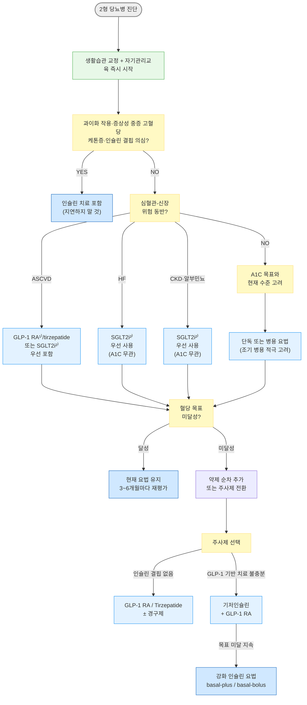

# 당뇨병, 약물 치료 Pharmacologic Treatment of Diabetes Mellitus

## <mark style="color:green;">치료 방침</mark>

* 조절 목표 ☞ [당뇨병 관리](100_-diabetes-mellitus.md#undefined-12)
* 약물 선택 시 동반 질환(심부전, 죽상경화심혈관질환, 만성신장질환)에 대한 이득, 혈당 강하 효과, 체중에 대한 효과, 저혈당 위험도, 부작용, 비용 등의 약물 특성과 치료 수용성 및 환자의 특성을 고려
  * ASCVD, 심부전(HF), 만성신장질환(CKD)이 확인된 경우에는 A1C 수치와 무관하게 해당 질환에 대한 이득이 입증된 GLP-1 RA 또는 SGLT2i를 우선 고려
  * 약물 선택은 심혈관·신장 보호 효과뿐 아니라 환자의 선호도, 비용, 투여 방법(경구/주사), 치료 부담 및 복약 지속 가능성을 함께 고려하는 person-centered approach에 따라 개별화
* 약물 치료는 A1C, 혈당 수준·증상 및 동반질환에 근거하여 시작하며 개별화된 A1C·혈당 목표에 맞추어 조절함
  * 식전 포도당이 목표에 도달했음에도 A1C 목표가 달성되지 않을 경우 식후 포도당을 목표로 할 수 있음
  * 환자 상태 및 검사 조건에 따라 A1C 결과 해석에 오류가 있을 수 있음에 유의; 이 경우 CGM의 TIR(Time In Range, 목표: ＞70%), TBR(Time Below Range), TAR(Time Above Range) 또는 GMI(Glucose Management Indicator)를 A1C 보조 지표로 함께 활용
* 약물 치료 시작 및 초기부터 A1C의 목표와 현재 수준을 고려하여 치료
  * 약물 치료 시작 시 단독 또는 병용 요법 모두 가능
  * 약물 치료 초기 시 병용 요법을 적극적으로 고려
    * A1C가 개별화된 목표보다 약 1.5% 이상 높은 경우 초기 병용 요법을 특히 적극적으로 고려
* 일반적으로 3제 병용 요법으로 혈당 조절 목표에 도달하지 못하는 경우 주사제를 포함한 치료를 고려하지만, 주사제 기반의 치료가 어려운 경우에는 4제 병용 요법을 고려할 수 있음
  * ADA에서는 일반적으로 추가 경구제보다 주사제 기반 치료(GLP-1 RA 또는 insulin)로의 전환을 우선 권고하는 방향이며, 국내 4제 병용 관행과는 다소 차이가 있음 - 환자의 주사 수용성을 고려하여 개별화
* 약물 치료 시 주기적으로 복약 순응도를 확인하고, 필요한 경우 약물을 조정함
* 목표 A1C에 도달하지 못한 경우 기존 약물의 증량 또는 다른 계열 약물과의 병용 요법을 조속히 시행
* 저혈당·허약·인지기능 저하 또는 과도한 치료 부담이 있으면 SU·meglitinide·인슐린의 감량·단순화를 함께 고려함
* 병용 시 DPP-4i + GLP-1 RA/tirzepatide, SU + meglitinide처럼 작용이 중복되는 조합은 피함. 인슐린 또는 GLP-1 기반 약제 추가 시 기존 인슐린 분비 촉진제의 감량·중단 필요성을 평가함
* 의뢰 대상: 약제 부작용 발생, 혈당 조절 불량, 집중 인슐린 요법 필요, 당뇨병 합병증 발생

- [ ] 보험인정기준 유의 ☞ [\[일반원칙\] 당뇨병용제](https://www.hira.or.kr/rc/insu/insuadtcrtr/InsuAdtCrtrPopup.do?mtgHmeDd=20260601\&sno=1\&mtgMtrRegSno=0013)

### <mark style="color:orange;">당뇨병전단계 (Prediabetes)</mark>

* 생활 습관 중재, 체중 감량 등 예방 조치 우선; 당뇨병 예방을 위해 주 150분 이상 중강도 이상의 신체 활동, 과체중/비만 시 체중의 5% 이상 감량·유지 (☞ [당뇨병 관리](100_-diabetes-mellitus.md#prediabetes))
* 과체중/비만인 당뇨병전단계 성인에서 T2DM 예방을 위해 metformin 사용을 고려할 수 있음 \[제한적권고]. 국내 당뇨병전단계 예방 목적은 허가 외 사용임
  * 특히 25~59세, BMI ≥35 ㎏/㎡, 공복혈당 ≥110 ㎎/㎗, A1C ≥6.0% 또는 임신당뇨병 과거력 등 진행 고위험군에서 고려 가치가 큼. 생활 습관 중재를 대체하지 않음 <mark style="color:$info;">[ADA 2026]</mark>

### <mark style="color:orange;">1형 당뇨병 (T1DM)</mark>

* T1DM 성인에게는 인슐린 용량을 스스로 조절하여 유연한 식사가 가능하도록 체계화된 교육 시행
* T1DM 성인에게는 다회 인슐린 주사(MDI)나 인슐린 펌프를 이용한 치료를 시행
* T1DM 성인에서 MDI 또는 인슐린 펌프 치료 시 연속 혈당 측정기(CGM)를 연동한 치료를 권고
* MDI 시 초단기 작용 인슐린 유사체 및 장기 작용 인슐린 유사체를 우선 사용
* 자동 인슐린 주입기(AID, Automated Insulin Delivery)를 안전하게 사용할 수 있는 모든 T1DM 성인에서-저혈당 위험과 A1C를 모두 낮추기 위해- AID 사용을 권고
  * AID는 T1DM 성인·소아뿐 아니라 다회 인슐린 주사(MDI)·인슐린 펌프(CSII)·센서 강화 펌프 치료 중인 T2DM 환자에서도 우선 고려되는 인슐린 전달 방식이며, 기저 인슐린만 사용 중인 T2DM 환자가 개별화된 혈당 목표에 도달하지 못하는 경우에도 AID 사용을 고려할 수 있음 <mark style="color:$info;">[ADA 2026]</mark>
  * ADA의 임상적 AID·연속피하인슐린주입(CSII) 시작 요건에 C-peptide·자가항체 결과 또는 특정 인슐린 치료 기간은 포함되지 않음. 국내 기기 허가·급여 요건과는 구분
* 저혈당 무감지증이나 중증 저혈당이 발생한 T1DM 성인에게는 저혈당 예방과 저혈당 인지 능력 회복을 위한 전문화·특화된 교육 시행
* CGM 상시 사용에도 불구하고 저혈당 위험이 높으나 AID를 사용할 수 없는 T1DM 성인에게는 기저 인슐린 주입 중단 알고리듬을 내장한 센서 강화 인슐린 펌프(SAP) 사용을 고려
* **비만 동반 T1DM** : BMI ≥30 ㎏/㎡(아시아계 ≥27.5)인 T1DM 성인에서는 일반 성인과 동일한 비만 관리 전략(GLP-1 기반 치료 및/또는 대사수술)을 고려할 수 있음 <mark style="color:$info;">[ADA 2026 신규]</mark>
  * GLP-1 기반 약제는 T1DM의 혈당 강하 치료로 인슐린을 대체할 수 없음. 비만 치료의 국제 권고를 국내 모든 제품에 일괄 적용하지 않음. **국내 마운자로는 T1DM이 투여 금기**이므로 해당 권고만으로 사용하지 않음. 전문 진료에서 약제별 국내 허가 범위와 근거를 구분하고, 인슐린 감량에 따른 저혈당·케톤증 위험을 교육·모니터링함

### <mark style="color:orange;">2형 당뇨병 (T2DM)</mark>

* 진단 즉시 생활 습관 교정과 자기 관리 방법을 적극적으로 교육하고 지속하도록 모니터링
* 과이화 작용(설명되지 않는 체중 감소 등), 증상성 고혈당(다음·다뇨), 케톤증 또는 인슐린 결핍 의심 시 인슐린 치료를 지연하지 않음
  * 증상이 없어도 A1C ＞10% 또는 혈당 ≥300 ㎎/㎗이면 인슐린 치료를 적극 고려함. DKA/HHS가 의심되면 외래 약제 조정보다 응급 평가가 우선임 <mark style="color:$info;">[ADA 2026]</mark>
  * A1C 9%를 기준으로 인슐린 치료 여부를 결정하는 것은 근거가 빈약하고 현실에 맞지 않음. A1C 9% 이하에서도 과이화 작용 증상이 있으면 인슐린 치료가 필요하고, A1C 9% 이상이더라도 반드시 인슐린이 필요한 것은 아닐 수 있음 <mark style="color:$info;">[KDA 2025]</mark>
* KDA 2025에서는 metformin을 모든 환자의 일률적인 1차 약제로 우선 권고하지 않으며, 초기부터 동반 질환과 약제 특성을 고려하여 선택함. 다만 ASCVD·심부전·CKD·비만 등 특정 동반질환이 없는 일반적인 T2DM 환자에서는 비용·안전성·혈당 강하 효과와 장기간의 임상 경험을 고려할 때 metformin이 여전히 합리적인 기본 약제임
* 심부전 동반 시 심부전 이익이 입증된 SGLT2i를 A1C 수치와 무관하게 우선 사용하고 금기나 부작용이 없는 한 유지
* 알부민뇨가 있거나 eGFR 감소 시 신장 이익이 입증된 SGLT2i를 A1C 수치와 무관하게 우선 사용하고 금기나 부작용이 없는 한 유지
* ASCVD 동반 시: 심혈관 이익이 입증된 GLP-1 RA 혹은 SGLT2i를 포함한 치료를 우선 시행
* 강력한 혈당 강하 효과가 필요한 경우 주사제를 포함한 치료 선택
  * 중증 고혈당·고혈당 위기·인슐린 결핍이 없는 T2DM에서 주사제 기반 치료 고려 시 기저 인슐린보다 GLP-1 RA 또는 tirzepatide를 우선 고려
  * GLP-1 RA 또는 기저 인슐린 단독으로 목표 혈당에 도달하지 못할 경우 두 약제 병용
  * GLP-1 RA 또는 기저 인슐린 치료에도 목표 혈당에 도달하지 못할 경우 인슐린 강화 요법 시행
* 매 3\~6개월마다 치료 효과 재평가; 생활 습관 점검, 약제 복용 순응도 평가. 목표 미달·약제 변경 시 대개 3개월 이내 A1C를 평가하며, 인슐린 적정·저혈당·부작용 평가는 수일~수주 내 더 일찍 시행함

***



***

<p align="center"><strong>2형 당뇨병 약물 치료 알고리듬</strong></p>

<p align="center"><em><mark style="color:$info;">Ref. 대한당뇨병학회. 당뇨병 진료지침 제9판. 2025. 그림 6-2.1 및 ADA 2026을 바탕으로 재구성</mark></em></p>


1. ASCVD에 심혈관 이익이 입증된 GLP-1 RA: dulaglutide, liraglutide, semaglutide. Tirzepatide는 2026년 10월 국내 MACE 위험 감소 적응증 추가(본문 참조)\\
2. 심부전·CKD에 이익이 입증된 SGLT2i: dapagliflozin, empagliflozin (empagliflozin은 eGFR ≥20인 CKD 및 HFpEF에도 허가 확대)\\
3. 허혈성 뇌졸중/TIA는 ASCVD 치료 선택에 반영함. 재발 예방 목적으로 pioglitazone을 고려할 때는 심부전·체액 저류·골절 및 방광암 위험을 함께 평가함. 출혈성 뇌졸중에 이 근거를 외삽하지 않음\
   ※ Metformin을 제외한 **SGLT2i + DPP-4i 2제 병용**은 당뇨병용제 일반원칙상 급여 인정 안 됨. Metformin 포함 3제 병용은 혈당·선행 치료 요건을 충족할 때 인정하며, 임상적 병용 가능성과 급여 인정을 구분함


***

### <mark style="color:orange;">임상 상황별 우선 약제</mark>

<table data-search="false"><thead><tr><th width="180">임상 상황</th><th width="230">우선 약제</th><th>임상 Pearls</th></tr></thead><tbody><tr><td>심부전(HFrEF/전반)</td><td>SGLT2i</td><td>A1C와 무관하게 우선 사용; 삼투성 이뇨에 따른 체액량 감소·저혈압 주의</td></tr><tr><td>증상성 HFpEF + 비만</td><td>효과가 입증된 GLP-1 기반 약제(semaglutide 2.4 ㎎ 또는 tirzepatide)</td><td>A1C와 무관하게 치료 계획에 포함; semaglutide는 증상·운동능력 개선, tirzepatide는 증상 및 심부전 악화 사건 감소 근거</td></tr><tr><td>CKD / 알부민뇨</td><td>SGLT2i</td><td>지침상 eGFR ≥20에서 신장 보호 목적으로 권고하나 실제 시작 기준은 성분별 국내 허가사항 확인; eGFR ＜45에서 혈당 강하 효과 제한적</td></tr><tr><td>진행된 CKD (eGFR ＜30)</td><td>신기능 제한이 적은 GLP-1 RA 등</td><td>저혈당 위험과 영양 상태를 평가; exenatide·lixisenatide에는 별도 신기능 제한이 있음</td></tr><tr><td>투석</td><td>허가·영양 상태에 따라 GLP-1 기반 약제, 인슐린, DPP-4i 등으로 개별화</td><td>ADA 2026은 신장 청소에 의존하지 않는 GLP-1 기반 치료를 고려하도록 권고함. 국내 성분별 말기신장병 허가·임상경험 및 위장관 증상·영양 악화를 구분하여 전문 진료에서 선택</td></tr><tr><td>ASCVD 동반</td><td>심혈관 이익 입증 GLP-1 RA 또는 SGLT2i; tirzepatide도 국내 적응증에 따라 고려</td><td>심혈관 보호 입증 약제 우선; GLP-1 RA는 체중 감소·뇌졸중 예방에도 유리</td></tr><tr><td>비만 동반</td><td>Tirzepatide 또는 Semaglutide</td><td>T2DM 동반 비만에서 tirzepatide의 72주 체중 감소는 약 13~15%(위약 대비 약 10~12%); 초기 위장관 부작용을 줄이기 위해 저용량부터 증량</td></tr><tr><td>생검 확인 MASH 또는 간섬유화 고위험</td><td>GLP-1 RA 우선</td><td>MASH 이득 입증 약제를 혈당 관리 목적으로 우선 사용 <mark style="color:$info;">[ADA 2026]</mark>; pioglitazone 또는 tirzepatide도 고려 가능</td></tr><tr><td>저혈당 우려 (고령·불규칙 식사)</td><td>DPP-4i / SGLT2i / GLP-1 RA</td><td>SU·meglitinide 회피; linagliptin은 CKD에서도 용량 조절 불필요</td></tr><tr><td>비용 부담</td><td>Metformin, Sulfonylurea</td><td>저렴·효과 검증; SU는 저혈당 위험 - 고령·신기능 저하 시 glibenclamide 회피</td></tr><tr><td>허혈성 뇌졸중 동반</td><td>GLP-1 RA 또는 Pioglitazone</td><td>출혈성 뇌졸중에는 적용 안 됨; TZD는 심부전 환자에서 회피하며 국내 성분별 금기를 적용</td></tr></tbody></table>


복합 질환 동반 시 단독 인자 기준이 아니라 우선 순위를 종합 판단. 예) CKD + ASCVD → SGLT2i 우선, GLP-1 RA 병용 고려.

2026년 10월 ADA/EASD 합의문은 SGLT2i를 심부전·CKD 보호의 기반으로, GLP-1 기반 약제를 추가 심혈관·신장 이익과 체중 관리에 활용하는 접근을 강조함. 알부민뇨 동반 T2DM-CKD에서는 ACEi/ARB 및 finerenone 등 비혈당강하 치료도 함께 검토함(상세 ☞ [당뇨병 합병증](102_-complications-of-diabetes.md)). 임상 근거와 국내 성분·제품별 적응증·급여는 구분함. <mark style="color:$info;">[ADA/EASD 2026]</mark>


### <mark style="color:orange;">주요 치료제의 특성 비교</mark>

<table data-search="false"><thead><tr><th width="120">약제</th><th width="92">A1C 강하(%)</th><th width="58">저혈당</th><th width="74">체중 변화</th><th width="97">GI 증상</th><th width="171">심혈관/심부전 효과</th><th>DKD 진행 지연</th></tr></thead><tbody><tr><td>Metformin</td><td>1.0~2.0</td><td>-</td><td>없음/감소</td><td>중등증</td><td>잠재적 이득 / 심부전 치료 효과 미입증</td><td>-</td></tr><tr><td>SGLT2i</td><td>0.5~1.0</td><td>-</td><td>↓</td><td>-</td><td>+(CG, EG) / +(CG, DG, EG, ETG)</td><td>+(CG, DG, EG)</td></tr><tr><td>GLP-1 RA</td><td>약제·용량별 상이; 약 1~2 이상도 가능</td><td>-</td><td>↓↓</td><td>중등증</td><td>MACE 이득 입증 성분 있음 / 비만 동반 HFpEF에서 semaglutide 증상 개선</td><td>semaglutide 주사: 전용 신장결과시험 이득; dula-/lira-: 주로 알부민뇨·이차 분석 근거</td></tr><tr><td>GLP-1/GIP (tirzepatide)</td><td>1.6~2.5</td><td>-</td><td>↓↓↓</td><td>중등증</td><td>MACE: dulaglutide 대비 비열등(우월성 미입증); 비만 동반 HFpEF에서 이득</td><td>잠재적 이득; 전용 신장결과 근거 제한</td></tr><tr><td>DPP-4i</td><td>0.5~1.0</td><td>-</td><td>-</td><td>-</td><td>- / 위험(saxagliptin)</td><td>-</td></tr><tr><td>TZD</td><td>0.5~1.4</td><td>-</td><td>↑</td><td>-</td><td>+(pioglitazone) / 악화</td><td>-</td></tr><tr><td>α-Gi</td><td>0.5~1.0</td><td>-</td><td>없음/감소</td><td>중등증</td><td>-</td><td>-</td></tr><tr><td>Meglitinide</td><td>0.5~1.5</td><td>+</td><td>↑</td><td>-</td><td>(자료 없음)</td><td>(자료 없음)</td></tr><tr><td>SU</td><td>1.0~2.0</td><td>+</td><td>↑</td><td>-</td><td>- / -</td><td>-</td></tr><tr><td>Insulin</td><td>매우 큼</td><td>+</td><td>↑</td><td>-</td><td>- / -</td><td>-</td></tr></tbody></table>

α-Gi=α-Glucosidase inhibitor; CG=cana-, DG=dapa-, EG=empa-, ETG=ertu-gliflozin (CG·ETG는 임상시험 근거 표기이며 현재 국내 처방 목록에서 제외)\
_✽ A1C 변화는 시작 A1C·용량·병용약·관찰 기간에 따라 달라지며 약제 간 직접 비교 수치가 아님. 저혈당 ‘-’는 단독 사용 시 낮은 위험을 뜻하며 SU·인슐린 병용 시 위험이 증가함._

_<mark style="color:$info;">Ref. KDA 당뇨병 진료지침 제9판. 2025. 표 6-2.1; ADA Standards of Care in Diabetes 2026; FLOW; SURPASS-CVOT; SUMMIT</mark>_

## <mark style="color:green;">경구제</mark>

### <mark style="color:orange;">Metformin (MTF)</mark>

* 작용 : 간 포도당 합성↓, 말초 인슐린 감수성↑, 공복 혈당↓, 지질 개선, 체중↓
* A1C 감소 효과 : 1\~2%
* 대사·배설 : 신장
* 부작용 : 소화 장애(＞10%; 설사, 구역, 구토, 복부팽만, 식욕부진, 소화불량, 변비, 복통), Vit B12 결핍, 피부 발진, 젖산증
  * 장기 투여 환자에서 주기적인 Vit B12 측정; 다이아벡스엑스알 국내 허가상 매년 측정 권고. 빈혈 또는 말초신경병증 동반 시 조기에 확인
* 주의 : 신부전, 고령, 중증 감염, 탈수, 심/폐/간부전
* 금기 : 급성 및 만성 대사산증, 중증 신장애. 국제 지침에서는 대개 eGFR ≥30에서 감량 사용을 고려하지만 신규 시작 기준은 지침과 허가체계에 따라 다름. 국내에서는 아래 제품별 기준을 적용함
  * **다이아벡스엑스알 서방정** : eGFR 45\~＜60에서는 유산산증 위험인자가 없을 때 시작 500 ㎎ qd, 최대 1,000 ㎎/d; eGFR ＜45이면 중단. 국제 권고의 30 절단값을 이 제품의 국내 허가용법으로 적용하지 않음 <mark style="color:$info;">[국내 품목허가정보]</mark>
* 요오드 조영제 관련 : 영상의학 지침과 국내 제품허가의 중단 기준을 구분
  * 다이아벡스엑스알 국내 허가 : eGFR ＞60은 검사 시점 또는 사전에 중단, eGFR 45\~60은 **조영제 투여 48시간 전 중단**. 투여 후 최소 48시간이 지나 신기능을 재평가하여 안정적일 때 재개
  * AKI·탈수·저산소증 또는 동맥 조영술 등 고위험 상황은 신기능과 시술 특성을 함께 평가. 일부 영상의학 지침에서 eGFR ≥30이고 AKI가 없는 정맥 조영제 검사는 중단을 요구하지 않더라도 이를 모든 국내 품목에 동일 적용하지 않음

* 용법 : 식사와 함께 복용; 저용량으로 시작하여 대개 1~2주 이상 간격으로 혈당·위장관 내약성에 따라 증량함. 서방정은 씹거나 부수지 않음
* 급성 탈수·구토·중증 감염·저산소증·AKI 시 일시 중단함. 다이아벡스엑스알은 음식·수액 제한이 있는 수술에서 허가상 48시간 전 중단하며, 최소 48시간 후 섭취와 신기능 회복을 확인하여 재개함

<table><thead><tr><th width="160">성분명</th><th width="220">상품명</th><th width="200">1일 용량 (㎎)</th><th>작용시간 (hr)</th></tr></thead><tbody><tr><td>metformin</td><td><mark style="color:blue;">[다이아벡스]</mark></td><td>500~2,550 #2~3</td><td>6~12</td></tr><tr><td>metformin SR</td><td><mark style="color:blue;">[다이아벡스엑스알 서방]</mark></td><td>500~2,000 #1~2</td><td>24</td></tr></tbody></table>

### <mark style="color:orange;">SGLT2i (Sodium–glucose cotransporter-2 Inhibitor)</mark>

* 작용 : 신장에서의 포도당 재흡수↓, 소변 당 배설↑; 혈압↓, 체중↓; 심혈관·심부전·신장 이익은 임상시험으로 효과가 입증된 성분에 한함
  * 삼투성 이뇨 효과 → 전부하 감소 → 심부전 증상 개선
* A1C 감소 효과: 0.5\~1.0%; eGFR ＜45인 경우 혈당 강하 효과 감소
* 적응 : 심부전 또는 CKD(알부민뇨·eGFR 감소) 동반 시 A1C 수치와 무관하게 우선 사용 및 금기·부작용 없는 한 유지; ASCVD 동반 시 심혈관 이익 입증 약제 포함 우선
* 신기능에 따라 혈당 강하 효과와 시작·유지 기준이 달라지므로 성분별 허가사항을 확인
* 부작용 : 요로 감염, 생식기 진균 감염, 케톤산증(T2DM에서 드묾; 상세 ☞ 아래 hint), 체액량 감소, 회음 괴사성 근막염(Fournier's Gangrene - 드묾)
* 주의 : 신장애, 중증 간장애, 저혈압, 고령 (투여 중단 상황 ☞ 아래 hint)
* 금기 : 투석
* 용법 : 식사와 관계없이 복용

<table><thead><tr><th width="190">성분명 [상품명]</th><th>1일 용량 (㎎)</th><th>혈당 조절 목적</th><th>심부전·CKD 장기 보호 목적</th></tr></thead><tbody><tr><td>dapagliflozin¹⁾²⁾ <mark style="color:blue;">[다파론]</mark></td><td>10 qd</td><td>eGFR ＜45에서 혈당 조절 목적만의 사용은 권장되지 않음</td><td>10 ㎎ qd; eGFR ＜25에서는 신규 시작 권장되지 않음</td></tr><tr><td>empagliflozin¹⁾²⁾ <mark style="color:blue;">[자디앙]</mark></td><td>10~25 qd</td><td>eGFR ＜45에서 혈당 조절 목적의 사용은 권장되지 않음</td><td>10 ㎎ qd; HF는 eGFR ＜20에서 사용하지 않음. CKD는 eGFR ＜20에서 신규 시작 권장되지 않음</td></tr><tr><td>ipragliflozin <mark style="color:blue;">[슈글렛]</mark></td><td>50 qd</td><td>eGFR/CrCl ＜60에서 시작하지 않으며, 지속적으로 ＜60이면 중단</td><td>장기 보호 목적의 확립된 국내 적응증 없음</td></tr><tr><td>enavogliflozin <mark style="color:blue;">[엔블로]</mark></td><td>0.3 qd</td><td>eGFR ＜60에서 시작하지 않음; eGFR ＜30, ESRD·투석은 금기</td><td>장기 보호 목적의 확립된 국내 적응증 없음</td></tr></tbody></table>

_¹⁾ 심혈관·신장 보호 효과가 입증된 성분. ²⁾ 심부전 적응증이 있는 성분._\
_※ eGFR 단위는 ㎖/min/1.73㎡, CrCl 단위는 ㎖/min임. 지침의 CKD eGFR ≥20 권고를 모든 성분에 동일 적용하지 않음. 낮은 eGFR에서 혈당 강하 효과가 약해져도 장기 보호 효과는 유지될 수 있음. 투석 환자에게 사용하지 않음. 시작 후 신기능·체액량을 평가하며 초기의 경미한 eGFR 감소만으로 자동 중단하지 않음._

_※ Ertugliflozin 제품은 현재 처방 목록에서 제외함: 스테글라트로 15 ㎎은 2023년 1월 허가 취하, 5 ㎎ 및 스테글루잔은 2025년 10월 허가 취소. <mark style="color:$info;">[한국MSD 공지]</mark>_


**Euglycemic DKA (정상 혈당 케톤산증)** : 혈당이 **200 ㎎/㎗ 미만**(정상\~경도 상승 수준)이어도 발생 가능하므로 혈당 정상=안전 으로 판단하지 말 것. 진단·Red Flags 상세 기준은 (☞ [당뇨병 합병증 - DKA](102_-complications-of-diabetes.md#당뇨병케토산증-diabetic-ketoacidosis-dka)) 참조.

**중단 적응 상황 :** 예정 수술 전 dapagliflozin·empagliflozin은 최소 3일 중단(해외 ertugliflozin은 최소 4일). 다른 성분은 해당 제품·수술 지침에 따라 중단 계획을 정함. 장기간 금식·급성 중증 질환·탈수 시에도 중단하고, 케톤식·현저한 탄수화물 제한 및 과음을 피함. 경구 섭취·체액량이 회복되고 케톤산증 위험이 해소된 뒤 재개함. 응급 수술은 투약력을 알리고 수술 후 케톤산증을 감시함

**케톤산증 증상 :** 구역·구토·복통·호흡 곤란 → 즉시 약을 중단하고 혈중 β-hydroxybutyrate·전해질·산염기 상태를 평가함. 혈중 케톤 측정을 우선하며, 소변 케톤 음성만으로 배제하지 않음. 인슐린 결핍 환자에서 기저 인슐린을 임의 중단하지 않음


### <mark style="color:orange;">DPP-4i (Dipeptidyl peptidase-4 inhibitor)</mark>

* 작용 : incretin 분해 억제(GLP-1↑, GIP↑); 포도당 의존 인슐린 분비↑, 글루카곤 분비↓, 식후 혈당 강하 (✽아시아인에게 더 효과적이라는 보고가 있음)
* A1C 감소 효과 : 0.5\~1.0%
* 대사·배설 : 성분별 차이가 있으며, linagliptin은 주로 담즙·장으로 배설. 신장 배설 여부만으로 용량 조절을 결정하지 않음
* 부작용 : 설사, 복통, 비인두염, 상기도 감염, 췌장염, 중증 관절통·수포성 유사천포창(계열 이상반응), 심부전으로 인한 입원 위험 증가(saxagliptin)
* 주의 : 신장애(성분별 용량 조절 여부는 아래 표 참조), 유당 함유 제품의 유전적 갈락토오스 불내성·Lapp 유당분해효소 결핍·포도당-갈락토오스 흡수장애, 췌장염, 심부전(saxagliptin에서 입원 증가 근거가 가장 분명하며 alogliptin도 심부전 환자에서 주의)
* 용법 : 식사와 관계없이 복용
* Vildagliptin은 시작 전 간기능검사 및 첫 1년간 3개월 간격 검사를 시행하고 이후 주기적으로 확인함. 간장애 또는 치료 전 AST/ALT ＞정상 상한의 3배에서는 사용하지 않으며 지속 상승 시 중단함

<table><thead><tr><th>성분명 [상품명]</th><th>일반 용법</th><th>신기능에 따른 용법</th></tr></thead><tbody><tr><td>alogliptin <mark style="color:blue;">[네시나]</mark></td><td>25 ㎎ qd</td><td>국내 단일제: CrCl ≥50 — 25 ㎎ qd; 30~＜50 — 12.5 ㎎ qd; ＜30 또는 혈액투석 — 6.25 ㎎ qd</td></tr><tr><td>anagliptin <mark style="color:blue;">[가드렛]</mark></td><td>100 ㎎ bid</td><td>CrCl ≥30 — 조절 불필요; ＜30 또는 ESRD — 100 ㎎ qd</td></tr><tr><td>evogliptin <mark style="color:blue;">[슈가논]</mark></td><td>5 ㎎ qd</td><td>신장애에서 용량 조절 불필요; 중증 신장애·말기 신질환에서는 임상경험의 제한을 고려</td></tr><tr><td>gemigliptin <mark style="color:blue;">[제미글로]</mark></td><td>50 ㎎ qd</td><td>신장애에서 용량 조절 불필요</td></tr><tr><td>linagliptin <mark style="color:blue;">[트라젠타]</mark></td><td>5 ㎎ qd</td><td>신장애·투석에서 용량 조절 불필요</td></tr><tr><td>saxagliptin <mark style="color:blue;">[온글라이자]</mark></td><td>2.5~5 ㎎ qd</td><td>eGFR ≥45 — 조절 불필요; ＜45 또는 혈액투석 — 2.5 ㎎ qd; 혈액투석일은 투석 후 투여</td></tr><tr><td>sitagliptin <mark style="color:blue;">[자누비아]</mark></td><td>100 ㎎ qd</td><td>eGFR ≥45 — 100 ㎎ qd; 30~＜45 — 50 ㎎ qd; ＜30 또는 투석 — 25 ㎎ qd</td></tr><tr><td>teneligliptin <mark style="color:blue;">[테넬리아]</mark></td><td>20 ㎎ qd</td><td>신장애에서 용량 조절 불필요</td></tr><tr><td>vildagliptin <mark style="color:blue;">[가브스]</mark></td><td>50 ㎎ bid</td><td>CrCl ≥50 — 조절 불필요; ＜50 또는 ESRD — 50 ㎎ qd. SU와의 2제 병용은 신기능이 양호해도 50 ㎎ qd</td></tr></tbody></table>

_✽표의 CrCl(㎖/min)과 eGFR(㎖/min/1.73㎡)은 서로 다른 지표임. 성분별 국내 허가에 사용된 지표와 절단값을 표시하였으며, 고정 복합제에는 metformin 등 동반 성분의 추가 제한이 적용됨. <mark style="color:$info;">[국내 품목허가정보]</mark>_

### <mark style="color:orange;">Thiazolidinedione (TZD)</mark>

* 작용 : 말초 조직 인슐린 저항성 개선, 간 당 생성↓; 뇌졸중 예방, MASLD/MASH에 유익(pioglitazone)
* A1C 감소 효과: 0.5\~1.4%
* 대사 : 간
* 부작용 : 심부전 악화, 체중↑, 부종, Hb↓, 골절 위험↑(특히 여성)
* 금기·회피 : 심부전·심부전 병력 등 국내 성분별 금기 및 활동성 방광암(pioglitazone). 국내 액토스는 심부전 환자에서 치료를 시작하지 않으며, 증상성 심부전에서 사용하지 않음; 해외의 NYHA III/IV 기준만으로 국내 허가를 축소 해석하지 않음
* 주의 : 심부전, 간장애, 중증 신장애; 신기능 저하 시 용량 조절은 불필요하나 체액 저류 가능성 때문에 권장하지 않음
* 용법 : 식사와 관계없이 복용

<table><thead><tr><th width="250">성분명 [상품명]</th><th width="198">1일 용량 (㎎)</th><th>반감기 (hr)</th></tr></thead><tbody><tr><td>lobeglitazone <mark style="color:blue;">[듀비에]</mark></td><td>0.5 qd</td><td>9.5(남), 15(여)</td></tr><tr><td>pioglitazone* <mark style="color:blue;">[액토스]</mark></td><td>15~30 qd (국내 최대 30 ㎎/d)</td><td>3~7</td></tr></tbody></table>

_✽rosiglitazone은 국내 유통 품목 없음._

_\*pioglitazone은 MASLD/MASH(대사기능장애 관련 지방간 질환)에서 T2DM 성인의 일차 약제 후보로 고려할 수 있음 \[제한적권고] - 체중 증가·부종·골절 위험을 고려하여 개별화_

### <mark style="color:orange;">α-Glucosidase inhibitor (α-Gi)</mark>

* 작용 : 상부 위장관에서의 다당류 소화 및 흡수 억제, 식후 혈당↓
* A1C 감소 효과 : 0.5\~1.0%
* 대사 : 장
* 부작용 : 복부팽만감, 방귀 증가, 묽은 변, 배변 횟수 증가, 급성 간염
* 금기 : 소화·흡수장애를 동반한 만성 장질환 및 장폐색 등 가스 증가로 악화되는 질환. Acarbose는 간경화·간기능장애 및 CrCl ＜25 ㎖/min에서도 금기
* 주의 : 중증 신/간질환, 고령, 중증 감염; SU 병용 시 저혈당 증가; 장내 흡착제·소화효소제 등과의 상호작용은 성분별 확인
  * α-Gi 복용 중 저혈당 발생 시 설탕(sucrose)의 분해가 지연되어 신속한 교정에 부적합하므로 포도당 정제·겔을 사용함
  * Acarbose는 시작 후 6~12개월간 간효소 수치를 모니터링함
* 용법 : 식사 직전(첫 숟갈과 함께) 복용; 저용량으로 시작 → 4주 간격으로 조절

<table><thead><tr><th>성분명 [상품명]</th><th>용법·용량</th><th>신기능 관련</th></tr></thead><tbody><tr><td>acarbose <mark style="color:blue;">[글루코바이]</mark></td><td>50 ㎎ tid 시작 → 통상 100 ㎎ tid; 식사 직전 또는 첫 숟갈과 함께. 4~8주 간격으로 조절</td><td>국내 금기 기준: CrCl ＜25 ㎖/min. eGFR 절단값으로 대체하지 않음</td></tr><tr><td>voglibose <mark style="color:blue;">[베이슨]</mark></td><td>0.2 ㎎ tid → 필요 시 0.3 ㎎ tid; 매 식사 직전</td><td>중증 신장애에서 임상경험이 제한되므로 신중히 사용함</td></tr></tbody></table>

* Miglitol은 신장 배설 의존성이 높으므로 중증 신장애에서 피함. 국내 실제 처방 가능 품목과 허가 상태가 확인된 경우에만 해당 제품의 용법·신기능 제한을 적용함</mark>

### <mark style="color:orange;">Meglitinide</mark>

* 작용 : 인슐린 분비↑, 식후 혈당↓; SU에 비해 작용 속도가 빠르고 반감기가 짧아 저혈당 부작용이 적음
* A1C 감소 효과 : 0.5\~1.5%
* 대사 : 간
* 부작용 : 체중 증가, 저혈당, 변비, 상기도 감염
* 금기 : gemfibrozil과 병용 투여 금기(repaglinide - 노출 증가에 따른 중증·지연 저혈당 위험)
* 주의 : 중증 감염, 중증 간/신 장애, 임신, 수유
  * 신장애에서는 성분별로 저용량 시작·보수적 적정이 필요함. Nateglinide는 국내 허가상 **투석을 필요로 하는 중증 신기능장애**에서 금기이며, 단순히 eGFR 15를 기준으로 계열 전체의 용량 조절 여부를 정하지 않음
  * Repaglinide는 CYP2C8·CYP3A4로 대사됨. Clopidogrel(CYP2C8 억제)과의 병용은 가능하면 피하며 불가피하면 감량과 면밀한 혈당 감시가 필요함 <mark style="color:$info;">[미국 repaglinide 허가사항]</mark>. Gemfibrozil과의 금기 상호작용을 모든 CYP3A4 억제제와 같은 정도로 설명하지 않음
* 용법 : 식사 직전(식사 없으면 투여 생략) 복용; 저용량으로 시작 → 1\~2주 간격 증량

<table><thead><tr><th width="250">성분명 [상품명]</th><th width="200">1회 용량 및 용법</th><th>작용시간</th></tr></thead><tbody><tr><td>mitiglinide <mark style="color:blue;">[글루패스트]</mark></td><td>10 tid ac</td><td>＜4 hr</td></tr><tr><td>nateglinide <mark style="color:blue;">[파스틱]</mark></td><td>90 tid ac → 필요 시 120 tid ac</td><td>＜4 hr</td></tr><tr><td>repaglinide <mark style="color:blue;">[노보넘]</mark></td><td>0.5 ㎎/회 시작; 매 식전 2~4회, 최대 4 ㎎/회·16 ㎎/d (급여 상한 6 ㎎/d)</td><td>＜4 hr</td></tr></tbody></table>

### <mark style="color:orange;">Sulfonylurea (SU)</mark>

* 작용 : 췌장 β-cell에서 인슐린 분비 자극, 식전/식후 혈당↓
* A1C 감소 효과 : 1\~2%
* 대사 : 간, 신장
* 부작용 : 체중↑, 저혈당(특히 식사 불규칙·고령·신기능 저하 시 위험), 구역, 간질환, 용혈성 빈혈(G6PD 결핍 환자)
* 주의 : 저혈당 위험이 높은 환자에서 주의해서 사용; 간질환(간수치가 정상 상한의 3배 이상이면 회피), 신질환(eGFR ＜45), 해당 SU에 대한 과민반응 병력, 임신, 수유, 수술, 중증 감염, 중증 외상, 설사, 구토
  * 고령·신기능 저하 환자에서 장시간 작용 SU(glibenclamide)는 회피. 식사를 거르는 경우 해당 용량을 건너뜀
* 용법 : 성분별 식사 시점을 구분함. Glibenclamide(다오닐)는 식후, glimepiride는 아침 또는 첫 주된 식사 직전/중, gliclazide 서방정은 아침 식사 시, glipizide는 식사 약 30분 전에 복용함. 저용량으로 시작하여 1~2주 이상 간격으로 적정함

<table><thead><tr><th width="260">성분명 [상품명]</th><th width="200">1일 용량 (㎎)</th><th>작용시간</th></tr></thead><tbody><tr><td>glibenclamide <mark style="color:blue;">[다오닐]</mark></td><td>2.5~15 #1~2 (최대 15 ㎎/d)</td><td>12~24 hr</td></tr><tr><td>gliclazide <mark style="color:blue;">[디아미크롱]</mark></td><td>40~320 #1~2</td><td>12~24 hr</td></tr><tr><td>gliclazide SR <mark style="color:blue;">[디아미크롱서방]</mark></td><td>30~120 qd</td><td>24 hr</td></tr><tr><td>glimepiride <mark style="color:blue;">[아마릴]</mark></td><td>1~8 qd</td><td>24 hr</td></tr><tr><td>glipizide <mark style="color:blue;">[다이그린]</mark></td><td>5~40 #1~3</td><td>12~18 hr</td></tr></tbody></table>

### <mark style="color:orange;">복합제</mark>

<mark style="color:cyan;">**DPP-4i + MTF 복합제**</mark>

* <mark style="color:blue;">\[자누메트]</mark> sitagliptin/MTF · <mark style="color:blue;">\[자누메트 엑스알 서방]</mark> sitagliptin/MTF XR
* <mark style="color:blue;">\[가브스메트]</mark> vildagliptin/MTF
* <mark style="color:blue;">\[콤비글라이즈 서방]</mark> saxagliptin/MTF
* <mark style="color:blue;">\[트라젠타 듀오]</mark> linagliptin/MTF
* <mark style="color:blue;">\[네시나메트]</mark> alogliptin/MTF
* <mark style="color:blue;">\[가드메트]</mark> anagliptin/MTF
* <mark style="color:blue;">\[제미메트 서방]</mark> gemigliptin/MTF
* <mark style="color:blue;">\[테넬리아 엠 서방]</mark> teneligliptin/MTF
* <mark style="color:blue;">\[슈가메트 서방]</mark> evogliptin/MTF

<mark style="color:cyan;">**SGLT2i + MTF 복합제**</mark>

* <mark style="color:blue;">\[직듀오 서방]</mark> dapagliflozin/MTF
* <mark style="color:blue;">\[다파메트 서방]</mark> dapagliflozin/MTF
* <mark style="color:blue;">\[자디앙듀오]</mark> empagliflozin/MTF
* <mark style="color:blue;">\[엔블로멧 서방]</mark> enavogliflozin/MTF

<mark style="color:cyan;">**SGLT2i + DPP-4i 복합제**</mark>

* <mark style="color:blue;">\[에스글리토]</mark> empagliflozin/linagliptin
* <mark style="color:blue;">\[큐턴]</mark> saxagliptin/dapagliflozin
* <mark style="color:blue;">\[제미다파]</mark> gemigliptin/dapagliflozin
* <mark style="color:blue;">\[슈가다파]</mark> evogliptin/dapagliflozin
* <mark style="color:blue;">\[시다프비아]</mark> dapagliflozin/sitagliptin


**Metformin을 제외한 SGLT2i + DPP-4i 2제 병용**은 일반원칙상 급여 인정 안 됨. Metformin 포함 3제 병용은 선행 치료·혈당 요건을 충족할 때 인정함. 고정 복합제도 성분 수대로 계산하며, 모든 성분 조합이 허가·급여상 동일하지 않음


<mark style="color:cyan;">**Thiazolidinedione 복합제**</mark>

* <mark style="color:blue;">\[네시나액트]</mark> pioglitazone/alogliptin(DPP-4i)
* <mark style="color:blue;">\[액토스메트]</mark> pioglitazone/MTF
* <mark style="color:blue;">\[듀비메트 서방]</mark> lobeglitazone/MTF
* <mark style="color:blue;">\[듀비엠파]</mark> lobeglitazone/empagliflozin(SGLT2i)

<mark style="color:cyan;">**Sulfonylurea + MTF 복합제**</mark>

* <mark style="color:blue;">\[아마릴 엠]</mark> glimepiride/MTF
* <mark style="color:blue;">\[글루코반스]</mark> glibenclamide/MTF
* <mark style="color:blue;">\[글루파 콤비]</mark> gliclazide/MTF

<mark style="color:cyan;">**α-Glucosidase inhibitor + MTF 복합제**</mark>

* <mark style="color:blue;">\[보그메트]</mark> voglibose/MTF

#### <mark style="color:$primary;">3제 복합제</mark>

* dapagliflozin/sitagliptin/MTF : <mark style="color:blue;">\[다파시타엠]</mark>
* empagliflozin/linagliptin/MTF: <mark style="color:blue;">\[엠시폴민]</mark>
* <mark style="color:blue;">\[듀비메트 에스서방]</mark> lobeglitazone/sitagliptin/MTF (TZD+DPP-4i+MTF)
* <mark style="color:blue;">\[듀비엠폴서방정]</mark> lobeglitazone/empagliflozin/MTF (TZD+SGLT2i+MTF)

## <mark style="color:green;">GLP-1 RA (Glucagon-like peptide-1 receptor agonist)</mark>

* 작용 : 포도당 의존 인슐린 분비↑, 글루카곤 분비↓ → 위 배출 지연, 식욕 억제, 근육/지방 조직의 당 흡수↑, 간 당 생성↓; ASCVD 위험↓, 뇌졸중 예방, 체중↓
  * 체중 감소 효과 : semaglutide 등 고효능 제제에서 큼. 제형·용량·연구 대상이 달라 모든 제제를 고정된 서열로 비교하지 않음
* A1C 감소 효과 : 약제·용량·시작 A1C에 따라 약 1~2% 이상도 가능
* 부작용 : 위장 장애(구역, 구토, 설사), 췌장염, 담석증, 급성 신장 손상, 심박수 증가
* 주의 : 췌장염 과거력, 급성 신장 손상, 중증 간장애, 신장애, 중증 위마비를 포함한 중증 위장관 질환, 당뇨병성 망막병증(특히 semaglutide - 급격한 혈당 강하 시 망막병증 악화 보고; 망막병증 병력 있는 환자에서 안과 모니터링 강화 권고); DPP-4i와는 병용하지 않음
  * 눈 건강 : 급격한 혈당 개선에 따른 망막병증 초기 악화와 NAION을 구분함. **국내 오젬픽·리벨서스 허가사항에도 NAION이 매우 드문 이상반응으로 반영됨**(2026년 10월 확인). 갑작스러운 시력 소실·급격한 시력 악화 시 즉시 안과 평가하고 NAION 확진 시 semaglutide를 중단함. 관찰연구의 다른 안과 연관성을 확정적인 계열 효과로 일반화하지 않음 <mark style="color:$info;">[국내 품목허가정보; EMA 2025]</mark>
* 금기·갑상선 C세포 종양 관련 : 성분·국가·제품별 허가가 다름. Dulaglutide 등 해당 국내 금기가 있는 제품은 갑상선 수질암(MTC)의 개인력·가족력 또는 MEN2에서 사용하지 않음. **미국 semaglutide의 MTC/MEN2 금기를 국내 오젬픽의 명시 금기로 그대로 옮기지 않음**; 국내 오젬픽의 명시 금기는 주성분·첨가제 과민증임. MTC/MEN2 병력이 있으면 대체 약제를 우선 검토하고 전문 진료에서 위험·이득을 판단함
* 중증 고혈당·고혈당 위기·인슐린 결핍이 없는 T2DM에서 주사제 고려 시 기저 인슐린보다 GLP-1 기반 약제를 우선 선택
* ASCVD 확인 또는 위험 인자가 있는 경우 심혈관 질환 예방 효과가 입증된 GLP-1 RA 추천
* '증상성 HFpEF + 비만' 시 효과가 입증된 GLP-1 기반 약제(semaglutide 2.4 ㎎ 또는 tirzepatide)를 A1C와 무관하게 치료 계획에 포함; semaglutide는 증상·운동능력 개선, tirzepatide는 증상 및 심부전 악화 사건 감소 근거
* 생검 확인 MASH 또는 간섬유화 고위험군에서 MASH에 대한 이득이 입증된 GLP-1 RA를 혈당 관리 목적으로 우선 사용
* GLP-1 RA와 tirzepatide를 중복 투여하지 않음. SU·인슐린 병용 시 저혈당 위험에 따라 감량하며 인슐린을 갑자기 중단하지 않음
* 전신마취·깊은 진정 예정 시 위 배출 지연 및 흡인 위험을 시술팀에 알림. 증량기·구역/구토·위마비 등 위험을 평가하여 액상식·일시 중단·시술 연기 여부를 개별 결정하며 주 1회 제제를 모두 일률적으로 7일 중단시키지는 않음
* 임신 계획 시 semaglutide는 최소 2개월 전 중단함. Tirzepatide는 최소 1개월 전 중단하며 임신 중에는 사용하지 않음

#### <mark style="color:$primary;">경구제</mark>

* semaglutide : 3 ㎎ qd ×30일 → 7 ㎎ qd; 7 ㎎을 최소 30일 투여 후 필요 시 14 ㎎ qd. 3 ㎎은 시작 용량이며 유지 용량이 아님 <mark style="color:blue;">\[리벨서스]</mark>
  * 하루 중 첫 음식·음료 섭취 전 공복에 물 120 ㎖ 이하와 통째로 복용하고, 이후 최소 30분간 음식·음료·다른 경구약 복용을 피함
  * SOUL 연구에서 ASCVD/CKD 동반 고위험 T2DM의 MACE가 위약 대비 14% 감소함(HR 0.86, 95% CI 0.77~0.96). 주사제의 심혈관 근거와 별도로 경구제 자체의 근거가 있음 <mark style="color:$info;">[SOUL 2025]</mark>

#### <mark style="color:$primary;">피하주사제</mark>

<table><thead><tr><th width="239.52386474609375">성분명 [상품명]</th><th width="260.4761962890625">용량 (최대)</th><th>신기능에 따른 제한</th></tr></thead><tbody><tr><td>dulaglutide¹⁾²⁾ <mark style="color:blue;">[트루리시티 주]</mark></td><td>0.75 ㎎ qwk → 최대 1.5 ㎎/wk</td><td>용량 조절 불필요; 말기신장병에서는 경험 제한</td></tr><tr><td>exenatide <mark style="color:blue;">[바이에타 주]</mark></td><td>5 ㎍ bid ≥1개월 → 필요 시 10 ㎍ bid; 식전 60분 이내</td><td>CrCl 30~50 시 주의; ＜30 시 금지</td></tr><tr><td>liraglutide¹⁾³⁾ <mark style="color:blue;">[빅토자 주]</mark></td><td>0.6 ㎎ qd ≥1주 → 1.2 ㎎ qd; 최소 1주 후 필요 시 1.8 ㎎ qd</td><td>eGFR ≥15에서 조절 불필요</td></tr><tr><td>lixisenatide³⁾ <mark style="color:blue;">[릭수미아 주]</mark></td><td>10 ㎍ qd ×14일 → 20 ㎍ qd; 식전 1시간 이내</td><td>eGFR ≥30에서 조절 불필요</td></tr><tr><td>semaglutide¹⁾²⁾ <mark style="color:blue;">[오젬픽 펜]</mark></td><td>0.25 ㎎ qwk ×4주 → 0.5 ㎎ qwk; 최소 4주 후 필요 시 1 ㎎ qwk. 국내 최대 1 ㎎/wk이며 펜 총함량(2·4 ㎎)과 1회 투여량을 혼동하지 않음</td><td>조절 불필요</td></tr></tbody></table>

_¹⁾ 심혈관 질환 예방 효과가 입증됨(ASCVD 동반 시 우선 선택). ²⁾ 보험 급여 적용(semaglutide는 2026년 2월부터 조건부 급여 적용 - HIRA 고시 확인). ³⁾ 복합제로 보험 적용 제품 있음_\
※ exenatide(바이에타 주), lixisenatide 단일제(릭수미아 주)는 매출 저조로 국내 공급이 중단된 상태이며 실제 처방 가능 여부는 확인 필요; lixisenatide는 glargine/lixisenatide 복합제(솔리쿠아 펜)로만 국내 사용 가능\
※ SELECT 연구(2023): 당뇨병이 없고 BMI ≥27 ㎏/㎡이며 확증된 심혈관질환이 있는 환자에서 semaglutide 2.4 ㎎으로 MACE 20% 감소. 모든 비만 환자의 일차 예방 효과로 일반화하지 않음. 이 용량은 오젬픽의 국내 최대 1 ㎎/wk와 구분함

#### <mark style="color:$primary;">GLP-1/GIP dual agonist</mark>

* GLP-1 및 GIP(glucose-dependent insulinotropic polypeptide) receptor에 모두 작용
* 작용 : 인슐린 생산↑, 간 당 생성↓, 위장관 통과 지연(포만감 유지), 식욕 억제; 혈당 강하 + 체중 감소
* A1C 및 체중 감소 효과 : 비만 동반 T2DM 대상 연구(SURMOUNT-2)에서 위약 대비 A1C 1.55\~1.57%, 체중 9.6\~11.6% 감소(72주, 10 ㎎·15 ㎎ 용량); 혈당·체중 감소 효과가 큰 약제 중 하나 <mark style="color:$info;">[ADA 2026]</mark>
* 심혈관 이득 : SURPASS-CVOT에서 dulaglutide 대비 MACE 비열등성 확인(HR 0.92, 95.3% CI 0.83~1.01); 우월성은 입증되지 않음. **2026년 10월 22일 국내 허가 변경으로 확증된 심혈관질환이 있는 성인 T2DM에서 MACE 위험 감소 적응증이 추가됨**. KDA 2025의 우선 약제 목록 이후의 변경임 <mark style="color:$info;">[SURPASS-CVOT; 국내 품목허가정보]</mark>
* 금기 : 갑상선 수질암의 개인력·가족력 또는 MEN2, 주성분·첨가제 과민반응, **T1DM(국내 허가)**
* 주의 : 췌장염, GLP-1 RA에 과민 반응 병력, 중증 위장관 질환, 급성 신장 손상, 중증 간장애, 당뇨병 망막병증, 급성 담낭 질환
* tirzepatide : 2.5 ㎎ qwk SQ ×4주 → 5 ㎎ qwk; 추가 조절이 필요한 경우에만 현재 용량을 최소 4주 유지한 뒤 2.5 ㎎씩 증량(성인 최대 15 ㎎/wk) <mark style="color:blue;">\[마운자로]</mark>
  * 2.5 ㎎은 치료 시작과 위장관 적응을 위한 용량이며 혈당 조절을 위한 유지 용량은 아님
  * 2026년 10월 국내 허가에는 만 10세 이상 소아 T2DM의 **병용요법**도 포함됨(소아 최대 10 ㎎/wk). 성인 단독요법·체중관리 적응증 및 용량과 구분하고 소아 전문 진료에서 시행함
  * 증상성 HFpEF + 비만 동반 T2DM : 심부전 관련 증상 개선 및 이벤트 감소 효과가 입증되어 A1C와 무관하게 혈당 치료 계획에 포함 권고 (ADA 2026)
  * 경구피임약 복용 여성 주의 : 위 배출 지연으로 경구피임약 흡수가 저하될 수 있음; 투여 시작 후 4주간 및 매 증량 후 4주간 비경구 피임법으로 전환하거나 차단(barrier) 피임법을 병행

#### <mark style="color:$primary;">인슐린/GLP-1 RA 복합제</mark>

* glargine/lixisenatide : 1일 1회 식사 전 1시간 이내 피하주사 <mark style="color:blue;">\[솔리쿠아 펜]</mark>
* degludec/liraglutide : 1일 1회 피하주사 <mark style="color:blue;">\[줄토피플렉스터치 주]</mark>
* insulin icodec/semaglutide : 성인 T2DM에서 주 1회 피하주사(2026년 5월 국내 허가); 시작·전환 용량은 이전 치료에 따라 결정 <mark style="color:blue;">\[키인슈프리필드펜]</mark>

#### <mark style="color:$primary;">Pramlintide (아밀린 유사체)</mark>

* 미국 FDA가 승인한 유일한 T1DM 비-인슐린 보조 약제; 위 배출 지연 및 식후 글루카곤 분비 억제를 통해 인슐린 최적화 후에도 목표 미달 시 추가 고려되는 약제 (국내 통상 처방 약제가 아닌 해외 치료 선택지)
* 부작용(구역·구토·식욕 저하)과 식사마다 추가 주사가 필요하다는 번거로움으로 실제 사용 빈도는 낮음
* gastroparesis 환자에서는 위 배출을 추가로 지연시키므로 회피 약물임

## <mark style="color:green;">인슐린</mark>

> **\[최신 동향]** CGM 연동 AID는 임상에 적용되고 있음. 연구용 AI 혈당 예측 모델을 독립적인 인슐린 처방·용량 결정 도구로 사용하지 않으며, 허가된 기기·알고리듬과 교육·추적 체계를 함께 적용함

### <mark style="color:orange;">인슐린 요법의 선택</mark>

* 인슐린 & metformin 병용 효과: 인슐린 단독 투여보다 혈당 조절이 향상되고 같은 혈당 목표를 달성하는 데 필요한 인슐린 용량과 체중 증가를 줄일 수 있음; 저혈당 위험은 개별 모니터링 필요
* 인슐린 & acarbose 병용 효과: A1C, 식후 혈당, 식후 중성지방 조절에서 유익
* 인슐린 치료를 선택한 T2DM 환자에서 과이화 작용 증상이 없으면 일반적으로 기저 인슐린부터 시작(적절한 비인슐린 약제 병용 유지)
* 과이화 작용 증상이 동반된 고혈당의 경우 인슐린 치료를 시행
* 기저 인슐린으로 공복 혈당이 조절된 뒤에도 식후 고혈당이 두드러지거나 A1C가 목표에 도달하지 않으면 GLP-1 기반 약제 또는 식사 인슐린 추가를 고려; 혼합형 인슐린은 식사 패턴과 환자 선호를 고려한 대안
* 식사 또는 운동에 따른 인슐린 용량 조절이 필요하며 특히 식후 당 조절이 필요한 경우에는 식사 시간을 고려하여 주사
* 공복 혈당이 목표 범위인데 A1C가 높거나 아래 임상 징후가 있으면 기저 인슐린 추가 증량보다 식사 인슐린 또는 GLP-1 기반 약제 추가를 고려(Overbasalization 주의) : 취침 전-아침 또는 식후-식전 혈당 차이가 큼, 저혈당·야간 저혈당 또는 큰 혈당 변동성 → Basal-plus(식사 인슐린 1회 추가) 또는 GLP-1 RA 병용으로 전환
  * 기저 인슐린 ＞0.5 U/㎏/d 자체만으로 과다 투여를 확정하거나 치료를 전환하지 않음. 혈당 패턴·저혈당·주사법을 함께 평가하며, 식후 고혈당을 기저 인슐린 증량으로만 교정하면 저혈당과 체중 증가 위험이 커짐


주사제 강화 단계 (Injectable Escalation Ladder) **:** 경구제 최적화 → GLP-1 RA 또는 Tirzepatide → GLP-1 RA + 기저 인슐린 → Basal-plus(기저 + 식사 1회) → Basal-bolus(기저 + 매 식전 식사 인슐린)

✽ 단계 상향 전 반드시 복약 순응도·식이·운동 점검; Overbasalization 배제 후 '식사 인슐린' vs 'GLP-1 RA' 추가 결정



인슐린 요법의 선택은 특정 A1C cut-off 기준보다는 증상, 공복 및 식후 혈당 양상, 저혈당 위험 등을 종합하여 개별화 - A1C 9%만을 기준으로 획일적으로 선택하는 접근은 권고하지 않음. 과이화 작용이 있을 때는 A1C 9% 이하에서도 인슐린을 사용해야 하고, A1C 9% 이상이더라도 인슐린 치료가 반드시 필요한 것은 아닐 수 있음 <mark style="color:$info;">[KDA 2025]</mark>


### <mark style="color:orange;">인슐린 요법의 비교</mark>

<table><thead><tr><th width="100">구분</th><th width="200">기저 인슐린 요법</th><th width="220">혼합형 인슐린유사체 투여법</th><th>식전 인슐린 요법</th></tr></thead><tbody><tr><td>장점</td><td>저혈당 발생 및 체중 증가가 적음</td><td>A1C가 높은 경우 효과적</td><td>식후 고혈당 및 A1C 조절에 효과; 유연성 높음</td></tr><tr><td>단점</td><td>식후 고혈당이 두드러지면 기저 인슐린만으로 목표 달성이 어려움</td><td>저혈당 발생 빈도가 높음; 체중 증가가 많음; 많은 용량이 요구됨</td><td>자주 주사해야 함; 자주 혈당 측정을 해야 함; 저혈당 발생 빈도가 높음</td></tr><tr><td>기타</td><td>식후 혈당 조절을 위해 경구 혈당 강하제 병용 고려</td><td>치료 만족도 및 삶의 질에 대하여 논란</td><td>삶의 질에 대하여 논란</td></tr></tbody></table>

### <mark style="color:orange;">인슐린 종류 및 작용시간</mark>

<table data-search="false"><thead><tr><th width="268.09527587890625">성분명 [상품명]</th><th width="165">시작/최대/지속 (hr)</th><th width="130">투여일정</th><th>비고</th></tr></thead><tbody><tr><td><strong>Rapid-Acting (초단기 작용)</strong></td><td></td><td></td><td></td></tr><tr><td>aspart <mark style="color:blue;">[노보래피드]</mark>, lispro <mark style="color:blue;">[휴마로그]</mark>, glulisine <mark style="color:blue;">[에피드라]</mark></td><td>10~15분/1~2 hr/3~5 hr</td><td>대개 식전 0~15분; 식후 투여 가능 범위는 제품별 허가사항 확인</td><td>식후 혈당 조절; 임신 중 사용은 성분별 근거·허가사항 확인</td></tr><tr><td><strong>Ultra-Rapid-Acting (초초단기)</strong>¹⁾</td><td></td><td></td><td></td></tr><tr><td>faster aspart <mark style="color:blue;">[피아스프]</mark>,<br>lispro Lyumjev <mark style="color:blue;">[룸제브]</mark></td><td>2~4분/1~1.5 hr/3~5 hr</td><td>식사 시작 직전; 필요 시 식사 시작 후 20분 이내(제품별 확인)</td><td>식후 혈당 조절 개선; 임신 중 사용은 제품별 허가사항 확인</td></tr><tr><td><strong>Short-Acting (단기 작용)</strong></td><td></td><td></td><td></td></tr><tr><td>regular <mark style="color:blue;">[휴물린알]</mark></td><td>30분/2~3 hr/6.5 hr</td><td>식사 30분 전</td><td>저렴; 야간 저혈당; 정맥 주사 가능</td></tr><tr><td><strong>Intermediate (중기 작용)</strong></td><td></td><td></td><td></td></tr><tr><td>NPH <mark style="color:blue;">[휴물린엔]</mark></td><td>1~3/5~8 hr/18 hr</td><td>밤 또는 q12h</td><td>저렴; 야간 저혈당</td></tr><tr><td><strong>Long-Acting (장기 작용)</strong></td><td></td><td></td><td></td></tr><tr><td>degludec <mark style="color:blue;">[트레시바]</mark></td><td>1 hr/없음/42 hr~</td><td>매일 같은 시간; 시간을 조절할 때는 직전 투여와 최소 8시간 간격</td><td>다른 기저 인슐린 대비 저혈당 감소 근거; 비교 제제·대상에 따라 차이</td></tr><tr><td>glargine U100 <mark style="color:blue;">[란투스]</mark></td><td>1.5 hr/없음/24 hr</td><td>매일 같은 시간</td><td>CVD 안전성 입증</td></tr><tr><td>glargine U300 <mark style="color:blue;">[투제오]</mark></td><td>6 hr/없음/24~36 hr</td><td>(상동)</td><td>glargine U100보다 저혈당 더 적음; 고가</td></tr><tr><td>detemir <mark style="color:blue;">[레버미어]</mark></td><td>3~4/6~8 hr/24 hr</td><td>(상동)</td><td>국가별 공급 중단·전환이 진행되어 신규 처방 시 공급 상태 확인. 임신 중 대체 제제는 NPH 또는 glargine 등 성분별 근거·허가에 따라 선택</td></tr><tr><td><strong>Premixed</strong></td><td></td><td></td><td></td></tr><tr><td>degludec/aspart 70/30²⁾<br><mark style="color:blue;">[리조덱]</mark></td><td>약 10~20분/이중/기저 효과 42 hr 이상</td><td>탄수화물을 포함한 주된 식사 직전 또는 식사와 함께, 1~2회</td><td>장기 기저 + 초단기 식사 효과</td></tr><tr><td>lispro protamine 75/25<br><mark style="color:blue;">[휴마로그믹스25]</mark></td><td>15분/이중/16 hr</td><td>아침 &#x26; 저녁 식사 시</td><td>편리; 야간 저혈당</td></tr><tr><td>aspart protamine 70/30<br><mark style="color:blue;">[노보믹스30]</mark></td><td>15분/이중/16 hr</td><td>(상동)</td><td>(상동)</td></tr><tr><td>NPH70/regular30 <mark style="color:blue;">[휴물린70/30]</mark></td><td>약 30분/이중/대개 18~24 hr</td><td>통상 식사 약 30분 전</td><td>(상동)</td></tr></tbody></table>

_¹⁾ Ultra-Rapid-Acting 제제는 식후 즉시 투여 가능 - 식사 시간이 불규칙한 환자에서 유용._\
_²⁾ degludec/aspart: 기저와 식사 인슐린 역할을 하나의 주사로 충족 - 혼합형 대안으로 활용._

#### <mark style="color:$primary;">주 1회 기저 인슐린</mark>

* insulin icodec <mark style="color:blue;">[아위클리프리필드펜]</mark> : 성인 당뇨병에서 주 1회 투여하는 기저 인슐린(2024년 12월 국내 허가). T1DM에서는 식사 인슐린(볼루스)과 병용 투여해야 하며, T2DM에서는 단독 또는 경구 혈당강하제·GLP-1 RA·볼루스 인슐린과 병용 가능. 시작 용량과 기존 1일 1회 기저 인슐린에서의 전환 용량, 첫 투여 시 추가 용량 여부가 서로 다르므로 허가사항에 따라 처방하고, 주 단위 오투여·중복 투여를 예방하도록 투여 요일을 명확히 교육
  * 인슐린 미사용 T2DM의 국내 권장 시작 용량은 **70 U/주**임. 기존 기저 인슐린에서 전환 시 일일 용량×7을 바탕으로 계산하되 첫 주의 추가 용량 규칙을 별도로 적용함. 신규 진단·인슐린 미사용 T1DM에서 안전성·유효성은 확립되지 않음
  * T1DM에서 degludec 대비 임상적으로 유의한/중증 저혈당 발생률이 증가했으므로 편의성만으로 우선 선택하지 않음. 투여 후 2~4일에 저혈당 위험이 높으며, 긴 작용 때문에 급성 식사·운동 변화에 맞춰 단기간 용량을 수시 변경하지 않음 <mark style="color:$info;">[국내 품목허가정보]</mark>

<p align="center"><em><mark style="color:$info;">Ref. 대한당뇨병학회. 당뇨병 진료지침 제9판. 2025. 표 6-2.4</mark></em></p>

✽ 저혈당 위험: degludec/glargine U300 ＜ glargine U100/detemir ＜ NPH insulin

### <mark style="color:orange;">T1DM에서의 인슐린 공급 장치 비교</mark>

<table><thead><tr><th width="320">인슐린 주사 regimen</th><th width="100">유연성</th><th width="130">낮은 저혈당 위험</th><th>고비용</th></tr></thead><tbody><tr><td>MDI with LAA + RAA or URAA</td><td>+++</td><td>+++</td><td>$$$</td></tr><tr><td>MDI with NPH + RAA or URAA</td><td>++</td><td>++</td><td>$$</td></tr><tr><td>MDI with NPH + 속효성(regular) insulin</td><td>++</td><td>+</td><td>$</td></tr><tr><td>NPH + 속효성(regular) insulin or premix bid Inj.</td><td>+</td><td>+</td><td>$</td></tr></tbody></table>

<table><thead><tr><th width="320">연속 인슐린 펌프 regimen</th><th width="100">유연성</th><th width="130">낮은 저혈당 위험</th><th>고비용</th></tr></thead><tbody><tr><td>AID system (Hybrid Closed Loop)</td><td>+++++</td><td>+++++</td><td>$$$$$</td></tr><tr><td>sensor-augmented pump with predictive low-glucose suspend (PLGS)</td><td>++++</td><td>++++</td><td>$$$$$</td></tr><tr><td>insulin pump therapy without automation</td><td>+++</td><td>+++</td><td>$$$$</td></tr></tbody></table>

_LAA=long-acting insulin analog; MDI=multiple daily injections; RAA=rapid-acting insulin analog; URAA=ultra-rapid-acting insulin analog; AID=Automated Insulin Delivery_\
✽ +와 $ 기호는 각 항목 간 상대적 비교를 나타냄\
✽Insulin-only bionic pancreas(예: iLet) : 초기 체중 입력을 바탕으로 용량을 적응 조절하며 정밀한 탄수화물 g 계산은 필요하지 않지만, **식사 종류와 평소 대비 양(보통·많음·적음)을 알리는 입력은 필요**함. 식사 입력이 전혀 필요 없는 완전 자동 시스템으로 설명하지 않음 <mark style="color:$info;">[제조사 사용안내]</mark>

<p align="center"><em><mark style="color:$info;">Ref. ADA. Standards of Care in Diabetes. 2026. Figure 9.1</mark></em></p>

### <mark style="color:orange;">인슐린 치료 시작 용량 및 용량 조절</mark>

* 아래 시작·증량 표는 **T2DM의 외래 인슐린 시작/강화 예시**임. T1DM의 초기 총용량·기저/식사 배분은 다음 절을 따름
* 아래의 일일 용량·3일 간격 증량 표는 **매일 투여하는 인슐린**에 적용. 주 1회 icodec 또는 icodec/semaglutide에는 적용하지 않음
* 식사 또는 운동에 따른 인슐린 용량 조절이 필요하며 특히 식후 당 조절이 필요한 경우에는 식사 시간을 고려하여 주사

<table><thead><tr><th width="111.90478515625">인슐린 종류</th><th width="242.3809814453125">시작 용량</th><th width="218.09521484375">용량 조절</th><th>저혈당 발생 시</th></tr></thead><tbody><tr><td>기저 인슐린</td><td>10 U/d 또는 0.1~0.2 U/㎏/d</td><td>목표 공복 혈당 기준으로 3일 간격 2 U씩 증량(입증된 다른 조절 방법 사용 가능)</td><td>원인 분석 후 특별한 원인 없으면 10~20% 감량</td></tr><tr><td>식사 인슐린</td><td>4 U/d 또는 기저 인슐린의 10%; A1C ＜8%이면 기저 인슐린 4 U/d 또는 10% 감량 고려</td><td>주 2회 1~2 U 또는 10~15% 증량</td><td>(상동)</td></tr><tr><td>혼합 인슐린</td><td>초치료 시 대개 총 0.3 U/㎏/d 등으로 개별화. 기존 기저에서 1일 2회 혼합형으로 전환 시 이전 총 기저 용량을 기준으로 감량 필요성을 평가한 뒤 오전/오후 2:1 또는 1:1로 분할</td><td>주 1~2회 1~2 U 또는 10~15% 증량</td><td>원인 분석 후 2~4 U 또는 10~20% 감량</td></tr></tbody></table>

_<mark style="color:$info;">Ref. KDA 당뇨병 진료지침 제9판. 2025. 표 6-2.8; ADA Standards of Care in Diabetes 2025</mark>_

#### <mark style="color:$primary;">공복 혈당에 따른 기저 인슐린 용량 조절</mark>

_(제시된 구간은 예시이며, 개별화된 목표 공복 혈당에 맞추어 구간·증량폭을 조정)_

<table><thead><tr><th>최근 3일간 공복 혈당/저혈당</th><th>용량 조절 예시</th></tr></thead><tbody><tr><td>목표 범위 (예: 80~130 ㎎/㎗)</td><td>유지</td></tr><tr><td>반복적으로 목표 상한 초과, 저혈당 없음</td><td>3일마다 +2 U 등으로 적정</td></tr><tr><td>공복 ＜80 ㎎/㎗ 또는 야간 저혈당</td><td>추가 증량하지 않고 원인 평가·감량 고려</td></tr><tr><td>＜70 ㎎/㎗ 또는 중증 저혈당</td><td>즉시 교정; 원인 평가 후 통상 10~20% 감량하고 조기 재평가</td></tr></tbody></table>

#### <mark style="color:$primary;">T1DM 환자에서의 인슐린 용량 추정 공식 (탄수화물 비율 · 민감도 인자 기반)</mark>

* 신규 진단 환자에서는 임상 상태에 따라 초기 일일 총 인슐린 용량(Total Daily Dose, TDD)을 대략 0.4\~0.5 U/㎏/d로 추정한 뒤, 실제 혈당·식사·활동·잔존 인슐린 분비에 따라 신속히 개별 조정
* 체중만으로 식사·교정 인슐린을 직접 계산하지 않음. 아래 공식은 이미 파악한 TDD에 근거한 초기 추정치이며 저혈당 위험·활성 인슐린을 고려하여 사용함

- 탄수화물 비율(Carbohydrate Ratio, CR) : 인슐린 1단위에 해당하는 탄수화물량(g) ≈ 500 ÷ TDD(U) (초단기 인슐린 유사체의 시작 추정)
- 인슐린 민감도 인자(Insulin Sensitivity Factor, ISF) : 속효성/초속효성 인슐린 1단위가 낮추는 혈당(㎎/㎗) ≈ 1800 ÷ TDD(U)
- 식전 혈당이 목표보다 높으면, 민감도 인자(ISF)로 계산한 교정 인슐린(correction bolus)을 식사 인슐린에 더해서 함께 투여
- 예) "체중 60 ㎏, 추정 TDD 30 U(0.5 U/㎏/d), 식전 혈당 220 ㎎/㎗, 목표 혈당 110 ㎎/㎗, 흰 쌀밥 210 g(탄수화물 70 g) 섭취 예정"
  1. CR = 500 ÷ 30 ≈ 16.7 g/U; 식사 인슐린(meal bolus) = 70 ÷ 16.7 ≈ 4.2 U
  2. ISF = (1800 ÷ 30) = 60 ㎎/㎗/U; 교정 인슐린 = (220−110) ÷ 60 ≈ 1.8 U
  3. 총 식전 인슐린 ≈ 6 U (4.2+1.8; 중간 단계에서 불필요하게 반올림하지 않음)
  4. 이는 교육용 초기 추정치이며 실제 투여량은 CGM/자가혈당, 활성 인슐린, 식사·운동, 신기능 및 저혈당 위험을 반영하여 개별 조정
- 투여 시점 : 일반 초단기 유사체는 대개 식전 0~15분, regular insulin은 식사 약 30분 전, faster aspart·초초단기 lispro는 식사 시작 직전(필요 시 시작 후 20분 이내) 등 제품별로 구분함
- 원칙적으로는 식사 예정인 총 탄수화물양을 영양성분표 또는 교환표를 이용하여 산출
- 반응에 따라 개별 조정 : 식후 혈당이 지속적으로 목표를 벗어나면 CR 자체를 재조정 - 식후 혈당이 반복적으로 높으면 CR을 낮추고(예: 10→8 g/U, 더 많은 인슐린 투여), 반복적으로 낮으면 CR을 높임(예: 10→12 g/U)

### <mark style="color:orange;">주사법</mark>

* 방법 : 피하주사; 주입 버튼을 누른 상태에서 **제품별 유지 시간** 동안 바늘을 유지함(예: 노보래피드 플렉스펜 ≥6초, 란투스 솔로스타 10초). 모든 펜에 동일 시간을 적용하지 않으며 주사 부위를 문지르지 않음
* 매회 새 바늘을 사용하고 펜의 공기 빼기·작동 확인을 시행함. 펜을 다른 사람과 공유하지 않으며 고농도 펜에서 약액을 주사기로 빼내거나 농도비로 임의 환산하지 않음
* 주사 부위 : 팔 상부 외측, 대퇴부 외측, 복부, 둔부
* 순환 주사 : 지방 위축, 반흔, 지방 비대 등 부작용 예방을 위해 가능한 한 장소를 바꿔가면서 주사
  * 부위에 따른 흡수 속도 차이는 특히 사람 인슐린에서 중요하며 모든 유사체에 같은 서열을 적용하지 않음. 같은 해부학적 부위 내에서 약 1 ㎝ 이상 간격으로 체계적으로 순환하고 지방비대·아밀로이드 침착·반흔 부위는 피함. 이상 부위에서 정상 피부로 바꾸면 흡수 증가로 저혈당이 생길 수 있어 모니터링함
* 주사 바늘 길이 : 대부분 성인 - 4\~5 ㎜ 펜니들, 90° 각도 주사, 피부 집어올리기 불필요 (BMI ＜19의 마른 성인은 피부를 집어 올린 후 주사); 8 ㎜ 바늘은 근육 주사 위험·통증으로 권장하지 않음

- [ ] 주사법 ☞ [대한당뇨병학회-치료 및 관리-약물 요법](https://www.diabetes.or.kr/general/info/treat/treat_02.php?con=2)

### <mark style="color:orange;">강화 인슐린 요법</mark>

* 경구 혈당 강하제 및 기저 인슐린 요법 병용으로 목표 혈당에 도달하지 못하면 → 식전 속효성 인슐린 추가 또는 1일 2회 이상의 인슐린 투여법으로 전환
* 2회 이상의 혼합형 인슐린 투여로 목표 혈당에 도달하지 못하면 → 다회 인슐린 요법(기저+식전 속효성) 또는 인슐린 펌프 치료로 전환하는 것을 고려
* 심한 저혈당 위험이 없이 혈당 조절을 향상시키기 위하여 sensor-augmented pump therapy 또는 AID(Automated Insulin Delivery)를 고려
* 강화 인슐린 요법과 real-time CGM이 목표 달성에 실패한 T1DM 환자에서 AID가 유용함
* 안전하게 기기를 사용할 수 있는 T1DM 및 MDI/CSII 치료 중인 T2DM에서 AID를 우선 고려함. 기저 인슐린만 사용하는 T2DM은 개별화된 목표 미달 시 고려할 수 있음. 기존 MDI·CGM의 실패가 AID 시작의 필수 조건은 아님
* CGM은 환자 상황에 맞는 실시간·전문가용 등의 기기를 선택함. ADA 2026의 OTC-CGM은 **미국의 처방전 없이 구입 가능한 의료기기 분류**로, ‘일반의약품 CGM’으로 번역하지 않음. 저혈당 알람이 없는 소비자용 기기를 인슐린 사용·저혈당 고위험 환자의 안전 감시용으로 대체하지 않음. 국내에서는 기기별 허가·급여·알람 기능을 구분함(☞ [당뇨병](100_-diabetes-mellitus.md))

### <mark style="color:orange;">CGM 데이터 판독 및 관리 실무</mark>

* 데이터 확보 기간
  * 통상 **10~14일, 데이터 확보율 ≥70%**를 바탕으로 TIR·TBR·TAR 및 일중 패턴을 평가함 <mark style="color:$info;">[ADA 2026]</mark>
  * 반복 패턴으로 치료를 조정하되 저혈당·급성 고혈당·케톤증 또는 약제 변경 직후에는 데이터가 1주 쌓일 때까지 조치를 미루지 않음
  * 안정적 혈당 조절, 저혈당 위험이 낮은 요법, 모니터링 피로가 있는 환자는 상시 착용 대신 연 수회 2\~4주씩 간헐 사용도 대안
  * 단일 수치보다 추세(trend)에 근거하여 해석·조정
* 압박 저혈당 (compression low)
  * 수면·휴식 중 센서 부착 부위에 압력이 가해지면 인위적으로 낮은 수치가 나타날 수 있음 - 증상과 CGM 수치가 맞지 않으면 반드시 손끝 혈당으로 재확인
  * lag time(혈당 급변 시 수 분의 반응 지연)과는 별개의 현상이므로 감별할 것 (☞ [저혈당, 당뇨병성](103_-hypoglycemia-diabetic.md))
* 알람 관리 : 과도한 알람의 원인과 정확도를 평가하고 고혈당 알람은 개별화함. **저혈당 고위험군의 저혈당 알람을 더 낮추거나 끄는 방식으로 완화하지 않음**; 필요 시 더 높은 혈당에서 조기 경고하도록 설정함. 혈당 치료 목표의 완화와 안전 알람 역치 조정을 구분함
* 핵심 지표 : 일반적인 비임신 성인의 TIR(70~180 ㎎/㎗) ＞70%, TBR ＜70은 ＜4%·＜54는 ＜1%, TAR ＞180은 ＜25%·＞250은 ＜5%를 흔히 목표로 함. 고령·복합질환·저혈당 고위험군은 TIR ＞50%, TBR ＜70은 ＜1% 등으로 개별화함. GMI는 검사실 A1C와 다를 수 있으며 둘의 차이를 약제 증량만으로 교정하지 않음

### <mark style="color:orange;">CGM 부착 부위 피부 관리</mark>

* 피부 자극, 접착제 반응, 접촉 피부염이 흔히 발생함
* 관리 : 부착 부위 순환, 피부를 충분히 건조시킨 뒤 부착, 기기와 호환되는 barrier film·overpatch 사용을 고려함. 센서 삽입부를 막지 않도록 제조사 지침을 따름. 반복되는 접촉피부염은 피부과 평가·원인 접착제 확인 및 기기 변경을 검토함. Fluticasone 비강용 스프레이의 피부 도포는 소규모 보고에 근거한 허가 외 방법이므로 일상적인 표준 관리로 권고하지 않음
* 심하거나 지속되는 피부 반응은 CGM 중단을 고려

***

### <mark style="color:red;">질병코드</mark>

E10 1형 당뇨병

E10.9 합병증을 동반하지 않은 1형 당뇨병

E11 2형 당뇨병

E11.9 합병증을 동반하지 않은 2형 당뇨병

E14.9 합병증을 동반하지 않은 상세불명의 당뇨병

R73.0 이상포도당내성검사 (Abnormal glucose tolerance test) — 당뇨병전단계 관련 임상 상태에 적용

R73.9 상세불명의 고혈당증

***

## <mark style="color:purple;">처방례</mark>

> **처방례 1. T2DM 초기 - 단독 요법**
>
> ```
> Metformin HCl 500 ㎎ (다이아벡스)    1T  bid  pc (아침, 저녁)
> ```
>
> _✽위장관 부작용 우려 시 500 ㎎ qd로 먼저 시작하며 1~2주 이상 간격으로 단계적 증량(예: 500 ㎎ qd → bid → 1,000 ㎎ bid); 위장 장애 시 서방형(SR) 제제로 교체 고려. KDA 2025부터 metformin 1차 의무 권고가 삭제되었으나, 비용·안전성·유효성을 고려하면 여전히 합리적인 첫 번째 선택_

> **처방례 2. T2DM + 심부전 또는 CKD/알부민뇨 - SGLT2i 우선 (A1C 무관)**
>
> ```
> Empagliflozin 10 ㎎ (자디앙)          1T  qd  식사 무관
> Metformin HCl SR 1,000 ㎎ (다이아벡스엑스알)  1T  qd  석식과 함께
> ```
>
> _✽심부전·CKD 동반 시 A1C 수치와 무관하게 SGLT2i를 우선 사용하고 금기·부작용 없는 한 유지(KDA 2025 권고). 이 처방례는 eGFR ≥45에서 다이아벡스엑스알 1,000 ㎎을 이미 복용 중인 환자를 가정함(45~＜60에서는 최대 1,000 ㎎/d 및 위험인자 제한 적용). Empagliflozin의 장기 보호 목적 시작 기준(eGFR ≥20)과 metformin 기준을 구분. 생식기 진균 감염 주의 및 위생 교육; 수술·금식·중증 질환 시 중단_

> **처방례 3. T2DM + ASCVD - GLP-1 RA 또는 SGLT2i 우선**
>
> ```
> Dulaglutide 0.75 ㎎ (트루리시티 주)   1회/주  SQ
> Metformin HCl SR 1,000 ㎎ (다이아벡스엑스알)  1T  qd  석식과 함께
> ```
>
> _✽ASCVD 동반 시 심혈관 이익 입증 GLP-1 RA(dulaglutide, liraglutide, semaglutide) 또는 SGLT2i를 포함한 치료 우선 선택(KDA 2025). metformin 기존 복용자에서 추가하는 임상 예시이며, 국내 GLP-1 급여 인정 단계·조합과는 구분. 구역·구토는 처음에 흔하며 서서히 줄어들므로 저용량 유지 후 증량_

> **처방례 4. T2DM + 비만 - GLP-1/GIP dual agonist**
>
> ```
> Tirzepatide 2.5 ㎎ (마운자로)         1회/주  SQ
> Metformin HCl SR 1,000 ㎎ (다이아벡스엑스알)  1T  qd  석식과 함께
> ```
>
> _✽2.5 ㎎은 시작 용량이며 4주 후 5 ㎎으로 증량; 이후 필요 시 4주 이상 간격으로 2.5 ㎎씩 증량(최대 15 ㎎/wk). T2DM 동반 비만 연구에서 72주 체중 감소는 약 13\~15%(위약 대비 약 10\~12%)로, 혈당과 체중을 함께 조절할 때 우선 고려_

> **처방례 5. T2DM 혈당 조절 불량 - 기저 인슐린 추가**
>
> ```
> Metformin HCl SR 1,000 ㎎ (다이아벡스엑스알)  1T  qd  석식과 함께
> Empagliflozin 10 ㎎ (자디앙)          1T  qd  식사 무관
> Insulin glargine U100 (란투스)         10 U  취침 전  SQ
> ```
>
> _✽metformin 1,000 ㎎을 이미 복용 중인 환자의 추가 치료 예시. 기저 인슐린 10 U(또는 0.1\~0.2 U/㎏/d)로 시작, 3일마다 공복 혈당에 따라 2 U씩 증량(개별화된 목표 공복 혈당까지 - 일반적으로 80\~130 ㎎/㎗ 범위에서 설정); 취침 전 간식을 일률적으로 권하지 않으며 야간 저혈당 시 기저 용량·운동·음주를 먼저 평가; SGLT2i 병용 시 DKA 위험 주의_

> **처방례 6. T1DM - MDI (다회 인슐린 요법, 일일 투여 제제)**
>
> ```
> Insulin glargine U100 (란투스)       ○○ U  취침 전  SQ
> Insulin aspart (노보래피드)          ○○ U  식전 즉시  SQ  tid
> ```
>
> _✽기저:식사 인슐린 ≈ 50:50 비율; 총 용량 0.4\~0.5 U/㎏/d로 시작; CGM 연동 치료 권고 - AID 사용 가능한 경우 우선 고려(KDA 2025 일반적 권고)_

***

### <mark style="color:$success;">핵심 복약 지도</mark>

**Metformin**

* 식사와 함께 복용해야 위장 장애를 줄일 수 있습니다.
* 구역·설사는 처음에 흔하며 서방형 제제로 교체 시 개선됩니다.
* 요오드 조영제 CT 검사 예정이면 반드시 미리 알려주세요(신기능에 따라 당일 중단 필요).
* 장기 복용 시 비타민 B12 결핍이 생길 수 있으므로 주기적 검사를 받으십시오.

**SGLT2i (다파글리플로진 제네릭·자디앙 등)**

* 소변으로 당을 배출시키는 약으로 생식기 진균감염이 늘 수 있습니다. 배뇨통·발열이나 회음부의 심한 통증·붓기가 생기면 진료를 받으세요.
* 탈수되지 않도록 수분을 섭취하되, 심부전·신장질환으로 수분 제한을 안내받은 경우 담당 의사의 지시에 따르세요.
* 수술·금식·중증 질환 시에는 복용을 중단하고 의사에게 알리세요(케톤산증 위험).
* 요당 검사지 양성은 이 약의 예상되는 작용이며 이것만으로 혈당 조절 상태를 판단하지 않습니다.

**α-glucosidase inhibitor, α-Gi (예: 아카보스, 보글리보스)**

* Acarbose는 식사 직전 또는 첫 숟갈과 함께, voglibose는 식사 직전에 복용하세요. 식사와 투여 시점을 맞추어야 효과를 얻을 수 있습니다.
* 복부팽만, 방귀, 무른 변이 흔하며 저용량부터 시작하면 줄어듭니다.
* **다른 혈당강하제(특히 인슐린, SU)와 병용 중 저혈당이 발생하면 설탕(sucrose)의 분해가 지연될 수 있으므로 포도당(글루코스) 정제·겔로 교정하십시오** (상세 ☞ [저혈당, 당뇨병성](103_-hypoglycemia-diabetic.md)).

**GLP-1 RA / GLP-1/GIP dual agonist (트루리시티, 오젬픽, 마운자로 등)**

* 처음에 구역·구토가 생길 수 있으며 서서히 증량하면서 대부분 줄어듭니다.
* 지방이 많거나 매운 음식, 과식을 피하면 위장 증상이 경감됩니다.
* 음식은 소량씩 꼭꼭 씹어 천천히 드시면 위 배출 지연으로 인한 불편감을 줄일 수 있습니다.
* 구토·설사 시 탈수되지 않도록 수분을 섭취하되, 심부전·신장질환으로 수분 제한을 안내받은 경우 담당 의사의 지시에 따르세요.
* 임신 계획이 있으면 미리 알려 주세요. Semaglutide는 계획 임신 최소 2개월 전, tirzepatide는 최소 1개월 전에 중단합니다. Tirzepatide 시작 후 및 매 증량 후 4주간은 경구피임약 외의 추가 피임이 필요합니다.
* **주 1회 제제**는 매주 같은 요일에 투여하세요. Liraglutide 및 일부 인슐린/GLP-1 복합제는 매일, exenatide 즉시방출제는 하루 2회 투여하므로 처방된 제품의 투여 간격을 구분하세요. 주사 부위는 돌아가며 사용하세요.
* 복통·구토가 심하거나 등 방향으로 퍼지는 통증이 있으면 즉시 내원하세요(췌장염 가능성).

**인슐린**

* 혈당 ＜70 ㎎/㎗이거나 저혈당 증상이 있으면 의식이 명료하고 삼킬 수 있을 때 빠르게 흡수되는 당질 15 g을 섭취하고 15분 후 혈당을 재측정하세요(**15-15 rule**). α-Gi 복용 중에는 포도당 정제·겔을 사용하세요.
* 의식 저하·경련·삼킴 곤란 시에는 음식·음료를 입으로 주지 말고 글루카곤을 사용하며 응급 도움을 요청하세요.
* 식사를 못 해도 T1DM의 기저 인슐린은 임의로 중단하지 마세요.
* 주사 부위를 매번 바꿔 지방 비대를 예방하세요; 지방 비대 부위에 주사하면 흡수가 불규칙해집니다.
* 미개봉 인슐린은 냉장(2\~8℃) 보관하며, 개봉 후 허용 온도와 사용기간은 제품에 따라 다르므로 해당 제품의 설명서에 따르세요(대개 4\~8주).
* **인슐린을 사용하는 모든 환자 또는 저혈당 고위험군에게 글루카곤을 처방하고, 가족·간병인이 보관 위치와 사용법을 숙지하도록 교육하세요.** <mark style="color:$info;">[ADA 2026]</mark>

***

## <mark style="color:blue;">환자 안내서</mark>

**당뇨병 약을 잘 드시는 방법**

**메트포르민(다이아벡스 등)** - 식사와 함께 드세요. 처음에 속이 불편하거나 설사가 있을 수 있는데 1\~2주 지나면 대부분 괜찮아집니다. 검사 조영제를 맞는 날에는 반드시 선생님께 알려 주세요.

**SGLT2 억제제(다파글리플로진 제네릭·자디앙 등)** - 신장에서 당을 소변으로 배출시키는 약입니다. 속옷이 가렵거나 냄새가 나면 알려 주세요. 탈수되지 않도록 수분을 드시되 심부전·신장질환으로 수분 제한을 안내받았다면 그 지시에 따르세요. 수술이나 심한 구토로 식사를 못 할 때는 약을 잠시 중단하고 연락 주세요.

**GLP-1 기반 주사(트루리시티, 오젬픽, 마운자로 등)** - 처음에 메슥거림이 있을 수 있으나 보통 2\~4주 후에 가라앉습니다. 지방이 많은 음식이나 과식은 피하고, 음식은 소량씩 천천히 드세요. 구토·설사 시 탈수되지 않도록 하되 수분 제한을 안내받았다면 그 지시에 따르세요. 심한 복통이 생기면 즉시 병원에 오세요.

**인슐린 주사** - 저혈당(손 떨림, 식은땀, 두근거림)이 올 수 있습니다. 의식이 흐리거나 삼킬 수 없을 때는 입으로 음식·음료를 주지 말고 응급 도움을 요청해야 합니다. 1형 당뇨병은 식사를 못 해도 기저 인슐린을 임의로 끊지 마세요. 언제나 당질 15 g에 해당하는 포도당 제품이나 주스를 가지고 다니세요. 주사는 같은 자리에 반복하지 말고 돌아가며 놓으세요. 펜형 인슐린의 개봉 후 보관 온도와 사용기간은 제품마다 다르므로 설명서에 따르세요(대개 4\~8주). 인슐린을 사용하거나 저혈당 위험이 높으면 응급용 글루카곤 처방과 사용법을 상담하고 가족에게도 알려 주세요.

**공통 주의사항**

* 혈당 수첩이나 앱에 자가 혈당을 기록하고 다음 진료 시 가져오세요.
* 식사를 거를 때 SU(예: 아마릴)·메글리티나이드는 미리 안내받은 계획에 따라 조정하세요. 식사마다 먹는 메글리티나이드는 해당 식사 용량을 건너뛰되, 이미 먹은 SU의 저혈당 위험은 지속될 수 있으므로 혈당을 더 자주 확인하세요.
* 새로운 약(한약, 건강보조식품 포함)을 시작할 때 반드시 알려 주세요.
* 발 상처나 감각 이상이 생기면 즉시 알려 주세요.
* CGM(연속 혈당 측정기)을 사용하는 일반 성인은 목표 범위 내 시간(TIR) 70% 이상을 흔히 목표로 하지만, 고령자·저혈당 고위험군에서는 목표를 개별화합니다.

***

## <mark style="color:green;">주요 참고문헌 및 확인 자료</mark>

### <mark style="color:orange;">임상 근거</mark>

* 대한당뇨병학회. 당뇨병 진료지침 제9판. 2025; 영문판: 2025 Clinical Practice Guidelines for Diabetes Management in Korea: Recommendation of the Korean Diabetes Association. Diabetes Metab J. 2025;49:582–783. [https://doi.org/10.4093/dmj.2025.0469](https://doi.org/10.4093/dmj.2025.0469)
* American Diabetes Association. 9. Pharmacologic Approaches to Glycemic Treatment: Standards of Care in Diabetes—2026. [https://doi.org/10.2337/dc26-S009](https://doi.org/10.2337/dc26-S009)
* American Diabetes Association. 6. Glycemic Goals, Hypoglycemia, and Hyperglycemic Crises; 7. Diabetes Technology; 11. Chronic Kidney Disease and Risk Management; 16. Diabetes Care in the Hospital. Standards of Care in Diabetes—2026. [진료지침 모음](https://diabetesjournals.org/care/issue/49/Supplement_1)
* American Diabetes Association; European Association for the Study of Diabetes. Management of type 2 diabetes, 2026: a consensus report. [https://doi.org/10.1007/s00125-026-06855-7](https://doi.org/10.1007/s00125-026-06855-7)
* Jacobsen LM, Schatz DA. Type 1 Diabetes: A Review. JAMA. 2026;335:1070–1083. [https://doi.org/10.1001/jama.2026.0048](https://doi.org/10.1001/jama.2026.0048)
* Beta Bionics. iLet Bionic Pancreas — Meal Announcements Guide/FAQs. 정밀 탄수화물 계산과 식사 알림의 차이. [제조사 사용안내](https://www.betabionics.com/faqs/)
* Dower JA, et al. Continuous Glucose Monitoring in Type 2 Diabetes and Beyond: A Review. JAMA Intern Med. 2026;186:1166–1173. [https://doi.org/10.1001/jamainternmed.2026.2772](https://doi.org/10.1001/jamainternmed.2026.2772)

* McGuire DK, et al. Oral Semaglutide and Cardiovascular Outcomes in High-Risk Type 2 Diabetes (SOUL). N Engl J Med. 2025. [https://doi.org/10.1056/NEJMoa2501006](https://doi.org/10.1056/NEJMoa2501006)
* Perkovic V, et al. Effects of Semaglutide on Chronic Kidney Disease in Patients with Type 2 Diabetes (FLOW). N Engl J Med. 2024. [https://doi.org/10.1056/NEJMoa2403347](https://doi.org/10.1056/NEJMoa2403347)
* Nicholls SJ, et al. Cardiovascular Outcomes with Tirzepatide versus Dulaglutide in Type 2 Diabetes (SURPASS-CVOT). N Engl J Med. 2025;393:2409–2420. [https://doi.org/10.1056/NEJMoa2505928](https://doi.org/10.1056/NEJMoa2505928)
* Packer M, et al. Tirzepatide for Heart Failure with Preserved Ejection Fraction and Obesity (SUMMIT). N Engl J Med. 2025. [https://doi.org/10.1056/NEJMoa2410027](https://doi.org/10.1056/NEJMoa2410027)

### <mark style="color:orange;">허가·급여 확인 자료</mark>

* 미국 DailyMed. Repaglinide 처방정보 — clopidogrel 병용 회피 권고. [처방정보](https://www.dailymed.nlm.nih.gov/dailymed/drugInfo.cfm?setid=d7673e22-0dbb-4395-ad60-943d249203a1)

* 식품의약품안전처. 의약품안전나라 — 의약품 품목허가정보. 국내 제품별 적응증·용법·금기 및 허가 상태 확인(2026.10.27. 검토; 마운자로 2026.10.22. 변경 및 오젬픽·리벨서스 NAION 반영 확인). [https://nedrug.mfds.go.kr/index](https://nedrug.mfds.go.kr/index)
* 건강보험심사평가원. [일반원칙] 당뇨병용제 — 보건복지부 고시 제2026-117호(2026.6.1. 시행); 개별 급여기준이 있는 약제는 해당 고시 적용. [보험인정기준](https://www.hira.or.kr/rc/insu/insuadtcrtr/InsuAdtCrtrPopup.do?brdScnBltNo=4&isPopupYn=Y&mtgHmeDd=20260601&mtgMtrRegSno=13&sno=1)
* European Medicines Agency. PRAC concludes eye condition NAION is a very rare side effect of semaglutide medicines Ozempic, Rybelsus and Wegovy. 2025 — 해외 안전성 판단과 국내 허가사항을 구분. [EMA 발표](https://www.ema.europa.eu/en/news/prac-concludes-eye-condition-naion-very-rare-side-effect-semaglutide-medicines-ozempic-rybelsus-wegovy)

* 건강보험심사평가원. Semaglutide 주사제(오젬픽) 개별 급여기준 — 고시 제2026-24호(2026.2.1. 시행). 일반 GLP-1 기준과 별도로 선행 치료 2~4개월·A1C, 최초 객관적 자료 제출, 3개월마다 평가 및 초기 처방기간 제한 등을 적용함. [고시 안내](https://www.hira.or.kr/rc/drug/insuadtcrtr/bbsView.do?brdBltNo=53076&brdScnBltNo=4&pgmid=HIRAA030069000400)
* 한국MSD. 2023.1.19. 스테글라트로 15 ㎎ 허가 취하 및 2025.10.13. 스테글라트로 5 ㎎·스테글루잔 허가 취소 공지. [제조사 공지사항](https://www.msd-korea.com/공지사항/)
