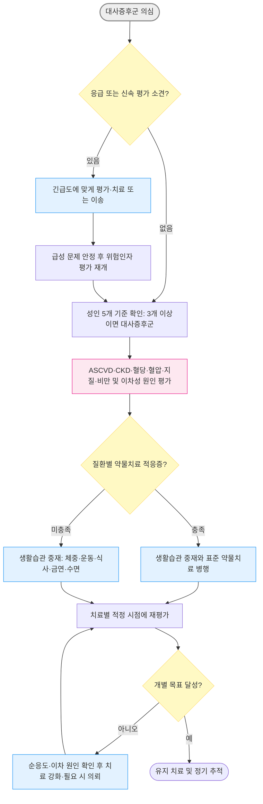

# 대사증후군 Metabolic Syndrome

## <mark style="color:green;">일반 사항</mark>

* 2형 당뇨병, 심혈관 질환, 뇌졸중, 지방간 등의 위험을 증가시키는 대사 이상들의 묶음(cluster)
* 다른 이름 : insulin resistance syndrome, syndrome X
* 연령표준화 유병률 : 19세 이상 21.5%, 30세 이상 25.7%, 65세 이상 39.0%; 19세 이상 남성 28.5%, 여성 14.3%(남성이 여성의 약 2배). 2005년 주민등록연앙인구를 기준으로 표준화한 값으로 조유병률과 구분 \[국민건강영양조사 제9기, 2022\~2024; 한국 대사증후군 팩트시트 2026, 책자 3·19쪽]
  * 제8기(2019\~2021)의 24.9%에서 제9기 21.5%로 감소했으나 성별 격차는 확대됨
  * 남성은 50\~60대에 유병률이 정점에 이르고, 여성은 폐경 이후 연령이 증가할수록 빠르게 상승하는 양상
* 대사증후군은 향후 당뇨병·심뇌혈관질환 위험 증가와 연관됨. 개인의 절대위험은 나이, 흡연, LDL-C, 당뇨병·CKD 및 기존 심혈관질환 등에 따라 달라지므로, 구성요소 개수만으로 예후나 치료 강도를 정하지 않음
* 국내 KNHANES–NHIS/HIRA 연계 코호트(33,697명; 2007~2013년 기초조사, 2014~2023년 추적)에서 대사증후군은 비대사증후군 대비 모든 원인 사망의 보정 HR 1.15(95% CI 1.06~1.25), 심뇌혈관질환 발생의 보정 HR 1.77(1.57~1.99)과 연관. 각각 상대적 위험도 지표가 15%·77% 높은 것으로, 절대위험이 15%p·77%p 증가했다는 뜻은 아님
  * Cox 비례위험모형에서 연령·성별·교육수준·가구소득·흡연·음주·규칙적 운동을 보정. 심뇌혈관질환은 처음 발생한 심근경색·협심증·허혈성뇌졸중의 복합결과이며, 관찰연구의 연관성으로 해석 <mark style="color:$info;">\[한국 대사증후군 팩트시트 2026, 책자 39~40쪽]</mark>

**대사증후군과 CKM 증후군(Cardiovascular-Kidney-Metabolic Syndrome)**

* 미국심장협회(AHA)는 비만·대사이상·만성신질환·심혈관질환을 하나의 연속된 병태생리 스펙트럼으로 보는 CKM 증후군 개념을 제시했고(2023년), 2026년 6월 AHA/ACC/ADA/ASN 공동 임상진료지침이 발표됨
* CKM은 Stage 0(위험인자 없음)부터 Stage 4(임상적 심혈관질환)까지 분류하며, 조기 단계에서 체중·혈압·지질·혈당·신장 위험을 함께 평가하고 치료하는 것을 강조
* 전통적 대사증후군 5항목은 심혈관 위험을 알리는 실무적 도구로 유용하지만 CKM 단계와 일대일로 대응하지 않음. 대사증후군 환자도 CKD, 무증상 또는 임상적 심혈관질환, 예측 위험도에 따라 CKM Stage 2\~4에 분포할 수 있음

<table><thead><tr><th width="110">CKM Stage</th><th>정의</th><th>대사증후군과의 관계</th></tr></thead><tbody><tr><td>Stage 0</td><td>과체중·비만, 대사 위험인자, CKD, 심혈관질환이 없음</td><td>대사증후군에 해당하지 않음</td></tr><tr><td>Stage 1</td><td>과체중·비만·기능 이상 지방조직 또는 당뇨병전단계가 있으나 다른 대사 위험인자·CKD·CVD는 없음</td><td>복부비만·당뇨병전단계만으로는 대사증후군 3항목 기준을 충족하지 않음</td></tr><tr><td>Stage 2</td><td>고혈압·고중성지방혈증·당뇨병 등의 대사 위험인자 또는 CKD가 있으며 Stage 3·4에 해당하지 않음</td><td>대사증후군은 대개 이 단계 이상에 해당하지만, 5항목 중 3개 충족이 Stage 2의 필수조건은 아님</td></tr><tr><td>Stage 3</td><td>CKM 위험인자와 무증상 CVD가 있거나, 위험 등가 상태인 매우 고위험 CKD 또는 PREVENT-CVD 10년 위험 ≥20%</td><td>대사증후군 유무와 별도로 무증상 심혈관질환·전체 위험도로 판정</td></tr><tr><td>Stage 4</td><td>비만·대사 위험인자 또는 CKD와 함께 임상적 CVD(관상동맥질환·심부전·뇌졸중·PAD·심방세동 등) 동반</td><td>대사증후군 3항목 충족은 필수가 아니며 임상적 CVD와 CKM 위험인자의 동반으로 판단</td></tr></tbody></table>

* CKM 단계 판정의 **PREVENT-CVD(총 CVD)**와 미국 지질 지침의 **PREVENT-ASCVD(죽상경화성 CVD)**는 예측 결과가 다름. Stage 3의 ≥20%를 미국 이상지질혈증 지침의 ≥10% 고위험 기준과 혼용하지 않음
* PREVENT의 적용 연령·기존 CVD 유무·예측 결과를 확인함. 미국 지침의 위험도 절단값을 국내 지질 치료의 위험군·LDL-C 목표에 그대로 대입하지 않으며, 국내 지침과 임상 상황을 함께 적용함

_<mark style="color:$info;">Ref. AHA/ACC/ADA/ASN CKM Syndrome Guideline 2026</mark>_


**"대사증후군은 위험 표지(risk marker)이다"** 대사증후군은 그 자체가 단일 약물의 치료 대상이라기보다 심혈관·신장·대사 위험이 증가했음을 알리는 위험 표지로 이해하는 것이 적절하며, 실제 치료는 혈압·지질·혈당·체중 등 개별 위험 인자의 적극적인 조절에 초점을 둠


### <mark style="color:orange;">병태생리</mark>

* intra-abdominal & visceral adipose tissue 증가
* 지방조직 기능이상과 인슐린 저항성이 주요 기전이며 leptin resistance 등이 관여. 인슐린 저항성의 연구·대리지표는 있으나 대사증후군 확진에 사용할 단일 표준 검사는 없음
* adipose tissue inflammation 및 ectopic fat deposition(간, 췌장, 골격근 등에 이소성 지방 축적)
* adiponectin(2형 당뇨병, 고혈압, 죽상경화증 등으로부터의 보호 인자) 감소
* 지방산 대사 이상, 혈관내피 기능이상, 전신 염증(IL-6, TNF-α, resistin, CRP↑), 산화 스트레스, renin-angiotensin system 활성화, prothrombotic state(plasminogen activator inhibitor-1↑)

## <mark style="color:green;">원인 및 위험 인자</mark>

* 중심 비만, 인슐린 저항성
* 고령, 폐경기
* 유전, 가족력(대사증후군, 당뇨병, 심혈관 질환)
* 소아기 비만
* 고칼로리 식사, 설탕 가미 음료 섭취
* 낮은 사회 경제적 상태
* 음주, 흡연, 신체 비활동, 수면 부족·수면 장애
* 약물 : glucocorticoid, 일부 비정형 항정신병제 등; β-blocker·thiazide계 이뇨제는 일부 대사 지표에 영향을 줄 수 있으나 명확한 심혈관 적응증이 있으면 임의로 중단하지 않음
* pro-inflammatory state, 장내 미생물총 변화

### <mark style="color:orange;">관련 질환</mark>

* MASLD (대사이상지방간질환) : 대사증후군의 간(肝) 표현형이라 할 정도로 연관성이 큼
* OSA (폐쇄수면무호흡증) : 중심비만·인슐린저항성 및 대사증후군과 양방향으로 강하게 연관
* 고요산혈증/통풍 : 요산이 대사증후군 개별 구성 요소와 연동됨
* CKD : 대사증후군이 있으면 위험도가 유의하게 상승함. 단, eGFR·알부민뇨 포함 여부 등 CKD 정의에 따라 연관성 크기의 편차가 큼
* PCOS (다낭성난소증후군) : 가임기 여성에서 대사증후군 위험과 연관
* acanthosis nigricans : 인슐린저항성을 시사하는 임상 표지
* 발기 장애 : 혈관내피기능이상 경로로 대사증후군과 연관될 수 있음
* 담석증 : 비만·이상지질혈증 경로로 연관
* 우울·인지 장애 : 연관성이 있으나 인과관계는 명확하지 않음
* 무증상 갑상선저하증·Vit D 결핍 : 관찰 연구상 연관성이 보고되나 인과관계와 치료 효과의 근거는 제한적임

## <mark style="color:green;">임상 양상</mark>

* 대부분 무증상이며 건강검진의 허리둘레·혈압·혈액검사에서 우연히 발견되는 경우가 많음
* 중심 비만의 신체 소견 : 허리둘레 증가, 목·겨드랑이 등의 acanthosis nigricans(인슐린 저항성 시사)
* 관련 질환의 증상이 먼저 나타나기도 함 : 코골이·주간 졸림(OSA), 여성에서 월경 불순·다모증(PCOS), 관절통(고요산혈증/통풍)
* 진행 시 2형 당뇨병, 관상동맥질환, 뇌졸중 등으로 발현 가능

### <mark style="color:$danger;">🚩 Red Flags!</mark>

<mark style="color:$danger;">**즉각 조치**</mark>

* 급성 흉통, 심한 호흡곤란, 실신 또는 혈역학적 불안정 → 즉시 응급 평가·필요 시 119 이송  `급성 관상동맥증후군·급성 심부전·폐색전증 등`
* 편측 위약감, 언어 장애, 갑작스러운 시야 장애 → 증상이 소실되어도 즉시 응급 평가  `급성 뇌졸중·일과성허혈발작`
* 심한 혈압 상승(흔히 SBP ≥180 또는 DBP ≥120 ㎜Hg)과 흉통·호흡곤란·신경학적 이상·시야 이상·의식 변화·급성 신기능 저하 등 → 급성 표적장기 손상 평가; 증상이 있으면 반복 측정 때문에 이송을 지연하지 않음. 수치가 이보다 낮아도 장기 손상이 있으면 응급 대응  `고혈압응급증`
* 심한 다뇨·다음과 함께 탈수, 구토, 복통, Kussmaul 호흡 또는 의식 변화 → 즉시 응급 평가  `당뇨병성 케톤산증·고삼투압성 고혈당상태`
* 새로 발생한 심한 상복부 통증·지속적인 구토 → TG 수치와 관계없이 즉시 평가; TG ≥1,000 ㎎/㎗이면 고중성지방혈증성 췌장염을 강하게 의심  `급성 췌장염·급성 복증`

<mark style="color:$warning;">**당일~수일 내 평가**</mark>

* 반복 측정한 SBP ≥180 또는 DBP ≥120 ㎜Hg이나 급성 표적장기 손상 증후는 없는 경우 → 가능하면 당일 평가하여 손상 유무·복약 순응도·유발 요인을 확인하고 치료 조정; 임의의 급격한 강압은 피함  `중증 무증상 혈압 상승`
* 현저한 고혈당과 다뇨·다음·체중 감소가 있으나 위기 소견은 없는 경우 → **당일** 당뇨병 및 케톤·탈수 여부 평가와 치료 결정  `증상성 고혈당`
* TG ≥500 ㎎/㎗ → 금주·식이 교정·이차성 원인 평가와 신속한 약물치료 검토. 특히 ≥1,000 ㎎/㎗이면 **당일** 평가를 우선하며 복통·구토가 생기면 즉시 응급 평가  `중증 고중성지방혈증·췌장염 위험`

<mark style="color:$info;">**조기 평가 및 추적**</mark>

* LDL-C ≥190 ㎎/㎗ → 이차성 원인·가족력·건황색종 등을 평가하고 조속히 지질강하치료; 수치만으로 응급실 의뢰하지 않음  `중증 고콜레스테롤혈증·가족성 고콜레스테롤혈증 의심`
* 급속한 체중 증가, 넓은 자색 선조, 근위부 근력 저하 등 → 표적 내분비 검사·필요 시 의뢰; 중증 고혈압·고혈당 등이 동반되면 긴급도를 상향  `쿠싱증후군 등 이차성 원인`
* 코골이·수면 중 무호흡 목격·주간 졸림 → 수면 평가; 졸음운전은 즉시 피하도록 교육  `폐쇄수면무호흡증`
* 경계역 혈압·공복혈당·지질 이상 또는 대사증후군 구성요소 1~2개 → 생활습관 중재와 정기 재평가  `심혈관·대사 위험 증가`
* 적절한 생활습관·약물 치료 후에도 체중·혈압·지질·혈당 목표 미달성  `잔여 위험·치료 반응 불충분`

## <mark style="color:green;">진단</mark>

* 성인 진단 : 다음 5개 항목 중 ≥3개 해당(NCEP-ATP III 개정안·2009년 국제 통합 기준의 구성요소 + 대한비만학회 한국인 복부비만 기준). 복부비만은 필수조건이 아니며 BMI가 정상이어도 진단 가능

<table><thead><tr><th width="143.80950927734375">항목</th><th>기준</th></tr></thead><tbody><tr><td>중심 비만</td><td>허리둘레 남성 ≥90 ㎝, 여성 ≥85 ㎝</td></tr><tr><td>높은 중성지방</td><td>≥150 ㎎/㎗ 또는 이에 대한 약물 치료 중</td></tr><tr><td>낮은 HDL-C</td><td>남성 ＜40 ㎎/㎗, 여성 ＜50 ㎎/㎗ 또는 이에 대한 약물 치료 중</td></tr><tr><td>높은 혈압</td><td>SBP ≥130 ㎜Hg 또는 DBP ≥85 ㎜Hg 또는 고혈압 약물 치료 중</td></tr><tr><td>높은 혈당</td><td>공복혈당 ≥100 ㎎/㎗ 또는 혈당강하제 치료 중</td></tr></tbody></table>

* 허리둘레는 양발을 모으고 서서 숨을 편안히 내쉰 상태에서 마지막 늑골 하단과 장골능 상단의 중간 지점을 바닥과 수평으로 측정; 줄자가 피부를 압박하지 않게 함
* 공복혈당은 ≥8시간 열량 섭취 없이 측정한 정맥혈장 기준. 경계값이거나 급성 질환·일시적 요인의 영향이 의심되면 안정된 상태에서 재평가
* 혈압 ≥130/85 ㎜Hg·공복혈당 ≥100 ㎎/㎗는 대사증후군 구성요소 기준으로, 고혈압·당뇨병의 확진 또는 약물치료 시작 기준과 같지 않음
* 고중성지방혈증·저HDL-C에 대한 치료 여부는 해당 이상을 치료하기 위한 처방인지 확인함. LDL-C 상승으로 스타틴을 복용한다는 사실만으로 TG·HDL-C 항목을 자동 양성 처리하지 않음
* 성인 절단값을 소아청소년·임신부에게 그대로 적용하지 않음. 소아청소년은 연령별 비만·혈압·지질·혈당 기준으로 개별 위험을 평가
* HbA1c는 당뇨병전단계·당뇨병 평가에 유용하지만 위 대사증후군 기준의 공복혈당을 대체하지 않음. 당뇨병이 의심되거나 공복혈당·HbA1c가 불일치하면 75 g 경구당부하검사 등 추가 평가를 고려(100장 참조)
* 공복 인슐린·HOMA-IR·adiponectin·leptin·염증표지자는 대사증후군 진단을 위해 일률적으로 검사하지 않음
* 기본 평가
  * 병력 : 흡연·음주, 식사, 신체 활동, 수면, 약물, 가족력, 심혈관질환 병력
  * 신체 : 허리둘레, BMI, 표준화된 진료실 혈압; 필요 시 가정혈압 또는 활동혈압으로 확인
  * 검사 : 공복혈당 ± HbA1c, 공복 지질검사(LDL-C·non-HDL-C 포함), AST·ALT, creatinine/eGFR, UACR(요알부민/크레아티닌비)
  * 비공복 TG ≥400 ㎎/㎗이면 공복 재검. TG가 매우 높으면 Friedewald 계산 LDL-C의 신뢰도가 떨어지므로 직접 LDL-C·non-HDL-C, 필요 시 ApoB 등으로 보완
  * eGFR ＜60 ㎖/min/1.73㎡ 또는 UACR ≥30 ㎎/g이 나오면 원인·일시적 상승 요인을 평가하고 재검. CKD는 신장 구조·기능 이상이 ≥3개월 지속됨을 확인하며, 급성 신손상 의심 시 즉시 별도 평가
  * MASLD 고위험군(특히 제2형 당뇨병, 또는 복부비만과 ≥1개 추가 대사 위험인자)에서는 간효소가 정상이더라도 AST·ALT·혈소판을 이용한 FIB-4 등 섬유화 위험 평가
    * FIB-4 ≥1.3(＞65세는 ≥2.0)이면 간탄성도 검사 등 이차 평가를 고려하고, ＞2.67이면 전문 진료를 고려. ＜35세·급성 질환에서는 정확도·해석에 한계가 있어 이 점수만으로 배제하지 않음(093장 대사이상지방간질환 참조)
  * 요산은 통풍·CKD·요산 상승 약물 사용 등 임상 적응증에 따라 선택적으로 검사
* 대사증후군 진단과 별도로 ASCVD, CKD, 당뇨병, 고혈압 및 이상지질혈증의 진단·위험도·표적장기 손상을 평가

### <mark style="color:orange;">감별</mark>

* 중심 비만·대사 이상을 유발하거나 악화시키는 이차성 원인은 임상적으로 의심될 때 표적 검사

<table><thead><tr><th width="123.33331298828125">질환</th><th width="282.8570556640625">대사증후군과의 차이점</th><th>핵심 감별 포인트</th></tr></thead><tbody><tr><td>쿠싱증후군</td><td>중심 비만·고혈압·고혈당이 코티솔 과잉에 기인</td><td>넓은 자색 선조, 근위부 근력 저하, 쉽게 멍듦, 다혈성 안면 → 1 ㎎ overnight dexamethasone 억제검사, 24시간 요중 유리코티솔 또는 야간 타액 코티솔 중 적절한 검사</td></tr><tr><td>갑상선저하증</td><td>체중 증가·이상지질혈증이 갑상선호르몬 저하에 기인</td><td>피로, 서맥, 부종 등 임상적 의심 → TSH ± free T4</td></tr><tr><td>PCOS</td><td>인슐린 저항성이 흔히 동반되나 배란장애·고안드로겐증이 핵심</td><td>월경 불순, 다모증, 여드름 → 다른 원인 배제 후 진단 기준에 따라 평가; 모든 환자에서 초음파가 필수는 아님</td></tr><tr><td>약물 유발</td><td>glucocorticoid, 일부 비정형 항정신병제 등으로 대사 이상 발생·악화</td><td>약물 복용력, 치료 전후 체중·혈압·혈당·지질 변화 확인; 원 적응증과 위험·이익을 고려해 대체 약제 검토</td></tr></tbody></table>

***



<p align="center"><strong>대사증후군 진단 및 치료 알고리듬</strong></p>

<p align="center"><em><mark style="color:$info;">저자 재구성(참고 문헌: NCEP-ATP III 개정안·2009년 국제 통합 기준; AHA/ACC/ADA/ASN CKM Syndrome Guideline 2026)</mark></em></p>

***

## <mark style="background-color:$warning;">Management</mark>

### <mark style="color:orange;">치료 방침</mark>

* 생활습관 개선은 모든 단계의 치료 기반이며, 개별 위험 인자의 약물치료 적응증을 동시에 평가
* 고혈압·당뇨병·이상지질혈증·CKD·비만이 각각의 치료 적응증을 충족하면 생활습관 개선 결과를 3\~6개월 기다리지 않고 해당 질환의 표준 치료를 병행
* 과체중·비만에서는 초기 6개월 동안 현 체중의 5\~10% 감량을 목표로 하되, 동반 질환·기능 상태·치료 반응에 따라 추가 감량 목표를 개별화(☞ [비만](../230_/191_-obesity.md))
  * BMI ＜25 ㎏/㎡ 도달을 모든 환자의 필수 목표로 삼기보다, 달성 가능하고 지속 가능한 체중 감량과 허리둘레·대사 지표 개선을 우선
  * 정상 체중·허약·근감소증이 있으면 일률적인 감량을 피하고 근력·영양·기능 보존을 함께 고려


**단계별 치료 전략(Step-wise Approach)** : 생활습관 개선이 모든 치료의 근간이지만 약물치료가 필요한 고혈압·당뇨병·이상지질혈증·비만 등을 단순히 "대사증후군"이라는 이유로 지연하지 않음


## <mark style="color:green;">비-약물 치료 및 예방</mark>

* [금연](../230_/190_-smoking.md), 음주는 시작을 권하지 않으며 가능한 한 줄이거나 피하도록 권고(☞ [음주](../230_/189_-alcohol-use-disorder.md))
* 신체 활동 : 주 150\~300분 중등 강도 또는 75\~150분 고강도 유산소 운동 + 주 2일 이상 근력 운동; 장시간 좌식 시간을 줄임(☞ [운동지침](../231_/216_-physical-activity-guideline.md))
  * 위 운동량은 장기 목표이며 현재 활동량·체력·동반질환에 맞추어 낮은 강도·짧은 시간에서 시작함. 짧게 나누어 누적할 수 있으며, 10분 이상 연속해야만 계산되는 것은 아님
  * 대사증후군 자체만으로 운동부하검사를 일률적으로 시행하지 않음. 심혈관질환 의심 증상, 알려진 질환과 시작하려는 운동 강도에 따라 평가함. 고혈압·심부전·당뇨병 동반 시 해당 장과 216장의 안전 기준을 함께 적용함
  * ME/CFS 또는 PEM이 있는 Long COVID에서는 고정된 운동 증량이나 일률적인 주당 목표 대신 에너지 한도 내 활동 조절(pacing)을 우선함(216장 예외 항목 참조)
* 식이 : 총열량과 식사 패턴을 개별화하고, 식이섬유·통곡물·채소·과일·콩류·견과류·생선·불포화지방을 늘림(☞ [식이지침](../231_/217_-nutritiondiet-guideline.md))
  * DASH diet, 지중해식 식단 등 지속 가능한 심장건강 식사 패턴 권장
  * 중증 고중성지방혈증에서는 아래 「이상지질혈증」의 총지방 제한을 우선 적용함. 특히 TG ≥1,000 ㎎/㎗에서 견과류·씨앗류·식물성 기름 등 불포화지방도 총지방량에 포함되므로 일반적인 증량 권고를 그대로 적용하지 않음
  * 제한 : 소금(＜5 g/d)(☞ [고혈압](../225_/095_-hypertension.md)), 설탕 가미 음료·단순당, 포화지방·트랜스지방, 가공육·과도한 붉은 고기
  * 초가공식품(ultra-processed food) 섭취 제한
  * 칼륨이 풍부한 식품은 혈압 관리에 도움이 될 수 있으나 CKD·고칼륨혈증 위험에서는 개별화; Vit A/B/E 등 항산화 비타민 보충제를 대사증후군 치료 목적으로 일률적으로 권고할 근거는 부족
* 수면·행동 중재 : 규칙적인 수면 시간과 충분한 수면을 확보하고, 코골이·무호흡·주간 졸림이 있으면 OSA 평가. 스트레스 관리·행동 상담과 식사·운동·체중 기록을 활용하여 중재를 지속

## <mark style="color:green;">약물 치료</mark>

### <mark style="color:orange;">비만</mark>

* 비만 약물치료 적응증을 충족하면 생활습관 중재와 함께 시작할 수 있으며, 사전에 반드시 3\~6개월의 생활습관 단독 치료를 요구하지 않음(☞ [비만](../230_/191_-obesity.md))
* 대한비만학회 2024 지침(2025년 영문 발표)은 BMI ≥25 ㎏/㎡ 또는 BMI ≥23 ㎏/㎡이면서 비만 관련 동반 질환이 있는 성인에서 약물치료를 고려함. **학회 권고의 BMI 기준과 각 제품의 국내 허가 적응증은 다를 수 있으므로 구분함**
* semaglutide는 GLP-1 수용체 작용제, tirzepatide는 GIP/GLP-1 이중 수용체 작용제임. 체중 감량 효과와 심혈관·신장 이익은 약제별 허가 적응증과 근거가 확인된 환자군에 따라 판단; 대사증후군 진단만으로 투여하거나 계열 전체에 동일한 장기 보호 효과가 있다고 가정하지 않음
* 금기·부작용 및 중단 후 체중 재증가 가능성을 함께 고려

### <mark style="color:orange;">고혈압</mark>

* 목표 혈압 : 일반적으로 ＜140/90 ㎜Hg; 당뇨병·CKD·심혈관질환·뇌졸중이 동반된 환자와 심혈관 고위험군은 치료 내약성을 고려해 ＜130/80 ㎜Hg으로 관리(급성 뇌졸중기는 별도 기준). 고령·허약·증상성 기립저혈압에서는 개별화 <mark style="color:$info;">\[대한고혈압학회 2026]</mark> (☞ [고혈압](../225_/095_-hypertension.md))

### <mark style="color:orange;">이상지질혈증</mark>

* 대사증후군 자체만으로 LDL-C 치료 목표를 정하지 않으며, ASCVD·당뇨병·CKD와 전체 위험도에 따라 위험군별 LDL-C 목표 및 스타틴 강도를 결정(☞ [이상지질혈증](../225_/099_-dyslipidemia.md))
* TG 150\~499 ㎎/㎗ : 체중 감량, 운동, 음주·정제 탄수화물 제한, 당뇨병·갑상선저하증·약물 등 이차성 원인 교정 및 ASCVD 위험에 따른 스타틴 치료가 우선
* TG 500~999 ㎎/㎗ : 췌장염 예방을 위해 금주·첨가당/정제 탄수화물 제한·저지방식과 총지방 제한의 개별화; 이차성 원인 교정과 함께 fibrate 또는 처방용 omega-3 등 신속한 약물치료를 검토. 수개월간 생활습관 교정만 하며 기다리지 않음
* TG ≥1,000 ㎎/㎗ : 매우 저지방식(총에너지의 약 10~15%, 대개 지방 ≤20~30 g/d), 첨가당 배제·금주 및 신속한 TG·혈당 조절; 복통·구토 시 즉시 췌장염 평가. 반복·지속되는 극심한 상승이나 췌장염 병력은 유전성 지질이상 등 전문 평가
* 스타틴 치료 후 TG 135~499 ㎎/㎗가 지속되는 선택된 ASCVD·고위험 당뇨병 환자에서는 고순도 EPA 제제인 icosapent ethyl(IPE) 4 g/d 추가를 2026 국내 지침에서도 고려하도록 권고(IIa, B). 임상시험 근거·학회 권고와 국내 품목별 허가·공급 여부는 구분
  * EPA+DHA 혼합제·일반 보충제를 IPE와 동등한 심혈관사건 예방제로 대체하지 않음. 국내 지침의 선택적 EPA+DHA 추가 고려는 약한 권고(IIb, 전문가 의견)이며, IPE와 같은 사건 감소 근거를 뜻하지 않음
* **낮은 HDL-C만 올리기 위한 약물치료는 권고하지 않음**. 생활습관 교정과 LDL-C·non-HDL-C 및 전체 위험 관리가 우선
* 스타틴으로 혈당이 소폭 오를 수 있으나 적응증이 있으면 당뇨병 발생 우려만으로 회피·중단하지 않고 혈당을 추적
* atorvastatin 처방 전 간기능·임신 가능성·근육질환과 상호작용 약물을 확인. 국내 리피토정은 활동성 간질환·아미노전달효소 ≥정상상한치 3배, 급성 간부전·비대상성 간경화, 근질환, 임부·임신 가능성이 있는 여성·수유부 등에 금기. glecaprevir/pibrentasvir 병용 금기이며, macrolide·azole계 등 병용 시 용량 제한·대체 약제 여부를 평가(099장 참조)

### <mark style="color:orange;">당뇨병, 당뇨병전단계</mark>

* 생활습관 교정과 과체중·비만의 체중 감량은 모든 단계의 기반임(☞ [당뇨병](100_-diabetes-mellitus.md#management))
* 확진 당뇨병은 진단·혈당 정도에 맞는 약물치료를 병행. ASCVD·CKD·심부전 동반 여부에 따라 SGLT2 억제제 또는 GLP-1 기반 치료 등의 장기 보호 적응증을 평가하며, 아래 당뇨병전단계 예방요법과 구분함
* ADA 2026은 진행 위험이 높은 당뇨병전단계에서 metformin을 고려하며, 특히 25~59세이면서 BMI ≥35 ㎏/㎡, 높은 공복혈당(예: ≥110 ㎎/㎗)·HbA1c(예: ≥6.0%)가 있는 경우와 과거 임신성 당뇨병 병력에서 우선 고려하도록 권고. 각 수치를 단독 처방 기준으로 해석하지 않음 <mark style="color:$info;">[ADA 2026]</mark>
  * metformin <mark style="color:blue;">\[다이아벡스]</mark>을 당뇨병전단계의 당뇨병 예방 목적으로 사용하는 것은 국내 허가 외 사용
  * 국내 다이아벡스정은 eGFR ＜45 ㎖/min/1.73㎡ 또는 CrCl ＜45 ㎖/min에서 투여하지 않음. eGFR 45~＜60 ㎖/min/1.73㎡에서는 유산산증 위험을 평가하고 최대 1,000 ㎎/d(2회 분할), 신기능 3~6개월마다 평가; 국제 metformin 일반 기준과 해당 품목 허가 기준을 구분
  * 급성·불안정형 심부전, 대사성산증·케톤산증, 간기능장애·과량 음주 등 금기·유산산증 위험을 확인. 안정형 만성 심부전은 국내 허가상 심장·신장기능 모니터링하에 투여할 수 있어 급성 심부전과 구분(101장 참조)
  * ADA는 장기 복용 시 특히 빈혈·말초신경병증이 있으면 Vit B12를 주기적으로 평가하도록 권고하며, **국내 다이아벡스정 허가사항은 혈청 Vit B12 연 1회 검사를 권고**
  * 심한 구토·설사·탈수, 중증 감염·저산소증 또는 급성 신손상 시 일시 중단하고 진료; 회복·신기능을 확인한 뒤 재개
  * 예방요법의 이익·부작용·장기 복용 부담을 설명하여 결정. 당뇨병 발생 지연 효과를 심혈관사건 감소 효과로 동일시하지 않음
  * 국내 다이아벡스정의 요오드 조영제 검사 중단 기준은 국제 영상의학 지침보다 보수적임. eGFR ＞60에서는 검사 시점 또는 사전에, 45~60에서는 검사 48시간 전 중단하며 검사 후 최소 48시간 경과 및 신기능 재평가 뒤 재개

* 당뇨병전단계는 적어도 연 1회 혈당 상태를 재평가하고, 경계값 상승·증상·치료 변경 등 진행 위험에 따라 3~6개월 등으로 앞당김

### <mark style="color:orange;">기타</mark>

* 저용량 aspirin : 대사증후군만을 이유로 일차예방에 일률적으로 사용하지 않음. 연령·심혈관 위험·출혈 위험을 함께 평가하여 제한적으로 고려
  * 관상동맥질환, 허혈성뇌졸중 등 확진된 죽상경화성 심혈관질환의 이차예방에서는 질환별 항혈전 지침을 적용(☞ [항혈전제](../231_/214_-anti-thrombotics-anti-coagulants.md))

## <mark style="color:green;">시술 및 기타 처치</mark>

* 중증비만 또는 표준 치료로 충분히 조절되지 않는 비만 관련 대사 합병증에서는 BMI·동반 질환·수술 위험을 평가해 전문기관의 비만대사수술 평가를 고려(191장 비만 참조). 대사증후군 진단만으로 수술 적응증을 정하지 않음

***

### <mark style="color:red;">질병코드</mark>

E88.8 기타 명시된 대사장애 – Other specified metabolic disorders

* E88.8은 명시된 대사장애에 사용하는 범주임. E88.9 상세불명의 대사장애 – Metabolic disorder, unspecified는 대사장애가 구체화되지 않은 경우에 제한; 미국 ICD-10-CM 세부코드를 KCD 코드로 그대로 적용하지 않음
* 고혈압·당뇨병·이상지질혈증·비만 등 동반 질환은 실제 진단 기준을 충족하고 진료한 경우에만 각각의 코드를 추가

***

## <mark style="color:purple;">처방례</mark>

> **처방례 1. 경계역 혈압 상승, 저위험군**
>
> ```
> 생활습관 개선(체중 감량, 저염식, 운동) 우선; 가정혈압 측정 후 약 3개월 이내 재평가
> ```
>
> _✽당뇨병·CKD·심혈관질환 등 고위험 동반 질환이 없고 SBP 130\~139 또는 DBP 85\~89 ㎜Hg인 경우. 반복 측정 또는 가정혈압으로 확인하고 전체 심혈관 위험도에 따라 치료 시점을 개별화_

> **처방례 2. 중등도 강도 스타틴이 적절한 이상지질혈증 동반**
>
> ```
> 리피토 10 ㎎/T  1T  qd  매일 일정한 시간
> ```
>
> _✽대사증후군 또는 LDL-C ≥100 ㎎/㎗만으로 일률적으로 처방하지 않으며, ASCVD·당뇨병·CKD·LDL-C ≥190 ㎎/㎗ 및 전체 위험도에 따라 적응증과 강도를 결정. atorvastatin 10 ㎎은 중등도 강도 치료의 예이며, ASCVD·LDL-C ≥190 ㎎/㎗ 등 더 강한 치료가 필요한 환자에게 일률 적용하지 않음. 리피토정 허가사항은 시작·용량 조정 후 2~4주 내 지질검사와 용량 조정을 안내_

> **처방례 3. 진행 위험이 특히 높은 당뇨병전단계**
>
> ```
> 다이아벡스 500 ㎎/T  1T  qd  저녁 식사 직후(1~2주 후 1T bid로 증량 고려)
> ※ 당뇨병전단계의 당뇨병 예방 목적은 국내 허가 외 사용
> ※ 위장관 부작용(설사, 복통 등)을 줄이기 위해 1~2주 간격으로 서서히 증량
> ※ 국내 다이아벡스정: eGFR ＜45 ㎖/min/1.73㎡ 또는 CrCl ＜45 ㎖/min에서는 투여하지 않음
> ※ eGFR 45~＜60 ㎖/min/1.73㎡: 유산산증 위험 평가 후 최대 1,000 ㎎/d(2회 분할), 신기능 3~6개월마다 평가
> ```
>
> _✽진행 위험이 높은 당뇨병전단계에서 생활습관 중재와 함께 선택적으로 고려. 특히 25~59세이며 BMI ≥35 ㎏/㎡·높은 혈당/HbA1c가 있는 경우 또는 임신성 당뇨병 병력에서 이익이 큼. 예방 목적의 허가 외 저용량 시작 예이며 국내 성인 당뇨병 허가 용법과 구분(ADA 2026)_

> **처방례 4. 비만 동반**
>
> ```
> 생활습관 중재와 함께 BMI·동반 질환·금기·환자 선호에 따라 비만 약물치료 고려
> ※ 약제별 저용량부터 시작하여 서서히 증량; 위장관 부작용(오심, 구토) 등 모니터링
> ```
>
> _✽적응증을 충족하면 생활습관 단독 치료를 3\~6개월 먼저 시행할 필요는 없으며, 약제 선택과 증량법은_ [_비만_](../230_/191_-obesity.md) _챕터 참조_

***

## <mark style="color:$success;">핵심 복약 지도</mark>

> **생활습관 개선은 모든 치료의 기반입니다**
>
> * 대사증후군 자체를 목표로 하는 단일 약물은 없으며, 개별 위험 인자(고혈압·이상지질혈증·고혈당·비만)가 각각의 치료 적응증을 충족하면 해당 표준 치료를 적용
> * 과체중·비만에서는 체중의 5\~10% 감량만으로도 혈압·혈당·지질이 함께 개선될 수 있으며, 달성 가능하고 유지할 수 있는 목표를 단계적으로 설정

> **약물 복용 시 주의사항**
>
> * 스타틴과 fibrate 병용 시 근육병증 위험이 증가하며 특히 gemfibrozil 병용을 피함. 설명되지 않는 근육통·근력 저하 또는 진한 소변이 나타나면 즉시 보고하고 의료진이 CK 등을 평가
> * metformin은 식사와 함께 복용하며, 심한 구토·설사·탈수 시 일시 중단하고 의료진과 상의. 다이아벡스정 허가사항에 따라 신기능과 혈청 Vit B12(연 1회)를 확인
> * metformin 복용 중 요오드 조영제 검사가 예정되면 미리 복용 사실과 신기능을 알리고, 해당 제품 허가사항과 검사기관 지시에 따라 중단·재개함. 국내 다이아벡스정은 신기능이 양호해도 중단이 필요하며, 검사 후 최소 48시간 경과 및 신기능 확인 뒤 재개

> **정기 모니터링**
>
> * 생활습관 중재는 대개 3~6개월 간격으로 체중·허리둘레·혈압·혈당·지질을 평가하되, 약물 시작·변경이나 중증 이상 시 더 일찍 확인. 스타틴 시작·용량 변경 후 지질은 일반 지침상 4~12주에 재검하며, 리피토정은 품목 허가사항에 따라 2~4주 내 확인
> * 신기능은 eGFR과 UACR로 평가하고, MASLD 고위험군은 FIB-4 등 섬유화 위험 평가를 고려; 요산은 임상 적응증에 따라 확인

> **언제 다시 병원을 방문해야 하나요?**
>
> * 정한 기간 내에 체중·혈압·혈당·지질 목표에 도달하지 못하거나 약물 부작용이 의심되는 경우
> * 혈압이 **수축기 180 또는 이완기 120 ㎜Hg 이상**이면서 흉통·호흡곤란·신경학적 이상·시야 이상·의식 변화 등이 동반되는 경우 - 즉시 응급 평가·필요 시 119 이송
> * 갑작스러운 심한 상복부 통증이나 지속적인 구토가 생기는 경우 - 즉시 응급 평가·필요 시 119 이송
> * 다뇨·다음·체중 감소 등 새로운 고혈당 증상은 당일 평가. 구토·탈수·의식 변화가 동반되면 즉시 응급 평가

***

## <mark style="color:green;">주요 참고문헌 및 확인 자료</mark>

### ＜임상 근거＞

* 심장대사증후군학회. **대사증후군 팩트시트 2026 최종본**. 국내 연령표준화 유병률·산출 방법(책자 2~3·19쪽), KNHANES–NHIS/HIRA 연계 코호트의 연구설계·보정 HR·신뢰구간(책자 39~40쪽).
  [학회 자료](https://www.kscms.org/Fact-sheet)
* Alberti KGMM, et al. **Harmonizing the Metabolic Syndrome**. Circulation. 2009;120:1640–1645. 구성요소 5개 중 3개·인구별 허리둘레 기준.
  [doi:10.1161/CIRCULATIONAHA.109.192644](https://doi.org/10.1161/CIRCULATIONAHA.109.192644)
* 질병관리청. **국가건강정보포털 — 대사증후군**. 한국인 진단 기준 및 생활습관 관리.
  [국가건강정보포털](https://health.kdca.go.kr/healthinfo/biz/health/gnrlzHealthInfo/gnrlzHealthInfo/gnrlzHealthInfoView.do?cntnts_sn=6781)
* AHA/ACC/ADA/ASN. **2026 Guideline for the Prevention, Detection, Evaluation, and Management of Cardiovascular-Kidney-Metabolic Syndrome**. CKM 단계·PREVENT-CVD·통합 치료.
  [AHA 지침 자료](https://professional.heart.org/en/science-news/2026-guideline-for-the-prevention-detection-evaluation-and-management-of-ckm-syndrome)
* 한국지질·동맥경화학회. **이상지질혈증 진료지침 2026**. 지질 치료목표·TG 치료·모니터링.
  [학회 원문](https://lipid.or.kr/reference/guideline.php?boardid=guideline&idx=1456&mode=view)
* 대한고혈압학회. **2026년 제6판 고혈압 진료지침(수정본)**. 위험도별 혈압 목표 및 치료.
  [학회 지침](https://www.koreanhypertension.org/reference/guide?idno=10446&mode=read)
* ADA. **Prevention or Delay of Diabetes and Associated Comorbidities: Standards of Care in Diabetes—2026**.
  [doi:10.2337/dc26-S003](https://doi.org/10.2337/dc26-S003)
* 대한비만학회. **2024 Clinical Practice Guidelines for the Diagnosis and Pharmacologic Treatment of Overweight and Obesity**. J Obes Metab Syndr. 2025;34:322–343. 약물치료 고려 기준과 국내 허가 적응증의 구분.
  [doi:10.7570/jomes25042](https://doi.org/10.7570/jomes25042)
* EASL–EASD–EASO. **Clinical Practice Guidelines on the Management of MASLD**. 2024. 고위험군의 FIB-4 기반 단계적 간섬유화 평가.
  [학회 지침](https://easlcampus.eu/sites/default/files/2024-08/EASL_CPGs_management_of_MASLD.pdf)
* KDIGO. **2024 Clinical Practice Guideline for the Evaluation and Management of CKD**. eGFR·UACR 및 만성성 확인.
  [학회 지침](https://kdigo.org/wp-content/uploads/2024/03/KDIGO-2024-CKD-Guideline.pdf)

### ＜허가·급여 확인 자료＞

* 식품의약품안전처. **의약품안전나라 — 의약품 품목허가정보**. 국내 제품별 적응증·용법·금기 및 허가 상태; 다이아벡스정500밀리그램의 신기능·요오드 조영제 중단·Vit B12 검사 기준은 해당 품목 허가사항으로 대조(2026-10-27 확인).
  [의약품안전나라](https://nedrug.mfds.go.kr/index)
  * 리피토정은 제조사가 제공하는 국내 허가문서(최종 변경명령일 2025-12-03)의 용법·금기·지질검사 시점을 대조.
* 건강보험심사평가원. **배포용 상병마스터_260329**. KCD-9 기반 E88.8 코드·명칭 확인. 대사증후군만의 별도 세부코드로 해석하지 않음.
  [상병마스터 배포 공지](https://www.hira.or.kr/rc/drug/insuadtcrtr/bbsView.do?brdBltNo=53117&brdScnBltNo=4&pgmid=HIRAA030069000400)

***

## <mark style="color:blue;">환자 안내서</mark>


**대사증후군, 여러 위험 신호가 한꺼번에 나타난 상태입니다**

대사증후군은 복부 비만, 높은 혈압·혈당·중성지방, 낮은 HDL 콜레스테롤 가운데 세 가지 이상이 함께 나타난 상태입니다. 당장 큰 증상이 없더라도 방치하면 당뇨병이나 심근경색, 뇌졸중, 콩팥병 위험이 커질 수 있습니다.


#### <mark style="color:$primary;">왜 대사증후군이 생기나요?</mark>

* 내장 지방이 늘어나면 우리 몸이 인슐린에 잘 반응하지 않게 되고(인슐린 저항성), 혈압·혈당·중성지방과 HDL 콜레스테롤이 함께 나빠질 수 있습니다
* 고칼로리 식사, 운동 부족, 흡연·음주, 수면 부족, 스트레스, 유전적 소인 등이 함께 작용합니다

#### <mark style="color:$primary;">일상생활에서 어떻게 관리하나요?</mark>

* **과체중·비만이라면 현재 체중의 5\~10% 감량을 첫 목표로 삼으십시오.** 혈압·혈당·지질이 함께 좋아질 수 있으며, 무리한 단기 감량보다 유지 가능한 변화가 중요합니다
* **빠르게 걷기 등 중등 강도 유산소 운동을 일주일에 150분 이상, 근력 운동을 주 2회 이상 하는 것을 목표로 하십시오.** 처음부터 목표량을 채우기 어려우면 현재보다 조금 더 움직이는 것부터 시작하고, 지병·운동 후 증상에 따라 운동량을 조절하십시오.
* **채소, 통곡물, 콩류, 견과류, 생선 위주로 먹고 짠 음식, 단 음료, 가공육과 초가공식품은 줄이십시오.**
* **금연하십시오. 술은 가능하면 피하거나 줄이십시오.** 특히 중성지방이 매우 높으면 금주가 필요합니다
* **규칙적으로 충분히 자고, 코골이·수면 중 숨 멎음·낮 졸림이 있으면 진료를 받으십시오.**
* 중성지방이 매우 높아 별도의 식이 처방을 받았다면 견과류·기름을 포함한 전체 지방 섭취량을 그 처방에 맞추십시오

#### <mark style="color:$primary;">약은 어떻게 써야 하나요?</mark>

* 대사증후군 자체를 한 번에 치료하는 약은 없습니다. 혈압약, 콜레스테롤약, 당뇨약, 비만 치료제 등은 각 수치와 전체 위험도를 평가하여 처방합니다
* 처방받은 약은 임의로 중단하지 말고 정해진 방법대로 꾸준히 복용하십시오
* 메트포르민 복용 중 심한 구토·설사로 탈수되면 일시 중단하고 의료진과 상의하십시오. 조영제 검사가 예정되면 미리 복용 사실을 알리십시오
* 정해진 날짜에 혈압·혈당·콜레스테롤·콩팥 기능을 확인하십시오. 당뇨병전단계도 적어도 매년 혈당 확인이 필요합니다

#### <mark style="color:$primary;">이럴 때는 즉시 응급 진료를 받으세요</mark>

심한 가슴 통증·호흡곤란이나 뇌졸중 의심 증상은 직접 운전하지 말고 119에 연락하십시오.

* 갑작스러운 가슴 통증이나 숨이 심하게 찬 경우
* 몸의 한쪽이 갑자기 힘이 빠지거나 말이 어눌해지는 경우
* 혈압이 수축기 180 또는 이완기 120 ㎜Hg 이상이면서 가슴 통증, 호흡곤란, 신경학적 이상, 시야 이상 또는 의식 변화가 동반되는 경우
* 갑작스러운 심한 상복부 통증이나 지속적인 구토가 생기는 경우
* 심하게 목이 마르고 소변이 많아지면서 구토, 탈수, 심한 처짐이나 의식 변화가 동반되는 경우
