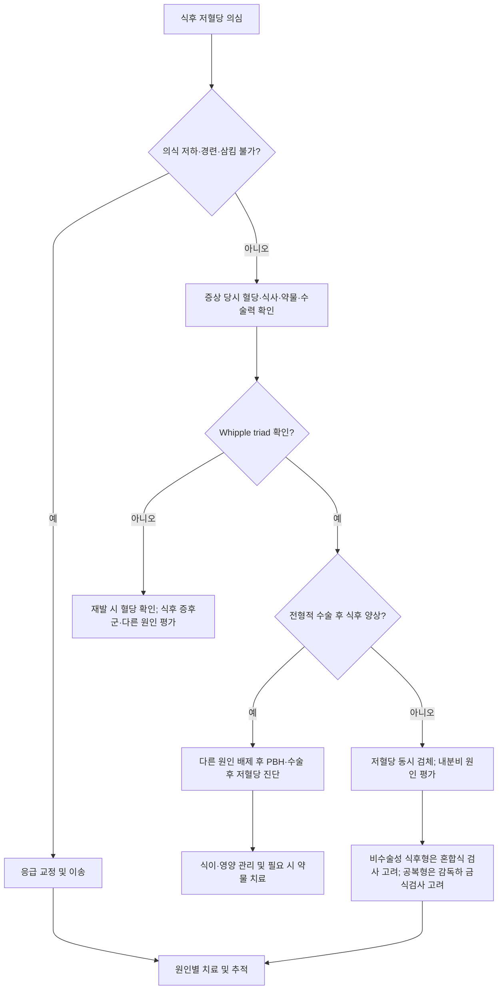

# 반응성 저혈당 (식후 저혈당) Reactive Hypoglycemia, Postprandial Hypoglycemia

## <mark style="color:green;">일반 사항</mark>

* 정의 : 식후 수 시간 이내에 저혈당 증상과 실제 저혈당이 함께 나타나고 혈당 교정 후 증상이 호전되는 상태
  * 식후 저혈당은 발생 시점을 나타내는 임상 표현으로, 다양한 원인이 있으며 일부에서는 부적절한 식후 인슐린 분비가 관여
* 용어 : postprandial hypoglycemia는 식후 저혈당 전반을 뜻하며, alimentary hypoglycemia는 주로 상부 위장관 수술 후 저혈당에 사용되는 용어임
* 분류
  1. 특발성 반응성 저혈당
  2. 상부 위장관 수술 후 저혈당(post-surgical hypoglycemia); 전통적으로 후기 dumping syndrome으로 불리며, 비만대사수술 후 저혈당은 post-bariatric hypoglycemia(PBH)로 구분
  3. 내당능장애·인슐린저항성과 연관된 식후 저혈당 - 연관성이 보고되었으나 인과관계와 병태생리는 확립되지 않음
  4. 내인성 고인슐린혈증성 저혈당 - noninsulinoma pancreatogenous hypoglycemia syndrome(NIPHS), insulin autoimmune hypoglycemia, insulinoma 등
  5. 약물성·인위성(factitious) 저혈당
* Insulinoma는 공복 저혈당이 전형적이지만 식후에도 발생할 수 있어 식후 저혈당의 감별 원인에 포함
* 실제 저혈당이 확인되지 않는 식후 자율신경 증상은 특발성 식후 증후군(idiopathic postprandial syndrome)으로 구분하며, 진성 저혈당과 혼용하지 않음
* 이 장의 검사·약물 용량은 성인 기준임. 소아·청소년 및 임신 중 저혈당은 원인과 영양 요구량이 달라 전문 평가가 필요함
* 특발성 반응성 저혈당의 추정 병태생리로 식후 인슐린 분비의 상대적 과다, 지연된 1차 인슐린 분비 후 2차 과다분비, incretin 반응의 변화 등이 제시되지만 명확히 규명되지는 않음


**당뇨병이 없는 사람에게도 발생할 수 있음** : 식후 저혈당은 인슐린·sulfonylurea를 사용하지 않는 사람에서도 나타날 수 있으며, 진단·관리 접근이 [당뇨병성 저혈당](103_-hypoglycemia-diabetic.md)과 다름


## <mark style="color:green;">원인·유발 인자 및 감별 원인</mark>

* 유발 인자 : 고탄수화물 식사, 정제 탄수화물·단순당 섭취
* 상부 위장관 수술 : Roux-en-Y gastric bypass, 위소매절제술, 위절제술, 식도 수술, Nissen fundoplication 등
  * PBH는 특징적으로 수술 1\~3년 후 식후 2\~4시간에 발생하나 더 이르거나 늦게 발현할 수 있음. 수술 전부터 있었거나 수술 후 6개월 이내 발현, 공복·야간 발생 등 비전형적 양상에서는 다른 원인을 우선 감별함. 비비만 수술 후 후기 dumping은 수술 종류에 따라 발현 시점이 다름  <mark style="color:$info;">[Society for Endocrinology 2024]</mark>
* 약물성 저혈당 : 인슐린·sulfonylurea·meglitinide 등; 처방약·비처방약과 알코올을 함께 확인
* 인위성 저혈당 : 인슐린 또는 인슐린분비촉진제의 의도적·은폐된 사용
* 내인성 고인슐린혈증 : insulinoma, NIPHS, insulin autoimmune hypoglycemia
* 중증 질환·호르몬 결핍 : 간·신장부전, 패혈증, 영양결핍, 부신기능저하 등

## <mark style="color:green;">임상 양상</mark>

* 자율신경 증상 : 떨림, 식은땀, 두근거림, 공복감, 불안 등
* 신경당결핍 증상 : 집중력 저하, 행동 변화, 혼돈, 시야 흐림, 발음 이상, 경련, 의식 소실 등
  * 반복 저혈당에서는 경고성 자율신경 증상이 약해지고 신경당결핍 증상이 먼저 나타나는 저혈당 인지장애가 생길 수 있음
* 조기 dumping syndrome : 식후 1시간 이내 복부팽만·복통·설사 및 심계항진·홍조·저혈압 등이 나타나며 저혈당 없이 발생
* 후기 dumping syndrome/수술 후 저혈당 : 대개 식후 1\~3시간(일부 지침 2\~4시간)에 실제 저혈당 증상 발생

### <mark style="color:$danger;">🚩 Red Flags!</mark>

<mark style="color:$danger;">**즉각 조치**</mark>

* 의식 소실·경련·심한 혼돈 또는 인지·신체 기능 저하로 타인의 도움이 필요한 중증 저혈당; 혈당 수치와 무관하게 즉각 조치  <mark style="color:$danger;">[중증 저혈당]</mark>
* 경구 포도당 섭취가 불가능하거나 포도당 투여 후에도 증상·저혈당이 지속되는 경우  <mark style="color:$danger;">[지속 저혈당]</mark>

<mark style="color:$warning;">**당일~수일 내 평가**</mark>

* 현재 교정되어 안정적이나 Whipple triad가 확인되었고 원인이 불분명한 경우; 신경당결핍 동반·반복 시 **당일 평가**, 현재 지속·재발 시 즉각 조치  <mark style="color:$warning;">[원인 미상의 저혈당]</mark>
* 공복·야간 또는 운동 중 저혈당이 반복되는 경우  <mark style="color:$warning;">[insulinoma 등]</mark>
* 위 수술 후 신경당결핍 증상 과거력이 있으나 현재는 회복·안정된 경우; 증상이 현재 지속되면 즉각 조치  <mark style="color:$warning;">[수술 후 저혈당]</mark>
* 반복적인 저혈당으로 운전·업무 등 일상생활의 안전에 지장이 있거나 저혈당 인지장애가 있는 경우  <mark style="color:$warning;">[중증 저혈당 위험]</mark>

<mark style="color:$info;">**조기 평가 및 추적**</mark> <mark style="color:$info;">- 즉각 위험이 낮으나 호전 없으면 추가 평가</mark>

* 경미하고 산발적인 식후 자율신경 증상으로 실제 저혈당이 확인되지 않은 경우  <mark style="color:$info;">[특발성 식후 증후군 등]</mark>
* 경미한 증상이 식이 조정 4\~6주 후에도 반복되는 경우; 신경당결핍 증상·실제 저혈당 확인 시 위 단계에 따라 조기 평가  <mark style="color:$info;">[지속 식후 증상]</mark>

## <mark style="color:orange;">진단</mark>

* 원칙 : Whipple triad 확인이 핵심 - 증상 시점의 실제 저혈당 확인 없이는 반응성 저혈당으로 진단하지 않음
  * Whipple triad : ⓵ 저혈당에 합당한 증상·징후, ⓶ 신뢰할 수 있는 방법으로 확인된 낮은 혈장 포도당, ⓷ 혈당 상승 후 증상·징후 호전
  * 비당뇨병 성인에서 단일 수치로 저혈당을 절대적으로 정의할 수는 없지만, 증상 당시 검사실 혈장 포도당 ＜55 ㎎/dL는 임상적으로 의미 있는 저혈당을 강하게 시사
  * PBH는 전형적 병력, 혈장 포도당 ＜54 ㎎/dL 및 Whipple triad를 확인하고 다른 원인을 배제하여 진단  <mark style="color:$info;">[Society for Endocrinology 2024]</mark>
* 증상 당시 가능하면 정맥혈 검사실 혈장 포도당을 우선 확인
  * 자가혈당 측정은 저혈당 가능성, 식사와의 시간적 연관성 및 반복 양상을 기록하는 선별 도구로 활용하며 단회 측정만으로 진단을 확정하지 않음
  * PBH에서 정맥혈 채취가 현실적으로 어렵다면 ISO 15197 기준을 충족한 측정기로 ＜54 ㎎/dL가 반복 확인되고 병력이 전형적인 경우 진단에 활용 가능
  * CGM은 저혈당 범위의 정확도 한계, 혈액-간질액 간 시간 지연 및 압박에 의한 거짓 저혈당 때문에 단독 확진검사로 사용하지 않음. 증상과 센서값이 맞지 않으면 모세혈관혈당 또는 검사실 혈당으로 대조함
  * 확진된 PBH에서 실시간 CGM과 저혈당 알람은 식사·운동 교육 및 저혈당 인지장애 환자의 예방·관리에 활용 가능함; 진단 도구로서의 한계와 구분함
* 저혈당 당시 원인이 불분명하면 가능하면 포도당 투여 전 critical sample 채취; 검체 확보 때문에 저혈당 치료를 지연하지 않음
  * 같은 시점의 plasma glucose, insulin, C-peptide, proinsulin, β-hydroxybutyrate 및 sulfonylurea/meglitinide screen을 채취함. Insulin antibody는 별도로 측정 가능하며 반드시 저혈당 순간에 채혈할 필요는 없음
  * 병력에 따라 간·신장기능, cortisol 등 추가 평가; 저혈당 당시 cortisol 단회 저치만으로 부신기능저하를 확진하지 않음
  * 저혈당과 임상상이 맞지 않으면 검체 처리 지연에 따른 시험관 내 해당작용 등 거짓 저혈당도 확인함
  * **내인성 고인슐린혈증 해석** : 혈장 포도당 ＜55 ㎎/dL일 때 insulin ≥3 μU/mL, C-peptide ≥0.6 ng/mL 및 proinsulin ≥5 pmol/L처럼 인슐린 분비가 억제되지 않은 양상이 근거가 됨. β-hydroxybutyrate ≤2.7 mmol/L는 인슐린 매개 기전을 지지함. 신부전·측정법·인슐린 항체 등의 영향을 함께 해석함  <mark style="color:$info;">[Endocrine Society 2009]</mark>
  * 약물 선별검사 양성인 인슐린분비촉진제 노출은 insulinoma와 같은 검사 양상을 보일 수 있음. 위 수치는 공복 평가에서 정립된 기준으로, 식후에는 검사 표준화가 부족하여 단독으로 PBH·insulinoma·NIPHS를 구분하지 못함
* 자발적 식후 저혈당 당시 검체를 얻지 못한 비수술성 환자에서는 감독하 혼합식이내성검사(mixed-meal tolerance test)를 고려
  * 평소 증상을 유발하는 혼합식을 이용하여 최대 5시간 동안 증상과 혈당을 관찰하고, 저혈당 시 동시 검체를 채취함. 판독 기준이 완전히 표준화되어 있지 않아 전문기관에서 해석함
  * 경구당부하검사는 비생리적 자극과 위양성 때문에 비수술성 식후 저혈당 평가에 사용하지 않음. 식후 저혈당만으로 전당뇨병을 진단하거나 향후 당뇨병 발생을 단정하지 않음
* PBH는 임상 병력과 Whipple triad를 중심으로 진단하며 OGTT 또는 MMTT를 일률적인 확진검사로 시행하지 않음  <mark style="color:$info;">[Society for Endocrinology 2024]</mark>
  * Dumping syndrome 자체의 평가가 목적이면 임상 맥락에 따라 modified OGTT를 고려할 수 있으나, PBH의 routine 확진검사와는 구분
* 공복·야간 저혈당 또는 insulinoma가 의심되면 감독하 최대 72시간 금식검사 고려
* CT, MRI, EUS 등 영상검사는 생화학적으로 내인성 고인슐린혈증을 확인하고 약물성·자가면역성 원인 등을 감별한 뒤 insulinoma 국소화를 위해 시행
* 실제 저혈당 없이 식후 증상이 반복되면 식후 저혈압, 부정맥, 불안·공황, 약물·카페인 영향 등을 병력에 따라 감별함. 위장관 수술 후 조기 dumping도 포함함

<table data-search="false"><thead><tr><th width="120">감별 포인트</th><th width="185">특발성 식후 저혈당/식후 증후군</th><th width="185">수술 후 저혈당</th><th width="170">Insulinoma</th><th width="170">NIPHS</th></tr></thead><tbody><tr><td>발생 시점</td><td>주로 식후 수 시간 이내</td><td>대개 식후 1~3시간 또는 2~4시간</td><td>공복·야간·운동 중 흔하나 식후에도 가능</td><td>주로 식후 3~4시간</td></tr><tr><td>주요 병력</td><td>상부 위장관 수술력 없음</td><td>상부 위장관 수술 후; PBH는 특징적으로 1~3년 후</td><td>수술력과 무관</td><td>고전적 NIPHS는 수술력 없이도 발생; PBH와 동의어가 아님</td></tr><tr><td>Whipple triad</td><td>진성 저혈당에서는 확인; 불충족 시 식후 증후군 고려</td><td>확인 필요</td><td>대개 명확히 충족</td><td>확인 필요</td></tr><tr><td>공복검사</td><td>대개 정상</td><td>대개 정상; 공복 저혈당이면 다른 원인 평가</td><td>72시간 금식검사에서 확인되는 경우가 많음</td><td>대개 음성</td></tr><tr><td>주요 평가</td><td>증상 당시 혈장 포도당; 필요 시 감독하 MMTT</td><td>병력 + 증상 당시 혈당; PBH에서 OGTT/MMTT routine 비권고</td><td>저혈당 critical sample → 생화학적 확진 후 국소화</td><td>식후 critical sample; insulinoma 배제 후 전문검사</td></tr><tr><td>치료 원칙</td><td>식이 조정</td><td>식이 조정 → acarbose → 전문 치료</td><td>가능하면 외과적 절제</td><td>식이·약물 치료 우선; 수술은 중증 불응성에서 제한적 고려</td></tr></tbody></table>

***



***

## <mark style="background-color:$warning;">Management</mark>

* 급성기 : 안전하게 삼킬 수 있으면 속효성 포도당 15 g 섭취; PBH에서는 과잉 교정에 따른 재발을 줄이기 위해 10\~15 g의 소량 교정 권고 → 15분 후 재측정하여 여전히 ＜70 ㎎/㎗이면 반복
  * 혈당 회복 후에도 증상이 지속되면 혈당을 재확인하고 다른 원인을 평가; 심한 혼돈·신경학적 이상이 지속되면 응급 평가
  * 호전 후 필요시 저혈당지수 탄수화물에 단백질을 곁들인 소량의 간식 고려
  * 의식 저하·경련·삼킴 불가 시 즉시 119 신고, 경구 섭취 금지 및 측와위 유지; 정맥 포도당 또는 IV 확보 전 처방받은 glucagon 사용
  * Acarbose 복용 중에는 sucrose(설탕)를 피하고 포도당 정제·젤로 치료  <mark style="color:$info;">[Society for Endocrinology 2024]</mark>
* 1차 치료는 식이 조정이며, 증상·식사·혈당 기록을 바탕으로 개별화
* 실제 저혈당이 확인되지 않은 특발성 식후 증후군도 소량씩 자주 식사하고 정제당을 제한하는 식이 조정을 우선 시행하되, 불필요한 저혈당 치료나 과도한 간식 섭취는 피함

## <mark style="color:green;">비-약물 치료 및 예방</mark>

* PBH·수술 후 저혈당에서는 소량의 식사·간식을 분산하여 최대 1일 5\~6회로 조정하고 정제 탄수화물·단순당을 제한함. 비수술성 식후 증상에서는 식사량·간격과 총열량을 개별화하며 모든 환자에게 간식을 의무화하지 않음
* 저혈당지수가 낮은 복합 탄수화물, 식이섬유, 단백질, 불포화지방을 함께 섭취
* 수술 후 저혈당에서는 우선 탄수화물 ＜30 g/meal을 목표로 하고 반응에 따라 영양 전문가와 추가 조정
* 단백질은 매 끼니에 포함하고 PBH에서는 1일 최소 60 g을 출발점으로 영양상태·체중·신기능에 따라 개별화함. 과도한 탄수화물 제한으로 총열량·영양소가 부족해지지 않도록 함
* 수술 후 환자는 임상영양사와 협력하여 체중, 철·비타민 B12·비타민 D 등 수술 종류에 따른 영양결핍을 평가·보충함
* PBH에서는 알코올을 피하고, 비수술성 환자도 공복 음주를 피함. 카페인은 증상과의 연관성에 따라 감량·중단함
* 규칙적 운동을 권하되 PBH에서는 식후 최소 3시간 이후 등 개인별 위험이 낮은 시간에 시행하고 속효성 포도당을 지참함. 공복·운동 중 저혈당이 있는 환자에게 공복 운동을 권하지 않으며, 운동 전후 혈당과 증상을 확인함
* 수술 후 저혈당에서는 식사와 함께 물을 마시지 않고 가능하면 식전 30분부터 식후 30분까지 수분 섭취를 피함

## <mark style="color:green;">약물 치료</mark>

* Acarbose\* : 탄수화물의 소화·흡수를 지연시켜 식후 혈당·인슐린 급상승을 완화함. 식이 조정으로 충분히 조절되지 않는 PBH의 1차 약물로 고려하며, 비수술성 특발성 식후 저혈당의 일률적 약물 치료로 확대하지 않음
  * PBH 임상 사용에서는 1회 25 ㎎ 등 저용량부터 시작하여 내약성에 따라 1회 50 ㎎, 1일 3회로 단계적으로 조정 가능함. 국내 당뇨병 허가 시작 용량은 1회 50 ㎎, 1일 3회로 이와 구분함  <mark style="color:$info;">[Lawler et al. 2025]</mark>
  * 식사 바로 직전 또는 첫 술과 함께 복용; 식사를 거르면 해당 회차도 건너뜀. 복부팽만·방귀·설사와 효과를 함께 평가함
  * 주요 국내 금기 : 간경화·간기능장애, 소화·흡수장애를 동반한 만성 장질환, 장폐색·장궤양·염증성 장질환 등, CrCl ＜25 mL/min, 18세 이하, 임부·임신 가능 여성·수유부. 치료 전 간·신기능을 확인하고 투여 시작 후 첫 6\~12개월 간효소를 추적함
  * 임신 중 사용을 제안한 해외 증례·합의문을 국내 처방 권고로 옮기지 않음


**2026년 근거 보완 — HypoBar I** : RYGB 후 PBH 환자 11명이 완료한 무작위·이중눈가림 교차시험에서 acarbose 50 ㎎ tid와 canagliflozin은 위약 대비 CGM 저혈당 시간(＜70 ㎎/dL, 1차 평가변수)을 유의하게 줄이지 못함. 일부 증상·혈당 변동성 개선은 탐색적 결과임. Acarbose의 기존 1차 약물 권고는 유지하되 효과를 보장하지 않으며, 개인별 반응과 내약성을 확인함. 이 소규모 시험만으로 canagliflozin을 표준 치료로 채택하지 않음.  <mark style="color:$info;">[Lobato et al. 2026]</mark>


* Acarbose 불응·불내약 시 단시간형 octreotide 또는 pasireotide 식전 피하주사, 또는 pasireotide LAR를 전문기관에서 고려하고 이후 diazoxide를 고려함. 약제·제형별 국내 도입·공급 및 허가 범위가 달라 일반 외래 처방례로 제시하지 않음
  * Somatostatin 유사체는 혈당 상승·담석·소화기 부작용 등을, diazoxide는 체액저류·부종·저혈압 등을 모니터링함
* GLP-1 receptor agonist : 2024년 Society for Endocrinology 지침은 PBH 장기 치료로 권고하지 않음. 2025년 말 발표된 GCC 합의문은 다른 약제가 불응·사용 불가한 선택 환자에서 고려 가능하다고 제시함. 근거가 제한되어 표준 치료로 확대하지 않고 전문기관에서 개별 판단함. GLP-1 수용체 길항제인 avexitide와 구분함
* 빈번한 중증 PBH에서는 구조용 glucagon 사전 처방과 보호자 사용 교육을 전문기관에서 고려; 비당뇨병 환자 사용은 국내 인정·급여 범위와 구분  <mark style="color:$info;">[Society for Endocrinology 2024]</mark>
* Avexitide(GLP-1 수용체 길항제)는 PBH의 연구 단계 치료임. 2026년 8월 18일 개발사는 RYGB 후 PBH 성인 78명을 대상으로 한 LUCIDITY 3상에서 16주간 Level 2·3 저혈당 복합 발생률이 위약 대비 55% 감소했다고 발표함. 개발사 발표 수준의 근거로 정식 논문·허가 및 장기 안전성과 구분하며 통상 처방으로 제시하지 않음  <mark style="color:$info;">[Amylyx 2026, 개발사 주요 결과 발표]</mark>
* Insulinoma는 가능한 경우 외과적 절제가 근치 치료이며, 수술 전 diazoxide 등으로 증상을 조절할 수 있음
* NIPHS는 식이·약물 치료를 우선함; 수술 적응증은 아래 시술 및 기타 처치 참조

_✽Acarbose·octreotide·pasireotide·diazoxide의 반응성 저혈당·수술 후 저혈당 치료는 국내 허가 외 사용; avexitide는 연구 단계 약제임_

## <mark style="color:green;">시술 및 기타 처치</mark>

* 중증·약물 불응성 PBH에서는 잔여 위를 통한 위루관 영양, 수술 구조의 복원·전환 등을 내분비내과·비만대사수술팀에서 다학제로 검토함. 수술 합병증·체중 재증가와 저혈당 지속 가능성을 설명함
* PBH 자체를 이유로 췌장절제술을 시행하지 않음. 동반 insulinoma 등 국소 인슐린 과분비 병변의 근거가 있는 경우에만 별도 적응증으로 검토함
* 비수술성 NIPHS의 췌장절제술은 중증 불응성에서만 전문기관이 제한적으로 고려하며, 재발·수술 후 당뇨병·외분비기능 저하 위험을 설명함

***

### <mark style="color:red;">질병코드</mark>

E16.1 기타 저혈당 (진성 반응성 저혈당 포함; 실제 저혈당이 확인되지 않은 식후 증후군에 기계적으로 부여하지 않음)

K91.1 위장관 수술후 증후군 (dumping syndrome)

D13.7 내분비췌장의 양성 신생물 (양성 insulinoma 확진 시)

***

## <mark style="color:purple;">처방례</mark>

> **처방례 1. 식후 증상, 식이 조정 중심 관리**
>
> ```
> 식사 요법 : 식사량·간격과 총열량을 개별화, 정제 탄수화물·단순당 섭취 제한
>             저혈당지수가 낮은 복합 탄수화물에 식이섬유·단백질을 함께 섭취
> ※ 증상·식사 내용·발생 시각을 기록하고, 가능하면 증상 당시 자가혈당을 함께 기록
> ※ 자가혈당 단회 측정만으로 반응성 저혈당을 확진하지 않음
> ```
>
> _✽증상 당시 실제 저혈당이 확인되지 않으면 특발성 식후 증후군을 고려_

> **처방례 2. 식이 조정에 반응이 부족한 수술 후 저혈당**
>
> ```
> Acarbose 50 ㎎/T  1T  tid  매 식사 직전 또는 첫 술과 함께
> ※ 저용량부터 단계적으로 시작하여 50 ㎎ tid에 도달한 성인의 유지 처방 예시
> ※ 간·신기능과 금기 확인; 복부팽만, 방귀, 설사 및 효과에 따라 용량 조정
> ※ 식사를 거르면 해당 회차도 건너뜀
> ※ 저혈당 발생 시 sucrose(설탕) 함유 식품을 피하고 포도당 정제·젤로 치료
> ```
>
> _✽국내 허가 외 사용; 초기에 내약성을 확인하고 4\~8주 내 저혈당 빈도·중증도와 효과를 재평가. 신경당결핍·중증 재발 시에는 예정 추적일까지 기다리지 않음_

> **처방례 3. 비만대사수술 후 저혈당(PBH), 식이 관리**
>
> ```
> 식이 : 소량씩 자주, 저혈당지수 탄수화물 위주, 탄수화물은 우선 식사당 30 g 미만
>        매 끼니 단백질·식이섬유를 함께 섭취
> 수분 : 식사 중에는 마시지 않고 가능하면 식전 30분부터 식후 30분까지 피함
> 운동 : 식후 최소 3시간 이후 등 개인별 저혈당 위험이 낮은 시간에 시행
>        공복·운동 중 저혈당이 있으면 공복 운동을 피함
> ※ 속효성 포도당 10~15 g을 항상 지참
> ```
>
> _✽신경당결핍 증상이나 중증 저혈당이 있으면 내분비내과·비만대사수술팀 협진_

***

### <mark style="color:$success;">핵심 복약 지도</mark>

> **진단 확인이 먼저입니다**
>
> * 반응성 저혈당은 증상 시점의 실제 저혈당과 혈당 교정 후 증상 호전이 확인되어야 함을 설명
> * 자가혈당은 증상·식사와의 연관성을 기록하는 데 유용하지만, 단회 측정만으로 진단을 확정하지 않도록 안내

> **식이 조정이 1차 치료입니다**
>
> * PBH는 소량씩 나누어 먹고 정제당을 제한하며, 탄수화물을 단백질·식이섬유와 함께 섭취하도록 교육. 실제 저혈당이 없는 식후 증상에는 불필요한 간식·당 섭취를 늘리지 않도록 안내
> * Acarbose 처방 시 국내 허가 외 사용, 위장관 부작용, 식사와 함께 복용·결식 시 건너뛰기를 설명하고, 저혈당 시 포도당 정제·젤을 사용하도록 안내

> **안전 수칙**
>
> * 반복 저혈당이나 신경당결핍 증상이 있으면 평가·조절될 때까지 운전이나 위험 작업을 피함
> * 공복·야간에도 증상이 나타나거나 식이 조정 4\~6주 후에도 반복되면 재평가
> * 의식 소실·경련·심한 혼돈 또는 삼킴 불가 시 즉시 119 신고; 경구 섭취 금지

***

## <mark style="color:green;">주요 참고문헌 및 확인 자료</mark>

### 임상 근거

1. Cryer PE, et al. Evaluation and Management of Adult Hypoglycemic Disorders: An Endocrine Society Clinical Practice Guideline. J Clin Endocrinol Metab. 2009;94:709-728. [Link](https://academic.oup.com/jcem/article/94/3/709/2596247)
2. Hazlehurst J, et al. Society for Endocrinology guidelines for the diagnosis and management of post-bariatric hypoglycaemia. Endocr Connect. 2024;13:e230285. [Link](https://pmc.ncbi.nlm.nih.gov/articles/PMC11046333/)
3. Scarpellini E, et al. International consensus on the diagnosis and management of dumping syndrome. Nat Rev Endocrinol. 2020;16:448-466. [Link](https://pmc.ncbi.nlm.nih.gov/articles/PMC7351708/)
4. American Diabetes Association Professional Practice Committee for Diabetes. 6. Glycemic Goals, Hypoglycemia, and Hyperglycemic Crises: Standards of Care in Diabetes—2026. Diabetes Care. 2026;49(Suppl 1):S132–S149. [원문](https://doi.org/10.2337/dc26-S006)
5. Amylyx Pharmaceuticals. Positive topline results from the phase 3 LUCIDITY trial of avexitide in PBH. 2026-08-18. 개발사 주요 결과 발표이며 정식 논문과 구분. [발표 자료](https://investors.amylyx.com/news-releases/news-release-details/amylyx-pharmaceuticals-announces-positive-topline-results-0)

6. Lobato CB, et al. Acarbose or Canagliflozin vs. Placebo to Ameliorate Post-Bariatric Hypoglycaemia: The Clinical Outcomes of the HypoBar I Randomised Clinical Trial. Diabetes Obes Metab. 2026;28(5):4205–4215. [원문](https://doi.org/10.1111/dom.70611)
7. Abdelgadir E, et al. Post-bariatric Hypoglycemia Management: A Gulf Cooperation Council Consensus Statement. J Endocr Soc. 2026;10(2):bvaf225. 2025-12-30 온라인 발표. [원문](https://doi.org/10.1210/jendso/bvaf225)
8. Lawler HM, McGinnis T, Patti ME. Diagnosis and Management of Post-Bariatric Hypoglycemia. J Am Board Fam Med. 2025;38(2):383–394. [원문](https://doi.org/10.3122/jabfm.2024.240335R1)

### 허가·급여 확인 자료

* 식품의약품안전처. 의약품안전나라 — 의약품 품목허가정보. Acarbose의 국내 적응증은 당뇨병의 식후 고혈당 개선임. 본 장의 PBH 치료는 허가 외 사용이며, 당뇨병 약제 급여가 그대로 적용되는 것으로 해석하지 않음.

  [https://nedrug.mfds.go.kr/index](https://nedrug.mfds.go.kr/index)
* 건강보험심사평가원. 보건복지부 고시 제2025-224호 — Glucagon 주사제·외용제 급여기준 신설, 2026년 1월 1일 시행. 해당 고시의 존재가 비당뇨병 PBH 구조요법의 자동 급여 인정을 뜻하지는 않음.

  [고시 및 급여기준](https://www.hira.or.kr/rc/drug/insuadtcrtr/bbsView.do?brdBltNo=53046&brdScnBltNo=4&pgmid=HIRAA030069000400)

***

## <mark style="color:blue;">환자 안내서</mark>


**식후에 어지럽고 손이 떨리시나요?**

식사 후 어지럼, 식은땀, 손 떨림 같은 증상이 나타나더라도 반드시 저혈당인 것은 아닙니다. 증상이 있을 때 실제 혈당이 낮은지 확인하고, 혈당이 회복된 뒤 증상이 좋아지는지 함께 살펴야 합니다.


### <mark style="color:$primary;">왜 식후에 저혈당이 생기나요?</mark>

* 일부 사람은 흰쌀밥·빵·단 음료처럼 빨리 흡수되는 탄수화물을 많이 먹은 뒤 혈당과 인슐린이 크게 변하면서 저혈당이 나타날 수 있습니다.
* 위 수술을 받은 분은 음식이 장으로 빠르게 이동하면서 식후 1\~3시간 뒤 저혈당이 생길 수 있습니다.
* 드물게는 약물, 호르몬 이상 또는 인슐린을 과도하게 분비하는 질환이 원인일 수 있습니다.

### <mark style="color:$primary;">일상생활에서 어떻게 관리하나요?</mark>

* **한 번에 많은 탄수화물을 먹지 마십시오.** 위 수술 후 저혈당은 의료진의 안내에 따라 하루 식사·간식을 최대 5\~6번으로 나누어 먹을 수 있습니다. 저혈당이 확인되지 않은 분은 간식을 계속 늘리지 말고 식사량과 간격을 조정하십시오.
* **흰쌀밥, 흰 빵, 단 음료 같은 정제 탄수화물을 줄이십시오.** 대신 잡곡, 채소, 식이섬유가 많은 음식을 선택하십시오.
* **단백질과 채소를 탄수화물과 함께 드십시오.** 혈당이 급격히 오르내리는 것을 줄이는 데 도움이 됩니다.
* 위 수술 후 저혈당이 있으면 술을 피하십시오. 커피는 증상과의 관련성에 따라 줄이거나 끊으십시오.
* 운동 시간은 의료진과 정하고 포도당을 지참하십시오. 공복에 저혈당이 있었던 분은 빈속 운동을 피하십시오.
* 증상이 있을 때는 식사 내용·발생 시각을 기록하고 가능하면 혈당을 측정하십시오. 단, 가정용 혈당계 수치 하나만으로 스스로 확진하지 마십시오.
* 저혈당이 반복되거나 정신이 흐려지는 증상이 있으면 운전이나 위험한 작업을 피하십시오.

### <mark style="color:$primary;">저혈당 증상이 생기면 어떻게 하나요?</mark>

* 안전하게 삼킬 수 있고 혈당이 낮으면 포도당 정제·젤 등 속효성 포도당 15 g을 섭취하십시오. 비만대사수술 후 저혈당으로 10\~15 g을 교육받았다면 그 양을 따르십시오. 이미 저혈당을 진단받은 분은 전형적인 증상이 심한데 측정기가 없다는 이유로 치료를 미루지 마십시오.
* 15분 뒤 혈당을 다시 확인하고 아직 70 ㎎/㎗ 미만이면 반복하십시오. 혈당이 회복되었는데도 증상이 남으면 당을 계속 먹지 말고 혈당을 재확인한 뒤 의료진의 평가를 받으십시오.
* Acarbose를 복용 중이면 설탕 대신 포도당 정제·젤로 치료하십시오. 약은 식사 바로 직전 또는 첫 술과 함께 복용하고, 식사를 거르면 그 회차 약도 복용하지 마십시오.
* 의식이 흐리거나 경련이 있거나 삼키기 어려운 사람에게 음식·음료를 먹이지 말고 **즉시 119에 신고**하십시오. 구토할 수 있으므로 옆으로 눕혀 두고, 처방받은 glucagon이 있으면 교육받은 방법으로 사용하십시오.

### <mark style="color:$primary;">이럴 때는 즉시 119에 신고하세요</mark>

* 의식을 잃거나 경련·심한 혼돈이 있거나 안전하게 삼킬 수 없을 때
* 포도당을 반복 섭취해도 혈당이 회복되지 않거나 곧 다시 떨어질 때

식사와 상관없이 공복·야간에도 저혈당이 반복되면 신속히 진료를 받으십시오. 혈당이 회복된 뒤에도 심한 혼돈이나 마비·발음 이상이 남으면 즉시 119에 신고하십시오.
