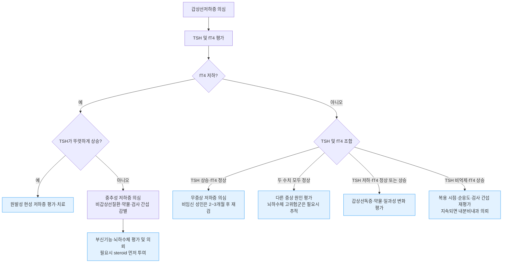
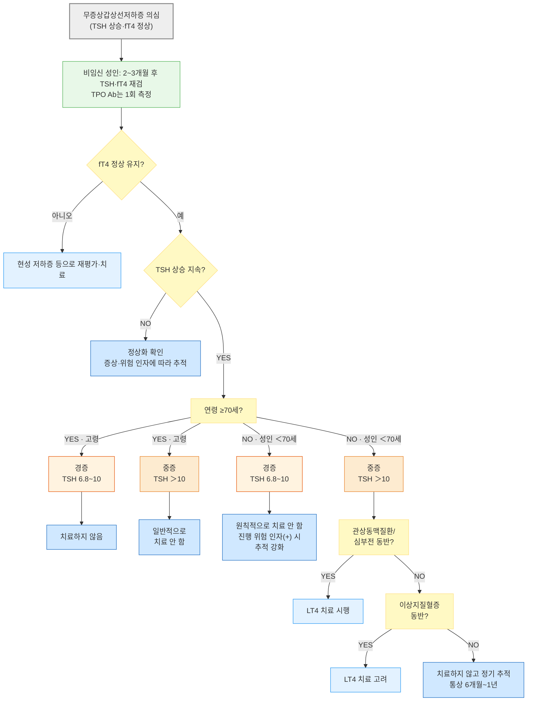

# 갑상선저하증 Hypothyroidism

## <mark style="color:green;">일반 사항</mark>

* 갑상선 호르몬의 생성·분비 부족 또는 시상하부-뇌하수체 축의 기능 이상으로 발생하는 대사 이상 상태
* 질환 범위 : 무증상(잠재성) 갑상선저하증부터 현성 갑상선저하증, 드물게 점액부종혼수(myxedema coma)까지 다양함. 무증상 저하증은 **TSH 상승·fT4 정상이라는 생화학적 분류**로, 증상이 전혀 없다는 뜻은 아님
* 유병률 : 현성/무증상 포함 여부, 연령·성별·요오드 섭취 및 검사 기준에 따라 크게 달라짐. 대부분은 원발성 갑상선저하증이며 여성·고령자에서 흔함
* 경과 : 일과성 갑상선염은 회복될 수 있으나 치료 중단 후 재발할 수 있음
  * 대부분의 원발성 저하증(특히 만성 자가면역성, 갑상선 절제/방사성 요오드 치료)은 영구적이며 평생 호르몬 보충이 필요

## <mark style="color:green;">원인</mark>

* **원발성 갑상선저하증 (Primary hypothyroidism)**
  * chronic autoimmune thyroiditis (Hashimoto thyroiditis) - 가장 흔함
  * 의인성 : 갑상선 절제, 방사성 요오드 치료
  * 요오드 결핍 또는 과잉
  * 약물 : 갑상선항진증 치료제(propylthiouracil, methimazole), lithium, amiodarone, tyrosine kinase inhibitor, interleukin-2, interferon-α, 면역관문억제제(파괴성 갑상선염 후 저하증; 뇌하수체염에 의한 중추성 저하증도 가능)
  * 침윤성 질환 : fibrous thyroiditis, hemochromatosis, sarcoidosis
  * 일부 thyroiditis : subacute granulomatous thyroiditis, silent lymphocytic thyroiditis, postpartum thyroiditis - 일시적인 thyrotoxic phase 후 hypothyroid phase가 이어질 수 있음
  * 선천성 갑상선 무형성, 호르몬 합성 결핍
* **중추성 갑상선저하증 (Central hypothyroidism) :** hypothalamic-pituitary 질환에 의한 TRH/TSH 결핍; 드묾

### <mark style="color:orange;">위험 인자</mark>

* 여성(특히 ＞60세, 임신, 분만 후 갑상선염 병력), 고령
* 자가면역 질환 병력/가족력 : 1형 당뇨병, 셀리악병, 자가면역 위축성 위염, multiple autoimmune endocrinopathies, RA
* 두경부 방사선 치료, 갑상선 기능 이상, 갑상선 수술 등의 과거력
* Down syndrome, Turner syndrome

## <mark style="color:green;">임상 양상</mark>

* 피로, 무기력, 우울, 두통, 감각 이상, 추위 불내성, 운동 시 호흡 곤란, 관절통/근육통
* 피부 건조, 얇은/부서지기 쉬운 손톱, 가늘어진 머리카락, 창백 또는 황색(carotenemia) 피부
* 체중 증가, 말초 부종, 부은 얼굴/눈꺼풀, 월경 과다, 변비, 근육 경련, 목소리 변화
* 서맥, 확장기 고혈압, 손목터널증후군, 레이노병, 심부 건반사 이완 반응 지연, 갑상선 비대(goiter)

### <mark style="color:$danger;">🚩 Red Flags</mark>

<mark style="color:$danger;">**즉각 조치**</mark>

* 의식 저하, 저체온, 저환기, 서맥·저혈압 등으로 중증 저하증이 의심됨. 저나트륨혈증·저혈당이 동반될 수 있으며 실제 혼수가 없어도 배제하지 않음  `점액부종혼수`
  * 즉시 응급실로 이송. 병원에서는 가능하면 cortisol 검체를 먼저 채취하되 치료를 지연하지 않고, 경험적 정맥 hydrocortisone을 갑상선호르몬보다 먼저 투여한 뒤 정맥 levothyroxine 및 호흡·순환·체온·전해질 지지 치료를 시행
* 갑상선호르몬 투여 중 새로 발생한 흉통, 불안정 협심증, 혈역학적으로 불안정한 부정맥  `급성 관상동맥증후군·중증 부정맥`
* 갑작스러운 심한 두통·시력/시야 이상, 저혈압·저혈당·의식 변화 등 급성 뇌하수체 질환 또는 부신 위기가 의심됨  `뇌하수체졸중·부신 위기`

<mark style="color:$warning;">**당일~수일 내 평가**</mark>

* 뇌하수체/시상하부 질환 시사 소견이나 다른 뇌하수체 호르몬 이상 동반 → 부신기능 평가와 함께 치료 순서 결정  `중추성 갑상선저하증`
* 임신부에서 새로 진단되었거나 기존 치료 중 조절 불량 → 지체 없이 검사·용량 검토  `임신 중 갑상선저하증`
* TSH가 현저히 높고 중증 증상 또는 장기 기능 이상이 동반됨  `중증 갑상선저하증`

<mark style="color:$info;">**조기 평가 및 추적**</mark>

* 안정형 관상동맥질환이 있어 갑상선호르몬 시작·증량 시 저용량 투여와 면밀한 관찰이 필요함  `심혈관질환 동반`
* 치료에도 TSH가 정상화되지 않거나 증상이 지속됨. 반복 증량 전에 복용법·상호작용·흡수 장애·진단을 재평가  `치료 반응 불충분`

## <mark style="color:green;">진단</mark>

### <mark style="color:orange;">갑상선 호르몬 검사</mark>

* 기본 : TSH, free T4. 원발성 저하증은 TSH 선별 후 이상 시 fT4 추가가 가능하나, 뇌하수체 질환·면역관문억제제 관련 뇌하수체염 등 중추성 원인이 의심되면 처음부터 둘 다 측정
* total T4는 임신·결합단백질 변화 등에 따라 선택적으로 활용. total/free T3는 저하증의 일상적 진단·추적 검사로 사용하지 않음
  * [ ] free 또는 total T3만으로는 갑상선저하증을 진단하지 않음 - 갑상선 기능 저하 초기에는 T4→T3 전환이 보상적으로 증가해 T3가 정상으로 유지될 수 있고(민감도↓), 반대로 비갑상선질환증후군(sick euthyroid) 등 갑상선이 정상인 상태에서도 T3만 낮아질 수 있어(특이도↓) 진단 지표로는 부적합
* 무증상 비임신 성인에 대한 일률적 선별은 이득·위해 근거가 불충분함(USPSTF). 임신 준비·임신·산후의 보편적 선별 역시 근거가 불충분하나, 갑상선질환/수술·방사선 치료력, 자가면역질환, 갑상선질환 가족력, 불임·반복 유산 등 위험 인자가 있으면 표적 검사를 시행함. USPSTF의 비임신 성인 권고를 임신부에게 직접 적용하지 않음

#### <mark style="color:$primary;">검사 결과에 영향을 주는 요인</mark>

<table><thead><tr><th width="240">검사 소견</th><th>영향 요인</th></tr></thead><tbody><tr><td>TSH↑</td><td>비-갑상선 질환의 회복기, 약물(dopamine 대항제, amiodarone)</td></tr><tr><td>TSH↓</td><td>비갑상선 질환, chorionic gonadotropin↑(임신 초기, molar pregnancy, choriocarcinoma), TSH 분비 억제 약물(고용량 dopamine 또는 agonist, dobutamine, steroid, octreotide)</td></tr><tr><td>s-TBG↓ (total T4↓ 유발)</td><td>androgen, danazol, steroid, nicotinic acid</td></tr><tr><td>s-TBG↑ (total T4↑ 유발)</td><td>estrogen, tamoxifen, raloxifene, methadone, 5-fluorouracil, clofibrate, heroin, mitotane</td></tr><tr><td>결합단백질·측정 영향 (total/fT4 불일치 가능)</td><td>고용량 salicylate·salsalate, 고용량 furosemide 등의 단백결합 영향. Heparin은 검체 내 유리지방산 증가로 fT4가 실제보다 높게 측정될 수 있음. 모든 NSAID에 같은 효과를 일반화하지 않음</td></tr><tr><td>TSH↓, free T4/T3↑ (위양성 가능)</td><td>biotin(비오틴) 복용 - 면역측정법(immunoassay) 간섭; 복용량·마지막 복용 시각·신기능과 검사 플랫폼에 따라 간섭 정도가 달라짐. 검사 전 복용 사실을 알림. 씬지로이드 국내 허가사항(2025년 변경)은 가능하면 채혈 전 최소 2일간 비오틴 복용을 피하도록 권고함. 5~10 ㎎/d에서도 간섭 가능하며, 고용량·신기능 저하·검사법에 따라 더 긴 중단이 필요할 수 있어 검사실과 결정함.</td></tr></tbody></table>

* TBG는 혈중 T4의 약 70\~75%가 결합하는 주된 운반단백질로, 위 표의 약물 외에 질환·생리 상태에 의해서도 변동할 수 있음 (✽ transthyretin·albumin도 호르몬을 운반하며, albumin의 유전적 결합 이상 등은 total T4 및 일부 fT4 측정값을 크게 변화시킬 수 있음)
  * TBG를 저하시키는 상황(합성 감소) : 만성 간질환, 영양 결핍
  * TBG를 상승시키는 상황 : 임신·estrogen 노출(합성 증가), 급성 간염(일시적 분비 증가)
  * 신증후군은 TBG 합성이 줄어드는 것이 아니라 소변으로 소실되는 기전으로, 위 두 경우와 달리 오히려 요구량을 늘리는 방향으로 작용함(☞ 아래 "T4 요구량이 증가하는 상황")


**TSH의 계절적 변이** : TSH는 계절에 따라 변동하므로(1\~2월에 최고, 6\~8월에 최저), TSH가 약간 상승하면서 fT4가 정상 범위이면 바로 갑상선저하증으로 진단하여 약물을 처방하기보다 2\~3개월 후 추적 검사를 고려할 수 있음\
✽비순응도, 비갑상선질환 회복기 등 TSH 상승의 다른 원인을 먼저 배제한 경우에 한하여 참고 - 계절 요인으로 쉽게 해석하지 않도록 주의


### <mark style="color:orange;">기타 검사</mark>

* anti-thyroperoxidase Ab(TPO Ab) : 자가면역성 원인 확인 및 무증상 갑상선저하증의 진행 위험 평가에 1회 측정 고려. 반복 검사는 불필요
  * anti-thyroglobulin Ab(TgAb) : TPO Ab 음성이지만 자가면역 갑상선염이 강하게 의심될 때 선택적으로 고려
  * [ ] TSH receptor Ab(TRAb)는 일반적인 저하증 원인 평가에는 불필요. 다만 Graves병 치료 후 저하증인 임신부는 태아 위험 평가 목적으로 측정할 수 있음
* 갑상선 초음파 : 기능 이상이나 TPO Ab 양성만으로 일률적으로 시행하지 않음. 촉지 결절·갑상선종, 비대칭, 압박 증상, 의심 경부 림프절이 있으면 고려. 중추성 원인 의심 시 뇌하수체 MRI는 별도로 시행
* 동반 대사 이상 검사 고려 : 저혈당, 빈혈, Na↓, 이상지질혈증

### <mark style="color:orange;">감별</mark>

* TSH가 정상이지만 증상이 지속될 때의 감별 : 빈혈(Vit B12 또는 iron 결핍), 자가면역 질환, 신질환/간질환, 폐경기, 우울/불안, 감염

#### <mark style="color:$primary;">중추성 갑상선저하증</mark>

* fT4 저하에 비해 TSH가 부적절하게 낮거나 정상이며, 드물게 약간 상승할 수 있음. TSH만으로 배제하지 않으며, 비갑상선질환·약물·검사 간섭을 배제하고 비응급 상황에서는 반복 검사로 확인
* 두통·시야 결손 등 시상하부-뇌하수체 질환 시사 소견이나 다른 뇌하수체 호르몬 이상이 동반되면 의심
* → 뇌하수체 MRI 및 타 뇌하수체 축(ACTH/cortisol, LH/FSH, prolactin, GH/IGF-1) 평가
* 치료 중에는 TSH가 용량 조절 지표로 부적절하므로 fT4를 사용하며, 임상 상태를 함께 보아 대체로 검사실 참고구간의 중간 이상(중간~상부)을 목표로 개별화


**부신부전 동반 여부를 반드시 확인** : 뇌하수체·시상하부 질환에 의한 중추성 갑상선저하증에서는 이차성 부신피질기능저하증이 동반될 수 있음. 부신부전을 배제하거나 먼저 교정하지 않고 levothyroxine을 단독으로 시작하면 대사율이 증가하면서 부신 위기(adrenal crisis)를 유발할 수 있음 → 부신부전이 의심되거나 배제되지 않았으면 glucocorticoid를 levothyroxine보다 먼저 투여; 부신부전 평가는 오전 8\~9시 cortisol 측정을 우선 시행하고, 애매한 경우 ACTH 자극검사(cosyntropin test)로 확인


***



<p align="center"><strong>갑상선저하증 진단 알고리듬</strong></p>

_✽비임신 성인 중심. 임신·소아·급성 중증 질환은 별도 기준을 적용함. 뇌하수체 질환이 의심되면 TSH가 약간 높아도 중추성 저하증을 고려함. TSH 참고구간은 검사실·측정법·연령을 우선 적용하며, 국내 6.8 mIU/L는 특정 측정법에 근거한 기준임._

***

## <mark style="background-color:$warning;">Management</mark>

### <mark style="color:orange;">치료 방침</mark>

* 치료 목표 : TSH를 검사실 참고범위(reference range)로 유지 (✽ 일률적으로 특정 수치를 목표로 고정하기보다 참고치 범위를 기준으로 함)
  * 성인에서의 일반적인 목표치 : 대략 0.4\~4.0 mIU/L (검사기관·측정법에 따라 다를 수 있음); 이 titration 목표(0.4\~4.0 mIU/L)는 이미 약물 치료 중인 현성 갑상선저하증 환자의 적정 조절 기준이며, 한국인 진단 상한(6.8 mIU/L)과는 별개의 개념임 - 미치료 상태에서 무증상 갑상선저하증을 "진단"하는 기준과, 이미 치료 중인 환자의 TSH를 "조절"하는 목표는 다를 수 있음
  * 고령에서는 TSH가 생리적으로 상승할 수 있으므로 연령별 참고구간, 심혈관·골 건강 및 증상을 함께 고려해 목표를 개별화함. 약 7.5 mIU/L은 일부 ≥80세 인구의 연령별 상한으로 제시된 값이지 모든 고령 환자의 일률적 치료 목표는 아님

## <mark style="color:green;">비-약물 치료 및 예방</mark>

* 정상적인 균형 식사를 유지하며, 하시모토 갑상선염에 일률적인 저요오드 식이를 권하지 않음. 다시마 농축액·해조류 추출 보충제 등 과도한 요오드 섭취는 피함
* 요오드 결핍 위험은 식사·지역·병력을 종합해 판단. 단일 소변 요오드 수치만으로 개인의 만성 결핍을 확진하지 않음. 요오드·셀레늄 보충제를 갑상선저하증의 일반 치료로 사용하지 않음
* 복용 시간, 음식·보충제·병용약, 보관 상태를 점검. 정제는 제품의 차광·밀폐 보관 조건을 지키고 고온·습기를 피함
* 갑상선 기능이 정상인 사람의 체중 감량이나 피로 개선 목적으로 갑상선호르몬을 투여하지 않음

## <mark style="color:green;">약물 치료</mark>

* 1차 선택 : levothyroxine (T4)
  * liothyronine(T3) : 일상적인 대체제가 아니며, 엄격히 선별한 환자에서만 전문의 감독 아래 제한적 병용 고려

#### <mark style="color:$primary;">Levothyroxine (T4)</mark>

<mark style="color:cyan;">**용법**</mark>

* 용량 : 연령·심장 질환·저하증의 중증도·잔여 갑상선 기능에 따라 결정. 아래는 성인 임상 지침에 따른 용량. 국내 씬지로이드 허가 초회 용량은 25~100 ㎍/d이며, 유지량은 TFT와 임상 반응으로 개별화
  * ＜60세 & 심장 질환(-) : 1.6 ㎍/㎏/d (약 1.5\~1.8 ㎍/㎏/d), 통상 50\~100 ㎍ qd로 시작 <mark style="color:blue;">\[씬지로이드]</mark>
    * [ ] 체중을 기준으로 용량을 계산하되 비만 환자에서는 실제 체중보다 이상체중 또는 제지방량을 기준으로 과량 투여를 피하고, 시판 정제 단위에 맞춰 반올림
  * 고령·노쇠 또는 장기간 중증 저하증 : 보통 25\~50 ㎍ qd 이하로 시작해 개별화. 나이 60세만으로 모든 환자에게 동일 저용량을 적용하지 않음
  * **관상동맥질환 동반 : 12.5\~25 ㎍ qd로 시작**, 흉통·부정맥을 관찰하며 서서히 조절. 국내 허가상 중증 협심증·급성 심근경색 등 금기는 별도로 확인
  * TSH와 증상을 기준으로 보통 6주경(4\~8주)마다 12.5\~25 ㎍/d씩 증량 또는 감량. 심혈관질환·노쇠 환자는 더 천천히 조절
  * 치료 중단 후 6주 이내 재개할 때는 심장 문제·체중 감소가 없으면 이전 용량으로 재개
* 공복 및 일정한 시간에 투여 : 예) 아침 식전 30\~60분 또는 취침 전(마지막 식사 후 최소 3시간)
  * [ ] 아침과 취침 전 모두 사용할 수 있으나 연구 결과는 일정하지 않음. 특정 시간대의 우월성보다 공복 조건과 일관된 복용·순응도가 중요함
* 칼슘·철분·알루미늄/마그네슘 제산제, sucralfate, 담즙산 결합수지 등 직접 결합해 흡수를 방해하는 약제와는 4시간 이상 분리; 커피는 약제 복용 후 **최소 1시간** 지나 음용
* 제조사마다 약효 차이가 있을 수 있으므로 가급적 동일 제조사·동일 제품 유지; 제품 변경 시 6주 후 TSH 재검
* PPI 장기 복용, 위축성 위염, 위 절제/우회술 등 흡수 장애가 확인되거나 의심되는 환자에서는 액상(liquid) 또는 연질캡슐(soft-gel) 제형이 위산도 변화에 따른 정제 용해 문제를 줄여 흡수에 도움이 될 수 있음. 해외 제형 자료이며 국내 처방례는 정제를 기준으로 함
* T4 및 T3는 혈중에서 TBG 등 결합단백질과 결합한 상태로 순환하므로 TBG 농도 변화는 주로 total T4/T3에 영향을 줌. TBG 변화만으로 기계적으로 증감하지 않고 TSH(중추성 갑상선저하증은 fT4)와 임상 상태로 조절
* 고령·체중 감소 때는 제지방량과 T4 대사량 감소 등에 따라 요구량이 줄 수 있으므로 과량 투여를 경계
* **국내 허가상 투여 금기(씬지로이드)** : 급성 심근경색·급성 심근염·급성 전층 심장염, 중증 협심증, 빈맥 동반 심부전, 심근염, 갑상선기능항진증·갑상선중독증, 치료 전 부신기능부전, 성분 과민증 및 유당 관련 특정 유전성 장애
  * 안정형 관상동맥질환·고혈압·진구성 심근경색 등은 신중 투여 대상이며, 위 금기 상태와 구분
* 추가 상호작용 : warfarin 사용자는 갑상선 기능 교정·용량 변경 시 INR을, 당뇨병 환자는 혈당을 관찰하고 필요시 병용약 용량 조절. Digoxin 사용자는 농도와 임상 반응 변화에 유의

<mark style="color:cyan;">**T4 요구량이 증가하는 상황**</mark>

* 임신, 체중 증가, 신증후군, 지속되는 갑상선 이상, 식이 섬유 섭취 증가, 위장관 질환(흡수 감소)
* 흡수 감소 : 두유, 셀리악병, IBD, 유당 불내증, H. pylori 감염, 위축성 위염, 위산 억제제(PPI·H2 차단제), sucralfate, Al/Mg/Ca/Fe 제제, 종합 영양제, cholestyramine, colestipol, raloxifene, sevelamer, orlistat. PPI·H2 차단제는 위산 억제가 기전이므로 단순히 4시간 간격을 두는 것만으로 해결되지 않을 수 있음
* 일부 환자에서 요구량 증가가 보고된 약물 : sertraline — TSH를 추적해 개별 조절
* s-TBG 증가 약제 : estrogen, tamoxifen, raloxifene, methadone, 5-fluorouracil, clofibrate, heroin, mitotane
* T4 clearance 증가 : phenytoin, carbamazepine, rifampin, phenobarbital

<mark style="color:cyan;">**T4 요구량이 감소하는 상황**</mark>

* 임신 종료, 체중 감소·고령화, 경구 estrogen 중단 등에서 요구량 감소 가능. 폐경·난소 절제만을 이유로 일률적으로 감량하지 않음
* 만성 간질환·영양 결핍의 total T4 저하를 곧바로 과량 대체로 판단하지 않음
* s-TBG 저하 약제 : androgen, danazol, nicotinic acid
* Steroid : TBG를 낮추는 동시에 T4→T3 전환도 억제하는 상반된 기전을 함께 가져 순효과(net effect)가 개인차를 보임; 임의로 감량하지 않고 TSH로 판단

#### <mark style="color:$primary;">Triiodothyronine (T3)</mark>

* Levothyroxine에 비해 작용이 강하고 반감기가 짧아 용량 조절이 어려움
* 일상적인 1차 치료 또는 T3 단독요법은 권고하지 않음. levothyroxine 부형제 불내성이 의심되면 먼저 다른 제조사·제형을 시도하고, 예외적 대안은 내분비내과 전문의와 결정
* 다수의 RCT와 메타분석에서 T4/T3 병용이 T4 단독보다 기분·삶의 질·인지기능 면에서 우월하다는 일관된 근거는 확인되지 않음 - 다만 개별 환자 수준에서 병용요법에 반응하는 경우가 보고되어, 아래 조건을 모두 만족하는 제한된 경우에 한해 전문의 감독 하 시도를 고려할 수 있음

**T3 병용 고려 전 확인 순서**

1. 치료 전 기록·갑상선 수술/방사성요오드 치료력 등으로 원발성 갑상선저하증의 객관적 근거를 확인함. BTA/SfE 2023은 T3 고려 전 확인할 근거로 과거 TSH ≥10 mIU/L 및/또는 fT4 저하를 제시하지만, TSH ≥10만으로 fT4 정상인 환자를 현성 저하증으로 재분류하지 않음. 진단이 불확실한 비임신 환자에서만 내분비내과 판단하에 LT4 중단 후 약 6주째 재검을 고려; 임신·임신 준비, 갑상선전절제/방사성요오드 치료 후 명확한 영구 저하증에는 이 중단 시험을 적용하지 않음 <mark style="color:$info;">\[BTA/SfE 2023]</mark>
2. 지속 증상을 설명할 수 있는 동반 질환을 배제 - 갑상선저하증 증상은 비특이적이며 정상 갑상선 기능에서도 흔함
3. levothyroxine 용량을 먼저 최적화 - TSH를 참고치 하한부(0.3\~2.0 mIU/L)로 3\~6개월간 유지한 후 반응을 평가; 일부에서 TSH 0.1\~0.3 mIU/L의 짧은 관찰을 고려할 수 있으나, 고령·심혈관질환·골다공증 위험 환자에서는 피하고 TSH＜0.1 mIU/L는 허용하지 않음


**동반질환 배제를 위한 권장 검사 (BTA/SfE 2023)** : FBC, 전해질/신기능, 간기능, calcium, HbA1c, ferritin, B12, vitamin D, transglutaminase Ab(셀리악병); 체중 감소나 부신부전이 의심되면 오전 9시 cortisol; Epworth 척도로 수면무호흡 선별, HADS 등으로 우울 선별


* T3 병용을 고려할 수 있는 조건(모두 충족) : ① 확실한 원발성 갑상선저하증 진단, ② levothyroxine 단독 투여에 증상 지속, ③ levothyroxine이 충분한 기간·용량·TSH 반응으로 적절히 투여됨, ④ 증상을 설명할 다른 동반 질환이 배제됨, ⑤ 내분비내과 전문의가 시작·감독할 의향이 있음
* 임신·임신 준비, 부정맥 또는 확립된 심혈관질환에서는 병용을 시작하지 않음. 국내 테트로닌 허가상 관상동맥 병변증·심대상부전증 등은 투여 금기
* 병용 시작 방법 : liothyronine을 현재 levothyroxine 용량의 약 1/17로 대체 투입하고, levothyroxine 용량은 liothyronine 용량의 3배만큼 감량(예 : 기존 levothyroxine 100 ㎍/d → levothyroxine 85 ㎍/d + liothyronine 5 ㎍/d)
* TSH가 참고치 내에서 유지된 상태로 최소 3\~6개월간 병용 후 반응을 평가하며, 증상 호전이 없으면 levothyroxine 단독으로 복귀
* 병용 전후 동일한 증상/삶의 질 평가 도구로 이득을 확인. 모니터링은 원칙적으로 TSH를 중심으로 하되, TSH가 낮거나 억제된 경우 fT3/fT4를 추가 측정 - liothyronine 복용 사실을 검사 의뢰서에 기재
* 짧은 반감기와 농도 변동 때문에 가능하면 1일 2회 분할 복용을 고려(예 : 아침·오후). 국내 liothyronine 5 ㎍ 정제는 <mark style="color:blue;">\[테트로닌]</mark> 분할 정확도가 확보되지 않으면 저용량(예 : 5 ㎍/d)에서 1일 1회 사용 여부를 전문의가 결정 - 처방 시 반감기·혈중 농도 변동을 환자에게 설명하고, 용량이 늘어나는 경우(10 ㎍/d 이상) bid 분할 투여를 우선 고려
* 감량/중단 시 : 일반적인 전환에서는 BTA/SfE 2023의 근삿값에 따라 liothyronine 5 ㎍을 levothyroxine 약 15 ㎍(1:3 비율)로 대체; 임신 전 전환은 아래 ATA 2026의 별도 근삿값을 참고하고 검사 결과로 조정함; 용량 변경 6\~8주 후 TSH 재검; 안정적으로 병용 중이며 TSH가 정상인 환자를 일률적으로 감량할 필요는 없음
* DIO2, MCT10 등 유전자 다형성이 T4/T3 병용요법 반응과 관련될 수 있다는 소규모 연구가 있으나, 근거가 충분하지 않아 치료 반응 예측을 위한 유전자 검사는 현재 임상에서 권고되지 않음


**Liothyronine 장기 사용의 안전성** : 과량 투여로 지속적인 TSH 억제가 발생하면 부정맥과 골소실 위험이 증가할 수 있으므로 TSH를 참고범위 내로 유지함. 국내 관찰연구에서는 LT3 사용과 심부전·뇌졸중 위험 증가의 연관성이 보고되었으나, 2025년 체계적 문헌고찰·메타분석에서는 심방세동·심부전·뇌졸중 위험 증가가 통계적으로 명확하지 않았음. 관찰연구의 교란과 일부 결과의 넓은 신뢰구간 때문에 인과관계나 장기 안전성이 확정된 것은 아님. TSH·심박수·부정맥을 추적하고, 폐경 후 여성 등 골다공증 고위험군에서는 골밀도 평가를 고려함 <mark style="color:$info;">\[Yi 2022; Bahl 2025]</mark>


### <mark style="color:orange;">모니터링</mark>

* 과량 대체로 TSH가 지속 억제되면 심방세동·골소실 위험이 증가하므로, 특히 고령·폐경 후 여성에서 주의
* 치료 경과 : 치료 시작 1\~2주 내 T4의 유의미한 증가, 2\~3주 후 증상 호전, 6주 후 TSH 안정
  * TSH가 매우 높았거나 높은 상태로 장기간 지속되었던 환자는 TSH 정상화에 6개월까지 소요될 수 있음
* 검사 일정 : 원발성 갑상선저하증은 TSH를 중심으로 진단 초기 및 용량 변경 6(±2)주 후 검사 → 안정화 전 3개월마다 검사 → 2회 연속 참고치 내 비슷한 수준이면 6개월 후 및 매년. fT4는 진단 초기, 결과 불일치, 임신, 중추성 갑상선저하증 등에서 함께 측정
* 반복 증량 전 복용법·상호작용·검사 간섭·흡수 장애를 재평가. 비임신 성인에서 잔여 갑상선이 있는데 1.5\~1.7 ㎍/㎏/d 초과, 갑상선절제 후 1.8\~2.0 ㎍/㎏/d 초과가 필요하면 복용 순응도 등을 적극 점검. 원인 불명 시 전문의와 LT4 흡수검사 고려; 단순히 2\~3회 증량했다는 사실만으로 치료 저항성을 판단하지 않음 <mark style="color:$info;">[ETA 2025]</mark>
* fT4는 복용 직후 일시적으로 상승하므로 가능하면 아침 복용 전에 채혈하고, 채혈·복용 시각을 일정하게 유지. 특히 중추성 저하증은 복용 전 또는 복용 후 최소 4시간 경과 시 채혈
* 제제를 변경한 경우에는 약 6주 후 TSH를 다시 확인
* TSH 상승 + fT4 정상/상승 : 불규칙 복용·검사 직전 보충 복용, 최근 용량 변경 후 TSH 반응 지연, 채혈 시점·검사 간섭 등을 먼저 점검. 지속적인 불일치에서는 다른 검사법 재검 및 드문 갑상선호르몬저항증·TSH 분비 종양 등을 전문의와 감별
* LT4 용량은 TSH를 기준으로 조절하며, fT3를 치료 목표로 삼아 용량을 조절하지 않음 - fT3를 low-normal range로 맞추기 위해 증량하는 것은 TSH 억제(과다 치료) 위험을 높이므로 권고되지 않음
* TSH가 성공적으로 조절됨에도 저하 증상이 지속되는 경우 : 'T3 병용 고려 전 확인 순서'의 '진단 재확인 → 동반 질환 배제 → levothyroxine 용량 최적화'를 실행하고, 필요시 의뢰
* 갑자기 조절되지 않는 원인 : 복용 순응도 저하, (흡수를 방해하는) 음식과 함께 복용, T4 요구량 증가 상황 발생(예 : 새로운 약물 복용 시작)

***

## ■ 임신/수유 중 관리

#### <mark style="color:$primary;">임신 준비(preconception) 단계</mark>

* 목표 TSH : 0.5\~2.5 mIU/L(참고치 내에서 안전역 확보 목적) <mark style="color:$info;">\[ATA 2026]</mark>
* Liothyronine·천연 갑상선 추출물(desiccated thyroid) 복용 중이면 임신 시도 전 LT4 단독으로 전환 - 태아 뇌는 모체에서 오는 T4에 의존하므로 T3 우세 상태는 태아 갑상선호르몬 공급에 불리할 수 있음
  * 임신 전 LT4 단독 전환 시 ATA 2026의 근삿값 : liothyronine 5 ㎍ ≈ LT4 20 ㎍(1:4). 일반 병용 감량 시 BTA/SfE 2023의 1:3과 출처·적용 상황이 다르므로 임의로 혼용하지 않고, 전환 후 갑상선기능으로 적정함

#### <mark style="color:$primary;">임신 중 관리</mark>

* 임신 중 새로 확인된 현성 갑상선저하증(TSH 상승 + fT4 저하) : LT4 치료가 원칙임. 대체로 1.5\~1.7 ㎍/㎏/d에 임신에 따른 요구량 증가(약 20\~30%)를 반영해 개별화함
  * 경미한 현성 저하증(TSH가 임신 참고치 상한 초과~＜6 mIU/L)이면 환자 선호와 임상 상태에 따라 즉시 치료 또는 1\~3주 내 확인 검사를 공동 결정할 수 있음. 현성 저하증에서 TSH ≥6 mIU/L이면 치료함. 이 6 mIU/L 기준을 fT4가 정상인 무증상 저하증에 그대로 적용하지 않음 <mark style="color:$info;">\[ATA 2026]</mark>
* 기존 **현성 저하증**으로 LT4 복용 중 : 임신 확인 즉시 통상 20\~30% 증량(예 : 평소 1일 용량을 주 2회 추가하면 약 29%) 후 검사로 조절. 12주 약 25%·20주 약 50%는 **임신 전 대비 누적 증가량**이며 매 시점 추가 증량 지시가 아님
  * 임신 전 **무증상 저하증**으로 저용량 복용 중인 경우에는 같은 일괄 증량을 적용하지 않고 조기 TFT에 따라 개별 조절 <mark style="color:$info;">[ATA 2026]</mark>
  * 임신 전 TSH＜1.5 mIU/L, 임신 전 LT4 용량 ＞100 ㎍/d, 또는 주 2정 추가 방식으로 일괄 증량한 경우 과잉치료 위험이 다소 높으므로 증량 폭을 개별화
* 모니터링(TSH, free/total T4) : 임신 전반기 4주마다 + 임신 3분기 중 최소 1회(약 30주 전후) + 용량 조정 후 4\~6주 후 + 분만 6주 후
* 진단 참고구간과 치료 목표
  * 진단·검사 해석 : 검사실·지역의 임신 분기별(trimester-specific) TSH 참고구간을 최우선 사용
    * 분기별 참고구간이 없으면 1분기에 0.1\~4.0 mIU/L를 대안으로 사용할 수 있음. 해당 검사실의 비임신 상한이 ＞4.5 mIU/L이면 임신 전반기에는 비임신 상한에서 약 0.5 mIU/L를 낮춰 적용하고, 이후 임신 후반기로 갈수록 비임신 범위로 회복하는 방식도 허용됨
  * LT4 치료 중 목표(기존 복용자와 임신 중 신규 치료자) : TSH를 참고구간 내에서 ＜2.5 mIU/L로 유지하는 것을 목표로 고려함. 위의 0.1~4.0 mIU/L는 진단을 위한 대안 참고구간으로, 치료 목표와 구분함
  * fT4는 검사법·임신 분기별 참고구간을 사용. 적절한 참고구간이 없어 해석이 어려우면 보정 total T4 등을 활용
  * total T4 : estrogen에 의한 TBG 증가로 자연히 상승 - 임신 7주부터 주당 5%씩 증가하여 16주경 최대 50% 증가로 정체(plateau)하므로, 비임신 **참고구간의 하한·상한 모두**에 임신 주수에 따른 보정을 적용해 해석(16주 이후 약 1.5배; 비임신 참고치를 그대로 적용하지 않음)
* 임신 중에는 liothyronine을 사용하지 않음
* TPOAb/TgAb 양성만으로 별도 태아 갑상선 감시를 시행하지 않음. **과거 Graves병을 수술·방사성요오드로 치료해 현재 저하증인 임신부는 예외**로, 잔존 TRAb/TSI에 따른 태아 위험을 평가함(☞ 갑상선항진증 챕터)

#### <mark style="color:$primary;">임신 중 무증상 갑상선저하증</mark>


**국내 권고와 ATA 2026의 차이** : 대한갑상선학회 2023은 임신 초기 TSH 상한 4.0 mIU/L를 제안하며, TSH가 4.0 mIU/L를 초과하고 10 이하이며 fT4가 정상인 경우, TPO Ab 양성이면 LT4 치료를 권고하고 음성이어도 고려함. TSH ＞10이면 fT4와 무관하게 현성 저하증 범주로 치료함. 아래 ATA 2026의 임신 주수별 접근과 구분하며, 현저한 TSH 상승을 단순 관찰 대상으로 처리하지 않음.


* ATA 2026 : 임신 1분기에 무증상 저하증이 의심되어 치료를 유보하면 3주 이내 TSH·fT4 재검. 지속되는 경우 TSH, TPO Ab, 과거력 및 환자 선호를 함께 고려해 LT4 시작을 공동 결정
* 임신 1분기 이후 처음 발견된 경미한 무증상 저하증은 일반적으로 새로 LT4를 시작하지 않음. 다만 분기 경계 직후 발견되거나 TSH가 상승하는 경우에는 임신 주수·검사 추세를 반영해 개별 판단함. TSH 상승과 fT4 저하가 함께 확인되면 현성 저하증으로 재분류해 치료하며, TSH가 현저히 높으면 신속히 재평가·협진함. TSH 정상 + fT4 단독 저하는 고립성 저티록신혈증으로 별도 평가하며 LT4를 일률적으로 투여하지 않음 <mark style="color:$info;">\[ATA 2026]</mark>
* 치료를 시작한다면 TSH·체중·임신 주수에 따라 보통 25\~75 ㎍/d 범위에서 개별화하고 4주 간격으로 조절
* 임신 중 처음 시작한 경증 환자는 분만 직후 감량 또는 중단을 검토하고 약 6주 후 TSH 재검. 특히 진단 시 경미했고(TSH ＜6 mIU/L) 분만 시 LT4 ≤75 ㎍/d인 경우 고려

<mark style="color:cyan;">**수유**</mark>

* 수유 중에도 levothyroxine 투여를 중단하지 않음; 분만 후에는 통상 임신 전 용량으로 감량하고 6주 후 TSH 재평가(단, 임신 전 용량이 최적이 아니었거나 임신 중 체중이 많이 증가한 경우 임신 전 용량보다 높은 용량이 필요할 수 있음)

<mark style="color:cyan;">**영아 모니터링**</mark>

* Levothyroxine은 생리적 대체 호르몬으로 모유 이행량이 적어 수유를 위한 별도 용량 상한이나 영아 갑상선기능 정기 검사가 필요하지 않음. 통상적인 저용량 MMI/PTU 수유에서도 영아 TFT를 일률적으로 시행하지 않고 성장·발달을 관찰함. 태내 TRAb·항갑상선제 노출에 따른 신생아 추적은 수유 중 약물 노출과 구분함

#### <mark style="color:$primary;">Euthyroid TPOAb 양성 여성 - LT4 치료 대상 아님</mark>

* TSH·fT4가 모두 정상인 TPOAb 양성 여성(임신 준비 중, 불임/습관유산 병력, 임신 중 모두 포함)에게는 TSH 수치나 유산력과 무관하게 LT4 치료를 시작하지 않음 - LT4 투여가 산과적 예후를 개선하지 못함
  * [ ] 갑상선 기능이 정상인데 "TPOAb 양성 + TSH＞2.5"만을 근거로 LT4를 시작하지 않음; TPOAb 양성 자체는 유산(절대 위험차 약 +2\~8%)·조산(약 +2\~3%)과 연관되나, 이 위험은 LT4로 교정되지 않음
* 임신 전 또는 임신 중 저하증으로 진행할 위험이 높으므로, 임신 준비 중에는 3\~6개월마다, 임신 중에는 통상 스케줄대로 TSH를 추적
* 셀레늄 보충, 글루코코르티코이드, 정맥 면역글로불린 등도 근거 부족으로 권장하지 않음

### <mark style="color:orange;">Postpartum thyroiditis (산후 갑상선염)</mark>

* 자연 경과(3상성, triphasic) : 분만 후 1\~6개월경 파괴성 갑상선기능항진기 → 4\~8개월경 갑상선기능저하기 → 이후 수개월에 걸쳐 자연 회복 - 모든 상을 거치지 않고 한 상만 나타나는 경우도 흔함
* 위험 인자 : 산후갑상선염 과거력(재발 위험 약 70%), TPOAb 양성(가장 강력한 인자, 위험 33\~50%까지 상승), 자가면역질환 개인력/가족력
* **갑상선기능항진기** : 증상이 있으면 propranolol 등 베타차단제 최저 유효 용량(수유 중 안전) 사용; 호르몬 과다생성이 아닌 파괴성 기전이므로 항갑상선제(ATD)는 사용하지 않음
* **갑상선기능저하기** - LT4 치료 : 증상이 있거나, 6개월 이내 임신을 계획 중인 경우에 고려. 수유 여부도 증상·저하 정도·환자 선호와 함께 판단(수유 자체에 대한 치료 이득 근거는 제한적). 미치료 시 4\~8주마다 재검하며, 임신 중이 아니고 곧 임신할 계획도 없을 때 분만 후 약 1년 시점에 감량/중단 시험을 고려. 중단 후 약 6주에 TFT 재검
* 초기 정상화 후에도 장기적으로 10\~50%가 결국 영구 갑상선저하증으로 이행할 수 있음(위험 인자 : 다분만력, 초음파상 저에코, 초기 저하증 중증도, TPOAb 양성, 고령, 유산력) - 정상화되었더라도 1년 후 재검 또는 저하 증상 발생 시 재검 권고
* Graves병 재발과의 감별 : 발병 시기(산후갑상선염 1\~6개월 vs Graves 3\~12개월), TRAb/TSI(음성 vs 양성 - 가장 확실한 감별점), 갑상선안병증(없음 vs 있을 수 있음), TT3/TT4 비율(각각 ng/dL·㎍/dL 단위 사용 시 전형적으로 ＜20 vs ＞20; 다른 단위로는 같은 기준을 적용하지 않음) - 감별이 애매하면 보존적 경과 관찰 우선, 필요시 의뢰

***

## ■ 무증상 갑상선저하증 Subclinical Hypothyroidism

* TSH가 상승하고 fT4는 정상인 생화학적 상태. 증상이 있더라도 이 분류에 해당할 수 있으며, 증상 유무만으로 현성 저하증과 구분하지 않음
* 소아·청소년, 임신부, 임신을 시도하는 여성은 이 섹션의 적용 대상에서 제외 - 별도의 임신 중 갑상선질환 지침을 따름
* 유병률 : 국외 4\~20%; 국내는 측정법·연령·지역에 따라 0.2\~17.3%로 보고(40\~70세 지역사회 코호트 11.7%, 65세 이상 코호트 17.3%); 여성·고령에서 유병률 증가
* 선별 검사 : 무증상 일반 성인의 보편적 선별을 뒷받침하는 근거는 부족함. 증상·위험 인자에 따른 검사는 별도로 판단


**국내 진단 기준 및 중증도 분류 \[대한갑상선학회 무증상갑상선기능저하증 진료 권고안 2023]**\
2013\~2015년 국민건강영양조사 기준 집단(갑상선질환·가족력 없음, 갑상선자가항체 음성, 비임신) 분석에 근거하여 한국인 TSH 참고치를 0.6\~6.8 mIU/L로 제시 - 국제적으로 흔히 쓰이는 4.0\~5.0 mIU/L 상한보다 높음(높은 요오드 섭취와 연관)\
✽**6.8 및 10.0은 Roche 측정법에 근거한 값**으로 모든 장비에 그대로 적용하지 않음. 기관에서 검증한 시약별 참고·의사결정 구간을 우선 적용(예 : Roche 6.8에 대응하는 Abbott 추정값은 약 5.2 mIU/L)\
✽해당 기준에서 경증(mild) - TSH 6.8\~10.0 mIU/L; 중증(severe) - TSH ＞10.0 mIU/L\
✽연령 구분 : 성인(＜70세) / 고령(≥70세) - 연령에 따라 LT4 치료의 이득·위해가 다르므로 구분하여 접근\
✽해외 문헌(TSH 상한 4.0\~5.0 기준)을 인용·비교할 때는 국내 기준과 컷오프가 다름을 반드시 감안 - 동일한 "무증상 갑상선저하증"이라도 포함되는 TSH 범위가 다를 수 있음


### <mark style="color:orange;">원인</mark>

* 갑상선 질환 : chronic autoimmune thyroiditis(하시모토 갑상선염, 가장 흔함), 침윤성 갑상선염(amyloidosis, sarcoidosis, primary thyroid lymphoma, Riedel's thyroiditis), 일과성 갑상선염(아급성, 무통성, 산후 갑상선염), 현성 갑상선저하증 환자의 불충분한 LT4 치료(용량 부족, 순응도 저하, 흡수 감소, 대사 증가), 갑상선 무형성증
* 갑상선 외 상황 : 비갑상선질환증후군(sick euthyroid) 회복기, 부신피질저하, 만성신부전, 고도비만(BMI ＞40) 등은 일시적 TSH 상승 또는 유사 검사 소견을 보일 수 있어 지속 여부와 임상 맥락을 재평가
* 약물 : 요오드 조영제, amiodarone, lithium, tyrosine kinase inhibitor, interferon-α, 면역관문억제제(ipilimumab, pembrolizumab 등)
* 요오드 섭취의 결핍 또는 과잉(국내는 고요오드 섭취 지역에 해당)
* 기타 : 고령, 계절/일중 변동, 측정 방법에 따른 차이, TSH 측정 방해 요인(이종친화항체, 류마티스인자, 비오틴, macro-TSH, TSH 아형 이상). TSH와 fT4가 생리적으로 맞지 않으면 중추성 질환·갑상선호르몬저항증·측정 간섭을 별도 감별

### <mark style="color:orange;">경과 및 현성 갑상선저하증으로의 진행</mark>

* 비임신 성인에서 첫 발견 시 보통 2\~3개월 후 TSH·fT4를 재검하여 지속 여부를 확인(일과성 상승 배제); 진행 예측을 위해 TPO Ab를 함께 측정(반복 측정은 불필요)
* 진행률 : 연간 약 2\~4%가 현성 갑상선저하증으로 진행하며, 장기 누적 위험은 기저 TSH와 TPO Ab 양성 여부에 따라 크게 달라짐. 일부에서는 TSH가 자연 정상화되므로 첫 이상은 반복 검사로 확인
* 진행 위험 평가 : 높은/상승하는 TSH, 정상범위 하단의 fT4, TPO Ab 양성, 갑상선종, 갑상선엽절제·경부 방사선 치료력 등을 중심으로 판단. 초음파가 이미 있다면 저에코·염증 소견을 참고하되 진행 예측만을 위해 일률적 초음파를 시행하지 않음. fT4가 정상 하한 미만으로 떨어지면 현성 저하증으로 재분류

### <mark style="color:orange;">치료 선별</mark>

_✽아래 수치는 Roche 기반 국내 2023 기준을 설명하는 것으로 시약별 해석이 필요함. 경증/중증 TSH 구간(6.8\~10 / ＞10 mIU/L)은 국제 가이드라인(주로 4.5\~5.0 / 10 mIU/L 기준 사용)과 다를 수 있음_

<table><thead><tr><th width="124.28570556640625">연령</th><th width="140">중증도</th><th>권고</th></tr></thead><tbody><tr><td>성인(＜70세)</td><td>경증(6.8~10)</td><td>LT4 치료는 일반적으로 권고하지 않음 [Weak, Moderate]</td></tr><tr><td>성인(＜70세)</td><td>중증(＞10)</td><td>관상동맥질환·심부전 동반 시 치료 시행 [Strong, Moderate]; 이상지질혈증 동반 시 개선 목적으로 고려 가능 [Weak, Moderate]</td></tr><tr><td>고령(≥70세)</td><td>경증(6.8~10)</td><td>치료하지 않음 [Strong, High]</td></tr><tr><td>고령(≥70세)</td><td>중증(＞10)</td><td>일반적으로 권고하지 않음 [Weak, Moderate]</td></tr></tbody></table>

* 대사증후군·비만 개선 목적의 LT4 치료는 시행하지 않음
* 우울증 개선 목적(성인 ＜70세) 및 인지기능 개선 목적(고령 ≥70세)의 LT4 치료는 권고하지 않음
* 갑상선저하 관련 증상 자체의 호전만을 목표로 한 LT4 치료도 일반적으로 권고하지 않음(성인 \[Weak, Low], 고령 \[Strong, Moderate]) - 다만 TSH ≥12 mIU/L인 하위군에서 일부 증상 호전을 시사한 소규모 사후 분석(post-hoc subgroup analysis) 결과가 있으나 근거 수준이 낮아 과잉 해석에 주의
* T3/T4 복합제는 무증상갑상선저하증에 근거가 부족하여 권고하지 않음
* 고령자에서 치료를 일반적으로 권하지 않는다는 것은 **fT4가 정상인 무증상 저하증**에 대한 권고임. TSH의 지속적 급상승·현저한 상승, 새로운 중증 증상, fT4 저하 때는 재평가·의뢰하며 아래 흐름도를 기계적으로 적용하지 않음

***



<p align="center"><strong>무증상 갑상선저하증 진료 흐름도</strong></p>

_✽임신·임신 준비·소아 제외. 수치는 Roche 기반이며 시약별 기준을 적용. 치료하지 않는 고령자도 TFT를 추적하고, 현저한 TSH 상승·중증 증상은 조기 재평가._

<p align="center"><em><mark style="color:$info;">Ref. 2023 대한갑상선학회 무증상갑상선기능저하증 진료 권고안 (Int J Thyroidol 2023;16(1):32-50)</mark></em></p>

***

#### <mark style="color:$primary;">치료제 및 용량 조정</mark>

* 경구 LT4 선택 <mark style="color:blue;">\[씬지로이드]</mark>
* 초기 용량 12.5\~50 ㎍/d; 고령 또는 심혈관질환 위험을 동반한 환자는 12.5\~25 ㎍/d로 시작하여 1\~2개월 간격으로 갑상선 기능을 추적하며 TSH 정상화를 목표로 조정
* 치료 중 갑상선기능항진 상태로 전환되면 감량 또는 중단을 시도
* 경증·진단 불확실·일과성 원인·TPO Ab 음성 등에서는 전문의와 중단 시험을 고려할 수 있으나, 일률적인 성공률을 제시하지 않음. 중단 후 약 6\~8주에 TSH·fT4 재검, 이후 재발을 추적. 명확한 영구 저하증·임신에는 적용하지 않음

### <mark style="color:orange;">모니터링</mark>

* 치료하지 않는 경우 : 첫 확인 후 6개월 이내 재검, 이후 안정적이면 6개월\~1년 간격으로 추적(경증은 더 늦게, 중증은 더 일찍 고려 가능)
* TPO Ab의 일률적 반복 검사는 권하지 않음

### <mark style="color:orange;">환자 교육 (전문가 권고사항)</mark>

* 지속적인 무증상갑상선저하증에서는 정기적인 갑상선 기능 검사가 필요함을 설명(미치료 시 현성 진행 여부 확인, 치료 중이면 용량 적절성 평가 목적)
* 하시모토 갑상선염에서 일률적인 저요오드 식이는 권장하지 않음. 다만 다시마 농축액·해조류 추출 보충제 등 과도한 요오드 섭취는 피하도록 교육
* 모든 가임기 여성에게 임신 관련 주의사항을 교육 - 특히 LT4 치료 없이 경과 관찰 중인 여성은 계획 임신의 필요성과, 임신 확인 시 즉시 갑상선 기능 검사가 필요함을 설명

***

## <mark style="color:green;">시술 및 기타 처치</mark>

* 일반적인 갑상선저하증에 시술·수술은 필요하지 않음. 압박 증상·결절 등 구조적 병변은 별도 평가
* 점액부종혼수 의심 시 입원·집중 치료가 필요하며 감염·진정제·추위 노출·복약 중단 등 유발 원인도 함께 교정. 검사 결과를 기다리며 이송·치료를 지연하지 않음

### <mark style="color:red;">질병코드</mark>

<table><thead><tr><th>코드</th><th>질병명·적용</th></tr></thead><tbody>
<tr><td>E03</td><td>기타 갑상선기능저하증(범주)</td></tr>
<tr><td>E03.2</td><td>의약품 및 기타 외인성 물질에 의한 갑상선기능저하증</td></tr>
<tr><td>E03.5</td><td>점액부종혼수</td></tr>
<tr><td>E03.8</td><td>기타 명시된 갑상선기능저하증</td></tr>
<tr><td>E03.9</td><td>상세불명의 갑상선기능저하증; KCD-9에 무증상 갑상선기능저하증 포함</td></tr>
<tr><td>E06.3</td><td>자가면역성 갑상선염(하시모토갑상선염·림프구성 갑상선염 포함)</td></tr>
<tr><td>E89.0</td><td>처치후 갑상선기능저하증</td></tr>
</tbody></table>

* E02는 **무증상 요오드결핍성** 갑상선기능저하증으로, 일반적인 무증상 갑상선저하증에 일률적으로 적용하지 않음. 확인된 원인·시술력에 맞는 코드를 우선 선택

***

## <mark style="color:purple;">처방례</mark>

> **처방례 1. 현성 저하증의 체중 기준 초회 용량 예 (60세 미만, 심장 질환 없음)**
>
> ```
> 씬지로이드정 0.1 ㎎/T   1T   qd  아침 식전 30~60분
> ```
>
> _✽예시는 약 60 ㎏ 성인에서 1.6 ㎍/㎏/d를 반올림한 용량으로 모든 환자의 기본 용량이 아님. 통상 50\~100 ㎍/d로 시작(체중 기준 산정 원칙은 1.6 ㎍/㎏/d, 약 1.5\~1.8 ㎍/㎏/d); TSH 기준 약 6주(4\~8주)마다 12.5\~25 ㎍/d씩 조절하며 검사실 참고치(대략 0.4\~4.0 mIU/L) 내로 TSH가 들어올 때까지 조정_

> **처방례 2. 고령 또는 관상동맥질환 동반 환자 (저용량 시작)**
>
> ```
> 씬지로이드정 0.025 ㎎/T   1T   qd  아침 식전 30~60분
> ```
>
> _✽관상동맥질환은 12.5\~25 ㎍/d로 시작; 고령자는 노쇠·심장 상태에 따라 개별화. 약 6주 간격으로 12.5\~25 ㎍씩 서서히 조절. **새 흉통·불안정 협심증은 즉시 응급 평가**하며 중증 협심증 등 국내 투여 금기에 유의_

> **처방례 3. 임신 중 갑상선저하증**
>
> ```
> 씬지로이드정 0.1 ㎎/T   1T   qd  아침 식전 30~60분
> ```
>
> _✽0.1 ㎎/d는 예시이며 체중·중증도로 산정. 임신 중 새로 확인된 현성 갑상선저하증은 대체로 1.5\~1.7 ㎍/㎏/d를 기준으로 산정하고 임신에 따른 요구량 증가(약 20\~30%)를 반영해 개별화; 기존 현성 저하증 복용자는 확인 즉시 통상 20\~30% 증량(예 : 주 2회 추가 시 약 29%); 기존 무증상 저하증 복용자는 개별 조절; 치료 목표는 TSH를 임신 참고구간 내에서 ＜2.5 mIU/L로 유지하는 것으로 고려; 진단 참고구간과 구분함; 임신 전반기 4주마다 + 3분기 중 1회 + 용량 조정 4\~6주 후 + 분만 6주 후 재평가 <mark style="color:$info;">\[ATA 2026]</mark>_

> **처방례 4. 무증상 갑상선저하증, 중증(TSH＞10) + 관상동맥질환/심부전 동반 (성인 ＜70세, 치료 대상)**
>
> ```
> 씬지로이드정 0.025 ㎎/T   1T   qd  아침 식전 30~60분
> ```
>
> _✽12.5\~25 ㎍/d로 시작하여 1\~2개월 간격으로 TSH를 추적하며 정상화까지 서서히 증량; 성인(＜70세) 경증(TSH 6.8\~10)은 원칙적으로 치료하지 않으며, 고령(≥70세)은 경증·중증 모두 일반적으로 치료하지 않음(2023 대한갑상선학회 권고) - 치료하지 않는 경우 6개월\~1년 간격 TFT 추적_

> **처방례 5. 확실한 현성 저하증에서 증상이 지속되는 경우 (심혈관질환·부정맥·임신/임신 준비가 없는 선별 환자, 전문의 감독 하 T3 병용 시험)**
>
> ```
> 씬지로이드정 0.075 ㎎/T   1T   qd  아침 식전
> 씬지로이드정 0.025 ㎎/T   0.5T qd  아침 식전
> 테트로닌정 5 ㎍/T       1T   qd  아침 식전 (levothyroxine과 동시 복용)
> ```
>
> _✽예시는 기존 levothyroxine 100 ㎍/d 복용자를 liothyronine 1/17 대체 원칙(BTA/SfE 2023)에 따라 계산한 LT4 85 ㎍/d를 실제 시판 함량에 맞춰 87.5 ㎍/d(75+12.5 ㎍)로 근사한 것; 반정 처방 가능 여부와 분할 정확도를 확인하고 필요하면 75 ㎍/d와 100 ㎍/d 교대 투여 등으로 조정; **반드시 내분비내과 전문의 감독 하에서만 시작**하며, 현성 갑상선저하증 진단이 확실하고 동반질환 배제 및 LT4 최적화 후에도 증상이 지속되는 경우에 한해 시도; 3\~6개월 후 무반응이면 LT4 단독으로 복귀; 임신 중에는 사용하지 않음_

***

### <mark style="color:$success;">핵심 복약 지도</mark>

> **복용 시간과 방법**
>
> * 공복에, 매일 같은 시간에 복용하도록 지도(아침 식전 30\~60분 또는 취침 전 - 마지막 식사 후 최소 3시간 중 하나를 선택해 일관되게 유지)
> * 칼슘·철분제, 제산제, 철분·칼슘 함유 종합 비타민 등 흡수를 방해하는 약제와는 최소 4시간 간격을 두고 복용
> * 커피는 흡수를 감소시킬 수 있으므로 복용 후 **최소 1시간**이 지난 뒤에 마시도록 안내
> * **LT4 단독요법의 1회 누락** : 기억나면 복용하되 다음 복용 시각이 가까우면 건너뛰고 원래 일정으로 복귀. 긴 반감기 때문에 의사가 미리 정한 보충 계획에 따라 다음 날 2회분 복용도 가능하나, 임의의 배수 복용을 일반 지침으로 삼지 않음. 심장질환·고령·여러 날 누락은 병원에 문의. 이 보충법을 T3에는 적용하지 않음

> **평생 복용 및 정기 검사의 필요성**
>
> * 대부분의 원발성 갑상선저하증은 영구적이므로 증상이 좋아졌다고 임의로 중단하지 않도록 설명
> * 용량 변경 후 6주경 재검사가 필요하며, 그 사이 임의로 용량을 조절하지 않도록 지도
> * 가능한 한 동일 제조사·동일 제품을 유지 - 제품을 변경한 경우 6주 후 재검사를 받도록 안내
> * 검사 전 비오틴 복용 사실을 알리고 통상 최소 2일 중단하되, 고용량·신기능 저하 때는 검사실 지시에 따라 더 긴 간격 적용

> **임신 계획 시**
>
> * 임신 계획·확인 시 즉시 알리도록 안내. 기존 현성 저하증은 사전에 정한 계획에 따라 통상 20\~30% 증량하고 조기 검사. 이후 용량은 검사로 조절하며, 임신 주수만으로 추가 증량하지 않음. 기존 무증상 저하증의 저용량 복용자는 개별 계획 적용
> * Liothyronine이나 천연 갑상선 추출물을 복용 중인 여성은 임신을 시도하기 전에 levothyroxine 단독으로 전환하도록 안내(태아 뇌 발달에 필요한 T4 공급을 위함)

> **Liothyronine(T3)을 함께 복용하는 경우**
>
> * levothyroxine만으로 충분한 기간 최적화했음에도 증상이 지속될 때 전문의 감독 하 제한적으로 병용하는 약이며, 일상적인 1차 약제가 아님을 설명
> * 짧은 반감기로 혈중 농도가 변동하므로 용량·제형에 따라 1일 2회 분할을 고려. 국내 5 ㎍ 정제의 분할 정확도가 확보되지 않으면 저용량에서 1일 1회 사용 여부를 전문의가 결정하며, 환자가 임의로 나누거나 횟수를 변경하지 않도록 설명
> * 두근거림, 손 떨림, 불면 등 과다 복용 징후를 스스로 관찰하도록 교육하고, 정기적인 TSH(필요시 fT3) 추적이 필요함을 안내
> * 3\~6개월 트라이얼 후에도 증상 호전이 없으면 levothyroxine 단독으로 되돌아갈 수 있음을 미리 설명

> **언제 다시 병원을 방문해야 하나요?**
>
> * 새로운 흉통·실신·심한 호흡곤란은 즉시 응급 평가; 두근거림·떨림·불면은 조기 상담
> * 임신을 계획하거나 확인한 경우
> * 다른 병원에서 새로운 약(철분제, 제산제, 골다공증약, 항경련제 등)을 처방받은 경우
> * 처방된 용량을 꾸준히 복용했음에도 6주 후 검사에서 TSH가 정상화되지 않거나 증상이 지속되는 경우

***

## <mark style="color:green;">주요 참고문헌 및 확인 자료</mark>

### 임상 근거

* 대한갑상선학회. 2023 대한갑상선학회 무증상갑상선기능저하증 진료 권고안. Int J Thyroidol. 2023;16:32–50. — 국내 TSH 참고치, 연령별 치료 선별. [원문](https://doi.org/10.11106/ijt.2023.16.1.32)

* 대한갑상선학회. 2023 임신 중 및 산후 갑상선질환의 진단 및 치료 권고안 개정안. Int J Thyroidol. 2023;16:51–88. — 국내 임신 진단·치료 기준. [원문](https://doi.org/10.11106/ijt.2023.16.1.51)

* Yoo WS, et al. Comparison of Thyroid-Stimulating Hormone Results from Eight Different Reagents and Assay-Specific Korean Reference Interval for Subclinical Hypothyroidism Treatment. Int J Thyroidol. 2023;16:166–174. — 시약별 TSH 기준 해석. [원문](https://doi.org/10.11106/ijt.2023.16.2.166)

* Jonklaas J, et al. Guidelines for the Treatment of Hypothyroidism. Thyroid. 2014;24:1670–1751. — 성인 LT4 치료·심혈관질환·응급 치료. [원문](https://doi.org/10.1089/thy.2014.0028)

* Persani L, et al. 2018 European Thyroid Association Guidelines on the Diagnosis and Management of Central Hypothyroidism. Eur Thyroid J. 2018;7:225–237. — 부신기능 선평가·fT4 추적. [원문](https://doi.org/10.1159/000491388)

* Centanni M, et al. ETA guidelines for the use of levothyroxine sodium preparations in monotherapy to optimize the treatment of hypothyroidism. Eur Thyroid J. 2025;14:e250123. — LT4 복용·상호작용·제형 및 모니터링. [원문](https://doi.org/10.1530/ETJ-25-0123)

* Korevaar TIM, et al. American Thyroid Association 2026 Guidelines for Thyroid Disease in Preconception, Pregnancy, and Postpartum. — 임신 전·중·산후 관리. [원문](https://doi.org/10.1177/10507256261445624)

* Ahluwalia R, et al. Use of liothyronine (T3) in hypothyroidism: Joint British Thyroid Association/Society for endocrinology consensus statement. Clin Endocrinol (Oxf). 2023;99:206–216. — 제한적 병용 시험과 전환·추적. [원문](https://doi.org/10.1111/cen.14935)

* Yi, et al. Heart Failure and Stroke Risks in Users of Liothyronine With or Without Levothyroxine Compared with Levothyroxine Alone: A Propensity Score-Matched Analysis. Thyroid. 2022. — 국내 관찰연구의 안전성 신호. [PubMed](https://pubmed.ncbi.nlm.nih.gov/35570696/)

* Bahl S, et al. Risk of Death and Adverse Effects in Patients on Liothyronine: A Multisource Systematic Review and Meta-analysis. J Clin Endocrinol Metab. 2025;110:3278–3288. — LT3 안전성 통합 분석. [원문](https://doi.org/10.1210/clinem/dgaf449)

* Li D, et al. AACC Guidance Document on Biotin Interference in Laboratory Tests. J Appl Lab Med. 2020;5:575–587. — 용량·측정법에 따른 비오틴 간섭과 검사 전 중단. [원문](https://doi.org/10.1093/jalm/jfz010)

### 허가·급여 확인 자료

* 식품의약품안전처. 의약품안전나라 — 국내 제품별 적응증·용법·금기 및 허가 상태. 씬지로이드 2025년 비오틴 관련 변경 및 국내 투여 금기 대조. 테트로닌의 국내 관상동맥 병변증·심대상부전증 등 금기에 유의. 허가 정보는 공급·재고를 의미하지 않음.

[https://nedrug.mfds.go.kr/index](https://nedrug.mfds.go.kr/index)

* 한국표준질병·사인분류 제9차 개정 상병분류기호 원표(KCD9_251216.xlsx) — 질병코드·포함 용어 대조.

***

## <mark style="color:blue;">환자 안내서</mark>


**갑상선저하증, 매일 같은 시간에 꾸준히 복용하는 것이 핵심입니다**

갑상선저하증은 목 앞쪽의 갑상선에서 만드는 호르몬이 부족해 몸의 대사가 전반적으로 느려지는 상태입니다. 대부분 부족한 호르몬을 약으로 매일 보충하면 증상이 좋아지고 정상적인 생활이 가능합니다.


### <mark style="color:$primary;">왜 갑상선저하증이 생기나요?</mark>

* 가장 흔한 원인은 몸의 면역계가 자신의 갑상선을 서서히 공격하는 만성 자가면역성 갑상선염(하시모토병)입니다
* 갑상선 수술이나 방사성 요오드 치료를 받은 뒤에도 생길 수 있습니다
* 대부분은 평생 관리가 필요한 만성 질환이지만, 매일 약을 챙겨 드시면 정상적인 컨디션을 유지할 수 있습니다

### <mark style="color:$primary;">약은 어떻게 써야 하나요?</mark>

* **매일 같은 시간, 빈속에 드십시오.** 아침 식사 30\~60분 전이나 잠들기 직전(마지막 식사 후 최소 3시간 뒤) 중 편한 시간을 정해 꾸준히 지키는 것이 중요합니다
* 약은 물로 드시고, **커피는 복용 후 최소 1시간 뒤**에 마시십시오
* **철분제, 칼슘제, 제산제, 철분·칼슘 함유 종합 비타민과는 4시간 이상 간격**을 두고 드십시오. 함께 드시면 약효가 떨어질 수 있습니다
* 증상이 좋아졌다고 **임의로 중단하거나 용량을 바꾸지 마십시오.** 대부분 평생 복용해야 하는 약이며, 용량 조절은 혈액 검사 결과를 보고 의사가 결정합니다
* 처방받은 것과 **같은 제품을 계속 사용**하십시오. 제품이 바뀌면 병원에 알리고 보통 6주 후 검사를 받으십시오
* 복용을 잊었으면 생각났을 때 드시되 다음 복용 시간이 가까우면 건너뛰십시오. 두 배로 보충하는 방법은 미리 받은 지시가 있을 때만 적용하십시오
* 탈모·손톱 영양제의 **비오틴**은 검사 결과를 바꿀 수 있습니다. 검사 전에 알리고, 보통 최소 2일간 중단하되 용량·신장 상태에 따라 의료진의 별도 지시를 따르십시오

### <mark style="color:$primary;">일상생활에서 어떻게 관리하나요?</mark>

* 균형 잡힌 식사를 하십시오. 다시마 농축액·요오드 보충제를 임의로 드시지 마십시오. 두유·콩 단백 보충제는 약과 충분히 간격을 두고, 식사 습관이 크게 바뀌면 알리십시오
* 정기적으로(초기에는 6주 간격, 안정되면 6개월\~1년 간격) 혈액 검사를 받으십시오
* 임신을 계획하거나 임신 사실을 확인하면 **바로 병원에 알리십시오.** 임신 초기부터 필요한 약의 양이 늘어납니다

### <mark style="color:$primary;">이럴 때는 즉시 진료받으세요</mark>

* 새로 생긴 흉통, 실신, 심한 호흡곤란은 즉시 응급실로 가십시오
* 원래 있던 갑상선저하증 환자가 갑자기 몸이 매우 차갑고 축 처지며 말이 어눌해지거나 의식이 흐려지는 경우 - 매우 드물지만 응급 상황(myxedema coma)일 수 있으므로 즉시 응급실로 가십시오

### <mark style="color:$primary;">예약일보다 일찍 상담하세요</mark>

* 두근거림, 손 떨림, 심한 불면이 새로 생긴 경우
* 약을 꾸준히 복용했는데도 증상이 나아지지 않거나 검사 수치가 계속 정상으로 돌아오지 않는 경우
* 임신을 계획하거나 확인한 경우, 새 약·보충제를 복용하기 시작한 경우
