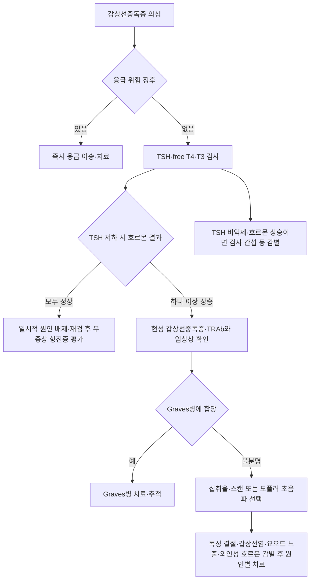
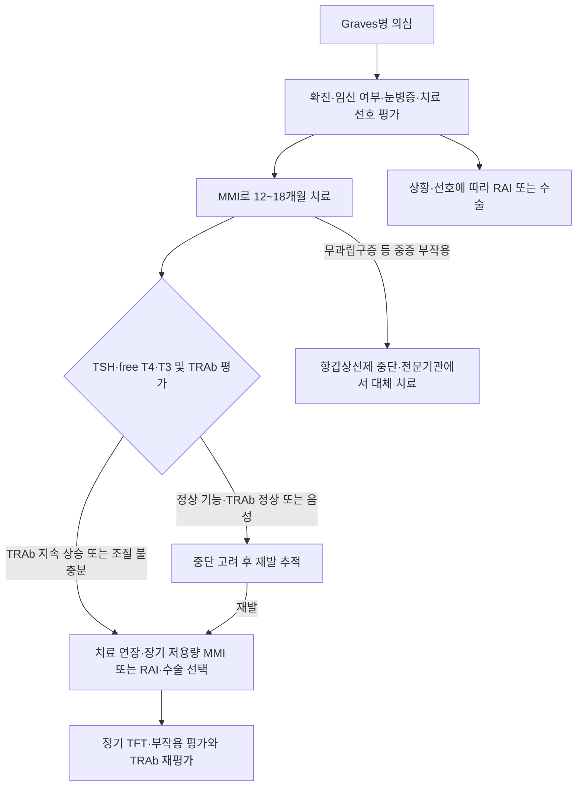

# 갑상선항진증 Hyperthyroidism

## <mark style="color:green;">일반 사항</mark>

* 갑상선항진증 (Hyperthyroidism) : 갑상선 자체에서 갑상선호르몬(T3, T4)의 신생 합성·분비가 증가하여, 그 결과 말초 조직에서 갑상선호르몬의 생리적 작용이 과도하게 나타나는 임상 증후군; 신생 합성 증가가 핵심 기전이라는 점에서, 저장된 호르몬의 파괴적 유출(파괴성 갑상선염)이나 외인성 섭취로 인한 갑상선중독증과 구분됨
* 갑상선중독증 (Thyrotoxicosis) : 원인(기전)과 무관하게 갑상선 호르몬(T4 or T3)의 과도한 증가와 관련된 임상 양상 전반을 지칭하는 상위 개념으로, 갑상선항진증을 포함함
* 갑상선중독발작 (Thyroid storm) : 갑상선중독증 환자에서 감염, 수술, 항갑상선제 임의 중단 등의 유발 사건과 함께 다발성 장기 기능 부전이 나타나는 내분비 응급 상황; 혈중 호르몬 수치의 높이만으로 진단하거나 배제할 수 없음(사망률 약 10\~30%)
* 무증상 갑상선항진증 (Subclinical hyperthyroidism) : TSH가 정상 하한 미만으로 저하되어 있으나 free T4와 T3는 정상인 **생화학적 상태**; 증상은 없을 수도 있고 경미하게 나타날 수도 있음
* 유병률 : 현성 갑상선항진증은 조사 지역·정의에 따라 약 0.2\~1.4%; 여성에서 흔하며, 요오드 충분 지역에서는 Graves병이 가장 흔한 원인임
* 경과 : 원인에 따라 다름. Graves병은 항갑상선제 표준 치료 후 약 40\~60%에서 관해하며 재발 가능; 독성 결절은 약물 중단 후 재발하는 경우가 많고, 파괴성 갑상선염은 대개 일과성임
  * 재발 : 관해 후에도 상당수에서 재발하며, 항갑상선제 종료 시 TRAb 음성이면 재발 위험이 낮고 지속 양성이면 재발 위험이 높음
* 합병증 : 심방세동, 심부전, 골다공증·취약성 골절, 갑상선중독발작(thyroid storm); Graves병에서는 갑상선안병증 동반 가능

## <mark style="color:green;">원인 및 위험 인자</mark>

### <mark style="color:orange;">방사성 요오드 섭취율 정상 또는 증가</mark>

* 갑상선 호르몬의 신규 합성이 항진된 상태를 의미하며, 합성 억제제인 항갑상선제에 반응함
* Autoimmune thyroid disease : Graves' disease(가장 흔함)
* Autonomous thyroid tissue : Toxic adenoma, Toxic multinodular goiter
* TSH-mediated hyperthyroidism : TSH 분비 뇌하수체선종(드묾); free T4·T3 상승에도 TSH가 억제되지 않으면 검사 간섭·갑상선호르몬 저항성 등을 먼저 감별
* Human chorionic gonadotropin-mediated thyrotoxicosis : 임신성 일과성 갑상선중독증(GTT; 임신오조·다태임신과 연관), 임신성 융모성 질환; 임신 중에는 섭취율 검사를 시행하지 않음

#### <mark style="color:$primary;">Graves' disease (GD)</mark>

* 자가면역 질환으로 갑상선항진증의 가장 흔한 원인임(60\~80%)
* 기전 : B 림프구에서 생성된 TSH 수용체 자극항체(TSAb; TRAb 중 자극형)가 갑상선의 TSH receptor에 결합 → receptor 활성화 → 갑상선 호르몬 합성·분비 자극(thyrotoxicosis), 갑상선 비대(goiter), 안와 돌출 유발
  * 안와 증상 : 안와섬유아세포에도 TSH 수용체가 발현되어 있어 TRAb가 직접 작용 → 섬유아세포 증식, 글리코사미노글리칸 축적, 림프구 침윤성 염증 → 안구돌출·외안근 비대(Graves' orbitopathy) 유발
* 위험 인자 : 여성, 가족력, 흡연(특히 Graves' orbitopathy 위험을 높임)
* 다른 자가면역질환 위험 증가와 관련 : Sjögren syndrome, 셀리악병, pernicious anemia, Addison disease, 원형탈모증, 백반증, 1형 당뇨병, 부갑상선저하증, myasthenia gravis
* 경과 : 항갑상선제 치료 시 약 40\~60%에서 관해
  * 좋은 예후 인자 : small goiter, 경증 항진 증상, 적은 항갑상선제 요구량, TRAb가 해당 검사법의 정상범위 또는 음성
  * 치료 종료 시점의 TRAb 상태가 재발의 중요한 예측 인자 : 음성 전환 시 재발 위험 낮음, 지속 양성 시 재발 위험 높음

#### <mark style="color:$primary;">Toxic multinodular goiter (TMNG, Plummer's disease)</mark>

* 고령에서 비중이 증가하며, 특히 요오드 부족 지역에서 흔함; 국내 고령 환자 전체에서 가장 흔한 원인이라고 일반화하지 않음
* 여러 개의 autonomously functioning thyroid nodules에 의해 발생; insidious onset

### <mark style="color:orange;">방사성 요오드 섭취율 감소</mark>

* 갑상선염·외인성 호르몬 섭취가 대표적이며, 최근 요오드 노출이나 AIT type 1에서도 섭취율이 낮을 수 있음. **저섭취율만으로 파괴성 갑상선염 또는 항갑상선제 무효를 단정하지 않음**
* Thyroiditis : Hashitoxicosis, Subacute (granulomatous) thyroiditis, Painless (silent) thyroiditis, Postpartum thyroiditis, Radiation thyroiditis, Palpation thyroiditis, Drug-induced thyroiditis (interferon-α 등)
  * Amiodarone-induced thyrotoxicosis(AIT)는 요오드 유발 호르몬 합성 증가형(type 1), 파괴성 갑상선염형(type 2), 혼합형이 있어 섭취율만으로 일률 분류하지 않음
* Exogenous thyroid hormone intake : Excessive replacement therapy, Intentional suppressive therapy, Factitious hyperthyroidism
* Ectopic hyperthyroidism : Struma ovarii, Metastatic follicular thyroid cancer

#### <mark style="color:$primary;">갑상선염 (Thyroiditis)</mark>

* 갑상선의 염증에 해당되는 여러 질환군; transient autoimmune process인 경우가 많음
* 경과 : 조직에 저장되어 있던 T3/T4가 갑상선 염증으로 인하여 방출 \[항진 증상 발생] → 방출 종료 → 방출된 갑상선호르몬의 소멸 \[저하 증상 발생] → 회복
* Subacute (granulomatous) thyroiditis (= de Quervain's thyroiditis) : 상기도 감염 후 발생하는 경우가 많은 통증성 갑상선염; ESR·CRP 상승, 낮은 섭취율이 감별에 도움. 수개월 내 회복하는 경우가 많으나 일부는 영구 저하증으로 이행함
* Silent (lymphocytic) thyroiditis : 특발성 또는 약물(예: 화학요법제, lithium, amiodarone)에 의해 발생
* [산후 갑상선염](#postpartum-thyroiditis) (Postpartum thyroiditis) : 대개 산후 1\~6개월 사이에 항진 증상이 발생하여 0\~3개월 지속된 후, 수개월간 저하 증상이 이어질 수 있음; 관해 후에도 10\~50%에서 갑상선저하증이 영구화될 수 있음

## <mark style="color:green;">임상 양상</mark>

* 신경 : 과민, 안절부절, 손가락 떨림, 불면
* 근골격 : 근 약화, 근 경련, 심부건반사 항진, 골다공증, 골절
* 심혈관 : 빈맥(두근거림), 수축기혈압 상승, 심방세동, 심장 비대, 심부전 악화
* 내분비 : 열 불내성, 다한증, 갑상선종, 여성형유방증, 성 기능 저하, 불규칙 월경, 당뇨병 악화
* 피부 : 따뜻하고 습한 피부, 가려움, 가는 모발(fine hair), onycholysis, pretibial myxedema(3%)
* 눈 : 눈꺼풀뒤당김·눈꺼풀내림지연은 갑상선중독증에서 보일 수 있음; 안구돌출, 제한성 복시, 안와 염증은 주로 Graves 갑상선안병증을 시사
* 기타 : 피로, 체중 변화(보통 감소), 발열, 무른 변·빈변, 호흡 곤란
* 갑상선 비대 : 미만성 갑상선 비대(대개 압통 없음이 일반적; 압통이 뚜렷하면 subacute thyroiditis 등 다른 원인 고려); 화농성 갑상선염에서는 국소 압통·염증 반응

**고령에서의 특징**

* 고령에서는 전형적 증상이 나타나지 않을 수 있음 (apathetic hyperthyroidism)
* 피로, 쇠약, 체중 감소, 심방세동(TSH ＜0.1 mIU/L에서 흔함), 호흡 곤란이 주 증상일 수 있음

### 🚩Red Flags

<mark style="color:$danger;">**즉각 조치**</mark>

* 고열·현저한 빈맥과 섬망·경련·의식 저하, 심부전 또는 위장관·간 기능 이상 → 점수 산출·검사 확정을 기다리지 말고 응급 이송·치료  <mark style="color:$danger;">[갑상선중독발작]</mark>
* 갑작스러운 시력·색각 저하, RAPD, 시야 결손 또는 각막 손상 → 즉시 응급 안과 의뢰  <mark style="color:$danger;">[시력 위협 갑상선안병증]</mark>
* 빈맥·심방세동과 저혈압·흉통·심한 호흡곤란 → 응급 이송  <mark style="color:$danger;">[불안정 부정맥·심부전]</mark>
* 갑작스러운 사지 마비·심한 근력 저하 → 심전도·전해질 평가 및 응급 이송  <mark style="color:$danger;">[갑상선중독성 주기마비 등]</mark>
* 항갑상선제 복용 중 발열·인후통·구강 궤양 → 즉시 복용 중단, **당일** CBC·백혈구 분획·ANC 검사; 전신 상태 불량이면 응급실 평가  <mark style="color:$danger;">[무과립구증]</mark>

<mark style="color:$warning;">**당일~수일 내 평가**</mark>

* 새로 발생한 심방세동 또는 심부전 악화 → **당일** 심전도·순환기 평가  <mark style="color:$warning;">[심혈관 합병증]</mark>
* 항갑상선제 복용 중 황달·진한 소변·회색변·우상복부 통증 → 복용 중단, **당일** 간기능 평가; 의식 변화·출혈이면 응급 이송  <mark style="color:$warning;">[약물 간손상]</mark>
* 임신 중 신규 항진증 또는 TRAb 상승 → 내분비·산과 협진  <mark style="color:$warning;">[모체·태아 갑상선 기능 이상]</mark>
* 새 복시 또는 빠르게 진행하는 안구돌출 → 신속한 안과 평가; 시력 위협 소견이 있으면 즉각 의뢰  <mark style="color:$warning;">[진행성 갑상선안병증]</mark>

<mark style="color:$info;">**조기 평가 및 추적**</mark>

* 항갑상선제 치료 4~6주 후에도 호전 없음 → 용량·복약·진단 재평가  <mark style="color:$info;">[치료 반응 불충분]</mark>
* 무증상 항진증 관찰 중 증상 발생, 고령·심질환·골다공증 위험 확인 → 치료 적응증 재평가  <mark style="color:$info;">[무증상 갑상선항진증]</mark>
* 경증 눈병증의 활동성·진행 여부 추적  <mark style="color:$info;">[갑상선안병증]</mark>

## <mark style="color:green;">진단</mark>

### <mark style="color:orange;">갑상선기능검사를 고려할 대상</mark>

* 다음의 상태에서 검사 고려 : 갑상선 질환 의심 증상, 1형 당뇨병 등 자가면역 질환, 새로이 발생한 심방세동, 설명되지 않는 체중감소, 지속적인 동성빈맥(persistent sinus tachycardia), 골다공증, 설명할 수 없는 행동 변화·우울·불안

### <mark style="color:orange;">갑상선 호르몬 검사</mark>

* 기본 : TSH, free T4(thyroxine)
* 필요시 free 또는 total T3 추가 - 임상 환경상 free T3 측정에 어려움이 있어 흔히 total T3를 검사
  * free T4가 정상이더라도 T3만 단독으로 상승하는 경우(T3 toxicosis) 감별을 위해 T3 측정이 필요함
  * 낮은 TSH만으로 확진하지 않고 free T4·T3를 함께 해석함; 낮은 TSH와 정상 free T4만 확인하고 T3 toxicosis를 놓치지 않도록 주의
  * 비오틴 함유 보충제·갑상선호르몬·amiodarone·조영제 사용력을 확인. 임상상과 검사 결과가 맞지 않으면 검사 간섭을 의심하고 검사실과 비오틴 중단 기간·다른 측정법을 협의함

<table data-header-hidden><thead><tr><th width="82.33331298828125"></th><th width="102.47613525390625"></th><th></th></tr></thead><tbody><tr><td><strong>TSH</strong></td><td><strong>free T4/T3</strong></td><td><strong>해석</strong></td></tr><tr><td>↓</td><td>↑</td><td>명백한 갑상선중독증(Graves병·자율기능성 결절·갑상선염·외인성 호르몬 등 원인 감별 필요)</td></tr><tr><td>↓</td><td>정상</td><td>일시적 원인·검사 간섭을 배제하고 지속되면 무증상 갑상선항진증</td></tr><tr><td>↓/정상</td><td>↓</td><td>중추성 갑상선기능저하증, 비갑상선질환증후군, 최근 갑상선중독증 치료 후 회복기 등 감별</td></tr><tr><td>↑</td><td>↓</td><td>일차성 갑상선기능저하증(갑상선중독증 치료 후 발생 가능)</td></tr><tr><td>정상/↑</td><td>↑</td><td>TSH 분비 뇌하수체선종, 갑상선호르몬 저항성, 검사 간섭·약물 영향 감별</td></tr></tbody></table>

* 검사 결과에 영향을 주는 요인 ☞ [갑상선저하증](105_-hypothyroidism.md)

### <mark style="color:orange;">기타 검사</mark>

* 영상 검사 : 진찰·TRAb로 원인이 분명하지 않거나 결절이 동반되면 방사성요오드 섭취율/스캔과 도플러 초음파를 선택. 임신 중 동위원소 검사는 금기이며, 수유 중 검사는 핵종별 중단 지침을 적용함. CT·MRI는 흉골하 갑상선종·뇌하수체 종양·안병증 등 특수 상황에 사용
* TRAb : Graves병 감별·항갑상선제 종료 전 재발 위험·임신 중 태아 위험 평가에 활용. 현대 검사법의 진단 정확도는 높으나 음성이라고 Graves병을 완전히 배제하지 않음; 일반 TRAb 결합검사는 자극항체와 차단항체를 구분하지 못함
* CBC(백혈구 분획·ANC), LFT(빌리루빈 포함) : 항갑상선제 시작 전 기초 검사. 빈맥·부정맥은 심전도, 심부전 의심 시 심초음파, 통증성 갑상선염은 ESR·CRP, 급성 근력 저하는 전해질을 추가

#### <mark style="color:$primary;">안과 검진 대상</mark>

* 새 안구돌출·복시, 안구운동 제한, 지속되는 안와 통증·눈꺼풀/결막 염증은 안과 평가 대상
* 임상활동도점수(CAS)와 중증도를 함께 평가하며, 눈병증이 비대칭이거나 진단이 불분명하면 다른 안와 질환을 감별
* 안구돌출 ≥2 ㎜ 증가, 안구운동 ≥5° 감소, 시력 저하는 이전 검사와 비교하는 진행 지표임; 이 역치까지 기다렸다가 의뢰하지 않음
* 시력·색각 저하, RAPD, 시야 결손, 각막 손상은 응급 의뢰. 복시 단독은 곧바로 시력 위협 상태를 뜻하지 않으나 신속한 평가가 필요함

### <mark style="color:orange;">감별</mark>

* 열 불내성·심계항진·체중 감소 등으로 내원 시 아래 질환과의 감별이 필요; TSH가 정상이면 일반적인 일차성 항진증 가능성은 낮지만, 호르몬 상승이 있으면 검사 간섭·중추성 원인 등을 감별

<table><thead><tr><th width="169.047607421875">질환</th><th width="278.5714111328125">감별 포인트</th><th>핵심 검사</th></tr></thead><tbody><tr><td>불안장애·공황장애</td><td>발한·심계항진은 유사하나 열 불내성·체중감소·안구 증상은 드묾</td><td>TSH 정상</td></tr><tr><td>갱년기(폐경) 증후군</td><td>안면홍조·발한은 있으나 빈맥·손떨림은 덜함</td><td>TSH; 전형적 폐경 증상은 임상 진단, FSH는 필요한 경우에만</td></tr><tr><td>갈색세포종(Pheochromocytoma)</td><td>발작성 고혈압·심계항진·발한이 특징적; 갑상선종·안구 증상 없음</td><td>혈장 또는 소변 metanephrine</td></tr><tr><td>악성 종양(체중감소 동반)</td><td>식욕부진 동반 체중감소가 흔함(갑상선항진증은 식욕 증가에도 체중 감소)</td><td>영상 검사; TSH 정상</td></tr><tr><td>기타 원인의 심방세동</td><td>고령·구조적 심질환 동반이 흔함</td><td>TSH로 감별</td></tr></tbody></table>

#### <mark style="color:$primary;">갑상선중독발작 중증도 평가 (Burch-Wartofsky Point Scale)</mark>

* 갑상선중독발작이 임상적으로 의심되는 경우, 체온·심혈관계·중추신경계·위장관/간 증상과 유발 인자 유무를 점수화하여 위험도를 정량적으로 평가할 수 있음

<table data-search="false"><thead><tr><th width="166.66668701171875">항목</th><th width="358.09521484375">소견</th><th>점수</th></tr></thead><tbody><tr><td>체온 조절 장애 (℃)</td><td>37.2~37.7</td><td>5</td></tr><tr><td></td><td>37.8~38.3</td><td>10</td></tr><tr><td></td><td>38.4~38.8</td><td>15</td></tr><tr><td></td><td>38.9~39.3</td><td>20</td></tr><tr><td></td><td>39.4~39.9</td><td>25</td></tr><tr><td></td><td>≥40.0</td><td>30</td></tr><tr><td>빈맥 (회/분)</td><td>90~109</td><td>5</td></tr><tr><td></td><td>110~119</td><td>10</td></tr><tr><td></td><td>120~129</td><td>15</td></tr><tr><td></td><td>130~139</td><td>20</td></tr><tr><td></td><td>≥140</td><td>25</td></tr><tr><td>심방세동</td><td>있음</td><td>10</td></tr><tr><td>심부전</td><td>경증(말초부종)</td><td>5</td></tr><tr><td></td><td>중등도(기저부 수포음)</td><td>10</td></tr><tr><td></td><td>중증(폐부종)</td><td>15</td></tr><tr><td>위장관·간 기능이상</td><td>중등도(설사, 복통, 오심/구토)</td><td>10</td></tr><tr><td></td><td>중증(황달)</td><td>20</td></tr><tr><td>중추신경계 증상</td><td>경증(초조)</td><td>10</td></tr><tr><td></td><td>중등도(섬망, 정신병, 극도의 무기력)</td><td>20</td></tr><tr><td></td><td>중증(경련, 혼수)</td><td>30</td></tr><tr><td>유발 인자</td><td>없음</td><td>0</td></tr><tr><td></td><td>있음(감염, 수술, 요오드 노출, 외상, 임의 중단 등)</td><td>10</td></tr></tbody></table>

* 판정 : 총점 ≥45점 - 갑상선중독발작 강력 시사; 25\~44점 - 임박한 갑상선중독발작(impending storm) 시사; ＜25점 - 갑상선중독발작 가능성 낮음
* 각 영역에서 해당하는 최고 점수 하나를 선택하고 합산하며, 심방세동·심부전·유발 인자는 별도로 더함(해당 소견이 없으면 0점). 패혈증 등도 높은 점수를 만들 수 있으므로 감별이 필요하며, 중추신경계 이상은 특히 중요한 임상 소견임
* 점수와 무관하게 임상적으로 갑상선중독발작이 강력히 의심되면 지체 없이 응급 이송 및 치료를 시작할 것

***



* TRAb 음성만으로 Graves병을 배제하지 않음. 동위원소 검사는 임신 중 금기이며 수유 중에는 핵종별 수유 중단 계획이 필요함.

<p align="center"><em><mark style="color:$info;">Ref. ATA 2016; ETA 2018. 원인별 진단 알고리듬을 일차진료용으로 재구성.</mark></em></p>

***

## <mark style="background-color:$warning;">Management</mark>

### <mark style="color:orange;">치료 방침</mark>

* 증상 완화 : 금기가 없으면 β-차단제. Glucocorticoid는 통증성 아급성 갑상선염·AIT type 2·활동성 안병증·갑상선중독발작 등 적응증에 한정
* 갑상선 치료 : 항갑상선제, ¹³¹I therapy(RAIT), 갑상선 절제
  * Thyroiditis 환자에서는 항갑상선제를 투여하지 않음(신규 합성이 항진된 상태가 아니므로 효과 없음)
* 식이 요법 : 특이 방법은 없음; 체중 저하 예방을 위해 충분한 칼로리 섭취를 권고
  * L-carnitine이 갑상선 호르몬의 말초 작용을 길항하여 증상 완화 및 골 대사에 유효하다는 일부 보고가 있으나, 근거 수준이 낮은 소규모 연구에 국한되어 일상적인 보조제로 권고하지 않음

<mark style="color:cyan;">**단계별 치료 전략 (Step-wise Approach)**</mark>

<table><thead><tr><th width="82.3809814453125">단계</th><th width="295.7142333984375">핵심 치료</th><th>대상</th></tr></thead><tbody><tr><td>Step 1</td><td>β-차단제로 증상 완화</td><td>모든 유증상 환자(금기 없는 한)</td></tr><tr><td>Step 2</td><td>원인별 확정 치료 결정 - 항갑상선제 / RAIT / 수술</td><td>Graves' disease, TMNG, Toxic adenoma</td></tr><tr><td>Step 3</td><td>Graves' orbitopathy 동반 여부 평가 및 안과 협진</td><td>안구 증상이 있거나 위험 인자(흡연 등) 보유</td></tr><tr><td>Step 4</td><td>정기적 TFT 추적 및 치료 반응·부작용 모니터링</td><td>모든 환자</td></tr></tbody></table>

<mark style="color:cyan;">**치료법별 추적 검사 주기**</mark>

<table><thead><tr><th width="227.142822265625">상황</th><th>추적 검사 주기</th></tr></thead><tbody><tr><td>항갑상선제 시작 직후</td><td>2~6주 후 free T4·T3 확인(TSH는 수개월간 억제될 수 있으므로 초기 용량 조정은 free T4·T3 중심으로 판단) → 정상화 후 4~6주마다 → 안정 후 2~3개월마다 → 18개월 이상 장기 치료 시 6개월마다</td></tr><tr><td>RAIT 이후</td><td>4~6주 이내 첫 검사 → 정상화될 때까지(치료 후 6개월까지) 2~3개월마다 → 정상 2회 확인 후 6개월~1년마다</td></tr><tr><td>무증상 갑상선항진증 관찰</td><td>치료하지 않는 경우 3~6개월 간격으로 재평가(원인·위험도에 따라 조정), 증상 발생 시 즉시 재검</td></tr><tr><td>임신 중(항갑상선제 계속 복용)</td><td>임신 확인 즉시 검사하고 대개 2~4주마다 TSH·free T4 추적; 안정되면 간격을 조정</td></tr><tr><td>임신 확인 후 항갑상선제 중단</td><td>1분기 1~2주마다 → 2~3분기 2~4주마다 TSH·free T4와 임상 소견 확인</td></tr><tr><td>임신 중(TRAb/TSI ≥3×ULN)</td><td>1분기, 18~22주, 30~34주 재검 + 18~20주부터 태아 초음파 추적(빈도는 모체·태아 상태에 따라 개별화)</td></tr><tr><td>산후 갑상선염</td><td>4~8주 간격 관찰; 정상화 후 1년째 또는 증상 발생 시 재검</td></tr></tbody></table>

_TRAb=TSH Receptor Antibodies, TSI=Thyroid-Stimulating Immunoglobulin_

***



* TRAb 음성만으로 중단하지 않고 충분한 치료 기간·정상 갑상선기능·임상 경과를 확인함. TRAb 지속 양성 또는 재발 시에도 안정적인 저용량 MMI 장기 치료가 선택지임.
* 임신 중 약제 선택 및 중단은 아래 임신/수유 관리 기준을 적용함.

<p align="center"><em><mark style="color:$info;">Ref. ETA 2018. 성인 Graves병 관리 알고리듬을 재구성.</mark></em></p>

***

## <mark style="color:green;">비-약물 치료 및 예방</mark>

* 금연 : 흡연은 Graves' orbitopathy의 발생 및 악화와 관련된 가장 강력한 교정 가능 위험 인자로, 안구 증상 유무와 무관하게 모든 환자에게 금연을 권고
* 갑상선중독 급성기에는 무리한 운동·격렬한 신체활동 자제(부정맥·심부전 악화 위험)
* 충분한 칼로리·단백질 섭취로 체중 감소 예방
* 요오드 보충제·해조류 농축액 등 과량 섭취 회피; 필요한 조영검사·amiodarone 치료는 갑상선 질환을 알리고 의료진이 이득·위험을 평가. 특히 독성 결절에서는 요오드 유발 갑상선중독증(Jod-Basedow 현상)에 주의
* 카페인 등 교감신경 항진 유발 물질 최소화(심계항진·불안 증상 악화 가능)
* 안구 증상이 있는 경우 인공눈물 사용, 선글라스 착용, 수면 시 머리를 높게 유지

## <mark style="color:green;">약물 치료</mark>

### <mark style="color:orange;">항갑상선제</mark>

* 작용 : 갑상선에서의 갑상선 호르몬 합성 억제
* 대상 : Graves병; 독성 결절의 기능 조절 및 필요 시 RAIT·수술 전 준비. 독성 결절은 약물로 기능이 조절되어도 중단 후 재발이 흔하므로 RAI·수술 또는 선택적 장기 약물 치료를 논의

#### <mark style="color:$primary;">Methimazole (MMI)</mark>

* 1차 선택제; 반감기는 짧으나 갑상선 내 체류 시간이 길어 대부분 1일 1회 복용(초기 고용량에서만 분할 투여); 효과 발현이 빠르고 간 괴사 부작용이 적어 선호됨
* 임신 16주 이전에는 가능하면 회피(기형 위험으로 PTU를 우선 선택); 다만 PTU에 중증 부작용이 있거나 대안이 없는 경우, 치료하지 않은 갑상선항진증 자체의 위험(유산·태아 사망 등)이 더 크므로 최소 유효 용량의 MMI 사용을 고려
* 증상·TFT 호전에 따라 최소 유효 용량으로 감량

#### <mark style="color:$primary;">Propylthiouracil (PTU)</mark>

* 부가적으로 말초에서의 T4 → active T3 전환 차단 효과가 있음
* 드물게 중증 간독성 부작용이 있어 MMI보다 우선 순위가 낮음
* 임신 16주 이전에는 우선 고려; thyroid storm에서는 T4→T3 전환 억제 효과를 고려해 선택할 수 있으나 간기능·중증도에 따라 MMI도 사용 가능

<table><thead><tr><th>항목</th><th>MMI <mark style="color:blue;">[부광메티마졸정]</mark></th><th>PTU <mark style="color:blue;">[안티로이드정]</mark></th></tr></thead><tbody><tr><td>임상 지침의 성인 시작 용량</td><td>대개 10~30 ㎎/d, 1일 1회 또는 분할; 경증은 더 적은 용량 사용 가능</td><td>중증도에 따라 조절; 국내 허가 용량은 아래 참조</td></tr><tr><td>국내 허가 성인 시작 용량</td><td>경증 15, 중등도 30~40, 중증 60 ㎎/d; 8시간 간격으로 1일 3회 분할</td><td>100~300 ㎎/d, 1일 3~4회 분할; 중증 400~600 ㎎/d</td></tr><tr><td>국내 허가 성인 유지 용량</td><td>5~15 ㎎/d, 1일 1~2회 분할</td><td>25~100 ㎎/d, 1일 1~2회 분할</td></tr><tr><td>주요 선택 상황</td><td>대부분의 비임신 성인에서 우선</td><td>임신 16주 이전, 갑상선중독발작 등 선택된 상황</td></tr><tr><td>주요 중증 이상반응</td><td>무과립구증·간손상·급성췌장염</td><td>무과립구증·중증 간손상·ANCA 연관 혈관염</td></tr><tr><td>태반·모유 이행</td><td>모두 이행; 태아 갑상선 억제 가능</td><td>모두 이행; 태아 갑상선 억제 가능</td></tr></tbody></table>

* **지침과 허가 용법 구분** : MMI 초기 1일 1회·저용량 사용은 임상 지침에 근거하나, 위 국내 제품의 초기 1일 3회 허가 용법과 다를 수 있음. 임신·수유는 별도 기준을 적용함.

#### <mark style="color:$primary;">부작용</mark>

* 흔한 부작용(1\~5%) : 피부 발진, 두드러기, 관절통, 발열; 단순한 가려움은 항갑상선제 중단 없이 항히스타민제로 조절 가능
* 무과립구증 : 발생률 약 0.1\~0.5%, 복용 초기 3개월에 흔하지만 이후에도 발생 가능; 인후통·발열·구강 궤양 발생 시 즉시 약을 중단하고 당일 CBC(백혈구 분획·ANC 포함) 시행. 확인되면 해당 약제를 재투여하지 않으며 다른 thionamide로 단순 교체하지 않고 전문기관에서 RAI·수술 등 대안을 결정함 <mark style="color:$info;">\[ETA 2018]</mark>
* 간손상 : PTU는 중증 간세포 손상·급성 간부전, MMI는 담즙울체성 손상이 대표적이나 두 약제 모두 중증 손상 가능. 황달·진한 소변·회색변·복통·오심 발생 시 즉시 중단하고 당일 LFT 평가


**Propylthiouracil 중증 간독성 경고** : PTU는 드물게 급성 전격성 간부전을 유발할 수 있어 소아에서는 일반적으로 PTU를 회피하고 MMI를 우선 사용함. 비임신 성인도 MMI가 우선이며, 임신 16주 이전에는 PTU를 우선 고려함. 소아의 예외적 PTU 사용은 대안이 없을 때 전문기관에서 판단함. 투여 전 기초 LFT를 확인하고, 황달·진한 소변·회색변·소양감·복통·식욕부진·오심·피로가 발생하면 즉시 약을 중단하고 LFT를 시행함. 무증상 환자의 정기적 LFT가 중증 간손상을 예방한다는 근거는 확립되지 않음


* **급성췌장염(MMI)** : 의심 증상이면 즉시 중단·평가. MMI/carbimazole 관련 췌장염 병력이 있으면 MMI 재투여 금기.
* **ANCA 연관 혈관염(주로 PTU)** : 혈뇨·객혈·자반·호흡곤란이 나타나면 약을 중단하고 신속히 전문기관 평가.
* 용량이 높을수록 무과립구증 위험이 커질 수 있어 최소 유효 용량을 사용함. 2024년 대규모 코호트에서도 양 약제의 용량 관련 위험 증가가 확인됨. <mark style="color:$info;">[Yoshimura Noh 등 2024]</mark>

#### <mark style="color:$primary;">모니터링</mark>

* 경미한 발진·불내성과 무과립구증·중증 알레르기·중증 간손상을 구분함. 중증 부작용 후 다른 항갑상선제로의 변경은 일률적으로 시행하지 않고 전문의가 대체 치료와 함께 판단함
* 치료 개시 후 2\~6주(증상에 따라)에 free T4 및 T3 검사; free T4가 정상이어도 T3는 증가 상태일 수 있으므로 T3를 함께 측정; 초기 용량 조정은 free T4·T3 중심으로 판단하고 TSH만으로 증량하지 않음
  * 이미 방출된 호르몬에는 작용하지 않으므로 효과는 수 주에 걸쳐 나타나며, 정상화까지 걸리는 기간은 중증도·약제 용량에 따라 다름
  * TSH는 치료 시작 후 수개월간 억제된 상태로 지속될 수 있어, 이 기간 동안은 TSH만으로 치료 반응이나 과다치료 여부를 판정하지 않음
* 항진 증상이 해소되고 TFT가 정상화됨에 따라 약제 용량을 30\~50% 감량하고 4\~6주마다 TSH 및 T4 검사
  * 정상 TFT를 유지하는 최소 용량이 정해진 후에는 2\~3개월 간격으로 검사
  * 18개월 이상 장기 치료 중인 경우에는 6개월 간격으로 검사
  * 국제 지침은 무증상 환자의 일률적인 CBC·LFT 반복검사 이득이 불확실하다고 보지만, **국내 PTU 허가사항은 정기 혈액검사를 명시**함. 허가사항에 따른 추적을 시행하되 정상 검사 직후에도 무과립구증이 발생할 수 있으므로 증상 발생 시 즉시 중단·검사가 필수
  * 일부 연구에서 TRAb 음성 전환 확인 후에도 일정 기간 항갑상선제를 추가 유지하는 것이 재발률 감소와 연관된다는 보고가 있으나, 표준화된 최적 유지 기간에 대한 확립된 지침은 아직 없음

#### <mark style="color:$primary;">치료 종료</mark>

* 성인에서는 12\~18개월 치료 후 TSH 및 TRAb가 정상이면 치료 중단 고려
* 12\~18개월 치료 후에도 TRAb가 높게 지속되면 일정 기간 항갑상선제 치료를 연장한 뒤 재평가하거나 RAIT 또는 thyroidectomy를 고려
  * 환자가 원하고 저용량 MMI로 안정적으로 조절되며 부작용이 없다면 장기 저용량 MMI도 선택지가 될 수 있음; 장기 치료 기간은 재발 위험·선호·치료 순응도를 반영하여 개별화
* 치료 종료 후 TFT 추적 검사 일정 : 첫 6개월 동안 2\~3개월 간격 → 다음 6개월 동안 4\~6개월 간격 → 이후 6\~12개월마다 또는 이상 증상이 있을 때

### <mark style="color:orange;">β-차단제</mark>

* 작용 : 교감신경 항진에 따른 두근거림·떨림·불안 등 증상 완화; 말초 T4 → T3 전환 억제는 주로 고용량 propranolol에서 나타남
* 대상 : 고령, 안정 시 맥박 ＞90회/분, 심혈관 질환 동반; 금기가 아닌 모든 유증상 환자
* 투여 기간 : 갑상선 기능과 빈맥·떨림이 호전될 때까지 개별화하고 감량; 2\~3주를 일률적인 종료 시점으로 삼지 않음
* Propranolol은 천식·서맥·고도 방실차단에서 회피하며, 비보상성 심부전·저박출 상태에서는 순환 허탈 위험을 평가. β-차단제를 쓸 수 없으면 diltiazem/verapamil을 고려할 수 있으나, 좌심실 수축기능 저하·저혈압·고도 방실차단에서는 이들 약제도 회피

<table data-header-hidden><thead><tr><th width="174.7142333984375"></th><th width="162.8095703125"></th><th></th></tr></thead><tbody><tr><td><strong>성분명</strong> <mark style="color:blue;">[상품명]</mark></td><td><strong>용법</strong></td><td><strong>특징</strong></td></tr><tr><td>propranolol <mark style="color:blue;">[인데놀]</mark></td><td>10~40 ㎎ tid~qid</td><td>고용량에서 T4→T3 전환 차단; 임신 중에는 태아 성장·서맥·저혈당 위험을 고려하여 필요 시 최소 유효 용량으로 단기간 사용</td></tr><tr><td>metoprolol tartrate(속방형) <mark style="color:blue;">[베타록]</mark></td><td>25~50 ㎎ bid~tid</td><td>상대적 β1 선택차단제</td></tr><tr><td>atenolol <mark style="color:blue;">[테놀민]</mark></td><td>25~50 ㎎ qd~bid</td><td>상대적 β1 선택차단제; 임신 중에는 일반적으로 회피</td></tr></tbody></table>

### <mark style="color:orange;">기타</mark>

#### <mark style="color:$primary;">Steroid</mark>

* 작용 : T4의 T3로의 전환 억제 (✽T3가 T4보다 3\~4배 효력이 강함)
* 용법은 적용 상황에 따라 다름 : 중등도\~중증 활동성 Graves' orbitopathy 시 methylprednisolone IV 적용; 갑상선중독발작 시 hydrocortisone IV 투여(☞ 처방례 4)
* 외래에서 경구 prednisolone을 장기간 분할(tid) 투여하는 처방은 일반적이지 않음

#### <mark style="color:$primary;">Cholestyramine</mark>

* 작용 : 장간순환에서의 갑상선 호르몬 재흡수 억제
* 적용 : 갑상선절제술 전 준비, 중증 갑상선중독증·갑상선중독발작의 보조 치료(장간순환 차단으로 호르몬 농도 하강을 가속)
* 용법 : 4 g qid <mark style="color:blue;">[퀘스트란]</mark>; 갑상선중독증에는 허가 외 보조 치료. 다른 경구약은 cholestyramine 복용 최소 1시간 전 또는 4~6시간 후 투여하여 흡수 방해를 줄임

### <mark style="color:orange;">원인별·동반 질환별 보완 치료</mark>

* 파괴성 갑상선염 : 항갑상선제는 효과가 없음. 통증성 아급성 갑상선염은 NSAID로 시작하고, 통증이 심하거나 반응이 없으면 감염성 갑상선염을 배제한 뒤 glucocorticoid를 고려; 저하기 발생 여부도 추적함.
* AIT : type 1은 주로 MMI, type 2는 glucocorticoid, 혼합형은 병합 치료를 고려. Amiodarone 중단 여부는 부정맥 위험 때문에 심장내과·내분비내과가 함께 결정함. <mark style="color:$info;">[ETA 2018 AIT]</mark>
* 심방세동 : 갑상선 기능 교정과 심박수 조절을 병행하고, CHA₂DS₂-VASc 등 표준 뇌졸중 위험 평가에 따라 항응고 여부를 판단. 정상 기능·동율동 회복 후에도 장기 항응고 필요성을 재평가함. <mark style="color:$info;">[ACC/AHA/ACCP/HRS 2023]</mark>

### <mark style="color:orange;">Graves' orbitopathy (안병증)</mark>

* 원칙 : 활동성(activity)·중증도(severity) 평가에 따라 치료 방침을 결정
* 흡연은 Graves' orbitopathy 발생·악화의 가장 중요한 교정 가능(modifiable) 위험 인자이므로 모든 단계에서 금연이 우선됨
* 경증(mild) : 인공눈물·위험 인자 교정이 기본. 셀레늄 결핍 지역의 최근 발생 활동성 경증에서는 6개월 보충을 고려할 수 있으나, 한국 SeGOSS RCT(2025)는 셀레늄 충분 지역에서 6개월 삶의 질·임상 지표 개선을 입증하지 못함. 국내 환자에게 일률적으로 보충하지 않고 영양 상태·총 섭취량을 평가함. <mark style="color:$info;">[EUGOGO 2021; SeGOSS 2025; 국내 TED 진료 프레임워크 2026]</mark>
* 중등도\~중증 활동성(moderate-to-severe active) : 정맥 methylprednisolone(IVMP) ± mycophenolate가 대표적 치료이며, 활동성·안구돌출·복시·금기 및 접근성을 고려해 전문 안과에서 선택함. IVMP 누적 용량은 한 치료 과정에서 8 g을 초과하지 않도록 하고 간기능·간염 위험·혈당·혈압 등 안전성을 평가함; mycophenolate의 국내 갑상선안병증 사용은 허가 외 치료임 <mark style="color:$info;">\[EUGOGO 2021]</mark>
* Teprotumumab <mark style="color:blue;">\[테페자주]</mark> : 2026년 4월 30일 국내 허가; 18세 이상 중등도~중증 갑상선안병증의 전문기관 치료 선택지임. 청력손상·고혈당·염증성 장질환 악화 위험을 평가함. 치료 전·중·후 청력검사가 필요하며 영구 청력손상 가능성을 설명함. 혈당은 치료 전·중 및 종료 후 최소 6개월간 추적을 권고함. 임신·수유 중 투여하지 않으며 마지막 투여 후 6개월까지 피임함 <mark style="color:$info;">\[식약처 품목허가정보]</mark>
* 시력 위협(sight-threatening) : 즉시 응급 안과 의뢰. 갑상선 시신경병증은 고용량 IVMP를 즉시 투여하고, 반응이 없거나 불충분하면 통상 1\~2주 이내 긴급 안와감압술을 시행함. 시력 악화·각막 손상·안구 아탈구 등은 더 이른 수술이 필요할 수 있으므로 반응 평가 기간을 기다리지 않고 조기 수술을 판단함 <mark style="color:$info;">\[EUGOGO 2021]</mark>
* 갑상선 기능은 정상으로 유지(과다·저하 모두 안병증 악화 요인); 활동성 중등도\~중증 안병증에서는 원칙적으로 RAIT를 피하고 항갑상선제 또는 수술을 우선 고려

## <mark style="color:green;">시술 및 기타 처치</mark>

### <mark style="color:orange;">Radioactive iodine therapy (RAIT)</mark>

* 작용 : 갑상선에 농축되어 갑상선 조직을 파괴; 갑상선기능항진증의 완치(정상 갑상선기능 또는 갑상선기능저하증 도달)를 목표로 함
* 효과 : 약물치료 후 재발·중증 이상반응 시 중요한 대안. KTA 2025에 인용된 성공률은 원인·갑상선 크기·투여량·성공 정의에 따라 달라, 서로 다른 코호트 수치를 직접 비교하여 개인별 완치율로 제시하지 않음
* 장기 안전성 : 관찰연구 메타분석에서 전체 암 발생·사망 위험의 유의한 증가는 확인되지 않았으나 일부 용량-반응 신호와 연구 한계가 있어 암 위험이 전혀 없다고 단정하지 않음. 갑상선기능저하증·안병증 위험을 포함해 치료 이득과 함께 설명함. <mark style="color:$info;">[KTA 2025]</mark>

#### <mark style="color:$primary;">적응증 (KTA 2025)</mark>

<table><thead><tr><th width="127.14288330078125">권고 수준</th><th>해당 상황</th></tr></thead><tbody><tr><td>적극 고려</td><td>완치율이 높은 1차 치료를 원하는 경우; 항갑상선제로 중증 부작용(무과립구증, 간독성 등) 발생; 항갑상선제 완치 후 재발하여 높은 완치율을 원하는 경우; 충분한 항갑상선제 치료(12~18개월)에도 조절되지 않는 경우</td></tr><tr><td>고려 가능</td><td>항갑상선제 복용 순응도가 낮은 경우; 조절되지 않는 부정맥·심부전 등 갑상선기능 변동에 취약한 기저질환 동반; 정상 기능 유지에 고용량 항갑상선제(MMI ≥15~20 ㎎/d 또는 PTU ≥150~300 ㎎/d)가 지속적으로 필요한 경우(특히 6개월 이후 임신 계획 여성)</td></tr><tr><td>권고하지 않음</td><td>임신 중이거나 수유 중인 여성; 중등도 이상의 활동성 Graves' orbitopathy 동반; 갑상선암 동반</td></tr></tbody></table>

* 절대 금기는 아니나 치료 실패율이 높을 것으로 예상되는 상황 : 큰 갑상선종, 높은 TRAb 농도(특히 ＞40 U/L) - 이런 경우 빠른 완치가 목표라면 수술을 우선 고려
* 임신 가능성이 있으면 **시행 전 48시간 이내** 임신검사로 확인

#### <mark style="color:$primary;">치료 전 준비</mark>

* 용량 : 갑상선기능저하증을 유발할 만큼 충분한 고정 용량 10\~15 mCi 사용(국내 임상 여건상 개별 선량 측정 방식보다 고정 용량 방식을 권고); 큰 갑상선종에서는 15 mCi 초과 용량을 고려할 수 있으나 치료 후 일시적 갑상선염 발생 가능성을 감안한 관찰 필요
* 저요오드 식이 : 일괄적인 저요오드 식이 처방은 권고하지 않으나, 해조류(김·미역·다시마) 등 요오드 함유량이 높은 식품과 고용량 요오드 보충제는 치료 최소 1주일 전부터 섭취 중단 권고; 요오드 조영제·아미오다론 등 사용 이력이 있으면 영향을 고려하고, 무기 요오드제는 최소 1\~2주 전 중단
* 항갑상선제 중단 : RAIT 3\~7일 전 중단 권고(항갑상선제를 치료 시점까지 유지하면 치료 실패 위험이 유의하게 증가); 갑상선기능항진증 악화 시 위험이 큰 고령·심혈관질환 동반 환자 등에서는 RAIT 후 3\~7일 이내 항갑상선제 재투여를 고려
* PTU는 방사성 보호 효과로 RAIT 효과를 감소시킬 수 있어, PTU 복용 중이었다면 MMI보다 더 이른 시점에 중단을 고려
* 임신 계획 시 주의 : 여성은 치료 후 최소 6개월간 임신을 연기; 남성 환자도 정자 생성 주기를 고려하여 치료 후 최소 3\~4개월간 임신 시도(피임)를 연기하도록 권고

#### <mark style="color:$primary;">Graves' orbitopathy 동반 시 예방적 스테로이드 (KTA 2025)</mark>

<table><thead><tr><th width="110">활동성</th><th width="150">경증 · 위험인자 없음</th><th width="150">경증 · 위험인자 있음</th><th width="150">중등도-중증 · 위험인자 없음</th><th>중등도-중증 · 위험인자 있음</th></tr></thead><tbody><tr><td>비활동성</td><td>불필요</td><td>고려</td><td>불필요</td><td>권고</td></tr><tr><td>활동성</td><td>고려</td><td>권고</td><td>RAIT 권고하지 않음</td><td>RAIT 권고하지 않음</td></tr></tbody></table>

* 활동성 중등도\~중증 안병증에서는 RAIT를 권고하지 않으며 항갑상선제 또는 수술을 우선 고려. 예외적 적용은 전문기관에서만 판단함 <mark style="color:$info;">[KTA 2025]</mark>
* 위험 인자 : 흡연, 높은 TRAb 농도
* 예방적 스테로이드 요법 예 : 저용량 prednisone 0.1\~0.2 ㎎/㎏/d로 시작하여 6주간 점진적 감량(저용량의 유사 효과는 후향적 자료에 근거하며, 고위험군까지 일률적으로 동등하다고 단정하지 않음)

#### <mark style="color:$primary;">부작용 및 추적 관찰</mark>

* 부작용 : 영구적 갑상선기능저하증(치료 후 1년 24\~87%, 이후 매년 3\~5%씩 추가 발생; 10년 누적 59%, 25년 누적 82%로 보고됨), 경부 통증, 미각 저하, 홍조감, 방사성 갑상선염, Graves' orbitopathy 악화(위 표 참고)
* 갑상선 크기는 치료 6개월 후 평균 약 57\~73%, 12개월 후 약 71% 감소
* 추적 검사 : RAIT 후 4\~6주 이내 TSH·free T4 시행(이 시기는 TSH가 지속적으로 억제되어 있을 수 있어 TSH만으로 판단하지 말 것) → 이후 갑상선기능이 정상화되거나 치료 후 6개월까지는 2\~3개월 간격 → 정상 기능이 2회 이상 확인되면 6개월\~1년 간격으로 전환 → 갑상선기능항진증·저하증 증상이 의심되면 즉시 재검

### <mark style="color:orange;">수술</mark>

* 대상 : 항갑상선제 또는 RAIT로 치료할 수 없는 상태, 호흡에 지장을 주는 큰 갑상선종, 암으로의 진행 가능성이 있는 결절, 중등도\~중증 활동성 Graves' orbitopathy
* 장점 : 빠르고 영구적인 치료
* 부작용 : 영구적 갑상선저하증, hypoparathyroidism, recurrent laryngeal nerve 손상
* 원칙 : 가능하면 수술 전 항갑상선제로 정상 갑상선기능에 도달시키고, Graves병에서는 수술 직전 단기간 무기 요오드 투여를 고려; 경험이 많은 고수술량(high-volume) 갑상선외과 의뢰 및 전절제술 또는 근전절제술을 권고

***

## ■ 임신/수유 중 관리

#### <mark style="color:$primary;">임신 중 갑상선중독증의 평가</mark>

* 임신 초기 hCG 자극으로 TSH가 생리적으로 낮아질 수 있으며, 이것만으로 GTT를 진단하지 않음. free T4/T3 상승을 동반한 임신성 일과성 갑상선중독증(gestational transient thyrotoxicosis, GTT)은 Graves병과 감별
* 임신오조(hyperemesis gravidarum)만 있고 다른 갑상선항진증 임상 소견이 없다면 갑상선기능검사를 굳이 시행하지 않아도 됨; 갑상선 초음파는 GTT와 Graves' disease를 구별하는 데 유용하지 않으며, 동위원소 스캔(scintigraphy)은 임신 중 절대 금기

<table data-search="false"><thead><tr><th width="207.14288330078125">특징</th><th width="226.6666259765625">GTT</th><th>Graves' disease</th></tr></thead><tbody><tr><td>임신 전 갑상선중독 증상</td><td>없음</td><td>흔함</td></tr><tr><td>임신오조 동반</td><td>흔함</td><td>대개 없음</td></tr><tr><td>갑상선 질환 개인·가족력</td><td>대개 없음</td><td>흔함</td></tr><tr><td>갑상선종</td><td>없거나 경미</td><td>미만성 갑상선종 가능</td></tr><tr><td>갑상선 눈병증</td><td>없음</td><td>동반 가능</td></tr><tr><td>혈청 TRAb 또는 TSI</td><td>정상</td><td>상승</td></tr><tr><td>TSH</td><td>임신 3분기까지 대개 정상화</td><td>임신 내내 억제되는 경우 흔함</td></tr></tbody></table>

* GTT는 대개 자연 호전하므로 수액·영양·구토 조절 등 지지 치료를 하고 통상 항갑상선제를 사용하지 않음. 임신 중 무증상 갑상선항진증(TSH 저하, free T4·T3 정상)도 항갑상선제를 투여하지 않고 2\~4주 간격 재검; 필요한 경우 두근거림은 propranolol로 단기간 조절
* GTT가 아닌, Graves' disease 등에 의한 명백한 갑상선항진증은 갑상선중독 기간을 최소화하기 위해 즉시 치료

#### <mark style="color:$primary;">검사 및 모니터링</mark>

* Graves' disease 병력이 있는 모든 임신부는 임신 1분기에 TSH, free T4, TRAb(또는 TSI)를 측정
* TRAb/TSI 농도가 정상 상한의 3배(3× ULN) 이상이면 18\~22주, 30\~34주에 재검하며 태아 갑상선항진증 징후를 모니터링; 3× ULN 미만이고 산모가 갑상선기능 정상이면 추가 TRAb 추적·태아 항진증 감시는 중단 가능하나, **항갑상선제 복용 중 태아 갑상선 초음파 감시는 별도로 지속**
* 관해(remission) 후 1년 이상 경과하고 RAI나 수술 이력이 없는 갑상선기능이 정상인 여성은 매 분기 갑상선기능검사, 산후 4\~6주 및 4\~6개월에 재검
* 항갑상선제 복용 중인 경우 임신 확인 즉시 TSH·free T4·TRAb/TSI를 측정하고, 이후 대개 2\~4주 간격으로 TSH·free T4 추적

#### <mark style="color:$primary;">항갑상선제 치료</mark> <mark style="color:$info;">\[ATA 2026]</mark>

* 임신 확인 즉시 연락하도록 미리 교육 : 저용량 항갑상선제(MMI ＜5\~10 ㎎/d 또는 PTU ＜100\~200 ㎎/d)를 6개월 이상 복용하며 정상 갑상선기능을 유지 중이었다면 임신 확인 시점에 항갑상선제 중단을 고려할 수 있음(중단 후 1년 이내 재발 위험 30\~70%이므로 개별화된 상담 필요)
* 중단 후에는 1분기에 1\~2주 간격, 2\~3분기에 2\~4주 간격으로 TSH·free T4 및 임상 소견을 관찰
* 새로 진단되었거나 중단 시 재발 위험이 높은 경우 항갑상선제를 유지 : 임신 16주 이전에는 (가능하면) PTU를 사용하고, MMI 복용 중이었다면 16주까지 PTU로 전환을 고려(전환 비율 MMI 1 : PTU 20, 예 - MMI 5 ㎎ qd = PTU 50 ㎎ bid); 16주 이후에는 PTU를 유지할지 MMI로 전환할지 확립된 근거가 없음
* 목표 : 항갑상선제의 최소 유효 용량으로 free T4를 임신 시기별 정상 범위의 상위 부근 또는 약간 높게 유지. **과다 치료하면** 약물이 태반을 통과하여 태아 갑상선기능저하증·갑상선종을 유발할 수 있으므로 낮은 free T4를 목표로 하지 않음
* PTU를 구할 수 없으면 MMI를 최소 유효 용량으로 최단 기간 사용
* 증상 조절에 propranolol이 필요하면 태아 성장 저하·서맥·저혈당 위험을 고려하여 최소 유효 용량으로 가능한 짧게 사용
* 산모 부작용 : 무과립구증·간독성 발생률은 비임신 인구와 유사할 것으로 추정; 항갑상선제 시작 시 기초 CBC·LFT 시행


**임신 1분기 항갑상선제 노출과 선천성 기형 위험** : MMI/carbimazole 노출은 두피 결손(aplasia cutis), omphalocele, 안면·비뇨기계 기형 등 여러 장기 계통에 걸친 기형과 연관되며, PTU 노출은 안면·경부 및 비뇨기계 기형과 연관되나 대체로 MMI보다 경미함. 두 약제 모두 노출 시 선천성 기형의 절대 위험이 소폭 증가하므로(비노출군 대비 출생아 1000명당 약 9\~17건 추가), 1분기에는 가능하면 PTU를 우선 고려함 <mark style="color:$info;">\[ATA 2026]</mark>


#### <mark style="color:$primary;">태아·신생아 모니터링</mark>

* TRAb/TSI가 3× ULN 이상으로 유지되거나 항갑상선제를 복용 중이면 임신 18\~20주부터 태아 갑상선·심박수·성장 초음파 감시. 고항체군은 매월 평가하며, 항갑상선제 노출군은 태아 저하증·갑상선종 위험도 함께 감시
* 태아 갑상선항진증 시사 소견 : 지속적 태아 빈맥(＞160\~180회/분), 갑상선종, 골성숙 가속, 심부전·태아수종
* 태아 갑상선항진증이 확인되면 산모 항갑상선제로 치료; 과거 RAI·수술로 갑상선저하증 상태에서 levothyroxine을 복용 중인 산모도 태아 치료 목적으로 항갑상선제를 추가할 수 있음(levothyroxine은 유지) - 이 경우가 아니면 임신 중 항갑상선제와 LT4를 함께 투여하는 block-and-replace 요법은 사용하지 않음
* 출산 후 : 항갑상선제를 복용 중인 산모의 신생아는 출생 시 정상이더라도 항갑상선제 효과가 소실되면서 갑상선중독증이 나타날 수 있음(모체 TRAb의 반감기가 항갑상선제보다 길기 때문) → 다학제 진료로 신생아 추적 필요; 신생아 Graves 갑상선항진증은 대개 일시적이며 생후 20주경 관해가 흔함

#### <mark style="color:$primary;">중증·응급 상황: 갑상선중독발작 및 수술</mark>

* 임신 중 갑상선중독발작 관리 원칙은 비임신 상태와 동일하되, 산모 건강을 우선으로 함
* β-차단제가 필요하면 propranolol을 우선 고려하되 저박출 심부전·쇼크에서는 앞서 기술한 순환 허탈 위험에 따라 선택·적정; 무기 요오드(SSKI)의 단기 사용은 태반을 통과하나 갑상선중독발작 치료나 수술 전 단기 사용은 태아에 큰 해가 없을 것으로 판단됨(장기 사용은 회피)
* 항갑상선제 최대 용량으로도 조절되지 않는 중증 갑상선항진증, 중증 부작용, 갑상선중독발작 등 예외적 상황에서는 임신 중 갑상선전절제술을 고려; 응급 수술이 필요하면 시기와 무관하게 시행하되, 가능하면 임신 2분기가 선호됨(임신 초기 수술·마취의 부담과 임신 후기 조기분만 위험 등을 고려)

#### <mark style="color:$primary;">요오드 영양</mark>

* 임신·수유부 목표 : 식이 섭취와 보충제를 합쳐 1일 요오드 250 ㎍
* 일반적으로 요오드 결핍 위험군(식이 제한, 흡수 장애, 요오드 부족 지역 거주 등)은 임신 최소 3개월 전부터 1일 150 ㎍ 요오드 보충을 시작하여 수유 종료 시까지 지속
* 다만 한국처럼 전통적으로 해조류 섭취가 많아 식이 요오드가 충분하거나 과다할 수 있는 환경에서는 모든 임신부에게 보충제를 일률적으로 권하지 말고 식이·지역 특성을 평가하여 개별화
* 항갑상선제 또는 levothyroxine 복용 여부만으로 보충 필요성이 결정되지는 않으며, 총 요오드 섭취량과 결핍 위험을 함께 평가
* 임신 중 과량 요오드 노출(요오드 조영제, SSKI 등 특정 의학적 필요 제외)은 피하고, 식이·보충제를 통한 지속적 섭취가 1일 500 ㎍을 넘지 않도록 함(태아·산모 갑상선 기능 이상 위험)

#### <mark style="color:$primary;">수유 중 항갑상선제 투여</mark>


**국제 지침과 국내 허가사항의 차이** : 아래 수유 용량은 ATA 2026 임상 근거에 따른 권고임. 국내 부광메티마졸정·안티로이드정 허가사항은 모두 **수유부 금기**를 명시하므로 국내 허가 내 사용과 구분해야 함. 수유 중 치료는 내분비내과·소아과와 협의하여 대안·이득·위험을 설명하고 계획함.


* MMI는 모유로의 이행이 적고(모체 용량의 약 0.1\~0.2%) 1일 1회 복용이 가능하며 PTU보다 중증 간독성 위험이 낮아 1차 선택제로 선호됨; 1일 20 ㎎까지는 신생아 갑상선 기능·신경 발달에 영향이 없는 것으로 보고됨; 저용량으로 조절되지 않는 선택된 경우 ATA 2026은 최대 30 ㎎/d도 고려 가능하다고 하나, 전문의와 영아 노출·추적 계획을 개별화함
* PTU는 모유 이행이 더 적으나(모체 용량의 약 0.025% 미만) 중증 간독성 위험 때문에 MMI보다 후순위이며, 1일 450 ㎎까지는 비교적 안전 자료가 있음
* 영아 추적 : 통상적인 저용량 MMI/PTU 수유에서 영아 TFT를 일률적으로 검사하지 않고 정기 소아 진료에서 성장·발달을 관찰함. 고용량 노출이나 영아 증상이 있으면 소아과와 검사 여부를 결정; 태내 TRAb·항갑상선제 노출에 따른 신생아 추적은 별개임
* 복용 시간 : 수유 직후 복용하고 가능하면 다음 수유까지 3\~4시간 간격을 두어 노출을 줄이되, 이를 수유의 절대 조건으로 적용하지 않음
* 진단적 방사성동위원소 스캔이 필요하면 ¹²³I 투여 후 3\~4일, ⁹⁹ᵐTc pertechnetate 투여 후 36시간 동안 모유를 유축·폐기; ¹³¹I 치료는 수유 중 금기이며 투여 전 최소 3개월 수유를 중단해야 함; 투여 후 현재 수유 중이던 영아에게 수유를 재개하지 않음

<a id="postpartum-thyroiditis"></a>

### <mark style="color:orange;">산후 갑상선염 (Postpartum Thyroiditis, PPT)</mark>

* 정의 : 출산(또는 유산) 후 12개월 이내에 발생하는 일과성 자가면역성 갑상선 기능 이상
  * 저장된 호르몬 유출에 의한 파괴성 갑상선중독기(대개 산후 1\~6개월) → 갑상선기능저하기(대개 산후 4\~8개월) → 대부분 자연 회복의 3단계 경과를 거침(전체 3단계를 모두 거치는 경우는 일부이며, 갑상선중독기 또는 저하기만 나타나는 경우도 흔함)
* 유병률 : 지역·대상군에 따라 다르며 대략 5~10%; 고위험 자가면역질환군에서 더 흔함
* 위험 인자 : PPT 과거력, TPOAb 양성(가장 강력한 위험 인자로, 양성 시 PPT 위험 33\~50%), 자가면역질환 병력·가족력, 초음파상 갑상선 저에코 소견
* 경과 : PPT 과거력이 있으면 다음 임신에서 재발 위험 약 70%; 갑상선기능저하기가 관해된 여성의 10\~50%는 이후 수년 내 영구 갑상선기능저하증으로 이행 - 정상화되더라도 1년 후 또는 갑상선 저하 증상 발생 시 재검 권고

#### <mark style="color:$primary;">Graves' disease와의 감별</mark>

<table><thead><tr><th width="202.38092041015625">특징</th><th width="200">PPT 갑상선중독기</th><th>Graves' disease</th></tr></thead><tbody><tr><td>갑상선중독 발생 시기</td><td>산후 1~6개월</td><td>산후 3~12개월</td></tr><tr><td>TRAb 또는 TSI</td><td>음성</td><td>대부분 양성</td></tr><tr><td>갑상선항진 증상</td><td>대개 경미</td><td>심할 수 있음</td></tr><tr><td>눈병증</td><td>없음</td><td>동반 가능</td></tr><tr><td>갑상선중독기 지속 기간</td><td>0~3개월</td><td>3개월 이상</td></tr><tr><td>갑상선 혈류(도플러)</td><td>낮음</td><td>높음</td></tr></tbody></table>

#### <mark style="color:$primary;">치료</mark>

* 갑상선중독기 : 증상이 있는 경우 최소 유효 용량의 β-차단제(propranolol 또는 metoprolol - 수유 중 사용 가능)로 수 주간 대증 치료; 파괴성 갑상선염이므로 항갑상선제는 사용하지 않음
* 갑상선저하기 : 현성 저하증 또는 TSH ＞10 mIU/L이면 levothyroxine 치료. 경미한 무증상 저하증에서는 증상·임신 계획·TPOAb·수유 상황을 함께 고려; 치료하지 않으면 4\~8주 간격 재검
* Levothyroxine을 시작한 경우 산후 1년 무렵 감량·중단을 고려하되, 곧 임신을 계획하거나 저하증이 지속되면 유지; 감량·중단 후 4~8주에 TFT 재평가
* TPOAb 양성 임신부에게 PPT 예방 목적의 levothyroxine이나 셀레늄 보충은 권고하지 않음(예방 효과 근거 부족)

***

## ■ 무증상 갑상선항진증 (Subclinical Hyperthyroidism)

* TSH는 저하되어 있으나 T3 및 free T4는 정상인 생화학적 상태로, 증상은 없거나 경미할 수 있음
* 내인성 원인 : Graves' disease, TMNG, solitary autonomously functioning nodule, 일시적 갑상선염
* 외인성 원인 : levothyroxine 과다 투여 또는 TSH 억제요법
* 지속성을 확인하기 전에 임신 초기의 생리적 TSH 저하, 비갑상선질환, 중추성 갑상선기능저하증, 약물(glucocorticoid·dopamine 등), 검사 간섭을 감별해야 함. 이들은 낮은 TSH를 보일 수 있으나 진정한 무증상 갑상선항진증의 원인으로 분류하지 않음
* 일반 무증상 성인의 일률적 선별검사 이득은 확립되지 않음. 이미 확인된 지속성 무증상 항진증의 위험군 치료와는 구분하며, 치료의 심방세동·골절 예방 효과도 확정적이지 않음. 2024년 자율기능성 결절 환자 RCT는 심방세동 감소의 일차 비교에서 통계적 유의성을 확보하지 못했음. <mark style="color:$info;">[Goichot 등 2024]</mark>

#### <mark style="color:$primary;">치료</mark>

* 일시적 TSH 저하가 흔하므로 원인과 중증도에 따라 2\~3개월 후 검사를 반복하여 지속 여부를 확인(고위험군 또는 TSH ＜0.1 mIU/L이면 더 이른 평가 고려); 자연 경과는 원인에 따라 달라 일률적으로 2년 내 회복한다고 단정하지 않음
* 치료 대상 : 아래 표에 따라 치료 권고와 고려 대상을 구분
  * 미치료 시 심방세동 위험 증가(특히 TSH ＜0.1 mIU/L에서 뚜렷) 및 골밀도 감소·골절 위험 증가 연관

<table><thead><tr><th>대상(지속성 TSH 저하 확인 후)</th><th>TSH ＜0.1 mIU/L</th><th>TSH 0.1 mIU/L 이상~검사실 정상 하한 미만¹⁾</th></tr></thead><tbody><tr><td>65세 미만, 무증상·위험 인자 없음</td><td>치료 고려</td><td>관찰</td></tr><tr><td>65세 미만, 심장질환·골다공증 또는 항진 증상</td><td>치료 권고</td><td>치료 고려</td></tr><tr><td>65세 미만, 심혈관 위험 인자만 있거나 미치료 폐경 여성²⁾</td><td>치료 권고</td><td>개별 위험도에 따라 판단</td></tr><tr><td>65세 이상</td><td>치료 권고</td><td>치료 고려</td></tr></tbody></table>

_¹⁾ ATA 표의 0.4 mIU/L는 정상 하한을 0.4로 둔 예시임. 정상 하한이 0.5인 검사실에서는 낮은 TSH 범위를 0.1 이상~0.5 미만으로 해석함._\
_²⁾ Estrogen 또는 bisphosphonate 치료를 받지 않는 폐경 여성._

<p align="center"><em><mark style="color:$info;">Ref. American Thyroid Association. Guidelines for diagnosis and management of hyperthyroidism and other causes of thyrotoxicosis. 2016.</mark></em></p>

* 목표 : TSH 정상치 회복
* 방법 : 원인에 맞춰 선택. Graves병은 항갑상선제, 독성 결절은 RAI·수술 등을 고려하며, 외인성 호르몬 과량은 용량 조절. 일과성 파괴성 갑상선염에는 항갑상선제를 투여하지 않음

***

## <mark style="color:purple;">처방례</mark>

> **처방례 1. MMI 30 ㎎/d가 필요한 성인 Graves병 (초기 치료 예)**
>
> ```
> 부광메티마졸정 5 ㎎/T  6T　#3
> 프로프라놀롤 10 ㎎/T  3T　#3
> ```
>
> _✽이 예의 30 ㎎/d·3회 분할은 국내 허가 용법에 해당. 초기 1일 1회 요법은 임상 지침과 국내 허가 용법의 차이를 구분함; 안정 시 맥박 ＞90회/분 등 증상이 뚜렷하면 β-차단제 병용; 2\~6주 후 free T4/T3로 반응 재평가_

> **처방례 2. PTU가 필요한 임신 16주 이전 Graves병 (초기 치료 예)**
>
> ```
> 안티로이드 50 ㎎/T  6T　#3
> ```
>
> _✽국내 허가상 임부 시작 용량은 150~300 ㎎/d, 3~4회 분할; 이 예는 상단 용량이므로 경증에 일률 적용하지 않음. 용량은 질환 중증도와 free T4에 따라 최소 유효 용량으로 조절; 비임신 성인에서는 경미한 MMI 불내성 등 선택된 경우에 고려; 무과립구증·중증 알레르기 반응 후 단순 대체하지 않으며 중증 간손상 후에도 전문의가 대안을 판단; 투여 전 기초 LFT를 확인하고 간독성 의심 증상 발생 시 즉시 중단·검사_

> **처방례 3. 항갑상선제 복용 중 인후통·고열 발생 시 초기 대응**
>
> ```
> 항갑상선제 즉시 복용 중단
> CBC(WBC 분획 포함) 응급 시행
> ```
>
> _✽약물 유발 무과립구증(ANC ＜500/㎣)이면 즉시 전문기관 의뢰·입원 평가; 발열/감염이 있으면 신속한 항생제 치료. 원인 약제를 영구 중단하고 다른 thionamide로 단순 교체하지 않으며 RAI·수술 등 대안 결정_

> **처방례 4. 갑상선중독발작 의심 시 상급기관 이송 전 초기 처치**
>
> ```
> 즉시 응급의료체계 활성화 및 상급기관 이송
> 산소·정맥로·심전도·혈압·체온 감시, 외부 냉각 및 acetaminophen 해열(aspirin 금기)
> 하이드로코르티손 100 ㎎ 정맥 투여 고려
> ```
>
> _✽진단 확정을 기다리지 말고 이송하는 것이 최우선. 심부전·쇼크·저박출 상태에서는 β-차단제가 순환 허탈을 유발할 수 있어 일률적인 고용량 propranolol 선투여를 피하고, 혈역학을 평가한 뒤 중환자 감시하에 단시간 작용 esmolol 등으로 신중히 적정함. 고용량 항갑상선제와 그 1시간 이후 요오드제 등 정규 치료는 응급실·중환자실에서 시행_

**참고 : 입원 후 갑상선중독발작 단계별 표준 치료 (교육용 요약)**

<table><thead><tr><th width="140">단계</th><th width="180">약제</th><th>목적·비고</th></tr></thead><tbody><tr><td>1. 교감신경 항진 억제</td><td>혈역학 평가 후 β-차단제 선택·적정</td><td>안정 환자는 propranolol 등을 사용; 저박출 심부전·쇼크에서는 순환 허탈 위험으로 일률적 고용량 투여를 피하고 중환자 감시하에 단시간 작용 esmolol 등을 신중히 적정</td></tr><tr><td>2. 호르몬 신규 합성 차단</td><td>PTU 또는 MMI(고용량)</td><td>PTU는 T4→T3 전환 억제 효과도 있어 중증에서 선호되기도 함</td></tr><tr><td>3. 호르몬 방출 차단(요오드제)</td><td>SSKI 또는 Lugol 용액</td><td>항갑상선제 투여 1시간 이후 시작(먼저 투여 시 신규 합성 기질 공급 위험)</td></tr><tr><td>4. 말초 전환 억제·부신 지지</td><td>Hydrocortisone 정맥</td><td>T4→T3 전환 억제 및 상대적 부신기능부전 대비</td></tr><tr><td>5. 유발 요인 치료·전신 관리</td><td>해열·수액·감염원 치료 등</td><td>유발 인자(감염, 수술 등) 확인 및 동시 치료</td></tr><tr><td>6. 불응성 중증 예</td><td>Cholestyramine, 혈장교환술 고려</td><td>표준 치료에 반응 없는 중증·불응성 예에서 3차 옵션</td></tr></tbody></table>

***

## <mark style="color:red;">질병코드</mark>

E05.0 미만성 갑상선종을 동반한 갑상선독증\[Graves병] (Thyrotoxicosis with diffuse goiter)

E05.1 독성 단일 갑상선결절을 동반한 갑상선독증 (Thyrotoxicosis with toxic single thyroid nodule)

E05.2 독성 다결절성 갑상선종을 동반한 갑상선독증 (Thyrotoxicosis with toxic multinodular goiter)

E05.5 갑상선 위기 또는 발작 (Thyroid crisis or storm)

E05.8 기타 갑상선독증 (Other thyrotoxicosis)

E05.9 상세불명의 갑상선독증 (Thyrotoxicosis, unspecified)

E06.1 아급성 갑상선염 (Subacute thyroiditis)

E06.2 일과성 갑상선중독증을 동반한 만성 갑상선염 (Chronic thyroiditis with transient thyrotoxicosis)

✽ KCD-9는 2026년 1월 1일부터 시행. 위 기본코드는 원인에 따라 선택하며, 갑상선염·산후 질환의 상세 분류 및 임신 관련 추가 코드는 해당 분류 지침을 적용함.

***

## <mark style="color:$success;">핵심 복약 지도</mark>

> **항갑상선제(메티마졸/PTU) 복용 안내**
>
> * 매일 같은 시간에 복용하며 임의로 용량을 조절하거나 중단하지 않도록 안내
> * 인후통·발열·입안 궤양 발생 시 즉시 복용을 중단하고 당일 CBC(백혈구 분획·ANC 포함) 검사를 받도록 안내; 정상 확인과 의료진 지시 전까지 재복용하지 않음
> * 황달, 진한 소변, 심한 피로감이 나타나면 간독성 가능성이 있으므로 복용 중단 후 내원하도록 안내
> * 임신 계획·임신 확인·수유 중이면 즉시 알리도록 안내; 약제 변경·중단은 의료진과 결정하며 수유 사용은 국내 허가사항과 차이가 있음을 설명

> **β-차단제 복용 안내**
>
> * 심계항진·떨림 등 증상을 완화하는 보조 약제이며 갑상선 기능 자체를 치료하는 약이 아님을 설명
> * 임의로 갑자기 중단하지 않도록 안내(반동성 빈맥 가능)
> * 천식·중증 서맥 병력이 있다면 복용 전 반드시 알리도록 안내

> **언제 다시 병원을 방문해야 하나요?**
>
> * 인후통·발열·구강 궤양 - 항갑상선제 중단, 당일 혈액검사
> * 황달·진한 소변·심한 피로감 - 항갑상선제 중단, 당일 평가
> * 가슴 두근거림이 심해지거나 숨이 차는 경우 - 즉시 내원
> * 새 복시·빠른 안구돌출 - 신속한 안과 진료; 시력·색각 저하 - 즉시 응급 안과 진료
> * 치료 4\~6주 후에도 증상이 호전되지 않는 경우 - 예약 내원

***

## <mark style="color:green;">주요 참고문헌 및 확인 자료</mark>

### ＜임상 근거＞

* Ross DS, et al. 2016 American Thyroid Association Guidelines for Diagnosis and Management of Hyperthyroidism and Other Causes of Thyrotoxicosis. — 원인별 진단·치료, 항갑상선제 및 무증상 항진증. [원문](https://doi.org/10.1089/thy.2016.0229)

* European Thyroid Association. 2018 European Thyroid Association Guideline for the Management of Graves' Hyperthyroidism. — Graves병 치료, 중증 약물 부작용과 장기 저용량 치료. [원문](https://pmc.ncbi.nlm.nih.gov/articles/PMC6140607/)

* 대한갑상선학회. 2025 Korean Thyroid Association Management Guidelines for Radioactive Iodine Therapy in Patients with Hyperthyroidism. Endocrinol Metab (Seoul). 2025;40:342–356. — 국내 RAI 치료 준비·안병증 예방·추적. [원문](https://doi.org/10.3803/EnM.2025.2464)

* Bartalena L, et al. The 2021 European Group on Graves’ orbitopathy (EUGOGO) clinical practice guidelines for the medical management of Graves’ orbitopathy. Eur J Endocrinol. 2021;185:G43–G67. — 활동성·중증도별 치료 및 시신경병증 대응. [원문](https://academic.oup.com/ejendo/article/185/4/G43/6654384)

* Korevaar TIM, et al. American Thyroid Association 2026 Guidelines for Thyroid Disease in Preconception, Pregnancy, and Postpartum. — 임신·수유, TRAb·태아 감시 및 산후갑상선염. [원문](https://doi.org/10.1177/10507256261445624)

* Ko J, et al. A Korean Clinical Practice Framework for Thyroid Eye Disease: Integrating International Recommendations with Survey-Informed Consensus. Endocrinol Metab (Seoul). 2026;41:367–382. — 국내 전문 진료 여건을 반영한 학회 승인 프레임워크; 공식 진료지침과 구분. [원문](https://doi.org/10.3803/EnM.2026.2920)

* Ahn HY, et al. Selenium vs Control for Graves Ophthalmopathy in a Selenium-Sufficient Area: A Randomized Clinical Trial. JAMA Ophthalmol. 2025;143:287–294. — 국내 SeGOSS 연구. [원문](https://doi.org/10.1001/jamaophthalmol.2024.6337)

* Goichot B, et al. Treatment of subclinical hyperthyroidism in patients older than 50 years: a randomized controlled study. Eur Thyroid J. 2024;13:e240121. — 자율기능성 결절 환자의 RAI 치료·심방세동 예방 근거와 한계. [원문](https://doi.org/10.1530/ETJ-24-0121)

* Yoshimura Noh J, et al. Dose-dependent incidence of agranulocytosis in patients treated with methimazole and propylthiouracil. Endocr J. 2024;71:695–703. — 용량별 무과립구증 위험. [PubMed](https://pubmed.ncbi.nlm.nih.gov/38710619/)

* Bartalena L, et al. 2018 European Thyroid Association Guidelines for the Management of Amiodarone-Associated Thyroid Dysfunction. — AIT 원인별 치료·amiodarone 지속 여부. [원문](https://doi.org/10.1159/000486957)

* Joglar JA, et al. 2023 ACC/AHA/ACCP/HRS Guideline for the Diagnosis and Management of Atrial Fibrillation. — 항진증 동반 심방세동의 항응고 판단. [원문](https://doi.org/10.1161/CIR.0000000000001193)

### ＜허가·급여 확인 자료＞

* 식품의약품안전처. 의약품안전나라 — 부광메티마졸정5밀리그램(197800303), 안티로이드정(197800305), 테페자주(202601304), 인데놀정10mg(197400040)의 허가 용법·수유 금기·안전성 정보를 대조함(2026-10-27). 국내 허가가 실제 공급·급여를 의미하지는 않음.

[https://nedrug.mfds.go.kr/index](https://nedrug.mfds.go.kr/index)

* 통계청. 제9차 한국표준질병·사인분류 개정 고시(제2025-299호), 2026-01-01 시행. [고시](https://www.kostat.go.kr/board.es?act=view&bid=107&list_no=437419&mid=a10403040000)

***

## <mark style="color:blue;">환자 안내서</mark>


**갑상선항진증, 조급해하지 말고 꾸준히 치료하세요**

갑상선은 목 앞쪽에 있는 나비 모양의 기관으로, 우리 몸의 신진대사를 조절하는 호르몬을 만듭니다. 갑상선항진증은 이 호르몬이 너무 많이 만들어져서 몸의 대사가 지나치게 빨라지는 병입니다. 약물 치료로 대부분 잘 조절되며, 꾸준히 치료받으면 정상 생활이 가능합니다.


#### <mark style="color:$primary;">왜 갑상선항진증이 생기나요?</mark>

* 가장 흔한 원인은 그레이브스병(Graves병)이라는 자가면역질환입니다. 우리 몸의 면역체계가 실수로 갑상선을 자극하는 항체를 만들어 호르몬이 과다 분비됩니다.
* 갑상선 혹(결절)이 호르몬을 많이 만드는 경우도 있습니다. 갑상선염으로 저장된 호르몬이 새어 나오는 경우도 비슷한 증상이 생기지만, 이때는 항갑상선제가 효과가 없어 원인에 따라 치료가 다릅니다.

#### <mark style="color:$primary;">일상생활에서 어떻게 관리하나요?</mark>

* **담배를 끊으십시오.** 흡연은 갑상선 눈병증(안구돌출, 복시 등)을 악화시키는 가장 중요한 원인입니다.
* **무리한 운동은 피하십시오.** 심장이 이미 빨리 뛰고 있는 상태이므로 격렬한 운동은 부정맥 위험을 높일 수 있습니다.
* **충분히 먹고 쉬십시오.** 대사가 빨라져 체중이 줄고 쉽게 피로해질 수 있으므로 균형 잡힌 식사와 휴식이 필요합니다.
* **카페인 섭취를 줄이십시오.** 두근거림, 불안감이 더 심해질 수 있습니다.
* 다시마 농축액·요오드 보충제 등 과량 섭취를 피하십시오. 모든 음식을 엄격하게 제한할 필요는 없으며, 방사성요오드 치료 전에는 별도 식이 안내를 따르십시오.

#### <mark style="color:$primary;">약은 어떻게 써야 하나요?</mark>

* 항갑상선제(메티마졸 등)는 매일 같은 시간에 꾸준히 복용해야 효과가 있습니다. 증상이 좋아졌다고 임의로 끊으면 재발하기 쉽습니다.
* 심장 두근거림을 줄여주는 약(β-차단제)은 갑상선 자체를 치료하는 약이 아니라 증상만 완화해주는 약입니다.
* 임신 계획이 있거나 임신이 확인되면 바로 담당의에게 알리십시오. 수유 중인 경우도 반드시 알리고 약과 수유 계획을 함께 정하십시오.

#### <mark style="color:$primary;">이럴 때는 즉시 병원을 방문하세요</mark>

* 갑자기 고열·심한 두근거림과 정신 혼미가 생기거나, 흉통·심한 숨참·실신·사지 마비가 있으면 119 또는 응급실로 가십시오.
* 항갑상선제 복용 중 목이 아프거나 열이 나거나 입안이 헐면, 약을 즉시 중단하고 당일 혈액검사를 받으십시오. 의료진의 지시 전까지 다시 복용하지 마십시오.
* 시력이 갑자기 떨어지거나 색이 흐리게 보이고 눈을 감기 어렵다면 즉시 응급 안과 진료를 받으십시오. 새로 사물이 두 개로 보이거나 눈이 빠르게 튀어나오면 신속히 안과 진료를 받으십시오.
* 피부·눈이 노랗게 변하거나 소변이 진해지면 항갑상선제를 중단하고 당일 진료를 받으십시오. 심한 복통·지속적인 구토도 바로 진료가 필요합니다.
