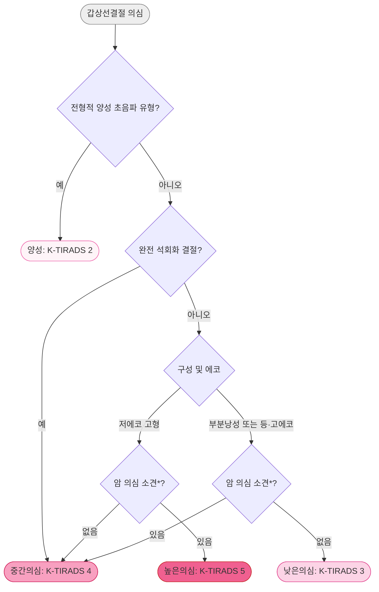

# 갑상선결절 Thyroid Nodule

## <mark style="color:green;">일반 사항</mark>

* 정의 : 촉진 또는 초음파 등 영상검사에서 주변 정상 갑상선 조직과 뚜렷하게 구별되는 병소
  * 촉진되는 병소가 항상 영상학적 이상 소견과 일치하는 것은 아니며, 촉진되지 않지만 영상검사에서 우연히 발견되는 결절(우연종)도 같은 크기의 촉진 결절과 동등한 악성 위험을 가짐
* 여성, 고령, 비만, 요오드 섭취 부족에서 흔함
* 유병률 : 고해상도 초음파검사 시 국내 성인의 30\~40%, 촉진으로는 약 5%에서 발견됨 <mark style="color:$info;">\[KTA 2024]</mark>; 미국 자료에서는 초음파상 최대 68%까지 보고 - 검사 지역·연령·성별에 따라 보고치 편차가 큼
* 임상적 중요성 : 결절의 2\~6%가 갑상선암이며, 악성 여부와 무관하게 크기가 커지면 기도 및 주위 조직을 압박하여 증상을 유발할 수 있음
* 경과 : 대부분 안정적으로 유지되며 일부는 성장하거나 감소함 - 전향적 연구에서 5년간 결절의 약 11%가 성장; 성장 자체만으로 악성을 판단하지 않음
* 갑상선 기능은 대부분 정상(euthyroid)이며 간혹 항진 또는 저하를 동반
* 선별 검사 : 가족력이 있는 일반인을 포함하여 일률적인 갑상선 초음파 선별 검사는 권고하지 않음 - 조기 진단이 이환율·사망률을 개선한다는 근거가 부족하고, 과잉 진단·과잉 치료로 인한 부작용을 초래할 수 있음 <mark style="color:$info;">\[KTA 2024]</mark>

## <mark style="color:green;">원인 및 위험 인자</mark>

#### <mark style="color:$primary;">양성 (90% 이상)</mark>

* 다결절성 갑상선종(multinodular/sporadic goiter)
* 하시모토 갑상선염(Hashimoto's/chronic lymphocytic thyroiditis)
* 낭종(colloid, simple, or hemorrhagic cyst)
* 여포선종(follicular adenoma) : macro-follicular, micro-follicular, cellular adenoma
* Hürthle 세포선종(oxyphil cell adenoma)

#### <mark style="color:$primary;">악성</mark>

* Papillary carcinoma (가장 흔함)
* Follicular carcinoma : minimally/widely invasive
* Oncocytic carcinoma (Hürthle cell carcinoma)
* Medullary carcinoma, anaplastic carcinoma, primary thyroid lymphoma
* Metastatic carcinoma (유방암, 신세포암 등)

#### <mark style="color:$primary;">경계성·저위험 종양</mark>

* 비침습성 여포성 갑상선종양(noninvasive follicular thyroid neoplasm with papillary-like nuclear features, NIFTP) : 악성 종양으로 분류하지 않으며, 수술 검체에서 종양 피막 전체를 확인하여 피막·혈관 침범이 없음을 입증해야 확진 가능

#### <mark style="color:$primary;">악성 위험 인자</mark>

* 두경부 방사선 조사력 (특히 소아기 노출; 위험도는 10\~30 Gy 구간에서 최고조 후 감소)
* 요오드 결핍 (follicular carcinoma 위험 ↑)
* 소아·청소년의 결절은 성인보다 악성 비율이 높으므로 전문 평가가 필요; 고령은 악성으로 확인되었을 때 불량한 예후와 관련
* 가족력·유전 : 직계 가족 중 갑상선분화암 환자가 2명 이상이거나 가족성 갑상선암·유전성 종양증후군이 의심되는 경우

### <mark style="color:orange;">고위험군의 갑상선암 선별 검사</mark>

* 직계 가족 중 3명 이상 갑상선분화암 환자가 있어도 일률적인 초음파검사는 권고하지 않음(조기 진단은 가능하나 이환율·사망률 개선 근거 부족)
* 가족성 갑상선암·유전성 종양증후군 가족은 유전상담 후 유전자변이 여부에 따라 선별 검사·치료 시행
* 그레이브스병, 하시모토갑상선염, 부갑상선기능항진증 환자에서도 일률적 초음파검사는 권고하지 않음
* 위 고위험군이라도 신체검진에서 결절, 비대칭적 갑상선종대, 림프절 종대가 의심되면 초음파검사를 고려
* 소아기 두경부 방사선 치료(또는 I-131 MIBG 치료) 과거력이 있는 소아암 생존자는 치료 5년 후부터 1\~2년 간격 촉진 또는 3\~5년 간격 초음파검사 권고

## <mark style="color:green;">임상 양상</mark>

* 대부분 무증상으로 검진·다른 목적의 영상검사에서 우연히 발견되거나 앞목의 혹으로 만져짐
* 큰 결절·갑상선종 : 목의 압박감, 연하곤란, 누울 때 심해지는 호흡 불편; 지속되는 애성은 성대 기능과 침범 여부 평가가 필요
* 갑자기 아프면서 커지는 결절 : 낭종 내 출혈을 우선 고려하되, 급속 성장하는 단단한 종괴는 미분화암·림프종과 감별
* 자율기능성 결절 : 두근거림, 손떨림, 더위불내성, 체중 감소 또는 무증상 TSH 억제; 갑상선기능이 정상이어도 악성을 배제하지 못함
* 병력·진찰 : 성장 속도, 통증, 애성·연하/호흡 증상, 방사선 노출·가족력, 갑상선·경부 림프절을 확인

### 🚩 Red Flags

<mark style="color:$danger;">**즉각 조치**</mark>

* 안정 시 호흡곤란, 협착음(stridor), 청색증 또는 누울 수 없을 정도의 기도 압박 → 응급실 이송 및 기도 평가  <mark style="color:$danger;">[기도 폐쇄]</mark>
* 갑자기 커지는 목 종괴·시술 후 경부 부종에 호흡곤란 동반 → 출혈·혈종 등에 의한 기도 압박 평가  <mark style="color:$danger;">[응급실]</mark>
* 성대마비에 호흡 장애·반복 흡인 등 기도 보호 장애 동반  <mark style="color:$danger;">[기도 보호]</mark>

<mark style="color:$warning;">**당일~수일 내 평가**</mark>

* 급속히 커지는 단단하고 고정된 종괴, 새로 발생하거나 지속·악화되는 애성·연하곤란 → 미분화암·림프종·침범성 암 평가; 호흡곤란이면 즉각 조치  <mark style="color:$warning;">[신속 의뢰]</mark>
* 결절과 동반된 악성 의심 경부 림프절 종대  <mark style="color:$warning;">[전이 평가]</mark>
* 병리진단검사에서 악성의심/악성(Bethesda V/VI) 결과 → 신속한 전문 진료로 치료 계획 수립  <mark style="color:$warning;">[전문 의뢰]</mark>
* 혈청 칼시토닌의 현저한 상승 또는 반복 상승(특히 ＞100 pg/㎖)  <mark style="color:$warning;">[수질암 평가]</mark>
* 소아·청소년의 높은의심(K-TIRADS 5) 결절  <mark style="color:$warning;">[소아 전문 평가]</mark>

<mark style="color:$info;">**조기 평가 및 추적**</mark>

* 반복 병리진단검사에서도 비진단적 결과가 지속  <mark style="color:$info;">[재검 계획]</mark>
* 적어도 두 방향에서 각각 ≥2 ㎜이면서 ≥20%의 직경 증가, 또는 용적 ≥50% 증가  <mark style="color:$info;">[성장 재평가]</mark>
* 자율기능성 결절로 갑상선항진증 또는 지속적 TSH 억제 동반  <mark style="color:$info;">[기능 평가]</mark>
* 비정형(AUS)·여포종양 등 미결정 결과  <mark style="color:$info;">[추가 평가]</mark>

## <mark style="color:green;">진단</mark>

* 결절 발견 시 TSH를 포함한 갑상선기능검사와 경부 림프절 평가를 포함한 초음파검사를 시행 (☞ [혈액 검사](#blood-tests), [초음파검사](#thyroid-ultrasound))
  * **TSH↓** 시 갑상선스캔을 추가하여 결절의 기능성을 확인 (☞ [갑상선스캔](#thyroid-scintigraphy))
    * 명확한 자율기능성 결절 → 갑상선항진증 치료
    * 비기능성 결절 또는 초음파-스캔 불일치 → 초음파 위험도(K-TIRADS)에 따라 FNA 시행 여부 결정 (☞ [FNA/CNB](#fna-cnb))
  * **TSH 정상 또는↑** 시 K-TIRADS에 따라 FNA 시행 여부 결정
    * 병리진단검사 결과가 미결정 범주이면 반복 FNA, CNB 또는 분자표지자검사 고려 (☞ [분자표지자검사](#molecular-tests))

<a id="blood-tests"></a>

#### <mark style="color:$primary;">혈액 검사</mark>

* **TSH를 포함한 갑상선기능검사**를 초기 검사로 시행. TSH↓이면 free T4·필요 시 T3로 갑상선중독증 정도를 확인하고 갑상선스캔을 시행; TSH↑이면 free T4 및 임상 소견에 따라 TPOAb 등으로 기능저하증·갑상선염을 평가
* 혈청 갑상선글로불린(Tg)의 일률적 측정은 권고하지 않음 - 양성·악성 모두에서 상승 가능해 민감도·특이도가 낮음
* 혈청 칼시토닌 : 모든 갑상선결절에서 일률적으로 측정하지 않으며, 갑상선수질암 의심, 수질암 가족력·MEN2 가능성, 수술 또는 비수술적절제 치료 전 측정을 고려 - ＞100 pg/㎖이면 수질암을 강하게 시사하지만 검사법·성별에 따른 참고범위와 흡연, proton pump inhibitor 사용, 신기능 저하, 만성 갑상선염 등 교란 요인을 함께 고려; 경도 상승은 재검과 원인 평가 후 해석

<a id="thyroid-scintigraphy"></a>

#### <mark style="color:$primary;">갑상선 스캔 (Thyroid Scintigraphy)</mark>

* 대상 : 혈청 **TSH↓ 시** 시행; TSH 정상/상승에서는 결절 감별을 위해 일률적으로 시행하지 않음. 이소성 갑상선 조직·흉골뒤갑상선종 등은 목적에 따라 전문의가 선택
* 열결절(hot/hyperfunctioning) : 초음파상 결절과 스캔상 열결절이 명확히 일치하면 원칙적으로 FNA 대상이 아니며 갑상선항진증 치료를 시행; 초음파-스캔 불일치, 별도의 비기능성 의심 결절 또는 악성 의심 림프절이 있으면 해당 병변을 별도로 평가
* 냉결절(cold/nonfunctioning) : 스캔 소견만으로 악성 위험을 결정하지 않고 K-TIRADS 및 임상 위험 인자에 따라 FNA 여부를 결정

<a id="thyroid-ultrasound"></a>

#### <mark style="color:$primary;">갑상선 초음파검사</mark>

* 대상 : 결절이 촉진되거나 영상검사에서 우연히 발견되는 등 갑상선결절이 존재하거나 의심되는 모든 환자; TSH가 낮으면 초음파와 함께 갑상선스캔을 추가하여 기능 여부를 확인
* 갑상선결절이 존재하거나 의심되는 모든 환자에서 경부 림프절 평가를 포함한 초음파검사를 권고
* 국내에서는 대한갑상선영상의학회 K-TIRADS에 따라 암 위험도 및 병리진단검사(FNA/CNB) 기준을 적용
* 구성·에코를 먼저 평가 : **저에코 고형결절은 3대 암 의심 소견이 없어도 K-TIRADS 4**이며, 의심 소견이 하나 이상 동반되면 K-TIRADS 5. 고형·저에코라는 소견을 양성으로 해석하지 않음
* **암 의심 초음파 소견** : 점상 고에코 병소(미세석회화), 비평행 방향성(taller-than-wide), 불규칙한 경계(침상 또는 소엽성)
* **양성 초음파 유형(K-TIRADS 2)** : 등/고에코 해면모양(spongiform), 낭성 부분 내 점상 고에코 병소와 혜성꼬리 인공음영(comet-tail artifact)을 동반한 부분낭성 결절, 순수낭종 - 등/고에코, 주변부 혈류 또는 조대석회화만으로 양성을 판단하지 않음

<table><thead><tr><th width="66.19049072265625">범주</th><th width="107.14288330078125">초음파 유형</th><th width="364.761962890625">주요 소견</th><th width="89.0477294921875">암 위험도</th><th width="112.2698974609375">FNA/CNB 시행 기준</th></tr></thead><tbody><tr><td>5</td><td>높은의심</td><td>암 의심 소견이 있는 저에코 고형결절</td><td>＞60%</td><td>＞1 ㎝¹⁾</td></tr><tr><td>4</td><td>중간의심</td><td>① 암 의심 소견 없는 저에코 고형결절 ② 암 의심 소견 있는 부분낭성/등·고에코 결절 ③ 완전 석회화 결절</td><td>10~40%</td><td>＞1~1.5 ㎝</td></tr><tr><td>3</td><td>낮은의심</td><td>암 의심 소견 없는 부분낭성 또는 등/고에코 결절</td><td>3~10%</td><td>＞2 ㎝</td></tr><tr><td>2</td><td>양성</td><td>등/고에코 해면모양, comet-tail artifact 동반 부분낭성, 순수낭종</td><td>＜3%</td><td>해당 없음²⁾</td></tr><tr><td>1</td><td>무결절</td><td>-</td><td>-</td><td>-</td></tr></tbody></table>

¹⁾ _경부 림프절전이 의심, 명백한 갑상선외부침범, 확인된 원격전이, 수질암 의심 등 불량한 예후 인자가 있으면 크기와 무관하게 병리진단검사 시행. 작은(＞0.5\~≤1 ㎝) 높은의심 결절이 기관에 붙어 있거나 되돌이후두신경 경로의 후내측 피막에 붙어 있어 침범 위험이 있는 경우 성인에서도 병리진단검사 권고; 소아는 크기가 작아도 높은의심이면 임상 소견을 고려해 시행._\
²⁾ _양성(K-TIRADS 2) 결절은 원칙적으로 생검 대상이 아니나, 지속적 성장 또는 비수술적절제·수술 예정인 경우 생검 가능._

* 중간의심(K-TIRADS 4)의 생검 기준은 특별한 위험 인자가 없으면 ＞1.5 ㎝를 적용할 수 있으며, 초음파 소견·결절 위치·임상 위험 인자·환자 특성(연령, 동반질환, 선호도)을 종합해 1\~1.5 ㎝ 범위에서 조정함
* 양성 FNA 후 장기 추적에서의 전체 악성 위험은 대략 1\~2%로 낮지만, 높은의심 초음파 소견과 병리 결과가 불일치하면 위험이 더 높으므로 초음파 소견에 따른 재검·추적이 필요함  <mark style="color:$info;">[Bethesda 2023]</mark>
* 경부 림프절의 낭성 변화·점상 고에코·비정상 혈류 등 전이 의심 소견은 결절 크기와 별도로 평가; 필요 시 림프절 FNA와 세척액 Tg 검사를 시행. 혈청 Tg의 선별 측정과 구분함
* 지속되는 애성·성대마비 의심 시 후두경검사, 흉골뒤 확장·기관 압박 또는 침범 의심 시 경부/흉부 CT 등을 선택적으로 추가

<a id="fna-cnb"></a>

#### <mark style="color:$primary;">병리진단검사 - 세침흡인검사(FNA)·중심바늘생검(CNB)</mark>

* 시행 시점 : 초음파 위험도(K-TIRADS)에 따른 시행 기준(크기 cutoff)을 충족하는 결절에서 FNA 시행 여부를 결정
* FNA는 갑상선결절 병리진단의 1차 검사
* CNB는 반복 비진단적 결과, 여포성 종양·림프종·미분화암 의심 등에서 FNA의 보완적 수단으로 숙련된 시술자가 선택적으로 시행
* FNA 결과는 2023년 개정 Bethesda system(제3판) 6개 범주로 보고

<table><thead><tr><th width="136.66668701171875">진단 범주</th><th width="130.4761962890625">성인 암 위험도</th><th width="132.3809814453125">소아 암 위험도</th><th>성인에서 주된 후속 조치</th></tr></thead><tbody><tr><td>I. 비진단적</td><td>13% (5~20)</td><td>14% (0~33)</td><td>초음파유도하 병리진단검사 재시행</td></tr><tr><td>II. 양성</td><td>4% (2~7)</td><td>6% (0~27)</td><td>즉각적 추가 검사·치료 불필요</td></tr><tr><td>III. 비정형(AUS)</td><td>22% (13~30)</td><td>28% (11~54)</td><td>반복 FNA/CNB 또는 분자표지자검사 후 초음파 추적 또는 수술 결정</td></tr><tr><td>IV. 여포종양</td><td>30% (23~34)</td><td>50% (28~100)</td><td>진단적 엽절제 우선 고려; 선택적으로 분자검사·관찰</td></tr><tr><td>V. 악성의심</td><td>74% (67~83)</td><td>81% (40~100)</td><td>종양 종류에 따른 수술 평가; 저위험 미세유두암 의심은 적극적 관찰 고려</td></tr><tr><td>VI. 악성</td><td>97% (97~100)</td><td>98% (86~100)</td><td>종양 종류별 치료; 저위험 미세유두암은 적극적 관찰 고려</td></tr></tbody></table>

* 표의 위험도는 NIFTP를 포함한 수술 표본 중심의 평균(범위)로, 선택 편향과 기관별 차이가 있음. 특히 양성 FNA의 4%를 모든 양성 결절에 그대로 적용하지 않으며, 장기 추적 기반 위험은 약 1\~2%임. NIFTP를 악성에서 제외한 성인 평균 추정치는 I~VI 순서로 12%, 2%, 16%, 23%, 65%, 94%  <mark style="color:$info;">[Bethesda 2023, Tables 2~4]</mark>
* 표는 **FNA의 Bethesda 체계**이며, CNB는 대한갑상선학회의 별도 6범주 진단체계를 사용; 범주가 유사해도 암 위험도를 동일하게 적용하지 않음
* CNB는 반복 FNA보다 비진단적 결과를 줄일 수 있고 여포성 종양·림프종 등의 평가에 유용. 여포선종과 여포암의 확정 감별에는 수술 검체에서 피막·혈관 침범 확인이 필요
* 첫 비진단적 결과는 초음파유도 FNA 재검 또는 선택적 CNB를 계획; 높은의심은 대개 6개월 이내, 낮은/중간의심은 12개월 이내에 재검. 임상적으로 암이 의심되면 더 일찍 시행하며, 재검을 위해 일률적으로 3개월을 기다릴 필요는 없음  <mark style="color:$info;">[KSThR 2021]</mark>
* 비진단적 결과 반복 시 : 낭성이면서 높은의심 소견이 없으면 주의 깊은 추적관찰 가능; 높은의심 소견, 추적 중 20% 이상 크기 증가, 임상적 암 위험 인자가 있으면 진단 목적의 수술적 절제 고려
* 비정형(AUS, Atypia of Undetermined Significance) : 경험 많은 병리의 재판독을 고려; 핵 비정형(nuclear atypia)은 기타 비정형보다 악성 위험이 높음. 반복 FNA/CNB 또는 분자표지자검사로 재평가 후 추적 또는 수술 결정
* 여포종양(Bethesda IV) : 진단적 엽절제를 우선 고려. 크기가 클수록 위험이 높아질 수 있으나 2 ㎝ 미만이라고 악성을 배제하지 못함; 분자검사·초음파·임상 위험과 선호도를 반영해 개별화

<a id="molecular-tests"></a>

#### <mark style="color:$primary;">분자표지자검사</mark>

* 검사 대상 : 병리진단검사에서 비정형(AUS)·여포종양·악성의심 등 미결정(indeterminate) 범주로 나온 결절 - 임상적 위험 요소, 세포검사 결과, 초음파 소견, 환자 선호도를 종합하여 시행 여부를 결정
* BRAF<sup>V600E</sup> : 유두암 진단 특이도가 높지만, **음성 결과만으로 암을 배제하지 못함**
* RAS(NRAS/HRAS/KRAS) : 여포형 종양 평가에 도움을 줄 수 있으나 NIFTP·양성 종양에서도 검출되므로 단독 양성을 암 확진으로 해석하지 않음
* TERT 프로모터 돌연변이 : 특히 BRAF<sup>V600E</sup> 또는 RAS와 동반될 때 불량한 예후의 표지자; 단일 수치를 모든 결절의 예후에 일률적으로 적용하지 않음
* NGS 기반 다유전자패널 : 성능·양성/음성예측도는 검사 종류와 기관의 암 유병률에 따라 다름. 결과가 수술 여부·범위를 실제로 바꿀 상황에서 이득·한계·비용을 설명하고 선택하며, 임상·초음파·병리 평가를 대체하지 않음
* 미결정 세포검사 결과만을 이유로 PET/CT를 일률적으로 추가하지 않음

### <mark style="color:orange;">18F-FDG PET/CT 우연종</mark>

* 다른 목적의 PET/CT에서 갑상선 국소 섭취(focal uptake)가 발견되면 초음파로 평가. 평가된 병변에서 악성 위험은 약 30%이나 선택 편향이 있고 초음파 유형에 따라 차이가 큼; PET 섭취만으로 모든 결절을 생검하지 않고 K-TIRADS·크기·임상 위험에 따라 결정
* 원래 암의 예후·기대여명·동반질환 때문에 갑상선결절 평가가 치료 결과에 영향을 주기 어려우면 추가 검사 이득을 개별 판단  <mark style="color:$info;">[BTA/BAETS 2026]</mark>
* 미만 섭취(diffuse uptake)는 TSH 등으로 기능을 확인하고, 필요 시 초음파로 동반 결절을 확인. 만성 림프구성 갑상선염에 합당하고 별도 의심 결절이 없으면 추가 영상검사·병리진단검사는 대개 불필요

### <mark style="color:orange;">다결절성 갑상선종</mark>

* 1 ㎝ 초과 결절이 2개 이상인 경우 단일 결절과 동일하게 평가하며, 결절마다 독립적 악성 위험이 있으므로 초음파 소견에 근거해 1개 이상 결절에서 FNA 고려; 가장 크거나 가장 만져지는 결절만 검사하면 암을 간과할 수 있음
* 악성 의심 소견 없이 유사한 융합성 결절이 다수라면 가장 큰 결절(＞2 ㎝)에서 FNA를 시행하거나 FNA 없이 관찰 가능
* 혈청 TSH가 낮으면 자율기능성 결절 가능성을 평가하기 위해 갑상선스캔 시행

### <mark style="color:orange;">소아·청소년</mark>

* 성인의 크기 기준만으로 생검 여부를 결정하지 않으며, 초음파 소견·림프절·방사선/유전 위험을 함께 평가하여 전문 진료 의뢰
* 미결정 결과도 성인보다 악성 비율이 높을 수 있음. 저위험 미세유두암이어도 19세 미만은 적극적 관찰의 안전성 근거가 부족하여 수술을 권고  <mark style="color:$info;">[KTA 2025]</mark>

### <mark style="color:orange;">감별</mark>

<table><thead><tr><th width="180">질환·상황</th><th>감별 단서와 대응</th></tr></thead><tbody>
<tr><td>낭종 내 출혈</td><td>갑작스러운 통증·종대; 호흡곤란이면 즉각 기도 평가</td></tr>
<tr><td>아급성갑상선염·염증성 가성결절</td><td>압통, 발열, 염증수치/기능 변화. 국소 저에코 병변이 결절처럼 보일 수 있어 염증 경과와 재평가를 종합</td></tr>
<tr><td>미분화암·갑상선림프종</td><td>빠른 성장, 단단한 고정성 종괴, 압박 증상; 신속한 전문 평가와 적절한 조직검사</td></tr>
<tr><td>여포선종·여포암·NIFTP</td><td>FNA/CNB만으로 확정 감별이 어려움; 필요한 경우 수술 검체 평가</td></tr>
<tr><td>갑상선 밖의 경부 종괴</td><td>림프절, 부갑상선 병변, 갑상설관낭종 등; 초음파로 기원 확인, 부갑상선 병변 의심 시 Ca·PTH 평가</td></tr>
</tbody></table>

***



_\*점상 고에코 병소(미세석회화), 비평행 방향성(taller-than-wide), 불규칙한 경계(침상 또는 소엽성). 전형적 K-TIRADS 2 유형은 우선 적용하며, 기도 위급 증상·명백한 침범·의심 림프절은 이 분류와 별도로 신속 평가한다._

<p align="center"><strong>K-TIRADS 기반 갑상선결절 악성 위험 계층화 알고리듬</strong></p>

<p align="center"><em><mark style="color:$info;">Ref. 대한갑상선영상의학회. 2021 K-TIRADS and Imaging-based management of Thyroid nodules; 대한갑상선학회 갑상선결절 진료권고안 2024, Table 2.2.A</mark></em></p>

***

## <mark style="background-color:$warning;">Management</mark>


* 병리진단 범주별 관리 원칙 : 비진단적 → 재검; 양성 → 초음파 위험에 따른 관찰; 비정형/여포종양 → 추가 평가 후 관찰 또는 진단 수술; 악성의심/악성 → 종양 종류·진행도에 따른 치료(저위험 미세유두암은 적극적 관찰 선택 가능)

### <mark style="color:orange;">양성 결절의 장기 추적관찰</mark>

<mark style="color:cyan;">**병리진단검사에서 양성으로 확인된 결절**</mark>

<table><thead><tr><th width="150">초음파 소견</th><th>추적 계획</th></tr></thead><tbody><tr><td>높은의심</td><td>6~12개월 내 초음파; 크기 감소 없으면 병리진단검사 반복(1 ㎝ 이하는 반복 없이 초음파 추적 고려)</td></tr><tr><td>낮은/중간의심</td><td>12~24개월에 초음파; 크기 증가(두 방향 ≥2 ㎜ &#x26; ≥20% 직경 증가, 또는 용적 ≥50% 증가) 또는 새로운 의심 소견 시 병리진단검사 또는 지속 관찰</td></tr><tr><td>양성 초음파 소견</td><td>악성 위험을 고려한 추적 초음파는 불필요</td></tr></tbody></table>

<mark style="color:cyan;">**병리진단검사 적응증에 해당하지 않는 결절**</mark>

<table><thead><tr><th width="150">초음파 소견</th><th>추적 계획</th></tr></thead><tbody><tr><td>높은의심</td><td>초기 1~2년은 6~12개월 간격, 이후 안정적이면 1년 간격</td></tr><tr><td>낮은/중간의심</td><td>1~2년 이상 간격(1 ㎝ 이하 낮은의심은 2~5년 이후 고려)</td></tr><tr><td>양성 초음파 소견</td><td>필요 시 2~5년 이후 고려</td></tr></tbody></table>

* 반복적으로 양성으로 진단되고 초음파 소견의 변화가 없으면 추가 병리진단검사는 불필요. 다만 새로운 의심 소견·림프절·압박 증상이 생기거나 영상-병리 불일치가 지속되면 재평가
* 위 추적관찰 기준(20% 이상 직경 증가 등)을 충족했다고 해서 반드시 수술이 필요한 것은 아니며, 반복 병리진단검사에서 양성이 유지되면 환자 증상·선호도를 고려하여 관찰을 지속할 수 있음

### <mark style="color:orange;">악성 또는 악성 의심 결절</mark>

* 유두암·여포암 등 수술 대상 갑상선암은 전문센터에서 수술 범위를 결정. **림프종·전이암·절제 불가능한 미분화암은 악성 결과라도 일률적으로 갑상선절제술을 시행하지 않으며**, 해당 종양의 치료 경로로 연결
* 저위험군 성인(≥19세)의 미세갑상선유두암(≤1 ㎝, 유두암에 합당한 Bethesda V/VI, 임상적 전이·육안적 갑상선외부침범·기관/되돌이후두신경 침범 의심 없고 공격적 아형의 세포학적 근거 없음)에서는 충분한 설명과 공동 의사결정을 거쳐 적극적 관찰(active surveillance)을 선택할 수 있음
  * 장기간 정기 추적에 동의하고 순응할 수 있으며, 표준화된 초음파 평가와 필요 시 지연 수술이 가능한 경험 많은 기관에서 시행
  * 종양과 기관·되돌이후두신경 등 주요 구조물의 위치 관계, 연령과 동반질환, 환자 선호를 함께 고려 - 젊은 환자는 진행 가능성이 상대적으로 높음을 설명
  * 추적 : 진단 후 처음 1\~2년은 6개월마다 경부 초음파, 이후 진행이 없으면 매년 추적; 세 방향 종양 크기·갑상선외부침범·경부 림프절과 갑상선기능을 평가함 <mark style="color:$info;">\[KTA 2025 적극적 관찰]</mark>
  * 크기 증가의 정의 : 최대 직경 ≥3 ㎜ 증가 또는 두 방향에서 각각 ≥2 ㎜ 증가. 크기 증가와 수술 전환 기준을 구분하며, 부피 ≥50% 증가만으로 일률적으로 수술하지 않음
  * 크기 증가만 있을 때 수술 전환 : 최대 직경 ≥13 ㎜ 또는 두 방향의 직경이 각각 ≥12 ㎜에 도달한 경우. 측정 변이를 고려해 6개월 이내 연속 두 초음파에서 기준 충족을 확인함
  * 새로 적극적 관찰에 부적합한 침범 소견이 발생하거나 림프절·원격전이가 확인/의심되면 크기 기준과 무관하게 신속한 수술 평가; 환자가 원하면 진행이 없어도 수술로 전환 가능
* 림프절/원격전이 의심, 육안적 갑상선외부침범·기관/되돌이후두신경 침범 의심, 공격적 조직아형(긴세포, 원주세포, hobnail 등)의 세포학적 의심이 있으면 적극적 관찰 대상에서 제외하고 수술 우선
* 생검하지 않은 작은 K-TIRADS 5 결절도 고위험 소견이 없으면 선호도에 따라 초음파 관찰 가능; 이는 암 확진을 의미하지 않으며, 병리로 진단된 저위험 미세유두암의 적극적 관찰과 구분하여 설명  <mark style="color:$info;">[KSThR 2024]</mark>

## <mark style="color:green;">비-약물 치료 및 예방</mark>

* 증상 없는 양성 결절은 대부분 치료가 필요하지 않으며, 초음파 위험도·병리진단 결과·크기 및 임상 상황에 따라 추적 여부와 간격을 결정 - K-TIRADS 2이면서 병리진단상 양성이거나 반복 검사에서 양성이고 초음파 변화가 없으면 추가 초음파가 필요하지 않을 수 있음
* 요오드 섭취를 극단적으로 제한하거나 과잉 섭취하지 않도록 안내(결핍·과잉 모두 결절·기능 이상과 연관)
* 압박 증상·미용 문제가 실제 결절에 기인한 것인지 영상 검사로 확인 후 비특이 증상과 감별

## <mark style="color:green;">약물 치료</mark>

#### <mark style="color:$primary;">Levothyroxine 억제 요법</mark>

* 양성 갑상선결절에 대한 일률적인 갑상선호르몬 억제 치료는 권고하지 않음 - 일부 연구에서 평균 결절 용적이 5\~15% 감소했으나 효과가 제한적이고, TSH 억제에 따른 부정맥·골소실 위험이 있어 이득·위험의 균형이 불리함
* 결절 억제만을 목적으로 정상인을 의도적으로 subclinical hyperthyroidism 상태로 만드는 치료는 권장하지 않음
* 크기가 증가하는 양성 결절에서도 LT4 억제 요법의 유효성을 뒷받침하는 근거는 부족함
* 동반된 갑상선기능저하증에 대한 LT4 보충 치료는 별개이며, 결절이 있다는 이유로 필요한 보충 치료를 중단하지 않음
* 경과 관찰 중 크기가 다소 증가하였으나 반복 세포검사에서 양성인 경우, 대부분의 무증상 결절은 치료 없이 추적관찰

## <mark style="color:green;">시술 및 기타 처치</mark>

### <mark style="color:orange;">양성 결절의 비수술적 절제 치료 및 수술</mark>

* 반복 병리진단검사에서 양성이라도 ① 압박 증상, ② 미용적 문제, ③ 자율기능성 결절(갑상선항진증 동반) 중 하나에 해당하면 치료를 고려 - 수술, 방사성요오드, 비수술적절제(에탄올·고주파·레이저절제술) 중 임상 특성·동반 질환·환자 선호를 고려해 선택. 방사성요오드는 주로 자율기능성 결절에 적용
* 대상 결절 정의
  * 일반 고형결절 : 원칙적으로 FNA 또는 CNB에서 2회 이상 양성 확인
  * K-TIRADS 2 또는 자율기능성 결절 : 영상·임상 소견을 종합하여 1회의 양성 병리 결과로 치료 고려 가능
  * 순수낭종 : FNA가 비진단적으로 나오더라도 영상 소견과 임상 상황에 따라 치료 가능
  * K-TIRADS 5 또는 여포종양·악성의심·악성 병리 결과 : 양성 결절에 대한 비수술적 절제 대상에서 제외. 과거 범주 IV~VI 결과가 있었다면 이후 양성이 2회 나왔다는 이유만으로 양성 결절로 간주하지 않음
* **고형/고형우세 결절** : 고주파절제술 또는 레이저절제술이 우선 권고; 에탄올절제술은 결절 내 불균일 확산·누출 위험으로 권고하지 않음
* **재발성 낭성 결절** : 단순 흡인 우선 시도 후 재발 시 에탄올절제술이 1차 치료
* **자율기능성 결절** : 근본 치료로 방사성요오드 또는 수술을 우선 고려; RAI·수술을 거부하거나 금기인 경우 등 선택된 환자에서는 고주파절제술을 대안으로 고려함. 작은 결절일수록 기능 정상화 가능성이 높으나 잔존 항진증·재성장·반복 치료 가능성을 설명함. 고령·동반질환·환자 선호에 따라 전문의 감독하 장기 저용량 MMI도 선택할 수 있으나 중단 후 관해를 기대하는 치료는 아님 <mark style="color:$info;">\[ATA 2016]</mark>
* **수술 우선 또는 전문센터 개별 판단** : 흉골뒤갑상선종, 매우 큰 결절, K-TIRADS 5 또는 악성·여포종양 의심 결절 - 큰 결절은 비수술적 절제 후 잔존·재성장 및 반복 시술 가능성이 높음을 설명
* ＞4 ㎝로 성장하며 압박증상이 심하거나 악성이 우려되는 결절은 수술 고려; 크기만으로 모든 양성 결절을 수술하지 않음
* 시술 전 영상-병리 일치, 음성·성대 기능, 출혈 위험과 항혈전제 복용을 확인하고, 성대신경 손상·혈종·통증·재성장·반복 시술 가능성을 설명. 항혈전제를 환자가 임의로 중단하지 않도록 안내
* 열절제술 후 경부 초음파를 보통 1\~3개월, 6개월, 12개월에 시행하고 이후 재성장·증상에 따라 장기 추적. 기능성 결절은 갑상선기능과 약물 필요성도 재평가  <mark style="color:$info;">[ATA 2023 절제술 성명]</mark>

***

### <mark style="color:orange;">임신·수유 중 갑상선결절</mark>

* 초음파 악성 위험 평가는 비임신부와 같으며 **FNA는 임신 중 시행 가능**. 결과가 임신 중 관리에 미칠 영향, 초음파 위험도와 선호도를 고려해 검사 시점을 공동 결정
* 임신 초기의 생리적 TSH 저하만으로 자율기능성 결절을 확진하지 않음. 초기 이후에도 TSH 억제가 지속되면 자율기능성 결절 등을 평가하되, 임신 중 방사성동위원소 스캔은 금기; 고위험 소견이 없으면 산후까지 FNA를 미룰 수 있음
* 미결정 세포검사의 분자표지자검사는 임신 중 진단 성능이 검증되지 않아 일률적으로 적용하지 않음
* 저위험 갑상선분화암은 초음파로 추적하면서 대개 분만 후까지 수술 연기 가능. 진행 위험·침범·전이 또는 합병증 우려가 크면 다학제 평가 후 임신 중 수술을 결정; 중기를 선호하지만 **긴급 수술을 특정 임신 주수까지 미루지 않음**
* **I-131 치료는 임신·수유 중 금기**. 치료 전 수유를 완전히 중단하고, 가능하면 수유 중단 후 적어도 3개월을 기다릴 이득·위험을 전문팀과 논의; 투여 후 해당 영아에게 수유를 재개하지 않음
* 수유 중 진단용 스캔은 I-131 치료와 구분하여 핵종·투여량에 맞춰 일시 수유 중단 계획을 세움. 갑상선중독증의 약물 치료는 항진증 챕터 참조  <mark style="color:$info;">[ATA 2026 임신·산후 지침]</mark>

***

## <mark style="color:red;">질병코드</mark>

E04.1 비독성 단순갑상선결절 Nontoxic single thyroid nodule

E04.2 비독성 다결절성 고이터 Nontoxic multinodular goitre

D34 갑상선의 양성 신생물 Benign neoplasm of thyroid gland

C73 갑상선의 악성 신생물 Malignant neoplasm of thyroid gland

* 기능성·갑상선중독증이 있으면 해당 진단에 맞는 E05 계열을 검토. 단순 결절과 양성 신생물을 구분하며, 미결정 세포검사 결과만으로 악성 신생물 코드를 부여하지 않음

***

## <mark style="color:purple;">처방례</mark>

> **처방례 1. 초진 - 초기 검사 오더**
>
> ```
> 갑상선기능검사(TSH; 결과에 따라 free T4·T3 등 추가)  1회
> 갑상선 초음파(경부 림프절 평가 포함)  1회
> ```
>
> _✽갑상선결절이 존재하거나 의심되면 TSH와 관계없이 경부 림프절 평가를 포함한 초음파로 K-TIRADS 위험도를 평가하고, TSH가 낮으면 갑상선스캔을 추가하여 기능성을 확인_

> **처방례 2. 높은의심(K-TIRADS 5) 결절 - 병리진단검사 의뢰**
>
> ```
> 갑상선 초음파유도 FNA  1회
> ```
>
> _✽1 ㎝ 초과 시 시행; ＞0.5 ㎝이면서 ≤1 ㎝라도 기관·되돌이후두신경 경로에 붙어 있어 침범 위험이 있으면 시행 권고. CNB는 반복 비진단적 결과 등 선택된 경우에 보완적으로 고려_

> **처방례 3. 병리진단검사에서 양성으로 확인된 K-TIRADS 3\~4 결절 - 추적관찰 계획**
>
> ```
> 갑상선 초음파  12~24개월 후 재검
> ```
>
> _✽두 방향에서 2 ㎜ 이상 & 20% 이상 직경 증가, 또는 용적 50% 이상 증가 시 병리진단검사 또는 지속 관찰을 고려; 일률적 levothyroxine 억제요법은 시행하지 않음_

> **처방례 4. 자율기능성 결절(TSH↓, 갑상선중독증 동반) - 협진 의뢰**
>
> ```
> 갑상선 스캔  1회
> 내분비내과 의뢰 (방사성요오드 치료 또는 수술 상담)
> ```
>
> _✽전신 증상이 심하면 의뢰 전 propranolol 등 베타차단제로 증상 조절 고려; 항갑상선제는 중단 후 재발하기 쉬우므로 근본 치료로 방사성요오드 또는 수술을 우선 고려함. 선택된 환자에서는 고주파절제술 또는 전문의 감독하 장기 저용량 약물 치료를 개별화함_

> **처방례 5. 압박·미용 증상 동반 양성 고형결절 - 비수술적절제 의뢰**
>
> ```
> 영상의학과/갑상선센터 의뢰 (고주파절제술 또는 레이저절제술 상담)
> ```
>
> _✽일반 고형결절은 원칙적으로 2회 이상 양성 확인; K-TIRADS 2/자율기능성 결절은 본문 예외 참조. K-TIRADS 5 또는 과거 여포종양·악성의심/악성 결과가 있는 결절은 양성 결절의 절제 대상에서 제외. 흉골뒤갑상선종은 수술 우선 평가_

***

## <mark style="color:$success;">핵심 복약 지도</mark>

> **검사 결과를 어떻게 설명할까요?**
>
> * 양성 FNA 후 장기 추적에서 암으로 확인되는 비율은 약 1\~2%로 낮습니다. 초음파 소견과 결과가 맞지 않으면 재검이 필요하며, 전형적 양성 소견에서는 추가 검사가 필요하지 않을 수도 있음을 설명합니다.
> * "비정형" 또는 "여포종양" 같은 결과는 암 확진이 아니라 **진단이 불확실하다는 뜻**이며, 일정한 악성 위험이 있으므로 반복 검사·분자표지자검사·진단 수술 등으로 위험도를 좁혀갈 수 있음을 안내합니다.

> **추적관찰 순응도**
>
> * 결절의 성장이 곧 암이나 수술 필요성을 의미하지는 않습니다. 정해진 초음파 일정과 새 증상에 따른 진료를 지키고, 성장·새로운 의심 소견이 있으면 재검 여부를 판단하도록 안내합니다.
> * 갑상선호르몬제(levothyroxine)를 결절 억제 목적으로 임의로 복용하지 않도록 설명 - 효과는 제한적이고 부정맥·골소실 위험이 있습니다. 기능저하증 때문에 처방된 약은 임의로 중단하지 않도록 안내합니다.

> **언제 다시 병원을 방문해야 하나요?**
>
> * 목소리가 새로 쉬거나 삼키기 어려워진 경우, 또는 증상이 지속·악화되는 경우 - 한 달을 기다리지 말고 조기 상담
> * 결절이 빠르게 커지거나 단단하게 만져지는 경우
> * 호흡곤란이나 숨쉴 때 목에서 거칠고 높은 소리가 발생하는 경우 - 즉시 응급실
> * 예정된 추적 초음파나 재검을 놓친 경우

***

## <mark style="color:green;">주요 참고문헌 및 확인 자료</mark>

### ＜임상 근거＞

* 대한갑상선학회. 대한갑상선학회 갑상선결절 진료권고안 2024. Int J Thyroidol. 2024;17(1):208–244. — 국내 결절 진단·추적·비수술적 치료. [원문](https://doi.org/10.11106/ijt.2024.17.1.208)

* 대한갑상선영상의학회. 2021 Korean Thyroid Imaging Reporting and Data System and Imaging-Based Management of Thyroid Nodules. — K-TIRADS 분류와 병리진단검사 기준. [원문](https://doi.org/10.3348/kjr.2021.0713)

* 대한갑상선학회. 2025 Korean Thyroid Association Clinical Management Guideline on Active Surveillance for Low-Risk Papillary Thyroid Carcinoma. Endocrinol Metab (Seoul). 2025;40:307–341. — 성인 ≤1 ㎝ 저위험 유두암 대상 선정, 추적, 성장 및 수술 전환 기준. [원문](https://doi.org/10.3803/EnM.2025.2461)

* Haugen BR, et al. 2015 American Thyroid Association Management Guidelines for Adult Patients with Thyroid Nodules and Differentiated Thyroid Cancer. Thyroid. 2016;26:1–133. — 양성 결절의 LT4 억제 치료 근거와 위험. [원문](https://doi.org/10.1089/thy.2015.0020)

* Ross DS, et al. 2016 American Thyroid Association Guidelines for Diagnosis and Management of Hyperthyroidism and Other Causes of Thyrotoxicosis. — 자율기능성 결절의 근본 치료와 선택적 장기 약물 치료. [원문](https://doi.org/10.1089/thy.2016.0229)

* Korevaar TIM, et al. American Thyroid Association 2026 Guidelines for Thyroid Disease in Preconception, Pregnancy, and Postpartum. — 임신 중 결절·암과 수유 중 방사성동위원소 사용. [원문](https://doi.org/10.1177/10507256261445624)

* Ali SZ, et al. The 2023 Bethesda System for Reporting Thyroid Cytopathology. Thyroid. 2023;33:1039–1044. — 제3판 세포진단 범주와 악성 위험도. [원문](https://doi.org/10.1089/thy.2023.0141)

* 대한갑상선영상의학회. Standardized Ultrasound Evaluation for Active Surveillance of Low-Risk Thyroid Microcarcinoma in Adults: 2024 Consensus Statement. Korean J Radiol. 2024;25(11):942–958. — 작은 높은의심 결절의 관찰과 침범 위험 평가. [원문](https://doi.org/10.3348/kjr.2024.0871)

* Sinclair CF, et al. General Principles for the Safe Performance, Training, and Adoption of Ablation Techniques for Benign Thyroid Nodules: An American Thyroid Association Statement. Thyroid. 2023;33:1150–1170. — 시술 전 확인과 시술 후 추적. [원문](https://doi.org/10.1089/thy.2023.0281)

* Moorthy R, et al. Evaluation and Management of Thyroid Nodules: A Joint Consensus Statement From the BTA, BAETS and Collaborating Bodies. Clin Endocrinol (Oxf). 2026;104:682–692. — PET 우연종의 임상 맥락과 과잉 검사 감소. [원문](https://doi.org/10.1111/cen.70116)

### ＜허가·급여 확인 자료＞

* 식품의약품안전처. 의약품안전나라 — 국내 제품별 적응증·용법·금기 및 허가 상태 확인.

[https://nedrug.mfds.go.kr/index](https://nedrug.mfds.go.kr/index)

* 건강보험심사평가원 — 갑상선 초음파·생검·치료 행위의 급여 및 비급여 확인 자료. [누리집](https://www.hira.or.kr/)

* 통계청. 제9차 한국표준질병·사인분류(KCD-9), 2026년 시행 — 질병코드 확인 자료. [고시](https://www.law.go.kr/admRulLsInfoP.do?admRulSeq=2100000260878)

***

## <mark style="color:blue;">환자 안내서</mark>


**갑상선결절, 대부분은 걱정하지 않아도 됩니다**

갑상선결절은 매우 흔해서 초음파로 검사하면 국내 성인 10명 중 3\~4명에서 발견됩니다. 이 중 실제로 암인 경우는 100명 중 2\~6명 정도이며, 나머지는 대부분 치료가 필요 없는 양성 결절입니다.


#### <mark style="color:$primary;">왜 결절이 생기나요?</mark>

* 갑상선 조직 일부가 정상보다 과도하게 자라면서 만들어지는 경우가 대부분입니다.
* 여성, 고령, 요오드 섭취 부족, 방사선 노출력, 가족력이 있으면 더 잘 생길 수 있습니다.
* 건강검진에서 우연히 발견된 결절도 대부분 양성이며, **발견되었다는 이유만으로 수술이 필요한 것은 아닙니다.**

#### <mark style="color:$primary;">검사는 어떻게 진행되나요?</mark>

* 혈액검사로 갑상선 기능을 먼저 확인하고, 초음파로 결절의 모양을 평가합니다.
* 초음파에서 암이 의심되는 모양이거나 크기가 일정 기준을 넘으면 **가는 바늘로 세포를 채취하는 검사(FNA)**를 시행합니다. 바늘이 가늘어 대부분 통증이 크지 않습니다.
* 검사 결과가 "애매하다"고 나올 수 있는데, 이는 암이라는 뜻이 아니라 조금 더 지켜보거나 추가 검사가 필요하다는 의미입니다.

#### <mark style="color:$primary;">치료가 필요한가요?</mark>

* 양성으로 확인되면 대부분 치료가 필요하지 않습니다. 초음파 모양과 병리 결과에 따라 정기적으로 추적하거나, 추가 초음파가 필요하지 않을 수도 있습니다.
* 갑상선호르몬제를 결절을 줄이려는 목적으로 복용하는 것은 권장하지 않습니다. 다만 기능저하증 때문에 처방받은 약은 임의로 끊지 마십시오.
* 결절이 커서 목이 눌리거나 미용적으로 불편하면 고주파·레이저절제술 같은 비수술적 치료나 수술을 상의할 수 있습니다.
* 암으로 진단되면 대부분 수술을 하지만, 매우 작고 위험도가 낮은 갑상선유두암은 **당장 수술하지 않고 정기적으로 지켜보는 방법(적극적 관찰)**을 선택할 수도 있습니다.

#### <mark style="color:$primary;">이럴 때는 병원을 방문하세요</mark>

* **목소리가 새로 쉬거나 음식을 삼키기 어려워졌을 때**, 또는 이러한 증상이 지속·악화될 때 - 한 달을 기다리지 말고 진료받으십시오
* 목의 혹이 **빠르게 커지거나 딱딱하게** 만져질 때
* **숨쉬기가 힘들거나 숨쉴 때 목에서 거칠고 높은 소리가 날 때**, 특히 검사·시술 후 목이 빠르게 부을 때 - 즉시 응급실
* 정해진 추적 초음파 일정을 잊지 않고 지켜주세요.
