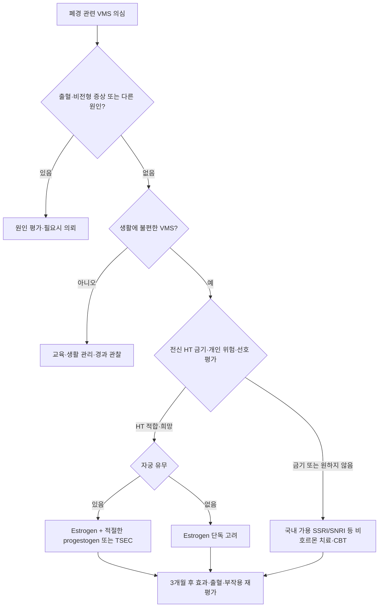
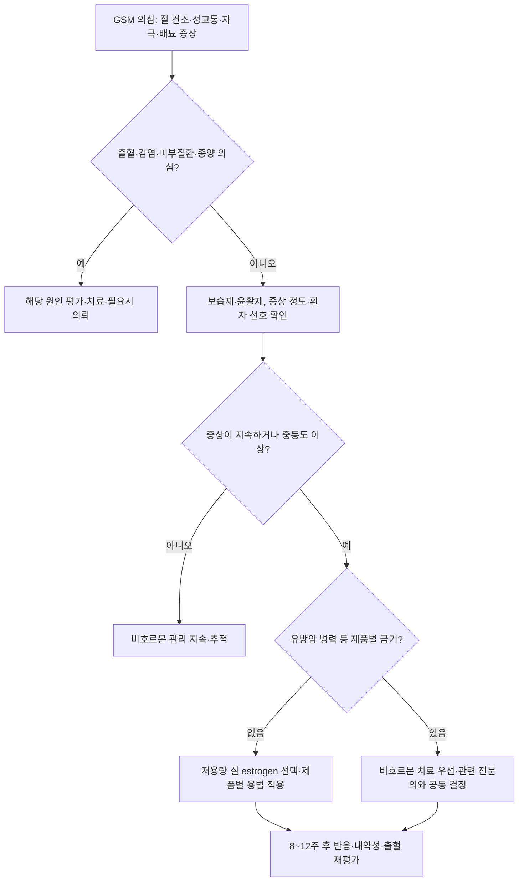

# 폐경기증후군 Menopause Syndrome

## <mark style="color:green;">일반 사항</mark>

* 자연 폐경 : 임신·수유·약물·기타 병적 원인 없이 12개월 연속 무월경이 지속된 뒤 마지막 자연 월경일을 후향적으로 판정. 호르몬 피임제·HT 사용 중이거나 자궁절제 후에는 무월경만으로 판정하지 않음
* 다른 이름 : 갱년기증후군, climacteric syndrome
* 자연 폐경은 보통 45\~55세에 발생하며 북미의 중앙 연령은 약 51세; 국가·인구집단에 따라 차이가 있음
* 의의 : 폐경은 생리적 변화이며 모든 여성에게 치료가 필요한 것은 아님. 혈관운동 증상(vasomotor symptoms, VMS), 비뇨생식 증상, 수면·기분 변화가 삶의 질을 낮출 수 있고, estrogen 결핍과 연령 증가에 따른 골·심혈관 위험을 함께 관리
* 조기 난소기능부전(premature ovarian insufficiency, POI) : 40세 미만에서 난소 활동이 저하되어 무월경·불규칙 월경과 FSH 상승을 보이는 상태. 난소 활동·자연 임신이 간헐적으로 가능하며, 조기폐경과 구분하여 원인 평가 및 골·심혈관 건강 관리가 필요
* 조기폐경(early menopause) : 40\~44세에 발생한 폐경

<mark style="color:cyan;">**STRAW (Staging of Reproductive Aging Workshop) staging system**</mark>

<table><thead><tr><th width="320.4761962890625">STRAW 단계</th><th width="429.5238037109375">정의</th></tr></thead><tbody><tr><td>Menopausal transition, stage -2 (early)</td><td>연속된 월경 주기의 길이가 ≥7일 달라지고, 그 변화가 처음 발생한 뒤 10주기 이내 다시 나타남</td></tr><tr><td>Menopausal transition, stage -1 (late)</td><td>무월경 간격 ≥60일</td></tr><tr><td><em>- 마지막 월경일(FMP) -</em></td><td></td></tr><tr><td>Postmenopause, stage +1 (early)</td><td>FMP 후 약 5~8년(+1a, +1b, +1c)</td></tr><tr><td>Postmenopause, stage +2 (late)</td><td>초기 폐경후기(stage +1) 이후의 나머지 생애</td></tr></tbody></table>

**<mark style="color:$info;">[대한폐경학회]</mark>**

* 폐경이행기 : 월경 주기의 변동 증가\~마지막 월경일 직전
* 폐경주변기 : 폐경이행기\~마지막 월경 후 1년

## <mark style="color:green;">원인 및 위험 인자</mark>

* 연령 증가에 따른 난소 기능 상실
* 난소 절제, 항암화학요법·골반 방사선치료 등 의인성 난소 기능 소실
  * 난소를 보존한 자궁절제술은 즉시 폐경을 일으키지는 않지만 월경력으로 폐경 시점을 판정할 수 없으며, 난소 기능 소실이 다소 빨라질 수 있음
* 성염색체 이상 (예: 터너증후군)

### <mark style="color:orange;">조기폐경 위험 인자</mark>

* 조기폐경 가족력, 유전적 소인 (예: FMR1 premutation)
* 흡연(폐경 시기를 앞당기는 가장 일관된 생활 습관 위험 인자); 과도한 음주는 연관 가능성이 있으나 근거는 일관되지 않음
* 자가면역질환 (예: 갑상선염, 애디슨병)
* 정신적 스트레스·우울과의 연관성이 보고되지만 인과관계나 독립적 위험 인자로 확정하지 않음
* 화학요법, 방사선치료, 1형 당뇨병

- [ ] 임신과 모유 수유가 조기폐경 위험을 낮춘다는 보고가 있음
- [ ] 저체중과 조기폐경의 연관 가능성이 일부 메타분석에서 제기되었으나 일관된 근거는 부족함; 비만과의 연관성은 더욱 근거가 약함

## <mark style="color:green;">임상 양상</mark>

* 불규칙 월경 : 기간 및 양의 불규칙, 과소 & 과다 월경
* VMS(Vasomotor symptoms) : 돌발적 안면 홍조(hot flash, 보통 2\~4분간 지속), 야간발한; 두근거림과 수면 장애가 동반될 수 있음
  * 중년 여성의 약 70%가 경험하고 stage -1\~+1 시기에 심함; 지속 기간의 중앙값은 약 7년이나 개인차가 크며 일부에서는 70세 이후에도 지속
  * 폐경 전 난소 절제, 비만, 우울증, 낮은 경제/교육 수준, 흡연 여성에서 더 심함
* 정신적 증상 : 우울, 불안, 불안정, 집중력 저하, 월경성 편두통 악화
  * 폐경 전에 비하여 우울 증상 발생이 최대 2.5배까지 증가한다는 보고가 있음
* 골 소실은 폐경이행기 후반부터 가속되나 골다공증은 골절 전까지 대개 무증상. 피부 건조·모발 변화·관절통은 동반 가능하지만 비특이적이므로 다른 원인도 평가
  * VMS가 심할수록 골다공증 유병률이 높다는 보고가 있음

### <mark style="color:orange;">폐경기비뇨생식증후군 (Genitourinary syndrome of menopause, GSM)</mark>

* 폐경기 estrogen 감소에 따른 외음부 및 방광-요도의 위축성 변화
* 폐경 여성의 약 50\~80%가 경험(문헌마다 편차 있음)
* 생식기 증상 : 건조, 작열, 가려움, 출혈, 질염; 성교통, 성욕 감퇴, 성 기능 저하
* 비뇨기 증상 : 절박뇨, 배뇨통, 반복 요로 감염
* 감별 : 외음부·질·요로 감염, 자극성/접촉성 피부염, 경화태선·편평태선, 외음부·질·자궁경부/내막 종양, 골반저 기능장애
* GSM은 병력과 필요시 외음부·질 진찰로 진단하며, pH·도말·배양은 감별이 필요할 때 선택. 증상이 있는 모든 여성에게 질 pH나 혈중 estrogen 측정이 필요한 것은 아님
* VMS와 달리 치료하지 않으면 지속·진행하는 경향. 질 출혈을 단순 위축 탓으로 단정하지 않음

### 🚩Red Flags

**즉각 조치**

* 갑작스러운 흉통·호흡곤란·객혈 또는 실신(폐색전증·급성 관상동맥증후군 가능성)  <mark style="color:$danger;">[즉각 조치]</mark>
* 급성 편측 위약·안면 마비·언어장애·갑작스러운 심한 두통(뇌졸중 가능성)  <mark style="color:$danger;">[즉각 조치]</mark>
* 다량 질출혈과 빈맥·저혈압 등 혈역학적 불안정  <mark style="color:$danger;">[즉각 조치]</mark>

**당일~수일 내 평가**

* HT 사용 중 또는 사용 여부와 관계없이 새 편측 하지 부종·통증·발적: DVT 의심 시 **당일** 평가; 호흡곤란·흉통 동반 시 즉각 응급 평가  <mark style="color:$warning;">[당일~수일 내 평가]</mark>
* 자연 폐경 후 새 질 출혈(1회·소량 포함)  <mark style="color:$warning;">[당일~수일 내 평가]</mark>
* HT 중 과다·지속·반복 출혈, 암 위험 인자가 있는 출혈 또는 초기 관찰 기간을 벗어난 예상 밖 출혈  <mark style="color:$warning;">[당일~수일 내 평가]</mark>
* 새 유방 종괴·혈성/편측 자발성 유두 분비물·유방 피부 변화  <mark style="color:$warning;">[당일~수일 내 평가]</mark>

**조기 평가 및 추적**

* ＜40세의 지속성 무월경·불규칙 월경 또는 estrogen 결핍 증상(POI 가능성)  <mark style="color:$info;">[조기 평가 및 추적]</mark>
* HT 고려 환자의 활동성 간질환·혈전증 병력 등 금기 가능성: 확인 전 전신 HT를 시작하지 않음  <mark style="color:$info;">[조기 평가 및 추적]</mark>
* 생활 관리·1차 치료 4\~8주 후에도 지속되는 성가신 VMS  <mark style="color:$info;">[조기 평가 및 추적]</mark>
* 골다공증 위험 인자 또는 국소 치료에 반응하지 않는 GSM·외음부 병변  <mark style="color:$info;">[조기 평가 및 추적]</mark>

## <mark style="color:green;">진단</mark>

* 월경·출혈력, 증상과 일상 기능·수면·기분에 미치는 영향, 임신 가능성, 약물·보충제 사용력 및 유방암·혈전·심혈관·간질환 병력 확인. 신장·체중·혈압을 측정하고 증상·위험도에 따라 유방·골반 진찰
* 지속적인 우울·불안, 코골이·무호흡, 하지불안 등은 독립적으로 평가. VMS 완화만으로 주요우울장애나 만성 불면증 치료를 대체하지 않음
* 감별 질환 : 임신, 갑상선 항진/저하증, 공황장애, 당뇨병, 약물(antiestrogen, SERM), 종양, 기타 시상하부/부신/난소 이상

### <mark style="color:orange;">실험실 검사</mark>

* ≥45세 : 전형적인 폐경 관련 증상과 월경 변화가 있으면 일반적으로 검사 없이 임상적으로 진단; 임신 가능성이 있으면 s-hCG, 갑상선질환이 의심되면 TSH 등 감별 목적의 검사 시행
* 40\~45세 : 폐경 관련 증상과 월경 변화가 있으면서 진단 확인이 필요한 경우 FSH 고려; s-hCG, prolactin, TSH는 임신 가능성 또는 해당 질환이 의심될 때 선택적으로 시행
* ＜40세 : POI 평가
  * 40세 미만 + 4개월 이상 자발성 무월경/불규칙 월경 + FSH ＞25 IU/L을 기준으로 진단. 불확실할 때만 4\~6주 후 FSH 재검하며, 모든 환자에서 2회 상승이 필수는 아님. 호르몬제는 FSH와 출혈 양상에 영향을 주므로 검토하고, AMH는 일률적 진단 검사가 아님 <mark style="color:$info;">[국제 POI 가이드라인 2024/2025]</mark>
  * 임신·고프로락틴혈증 등 이차성 무월경을 감별. 비의인성 POI는 염색체·FMR1 premutation 검사와 유전상담, 원인 불명 시 21-hydroxylase 항체를 포함한 부신 자가면역 평가를 전문의와 진행. 진단 시 TSH와 DXA를 평가하고, 항난소항체·TPO 항체를 일률적으로 검사하지 않음
* 복합 호르몬 피임제나 고용량 progestogen 사용 중 FSH는 폐경 확인에 부적절할 수 있음. 자연 폐경의 치료 용량 조정에 FSH·estradiol·AMH 또는 타액 호르몬 수치를 일률적으로 사용하지 않음
* 기타
  * 골반 초음파 : 비정상 자궁 출혈, 골반 종괴 또는 기타 기질적 질환이 의심될 때
  * 골밀도(DXA) : ≥65세, 골다공증 위험 인자가 있는 ＜65세에서 시행 (☞ [골다공증](../228_/149_-osteoporosis.md))
  * Mammogram : \[국가암검진] 40세 이상 여성에서 2년마다; <mark style="color:$info;">[USPSTF 2024]</mark> 평균 위험 여성 40\~74세에서 2년마다
  * 폐경기 관련 또는 연령에 따른 검사

### <mark style="color:orange;">HT 관련 검사</mark>

* HT 시행 전 병력, 혈압, 체중 및 심혈관·유방암·혈전·간질환 위험을 평가하고, 이후에는 임상 증상과 위험 인자에 따라 검사
* Mammogram : 국가암검진 및 개인 위험도에 따른 권고 주기로 시행; <mark style="color:$info;">[USPSTF 2024]</mark> 평균 위험 여성 40\~74세에서 2년마다
* DXA 골밀도 검사 : ≥65세, 골다공증 위험 인자가 있는 ＜65세에서 시행

**대한폐경학회 권고 검사 항목**

* 기본 평가 : 빈혈, 공복 혈당, LFT, RFT, 지질 및 연령·위험에 맞는 유방촬영·DXA·자궁경부암 검진
* 2025 대한폐경학회 지침은 국내 맥락에서 골반 초음파도 기본 평가에 포함. 국제 지침에서는 무증상·저위험 여성의 반복 자궁내막 검사를 일률적으로 권고하지 않으므로, 임상 적응증과 검사 이력을 함께 판단
* 선택 : TFT, 유방 초음파, 자궁내막생검. 출혈·의심 병변의 평가를 정기검진으로 대체하지 않음

***



* 전신 HT는 일반적으로 건강하고 ＜60세 또는 자연 폐경 후 ＜10년인 경우 이득-위험 비가 양호하나, 한 조건만으로 금기·심혈관 위험 평가를 생략하지 않음
* 경피 estrogen도 자궁이 있으면 자궁내막 보호가 필요. 자궁내막증·부분 자궁절제 등 예외는 전문의와 판단
* 국내 VMS 목적 SSRI/SNRI·gabapentin은 허가 외 사용; 국외 neurokinin 수용체 대항제와 구분

***



* GSM 단독에는 전신 HT를 새로 시작하지 않음. 저용량 질 estrogen의 장기 유지 필요성과 국내 제품의 휴약·재평가 지침을 함께 고려
* 국내 질 estrogen의 유방암·VTE 등 금기 문구와 국외 지침의 개별적 사용 권고는 구분

***

## <mark style="background-color:$warning;">Management</mark>

### <mark style="color:orange;">치료 방침</mark>

* 중등도\~중증 VMS : 금기가 없는 경우 전신 HT가 가장 효과적인 치료; 일반적으로 건강하고 ＜60세 또는 폐경 후 ＜10년인 유증상 여성에서 이득-위험 비가 양호함
* GSM만 있는 경우 : 비호르몬 윤활제·보습제 또는 저용량 질 국소 estrogen을 사용하며, GSM만을 치료하기 위해 전신 HT를 시작하지 않음
* HT가 금기이거나 원하지 않는 경우 국내 가용 SSRI/SNRI 등 비호르몬 치료를 선택(국내 VMS 목적 허가 외). Gabapentin도 대안이나, ACOG 2026은 다른 권고 비호르몬 약물의 효과 부족·불내약 시 제안. Fezolinetant·elinzanetant는 국내 유통 제품이 없어 국외 치료로 구분


**최신 권고: ACOG Clinical Practice Guideline No. 13** (2026-10-15 온라인 발표)

* 금기가 없는 유증상 여성의 VMS 및 VMS 관련 수면 장애에는 전신 HT를 권고
* HT를 원하지 않거나 금기인 경우 SSRI/SNRI 및 neurokinin 수용체 대항제를 권고; 국내 가용성과 허가 범위는 별도 판단
* CBT를 제안하며, 마음챙김·운동은 주로 수면·기분 증상, 최면·침 치료는 일부 증상의 보조적 선택지로 조건부 제안. 근거 수준·평가 대상이 달라 2023 The Menopause Society의 VMS 단독 권고와 차이가 있음
* 주요우울장애는 표준 우울증 치료를 시행. 기분 증상만을 위한 HT의 유효성은 불확실하며, progestogen 단독·DHEA·testosterone을 VMS·수면·기분 치료로 일률 권고할 근거는 부족



**폐경호르몬치료(HT) 미국 라벨링 업데이트** : FDA는 2025년 11월 변경을 추진하고 2026년 2월 12일 첫 6개 제품의 boxed warning에서 심혈관질환·유방암·치매 관련 문구를 제거하는 개정을 승인함. 전신 estrogen 단독제의 자궁내막암 경고는 유지. 이는 위험이 모두 사라졌다는 뜻이나 국내 허가 변경이 아니며, HT를 심혈관질환·치매 예방 목적으로 시작하지 않음.


<mark style="color:cyan;">**Vasomotor symptoms(VMS)에 대한 치료 효과 비교**</mark>

<table data-header-hidden data-search="false"><thead><tr><th width="255"></th><th></th><th></th></tr></thead><tbody><tr><td><strong>치료</strong></td><td><strong>대표 용량</strong></td><td><strong>비고</strong></td></tr><tr><td><strong>전신 estrogen</strong></td><td>제형별 최소 유효 용량</td><td>VMS에 가장 효과적; 자궁이 있으면 자궁내막 보호 필요</td></tr><tr><td><strong>SSRI/SNRI</strong></td><td></td><td>국내 VMS 적응증 허가 외 사용</td></tr><tr><td>paroxetine¹⁾ <mark style="color:blue;">[세로자트]</mark></td><td>7.5~25 ㎎/d</td><td>저용량부터 시작; tamoxifen과 상호작용 주의</td></tr><tr><td>venlafaxine <mark style="color:blue;">[이팩사]</mark></td><td>37.5~75 ㎎/d</td><td>혈압 및 중단 증상 주의</td></tr><tr><td>escitalopram <mark style="color:blue;">[렉사프로]</mark></td><td>10~20 ㎎/d</td><td>고령·민감 환자 5 ㎎/d 시작; 고령자 최대 10 ㎎/d, QT 주의</td></tr><tr><td><strong>Gabapentin</strong> <mark style="color:blue;">[뉴론틴]</mark></td><td>100~300 ㎎ 취침 전 시작 → 통상 300 ㎎ tid</td><td>야간 VMS에 유용; 졸림·어지러움 주의</td></tr><tr><td><strong>Neurokinin 수용체 대항제</strong></td><td>fezolinetant 45 ㎎/d<br>elinzanetant 120 ㎎ 취침 전</td><td>국외 허가 요법; 국내 유통 없음, 간기능 등 모니터링 필요</td></tr><tr><td><strong>권고하지 않는 치료</strong></td><td>경피 progesterone 크림, clonidine, pregabalin, vitamin E, soy·black cohosh 등</td><td>효과 부족, 안전성 또는 부작용 문제</td></tr></tbody></table>

_¹⁾ VMS에 대하여 FDA 승인된 SSRI는 paroxetine mesylate 7.5 ㎎ 제제이며, 국내 paroxetine 제제의 VMS 치료는 허가 외 사용임_

## <mark style="color:green;">비-약물 치료 및 예방</mark>

#### <mark style="color:$primary;">안면 홍조 개선</mark>

* 개인적으로 VMS를 유발하거나 악화시키는 맵고 뜨거운 음식, 카페인, 음주 등의 요인이 확인되면 조절
* 서늘한 실내 환경, 얇은 옷 겹쳐 입기, 시원한 음료 등은 편안함에 도움이 될 수 있으나 VMS 자체를 감소시키는 근거는 제한적
* 규칙적인 운동은 전반적인 건강에 권고하지만 VMS 자체의 치료 효과는 확립되지 않음; 과체중·비만 여성에서는 체중 감량이 VMS 개선에 도움이 될 수 있음
* 폐경 특이적 인지행동치료(menopause-specific CBT) : HT와 병용하거나 HT를 원하지 않거나 금기인 경우 고려. VMS로 인한 불편·일상 방해·수면 개선에 도움이 되며 홍조 횟수의 감소와는 구분 <mark style="color:$info;">[NICE NG23; ACOG 2026]</mark>
* 임상 최면도 선택지. 침 치료는 ACOG 2026의 조건부 제안과 The Menopause Society 2023의 비권고가 다르므로 효과의 불확실성과 선호를 고려; 표준 치료를 지연하지 않음

#### <mark style="color:$primary;">수면 개선</mark>

* 규칙적인 기상 시각·수면 환경을 유지하고 만성 불면증에는 CBT-I를 우선 고려. VMS 치료 후에도 지속되면 수면무호흡·하지불안·우울·약물 등을 평가 (☞ [불면증](../221_/029_-insomnia-sleep-disorder.md))
* 늦은 밤 식사 또는 과한 스낵 섭취를 피함
* 카페인(커피, 차, 초콜릿, 콜라) 섭취 제한, 특히 오후 이후에는 피함
* 술에 의지하여 수면하지 않음

#### <mark style="color:$primary;">GSM 관리</mark>

* 질 보습제는 성관계 여부와 무관하게 주 2\~3회 등 제품 지침에 따라 규칙적으로, 윤활제는 성관계 때 사용. 향·자극 성분과 질 세정제는 피하고 불편감에 따라 수용성·실리콘 기반 제품 등을 선택
* 편안한 범위의 성 활동, 질 확장기 또는 골반저 물리치료를 성교통·골반저 과긴장에 따라 병행. 통증을 참으며 삽입하도록 권하지 않음
* 라텍스 콘돔을 사용하는 경우 오일성 윤활제·일부 질크림의 재질 손상 가능성을 확인

#### <mark style="color:$primary;">심혈관 질환 및 골다공증 예방</mark>

* 유산소 운동, 체중 부하 운동
* 금연, 음주 제한
* 건강식, 적정 체중 유지
* 이상지질혈증, 당뇨병, 고혈압 관리
* 칼슘은 음식 섭취를 포함한 총 섭취량과 골절 위험에 따라 조절하고, Vit D는 결핍 위험과 혈중 농도·골다공증 여부에 따라 보충(☞ [골다공증](../228_/149_-osteoporosis.md#ca-vit-d))

- [ ] 저용량 aspirin의 심혈관 1차 예방 목적 투여는 더 이상 일률적으로 권고하지 않음 <mark style="color:$info;">[USPSTF]</mark>; 개별 심혈관 위험도에 따라 판단

## <mark style="color:green;">약물 치료</mark>

### <mark style="color:orange;">호르몬 치료(Hormone Therapy, HT) 및 호르몬 관련 치료</mark>

#### <mark style="color:$primary;">적응증</mark>

* ① 중등도\~중증 VMS 및 관련 수면 장애, ② 폐경 초기의 골 소실·골절 예방이 필요하고 이득-위험 비가 적합한 경우, ③ estrogen 저하 상태(예: POI·조기폐경), ④ GSM(저용량 질 국소 estrogen)
* 고령 또는 골절 고위험 환자에게 골 보호만을 목적으로 전신 HT를 새로 시작하기보다 골다공증 표준 약제를 우선 검토

#### <mark style="color:$primary;">위험과 이득</mark>

* 관상동맥병 : 건강하고 ＜60세 또는 폐경 후 ＜10년인 유증상 여성에서 시작하면 절대위험이 낮고 이득-위험 비가 양호함; 심혈관질환의 1차·2차 예방 목적으로 시작하지 않음
* 뇌졸중 : 경구 HT는 허혈성 뇌졸중 위험을 소폭 높일 수 있으나 젊은 폐경 여성에서는 절대위험이 낮음; 저용량 경피 estradiol은 위험이 더 낮을 가능성이 있음
* 정맥혈전색전증 : 경구 HT는 VTE 위험을 증가시키며 치료 초기 1\~2년에 가장 두드러짐; 연령·비만·흡연·혈전성향 등에 따라 절대위험이 증가하고 경피 estradiol은 경구제보다 위험이 낮을 가능성이 있음
* 유방암
  * WHI의 경구 CEE/MPA 요법에서는 약 5년 사용 시 유방암이 1,000명당 약 3명 추가 발생한 추정치가 있으나 모든 HT 제제·연령·투여 경로의 동일한 위험 수치는 아님
  * 유방암 위험은 제제·progestogen 종류·투여 기간에 따라 다름; micronized progesterone이 일부 합성 progestin보다 위험이 낮을 가능성이 있으나 장기 안전성이 확정된 것은 아님
  * 복합 HT는 3\~5년경부터 위험 증가가 관찰될 수 있으며 기간이 길수록 증가하는 경향; 치료 기간만으로 안전 여부를 단정하지 않음
  * WHI에서 자궁절제 여성의 CEE 단독요법은 장기 추적 시 유방암 발생과 사망 감소가 관찰되었으나, 이를 모든 estrogen 제제·대상자에게 일반화하지 않음
  * 유방암 병력자에서는 전신 HT는 일반적으로 권고되지 않음; 저용량 질 국소 estrogen은 비호르몬 치료(윤활제·보습제 등) 실패 시 종양 전문의와 상의(shared decision-making)하여 사용을 고려할 수 있음 <mark style="color:$info;">[ACOG, NAMS, AUA/SUFU/AUGS]</mark>
* 난소암 : estrogen 단독 및 복합 HT 모두에서 절대위험은 매우 낮지만 소폭 증가할 가능성이 있어 개인 위험도를 고려
* 자궁내막암 : 자궁이 있는 여성의 전신 estrogen 단독요법은 위험 증가. 충분한 progestogen을 병합한 지속요법은 위험을 낮추지만, 주기요법은 progestogen 용량·일수·기간에 따라 위험이 달라질 수 있어 모든 복합제가 위험을 없앤다고 단정하지 않음
* 대장암 위험 감소를 목적으로 HT를 사용하지 않음
* 기타 위험 : 전신 HT는 요실금을 유발·악화할 수 있고 특히 경구제에서 담낭질환 위험이 증가. GSM 관련 배뇨 증상에 대한 질 국소 치료 효과와 구분
* 기타 이득 : 치료 중 골 소실과 골절 위험 감소, VMS 관련 수면 장애 및 삶의 질 개선; 저용량 질 estrogen은 GSM과 반복 요로 감염 감소에 도움
* 인지 기능 개선·치매 예방 또는 심혈관질환 예방 목적으로 시작하지 않음. 젊은 POI에서의 생리적 호르몬 대체 권고는 일반 자연 폐경의 예방 목적 사용과 구분
* HT의 위험은 폐경 초기에 투여를 시작할 때 낮고, 폐경 경과 후 시작할수록 높음
* 치료 시작 3개월 후 및 매년 치료의 유효성, 내약성, 부작용 등을 평가하여 지속 투여 여부를 결정

#### <mark style="color:$primary;">전신 HT 금기증 및 주의 사항</mark>

* 유방암 또는 estrogen 관련 악성 종양(예: 자궁내막암) 병력 또는 의심
* 치료되지 않은 자궁내막 과다 형성
* 원인 불명의 질 출혈
* 심부정맥혈전증·폐색전증 병력 또는 알려진 고위험 혈전성향(예: protein C/S·antithrombin 결핍)
* 뇌졸중·심근경색·관상동맥질환 병력, 활동성/최근 동맥혈전질환. 조절되지 않는 중증 고혈압에서는 조절 전 시작하지 않음
* 임신 또는 임신 의심, 활동성 간질환 또는 간기능이 정상화되지 않은 간질환 병력, 제제 과민증; porphyria 등 제품별 금기 확인
* 활동성 담낭질환은 우선 평가·치료. 치료된 담낭질환·담석 병력에서는 위험을 평가하고 경피 제형을 우선 고려
* 고혈압 : 주의; 목표혈압 관리 하에 투여 가능

#### <mark style="color:$primary;">약제 종류</mark>

* 종류 : estrogen 단독 또는 estrogen-progestogen 병합 (☞ [폐경 후 호르몬요법 인정기준](https://www.hira.or.kr/rc/insu/insuadtcrtr/InsuAdtCrtrPopup.do?mtgHmeDd=20130901\&sno=1\&mtgMtrRegSno=0023))
  * 허가된 estradiol과 micronized progesterone은 체내 호르몬과 화학적으로 동일함; 일부 관찰연구에서 micronized progesterone과 경피 estradiol 조합의 유방암·VTE 위험이 더 낮을 가능성이 제시되었으나 모든 위험에 대한 우월성이 확정된 것은 아님
* 자연 폐경의 증상 치료는 저용량으로 시작하여 최소 유효 용량으로 조정. POI·젊은 수술폐경의 생리적 호르몬 보충에는 이 원칙을 일률 적용하지 않고 충분한 대체 용량을 사용(☞ 「무월경」)

#### <mark style="color:$primary;">상황에 따른 선택 약제</mark>

* 자궁 적출 : estrogen 단독 요법
* 자궁이 있음 : 적절한 용량의 progestogen을 지속 또는 매 28일 중 12\~14일 병합하거나 CEE/bazedoxifene TSEC 사용. 52 ㎎ LNG-IUS도 자궁내막 보호 선택지
* 자궁내막증 병력 : 자궁절제 후에도 잔존 병변 가능성을 고려하여 전문의와 병합요법 여부 결정
* GSM만 있음 : 국내 가용 저용량 질 국소 estrogen을 우선 고려. 질 prasterone(DHEA 6.5 ㎎ qhs)·경구 ospemifene은 국내 유통 제품이 없는 국외 선택지
* VTE 위험 인자, 고중성지방혈증, 비만, 흡연, 고혈압·담낭 질환 등이 있는 경우 : 경피 estradiol 우선 고려; 과거 VTE·뇌졸중·관상동맥질환 등 전신 HT 금기 여부를 먼저 평가

#### <mark style="color:$primary;">치료 시기 및 기간</mark>

* 시작 시기 : 폐경 전후에 치료가 필요한 증상이 나타나면 금기와 개인 위험도를 평가하여 시작; 건강하고 ＜60세 또는 폐경 후 ＜10년인 경우 이득-위험 비가 대체로 양호함
  * 폐경이행기에는 임신 가능성이 남아 있으며 HT는 피임제가 아님
  * 조기폐경 또는 난소 부전 시에는 증상에 관계없이 적어도 자연 폐경 연령까지 투여
* 투여 기간 : 이득과 위험에 대해 이해하고 있고 규칙적인 추적 관찰이 동반된다면 기간에 제한을 두지 않음(65세에 일률적으로 중단할 필요 없음). 필요시 경피 요법으로 변경할 수 있음 <mark style="color:$info;">[대한폐경학회]</mark>; 65세 이후에도 획일적 연령 기준으로 중단하기보다 개별 위험-이득 평가와 공동 의사결정을 거쳐 지속 여부를 정기적으로 재평가할 것을 권고 <mark style="color:$info;">[NICE NG23]</mark>

### <mark style="color:orange;">Estrogen</mark>

* 부작용 : (호르몬 치료의 위험 외) 두통, 유방통, 자궁내막 증식, 자궁 출혈, 소화불량
* HT 중 출혈 대처 : 예정된 주기적 소퇴성 출혈과 예상 밖 출혈을 구분함. 전신 HT 시작 후 첫 6개월 또는 제제·용량 변경 후 3개월 이내의 가벼운 부정출혈은 흔하며, 저위험 환자는 순응도·progestogen 용량·투여 방식 조정 후 추적할 수 있음. 과다·지속 출혈, 빈혈·통증 또는 자궁내막암 위험 인자가 있으면 이 기간 안이라도 조기 평가하고, 그 이후의 예상 밖 출혈은 신속히 평가 <mark style="color:$info;">[NICE NG23 2026; BMS 2024]</mark>
  * 폐경이행기에는 주기요법을 고려하고, 마지막 자연 월경 후 경과 기간·연령·출혈 선호와 제품 적응증에 따라 지속 병합요법으로 전환. 모든 환자에게 2년을 획일적으로 적용하지 않음
  * 자연 폐경 후 자발성 출혈은 대부분 질초음파와 자궁내막 조직검사를 병행하는 ACOG 2026 원칙에 따라 평가. 내막이 얇더라도 지속·재발 출혈을 배제하지 않음
  * 내막을 충분히 관찰할 수 없거나 검체가 불충분한 경우, 음성 생검 후에도 출혈이 지속·재발하는 경우에는 자궁경하 표적 생검 등 추가 평가를 고려
  * 필요한 내막 평가를 완료한 뒤 순응도·progestogen 용량·기간을 먼저 조정. 적합한 환자에서 제제 변경·52 ㎎ LNG-IUS 등을 고려하며, 출혈이 지속·재발하면 단순 약제 교체로 평가를 미루지 않음

#### <mark style="color:$primary;">경구용</mark>

* 적절한 용량의 전신 estrogen은 VMS에 효과적이나 제제·용량·경로별 내약성·위험·허가사항이 달라 동등한 안전성을 가정하지 않음
* Conjugated equine estrogen(CEE) : 통상 0.3\~0.625 ㎎/d <mark style="color:blue;">\[프레미나정]</mark>
* 17-β-estradiol : 0.5\~1 ㎎/d
* Estradiol valerate : 1\~2 ㎎/d <mark style="color:blue;">\[프로기노바]</mark>
* Estradiol hemihydrate : 1\~2 ㎎/d <mark style="color:blue;">\[프레다]</mark>

#### <mark style="color:$primary;">경피용 (겔, 패취)</mark>

* 경구 제제보다 경피 제제에서 정맥혈전색전증(VTE) 위험 증가가 낮은 것으로 알려짐
* 비만·고중성지방혈증·조절 중인 고혈압 등 위험 인자가 있으면 경피 제형을 우선 고려할 수 있음. 과거 VTE·뇌졸중·관상동맥질환 등 전신 HT 금기 여부를 먼저 평가하며, 경피 경로로 금기가 해소되는 것은 아님
* Estradiol 패취 : 제품별 방출량에 따라 1매를 주 1\~2회 피부에 부착
* Estradiol hemihydrate 겔 <mark style="color:blue;">\[에스트레바 겔]</mark> : 정량 펌프를 이용하여 1일 1회 피부에 도포; 제품 허가용량에 따라 조절
* Estradiol 0.1% 겔 <mark style="color:blue;">\[디비겔]</mark> : 포 단위 함량에 따라 1일 1회 피부에 도포

#### <mark style="color:$primary;">질 국소용</mark>

* 질 건조·위축·성교통에 효과적이며 반복 요로감염 예방에도 도움. 증상과 선호에 따라 시작하고 감염·출혈의 다른 원인을 먼저 평가
* 유방암 병력자 : 비호르몬 치료가 우선. 실패 시 국외 지침은 종양 전문의와 공동 결정하여 저용량 질 estrogen을 고려할 수 있으나, aromatase inhibitor 사용 중에는 특히 신중. 국내 질 estrogen 제품의 유방암 병력 금기와 구분하여 전문의가 허가 범위·근거·대안을 검토
* 저용량 질 국소 estrogen : 전신 흡수가 미미하고 관찰연구에서 유방암·자궁내막암 위험 증가와 관련되지 않았음; 장기 무작위시험 자료는 제한적이며 비정상 출혈이 있으면 평가
* 자궁이 있는 경우에도 권장 저용량 질 국소 estrogen 요법에는 통상 progestogen 병용이나 정기적 자궁내막 검사가 필요하지 않음. 크림 제형의 고용량·장기간 사용에 이 원칙을 일률 적용하지 않으며 비정상 출혈은 평가
* 제형 : 크림, 겔, 질정, vaginal ring 등; 효과, 사용 편의성, 환자 선호, 비용 및 국내 가용성에 따라 선택
* 용법 : 제품별 허가사항에 따라 초기 매일 투여 후 유지요법으로 감량; 모든 제형에 동일한 용법을 적용하지 않음
* Estriol 질좌제 0.5 ㎎ <mark style="color:blue;">\[오베스틴 질좌제]</mark> : 취침 시 질 내 깊숙이 삽입; 증상 완화까지 통상 1일 1회(보통 3주), 유지요법은 주 2회 1개. 국내 허가사항은 유지 중 매 2\~3개월마다 4주 휴약하여 지속 필요성을 판단하도록 기재함
* Estriol 질크림 1 ㎎/g <mark style="color:blue;">\[유센스 질크림]</mark> : 1회 0.5 g(estriol 0.5 ㎎)을 1일 1회 질내 투여. 초기 증상 조절 후 유지 빈도를 줄이며 제품별 허가 용법에 따라 조정
* Estriol 0.005% 겔(0.05 ㎎/g) <mark style="color:blue;">\[블리셀겔]</mark> : 1회 1 g(estriol 50 ㎍), 취침 시 매일 ×3주 후 주 2회 유지; 12주 이후 지속 여부 재평가. **국내 허가사항상 전신 estrogen과 병용하지 않음**. 오베스틴·유센스의 estriol 0.5 ㎎/회와 혼동하지 않음
* Conjugated estrogen 질크림 0.625 ㎎/g <mark style="color:blue;">\[프레미나질크림]</mark>(다림바이오텍) : 위축성 질염·외음위축증에 국내 허가. 증상에 따라 1일 0.5\~2 g을 질내 적용(CEE 0.3125\~1.25 ㎎에 해당); 허가 용법은 주기적 투여(예: 3주 투약 후 1주 휴약)이며 3\~6개월마다 중단·감량을 시도
  * 전신 흡수가 가능하며, 위 허가 범위 전체를 전신 노출이 미미한 저용량 질 estrogen 요법과 동일하게 간주하지 않음. 최소 유효 용량을 사용하고, 자궁이 있는 환자에서 높은 용량·장기간 사용 시 자궁내막 보호 및 추적 필요성을 개별 평가
* 국외 제형 예 : estradiol 10 ㎍ 질정(매일 ×2주 후 주 2회). 해당 질정의 국내 유통 제품 없음; 국내 경구·경피 estradiol 제제와 구분

- [ ] Estradiol hemihydrate 겔 <mark style="color:blue;">\[에스트레바 겔]</mark>, Estradiol 겔 <mark style="color:blue;">\[디비겔]</mark>은 전신 흡수를 목적으로 하는 경피(피부 도포)용 제제이며 질 국소 치료 용도가 아님

### <mark style="color:orange;">Progestogen</mark>

* 일부 경구 progestogen 단독요법에서 VMS 개선이 관찰되었으나 장기 근거가 제한적. 전신 estrogen의 자궁내막 보호 목적으로 주로 사용하며, ACOG 2026은 VMS·수면·기분 증상에 대한 일률적 단독 치료를 뒷받침할 근거가 부족하다고 평가
* 자궁이 있는 여성의 전신 estrogen 치료 시 자궁내막 보호를 위해 병합(저용량 질 국소 estrogen 및 TSEC는 예외)
* 부작용 : 졸림·어지럼, 부종, 유방통, 출혈 양상·기분 변화 등. 유방암 위험은 전신 estrogen 병합 제제·기간에 따른 장기 위험으로 설명하며 모든 progestogen의 단독 부작용처럼 일괄 표기하지 않음
* Micronized progesterone은 일부 합성 progestin보다 유방암·VTE 위험이 낮을 가능성이 관찰연구에서 제시되지만, 모든 임상 상황에서 더 안전하다고 확정하지 않음

#### <mark style="color:$primary;">경구용</mark>

* Micronized progesterone <mark style="color:blue;">\[유트로게스탄 경구용 연질캡슐]</mark> : 지침상 지속요법 100 ㎎/d 또는 주기요법 200 ㎎/d를 매 28일 중 12\~14일. 국내 유트로게스탄 허가용법은 estrogen 주기의 마지막 2주 또는 매달 10\~12일간 200 ㎎/d이므로 **100 ㎎ 지속요법은 허가용법과 구분**. 경구용·질삽입용 제형을 혼동하지 않으며 졸림·어지럼에 주의
* Medroxyprogesterone acetate(MPA) <mark style="color:blue;">\[프로베라]</mark> : 지속 요법 2.5\~5 ㎎/d; 주기 요법 5\~10 ㎎/d를 매 28일 중 12\~14일 투여
* Estrogen 용량이 높을수록 충분한 progestogen 용량과 투여 기간이 필요하며, 개별 복합제의 허가용법을 따름

#### <mark style="color:$primary;">질 국소용</mark>

* 질 micronized progesterone은 전신 estrogen 사용 시 자궁내막 보호 목적으로 일부 허가 외 사용되지만, 적정 용량과 장기 안전성 근거가 제한적임
* 경구 progestogen을 견디기 어려운 경우에만 전문의 감독하에 고려하며, 생식보조용 progesterone 질제제를 폐경 HT의 표준 자궁내막 보호요법으로 사용하지 않음

#### <mark style="color:$primary;">자궁내시스템</mark>

* Levonorgestrel 52 ㎎ LNG-IUS <mark style="color:blue;">\[미레나]</mark> + 전신 estrogen : 자궁내막 보호와 피임이 함께 필요한 경우 고려. 국내 estrogen 대체요법 시 자궁내막 보호 목적은 **5년** 기준으로 교체하며 피임 목적의 연장 사용기간을 그대로 적용하지 않음
* 저함량 LNG-IUS를 같은 자궁내막 보호 용도로 대체하지 않음

### <mark style="color:orange;">Estrogen & Progestogen 병합 요법</mark>

* Estrogen 단독 투여에 따른 자궁내막증식증과 자궁내막암 위험을 감소
* 자궁이 있는 여성의 전신 estrogen 치료에는 자궁내막 보호가 필요함. 보통 progestogen을 병합하나, CEE/bazedoxifene(TSEC)은 별도의 progestogen 없이 사용함. 저용량 질 국소 estrogen에는 통상 병용이 필요하지 않음

#### <mark style="color:$primary;">경구용 - progestogen 지속 요법</mark>

* 지속 병합 요법 : 주기적 소퇴 출혈은 감소하지만 초기 부정 출혈이 생길 수 있음; progestogen 종류와 용량에 따라 내약성과 위험이 다름
* 저용량 estradiol/progestogen 지속 요법 : 최소 유효 용량을 사용하며 증상 반응과 출혈 양상을 추적
* Estradiol hemihydrate/drospirenone <mark style="color:blue;">\[안젤릭]</mark>
* Estradiol valerate/MPA <mark style="color:blue;">\[인디비나]</mark>
* Estradiol hemihydrate/norethisterone acetate <mark style="color:blue;">\[에스디올 하프]</mark>, <mark style="color:blue;">\[크리안]</mark>

#### <mark style="color:$primary;">경구용 - progestogen 주기 요법</mark>

* Progestogen 주기적 병합 요법 : 자궁내막의 분비기 변화 후 progestogen 중단에 따른 소퇴성 출혈 발생
* Long-cycle therapy : 3개월마다 progestogen을 투여하는 방법은 자궁내막 안전성 근거가 부족하므로 일반적으로 권고하지 않음
* Estradiol valerate/medroxyprogesterone acetate <mark style="color:blue;">\[디비나]</mark> (표시대로 21일간 복용 & 7일간 휴약)
* Estradiol hemihydrate/dydrogesterone <mark style="color:blue;">\[페모스톤]</mark> (색깔별로 14일 + 14일 순서대로, 휴약 없이 28일 복용; 개시일은 월경·이전 HT 및 제품 설명서에 따라 결정)

#### <mark style="color:$primary;">경피용</mark>

* Estradiol/levonorgestrel·estradiol/norethindrone acetate 복합 패취는 국내 유통 제품이 없는 국외 제형 예. 경피 estradiol 단독제에는 별도의 자궁내막 보호가 필요하며, norethindrone(norethisterone) acetate 함유 국내 경구 복합제와 구분

### <mark style="color:orange;">Tibolone : Selective tissue estrogen activity regulator (STEAR)</mark>

* 체내 흡수되어 estrogen/progesterone/androgen 성질을 갖는 물질들로 전환
* 작용 : 조직 특이적으로 estrogen·progestogenic·androgenic 작용을 나타내며, 전통적 estrogen-progestogen 복합요법보다 유방통과 질 출혈이 적을 수 있음
  * VMS와 질 위축 증상을 완화하고 골밀도를 증가시키며 일부에서 성 기능 개선에 도움
  * 유방과 자궁내막을 전혀 자극하지 않는다고 단정할 수 없으며, 비정상 자궁 출혈 발생 시 평가 필요
  * 유방암 병력자에서는 재발 위험이 증가함
  * ≥60세에서 투여를 시작하는 경우 뇌졸중 증가 가능성이 있음
* 마지막 월경 후 적어도 12개월이 지난 폐경 여성에서 사용; 폐경이행기 또는 마지막 월경 후 12개월 이내 사용 시 불규칙 출혈 가능
* 금기 : 유방암·estrogen 의존성 종양 병력 또는 의심, 원인 불명 질출혈, VTE·동맥혈전질환 병력, 활동성 간질환 등
* 용량 : <mark style="color:blue;">\[리비알정 2.5 ㎎]</mark> 1일 1정. 1.25 ㎎/d는 저용량 연구·별도 함량 제품의 요법으로 구분하며 리비알정의 국내 표준 1일 용량과 혼동하지 않음

### <mark style="color:orange;">Selective estrogen receptor modulator (SERM)</mark>

* 조직에서 선택적으로 estrogen 수용체를 자극하거나 억제
* Raloxifene과 bazedoxifene 단독제는 폐경 후 골다공증 치료·예방에 사용하며 VMS 치료제가 아님; 안면 홍조를 유발하거나 악화할 수 있음
* Raloxifene : 60 ㎎ qd <mark style="color:blue;">\[에비스타]</mark>
* Bazedoxifene : 20 ㎎ qd <mark style="color:blue;">\[비비안트]</mark>
* Ospemifene : 60 ㎎ qd; 중등도\~중증 성교통 및 질 건조 치료에 FDA 승인된 경구 SERM으로 VMS 치료제는 아님; 국내 유통 제품 없음. VTE 위험에 주의하며 유방암 병력자에게는 일반적으로 권고하지 않음

- [ ] Tamoxifen <mark style="color:blue;">\[놀바덱스]</mark>은 SERM 계열이지만, 유방암 치료·예방에 적용하며 폐경 증상 자체의 치료 목적으로 사용하지 않음(오히려 안면 홍조를 유발하는 경우가 흔함)

#### <mark style="color:$primary;">Tissue selective estrogen complex (TSEC)</mark>

* SERM인 bazedoxifene과 결합형 estrogen 복합제
* CEE는 VMS 완화·골 소실 예방에, bazedoxifene은 자궁내막 보호에 기여. 자궁내막증식증·유방통·출혈 빈도가 낮게 관찰되지만 장기 유방암·심혈관 안전성의 우월성이 확정된 것은 아님
* 별도의 estrogen·progestogen·SERM을 추가하지 않으며, VTE 병력·혈전성향·원인 불명 출혈·estrogen 의존성 암·간질환 등 금기를 확인
* 자궁을 절제하지 않은 여성에서 폐경과 관련된 VMS 치료 및 폐경 후 골다공증 예방
* Bazedoxifene 20 ㎎ + CEE 0.45 ㎎ qd, 식사 무관 복용 <mark style="color:blue;">\[듀아비브]</mark>

### <mark style="color:orange;">Testosterone</mark>

* 질 위축(GSM) 자체의 1차 치료제는 아님 - 국소 estrogen, 보습제/윤활제 등이 우선 표준 치료
* 적응증은 폐경 후 hypoactive sexual desire disorder(HSDD)로 제한됨; 적절한 병력 청취와 타 원인(관계 문제, 우울, 약물 부작용 등) 배제 후 전문의 평가 하에 고려
* 국내 여성용 허가 제제는 없으며 남성용 제제를 초저용량으로 오프라벨 사용하는 경우가 있어 신중한 용량 조절과 안드로겐 과다 부작용(다모증, 여드름, 남성형 탈모 등) 모니터링이 필요함
* 혈중 testosterone 농도를 정상 폐경 전 여성 범위 이상으로 올리는 치료는 권고하지 않음 <mark style="color:$info;">[Global Consensus 2019; ISSWSH 2021]</mark>; 혈중 농도만으로 HSDD를 진단하지 않음
* 치료 전 total testosterone·SHBG 등을 확인하고 시작/용량 조정 3\~6주 후, 안정되면 약 4\~6개월마다 농도·증상·과다 부작용을 평가. 6개월까지 유의한 효과가 없으면 중단; 여성 생리 범위를 넘기는 주사·펠릿·비표준 조제제는 피함

### <mark style="color:orange;">수술로 인한 폐경 시 호르몬 보충 요법</mark>

* 난소절제술로 인한 조기폐경 시 금기가 아니면 최소 자연 폐경 연령까지 estrogen 보충 요법 시행
* 생리적 호르몬 대체를 목표로 충분한 용량의 전신 estrogen을 투여하되 증상·골건강·심혈관 위험과 선호에 따라 개별화. 국제 POI 지침은 골밀도 유지 목적의 대체 용량으로 경구 estradiol ≥2 ㎎/d 또는 경피 ≥100 ㎍/d에 상응하는 요법을 제안하며, 자연 폐경의 저용량 증상 치료와 구분
* 자궁이 있으면 적절한 progestogen을 병합. 양측 난소절제 후에는 자연 임신을 위한 피임이 필요하지 않지만, 난소가 남아 있는 POI·폐경이행기에는 간헐적 배란·임신 가능성이 있고 HT는 피임제가 아님. 자연 폐경 연령 이후에는 일반 폐경 여성과 같은 원칙으로 재평가

### <mark style="color:orange;">비호르몬 약물 치료</mark>

* HT가 금기이거나 원하지 않는 환자에서는 근거 기반 비호르몬제를 1차 대안으로 선택할 수 있음(국내 허가·급여 주의)
* <mark style="color:$info;">[NICE NG23]</mark> SSRI/SNRI/clonidine을 VMS 단독 증상의 일률적인 최초 치료로 제공하지 말 것을 권고하지만, 개별 상황에서 SSRI/SNRI 등은 유효한 대안임

#### [<mark style="color:$primary;">항우울제</mark>](../231_/213_-antidepressants-and-anxiolytics.md) <mark style="color:$primary;">: SSRI, SNRI</mark>

* Paroxetine : 7.5\~25 ㎎/d <mark style="color:blue;">\[세로자트]</mark> (✽미국에서 VMS에 승인된 제제는 paroxetine mesylate 7.5 ㎎; 국내 제제의 VMS 치료는 허가 외 사용)
* Venlafaxine 서방형 : 37.5 ㎎/d ×1주 후 통상 75 ㎎/d; VMS만을 위해 고용량을 일률적으로 사용하지 않으며 혈압·중단 증상에 주의 <mark style="color:blue;">\[이팩사]</mark>
* Desvenlafaxine : 시작 25\~50 ㎎/d, VMS 연구 용량 통상 100\~150 ㎎/d; 오심·혈압·신기능·제품별 함량을 고려 <mark style="color:blue;">\[프리스틱]</mark>
* Escitalopram : 10(시작)\~20 ㎎/d; 민감·고령 환자는 5 ㎎/d 시작, 고령자 최대 10 ㎎/d(QT 연장에 대한 유럽 규제 권고 반영) <mark style="color:blue;">\[렉사프로]</mark>

* SSRI/SNRI 공통 : 오심, 성 기능 장애, 저나트륨혈증·출혈 위험, 세로토닌성 약물 상호작용에 주의. 효과·내약성을 보고 조정하고 중단 시 서서히 감량
* Tamoxifen 병용 시 강한 CYP2D6 억제제인 paroxetine·fluoxetine은 피하고 venlafaxine·escitalopram 등 고려. Fluoxetine은 VMS 효과도 일관되지 않아 우선 선택하지 않음

#### <mark style="color:$primary;">Clonidine</mark>

* 중추성 α2-adrenergic agonist이며 차단제가 아님. 효과가 제한적이고 저혈압·졸림·입마름 등 부작용 때문에 The Menopause Society 2023은 VMS 치료로 권고하지 않음

#### <mark style="color:$primary;">항경련제</mark>

* Gabapentin : 100\~300 ㎎ 취침 전 시작 → 통상 300 ㎎ tid(900 ㎎/d); 반응·내약성에 따라 분할 증량하며 신기능 저하 시 감량. 900 ㎎을 처음부터 한 번에 투여하지 않음 <mark style="color:blue;">\[뉴론틴]</mark> (☞ [항경련제](../220_/001_-pain.md#gabapentinoid-a2d-ligands))

#### <mark style="color:$primary;">Neurokinin 수용체 대항제</mark>

* 체온 조절 경로(KNDy neuron)에 작용하여 VMS와 관련 수면 장애를 개선. ACOG 2026은 HT를 원하지 않거나 금기인 경우 권고하나, 골 소실·GSM의 대체 치료는 아님
* Fezolinetant : NK3 수용체 단독 대항제; 45 ㎎ qd; VMS에 대하여 FDA 승인; 영국 NICE는 중등도\~중증 VMS에서 HT가 부적합한 경우의 치료 옵션으로 채택; 국외 허가 요법이며 국내 유통 제품 없음
  * VMS 감소 효과가 있으나 골다공증·GSM의 치료제로 사용하지 않음; 효과 크기는 연구·평가 시점에 따라 다름
  * 중대한 간손상 위험 : 시작 전 ALT/AST/ALP 및 total/direct bilirubin을 측정하고 첫 3개월 매월, 이후 6개월과 9개월에 재검. ALT/AST 또는 total bilirubin ≥2배 ULN이면 시작하지 않으며, ALT/AST ＞5배 ULN 또는 ＞3배 ULN과 total bilirubin ＞2배 ULN 동반 시 중단. 간손상 의심 증상 발생 시 즉시 중단·검사; 간경변, 중증 신장애·말기신장질환, CYP1A2 억제제 병용 시 금기
* Elinzanetant : NK1/NK3 이중 수용체 대항제; 120 ㎎(60 ㎎ 캡슐 2개) 취침 전 qd; 중등도\~중증 VMS에 대하여 FDA 승인; 국외 허가 요법이며 국내 유통 제품 없음
  * 시작 전 간기능 검사 후 3개월에 재검; 졸림·어지러움·주간 기능 저하, 간 효소 상승 및 발작 위험에 주의하고 임신 중 사용 금기. ALT/AST 또는 total bilirubin ≥2배 ULN이면 시작하지 않으며, 간손상 의심 증상은 즉시 중단·평가. 가임 가능 여성은 시작 전 임신을 배제하고 치료 중 및 중단 후 2주간 효과적 피임. 2026년 8월 개정 라벨은 발작 위험을 명시하며 발작 병력·역치 저하 환자에 주의. 중등도~중증 간장애와 말기 신장질환에서는 권장하지 않음
  * 강한 CYP3A4 억제제와 grapefruit는 병용을 피하고, 중등도 CYP3A4 억제제 병용 시 60 ㎎ qd로 감량; 강한·중등도 CYP3A4 유도제 병용 회피

### <mark style="color:orange;">대체 요법</mark>

#### <mark style="color:$primary;">Phytoestrogen</mark>

* 일부 성분은 estrogen 유사 작용을 보이나, VMS 치료나 골절·심혈관질환 예방 효과가 일관되게 입증되지 않아 치료 대체제로 권고하지 않음
* 장기적인 효과와 안전성이 확인되지 않음
* 콩·두부 등은 균형 잡힌 식사의 일부로 섭취 가능하지만 특정 식품이나 고농축 보충제를 VMS 치료제로 처방하지 않음
* Black cohosh(승마 추출물) 등 생약제는 국내 일부 제품의 허가 적응증과 별개로 The Menopause Society 2023·ACOG 2026에서 일관된 유효성·안전성 근거가 부족하다고 평가. 복합 생약제는 다른 성분과 상호작용도 확인

#### <mark style="color:$primary;">효과·안전성 근거가 불충분한 보충제</mark>

* 당귀, 달맞이꽃기름, 인삼, 야생 참마, 붉은 토끼풀 등은 일관된 VMS 치료 효과가 확립되지 않아 표준 치료로 권고하지 않음
* 허가된 estradiol·micronized progesterone과 맞춤 조제 “bioidentical hormone”을 구분. 비표준 조제제·펠릿 및 타액 호르몬 검사에 따른 용량 조정은 권고하지 않음

***

<mark style="color:cyan;">**VMS에 대한 비호르몬 치료 권고 — The Menopause Society 2023 기준**</mark>

<table data-header-hidden data-search="false"><thead><tr><th></th><th></th><th></th><th></th></tr></thead><tbody><tr><td><strong>Treatment</strong></td><td><strong>권고</strong></td><td><strong>권고 안함</strong></td><td><strong>비고</strong></td></tr><tr><td><strong>생활 습관</strong></td><td></td><td></td><td></td></tr><tr><td>Cooling technique, Avoiding trigger, Exercise, Yoga</td><td></td><td>Level II</td><td>근거 부족</td></tr><tr><td>Dietary modification</td><td></td><td>Level III</td><td>근거 부족</td></tr><tr><td>Weight loss</td><td>Level II/III</td><td></td><td></td></tr><tr><td><strong>Mind-body technique</strong></td><td></td><td></td><td></td></tr><tr><td>Cognitive-behavioral therapy</td><td>Level I</td><td></td><td></td></tr><tr><td>Mindfulness-based interventions</td><td></td><td>Level II</td><td>근거 부족</td></tr><tr><td>Clinical hypnosis</td><td>Level I</td><td></td><td></td></tr><tr><td>Paced respiration</td><td></td><td>Level I</td><td>효과 없음</td></tr><tr><td>Relaxation</td><td></td><td>Level II</td><td>효과 없음</td></tr><tr><td><strong>약물 치료</strong></td><td></td><td></td><td></td></tr><tr><td>SSRIs/SNRIs</td><td>Level I</td><td></td><td></td></tr><tr><td>Gabapentin</td><td>Level I</td><td></td><td></td></tr><tr><td>Pregabalin</td><td></td><td>Level III</td><td>부작용¹⁾</td></tr><tr><td>Clonidine</td><td></td><td>Level I/III</td><td>부작용, 효과 부족</td></tr><tr><td>Oxybutynin</td><td>Level I/II</td><td></td><td>인지 저하 부작용²⁾</td></tr><tr><td>Suvorexant</td><td></td><td>Level II</td><td>근거 부족</td></tr><tr><td>Fezolinetant</td><td>Level I</td><td></td><td>국외 허가; 국내 유통 없음</td></tr><tr><td><strong>식이, 보충제</strong></td><td></td><td></td><td></td></tr><tr><td>Soy foods, extracts, metabolite equol</td><td></td><td>Level II</td><td>효과 부족</td></tr><tr><td>Supplements/Herbal remedies³⁾</td><td></td><td>Level I/III</td><td>근거 부족</td></tr><tr><td>Cannabinoids</td><td></td><td>Level II</td><td>부작용</td></tr><tr><td><strong>기타</strong></td><td></td><td></td><td></td></tr><tr><td>Acupuncture</td><td></td><td>Level II</td><td>근거 부족</td></tr><tr><td>Stellate ganglion block</td><td>Level II/III</td><td></td><td>부작용 위험</td></tr><tr><td>Calibration of neural oscillation</td><td></td><td>Level II</td><td>근거 부족</td></tr><tr><td>Chiropractic intervention</td><td></td><td>Level II</td><td>근거 부족</td></tr></tbody></table>

_¹⁾ Pregabalin은 VMS 감소 효과가 있으나 어지러움, 인지 장애, 체중 증가 등의 문제로 권고하지 않음_\
_²⁾ 노인에서 장기 사용 시 인지 기능 저하와 관련될 수 있음_\
_³⁾ Pollen extract, Ammonium succinate, Lactobacillus acidophilus, Rhubarb, Black cohosh, Wild yam, Dong quai, Evening primrose, Maca, Ginseng, Labisia pumila/Eurycoma longifolia, Chasteberry, Milk thistle, Omega-3 fatty acid, Vit E_

_**Level I**: good and consistent scientific evidence **Level II**: limited or inconsistent scientific evidence **Level III**: consensus and expert opinion_

<p align="center"><em><mark style="color:$info;">Ref. The 2023 nonhormone therapy position statement of The Menopause Society. Table 2.</mark></em></p>

* 위 표는 **2023년 VMS 감소에 대한 평가**이며 2026년 모든 증상에 대한 통합 권고표가 아님. ACOG 2026의 수면·기분 증상에 대한 마음챙김·운동, VMS 등에 대한 침 치료의 조건부 제안과 구분. Elinzanetant는 2025년 FDA 승인으로 이 표의 원자료에는 포함되지 않음
* Oxybutynin은 일부 VMS 효과가 있지만 항콜린성 입마름·변비·요폐·인지 저하 위험 때문에 특히 고령자에서 우선 선택하지 않음. 성상신경절 차단은 침습적 위험이 있어 통상적인 일차진료 치료가 아님

### <mark style="color:orange;">모니터링</mark>

* 치료 시작 3개월 후 효과·부작용·출혈 양상·순응도를 평가하고 이후 매년 재평가; 임상적 문제가 있으면 더 일찍 평가
* 국가 권고·개인 위험에 따른 자궁경부암·유방암 검진을 유지. 국내 학회의 골반 초음파 권고와 국제 지침을 구분하여 개별화하고, 무증상 저위험 여성에게 자궁내막 조직검사를 일률적으로 시행하지 않음
* HT 중단 시 VMS 재발 가능성을 설명하고 감량 또는 즉시 중단을 선호·상황에 따라 선택. 골 보호 효과도 감소하므로 골절 위험이 높으면 골다공증 치료를 재평가
* 전신 HT 초기 출혈도 양·지속 기간·위험 인자를 평가함. 시작 후 6개월 또는 변경 후 3개월을 벗어난 예상 밖 출혈, 어느 시점이든 과다·지속 출혈이나 고위험 소견은 조기 자궁내막 평가(☞ 「비정상 자궁 출혈」); 자발성 PMB는 대부분 TVUS와 조직검사를 함께 시행하는 ACOG 2026 원칙 적용
* 부정 출혈 평가에서 기질적 질환이 배제되면 estrogen-progestogen 용량·순응도·투여 방식의 균형을 조정하거나 다른 병합제·TSEC·tibolone 등을 고려
* progestogen 관련 부종·여드름·기분 변화·어지러움 등이 지속되면 용량·종류·투여 경로 변경을 고려

## <mark style="color:green;">시술 및 기타 처치</mark>

* 질 레이저·고주파 등 에너지 기반 GSM 치료는 충분한 장기 효과·안전성 근거가 부족하며 통상 치료로 제공하지 않음. NICE는 질 레이저를 무작위 임상시험 안에서만 고려하도록 권고하며 FDA도 GSM 적응증으로 승인·인가하지 않음

- [ ] “질 재생(vaginal rejuvenation)”이라는 명칭이 GSM 치료 효과의 입증을 뜻하지 않음. 화상·반흔·성교통·만성 통증 가능성을 설명하고 표준 치료 실패만으로 일상적 시술을 정당화하지 않음

***

### <mark style="color:red;">질병코드</mark>

N95.0 폐경후 출혈 Postmenopausal bleeding

N95.1 폐경 및 여성의 갱년기 상태 Menopausal and female climacteric states

N95.2 폐경후 위축성 질염 Postmenopausal atrophic vaginitis

E28.3 원발성 난소부전 Primary ovarian failure

M81.0 폐경후골다공증 Postmenopausal osteoporosis

* 위 골다공증 코드는 병적 골절이 없는 경우에 해당. 병적 골절이 있으면 M80 범주 및 골절 부위 등 세부 코드를 적용하며, 의인성 난소기능 저하와 원발성 난소부전도 구분

***

## <mark style="color:purple;">처방례</mark>

> **처방례 1. 자궁이 있는 폐경 초기 여성, 주기적 질 출혈 허용**
>
> ```
> 디비나정  1T  qd  (표시된 순서대로 21일간 복용 후 7일간 휴약)
> ```
>
> _✽estradiol valerate/MPA 주기적 병합 요법; 자연 월경 후 경과 기간·출혈 선호 및 제품 적응증에 따라 주기요법 또는 지속요법을 선택_

> **처방례 2. 자궁 적출 상태**
>
> ```
> 프로기노바 1 ㎎/T  1T  qd
> ```
>
> _✽자궁을 적출한 경우 progestogen 병합 없이 estrogen 단독 요법 시행_

> **처방례 3. 마지막 월경 후 12개월 이상 지난 여성에서 tibolone을 선택하는 경우**
>
> ```
> 리비알 2.5 ㎎/T  1T  qd
> ```
>
> _✽tibolone(STEAR); 전통적 병합 HT보다 불규칙 질 출혈과 유방 통증이 적을 수 있으나 전신 HT와 금기를 상당 부분 공유함; 유방암 병력자는 금기이며 ≥60세 시작 시 뇌졸중 위험에 주의_

> **처방례 4. GSM(질 위축)만 있는 경우 - 국소 요법**
>
> ```
> 오베스틴 질좌제 0.5 ㎎  취침 시 질내 삽입  매일 ×3주 → 이후 주 2회 유지
> ```
>
> _✽estriol 질좌제; 국내 허가사항상 유지 중 매 2~3개월마다 4주 휴약하여 지속 필요성을 평가함. 저용량 국소 치료의 전신 흡수가 적어 자궁이 있는 경우에도 progesterone 병용이 필요하지 않으며, 정기적인 자궁내막 검사도 필요하지 않음(비정상 출혈 등 증상이 있을 때만 평가); estradiol 겔(에스트레바 겔, 디비겔 등)은 경피 흡수용 제제로 질 국소 치료에는 사용하지 않음_

> **처방례 5. HT를 사용할 수 없거나 원하지 않는 VMS - 비호르몬 요법**
>
> ```
> 이팩사엑스알서방캡슐 37.5 ㎎  1C  qd  식사와 함께 ×1주
> → 반응·내약성에 따라 75 ㎎/d로 증량
> ```
>
> _✽venlafaxine 서방형; 국내 VMS 치료는 허가 외 사용. 처방 전 혈압·신기능·병용약을 평가하고 오심·혈압 상승·중단 증상에 주의; 중단 시 감량. Tamoxifen 사용자는 paroxetine·fluoxetine 대신 이 약 또는 escitalopram 등을 고려_

***

## <mark style="color:$success;">핵심 복약 지도</mark>

> **HT 복약 지도 - 복용 원칙**
>
> * 자궁이 있는 환자의 전신 estrogen에는 적절한 자궁내막 보호가 필요함. 일반적으로 progestogen을 병합하며, CEE/bazedoxifene(TSEC)에는 별도로 추가하지 않음. 저용량 질 국소 estrogen에도 통상 병용하지 않음
> * 자연 폐경의 증상 치료는 최소 유효 용량으로 조정함. POI·젊은 수술폐경의 호르몬 대체에는 충분한 용량이 필요하므로 같은 저용량 원칙을 일률 적용하지 않음
> * 효과는 대개 수 주 이내 나타나며, 3개월 후 및 매년 유효성·내약성·부작용을 재평가하여 지속 여부를 결정한다는 점을 안내
> * 비만·흡연·혈전 위험 또는 고중성지방혈증 등 경로 선택에 영향을 주는 요인을 평가. 경피 제형은 일부 위험이 더 낮을 수 있으나 전신 HT 금기가 없어지는 것은 아님
> * 경피 겔은 지정된 피부에 바르고 손을 씻으며 충분히 건조시킴. 제품별 시간 동안 소아·타인과 도포 부위 피부 접촉을 피하고 유방·외음부에 바르지 않음

> **부정 출혈에 대한 대처**
>
> * HT 시작 후 첫 6개월 이내, 또는 용량·제제를 변경한 후 3개월 이내에 발생하는 소량 부정 출혈은 흔히 발생하며 그 자체로 자궁내막 조직검사가 필수는 아님을 안내
> * 이 기간을 벗어난 출혈은 신속히 재내원하도록 안내. 초기라도 출혈이 많거나 오래 지속되거나 암 위험 인자가 있으면 기다리지 않고 평가

> **질 국소 제형 사용법**
>
> * 프레미나질크림은 처방된 g 용량을 지키며, 오베스틴의 주 2회 유지법을 그대로 적용하지 않음.
> * 초기 투여 기간과 유지 빈도는 제품별로 다름. 오베스틴 질좌제는 통상 매일 약 3주 후 주 2회로 줄이며, 다른 크림·겔·질정에 같은 용법을 일괄 적용하지 않음
> * 증상이 지속·재발할 수 있어 유지치료와 재평가가 필요하며, 휴약 지침은 선택한 제품의 허가사항에 따라 안내
> * 일부 질크림은 라텍스·고무 콘돔/피임용격막을 약화시킬 수 있음. 블리셀겔은 전신 estrogen 병용을 피하며, 모든 질 제품에 동일한 병용·휴약 원칙을 적용하지 않음

> **언제 다시 병원을 방문해야 하나요?**
>
> * 자연 폐경 후 새 질 출혈 - 소량이라도 조속히 진료; 다량 출혈·실신·심한 어지럼이면 응급실
> * HT 사용 중 한쪽 다리의 부종·통증, 갑작스런 흉통·호흡곤란, 편측 위약·언어장애 - 즉시 내원 또는 응급실
> * 새 유방 종괴·혈성/편측 자발성 유두 분비물 - 조속히 진료
> * 표준 치료 4\~8주 후에도 안면 홍조 등 증상이 호전되지 않는 경우

***

## <mark style="color:green;">주요 참고문헌 및 확인 자료</mark>

### <mark style="color:orange;">〈임상 근거〉</mark>

* 대한폐경학회. [The 2025 Menopausal Hormone Therapy Guidelines — Korean Society of Menopause](https://doi.org/10.6118/jmm.25103). 2025.
* ACOG. [Management of Menopause-Related Vasomotor, Sleep, and Mood Symptoms. Clinical Practice Guideline No. 13](https://doi.org/10.1097/AOG.0000000000006428). 2026-10-15 온라인 발표; Obstet Gynecol. 2026;148(5):e345–e369.
* AUA/SUFU/AUGS. [Genitourinary Syndrome of Menopause Guideline](https://doi.org/10.1097/JU.0000000000004589). 2025.
* NICE. [Menopause: identification and management. NG23](https://www.nice.org.uk/guidance/ng23). 2026 개정.
* ESHRE/ASRM/CRE-WHiRL/IMS. [Evidence-based guideline: premature ovarian insufficiency](https://www.asrm.org/practice-guidance/practice-committee-documents/evidence-based-guideline-premature-ovarian-insufficiency--2024/). 2024/2025.
* The Menopause Society. [The 2023 nonhormone therapy position statement](https://doi.org/10.1097/GME.0000000000002200). 2023.
* ACOG. [Updated Guidance Regarding The Role of Transvaginal Ultrasonography in Evaluating the Endometrium of Individuals With Postmenopausal Bleeding](https://pubmed.ncbi.nlm.nih.gov/41990335/). Obstet Gynecol. 2026;148:e87–e91.
* British Menopause Society. [Management of unscheduled bleeding on hormone replacement therapy](https://thebms.org.uk/publications/bms-guidelines/management-of-unscheduled-bleeding-on-hormone-replacement-therapy-hrt/). 2024 공동 지침; 2026-10 확인.

* Global Consensus. [Testosterone Therapy for Women](https://doi.org/10.1210/jc.2019-01603). 2019; ISSWSH. [Systemic Testosterone for HSDD](https://pmc.ncbi.nlm.nih.gov/articles/PMC8064950/). 2021.
* ACOG. [Compounded Bioidentical Menopausal Hormone Therapy](https://www.acog.org/clinical/clinical-guidance/clinical-consensus/articles/2023/11/compounded-bioidentical-menopausal-hormone-therapy). 2023.

### <mark style="color:orange;">〈허가·급여 확인 자료〉</mark>

* 식품의약품안전처. [의약품안전나라 — 의약품 품목허가정보](https://nedrug.mfds.go.kr/index). 국내 제품별 적응증·용법·금기 및 허가 상태 확인.
* 미국 FDA. [Menopausal hormone therapy labeling changes](https://www.fda.gov/news-events/press-announcements/fda-approves-labeling-changes-menopausal-hormone-therapy-products). 2026. 미국 규제 변경이며 국내 허가 변경과 구분.
* 미국 FDA. [Fezolinetant의 중대한 간손상 안전성 정보](https://www.fda.gov/drugs/drug-safety-communications/fda-adds-warning-about-rare-occurrence-serious-liver-injury-use-veozah-fezolinetant-hot-flashes-due).
* DailyMed. [LYNKUET(elinzanetant) 미국 제품설명서](https://dailymed.nlm.nih.gov/dailymed/drugInfo.cfm?setid=f42884ff-7dff-419c-8a0c-affe2ed73818). 국외 허가 용법·안전성 확인 자료.

* 건강보험심사평가원. [보험인정기준](https://www.hira.or.kr/). 폐경 후 호르몬요법 및 약제별 급여 기준 확인.
* MHRA. [Citalopram and escitalopram: QT interval prolongation](https://www.gov.uk/drug-safety-update/citalopram-and-escitalopram-qt-interval-prolongation). 고령자 용량 제한.

<mark style="color:$info;">검토 기준일: 2026-10-27. 국내 품목허가와 국외 지침이 다른 항목은 구분하여 기재함.</mark>

***

## <mark style="color:blue;">환자 안내서</mark>


**폐경기증후군, 자연스러운 변화이지만 관리가 필요합니다**

폐경은 난소 기능이 줄어들면서 나타나는 자연스러운 노화 과정입니다. 다만 안면 홍조, 수면 장애, 기분 변화, 질 건조 같은 증상이 일상생활에 불편을 줄 수 있고, 장기적으로는 골다공증이나 심혈관 건강에도 영향을 줄 수 있어 적절한 관리가 필요합니다.


#### <mark style="color:$primary;">왜 이런 증상이 생기나요?</mark>

* 난소에서 만들어지던 여성호르몬(estrogen)이 줄어들면서 체온 조절, 질과 방광 점막, 뼈 건강 등에 영향을 줍니다.
* 안면 홍조와 야간 땀은 수년간 지속할 수 있습니다. 연구상 지속 기간의 중앙값은 약 7년이며 개인차가 큽니다. 질 건조·통증은 자연히 없어지기보다 지속할 수 있습니다.

#### <mark style="color:$primary;">일상생활에서 어떻게 관리하나요?</mark>

* **개인적으로 안면 홍조를 유발하는 요인을 확인하십시오.** 맵고 뜨거운 음식, 카페인, 음주가 증상을 악화시키는 경우 줄이십시오.
* **얇게 겹쳐 입으십시오.** 열감이 느껴질 때 바로 옷을 벗어 체온을 낮출 수 있습니다.
* **규칙적으로 운동하고 적정 체중을 유지하십시오.** 골다공증과 심혈관 질환 예방에도 도움이 됩니다. 🚶‍♀️
* **카페인과 늦은 밤 식사를 피하십시오.** 수면의 질 개선에 도움이 됩니다. ☕🛏️
* **금연하고 음주를 줄이십시오.** 조기폐경 및 심혈관 위험을 낮추는 데 도움이 됩니다.
* **칼슘과 비타민 D를 충분히 섭취하십시오.** 뼈 건강 유지에 필요합니다.

#### <mark style="color:$primary;">호르몬 치료는 어떻게 하나요?</mark>

* 호르몬 치료(HT)는 안면 홍조에 가장 효과적입니다. 금기가 없는 건강한 여성에서 폐경 후 10년 이내 또는 60세 이전에 시작하면 대체로 이득이 위험보다 크지만 개인별 평가가 필요합니다. 질 건조만 있으면 질 국소 치료를 우선 고려합니다.
* 자궁이 남아 있으면 전신 호르몬 치료 시 자궁내막을 보호하는 약이 필요합니다. 일반적으로 progestogen을 병용하며, 듀아비브처럼 보호 성분이 포함된 복합제나 저용량 질 국소 치료에는 별도 progestogen이 필요하지 않을 수 있습니다. 자궁을 모두 들어낸 경우에는 대개 estrogen만 사용할 수 있습니다.
* 폐경이행기에도 임신이 가능하며 호르몬 치료는 피임약이 아니므로 필요한 경우 피임 방법을 상담하십시오.
* 치료 초기 소량의 불규칙 출혈은 흔합니다. 시작 후 6개월 또는 약 변경 후 3개월을 벗어난 출혈은 병원에 알리십시오. 이 기간 안이라도 출혈이 많거나 오래 지속되거나 통증·어지럼증이 있으면 기다리지 말고 진료받으십시오.
* 호르몬 치료가 어렵거나 원하지 않는 경우에도 비호르몬 약물, 생활 습관 교정 등 다른 선택지가 있으니 상담해 주십시오.

#### <mark style="color:$primary;">이런 증상이 있으면 진료받으십시오</mark>

* 자연 폐경 후 다시 질 출혈이 있으면 소량이라도 조속히 진료받으십시오. 출혈이 많고 어지럽거나 실신하면 응급실로 가십시오.
* 한쪽 다리가 새로 붓고 아프면 당일 진료받으십시오. 갑자기 숨이 차거나 가슴이 아프면 즉시 119 또는 응급실을 이용하십시오.
* 갑자기 한쪽 팔다리에 힘이 빠지거나 말이 어눌해지면 즉시 119에 연락하십시오.
* 새 유방 멍울이나 피가 섞인/한쪽에서 저절로 나오는 유두 분비물은 조속히 진료받으십시오.
