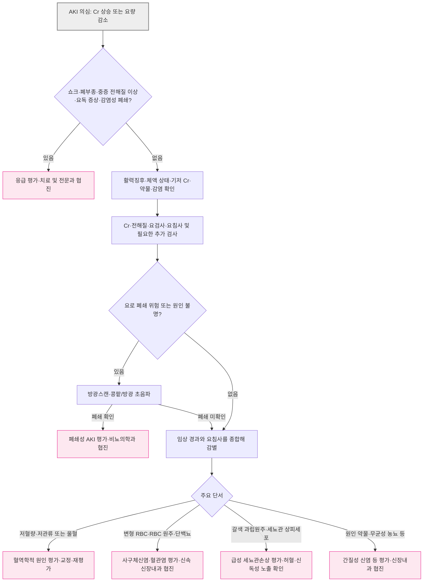

# 콩팥 질환의 진단

## <mark style="color:green;">일반 사항</mark>

* 본 챕터는 콩팥 질환 파트의 진단 도구 챕터로, 소변 검사·콩팥 기능 검사·영상 검사 등 콩팥 질환 전반에 공통으로 사용되는 진단 방법을 다룸
* 개별 질환의 임상 양상·Management·처방은 각 질환별 챕터 참조


**용어 원칙 :** 본서에서는 일반 질환명에 '콩팥'을 사용하고(콩팥 질환, 만성콩팥병, 급성콩팥손상 등), 관용적으로 굳어진 전문·제도적 명칭에는 '신장'을 사용함(신장내과, 신장이식, 신대체요법, 신동맥협착 등)


### 🚩 Red Flags

<mark style="color:$danger;">**즉각 조치**</mark>

* 새로 발생한 무뇨(성인에서 통상 ＜100 ㎖/day) 또는 갑작스런 현저한 요량 감소; AKI에 동반된 쇼크·폐부종  <mark style="color:$danger;">[응급 평가]</mark>
* 육안적 혈뇨 + 혈전·하복부 팽만·배뇨 불능 → 혈전 요폐 의심  <mark style="color:$danger;">[응급 비뇨의학과 평가]</mark>
* K ≥6.5 mmol/L 또는 심전도 변화를 동반한 고칼륨혈증; 정상 심전도만으로 중증 고칼륨혈증의 위험을 배제하지 않음  <mark style="color:$danger;">[응급 평가·치료]</mark>
* 요독성 뇌병증·심낭염 의심(의식 변화, 흉통 ± 심낭마찰음), 중증 산증 또는 조절되지 않는 용적과다  <mark style="color:$danger;">[응급 신장내과 평가]</mark>
* 빠른 Cr 상승 + 혈뇨·단백뇨 ± 적혈구 원주·핍뇨, 특히 객혈·폐출혈·자반 동반 → 급속 진행성 사구체신염·혈관염·항GBM병 의심  <mark style="color:$danger;">[응급 신장내과 평가]</mark>
* 발열·오한과 요로 폐쇄 의심(결석 병력·수신증·무뇨 등), 또는 UTI에 동반된 패혈증 징후 → 감염성 요로 폐쇄·요로성 패혈증 의심  <mark style="color:$danger;">[응급 평가·배액 필요성 판단]</mark>

<mark style="color:$warning;">**당일~수일 내 평가**</mark>

* Cr이 48시간 내 ≥0.3 ㎎/㎗ 상승하거나 7일 내 기저치 대비 ≥1.5배 상승, 또는 요량 ＜0.5 ㎖/㎏/h가 ≥6시간 지속 → AKI 평가  <mark style="color:$warning;">[**당일**]</mark>
* K 6.0~6.4 mmol/L → 심전도·신속 재검 및 급성 악화 여부 확인; AKI·증상·심전도 이상이 있으면 즉각 조치  <mark style="color:$warning;">[**당일**]</mark>
* 신규 eGFR ＜30 ㎖/분/1.73㎡ → 과거 결과·Cr 변화·요량·전해질을 우선 확인; 급성 악화이면 당일 평가, 안정된 CKD G4~G5도 신장내과 의뢰 계획 수립  <mark style="color:$warning;">[신속 평가·의뢰]</mark>
* 지속적인 GFR ＞20% 감소(혈역학적 작용 약물 시작 후에는 ＞30% 감소), 또는 원인 불명의 빠른 기능 저하  <mark style="color:$warning;">[원인 평가·의뢰]</mark>
* 고도 증가 알부민뇨와 혈뇨 동반, 지속적인 ACR ＞700 ㎎/g, 적혈구 원주 또는 설명되지 않는 지속적 RBC ＞20/HPF; 고도 알부민뇨 추적 중 ≥2배 증가  <mark style="color:$warning;">[신장내과 평가]</mark>
* CKD에서 ≥4제 항고혈압제에도 조절되지 않는 고혈압, 지속적 K 이상·산증 등 합병증; 고혈압성 응급이면 즉각 조치  <mark style="color:$warning;">[원인 평가·의뢰]</mark>
* 옆구리 통증 + 발열·오한·전신 증상 ± 농뇨 → 신우신염·전신 UTI 평가; 임신 중 신우신염 의심은 입원 필요성 평가  <mark style="color:$warning;">[**당일**]</mark>
* 임신부의 증상성 하부 UTI  <mark style="color:$warning;">[**당일** 평가·치료]</mark>
* 설명되지 않는 육안적 혈뇨(통증이 없어도 포함), UTI 치료 후에도 지속·재발하는 혈뇨  <mark style="color:$warning;">[비뇨의학과 평가 계획]</mark>

<mark style="color:$info;">**조기 평가 및 추적**</mark>

* 첫 발견된 A2 알부민뇨(uACR 30~＜300 ㎎/g), 또는 eGFR 60~89(G2)이면서 다른 콩팥 손상 지표가 동반된 경우  <mark style="color:$info;">[재검·만성성 확인]</mark>
* 임상적으로 안정된 새 eGFR 30~59 ㎖/분/1.73㎡ → 보통 2주 이내 재검해 급성 저하 배제; AKI 가능성이 있으면 당일 평가  <mark style="color:$info;">[조기 재검]</mark>
* 무증상 현미경적 혈뇨 → 사구체성 소견과 별개로 나이·흡연력·지속성 등에 따른 요로 악성종양 위험도 평가  <mark style="color:$info;">[위험도에 따른 추적·의뢰]</mark>
* 발열·운동 직후 경도 단백뇨 → 일시적 요인이 해소된 뒤 재검  <mark style="color:$info;">[지속 여부 확인]</mark>

## <mark style="color:green;">진단</mark>

### <mark style="color:orange;">CKD·AKI 정의 및 진단 기준</mark> <mark style="color:$info;">\[KDIGO]</mark>

* [만성콩팥병](112_-chronic-kidney-disease-ckd.md)(CKD) : 콩팥의 구조 또는 기능 이상이 3개월 이상 지속되며 건강에 영향을 미치는 경우; eGFR과 uACR(urine albumin-to-creatinine ratio) 두 축으로 병기 분류 (☞ [만성콩팥병](112_-chronic-kidney-disease-ckd.md), [단백뇨](111_-proteinuria.md))
  * 진단 기준 : **eGFR ＜60 ㎖/분/1.73㎡ 또는 콩팥 손상 지표 중 하나 이상이 ≥3개월 지속**
  * 콩팥 손상 지표 : uACR ≥30 ㎎/g, 지속적 혈뇨·요침사 이상, 세뇨관 장애에 의한 전해질 이상, 영상학적·병리학적 이상, 콩팥 이식 병력 등
  * eGFR ≥60이라도 손상 지표가 지속되면 CKD일 수 있으며, eGFR 60~89만으로 CKD를 진단하지 않음
* 급성콩팥손상(AKI) 진단 기준 - 다음 중 하나 이상 해당
  * 혈청 Cr이 48시간 이내 ≥0.3 ㎎/㎗ 상승
  * 7일 이내 기저치 대비 ≥1.5배 상승
  * 요량 ＜0.5 ㎖/㎏/h가 6시간 이상 지속
* AKI 진단은 eGFR 감소가 아니라 혈청 Cr의 변화와 요량을 기준으로 판단 - eGFR 공식은 콩팥 기능이 안정된 상태(steady state)를 전제하므로 AKI에서는 부정확
* 급성콩팥병(AKD) : AKI를 포함하여 3개월 미만 지속되는 급성·아급성 콩팥 구조·기능 이상을 포괄하는 개념. AKI는 그중 7일 이내 기능 변화 기준에 해당하며, AKI 기준을 충족하지 않는 아급성 이상도 AKD에 포함될 수 있음
* CKD·AKI 감별이 중요
  * 과거 Cr·eGFR·요검사, 기저 질환·약물·최근 탈수·감염, 영상·병리 결과를 종합하여 만성성 확인
  * 작은 콩팥·피질 위축은 만성성을 뒷받침하나, 에코 증가·빈혈·PTH 상승은 비특이적이며 단독으로 AKI와 CKD를 구분하지 못함. 정상 또는 큰 콩팥도 CKD를 배제하지 않음
  * 기존 CKD에 AKI가 겹칠 수 있으므로 만성 소견이 있어도 최근 Cr 상승·요량 감소를 별도로 평가

#### <mark style="color:$primary;">AKI 병기</mark>

<table><thead><tr><th width="90">병기</th><th width="330.47625732421875">혈청 Cr 기준</th><th>요량(㎖/㎏/h) 기준</th></tr></thead><tbody><tr><td>Stage 1</td><td>기저치 대비 1.5~＜2.0배 또는 48시간 내 ≥0.3 ㎎/㎗ 상승</td><td>6~＜12시간 동안 ＜0.5</td></tr><tr><td>Stage 2</td><td>기저치 대비 2.0~＜3.0배</td><td>≥12시간 동안 ＜0.5</td></tr><tr><td>Stage 3</td><td>기저치 대비 ≥3배 또는 혈청 Cr이 ≥4.0 ㎎/㎗에 도달하거나 신대체요법(RRT) 시작</td><td>≥24시간 동안 ＜0.3 또는 무뇨 ≥12시간</td></tr></tbody></table>

* **AKI가 성립한 환자**에서 Cr과 요량 기준 중 더 심한 병기를 적용. 안정된 CKD에서 Cr ≥4.0 ㎎/㎗라는 이유만으로 AKI Stage 3로 분류하지 않음
* Stage 3이면 신속한 전문 평가가 필요함. RRT 시작은 병기·Cr 수치만으로 결정하지 않으며, 조절되지 않는 고칼륨혈증·산증·용적과다 또는 요독 증상 등으로 판단
* 위 표는 성인 중심 기준임. 18세 미만에서는 eGFR ＜35 ㎖/분/1.73㎡로 감소한 경우도 Stage 3에 포함하며, 신생아는 별도 수정 기준을 적용
* AKI 후에는 회복 상태에 따라 조기에 Cr·K·요량을 재평가하고, 3개월 시점에 회복·새로운 CKD·기존 CKD 악화 여부를 확인 <mark style="color:$info;">[KDIGO AKI 2012]</mark>


**2026년 지침 확인 :** 2026-10-27 확인한 KDIGO 공식 AKI/AKD 페이지는 2026 개정 지침을 공개 검토 후 출판 준비 중으로 안내함. 본문의 AKI 정의·병기는 확정된 KDIGO 2012 기준을 유지하며, 2026 초안의 손상 바이오마커·새 분류를 확정 기준으로 적용하지 않음.


#### <mark style="color:$primary;">CKD 병기</mark>

* 원인(Cause), GFR 병기(G1\~G5), 알부민뇨 병기(A1\~A3)를 함께 사용해 "CGA" 방식으로 분류
  * 원인(Cause)-GFR-알부민뇨(CGA) 표기 예 : diabetic kidney disease G3aA2
* 진행·합병증 위험은 eGFR이 낮고 알부민뇨가 많을수록 증가하며, G 병기 숫자(G1→G5)와 A 병기 숫자(A1→A3)가 커질수록 위험이 높아짐
* 성인 CKD G3~G5에서는 해당 집단에서 검증된 콩팥기능상실 위험예측식(KFRE)을 활용. 4변수 KFRE는 나이·성별·eGFR·uACR을 사용하며, 5년 위험 3~5%는 eGFR·ACR·임상 소견과 함께 신장내과 의뢰를 결정하는 보조 기준임
* KFRE를 AKI, CKD G1~G2 또는 소아에 그대로 적용하지 않음. 임상적 긴급 의뢰가 필요한 상황에서는 위험도 계산 때문에 의뢰를 지연하지 않음

<table><thead><tr><th width="180.4761962890625">GFR 병기 (㎖/분/1.73㎡)</th><th width="139.5238037109375">A1 (＜30 ㎎/g)</th><th width="160.4761962890625">A2 (30~＜300 ㎎/g)</th><th width="149.84283447265625">A3 (≥300 ㎎/g)</th></tr></thead><tbody><tr><td>G1 (≥90)</td><td>저위험*</td><td>중등도 위험</td><td>고위험</td></tr><tr><td>G2 (60~89)</td><td>저위험*</td><td>중등도 위험</td><td>고위험</td></tr><tr><td>G3a (45~59)</td><td>중등도 위험</td><td>고위험</td><td>매우 고위험</td></tr><tr><td>G3b (30~44)</td><td>고위험</td><td>매우 고위험</td><td>매우 고위험</td></tr><tr><td>G4 (15~29)</td><td>매우 고위험</td><td>매우 고위험</td><td>매우 고위험</td></tr><tr><td>G5 (＜15)</td><td>매우 고위험</td><td>매우 고위험</td><td>매우 고위험</td></tr></tbody></table>

_\*요검사·영상 검사 등에서 다른 콩팥 손상 증거 없으면 CKD 아님_


본서의 알부민뇨 구간은 A1 ＜30, A2 30\~＜300, A3 ≥300 ㎎/g으로 통일함(ADA 2026 표기). KDIGO 2024의 분류표는 A2 30\~300, A3 ＞300으로 표기하므로 정확히 300 ㎎/g에서 경계 표기가 다름. 치료·급여의 개별 문턱값(예: ≥200, ＞300, ＞700)은 해당 기준대로 적용함.


***

<strong>AKI 원인 평가 알고리듬</strong>

<em><mark style="color:$info;">저자 재구성: KDIGO AKI 2012; NICE NG148(2024 개정)</mark></em>

* 패혈증·심부전에서는 혈역학적 원인과 세뇨관손상이 함께 존재할 수 있으며, 정상에 가까운 요침사만으로 콩팥 자체 손상을 배제하지 않음
* AIN의 발열·발진·호산구증가증은 없을 수 있음. 요중 호산구는 확진·배제에 사용하지 않음
* FeNa·FeUrea는 보조 검사임. 특히 CKD·이뇨제 사용·패혈증·사구체질환에서는 해석에 한계가 있으며, 수치만으로 수액 투여 여부를 결정하지 않음


AKI에서는 체액 고갈과 울혈을 구분함. 심부전·폐부종 환자에게 일률적으로 수액을 투여하지 않으며, 감염성 요로 폐쇄·급속 진행성 사구체신염이 의심되면 검사 결과를 모두 기다리며 의뢰를 늦추지 않음.


***

### <mark style="color:orange;">소변 검사</mark>

#### <mark style="color:$primary;">초기 평가 원칙</mark>

* CKD 위험군(당뇨병, 고혈압, 심혈관질환, AKI 병력, CKD 가족력, 전신질환, 신독성 약물 장기 사용 등)은 혈청 Cr 기반 eGFR과 uACR을 함께 평가
* 우연히 발견된 낮은 eGFR·알부민뇨·혈뇨는 긴급도에 맞춰 재검. 안정된 새 eGFR ＜60은 보통 2주 이내 재검해 급성 저하를 배제하고, 이후 과거 자료·≥3개월의 지속 여부로 만성성 확인. AKI 의심이면 당일 평가 <mark style="color:$info;">[NICE NG203]</mark>
* CKD 확진 후 eGFR·uACR은 적어도 매년 평가하고 고위험군은 더 자주 검사. 추적 eGFR ＞20% 변화, 혈역학적 작용 약물 시작 후 GFR ＞30% 감소, uACR ≥2배 증가는 예상 변동을 넘어서는 변화로 원인을 평가 <mark style="color:$info;">[KDIGO 2024]</mark>
* 시험지봉 잠혈 양성은 요현미경검사로 RBC 존재 여부를 확인하여 혈뇨와 hemoglobinuria·myoglobinuria를 구분; 희석뇨·알칼리뇨에서는 RBC가 용혈되어 현미경상 적혈구가 적게 보일 수 있으므로 결과가 불일치하면 신선한 검체로 재검
* 시험지봉 단백 양성은 가능한 경우 uACR 또는 uPCR로 정량

#### <mark style="color:$primary;">소변 채취 Tips</mark>

* 검사 전 과도한 신체 운동을 피하고, 월경·발열·증상성 UTI 등 일시적 알부민뇨·혈뇨를 유발할 상황을 확인
* 알부민뇨·단백뇨 확인에는 아침 첫 중간뇨를 우선하며 불가피하면 임의뇨를 사용. 혈뇨의 요침사는 신선하고 적절히 채취한 검체로 평가함; 밤새 오래 저류된 첫 소변 또는 격렬한 운동·성행위 직후 검체는 성인 현미경적 혈뇨 확인용으로 피함
* 검사실의 중간뇨 채취 지침을 따르며 요도 입구에 소독제가 남아 검체에 섞이지 않게 함. 붕산은 일부 배양용 용기의 보존제로 사용되지만 소독·세척용으로 사용하지 않음
* 오염되지 않도록 남성은 포피를 뒤로 젖히고, 여성은 음순이 닿지 않게 하고 채취
* 가능하면 채취 후 2시간 이내 검사실에 전달·검사; 지연되면 검사실 지침에 따라 2~8℃ 냉장 또는 검증된 보존 용기 사용. 검사 종류별 허용 보관시간이 다르며, 냉장만으로 세포·원주·화학 성분이 무기한 보존되지는 않음
* STI 핵산증폭검사(NAAT)는 중간뇨가 아닌 첫 부분뇨(first-catch urine) 또는 질 면봉 등 별도 검체가 필요할 수 있으므로 검사별 채취 지침 확인
* 도뇨관을 통한 채취 : 배액백에서 채취하지 않고 무균적으로 소독한 검체 채취 포트에서 채취. 장기간 유지 중인 도뇨관 관련 UTI가 의심되어 교체 적응증이 있으면 새 도뇨관으로 교체한 뒤 채취

#### <mark style="color:$primary;">24시간 소변 채취 방법</mark>

1. 아침에 기상하여 방광을 완전히 비워 버림(첫 소변은 모으지 않음), 시간을 기록
2. 이후 나오는 모든 소변을 병에 모아 검사실 지침에 따라 냉장 또는 지정 보존 방법으로 보관
3. 배변할 때 배출되는 소변도 수집해야 함
4. 정확히 24시간 후 방광을 비운 마지막 소변까지 수집
5. 한 번이라도 소변을 누락하면 검사실에 알리고 필요하면 처음부터 다시 채취

#### <mark style="color:$primary;">배양 검사</mark>

* 대상 : 신우신염·전신 UTI 의심, 임신부·남성의 증상성 UTI, 재발성·비전형적 UTI, 초기 치료 실패, 내성균 위험, 요로 폐쇄·결석 등 위험인자 또는 도뇨관 관련 UTI 의심
* 전신 UTI에서는 가능하면 항생제 투여 전 소변배양·감수성검사 시행. 패혈증이면 채취 때문에 항생제·응급 처치를 지연하지 않음
* EAU 2026은 UTI를 국소 UTI(방광염)와 전신 UTI로 나누고 위험인자를 별도로 평가하는 틀을 사용. 남성이라는 이유만으로 전신 감염으로 분류하지 않음 <mark style="color:$info;">[EAU 2026]</mark>
* 고령 또는 도뇨관 유치 자체만으로 배양·항생제 치료를 결정하지 않으며, 국소 요로 증상이나 발열·혈역학적 불안정 등 전신 감염 소견을 함께 평가
* 무증상 세균뇨를 선별·치료하는 주요 상황은 **임신**과 **점막 손상이 예상되는 내시경적 비뇨기 시술 전**임. 임신 초기 배양검사로 선별하며, 무증상 세균뇨 자체는 응급 의뢰 기준이 아님 <mark style="color:$info;">[IDSA 2019]</mark>
* 고령자의 섬망·낙상만 있고 국소 요로 증상·발열·혈역학적 불안정이 없으면, 배양 양성만으로 UTI로 진단·치료하지 않고 다른 원인을 평가
* 농뇨·세균뇨·냄새·혼탁만으로 증상성 UTI를 확정하지 않음. 유증상 환자에서는 균종·채취법·항생제 노출에 따라 10⁵ CFU/㎖ 미만의 균수도 의미가 있을 수 있음. 혼합균·오염 의심 검체는 적절히 재채취하여 확인

#### <mark style="color:$primary;">무균성 농뇨(Sterile Pyuria)의 원인</mark>

* 통상 배양검사에서 세균이 자라지 않으면서 농뇨가 확인되는 경우를 말함; 먼저 적절한 중간뇨 재검과 최근 항생제 복용력 확인
* 최근 항생제로 부분 치료된 UTI, 검체 오염(질 분비물 등)
* 요도염·성매개 감염(클라미디아·임균 등) → 임상 상황에 따라 NAAT; 일반 소변배양만으로 배제하지 않음
* 비뇨생식기 결핵 → 지속적 무균성 농뇨와 결핵 병력·노출 등 위험인자에서 평가
* 급성·만성 세뇨관간질성 신염; 약물 유발 AIN(NSAIDs, PPI, 일부 항생제, 면역관문억제제 등)
* 요로 결석·종양, 최근 요로 기구 삽입·도뇨관, 인접 복강 내 염증
* 방광통증증후군·간질성 방광염 등도 감별하되, 농뇨만으로 해당 질환을 확진하지 않음

#### <mark style="color:$primary;">예방적 소변 검사의 한계</mark>

* 소변 검사의 양성 결과와 질병 상태가 일치하지 않을 수 있음
* 다수의 사람에게서 불필요하거나 잠재적인 위해가 될 수 있음. 예) 유의미하지 않은 결과와 관련된 걱정, 불필요한 추가 검사 시행에 따른 비용 및 부작용
* 위험인자가 없는 무증상 일반 인구를 대상으로 한 일률적인 시험지봉 선별검사의 임상적 이득은 확립되어 있지 않음. 다만 CKD 고위험군에서는 eGFR과 uACR을 함께 평가

#### <mark style="color:$primary;">소변 시험지봉 검사의 해석</mark>

<table data-search="false"><thead><tr><th width="125">검사 항목</th><th>실제 양성의 주요 원인</th><th>위양성·간섭 요인</th><th>위음성·간섭 요인</th></tr></thead><tbody><tr><td>잠혈 Occult blood</td><td>혈뇨, hemoglobinuria, myoglobinuria</td><td>월경혈 오염, 산화제 오염</td><td>고농도 Vit C, 높은 비중, 강한 산성뇨, 현저한 단백뇨</td></tr><tr><td>빌리루빈 Bilirubin</td><td>간세포질환, 담즙울체·담도폐쇄</td><td>색소 약물에 의한 판독 간섭</td><td>빛에 오래 노출된 검체, 고농도 Vit C, 아질산염</td></tr><tr><td>우로빌리노겐 Urobilinogen</td><td>용혈, 간세포질환</td><td>phenazopyridine 등 색소 약물</td><td>빛 노출·오래된 검체, 일부 보존제</td></tr><tr><td>케톤 Ketone</td><td>당뇨병성케톤산증, 기아·저탄수화물식, 지속적 구토, 임신</td><td>일부 약물의 sulfhydryl기, 강한 색소뇨</td><td>오래된 검체; β-hydroxybutyrate 우세 시 과소평가</td></tr><tr><td>단백 Protein</td><td>사구체질환, 일시적 발열·운동·기립성 단백뇨, UTI</td><td>농축뇨, 강한 알칼리뇨, 혈뇨·농뇨, 소독제 오염</td><td>희석뇨, albumin 이외 단백질(경쇄·저분자량 단백질)</td></tr><tr><td>아질산염 Nitrite</td><td>질산염 환원 세균에 의한 세균뇨</td><td>오래되거나 오염된 검체, 시험지봉 공기 노출, 색소뇨</td><td>짧은 방광 저류시간, 질산염 섭취 부족, Vit C, 높은 비중·산성뇨, Enterococcus 등 질산염 비환원균</td></tr><tr><td>포도당 Glucose</td><td>고혈당, 임신, 신장성 당뇨·Fanconi 증후군, SGLT2 억제제 사용</td><td>산화제 오염</td><td>고농도 Vit C, 높은 비중, 오래된 검체</td></tr><tr><td>백혈구 Leukocyte esterase</td><td>UTI, 무균성 농뇨</td><td>질 분비물·산화제 오염, 색소뇨</td><td>높은 비중, 뇨당·단백뇨·케톤뇨, Vit C, 일부 항생제</td></tr></tbody></table>

* 일반 포도당 시험지봉은 과당·유당·갈락토오스를 검출하지 않음. 요당 음성으로 당뇨병을 배제하지 않음
* 요 케톤 시험지봉은 주로 acetoacetate를 검출하고 β-hydroxybutyrate를 검출하지 못함. DKA 의심 시 혈중 β-hydroxybutyrate·혈액가스·전해질로 평가; 특히 SGLT2 억제제 사용 시 현저한 고혈당이 없어도 DKA 가능
* 요 빌리루빈은 수용성인 결합형 빌리루빈을 반영. 우로빌리노겐은 완전 담도폐쇄나 장내 생성 감소(일부 항생제 사용 등)에서 실제로 감소할 수 있으며, 이를 분석상 위음성과 구분
* 빌리루빈·우로빌리노겐 조합은 보조 단서일 뿐 담도폐쇄·간세포질환을 확진하지 못함. 간질환 평가는 혈청 빌리루빈·간효소와 필요한 영상검사를 우선
* overhydration 시 소변이 희석되어 위음성을 초래할 수 있음
* leukocyte esterase와 nitrite가 모두 양성이면 UTI 가능성이 높아지나, nitrite 음성만으로 UTI를 배제하지 못함
* 고령 및 도뇨관 유치 환자에서는 무증상 세균뇨가 흔하므로 증상 없이 UTI 진단·항생제 투여를 목적으로 시험지봉 검사를 시행하지 않음
* 시험지봉의 부적절한 보관·유효기간 경과·판독시간 오류는 결과에 영향을 미침. 간섭 정도는 제품·측정법마다 다르므로 해당 검사실 지침을 따름

**pH**

* 산성 : 대사성·호흡성 산증, 당뇨병성케톤산증, 기아, 설사, 동물성 단백질 위주 식사
* 알칼리성 : urease 생성균 UTI, 구토 초기의 bicarbonaturia, 원위 신세뇨관산증, 채소·과일 위주 식사, 식후 alkaline tide, 오래된 검체
* 요 pH만으로 전신 산·염기 상태를 판단하지 않음. 심한 용적 고갈을 동반한 구토에서는 전신 알칼리증에도 산성뇨가 가능하며, 신세뇨관산증은 혈청 전해질·bicarbonate 등과 함께 평가

**비중 (SG)**

* 농축에 따른 증가 : 수분 섭취 감소·탈수, SIADH 등; 희석에 따른 감소 : 수분 과잉, 요붕증, 이뇨제, 콩팥 농축능 저하 등
* **측정법 확인 :** 굴절계 비중은 당·단백·조영제 등에도 높아질 수 있음. 시험지봉은 주로 이온 농도를 반영하므로 요당·조영제에 따른 비중 증가를 굴절계와 같은 방식으로 반영하지 않으며, 알칼리뇨 등에서 낮게 측정될 수 있음
* 다뇨·저나트륨혈증 또는 농축능의 정밀 평가에는 요삼투질농도를 활용. 비중 하나만으로 SIADH·요붕증을 진단하지 않음 <mark style="color:$info;">[EFLM 2023]</mark>

#### <mark style="color:$primary;">요 알부민/크레아티닌 비율 (uACR)</mark>

* 초기 선별·통상 추적에는 spot uACR이 24시간 채뇨보다 편리하며, 가능하면 아침 첫 중간뇨로 측정. 정확한 일일 배설량이 필요하거나 결과가 임상상과 불일치하면 시간뇨를 고려
* 정상\~경도 증가(A1) ＜30 ㎎/g, 중등도 증가(A2) 30\~＜300 ㎎/g, 고도 증가(A3) ≥300 ㎎/g
* 무작위뇨 uACR ≥30 ㎎/g이면 가능하면 아침 첫 중간뇨로 확인. 운동·월경·발열·증상성 UTI·혈뇨·현저한 고혈당·고혈압·심부전 등 일시적 증가 요인 확인
* 당뇨병에서는 생물학적 변동을 고려하여 3~6개월 내 3회 중 2회 이상 이상인지 확인. 단, 심한 알부민뇨·혈뇨·AKI 또는 신증후군 의심 시 재검 횟수를 채우기 위해 원인 평가·의뢰를 늦추지 않음 <mark style="color:$info;">[ADA 2026]</mark>
* uACR·uPCR은 요중 Cr 배설량에도 영향받음. 근감소·저체중에서는 실제 일일 배설량에 비해 높게, 근육량이 많으면 낮게 보일 수 있어 임상상과 함께 해석
* 요 시험지봉 단백 검사는 미세알부민뇨(중등도 증가 알부민뇨로 용어 변경 ☞ [단백뇨](111_-proteinuria.md)) 단계를 놓칠 수 있어, 당뇨병·고혈압 등 CKD 고위험군 선별에는 uACR을 우선 시행
* Dipstick은 albumin에 민감한 반면 저분자량 단백질(low molecular weight protein)은 놓칠 수 있음 - Bence-Jones protein, Fanconi 증후군, tubular proteinuria 등은 dipstick 음성일 수 있음
* 총 단백 배설 또는 비알부민 단백뇨가 의심되면 uPCR 및 원인별 검사를 고려
* 일반 총단백뇨의 참고 기준은 uPCR 약 ＜150 ㎎/g 또는 24시간 단백 ＜150 ㎎/day이며 검사실 기준 확인. uPCR의 총단백과 uACR의 알부민은 서로 바꾸어 사용하지 않음
* 상세 평가·감별은 [단백뇨](111_-proteinuria.md) 챕터 참조

#### <mark style="color:$primary;">소변의 현미경적 소견과 관련 질환</mark>

<table data-search="false"><thead><tr><th width="335.2381591796875">현미경적 소견</th><th>관련 질환·해석</th></tr></thead><tbody><tr><td>fatty cast, oval fat body</td><td>신증후군 또는 현저한 지질뇨</td></tr><tr><td>백혈구 + bacteria, WBC cast</td><td>급성 신우신염 시사</td></tr><tr><td>WBC cast without bacteria</td><td>급성 간질성 신염, 일부 사구체신염 등</td></tr><tr><td>normal-shaped(isomorphic) erythrocyte</td><td>비사구체성 출혈을 시사하나, 단독 소견으로 사구체성 출혈을 배제할 수 없음</td></tr><tr><td>dysmorphic erythrocyte, 특히 acanthocyte</td><td>사구체성 혈뇨를 시사; 검체·판독법에 영향받으므로 단백뇨·콩팥 기능 등과 종합</td></tr><tr><td>erythrocyte cast</td><td>사구체신염·혈관염 등 사구체성 질환</td></tr><tr><td>muddy-brown granular cast, tubular epithelial cell/cast</td><td>급성 세뇨관손상</td></tr><tr><td>waxy/broad cast</td><td>진행된 CKD 또는 심한 소변 정체</td></tr><tr><td>hyaline cast</td><td>정상에서도 소량 관찰 가능; 탈수·운동·발열·이뇨제 사용 등에서 증가</td></tr></tbody></table>

* 요중 호산구는 민감도·특이도가 낮아 급성 간질성 신염의 확진 또는 배제 검사로 사용하지 않음
* 성인 현미경적 혈뇨는 적절히 채취한 검체의 요현미경검사에서 통상 RBC ≥3/HPF로 평가하며, 시험지봉 잠혈 양성만으로 진단하지 않음
* 단백뇨·적혈구 원주·콩팥 기능 저하는 신장내과 평가 단서임. 사구체성 소견 또는 항응고제 복용이 있어도 나이·흡연력·혈뇨 지속성 등에 따른 비뇨의학과 평가 필요성은 별도로 판단 <mark style="color:$info;">[AUA/SUFU 2025]</mark>

#### <mark style="color:$primary;">소변의 색과 원인</mark>

<table data-search="false"><thead><tr><th width="114.28570556640625">소변 색</th><th>주요 원인</th></tr></thead><tbody><tr><td>무색</td><td>희석뇨, 과도한 수분 섭취, 다뇨</td></tr><tr><td>진한 황색</td><td>농축뇨, 탈수</td></tr><tr><td>혼탁</td><td>농뇨, 결정뇨, 인산염뇨, chyluria, 질 분비물 오염</td></tr><tr><td>오렌지색</td><td>phenazopyridine, rifampin, 농축뇨</td></tr><tr><td>갈색·차색</td><td>bilirubinuria, hemoglobinuria, myoglobinuria, 사구체성 혈뇨, 일부 약물</td></tr><tr><td>검은색</td><td>alkaptonuria, melanin, 오래된 혈액, 일부 약물</td></tr><tr><td>적색·분홍색</td><td>혈뇨, hemoglobinuria, myoglobinuria, 비트·블랙베리 등 음식, rifampin</td></tr><tr><td>청색·녹색</td><td>methylene blue, propofol, amitriptyline, 일부 색소·감염</td></tr></tbody></table>

* 냄새·혼탁은 수분 상태·식이·결정·약물 등에도 영향받으며 단독으로 UTI를 진단하지 않음
* 거품은 공기·농축뇨·단백뇨 등에서 보일 수 있으며 외관만으로 단백뇨를 판단하지 않고 uACR·uPCR로 확인

### <mark style="color:orange;">콩팥 기능 검사</mark>

#### <mark style="color:$primary;">BUN</mark>

* BUN은 간에서 생성되는 요소(urea)의 질소 성분을 측정한 값. 요소는 사구체에서 여과되고 세뇨관에서 일부 재흡수됨
* 증가 : 체액 고갈(콩팥에서의 재흡수 증가), catabolism↑(예: 위장관 출혈, cell lysis, steroid 사용), 단백질 섭취↑, 콩팥 관류↓(예: 심부전, renal artery stenosis)
* 감소 : 중증 간질환, 영양실조, 단백질 섭취 부족, 수분 과다·SIADH
* BUN/Cr ratio : **두 수치를 모두 ㎎/㎗로 표시했을 때** 대략 10~20:1; urea 수치 또는 서로 다른 단위에 그대로 적용하지 않음
  * ＞20:1은 저관류를 시사할 수 있으나 상부위장관 출혈·고단백 식이·고용량 steroid·이화항진 등에서도 상승. 이 비율만으로 신전성 AKI와 콩팥 자체 손상을 구분하거나 수액 반응성을 판단하지 않음

#### <mark style="color:$primary;">크레아티닌·추정 크레아티닌 청소율 (CrCl, Cockcroft–Gault)</mark>

* Cr은 근육 대사산물로서 사구체에서 여과되고 일부는 세뇨관에서 분비됨. GFR 외에도 근육량·육류·크레아틴 보충제·운동·약물·측정 간섭에 영향받음
* 근감소·절단·영양실조에서는 Cr이 낮아 eGFRcr이 실제 기능을 과대평가할 수 있음. trimethoprim·cobicistat·dolutegravir 등은 세뇨관 Cr 분비를 억제해 실제 GFR 감소 없이 Cr을 올릴 수 있으나, 실제 AKI와 동반될 가능성을 임상적으로 평가
* Cockcroft-Gault 공식은 특정 약물의 임상시험·허가사항·급여기준이 CrCl을 요구할 때 주로 사용하며, CKD 진단·병기 분류에는 검증된 eGFR 공식을 사용
* 근위세뇨관에서 Cr이 일부 분비되므로 CrCl은 실제 GFR을 과대평가할 수 있음. 정확한 평가가 임상 결정에 중요하면 eGFRcr-cys 또는 measured GFR을 고려
* [CrCl(㎖/분)](https://www.mdcalc.com/calc/43/creatinine-clearance-cockcroft-gault-equation) = {(140-연령[세]) × 몸무게(㎏)} ÷ {72 × s-Cr(㎎/㎗)} × 0.85(if female)
  * Cockcroft-Gault 공식은 체표면적(1.73㎡) 보정을 하지 않은 추정 CrCl(㎖/분)이며, MDRD·CKD-EPI(㎖/분/1.73㎡, 체표면적 보정)와 단위가 다름
  * 비만·심한 부종에서는 실제 체중을 대입한 CrCl이 과대평가될 수 있음. 약제·적응증별 검증 방법에 따라 체중을 선택하며, 이상 체중·조정 체중을 모든 약물에 일률적으로 대입하지 않음

**약물 용량 조절 기준 :** KDIGO 2024는 대부분의 환자와 임상 상황에서 검증된 혈청 Cr 기반 eGFR 공식을 약물 용량 결정에 사용할 수 있다고 제시함. 다만 DOAC 등 임상시험·허가사항이 CrCl 기반인 약물은 Cockcroft-Gault 공식을 따라야 하며, 국내 허가사항·HIRA 급여 기준을 약제별로 확인함. 체격이 매우 크거나 작고 약물의 치료범위가 좁으면 체표면적 보정을 해제한 eGFR(㎖/분), eGFRcr-cys 또는 measured GFR을 고려함. 보정 해제는 eGFR(㎖/분/1.73㎡) × 실제 체표면적(㎡) ÷ 1.73으로 계산하며, CKD G 병기에는 보정된 값을 사용함.


#### <mark style="color:$primary;">Cystatin C</mark>

* cysteine protease inhibitor의 cystatin superfamily의 일종인 저분자량 단백질. 혈청 측정
* Cr과 병용하여 GFR과 CKD를 보다 정확하게 평가하는 데 활용; 근육량이 많은 젊은 환자에서 s-Cr이 높게 측정되는 경우 또는 근육량이 적은 노인 환자에서 콩팥 기능 장애를 진단할 때 유용
* 검사 가능 여부·비용·급여 적용을 고려하며, 표준화된 검사값을 사용
* 비-GFR 결정인자 : 비만, 흡연, 갑상선기능 이상, 고용량 glucocorticoid, 염증 등이 cystatin C에 영향을 줄 수 있어 임상 맥락과 함께 해석

#### <mark style="color:$primary;">사구체여과율 (GFR)</mark>

* 콩팥 기능 평가 도구로 활용; 콩팥의 여과 능력을 반영 (☞ [계산식](https://www.kidney.org/professionals/gfr_calculator))
* 초기 평가는 일반적으로 혈청 Cr과 검증된 공식으로 산출한 eGFRcr을 사용
  * 인종 계수를 사용하지 않으며 동일 지역 내에서 통일된 검증 공식을 사용하는 것이 원칙. 국내에서는 검사실이 보고하는 공식과 적용 기준을 확인
  * CKD-EPI 2021은 대표적인 인종 비보정 공식이며 IDMS-traceable(표준화) 크레아티닌 값을 전제로 개발됨
* cystatin C를 이용할 수 있으면 Cr과 함께 측정한 eGFRcr-cys로 G 병기를 평가. 특히 근육량·식이 등으로 eGFRcr이 부정확하거나 치료 결정에 정확한 GFR이 필요한 경우 활용하며, 복합 공식도 부정확할 상황에서는 외인성 여과표지자를 이용한 measured GFR을 고려
* 급격한 콩팥 기능 변화에서는 steady state를 전제로 하는 eGFR 공식이 부정확하므로 Cr 변화·요량·임상 경과를 함께 평가
* **임신 중에는 성인 eGFR 공식을 콩팥 기능 평가에 사용하지 않으며**, 혈청 Cr과 임신 전 기저치·임신 시기·요검사·혈압을 종합. 임신 중 cystatin C도 생리적 영향으로 해석이 제한됨 <mark style="color:$info;">[임신·콩팥병 지침 2019]</mark>

**CKD-EPI Creatinine equation (2021)** - 대표적인 인종 비보정 공식

* 아래 성인 공식은 18세 이상에서 적용하며, Scr 단위는 ㎎/㎗, Scys 단위는 ㎎/L임. 소아·청소년은 연령에 적합한 검증 공식(예: CKiD U25)을 사용

* eGFR = 142 × min(Scr/κ, 1)α × max(Scr/κ, 1)-1.200 × 0.9938연령 \[× 1.012 if female]
  * κ= 여 0.7/남 0.9, α= 여 -0.241, 남 -0.302; min= Scr/κ or 1 중 최소값, max= Scr/κ or 1 중 최대값

**CKD-EPI Creatinine–Cystatin equation (2021)**

* Creatinine 단독 공식의 한계(근육량 의존성)를 보완하는 보다 정확한 보완적 추정식
* eGFRcr-cys = 135 × min(Scr/κ, 1)α × max(Scr/κ, 1)-0.544 × min(Scys/0.8, 1)-0.323 × max(Scys/0.8, 1)-0.778 × 0.9961연령 \[× 0.963 if female]
  * κ= 여 0.7/남 0.9, α= 여 -0.219/ 남 -0.144; min(Scr/κ, 1)= Scr/κ or 1.0 중 최소값, max(Scr/κ, 1)= Scr/κ or 1.0 중 최대값; min(Scys/0.8, 1)= Scys/0.8 or 1 중 최소값, max(Scys/0.8, 1)= Scys/0.8 or 1 중 최대값

**CKD-EPI Cystatin C equation (2012)**

* Cystatin C 단독 공식(CKD-EPI Cystatin C, 2012)도 존재하나, 가능하면 같은 검체에서 Cr을 함께 측정하여 eGFRcr-cys를 산출. Cr 해석이 매우 어려운 상황에서는 eGFRcys가 보조적으로 유용할 수 있으나 비-GFR 결정인자를 고려


**MDRD**는 CKD-EPI 이전에 널리 쓰였던 공식임. 현재는 검사실에서 보고하는 지역 내 검증·통일된 eGFR 공식을 우선하며, 서로 다른 공식으로 계산한 값을 추적 비교할 때 주의함.


### <mark style="color:orange;">원인 규명을 위한 추가 검사</mark>

* 이상 소견의 패턴에 따라 선택하며, 모든 환자에게 면역·유전 검사 패널을 일률적으로 시행하지 않음
* 기본 혈액검사 : Cr·eGFR·K·Na·bicarbonate를 중심으로 평가하고, 기능 저하·단백뇨 정도에 따라 CBC·albumin·Ca·인 등을 추가
* 사구체신염·전신질환 의심 : 임상상에 따라 C3·C4, ANA·항dsDNA, ANCA·항GBM 항체, B형·C형간염·HIV 검사 등을 신장내과와 상의
* 비알부민 단백뇨·원인 불명 기능 저하 등에서 단클론성 단백 관련 질환이 의심되면 혈청 유리경쇄, 혈청·소변 단백 전기영동/면역고정 등을 고려. 콩팥 기능 저하 자체가 유리경쇄 농도·비율에 영향을 주므로 적절한 참고 범위로 해석
* 가족력·젊은 연령 발병·특징적 구조 이상 또는 원인 불명 CKD에서는 유전질환 평가를 고려
* 콩팥 생검은 사구체질환·설명되지 않는 AKI·유의한 단백뇨 등에서 진단·치료 결정에 도움이 될 때 전문과가 적응증과 출혈 위험을 평가하여 시행 <mark style="color:$info;">[KDIGO 2024]</mark>

### <mark style="color:orange;">영상 검사</mark>

#### <mark style="color:$primary;">콩팥·방광 초음파</mark>

<mark style="color:cyan;">**검사 대상**</mark>

* 재발성 UTI 중 결석·폐쇄·잔뇨·혈뇨·신기능 저하 등 위험인자가 있거나 비전형적 경과인 경우; 저위험 재발 방광염 모두에 영상검사를 일률적으로 시행하지 않음
* 적절한 치료에도 반응하지 않는 UTI
* 배뇨 후 불완전 비움 증상 또는 촉지되는 방광
* 재발성 Proteus 감염(신결석 관련)
* CKD 의심 시 크기·피질 두께·에코·구조 평가. 작은 콩팥·피질 위축은 만성성을 시사하나, 에코 증가만으로 AKI/CKD를 구분하지 않음
* 수신증·방광 팽창·잔뇨 등 요로 폐쇄의 단서를 확인하여 교정 가능한 AKI 원인 평가. 수신증이 항상 기능적 폐쇄를 의미하지는 않음
* 다낭성 콩팥 질환 등 구조적 이상 평가
* 신동맥협착 의심 시 도플러 초음파 고려
* 요로 폐쇄 위험이 있거나 원인이 명확하지 않은 급성콩팥손상(AKI)
* AKI에서 원인 불명 또는 요로 폐쇄 위험이면 긴급 초음파(평가 후 24시간 이내), AKI에서 감염성 폐쇄·농신증 의심이면 즉시 초음파(6시간 이내)와 응급 전문과 평가를 고려 <mark style="color:$info;">[NICE NG148]</mark>
* 초기 폐쇄에서는 수신증이 뚜렷하지 않을 수 있어 임상적 의심이 높으면 초음파 음성만으로 폐쇄를 배제하지 않음

#### <mark style="color:$primary;">CT·MRI 등</mark>

* 요관결석 의심에서는 초음파만으로 놓칠 수 있어 필요 시 비조영 CT를 선택; 임신에서는 초음파를 우선
* 신동맥협착 의심 시 CT angiography 또는 MR angiography, 상부요로상피 종양 의심 시 CT urography, 콩팥 종괴 평가 시 조영증강 다중시기 CT 또는 MRI를 선택
* 검사 목적·임신 여부·AKI/CKD·조영제 종류를 함께 고려. 응급으로 필요한 영상검사를 콩팥 기능 수치만으로 일률적으로 배제하지 않음

### <mark style="color:orange;">증상/병력에 따른 배뇨 문제의 감별</mark>

<table><thead><tr><th width="212.3809814453125">증상</th><th>감별 질환/원인</th></tr></thead><tbody><tr><td>배뇨통(dysuria)</td><td>요도염, 방광염, 전립선염, 질염, 성매개 감염, 외상, 종양</td></tr><tr><td>주저뇨·약한 요류·잔뇨감</td><td>전립선비대증, 요도협착, 신경인성 방광, 약물, 골반장기탈출증</td></tr><tr><td>옆구리 통증</td><td>신결석, 신우신염, 요로 폐쇄; 드물게 콩팥경색·출혈</td></tr><tr><td>빈뇨</td><td>요도염, 방광염, 질염, 방광 결석, 과민성 방광, 간질성 방광염, 불안</td></tr><tr><td>다뇨(성인에서 통상 ＞3 L/day)</td><td>과다 수분 섭취, 이뇨제, 당뇨병·SGLT2 억제제 등 삼투성 이뇨, 요붕증; 24시간 요량·요삼투질농도 등으로 평가</td></tr><tr><td>야간뇨</td><td>전립선비대증·방광 기능 저하, 야간다뇨, 심부전·말초부종, 수면무호흡증, 당뇨병·요붕증, 수면장애</td></tr></tbody></table>

* 빈뇨는 횟수 증가, 다뇨는 하루 총 요량 증가임. 배뇨일지로 횟수·1회량·주야간 요량을 구분

#### <mark style="color:$primary;">배뇨통(Dysuria)의 초기 접근</mark>

1. 발열·오한·옆구리 통증·패혈증·요폐 여부를 먼저 확인하고, 해당하면 신우신염·전립선염·폐쇄 등 신속 평가
2. 배뇨통·빈뇨·절박뇨가 있고 질 분비물·자극 증상이 없는 저위험 비임신 여성은 방광염 가능성이 높음. 배양 적응증·임신 가능성·요로 위험인자 확인
3. 질 분비물·가려움·외음부 통증이 있으면 질염·외음부질환·폐경 관련 비뇨생식기증후군을 평가
4. 요도 분비물·새 성접촉·무균성 농뇨가 있으면 요도염·STI 가능성을 평가하고 적절한 검체로 NAAT 고려
5. 증상이 지속·재발하거나 혈뇨·결석·종양 위험이 있으면 반복 항생제 투여에 앞서 배양·영상·전문과 평가 필요성 판단

<mark style="color:$info;">[EAU 2026; UKHSA UTI 진단 지침]</mark>

***

### 질병코드

* 본 챕터는 콩팥 질환 전반의 진단 도구를 다루므로 단일 질병코드를 적용하지 않으며, 진단된 개별 질환의 질병코드는 해당 챕터 참조

## 주요 참고문헌 및 확인 자료

### ＜임상 근거＞

* KDIGO CKD Work Group. KDIGO 2024 Clinical Practice Guideline for the Evaluation and Management of Chronic Kidney Disease. Kidney Int. 2024;105(Suppl 4S):S117–S314. [지침](https://kdigo.org/guidelines/ckd-evaluation-and-management/)
* American Diabetes Association Professional Practice Committee. 11. Chronic Kidney Disease and Risk Management: Standards of Care in Diabetes—2026. Diabetes Care. 2026;49(Suppl 1):S246–S260. [DOI](https://doi.org/10.2337/dc26-S011)
* KDIGO Acute Kidney Injury Work Group. KDIGO Clinical Practice Guideline for Acute Kidney Injury. Kidney Int Suppl. 2012;2:1–138. [지침](https://kdigo.org/guidelines/acute-kidney-injury/)
* Nicolle LE, et al. Clinical Practice Guideline for the Management of Asymptomatic Bacteriuria: 2019 Update by IDSA. Clin Infect Dis. 2019;68:e83–e110. [DOI](https://doi.org/10.1093/cid/ciy1121)
* UK Kidney Association. Management of Hyperkalaemia in Adults. 2023. [지침](https://www.ukkidney.org/sites/renal.org/files/FINAL%20VERSION%20-%20UKKA%20CLINICAL%20PRACTICE%20GUIDELINE%20-%20MANAGEMENT%20OF%20HYPERKALAEMIA%20IN%20ADULTS%20-%20191223_0.pdf)
* EAU. Guidelines on Urological Infections. 2026. [지침](https://uroweb.org/guidelines/urological-infections/chapter/the-guideline)
* EAU. Guidelines on Urolithiasis. 2026. [지침](https://uroweb.org/guidelines/urolithiasis/chapter/guidelines)
* AUA/SUFU. Microhematuria Guideline (2020, Amended 2025). [지침](https://www.auanet.org/guidelines-and-quality/guidelines/microhematuria)
* Kouri TT, et al. The EFLM European Urinalysis Guideline 2023. Clin Chem Lab Med. 2024;62:1653–1786. [DOI](https://doi.org/10.1515/cclm-2024-0070)
* NICE. Acute kidney injury: prevention, detection and management. NG148, updated 2024. [지침](https://www.nice.org.uk/guidance/ng148/chapter/Recommendations)
* NICE. Chronic kidney disease: assessment and management. NG203. [지침](https://www.nice.org.uk/guidance/ng203/chapter/Recommendations)
* NIDDK. eGFR Equations for Adults; Determining Drug Dosing in Adults with Chronic Kidney Disease. [성인 공식](https://www.niddk.nih.gov/research-funding/research-programs/kidney-clinical-research-epidemiology/laboratory/glomerular-filtration-rate-equations/adults) · [용량 결정](https://www.niddk.nih.gov/research-funding/research-programs/kidney-clinical-research-epidemiology/laboratory/ckd-drug-dosing-providers)
* Wiles K, et al. Clinical practice guideline on pregnancy and renal disease. BMC Nephrol. 2019;20:401. [DOI](https://doi.org/10.1186/s12882-019-1560-2)
* UKHSA. Diagnosis of urinary tract infections: quick reference tools for primary care. [자료](https://www.gov.uk/government/publications/urinary-tract-infection-diagnosis/diagnosis-of-urinary-tract-infections-quick-reference-tools-for-primary-care)
* Muriithi AK, et al. Utility of urine eosinophils in the diagnosis of acute interstitial nephritis. Clin J Am Soc Nephrol. 2013;8:1857–1862. [DOI](https://doi.org/10.2215/CJN.01330213)
* Abdelhafez M, et al. Diagnostic Performance of Fractional Excretion of Sodium for the Differential Diagnosis of Acute Kidney Injury: A Systematic Review and Meta-Analysis. Clin J Am Soc Nephrol. 2022;17:785–797. [DOI](https://doi.org/10.2215/CJN.14561121)

### ＜허가·급여 확인 자료＞

* 식품의약품안전처. 의약품안전나라 — 의약품 품목허가정보. 국내 제품별 적응증·용법·금기 확인. [의약품안전나라](https://nedrug.mfds.go.kr/index)
* 건강보험심사평가원. 검사·약제 급여기준 및 적용 조건. [HIRA](https://www.hira.or.kr)

***

## <mark style="color:blue;">환자 안내서</mark>

### <mark style="color:$primary;">왜 소변 검사와 콩팥 기능 검사를 하나요?</mark>

* 콩팥은 몸의 노폐물을 걸러내고 수분·전해질 균형을 맞추는 장기입니다. 초기에는 증상이 거의 없는 경우가 많아, 검사로 미리 확인하는 것이 중요합니다.
* 혈액 크레아티닌으로 계산한 eGFR과 소변 알부민/크레아티닌 비율(uACR)을 함께 확인합니다. 일반 소변 검사에서 단백이 음성이어도 소량의 알부민은 검출되지 않을 수 있습니다.

### <mark style="color:$primary;">검사 결과가 이상하다고 나오면 어떻게 하나요?</mark>

* 한 번의 이상 소견만으로 병이라고 단정하지 않습니다. 물을 충분히 마시지 않았거나, 운동 직후, 발열 시에도 일시적으로 이상 소견이 나올 수 있습니다.
* 검사 종류와 이상 정도에 따라 며칠~수개월 안에 재검할 수 있습니다. 3개월 이상 지속되는 콩팥 구조 또는 기능 이상은 만성콩팥병을 시사하지만, 한 번의 이상 검사만으로 3개월을 기다리는 것은 아닙니다.

### <mark style="color:$primary;">이런 증상이 있으면 바로 병원에 가세요</mark> 🚨

* 소변량이 갑자기 줄었거나 거의 나오지 않습니다
* 붉은 소변에 덩어리(혈전)가 섞여 나오면서 아랫배가 아프고 팽팽합니다
* 평소와 다르게 숨이 차거나 의식이 흐릿합니다
* 열·오한과 옆구리 통증이 함께 있거나, 열이 나면서 소변이 잘 나오지 않습니다

### <mark style="color:$primary;">콩팥을 보호하는 습관</mark>

* **이부프로펜 등 진통소염제를 임의로 자주 복용하지 마십시오.** 특히 콩팥 기능이 떨어졌거나 탈수된 상태에서는 콩팥 손상이 생길 수 있습니다.
* 복용 중인 처방약·일반약·한약·건강기능식품을 의료진에게 알려 주세요.
* 검사를 잘 받으려고 물을 과하게 마시거나 일부러 끊지 마십시오. 평소 수분 섭취를 유지하되, 수분 제한 지시가 있으면 따르세요.
* 소변 채취 전 심한 운동을 피하고, 월경·발열·배뇨통이 있으면 알려 주세요. 24시간 소변을 한 번이라도 빠뜨리면 검사실에 말씀해 주세요.
