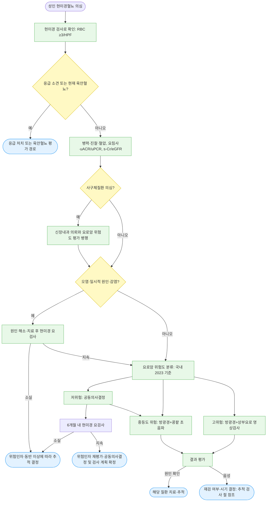

# 혈뇨 Hematuria

## <mark style="color:green;">일반 사항</mark>

* 소변에 적혈구가 비정상적으로 섞여 나오는 상태
  * 육안적 혈뇨(gross hematuria)와 현미경적 혈뇨(microhematuria, MH)로 구분; MH에는 증상성·무증상 혈뇨가 모두 포함됨
* **성인 MH의 정의** : 중간뇨(mid-stream clean-catch)로 적절히 채집한 단일 요검체의 현미경 검사에서 RBC ≥3/HPF; 이후 오염·일시적 원인·감염 등을 확인하여 평가 경로를 결정함
  * 시험지봉(딥스틱) 검사 단독으로는 MH를 진단하지 않음; trace 이상의 시험지봉 양성 소견이 있으면 반드시 현미경 검사로 확인
  * 단일 요검체에서 RBC ≥3/HPF이면 MH 정의에 해당하지만, 대한신장학회 2023 지침은 처음 확인된 무증상 MH를 반복 현미경 검사로 재확인할 수 있다고 권고함(조건부 권고, 근거 수준 매우 낮음) - 첫 검사에서 확인된 혈뇨의 30\~62%가 재검에서 음전되며 이 경우 예후가 양호함
* **소아청소년 현미경적 혈뇨의 정의** : 고배율 시야(×400)에서 RBC ≥5/HPF
  * 적어도 2주 간격으로 시행한 현미경 검사에서 3회 이상 연속 확인되면 지속 혈뇨로 보고 원인을 평가함
* 혈뇨의 원인은 연령·증상·사구체성 여부·요로암 위험도에 따라 평가함
  * 성인의 원인 불명 육안혈뇨는 통증 유무와 관계없이 요로 악성종양 가능성을 평가하고, 성인 무증상 MH는 [위험도](#무증상-현미경혈뇨의-위험도-분류-대한신장학회-2023)에 따라 접근
  * 소아청소년은 요로암 위험도 분류를 적용하지 않으며, 신장·방광 초음파를 우선하는 별도 평가 원칙을 적용
* 항혈소판제·항응고제가 혈뇨를 유발하거나 악화할 수 있으나 약물 영향으로만 단정하지 않으며, 복용하지 않는 환자와 동일한 원칙으로 암 등 기저 질환을 평가

## <mark style="color:green;">원인</mark>

#### <mark style="color:$primary;">사구체성 혈뇨 (Glomerular hematuria)</mark>

* 사구체신염 : IgA 신증, 감염후 사구체신염(PIGN; 연쇄상구균감염후 사구체신염 PSGN 포함), lupus nephritis, ANCA 연관 혈관염, 항사구체기저막병
* 유전성 신증 : Alport 증후군, 얇은기저막병(thin basement membrane disease). COL4A3/COL4A4 이형접합 변이 관련 질환은 단독 혈뇨에서 진행성 콩팥병까지 표현형이 다양하여 "양성 가족성 혈뇨"로 단정하지 않음; 가족력·알부민뇨·콩팥기능을 확인하며 필요 시 COL4A3/COL4A4/COL4A5 유전자검사를 고려

#### <mark style="color:$primary;">비사구체성 혈뇨 (Non-glomerular hematuria)</mark>

* 상부요로 : [요로결석](133_-urolithiasis.md), [신우신염](119_-acute-pyelonephritis-uncomplicated.md), 신세포암, 상부요로 요로상피암, 요로 폐쇄, 다낭콩팥병, 신경색, 신유두괴사, 콩팥 동정맥기형, 호두까기증후군
* 하부요로 : [세균성 방광염](118_-acute-cystitis.md)(UTI), 방광 요로상피암, 전립선비대증(BPH), 급성 전립선염, [요도염](115_-urethritis.md), 요로 조작(카테터 삽입·최근 시술), 출혈성 방광염(cyclophosphamide·골반 방사선 치료·BK 바이러스 등)
* 기타 비종양성 원인 : 발열과 동반된 일시적 혈뇨, interstitial cystitis/bladder pain syndrome, trigonitis, 요로 자궁내막증
* 출혈 증폭·동반 요인 : 응고장애, 항응고제·항혈소판제 - 약물 영향으로만 단정하지 않고 기저 원인을 동일하게 평가
* 검체 오염 : 월경, 질 출혈, 성관계 후 생식기 출혈, 치핵 출혈 - 외래에서 흔한 오염원이므로 병력과 적절한 중간뇨 채취 여부를 확인

#### <mark style="color:$primary;">Heme-negative discolored urine</mark>

* 붉거나 주황색·갈색으로 변색된 소변에서 현미경상 적혈구가 없고 시험지봉 heme 반응도 음성인 경우

- 대사 산물·색소 : porphyria(포르피린증), bile pigment, homogentisic acid, melanin, urate
- 식품 : 비트(beeturia), 블랙베리, 식용 색소
- 약물 : rifampin, phenazopyridine, doxorubicin, chloroquine, deferoxamine, nitrofurantoin 등

#### <mark style="color:$primary;">일시적 혈뇨</mark>

* 발열, 감염, 외상, 심한 운동 → 유발 요인 소실 후 재검으로 확인

## <mark style="color:green;">임상 양상</mark>

* 육안혈뇨의 배뇨 시점은 병소 국소화에 도움
  * 초기 혈뇨(initial hematuria) : 배뇨 시작 시에만 두드러짐 → 요도 병변 시사
  * 종말 혈뇨(terminal hematuria) : 배뇨 말기에 두드러짐 → 방광경부·삼각부·전립선·후부요도 병변 시사
  * 전 배뇨 혈뇨(total hematuria) : 배뇨 전 과정에 걸쳐 균일 → 방광 또는 상부요로 병변 시사
* 응괴(clot)의 모양도 단서 : 지렁이 모양의 긴 응괴는 요관·상부요로 기원을, 무정형의 큰 응괴는 방광 기원을 시사
* 배뇨 시점·소변색·응괴 모양은 보조 단서이며, 이것만으로 출혈 부위나 원인 질환을 확정하지 않음

### 🚩Red Flags

**즉각 조치**

* 응괴에 의한 급성 요폐(clot retention), 지속되는 다량 출혈 또는 혈역학적 불안정(빈맥·저혈압·실신) → 응급실·비뇨의학과 의뢰  <mark style="color:$danger;">즉각 조치</mark>
* 급격한 s-Cr 상승 또는 핍뇨~무뇨를 동반하는 혈뇨 → 급성콩팥손상·요로 폐쇄 평가  <mark style="color:$danger;">즉각 조치</mark>
* 발열·오한과 옆구리 통증, 요로 폐쇄 의심 → 폐쇄성 신우신염·요로패혈증 평가; 항균제와 함께 응급 요로 감압이 필요할 수 있음  <mark style="color:$danger;">즉각 조치</mark>
* 혈뇨와 객혈·호흡곤란·폐침윤 또는 급격한 콩팥기능 저하 → 폐–콩팥증후군(anti-GBM병, ANCA 연관 혈관염 등) 의심  <mark style="color:$danger;">즉각 조치</mark>
* 유의한 복부·옆구리·골반 외상 후 혈뇨, 특히 쇼크·심한 압통·요도구 출혈 동반 → 비뇨계 손상 평가  <mark style="color:$danger;">즉각 조치</mark>

**당일~수일 내 평가**

* 성인에서 새로 발생한 원인 불명의 육안혈뇨 → 통증 유무와 관계없이 신속한 비뇨의학과 평가; 단 한 번 발생 후 소실되어도 확인  <mark style="color:$warning;">당일~수일 내 평가</mark>
* 소아청소년 육안혈뇨 → 임상·요검사와 신장·방광 초음파로 평가; 부종·고혈압·소변량 감소 동반 시 **당일** 평가  <mark style="color:$warning;">당일~수일 내 평가</mark>
* 적혈구 원주, dysmorphic RBC(특히 acanthocyte ≥5%), 의미 있는 단백뇨·알부민뇨 또는 새로 동반된 고혈압 → 사구체질환 평가·신장내과 또는 소아신장 전문가 의뢰  <mark style="color:$warning;">당일~수일 내 평가</mark>
* 급성은 아니지만 s-Cr 상승·eGFR 감소를 동반하는 혈뇨  <mark style="color:$warning;">당일~수일 내 평가</mark>

**조기 평가 및 추적**

* 원인 미상의 무증상 현미경혈뇨가 지속; 소아청소년은 적어도 2주 간격으로 3회 이상 지속 시 소아신장 전문가 의뢰 고려  <mark style="color:$info;">조기 평가 및 추적</mark>
* 골반 방사선 치료, cyclophosphamide/ifosfamide 치료 또는 직업적 화학 물질 노출 병력  <mark style="color:$info;">조기 평가 및 추적</mark>
* 요로암 위험 인자가 있는 성인의 새로 발생한 MH 또는 혈뇨·콩팥병·난청의 가족력 → 위험도·유전성 신질환 평가  <mark style="color:$info;">조기 평가 및 추적</mark>


**비뇨기암 주요 위험 인자** : 연령, 남성, 흡연력, 현미경혈뇨의 정도, 육안혈뇨 병력

**추가 위험 인자** : 하부요로 자극 증상, 골반 방사선 치료 과거력, cyclophosphamide/ifosfamide 항암제 치료력, 요로암 가족력 또는 Lynch 증후군, 벤젠·방향족 아민 직업적 노출력, 만성 유치 이물 병력


## <mark style="color:green;">진단</mark>

### <mark style="color:orange;">검사</mark>

**시험지봉·현미경·소변색으로 보는 3단계 감별**

1. 시험지봉(+) / 현미경 RBC(+) : 진성 혈뇨(true hematuria)
2. 시험지봉(+) / 현미경 RBC(-) : heme 양성 비적혈구뇨(hemoglobinuria, myoglobinuria); 다만 희석뇨·알칼리뇨의 RBC 용혈 또는 검체 지연도 고려하고, 필요하면 신선한 검체로 재검
3. 시험지봉(-) / 변색뇨 : heme 음성 변색뇨(비트, rifampin, phenazopyridine, porphyria 등)

#### <mark style="color:$primary;">검체 채취</mark>

* 깨끗한 중간뇨를 채취하고 신속히 검사함. 월경·질 출혈이나 편평상피세포가 많아 오염이 의심되면 재채취하며, 오염과 진성 혈뇨의 구분이 어려우면 도뇨 검체를 선택적으로 고려
* 성인 MH 판정에는 장시간 누운 뒤 첫 배뇨, 격렬한 운동·성행위 직후 첫 배뇨를 피함. 과도하게 희석된 소변은 RBC 용혈로 적혈구 수가 과소평가될 수 있음
* 소아청소년의 **단백뇨 정량**에 권장하는 첫 아침 소변은 기립성 단백뇨를 구분하기 위한 것으로, 성인 MH 확인 검체에 관한 위 주의와 목적이 다름

#### <mark style="color:$primary;">소변 시험지봉 검사</mark>

* heme에 민감한 선별검사이나 적혈구 자체를 확인하는 검사는 아님; 검사법·검체 조건에 따라 정확도가 달라짐 (☞ [콩팥질환의 진단](109_-kidneydz.md))
* 현미경적 혈뇨와 불일치하는 양성 : hemoglobinuria·myoglobinuria는 heme에 대한 진양성임. 월경혈·semen·산화제 오염은 간섭 가능. 운동은 실제 일시적 혈뇨를 일으킬 수 있음
* 위음성 : Vit C 등 환원 물질, 높은 비중·강한 산성뇨 등; 시약·장비별 간섭 조건을 확인하며, 임상적으로 의심되면 시험지봉 음성만으로 혈뇨를 배제하지 않음
* trace 이상 양성이면 반드시 현미경 검사로 확인; 시험지봉 단독으로 MH 진단 금지

#### <mark style="color:$primary;">소변 현미경 검사</mark>

* 신선하지 않은 검체에서는 dysmorphic RBC가 관찰될 수 있으므로 위양성에 주의(반드시 신선한 검체로 판정)
* 시험지봉 검사(+) & 현미경 검사(-)인 경우, 진단이 애매하면 임상 판단에 따라 새 검체로 재검할 수 있음 - 처음 확인된 MH는 반복 현미경 검사로 재확인을 고려
* 전체 적혈구 중 dysmorphic RBC가 ＞50\~80%이거나 acanthocyte(고리 모양 세포막 돌출을 가진 적혈구)가 ≥5%이면 사구체성 혈뇨를 강하게 시사; 검사법·검사자에 따라 문턱값과 정확도가 달라질 수 있으며 정상 형태의 RBC가 많다고 사구체질환을 배제하지 않음
* 응괴(clot)는 사구체 출혈보다는 요로 출혈 가능성이 높음

<table><thead><tr><th width="100">구분</th><th width="134.7618408203125">색깔</th><th width="69.5238037109375">Clot</th><th width="133.333251953125">단백뇨</th><th width="125.238037109375">RBC 모양</th><th width="92.7464599609375">RBC 원주</th></tr></thead><tbody><tr><td>사구체성</td><td>적갈색·차색·콜라색이 흔함</td><td>대개 없음</td><td>동반될 수 있으며, 동반 시 사구체질환 가능성이 증가함; 단독 혈뇨도 가능</td><td><strong>dysmorphic</strong></td><td><strong>관찰될 수 있음</strong></td></tr><tr><td>비사구체성</td><td>선홍색(red)~분홍색(pink)</td><td><strong>동반 가능</strong></td><td>대개 없거나 경미함</td><td>isomorphic</td><td>없음</td></tr></tbody></table>

_✽사구체성 혈뇨를 판단하는 단일 단백뇨 문턱은 없음. 혈뇨에 단백뇨·알부민뇨가 동반되면 사구체질환 가능성이 높아지므로, 외래에서는 임의뇨 uACR 또는 uPCR로 정량함. 다량의 육안혈뇨 자체가 정량값에 영향을 줄 수 있어, 결과와 임상상이 맞지 않으면 출혈이 가라앉은 뒤 재확인하되 신염·AKI 평가를 늦추지 않음._

#### <mark style="color:$primary;">기타 검사</mark>

* 초기 검사 : 신체검사(혈압 포함), 요백혈구·아질산염(감염 평가; 음성만으로 배제하지 못함), dysmorphic RBC, 적혈구·백혈구 원주, 혈색소·혈소판, 혈청 알부민, s-Cr을 통한 eGFR, 소변 uACR 또는 uPCR
* s-BUN/Cr, eGFR : 원인 감별 및 조영제 사용 검사 가능 여부 판단을 위해 시행. 급성콩팥손상에서는 eGFR 수치만으로 판단하지 않고 s-Cr 변화·소변량·전신 상태를 함께 평가
* 임신 가능성이 있는 환자에서 방사선·조영제 영상검사를 계획할 때 소변 β-hCG 검사 고려
* 소변배양 : 요로감염이 의심되는 증상·전신 소견이나 감염을 시사하는 요검사에 따라 시행. 무증상 농뇨만으로 항생제 치료를 결정하지 않음
* 방광경·상부요로 영상 : 성인 원인 불명 육안혈뇨는 비뇨의학과에서 포괄 평가하며, MH는 위험도에 따라 검사 선택. 초음파·CT가 정상이어도 필요한 방광경을 대체하지 못함. 소아청소년은 신장·방광 초음파를 우선하고 방광경·CT를 일률적으로 시행하지 않음

#### <mark style="color:$primary;">육안혈뇨의 평가 순서</mark>

1. 활력징후, 혈역학적 안정성, 소변 배출 여부와 응괴 동반 여부를 먼저 평가
2. 시험지봉·현미경 검사로 혈뇨를 확인하고 색소뇨·오염을 배제
3. RBC 형태·원주·단백뇨·콩팥기능으로 사구체성/비사구체성 원인을 감별
4. 성인의 원인 불명 육안혈뇨는 통증 유무와 관계없이 요로 악성종양을 배제하도록 비뇨기과 평가; 특히 무통성 육안혈뇨에 유의하고 사구체성 소견이 있으면 신장내과 평가를 병행
5. 소아청소년은 신장·방광 초음파를 우선하고, 반복 혈뇨·단백뇨·고혈압·콩팥기능 저하·구조 이상 등에 따라 소아신장 또는 소아비뇨의학과에 의뢰

### <mark style="color:orange;">무증상 현미경혈뇨의 위험도 분류 \[대한신장학회 2023]</mark>

_대한신장학회 2023 지침에 수용된 AUA/SUFU 2020 위험도 분류. 둘 이상의 군에 해당하면 가장 높은 위험군을 적용하며, 여성 연령 기준은 아래 AUA/SUFU 2025 보완 설명과 구분하여 사용함._

<table><thead><tr><th width="177.61907958984375">위험군¹⁾</th><th width="88.5714111328125">기준</th><th width="124.7618408203125">연령</th><th width="103.3333740234375">흡연력</th><th width="140.952392578125">단일 현미경검사 소견</th><th width="100.36529541015625">비뇨기암 추가 위험인자</th></tr></thead><tbody><tr><td>저위험  (방광암 0.4%)</td><td>모두 해당</td><td>여성 ＜50세 남성 ＜40세</td><td>비흡연 또는 ＜10갑년</td><td>3~10 RBC/HPF (한 차례)</td><td>없음</td></tr><tr><td>중등도 위험 (방광암 1.0%)</td><td>1개 이상 해당</td><td>여성 50~59세 남성 40~59세</td><td>10~30갑년</td><td>11~25 RBC/HPF (한 차례)</td><td>있음</td></tr><tr><td>고위험 (방광암 6.3%)</td><td>1개 이상 해당</td><td>여성 또는 남성 ≥60세</td><td>＞30갑년</td><td>＞25 RBC/HPF (한 차례) 또는 육안혈뇨 병력²⁾</td><td>-</td></tr></tbody></table>

¹⁾ _방광암 진단률은 연구 코호트에 따라 편차가 크며(예: Woldu 등의 다기관 코호트는 저위험 0.4%·중등도 1.0%·고위험 6.3%), 위 수치는 대표값 예시임_\
²⁾ _육안혈뇨 병력은 과거에 육안혈뇨를 경험했던 병력을 위험 인자로 반영한 것 - 현재 진행 중인 육안혈뇨는 이 위험도 분류를 적용하지 않고 위의 "육안혈뇨의 평가 순서"에 따라 즉시 평가_


**지침 적용 구분** : 위 표와 아래 주 알고리듬은 국내 2023 지침(AUA/SUFU 2020 수용개작)을 기준으로 함. AUA/SUFU 2025는 아래와 같이 변경되었으므로, 최신 기준을 적용할 때에는 여성 연령 기준과 저위험군의 검사 경로를 함께 변경해야 함. 서로 다른 판의 기준을 혼합하여 위험군을 정하지 않음.


#### <mark style="color:$primary;">AUA/SUFU 2025의 변경 사항</mark>

<table><thead><tr><th>항목</th><th>국내 2023 기준</th><th>AUA/SUFU 2025 기준</th></tr></thead><tbody>
<tr><td>여성 연령</td><td>＜50세 저위험; 50~59세 중등도; ≥60세 고위험 기준</td><td>＜60세 저위험/무시할 수 있는 위험; ≥60세 중등도 기준. <strong>연령만으로 고위험 분류하지 않음</strong></td></tr>
<tr><td>저위험군 첫 대응</td><td>6개월 내 재검 또는 방광경+콩팥 초음파를 공동의사결정</td><td>즉시 방광경·영상검사보다 <strong>6개월 내 현미경 요검사</strong></td></tr>
<tr><td>저위험군에서 재검 양성</td><td>공동의사결정 재시행·콩팥 초음파 고려</td><td>지속 MH를 <strong>중등도 또는 고위험군으로 재분류</strong>하여 해당 검사 시행</td></tr>
</tbody></table>

* 남성 연령(＜40세 / 40~59세 / ≥60세), 흡연력(＜10 / 10~30 / ＞30갑년), RBC 수(3~10 / 11~25 / ＞25/HPF)와 육안혈뇨 병력의 기본 기준은 유지됨. 저위험군은 모든 저위험 조건을 충족해야 하며, 추가 요로암 위험 인자가 있으면 최소 중등도 위험군으로 평가
* 중등도 위험군에서 방광경의 이득·한계 및 보류 위험을 설명한 뒤 환자가 방광경을 원하지 않으면 요세포검사 또는 검증된 요종양표지자로 의사결정을 도울 수 있음. **콩팥·방광 초음파는 시행**하고, 방광경을 보류했다면 **12개월 내 현미경 요검사**, 지속 MH이면 방광경 시행. 국내 가용성·검증 여부를 고려하며 고위험군에서는 표지자로 방광경을 대체하지 않음

### <mark style="color:orange;">감별</mark>

<table data-search="false"><thead><tr><th width="355.71429443359375">단서</th><th>시사하는 질환</th></tr></thead><tbody><tr><td>작열감, 절박뇨, 빈뇨</td><td>UTI</td></tr><tr><td>관절통, 관절염, 발진·자반</td><td>루푸스, 혈관염, IgA 혈관염(IgA vasculitis; 과거 Henoch–Schönlein purpura)</td></tr><tr><td>진한 콜라색 소변, 원주 동반</td><td>사구체성 혈뇨</td></tr><tr><td>옆구리 통증(산통성)</td><td>요로 결석, 신경색, 신우신염</td></tr><tr><td>피덩이(clot)</td><td>비사구체성 혈뇨</td></tr><tr><td>체중 감소, 전신 증상</td><td>비뇨기암</td></tr><tr><td>최근 여행력(유행 지역)</td><td>schistosomiasis(국내에서는 드묾, 해외 유행지역 여행력 시 고려)</td></tr><tr><td>상기도 감염과 거의 동시(synpharyngitic)에 발생하는 혈뇨</td><td>IgA 신증</td></tr><tr><td>상기도 감염 후 1~3주 지나 발생하는 혈뇨(잠복기)</td><td>연쇄상구균감염후 사구체신염(PSGN)</td></tr><tr><td>혈뇨와 객혈·호흡곤란·폐침윤, 급격한 콩팥기능 저하</td><td>폐–콩팥증후군(anti-GBM병, ANCA 연관 혈관염 등)</td></tr><tr><td>무균농뇨, 반복되는 자극성 배뇨증상, 항균제 불응, 결핵 병력·노출</td><td>비뇨생식기결핵</td></tr><tr><td>혈뇨 가족력</td><td>Alport 증후군, 겸상적혈구병, 다낭콩팥병, IgA 신증</td></tr></tbody></table>

### <mark style="color:orange;">추적 검사</mark>

* 월경·질 출혈에 의한 오염이 의심되면 출혈이 끝난 뒤 적절히 채취한 검체로 재검
* 격렬한 운동(마라톤 등)이 원인으로 의심되면 운동 중단 48\~72시간 후 재검 - 대부분 이 기간 내 소실됨; 지속·재발하면 운동 탓으로 단정하지 않고 사구체질환과 비뇨기 원인을 평가
* 외상 후 혈뇨는 재검 시기를 정하기 전에 손상 기전·혈역학적 상태·옆구리 통증과 복부 진찰에 따라 응급 영상검사 및 비뇨기과 평가 필요성을 먼저 판단
* 요로 감염이 원인이었던 경우 적절히 치료한 뒤 현미경 요검사로 혈뇨 소실을 확인. AUA/SUFU 2025는 증상·비악성 원인 해소 후 약 3주\~3개월 내 재검을 합리적 범위로 제시하며, 그 사이 육안혈뇨·악화·고위험 소견이 있으면 평가를 지연하지 않음 (☞ [요로감염](113_-urinary-tract-infection.md))
* 요로 결석이 원인이었던 경우 결석 배출 후 재검 (☞ [요로결석](133_-urolithiasis.md))
* 약물 관련 가능성을 검토하되 처방약을 임의로 중단하지 않음. 항응고제·항혈소판제가 혈뇨를 유발하거나 악화할 수 있으나 약물 영향으로만 단정하지 않고 동일하게 기저 원인을 평가하며, 중단·조정은 처방의와 결정
* **필요한 위험도별 초회 평가가 음성인 성인** : 국내 2023 지침은 1년 이내 현미경 요검사와 혈압·단백뇨·eGFR 추적을 고려함. AUA/SUFU 2025는 재검 여부·시기 자체를 공동의사결정하며 일률적인 매년 재검을 요구하지 않음
  * 후속 요검사에서 MH가 소실되면 혈뇨에 대한 비뇨의학과 추적 종결을 고려. 지속·재발하면 정도·위험인자·이전 검사·경과 기간에 따라 추가 평가를 결정하며, 초음파만 받았던 환자는 추가 상부요로 영상검사를 고려할 수 있음
  * 새 육안혈뇨, MH의 뚜렷한 증가 또는 새 비뇨기 증상이 생기면 이전 음성 결과와 관계없이 재평가
  * 단백뇨·고혈압·CKD·유전성 신질환이 있으면 혈뇨가 소실되더라도 해당 질환 추적은 계속함

***

* 고위험 상부요로 영상 : 요로조영 CT 우선; 금기 시 요로조영 MR. 두 검사 모두 시행할 수 없으면 **역행성 신우조영술과 비조영 단면영상 또는 콩팥 초음파를 병합**하는 대안을 비뇨의학과·영상의학과와 결정. 비조영 CT·초음파만으로 상부요로 요로상피 평가가 완료되었다고 판단하지 않음
* 이 그림의 저위험 지속 혈뇨 경로는 국내 2023 권고를 요약한 것임. **AUA/SUFU 2025를 적용하면** 저위험군은 6개월 내 재검하고, 지속 시 중등도·고위험군으로 재분류하여 검사함
* 처음 확인된 MH는 국내 지침에 따라 반복 현미경검사로 재확인할 수 있으나, 고위험·사구체질환 의심 또는 증상이 있는 환자의 필요한 평가를 지연하지 않음

<strong>성인 무증상 현미경혈뇨의 위험도 기반 평가 알고리듬</strong>

<em><mark style="color:$info;">Ref. 대한신장학회 2023 현미경혈뇨 진료지침을 바탕으로 재구성; AUA/SUFU 2025 변경 사항 별도 표시.</mark></em>

***

### <mark style="color:orange;">소아청소년 혈뇨</mark>

#### <mark style="color:$primary;">정의와 지속성</mark>

* 소아청소년의 현미경적 혈뇨는 고배율 시야(×400)에서 **RBC ≥5/HPF**로 정의함
* 요시험지봉 잠혈 1+ 이상이면 현미경 검사로 적혈구를 확인함. 학교 요검사에서 한 번 잠혈 양성인 것만으로 지속 혈뇨를 진단하지 않음
* 적어도 2주 간격으로 시행한 현미경 검사에서 **3회 이상 연속** 혈뇨가 확인되면 지속 혈뇨로 보고 원인을 평가함
* 단백뇨가 동반되지 않은 경우 단독 현미경적 혈뇨(isolated microscopic hematuria)로 분류함

#### <mark style="color:$primary;">초기 평가</mark>

* 병력 : 발열·감염·격렬한 운동·외상·월경, 배뇨통·빈뇨·옆구리 통증, 부종·발진·자반·관절통·복통/혈변, 소변량 감소, 약물·칼슘·비타민 D 복용
* 가족력 : 혈뇨, 만성콩팥병·말기콩팥병, 사구체신염, 난청·시력 이상, 신결석증, 다낭콩팥병, 응고장애. 필요하면 부모 소변검사를 고려
* 신체검사 : 혈압, 키·체중과 성장곡선, 부종, 피부·관절, 복부 종괴·압통 및 늑골척추각 압통
* 소변 : 현미경 검사(RBC 형태·원주·결정), 기상 직후 첫 소변 uPCR 또는 uACR, 소변 calcium/creatinine ratio, 감염 의심 시 소변배양
* 혈액 : BUN, creatinine와 소아 eGFR; 임상 소견에 따라 CBC, albumin, C3/C4, ANA·anti-dsDNA·ANCA 등 추가

<table><thead><tr><th>소아청소년 임의뇨 정량검사</th><th>이상 기준</th></tr></thead><tbody><tr><td><strong>첫 아침 소변 uPCR</strong></td><td>2세 이상 ＞0.2 ㎎/㎎; 6\~24개월 ＞0.5 ㎎/㎎; 6개월 미만은 연령별 기준·임상상으로 판단</td></tr><tr><td><strong>첫 아침 소변 uACR</strong></td><td>≥30 ㎍/㎎ Cr(=30 ㎎/g Cr)</td></tr><tr><td><strong>소변 calcium/creatinine ratio</strong></td><td>선별 기준 예: 2세 이상 ＞0.2 ㎎/㎎. 영유아는 정상 상한이 더 높으며 연령·검사실 참고치를 적용. 한 차례 상승만으로 고칼슘뇨증을 확정하지 않음</td></tr></tbody></table>


소아청소년은 기립성 단백뇨가 흔하므로 단백뇨·알부민뇨는 **기상 직후 첫 소변**으로 평가함. 혈뇨에 단백뇨·알부민뇨가 동반되면 치료가 필요한 사구체질환 가능성이 높아짐. 소변 calcium/creatinine ratio가 높으면 반복 검사하고, 지속 상승 시 채뇨 가능한 소아에서는 24시간 요칼슘(일반적으로 ＞4 ㎎/㎏/d) 등으로 확인함.


#### <mark style="color:$primary;">영상검사</mark>

* **무증상 육안혈뇨** : 신장·방광 초음파를 권고함(강한 권고, 근거 수준 낮음)
* **원인이 밝혀지지 않은 지속 무증상 현미경적 혈뇨** : 신장·방광 초음파를 고려할 수 있음(조건부 권고, 근거 수준 낮음)
* 초음파는 양쪽 신장과 방광을 모두 평가함. 결석, 선천 신·요로기형, 낭성콩팥병, 종양, 수신증 및 필요 시 도플러로 호두까기증후군 등을 확인
* 방사선 노출을 고려하여 CT를 일차검사로 사용하지 않음. 초음파로 진단되지 않는 결석, 반복 육안혈뇨 또는 종양·구조 이상이 의심되는 선택된 환자에서 전문가 판단으로 CT/MR을 고려

#### <mark style="color:$primary;">신장조직검사·방광경 및 치료</mark>

* 다른 병력·가족력·증상·징후가 없는 **지속 무증상 단독 현미경적 혈뇨에는 신장조직검사를 권고하지 않음**
* 지속 혈뇨에 단백뇨·알부민뇨, 고혈압, 콩팥기능 저하 또는 전신질환에 의한 이차성 신질환 등 만성 사구체질환을 시사하는 소견이 동반되면 신장조직검사를 권고하는 상황이므로 소아신장 전문가에게 의뢰함; 유전성 신질환이 의심되면 유전자검사를 함께 검토
* IgA 신증이 의심되는 소아의 지속·재발 혈뇨에서, 육안혈뇨가 없는 검체의 uPCR이 1~2주 간격으로 ＞0.5 g/g인 경우가 2회 이상이면 생검을 시행하는 기준에 해당하며, 0.2~0.5 g/g이 3회 이상이면 생검을 고려함. 신증범위 단백뇨·콩팥기능 저하가 있으면 신속히 평가하며 재검 횟수를 채우느라 지연하지 않음 <mark style="color:$info;">[KDIGO IgAN 2025]</mark>
* 소아청소년 무증상 현미경적 혈뇨에는 방광경을 권고하지 않음. 반복 육안혈뇨 또는 영상검사 이상이 있을 때 소아비뇨의학과 판단으로 선택
* 원인이 밝혀지지 않은 무증상 단독 혈뇨에 ACE inhibitor·ARB 또는 steroid를 경험적으로 투여하지 않음. 원인 질환이 확인되면 질환별 지침을 적용하며, 일부 유전형의 Alport 증후군은 단백뇨 발생 전에도 신장 보호 치료 대상이 될 수 있음
* 지속 사구체성 혈뇨, 혈뇨·콩팥병 가족력, 감각신경성 난청 또는 특징적인 안과 소견이 있으면 **COL4A3/COL4A4/COL4A5 유전자검사**를 고려함. 유전성 신질환 의심 시 신장조직검사에 앞서 유전자검사가 도움이 될 수 있음 <mark style="color:$info;">[ERKNet/ERA/ESPN Alport 2024 지침, 2025 출판]</mark>

#### <mark style="color:$primary;">전문의 의뢰와 추적</mark>

* 다음 중 하나이면 소아신장 전문가에게 조기 의뢰
  * 단백뇨·알부민뇨, 고혈압, 성장부진, 연령·체격에 비해 감소한 eGFR 또는 추적검사에서 지속적인 콩팥기능 감소
  * 적혈구 원주·dysmorphic RBC 등 사구체성 소견, 혈청 C3 감소 또는 전신질환 소견
  * 만성콩팥병·사구체신염·말기콩팥병·난청의 가족력
  * 원인 미상의 혈뇨가 적어도 2주 간격으로 3회 이상 지속
* 결석, 수신증, 선천 신·요로기형, 낭성콩팥병, 종양 등 구조적 이상은 소아신장·소아비뇨의학과에 의뢰
* 원인이 밝혀지지 않은 무증상 단독 혈뇨가 지속되면 **매년 키·체중, 혈압, 소변 현미경 검사와 첫 아침 소변 단백 정량검사**를 시행함

<em><mark style="color:$info;">Ref. 대한소아신장학회. 소아청소년 혈뇨의 근거 기반 진료권고안. 2023.</mark></em>

***

## <mark style="background-color:$warning;">Management</mark>

* 혈뇨는 증상·소견이며, 원인 미확정 시 혈뇨의 유형에 맞는 R31 세부 코드를 사용함. 최종적으로 원인 질환을 확인하고 그에 따라 치료하는 것이 원칙임

### <mark style="color:orange;">치료 방침</mark>

* 응괴에 의한 요폐 또는 혈역학적 불안정 → 즉시 응급실·비뇨기과 의뢰
* 성인의 원인 불명 육안혈뇨 → 통증 유무와 관계없이 단 한 번이라도 요로 악성종양을 배제하도록 비뇨기과 평가; 특히 무통성 육안혈뇨에 유의
* 소아청소년 육안혈뇨 → 신장·방광 초음파 우선; 임상·검사 소견에 따라 소아신장·소아비뇨의학과 의뢰
* 사구체성 혈뇨 → 신장내과 또는 소아신장 전문가 의뢰; 원인 질환 치료 (☞ [콩팥질환의 진단](109_-kidneydz.md))
* 비사구체성 혈뇨 중 원인이 명확한 경우([UTI](113_-urinary-tract-infection.md), [요로결석](133_-urolithiasis.md) 등) → 해당 질환 치료 후 F/U
* 무증상 현미경혈뇨의 위험도별 대응
  * 저위험군 : 공동의사결정을 거쳐 ① 6개월 이내 U/A 재검 또는 ② 방광경+콩팥 초음파 중 선택 \[조건부 권고]
    * 재검에서도 MH가 지속되면 국내 2023 지침에 따라 위험인자를 다시 평가하고 공동의사결정·콩팥 초음파를 고려. **AUA/SUFU 2025 적용 시에는** 저위험군의 즉시 검사를 보류하고 6개월 내 재검하며, 지속 MH를 중등도·고위험군으로 재분류하여 해당 검사 시행
  * 중등도 위험군 : 방광경+콩팥 초음파 \[강한 권고]
  * 고위험군 : 방광경+상부요로 영상검사 \[국내 강한 권고]; 요로조영 CT 우선 \[국내 조건부 권고], 금기 시 요로조영 MR. 두 검사 모두 불가능하면 역행성 신우조영술과 비조영 단면영상 또는 콩팥 초음파를 병합하는 대안을 결정; 임신부는 초음파를 우선하고 가돌리늄 조영 MR은 꼭 필요한 경우가 아니면 피하며 추가 영상의 시기·방법은 비뇨의학과·영상의학과와 결정
  * 신세포암 가족력·유전성 콩팥종양 증후군 또는 Lynch 증후군 개인력·가족력/의심 소견 → 위험군과 무관하게 상부요로 영상 평가 <mark style="color:$info;">\[AUA/SUFU 2025]</mark>
  * 요세포검사·요종양표지자를 초기 선별이나 정상 방광경의 보조검사로 일률적으로 사용하지 않음. AUA/SUFU 2025의 중등도 위험군 예외는 위 변경 사항 참조. 고위험 환자의 불명확한 방광경 소견, 또는 음성 평가 후에도 지속 MH와 자극성 배뇨증상이나 상피내암 위험인자가 있으면 요세포검사를 선택적으로 고려 <mark style="color:$info;">[AUA/SUFU 2025]</mark>
* 항응고제·항혈소판제가 혈뇨를 유발하거나 악화할 수 있으나 약물 영향으로만 단정하지 않고 동일하게 기저 원인을 평가; 중단 여부는 임의 결정 말고 처방의와 상의

### <mark style="color:orange;">의뢰 기준</mark>

* 비뇨기과 : 성인 육안혈뇨, 중등\~고위험 성인 무증상 MH, 요폐/응괴, 신세포암 가족력·유전성 콩팥종양 증후군·Lynch 증후군 의심
* 신장내과 : 단백뇨·알부민뇨, dysmorphic RBC·세포원주 등 사구체성 소견, 고혈압, s-Cr 상승 또는 급성콩팥손상 의심
  * IgA 신증이 의심되는 성인에서 단백뇨 ≥0.5 g/d 또는 이에 상응하는 uPCR(대략 ≥0.5 g/g)이면 생검 금기가 없으면 생검 평가를 고려 <mark style="color:$info;">\[KDIGO IgAN 2025]</mark>
  * 사구체질환이 의심되어도 성인 요로암 위험이 있으면 비뇨의학과 평가를 병행함
* 소아신장·소아비뇨의학과 : 소아청소년 지속 혈뇨, 단백뇨·고혈압·성장부진·콩팥기능 저하·C3 감소·관련 가족력 또는 구조적 이상

### <mark style="color:orange;">비-약물 치료 및 예방</mark>

* 금연, 직업적 발암물질 노출 관리, 월경·운동·시술과 혈뇨의 시간 관계 기록 및 적절한 중간뇨 채취 교육
* 수분 섭취는 탈수 여부·결석·심부전·콩팥기능에 맞춰 조정함. 요폐·폐쇄 또는 핍뇨가 있으면 물을 억지로 많이 마시게 하지 않음

### <mark style="color:orange;">약물 치료</mark>

* 혈뇨 자체를 없애기 위한 경험적 항균제·steroid·지혈제를 일률적으로 처방하지 않음. 확인된 요로감염·사구체질환 등 원인을 치료함
* 항응고제·항혈소판제 조정은 출혈의 중증도와 혈전 위험을 함께 판단하여 처방의·해당 전문과와 결정

### <mark style="color:orange;">시술 및 기타 처치</mark>

* 응괴 요폐는 즉시 비뇨의학과 처치가 필요하며, 도뇨관을 이용한 응괴 제거·방광 세척 또는 내시경 처치가 필요할 수 있음
* 감염된 요로 폐쇄는 항균제 치료와 함께 요관 스텐트·경피적 신루술 등 응급 배액을 평가. 요도 손상이 의심되면 무리한 도뇨관 삽입을 피하고 전문 평가를 우선함

***

### 질병코드

<table><thead><tr><th>KCD-9</th><th>질병명</th></tr></thead><tbody>
<tr><td><mark style="color:red;">R31.0</mark></td><td>육안적 혈뇨 Gross hematuria</td></tr>
<tr><td><mark style="color:red;">R31.1</mark></td><td>현미경적 혈뇨 Microscopic hematuria</td></tr>
<tr><td><mark style="color:red;">R31.8</mark></td><td>기타 및 상세불명의 혈뇨 Other and unspecified hematuria</td></tr>
</tbody></table>

* R31은 상위 분류임. 유형이 확인되면 해당 세부 코드를 선택하며, 원인 질환이 확정된 경우 그 질환과 분류 지침에 맞춰 코딩함. 반복 혈뇨만으로 사구체질환(N02 등)을 임의 확정하지 않음

***

### <mark style="color:$success;">핵심 복약 지도</mark>

> **재검 요검사 타이밍 안내**
>
> * 월경·질 출혈 오염이 의심되면 출혈이 끝난 뒤 적절히 채취한 소변으로 재검
> * 마라톤 등 격렬한 운동 직후라면 48\~72시간 후 재검(대부분 이 기간 내 소실)
> * 외상 후 혈뇨는 기다리지 말고 손상 정도에 따른 응급검사 필요성을 먼저 평가
> * 요로 감염 치료 후에는 소변검사로 혈뇨가 소실되었는지 확인
> * 요로 결석은 결석 배출 후 재검
> * 처방약은 임의로 중단하지 않음

> **항응고제·항혈소판제 복용 환자**
>
> * 혈뇨가 있다고 해서 항응고제를 임의로 중단하지 않도록 안내 - 중단 여부는 처방의(순환기내과 등)와 상의 후 결정
> * 약물이 혈뇨를 유발하거나 악화할 수 있지만 약물 영향으로만 단정하지 않고 동일하게 기저 원인을 평가

> **언제 다시 병원을 방문해야 하나요?**
>
> * 소변에 피가 섞이거나 붉게 보이는 육안혈뇨가 새로 발생한 경우
> * 옆구리·아랫배의 심한 통증, 발열이 동반되는 경우 - 즉시 내원
> * 소변을 보기 힘들거나 전혀 나오지 않는 경우(요폐), 소변량이 현저히 줄거나 나오지 않는 경우(핍뇨·무뇨), 덩어리(응괴)가 나오는 경우 - 즉시 내원; 물을 억지로 많이 마시며 기다리지 않음
> * 정기 추적 요검사에서 혈뇨가 지속되거나 새로운 증상(체중 감소 등)이 생긴 경우

***

## 주요 참고문헌 및 확인 자료

### 임상 근거

* KDIGO. KDIGO 2025 Clinical Practice Guideline for the Management of IgAN and IgAV. Kidney Int. 2025;108(Suppl 4S):S1–S71. [지침](https://kdigo.org/guidelines/iga-nephropathy/)
* 대한신장학회 진료지침위원회. 2023 현미경혈뇨 진료지침. [지침](https://www.ksn.or.kr/bbs/skin/publication/download.php?code=guideline_k&number=2150)
* 대한소아신장학회. 소아청소년 혈뇨의 근거 기반 진료권고안. 2023.
* Park E, et al. Asymptomatic hematuria in children: Korean Society of Pediatric Nephrology recommendations for diagnosis and management. Kidney Res Clin Pract. 2024;43:565–574. [DOI](https://doi.org/10.23876/j.krcp.23.231)
* Torra R, et al. Diagnosis, management and treatment of the Alport syndrome – 2024 guideline on behalf of ERKNet, ERA and ESPN. Nephrol Dial Transplant. 2025;40:1091–1106. [DOI](https://doi.org/10.1093/ndt/gfae265)
* AUA. Medical Student Curriculum: Urologic Emergencies. [응급 처치 자료](https://www.auanet.org/Documents/education/medical%20student%20curriculum/Urologic-%20Emergencies-AUA-Med-Student.pdf)
* EAU. Guidelines on Paediatric Urology. Urinary Stone Disease. [지침](https://uroweb.org/guidelines/paediatric-urology/chapter/urinary-stone-disease)
* AUA/SUFU. Microhematuria Guideline (2020, Amended 2025). [지침 전문](https://www.auanet.org/documents/Guidelines/PDF/2025%20Guidelines/MH%20Unabridged%2002.2025FINAL3-1.pdf)
* Barocas DA, et al. Updates to Microhematuria: AUA/SUFU Guideline (2025). J Urol. 2025;213(5):547–557. [DOI](https://doi.org/10.1097/JU.0000000000004490)

### 허가·급여 확인 자료

* 이 장은 원인 평가·의뢰를 다루며 개별 약제 처방례는 제시하지 않음. 원인 질환별 치료는 해당 장을 참조함
* 질병코드 확인 : KCD9_251216.xlsx, 「상병분류기호(전체)」 및 「상병분류기호(완전코드)」의 R31·R310·R311·R318 대조

***

## <mark style="color:blue;">환자 안내서</mark>


**혈뇨, 소변에 피가 섞여 나오는 것을 말합니다**

눈에 보이지 않을 정도로 소량의 피가 섞인 경우(현미경적 혈뇨)와 눈으로 봐도 붉거나 콜라색으로 보이는 경우(육안적 혈뇨)가 있습니다. 혈뇨가 한 번만 있었다고 해서 모두 암은 아니며, 감염·결석·일시적인 변화 등 치료하거나 관찰할 수 있는 원인이 많습니다. 다만 성인의 원인이 분명하지 않은 육안혈뇨는 통증 유무와 관계없이 반드시 원인을 확인해야 하며, 소아청소년은 성인과 다른 원인과 검사 원칙을 적용합니다.


### <mark style="color:orange;">왜 혈뇨가 생기나요?</mark>

* 방광염 등 요로 감염, 요로 결석, 성인의 전립선비대증처럼 비교적 흔하고 치료 가능한 원인이 많습니다
* 콩팥 자체의 염증(사구체신염)이나 드물게 콩팥·요로의 종양이 원인일 수 있습니다. 필요한 검사는 나이, 증상, 흡연력, 혈뇨의 정도와 동반 검사 결과에 따라 달라집니다
* 심한 운동으로 일시적 혈뇨가 생기거나 월경·질 출혈, 성관계 후 생식기 출혈이 소변 검체에 섞일 수 있습니다. 재검에서도 혈뇨가 지속되면 다른 원인을 평가합니다

### <mark style="color:orange;">어떤 검사를 받게 되나요?</mark>

* 소변 검사(현미경 검사 포함)를 반복해서 혈뇨가 실제로 있는지, 지속되는지 확인합니다
* 성인은 나이, 흡연력, 혈뇨의 정도에 따라 초음파, 방광 내시경(방광경), CT 등의 추가 검사가 필요할 수 있습니다
* 소아청소년은 신장·방광 초음파를 우선하며, 방광경과 CT를 모든 환자에게 시행하지는 않습니다
* 검사에서 특별한 이상이 없더라도 일정 기간 후 소변 검사를 다시 받아야 할 수 있습니다. 검사와 추적 시기는 담당 의사와 정합니다
* 소아청소년은 혈뇨가 지속되면 성장, 혈압과 소변 단백을 정기적으로 확인합니다. 소변색이 정상으로 돌아와도 단백뇨·고혈압이나 확인된 콩팥병의 추적이 필요할 수 있습니다

### <mark style="color:orange;">이럴 때는 즉시 병원을 방문하세요</mark>

* **소변에 피가 보이거나 붉은색·콜라색 소변이 새로 생겼을 때**; 핏덩이·지속되는 다량 출혈·어지럼증이 있으면 응급실로 갑니다
* **소변을 보기 어렵거나 전혀 나오지 않을 때**
* 옆구리나 아랫배의 심한 통증, 발열이 함께 있을 때
* 어지럼증, 가슴 두근거림 등 출혈에 의한 전신 증상이 있을 때

