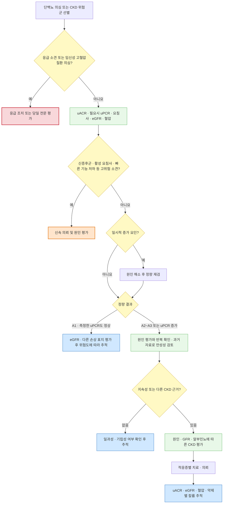

# 단백뇨 Proteinuria

## <mark style="color:green;">일반 사항</mark>

### <mark style="color:orange;">단백뇨 및 알부민뇨의 정의</mark>

* 단백뇨 : 소변에 단백질이 비정상적으로 많이 배설되는 상태. 성인에서 총단백 배설량 ＞150 ㎎/24h 또는 uPCR ≥150 ㎎/g을 증가 기준으로 참고하며, 사구체 여과 장벽 손상·세뇨관 재흡수 장애·저분자 단백질 과잉 생성·요로 염증 등에 의해 발생함
* 알부민뇨(albuminuria) : 단백뇨 중 알부민 성분만을 지칭하는 좁은 개념; KDIGO 2024 지침은 콩팥 손상의 주된 표지자로 uACR(알부민뇨 수준)을 우선 사용할 것을 권고함

<table><thead><tr><th>알부민뇨 분류</th><th>uACR (㎎/g)</th><th>24시간뇨 알부민 (㎎/24h)</th></tr></thead><tbody><tr><td><strong>A1 정상~경도 증가</strong></td><td>＜30</td><td>＜30</td></tr><tr><td><strong>A2 중등도 증가</strong></td><td>30~＜300</td><td>30~＜300</td></tr><tr><td><strong>A3 고도 증가</strong></td><td>≥300</td><td>≥300</td></tr></tbody></table>

_uACR=소변 알부민/크레아티닌비, uPCR=소변 총단백/크레아티닌비. A1~A3는 알부민뇨 분류임. 성인 uPCR ＜150, 150~＜500, ≥500 ㎎/g은 총단백 배설 증가 정도를 구분하는 대략적인 참고 구간이며, uACR과 일대일 환산할 수 없음. 시험지봉 등급만으로 A1~A3를 판정하지 않음. 소아·임신부는 아래 별도 기준을 적용함._


본서의 알부민뇨 구간은 A1 ＜30, A2 30\~＜300, A3 ≥300 ㎎/g으로 통일함(ADA 2026 표기). KDIGO 2024의 분류표는 A2 30\~300, A3 ＞300으로 표기하므로 정확히 300 ㎎/g에서 경계 표기가 다름. 치료·급여의 개별 문턱값(예: ≥200, ＞300, ＞700)은 해당 기준대로 적용함.


<p align="center"><em><mark style="color:$info;">Ref. 대한의학회, 일차의료용 근거기반 만성콩팥병 임상진료지침, 2022, 표 2; KDIGO 2012 CKD Guideline, Chapter 1, Table 7(총단백 배설 구간 참고 기준); KDIGO 2024 CKD Guideline.</mark></em></p>

#### <mark style="color:$primary;">중등도 증가 알부민뇨 (Moderately increased albuminuria, A2)</mark>

* 구용어 : microalbuminuria(미세알부민뇨) - 최근 지침의 권장 용어는 '중등도 증가 알부민뇨(A2)'이며 본서도 이 용어로 통일; 다만 국내 일부 문헌과 법령에는 "미세알부민뇨" 표기가 아직 남아있음
* 기준 : 임의뇨 Alb/Cr ratio 30\~＜300 ㎎/g 또는 24시간뇨 알부민 30\~＜300 ㎎
* 지속성 확인 : 일시적 증가 요인을 배제하고 3\~6개월 동안 시행한 3회 검사 중 ≥2회에서 uACR ≥30 ㎎/g이면(특히 당뇨병 환자에서) 증가를 확인; CKD의 만성성은 과거 기록 또는 3개월 이상 지속 여부로 별도 확인; 단, A3·콩팥 기능 저하·활성 요침사 등 고위험 소견이 있으면 반복 확인을 기다리지 않고 평가·의뢰
* 의의 : 당뇨병콩팥병증 조기 진단 및 신부전 예측 지표, 고혈압 환자의 심혈관 사망 위험 인자; KDIGO는 eGFR 수준과 무관하게 알부민뇨 증가 자체가 심혈관·콩팥 예후 악화와 비례 관계임을 강조

#### <mark style="color:$primary;">고립성 단백뇨 (Isolated proteinuria)</mark>

* 정의 : 전신질환의 증거, 고혈압, GFR 감소 또는 비정상 요침사 없이 단백뇨만 발생하는 상태. 단백 배설량의 상한으로 정의하지 않으며, 양이 적더라도 지속되면 사구체 질환 등을 평가
* 보통 자각 증상 없음

### <mark style="color:orange;">예후</mark>

* 합병증 : 신부전, 고콜레스테롤혈증, 응고 경향 증가, 감염 위험 증가(신증후군)
* 많은 양의 단백뇨는 GFR에 관계없이 사망 위험 증가, 심근경색, 신부전으로 진행될 가능성이 높음
* 지속되는 단백뇨는 기저 원인에 따라 다양한 경과를 보임
* 일시적, 기립성 단백뇨는 양성 상태로 나쁜 예후를 보이지 않음
* 알부민뇨는 eGFR 감소 여부와 독립적으로 심혈관 사망·말기신부전 위험을 높이는 예후 인자이며, 알부민뇨 감소 자체가 치료 반응의 대리 지표로 활용됨

## <mark style="color:green;">원인 및 분류</mark>

#### <mark style="color:$primary;">기능성 단백뇨 (Functional proteinuria)</mark>

* 양성 경과의 일과성 단백뇨
* 원인 : 급성 발열성 질환, 격렬한 운동, 탈수, 정신적 스트레스, 추위 노출 등
* 요단백 양 : 대개 적은 양이지만 양만으로 기능성 여부를 판정하지 않음. 다량이거나 지속되는 경우 사구체 질환 등을 평가
* 건강한 사람에서 검출되는 단백뇨는 추적 검사 시 대개 소실됨
* 치료 : 일과성이 확인되고 다른 이상이 없으면 단백뇨 자체의 치료는 필요 없음

_✽임신, 심부전, 고혈압 또는 약물 노출과 동반된 단백뇨는 기능성 단백뇨로 단정하지 말고 임신성 고혈압질환, 지속성 콩팥 손상 및 약물유발 콩팥질환 등을 평가_


**운동 후 단백뇨** : 격렬한 운동 직후에는 일시적 단백뇨가 흔하므로, 운동과 무관한 24\~48시간 후 아침 첫 소변으로 재검하는 것이 감별에 유용함


<mark style="color:$primary;">**기립성 또는 자세 단백뇨 (Orthostatic or Postural proteinuria)**</mark>

* 누운 자세로 밤새 휴식한 후의 아침 첫 소변에서는 단백뇨가 없으며, 기립 자세로 활동한 주간 소변에서만 단백뇨가 나타남
* 전통적으로는 split urine collection(주간 16시간 + 야간 8시간 분리 채취; 야간 단백 배설량을 확인)으로 진단하였으나, 최근에는 아침 첫 소변의 uPCR(또는 uACR)이 연령에 따른 정상 범위(2세 이상 소아는 아래 반복검사·의뢰 기준 참고, 성인은 통상 uPCR ＜150 ㎎/g; uACR ＜30 ㎎/g)이면서 주간 소변에서만 증가하는지로 확인하는 것이 일반적임
* 소아·청소년과 젊은 성인(대개 30세 미만)에서 관찰되며, 30세 이후 새로 발생하면 다른 원인을 우선 평가
* 기전 : 불명; 기립 중의 혈역학 변화, 사구체 변화 등으로 추정
* 경과 : 일과성 또는 수년간 지속될 수 있으나 콩팥 기능에 영향을 주지 않으며 대부분 자연 소실됨(장기 예후는 양호)
* 치료 : 확인된 기립성 단백뇨에는 약물·활동 제한이 필요 없음. 연 1회 혈압·아침 첫 소변을 확인하며 혈뇨·고혈압·지속성 단백뇨가 나타나면 재평가

<mark style="color:$primary;">**소아 및 청소년에서의 단백뇨**</mark>

* 원인 : 대부분 발열, 운동, 탈수 등에 의한 일과성 단백뇨 또는 기립성 단백뇨
* 시험지봉 검사 trace : 아침 첫 소변으로 재검 → 음성 또는 trace이고 혈압·성장·요침사 등 다른 이상이 없으면 일과성 가능성이 높아 1년 후 재검 고려; 위험인자나 다른 이상이 있으면 정량 평가
* 시험지봉 검사 1+ 이상 : 아침 첫 소변으로 uPCR과 uACR, 요검사를 함께 시행
  * 2세 이상에서 uPCR ＜200 ㎎/g이고 uACR ＜30 ㎎/g이며 요검사가 정상이면 일과성 또는 기립성 단백뇨 가능성이 높으므로 1년 후 재검 고려
  * 2세 이상은 건강한 상태에서 반복한 아침 첫 소변에서 uACR ≥30 ㎎/g 또는 uPCR ≥200 ㎎/g이면 소아신장 전문가 의뢰. 혈뇨·고혈압·eGFR 저하 등이 있으면 단백량과 무관하게 평가. 과거 실무 알고리듬의 uPCR ≤200 ㎎/g 정상 기준과 경계값이 다르므로, 정확히 200이면 재검 후 지속 시 의뢰 <mark style="color:$info;">[KDIGO 2024, PP 5.1.2]</mark>
  * 생후 6\~24개월은 첫 아침 uPCR ≤500 ㎎/g을 참고하며 위의 2세 이상 문턱값을 그대로 적용하지 않음. 6개월 미만은 연령별 정상범위와 임상상으로 판단. 혈뇨·부종·고혈압·eGFR 저하가 있으면 경계값과 무관하게 소아신장 전문가 평가

* 학교 선별검사의 반복 양성 여부와 임상적 지속성 단백뇨 진단을 구분하며, 첫 아침 정량검사와 혈압·요침사로 평가

#### <mark style="color:$primary;">범람성 단백뇨 (Overflow proteinuria)</mark>

* 기전 : 혈중 순환하고 여과되는 저분자 단백질의 생성 및 배설 증가. 예) hemoglobinuria, myoglobinuria
* 원인 : 다발골수종 등 단클론감마글로불린병증(면역글로불린 경쇄), 횡문근융해증(myoglobin), 혈관내 용혈(hemoglobin) 등

#### <mark style="color:$primary;">사구체성 단백뇨 (Glomerular proteinuria)</mark>

* 기전 : 사구체에서의 단백질 투과 증가
* 원발성 사구체 질환 : 미세변화병, 원발성 국소분절사구체경화증, IgA 신증, 원발성 막성신병증 등
* 유전성 : 선천성 신증후군, Alport syndrome, 유전성 국소분절사구체경화증 등
* 이차성 : 당뇨병, SLE, IgA 혈관염(IgA vasculitis; 과거 Henoch–Schönlein purpura), 감염관련 사구체신염(PSGN 포함), 아밀로이드증, 약물 등
* 막증식사구체신염(MPGN)은 조직학적 손상 패턴으로, 감염·자가면역·단클론 단백·보체 이상 등 원인을 구별함

#### <mark style="color:$primary;">세뇨관성 단백뇨 (Tubular proteinuria)</mark>

* 기전 : 세뇨관에서의 단백질 재흡수 감소
* 유전성·대사성 : cystinosis, Dent disease, Lowe syndrome, Wilson disease, mitochondrial disorder 등
* 후천성 : 중금속·약물 독성, 급성 세뇨관 손상, 세뇨관간질신염, 폐쇄성 요로병증 등

#### <mark style="color:$primary;">요로성 단백뇨 (Postrenal proteinuria)</mark>

* 요로감염·염증·출혈 등으로 단백질이 소변에 섞일 수 있음. 농뇨·증상·배양검사 등을 함께 평가하고 원인 해소 후 정량 재검; 다량이거나 지속되는 단백뇨를 이 원인만으로 설명하지 않음

#### <mark style="color:$primary;">신증후군 (Nephrotic syndrome)</mark>

* 성인에서 신증후군 범위 단백뇨(대개 ≥3.5 g/24h 또는 uPCR 약 ≥3.5 g/g)와 저알부민혈증을 함께 보이는 임상 증후군; 말초 부종·고지혈증이 흔히 동반됨
* 소아는 별도 기준을 적용하며, 첫 아침 uPCR ≥2 g/g(=2,000 ㎎/g) 등 신증후군 범위 단백뇨와 저알부민혈증(혈청 알부민 ＜3.0 g/㎗; 측정 불가 시 부종)을 함께 평가
* 관련 원인 질환 : 당뇨병, amyloidosis, SLE, 사구체 질환
* 신증후군 범위 단백뇨만으로 신증후군을 진단하지 않으며, 저알부민혈증·부종과 기저질환을 함께 평가
* 치료 : 원인질환 평가·치료가 우선이며, 체액 상태에 따라 Na 섭취 제한·loop diuretics를 사용하고 혈압·eGFR·혈청 칼륨을 고려해 ACEI/ARB 적용; 신규 발생 시 신장내과 조기 의뢰

## <mark style="color:green;">임상 양상</mark>

* 대부분 무증상이며 정기 검진의 요검사에서 우연히 발견됨
* 신증후군 수준의 단백뇨에서는 안면·하지 부종, 거품뇨(foamy urine), 체중 증가가 나타날 수 있음
* 저알부민혈증이 심하면 복수, 흉막삼출 등 체강내 삼출이 동반될 수 있음
* 기저 사구체 질환에 따라 육안적 혈뇨, 고혈압이 동반될 수 있음

### 🚩Red Flags

<mark style="color:$danger;">**즉각 조치**</mark>

* 단백뇨·부종과 함께 호흡곤란·저산소증 → 폐부종 등 급성 합병증  <mark style="color:$danger;">[응급]</mark>
* 갑작스러운 편측 하지 부종통·흉통·호흡곤란 → 심부정맥혈전증·폐색전증; 옆구리 통증·혈뇨·콩팥 기능 악화 → 신정맥혈전증 고려  <mark style="color:$danger;">[응급]</mark>
* 단백뇨·혈뇨 또는 적혈구원주와 함께 급격한 콩팥 기능 저하·핍뇨 → 급속진행사구체신염 등; 육안적 혈뇨가 없어도 배제하지 않음  <mark style="color:$danger;">[응급]</mark>
* SBP ≥180 또는 DBP ≥120 ㎜Hg이면서 신경학적 이상·흉통·폐부종·급격한 콩팥 기능 저하 등 급성 표적장기손상 의심 → 고혈압응급  <mark style="color:$danger;">[응급]</mark>
* 신증후군 환자에서 발열·심한 복통·복막자극징후·패혈증 소견 → 복막염 등 중증 감염  <mark style="color:$danger;">[응급]</mark>
* 임신부에서 지속되는 SBP ≥160 또는 DBP ≥110 ㎜Hg, 심한 두통·시야 이상·상복부 통증·호흡곤란 → 중증 임신성 고혈압질환 평가  <mark style="color:$danger;">[응급]</mark>

<mark style="color:$warning;">**당일~수일 내 평가**</mark>

* 신증후군 신규 발생(신증후군 범위 단백뇨·저알부민혈증 ± 부종)  <mark style="color:$warning;">[신속 의뢰]</mark>
* 혈뇨와 함께 uACR ≥300 ㎎/g 또는 uPCR ≥500 ㎎/g 확인 → 사구체 질환 의심  <mark style="color:$warning;">[신속 의뢰]</mark>
* 지속적으로 uACR ＞700 ㎎/g, 적혈구원주 또는 설명되지 않는 RBC ＞20/HPF → 신장내과 의뢰; AKI·전신증상이 있으면 **당일** 평가  <mark style="color:$warning;">[신속 의뢰]</mark>
* 임신부에서 신규 단백뇨 → **당일** 산과 평가. 임신 20주 이후 새 고혈압이 동반되면 전자간증 평가; 단백뇨만으로 확진하지 않으며 단백뇨가 없어도 장기손상 소견에 따라 전자간증 가능  <mark style="color:$warning;">[당일 평가]</mark>
* 콩팥 기능이 빠르게 악화하거나 전신질환 소견을 동반한 단백뇨 → 증상·요침사·전해질에 따라 당일 평가  <mark style="color:$warning;">[신속 평가]</mark>
* SBP ≥180 또는 DBP ≥120 ㎜Hg이나 급성 표적장기손상이 명확하지 않음 → 안정 후 재측정하고 **당일** 평가  <mark style="color:$warning;">[당일 평가]</mark>

<mark style="color:$info;">**조기 평가 및 추적**</mark>

* 시험지봉 양성 → uACR/uPCR 정량 확인 및 혈압·eGFR·요침사 평가  <mark style="color:$info;">[정량 확인]</mark>
* 안정적 A2가 지속됨 → 원인·eGFR·치료 변화에 따라 통상 3~6개월 간격 추적  <mark style="color:$info;">[추적]</mark>
* 안정적 eGFR ＜30, 원인 불명·유전성 콩팥질환 의심, 또는 CKD G3~G5에서 KFRE 5년 콩팥기능상실 위험 3~5% 이상 → 위험도에 따른 신장내과 협진; 응급성은 임상상으로 결정  <mark style="color:$info;">[전문 평가]</mark>
* 소아·청소년에서 반복한 아침 첫 소변의 알부민뇨·단백뇨가 의뢰 기준을 충족 → 소아신장 전문가 의뢰  <mark style="color:$info;">[전문 평가]</mark>

_✽의뢰 시점은 위 기준과 증상·혈압·전해질·진행 속도를 함께 고려한 임상적 분류임. KDIGO의 의뢰 문턱값 자체가 일률적인 응급도나 당일 의뢰를 뜻하지는 않음._

## <mark style="color:green;">진단</mark>

* 단백뇨·혈뇨의 단계별 상세 접근(Dipstick → uACR/uPCR, 필요시 시간뇨; 혈뇨의 현미경 검사 → RBC morphology → 의뢰)은 [콩팥 질환의 진단](109_-kidneydz.md), [혈뇨](110_-hematuria.md) 챕터에서 총괄적으로 다루며, 본 챕터의 아래 진단 원칙 및 알고리듬은 단백뇨에 특화된 실전 접근을 정리한 것임

### <mark style="color:orange;">병력 및 신체검사</mark>

* 발생 시기·과거 검사, 발열·운동·감염·월경, 당뇨병·고혈압·전신질환, 임신 여부, 가족력(콩팥질환·혈뇨·난청), 약제·한약·보충제·단백질제 확인
* 발진·관절통·객혈·체중 감소·골통·반복 감염 등 원인질환 단서 확인

* 혈압, 체중
* 말초 부종, 안구 주위/안면 부종, 복수
* 콩팥, 폐, 심장 진찰 : CHF 징후 관찰

### <mark style="color:orange;">소변 검사</mark>

* 채뇨 방법 : 일반적인 CKD 평가에서는 밤새 누워 휴식한 뒤 아침 첫 소변의 중간뇨 채취; 임신성 고혈압질환 평가는 아래 예외 참고 (☞ [소변 채취 Tips](109_-kidneydz.md))

#### <mark style="color:$primary;">시험지봉 검사</mark>

* 시험지봉 검사는 주로 알부민에 민감하며, 글로불린·면역글로불린 경쇄(Bence-Jones 단백) 등 비알부민 단백에는 민감도가 낮음
* 세뇨관성 단백뇨(tubular proteinuria), 범람성 단백뇨(overflow proteinuria, 예: 다발골수종의 Bence-Jones protein)에서는 실제 단백뇨가 상당함에도 위음성(Negative\~Trace)이 나올 수 있음 - 의심되면 dipstick 또는 uACR이 낮더라도 uPCR을 측정하고, 임상 상황에 따라 혈청 유리경쇄와 혈청·소변 단백전기영동/면역고정검사를 시행
* 위양성·과대평가 요인 : 심한 농축뇨, 강한 알칼리뇨, 소독제·질 분비물·혈액 오염 등. 육안혈뇨에서는 혈액 유래 단백이 섞여 결과 해석을 방해할 수 있음
* 위음성·과소평가 요인 : 희석뇨, 비알부민 단백 우세, 낮은 수준의 알부민뇨. 음성 시험지봉만으로 A2나 비알부민 단백뇨를 배제하지 않음

**시험지봉 검사 결과별 대략적인 요단백 농도**

<table data-header-hidden data-search="false"><thead><tr><th></th><th></th></tr></thead><tbody><tr><td><strong>시험지봉 검사 결과</strong></td><td><strong>대략적인 요단백 농도 (㎎/㎗)</strong></td></tr><tr><td><strong>Negative</strong></td><td>＜15</td></tr><tr><td><strong>Trace</strong></td><td>15~30</td></tr><tr><td><strong>1+</strong></td><td>30~100</td></tr><tr><td><strong>2+</strong></td><td>100~300</td></tr><tr><td><strong>3+</strong></td><td>300~1,000</td></tr><tr><td><strong>4+</strong></td><td>≥1,000</td></tr></tbody></table>

_✽시험지봉 검사는 소변 농축도와 제품별 판독 기준에 영향을 받는 반정량 선별검사이며, 1일 단백 배출량으로 환산할 수 없음. 농축뇨에서는 A1임에도 1+가 나올 수 있고 희석뇨에서는 A3임에도 trace로 나올 수 있으므로, 양성 결과는 uACR 또는 임상 목적에 따른 uPCR로 확인_

#### <mark style="color:$primary;">소변 단백 정량 검사</mark>

* 임의뇨 Alb/Cr ratio(uACR) 측정 - 알부민뇨 평가의 1차 검사
  * 채뇨 우선 순위 : ① 아침 첫 소변(중간뇨) 우선 ② 여의치 않으면 random 소변으로 초기 선별 후 uACR ≥30 ㎎/g이면 아침 첫 소변으로 확인 검사
  * 신증후군이 의심되거나 uACR로 설명되지 않는 총단백 증가가 의심되면 uPCR을 함께 측정; 특정 uACR 수치를 uPCR 추가의 필수 문턱으로 사용하지 않음
  * 근육량이 적으면 같은 배설량에서도 uACR/uPCR이 높게, 많으면 낮게 나타날 수 있음. 임상상과 현저히 불일치하면 재검·필요시 시간뇨로 확인
  * 확진된 CKD 추적 중 eGFR ＞20% 변화 또는 uACR 2배 증가는 원인 평가가 필요함. 혈역학에 영향을 주는 치료 시작 후 eGFR ＞30% 감소도 평가 대상이며, 작은 초기 감소만으로 신보호 치료를 중단하지 않음 <mark style="color:$info;">\[KDIGO]</mark>
* 정량 검사 선택 : 일반 CKD 선별에는 uACR 우선; 소아·비알부민 단백뇨 의심·신증후군 총단백 평가에는 uPCR을 함께 또는 우선 사용
  * 24시간뇨 등 시간뇨는 임의뇨 결과와 임상상이 불일치하거나, 사구체 질환에서 면역억제치료 시작·변경 등 정확한 총단백 배설량이 치료 결정에 중요한 경우 선택. 일반 CKD 선별이나 임신성 고혈압질환 평가에서 일률적으로 시행하지 않음
  * uACR 검사 급여는 심평원 검사 항목별 인정기준 참조(국내 고시에서는 “미량알부민” 명칭 사용)

### <mark style="color:orange;">소변 외 검사</mark>

* 기본 검사 : 혈청 Cr/eGFR, 전해질, 알부민·총단백, 혈당/HbA1c, 지질, CBC, 요침사
* 임상 소견에 따른 원인 검사
  * 사구체 질환 의심 : 전신질환·임상상에 따라 ANA, C3/C4; 막성신병증 의심 시 anti-PLA2R Ab; 급속진행사구체신염·폐-콩팥증후군 의심 시 ANCA·anti-GBM Ab 등. 모든 환자에게 일률적으로 시행하지 않음
  * 감염 연관 의심 : HBV, HCV, HIV; 필요 시 antistreptolysin O titer 등
  * 단클론감마글로불린병증 의심 : 혈청 유리경쇄, 혈청·소변 단백전기영동 및 면역고정검사
  * ferritin·철분, ESR/CRP, LFT, prothrombin time, 매독검사 등은 임상 적응증에 따라 선택

### <mark style="color:orange;">영상검사·콩팥 생검 및 감별</mark>

* 지속성 단백뇨에 eGFR 저하·혈뇨·폐쇄 의심 등이 동반되면 콩팥 초음파로 크기·구조·폐쇄 여부 평가
* 신규 성인 신증후군, 활성 요침사·원인 불명의 콩팥 기능 저하, 전신성 사구체 질환 의심 등은 신장내과에서 생검 필요성을 판단. 모든 단백뇨에 생검을 시행하지 않음
* 당뇨병이 있어도 급격한 단백뇨 증가·신증후군, 적혈구원주 등 활성 요침사, 빠른 eGFR 저하가 있으면 비당뇨병성 또는 중복 콩팥질환 평가. 당뇨망막병증이 없다는 사실만으로 제2형 당뇨병콩팥병을 배제하지 않음

### <mark style="color:orange;">임신부의 예외</mark>

* 임신성 고혈압질환 평가에서 dipstick ≥1+이면 임의뇨 uPCR 또는 uACR로 정량; 아침 첫 소변을 기다리거나 24시간뇨를 일률적으로 채집하지 않음
* NICE NG133은 유의한 단백뇨 기준으로 uPCR ≥30 ㎎/mmol 또는 uACR ≥8 ㎎/mmol을 사용하며, 아침 첫 소변을 정량검사에 사용하지 않도록 권고함. 본문의 일반 CKD 기준(㎎/g)과 단위·문턱값이 다름에 주의
* 혈압·증상·혈소판·간기능·콩팥 기능·태아 상태를 함께 평가하고, 임신 20주 이전 단백뇨는 기존 콩팥질환 가능성도 검토. 임신 중 ACEI/ARB는 사용하지 않음

### <mark style="color:orange;">선별 검사</mark>

* 시험지봉 검사상 단백뇨가 1+ 이상 : 가능한 시기에 아침 첫 소변 uACR 또는 임상 목적에 따른 uPCR로 정량 확인
  * 발열, 격렬한 운동, UTI, 월경, 탈수 등 일시적 증가 요인이 있으면 해소 후 재검
  * CKD 진단 목적이면 최소 3개월 이상의 지속성을 확인하되, A3·혈뇨·eGFR 저하·신증후군 등 고위험 소견이 있으면 반복 확인을 기다리지 않고 평가·의뢰
* 시험지봉 검사상 단백뇨이지만 uACR/uPCR이 정상이면 소변 농축도와 검사 오차를 확인하고, 위험도에 따라 아침 첫 소변으로 재검
* 만성콩팥병 위험도가 높은 환자(예: 당뇨병, 고혈압) : 처음부터 uACR과 eGFR을 함께 평가
  * 제2형 당뇨병은 진단 시부터, 제1형 당뇨병은 유병기간 ≥5년부터 적어도 매년 uACR·eGFR 검사; 확진 CKD에서는 위험도에 따라 연 1~4회 또는 더 자주 평가 <mark style="color:$info;">[ADA 2026]</mark>
  * 필요시 사구체성, 세뇨관성, 또는 범람성 단백뇨 감별을 위한 소변 단백 전기영동검사 시행
  * 위험인자가 없는 무증상 일반 인구의 일률적 시험지봉 선별검사는 임상적 이득이 확립되지 않음 (☞ [예방적 소변 검사의 한계](109_-kidneydz.md))

***



<p align="center"><strong>단백뇨(알부민뇨) 평가 알고리듬</strong></p>

<p align="center"><em><mark style="color:$info;">저자 재구성 (참고 문헌: KDIGO 2024 CKD Guideline; NICE NG133). 소아·임신부는 본문의 별도 기준을 적용하며, CKD 만성성 확인을 위해 필요한 3개월을 초기 평가·치료의 대기기간으로 사용하지 않음.</mark></em></p>

***

## <mark style="background-color:$warning;">Management</mark>

### <mark style="color:orange;">치료 방침</mark>

* 원인 치료, 혈압/당뇨병 관리
* 관리 목표 : 알부민뇨 감소를 치료 반응·위험 감소의 지표로 사용하되 모든 환자에게 하나의 절대 목표를 적용하지 않음
  * 당뇨병 동반 CKD에서 uACR ≥300 ㎎/g이면 기저 대비 ≥30% 감소를 목표로 치료 반응 평가 <mark style="color:$info;">[ADA 2026, 11.2]</mark>
  * IgA 신증 : 단백뇨 ≥0.5 g/d(또는 이에 상응하는 uPCR)인 성인에서 IgA 신증이 의심되면 신장내과 의뢰하여 생검을 고려. 확진 후 단백뇨 목표는 ＜0.5 g/d, 가능하면 ＜0.3 g/d이며 eGFR 안정화를 함께 목표로 함 <mark style="color:$info;">\[KDIGO IgAN 2025]</mark>
  * <mark style="color:$info;">\[KDIGO]</mark> 알부민뇨 정도(A1\~A3)와 eGFR(G1\~G5)을 함께 고려한 위험도(heat map) 기반으로 치료 강도와 추적 간격 결정
* 혈압 목표 : 비투석·비이식 성인 CKD의 고혈압에서 KDIGO 2024·대한신장학회 2025는 표준화된 진료실 혈압 기준 내약 시 SBP ＜120 ㎜Hg를 제안(2B). 일상 진료실·가정혈압에 같은 문턱을 그대로 적용하지 않으며, 연령·허약·기립성 저혈압·낙상 위험에 따라 개별화 (☞ [고혈압](../225_/095_-hypertension.md))
* 콩팥 독성 약물·불필요한 보충제를 줄이고 약제의 eGFR별 용량·상호작용을 점검 (예: NSAID, aminoglycoside)
* 추적 : CKD에서는 적어도 매년 uACR·eGFR을 평가하며, 고위험·진행·치료 변경 시 간격을 단축. 유의한 알부민뇨의 2배 증가, 지속적 eGFR 감소, 조절되지 않는 고혈압·칼륨 이상은 원인 재평가 및 협진

## <mark style="color:green;">비-약물 치료 및 예방</mark>

* 단백질 섭취 : 성인 비투석 CKD G3\~G5에서 0.8 g/㎏/d 유지 권고; 진행 위험이 있는 경우 1.3 g/㎏/d 초과 섭취는 피함. 고령·허약·근감소증 환자는 영양 상태에 따라 단백질·열량 목표를 상향 조정
* Na 섭취 제한 : 성인 CKD에서 ＜2 g/d(소금으로 5 g/d); 소아·염분 소실성 질환은 개별화 (☞ [고혈압](../225_/095_-hypertension.md))
* 수분 섭취 : 갈증과 체액 상태에 따라 적절히 섭취하며, 부종·심부전·저나트륨혈증에서는 개별화
* 금연, 적정 체중 유지
* 안정된 환자는 내약 범위에서 주당 ≥150분 중등도 신체활동을 권장; 단백뇨 확인 검사 전 격렬한 운동은 피함. 단백뇨만으로 장기간 침상안정을 권하지 않음

## <mark style="color:green;">약물 치료</mark>

### <mark style="color:orange;">RAAS 억제제(ACEI/ARB) - 1차 선택제</mark>

* ACEI 또는 ARB : 임상시험에서 효과가 확인된 최고 허가 용량 중 내약 가능한 용량 적용 (☞ [고혈압](../225_/095_-hypertension.md#renin-angiotensin))
* 성인 CKD G1\~G4에서 알부민뇨 A3(≥300 ㎎/g)는 당뇨병 유무와 관계없이 ACEI/ARB 시작 권고; A2(30\~＜300 ㎎/g)는 당뇨병 동반 시 시작 권고, 비동반 시 시작 고려
* ACEI, ARB 및 direct renin inhibitor(DRI) 중 두 가지 이상을 병용하지 않음
* 정상 혈압이며 알부민뇨 A1인 환자에서는 예방 목적의 ACEI/ARB 시작을 권고하지 않음 (✽ 고혈압·심부전 등 다른 적응증이 있으면 시작 가능)
* 시작·증량 후 2\~4주 이내(진행 CKD·기저 고칼륨혈증 등 고위험에서는 더 일찍) 혈압, 혈청 크레아티닌, 칼륨 재확인. 4주 내 Cr ＞30% 상승 시 탈수·NSAID·이뇨제·신동맥협착 등 원인 평가; 치료 가능한 고칼륨혈증은 우선 교정하되 조절되지 않거나 증상성 저혈압이 있으면 감량·중단 고려. eGFR ＜30만을 이유로 일률적으로 중단하지 않음; 임신 시 금기

### <mark style="color:orange;">non-DHP CCB</mark>

* diltiazem <mark style="color:blue;">\[헤르벤]</mark>, verapamil <mark style="color:blue;">\[이솦틴]</mark> (☞ [고혈압](../225_/095_-hypertension.md#calcium-channel-blocker-ccb))
* 혈압 추가 조절이 필요하거나 RAAS 억제제 사용이 제한되는 경우 선택적으로 고려할 수 있으나, ACEI/ARB를 대체하는 일률적인 1차 신보호 치료는 아님; 서맥·방실차단에 주의하고 수축기 기능 저하 심부전에서는 회피. finerenone과 병용 시 CYP3A4 억제로 노출이 증가할 수 있으므로 칼륨 추가 모니터링

### <mark style="color:orange;">SGLT2 억제제</mark>

* 제2형 당뇨병 동반 성인 CKD, eGFR ≥20 mL/min/1.73㎡ 환자에서 SGLT2 억제제 치료 권고
* 성인 CKD에서 당뇨병 유무와 관계없이 다음 중 하나이면 치료 권고
  * eGFR ≥20 mL/min/1.73㎡이면서 uACR ≥200 ㎎/g
  * 심부전 동반(알부민뇨 수준과 무관; 신규 시작은 제품별 eGFR 허가 기준 적용)
* eGFR 20\~45 mL/min/1.73㎡이면서 uACR ＜200 ㎎/g인 성인 CKD에서도 치료 고려
* CKD 신보호 용량은 dapagliflozin·empagliflozin 모두 10 ㎎ qd. 종류 : dapagliflozin <mark style="color:blue;">\[다파엔]</mark>, empagliflozin <mark style="color:blue;">\[자디앙]</mark> (☞ [당뇨병](../226_/101_.md#sglt2i-sodium-glucose-cotransporter-2-inhibitor))
* 투여 시작 후에는 eGFR이 20 미만으로 감소해도 내약성이 좋으면 신대체요법(KRT) 개시 전까지 유지 가능(practice point). 예상되는 작은 초기 eGFR 감소만으로 중단하지 않으며 체액 감소·증상·큰 감소는 별도 평가
* 장기 금식·수술·중증 급성질환에서는 일시 중단. 계획 수술 전 dapagliflozin·empagliflozin은 적어도 3일 전부터 중단하고, 식사·수분 섭취 및 전신 상태가 회복되고 케톤산증 위험 요인이 해소된 뒤 재시작 <mark style="color:$info;">[ADA 2026, 입원 진료]</mark>
* 생식기 진균감염·체액 감소·정상혈당 케톤산증 교육. 제1형 당뇨병의 단백뇨에 일률적으로 사용하지 않으며, 다낭콩팥병·최근 면역억제치료 등 근거·허가가 제한된 상황은 전문 평가
* 국내 CKD 급여(비당뇨 환자 기준, eGFR 단위 mL/min/1.73㎡) : 두 약제 모두 ACEI 또는 ARB 최대 내약 용량을 4주 이상 안정적으로 투여 중이어야 함. 당뇨병 환자는 당뇨병용제 일반원칙을 별도 적용
  * dapagliflozin 10 ㎎ qd [다파엔] : eGFR 25\~75, dipstick ≥1+ 또는 uACR ≥200 ㎎/g <mark style="color:$info;">\[심평원 고시 제2025-102호]</mark>
  * empagliflozin 10 ㎎ qd [자디앙] : eGFR 20\~＜45에서는 알부민뇨 문턱 없이, eGFR 45\~90에서는 uACR ≥200 또는 uPCR ≥300 ㎎/g <mark style="color:$info;">\[심평원 고시 제2026-159호]</mark>
  * 신규 시작 허가 하한은 dapagliflozin eGFR ≥25, empagliflozin ≥20으로 구분함. 계열 권고 eGFR ≥20을 모든 제품의 신규 시작 허가로 해석하지 않음

### <mark style="color:orange;">비스테로이드성 무기질코르티코이드 수용체 길항제 (ns-MRA)</mark>

* finerenone <mark style="color:blue;">\[케렌디아]</mark> : 최대 내약 용량 ACEI 또는 ARB를 사용 중인데도 알부민뇨(uACR ≥30 ㎎/g)가 지속되는 2형 당뇨병 동반 CKD(국내 시작 기준 eGFR ≥25 mL/min/1.73㎡, 혈청 칼륨 확인)에서 콩팥·심혈관 사건 위험 감소
* 국내 제2형 당뇨병 동반 CKD 용량(심부전 용법과 구별) : eGFR 25\~＜60이면 10 ㎎ qd, ≥60이면 20 ㎎ qd로 시작; ＜25이면 시작하지 않음. K ≤4.8 mmol/L에서 시작 권장, 4.8＜K≤5.0에서는 첫 4주 내 추가 모니터링을 전제로 고려; K ＞5.0이면 시작하지 않음
* 시작·재시작·용량 조절 4주 후 K·eGFR 확인. K ≤4.8이고 이전 대비 eGFR 감소가 ＜30%이면 10→20 ㎎ 증량; 4.8＜K≤5.5이면 현 용량 유지. K ＞5.5이면 중단하고 ≤5.0이면 10 ㎎ qd로 재시작
* 금기·상호작용 : 강력한 CYP3A4 억제제(clarithromycin·itraconazole 등), 애디슨병 등. 다른 MRA·칼륨보존 이뇨제·칼륨 보충제 병용은 피하고, verapamil·diltiazem·trimethoprim 병용 시 K 추가 검사; 자몽·자몽주스 회피, 중증 간장애에서는 투여 회피 <mark style="color:$info;">[국내 finerenone 허가사항]</mark>
* finerenone은 ACEI 또는 ARB 및 SGLT2 억제제에 추가 가능. ADA 2026은 RAS 억제제를 사용 중인 제2형 당뇨병에서 uACR ≥100 ㎎/g, eGFR 30~90이면 SGLT2 억제제와 finerenone의 동시 시작도 고려하도록 제시함. CONFIDENCE(2025)의 병용 이득은 180일 uACR 감소 근거이며 추가 신부전·사망 감소의 확증은 아님; 국내 급여 인정 범위와 별도 판단 <mark style="color:$info;">[ADA 2026, 11.9; CONFIDENCE 2025]</mark>
* 국내 당뇨병 동반 CKD 급여 : ACEI 또는 ARB 최대 내약 용량을 4주 이상 안정적으로 투여 중이며, ① uACR ＞300 ㎎/g 또는 dipstick ≥1+, ② eGFR 25\~＜75 mL/min/1.73㎡를 모두 충족하는 제2형 당뇨병 성인. 지속적인 증상이 있는 만성 심부전(NYHA II\~IV)은 이 CKD 급여기준에서 제외하며, eGFR ＜15이면 중단함 <mark style="color:$info;">\[심평원 고시 제2024-20호]</mark>


**적응증 및 최신 연구의 구별(2026.10.27. 확인)**

* 국내 finerenone에는 만성 심부전(LVEF ≥40%) 적응증도 있으나, 본 항목은 제2형 당뇨병 동반 CKD의 용량·칼륨 기준임. 심부전의 최대 40 ㎎ 용량 및 칼륨 조절표를 CKD 처방에 적용하지 않음 (☞ [심부전](../225_/098_-heart-failure.md))
* **FIND-CKD(2026)** : RAS 억제제를 사용 중인 비당뇨병 CKD(eGFR 25~＜90, uACR 200~≤3,500 ㎎/g) 성인 1,584명에서 finerenone이 32개월 eGFR 감소를 늦춤(연간 기울기 차이 0.7 mL/min/1.73㎡). 콩팥·심혈관 복합 결과 HR 0.77(95% CI 0.60~0.99)이었으나 콩팥 결과 단독 HR 0.78의 95% CI는 0.60~1.01이었으며 고칼륨혈증에 주의. 이 연구만으로 비당뇨병 단백뇨의 국내 허가·급여가 확대된 것으로 해석하지 않음
* **FINE-ONE(2026)** : 제1형 당뇨병 CKD에서 6개월 uACR이 위약 대비 25% 더 감소했으나 장기 콩팥기능상실·사망 감소를 검증한 연구는 아님. 제1형 당뇨병 CKD 적응증으로 자동 확대하지 않음
* KDIGO 약물치료 focused update는 현재 **2027 지침 공개검토 초안** 단계이므로 확정 권고로 인용하지 않음. 본문의 확정 지침 근거는 KDIGO 2024와 ADA 2026임


### <mark style="color:orange;">GLP-1 수용체 작용제</mark>

* semaglutide : FLOW에서 제2형 당뇨병 동반 CKD의 주요 콩팥 사건 위험 감소가 확인됨; 기저 SGLT2 억제제 사용 하위군은 규모가 작아 병용의 추가적인 임상 결과 이득을 확정하는 근거로 해석하지 않음
* 제2형 당뇨병 동반 CKD에서는 신장·심혈관 이득이 입증된 GLP-1 수용체 작용제를 혈당·체중·장기 보호 목표에 따라 고려하며, metformin+SGLT2 억제제 치료 실패를 필수 선행조건으로 단정하지 않음. 비당뇨병 CKD 전체로 효과를 확대하지 않음 <mark style="color:$info;">\[FLOW 2024; ADA 2026]</mark>

***

## <mark style="color:green;">시술 및 기타 처치</mark>

* 콩팥 생검·면역억제치료·질환별 표적치료는 신장내과에서 원인·조직진단·진행 위험에 따라 결정. 단백뇨 수치만으로 경험적 스테로이드 치료를 시작하지 않음
* 신증후군의 부종은 체액 상태를 평가하여 염분 제한·loop 이뇨제 등으로 관리. 알부민 주입은 일률적으로 시행하지 않음
* 신증후군에서 예방적 항응고는 혈전 위험과 출혈 위험을 함께 평가하여 전문의와 결정; 저알부민혈증이나 신증후군 범위 단백뇨만으로 모든 환자에게 투여하지 않음

***

## <mark style="color:purple;">처방례</mark>

> **처방례 1. 중등도 증가 알부민뇨(A2), 고혈압 동반**
>
> ```
> 코자정 50 ㎎/T  1T  qd
> ※ 혈압·eGFR·K·체액 상태 확인 후 시작; 필요·내약 시 100 ㎎ qd까지 증량
> ※ 2~4주 후 혈압·혈청 크레아티닌·칼륨 재검
> ```
>
> _✽지속성 CKD A2 이상에서는 정상 혈압이라도 신보호 목적으로 ACEI/ARB 시작을 고려하되, 저혈압·고칼륨혈증·AKI 위험을 평가_

> **처방례 2. 2형 당뇨병 동반 CKD(A3), eGFR 25\~＜60, ACEI 또는 ARB 최대 내약 용량 사용 중**
>
> ```
> 케렌디아정 10 ㎎/T  1T  qd
> ※ 4주 후 K ≤4.8 및 이전 대비 eGFR 감소 ＜30%이면 20 ㎎ qd로 증량
> ※ eGFR ≥60이면 CKD 용량 20 ㎎ qd로 시작; eGFR ＜25이면 시작 권장하지 않음
> ※ 시작 전 K 확인: ≤4.8 mEq/L에서 권장, 4.8＜K≤5.0이면 조기 추가 검사 조건으로 고려, ＞5.0이면 시작하지 않음
> ※ 시작·재시작·용량 조절 4주 후 K·eGFR 재검; 4.8＜K≤5.5이면 현 용량 유지
> ※ ACEI 또는 ARB 한 가지에 추가; 급여 세부 조건은 위 ns-MRA 항목 참조. K ＞5.5이면 중단, ≤5.0이면 10 ㎎으로 재시작
> ```
>
> _✽고칼륨혈증 위험으로 칼륨보존 이뇨제·다른 MRA·칼륨 보충제 병용은 피함_


**신규 신증후군은 원인 평가와 신장내과 조기 의뢰가 우선임.** 심한 저알부민혈증에서는 유효순환혈액량 감소가 동반될 수 있으므로, 체액 상태·혈압·eGFR·전해질을 확인하지 않고 ACEI/ARB와 이뇨제를 일률적으로 시작하지 않음.


***

### <mark style="color:red;">질병코드</mark>

N04.9 상세불명의 신증후군 Nephrotic syndrome, unspecified

N39.1 상세불명의 지속성 단백뇨 Persistent proteinuria, unspecified

N39.2 상세불명의 기립성 단백뇨 Orthostatic proteinuria, unspecified

N08.3* 당뇨병에서의 사구체 장애 Glomerular disorders in diabetes mellitus

_✽N08.3*은 기저 당뇨병의 콩팥 합병증 코드를 우선 입력하고 함께 사용하는 발현 코드로, 단독 사용하지 않음_

R80 고립된 단백뇨 Isolated proteinuria

***

### <mark style="color:$success;">핵심 복약 지도</mark>

> **ACEI/ARB, 어떻게 관리할까요?**
>
> * 시작·증량 2\~4주 후 반드시 혈압, 혈청 크레아티닌, 칼륨을 재검하십시오 - 혈청 크레아티닌의 경미한 상승은 사구체내압 감소에 따른 예상 반응일 수 있으나, 4주 이내 ＞30% 상승하면 체액량 감소·NSAID 병용·콩팥동맥협착 등 원인을 평가하십시오
> * 임신을 계획하면 사전에 대체 약제로 변경하십시오. 복용 중 임신이 확인되면 즉시 중단하고 진료를 받으십시오
> * NSAID 병용은 콩팥 기능 저하 위험을 높이므로 가능하면 피하십시오

> **finerenone(케렌디아) 처방 시 확인할 점**
>
> * 제2형 당뇨병 동반 CKD에서는 시작 전 K ≤4.8 mEq/L이 권장되며, 4.8＜K≤5.0이면 조기 추가 검사 조건으로 고려합니다. 5.0을 초과하면 시작하지 마십시오
> * ACEI 또는 ARB 한 가지와 병용하며, ACEI·ARB·DRI 중 두 가지 이상을 함께 사용하지 마십시오
> * 시작·재시작·용량 변경 4주 후 혈청 칼륨과 콩팥 기능을 검사하고, 이후에도 정기 검사를 받으십시오. 고칼륨혈증은 증상이 없어도 발생할 수 있습니다

> **SGLT2 억제제(dapagliflozin·empagliflozin) 복용 시 주의할 점**
>
> * 심한 구토·설사, 장기 금식·중증 질환으로 먹고 마시기 어렵다면 일시 중단 및 재개 시점을 의료진과 상의하십시오. 계획 수술 전에는 적어도 3일 전부터 중단합니다
> * 구역·구토·복통·심한 무력감·숨참이 생기면 혈당이 높지 않아도 케톤산증 가능성이 있으므로 즉시 진료를 받으십시오
> * 생식기 가려움·발적·분비물, 어지럼·탈수 증상을 알려 주십시오

> **언제 다시 병원을 방문해야 하나요?**
>
> * 부종이 갑자기 심해지거나 호흡곤란이 동반되는 경우 - 즉시 내원
> * 소변량이 눈에 띄게 줄어드는 경우
> * ACEI/ARB, finerenone 복용 중 심한 근력 저하·두근거림·실신이 나타나는 경우 - 즉시 진료; 고칼륨혈증은 무증상일 수 있으므로 증상 유무와 무관하게 정기 검사
> * 정기 추적 검사에서 단백뇨가 악화되거나 콩팥 기능이 저하되는 경우

***

## 주요 참고문헌 및 확인 자료

### ＜임상 근거＞

* KDIGO. KDIGO 2025 Clinical Practice Guideline for the Management of IgAN and IgAV. Kidney Int. 2025;108(Suppl 4S):S1–S71. [지침](https://kdigo.org/guidelines/iga-nephropathy/)
* KDIGO CKD Work Group. KDIGO 2024 Clinical Practice Guideline for the Evaluation and Management of Chronic Kidney Disease. Kidney Int. 2024;105(Suppl 4S):S117–S314. [지침](https://kdigo.org/guidelines/ckd-evaluation-and-management/)
* 대한신장학회. 2025 고혈압콩팥병 진료지침. [지침](https://ksn.or.kr/bbs/skin/publication/download.php?code=guideline_k&number=2252)
* American Diabetes Association Professional Practice Committee. 16. Diabetes Care in the Hospital: Standards of Care in Diabetes—2026. [DOI](https://doi.org/10.2337/dc26-S016) — SGLT2 억제제 수술 전 중단.
* American Diabetes Association Professional Practice Committee. 11. Chronic Kidney Disease and Risk Management: Standards of Care in Diabetes—2026. Diabetes Care. 2026;49(Suppl 1):S246–S260. [DOI](https://doi.org/10.2337/dc26-S011)
* Agarwal R, et al. Finerenone with Empagliflozin in Chronic Kidney Disease and Type 2 Diabetes. N Engl J Med. 2025;393:533–543. [DOI](https://doi.org/10.1056/NEJMoa2410659) — 병용 시 단기 uACR 감소 근거.
* Perkovic V, et al. Effects of Semaglutide on Chronic Kidney Disease in Patients with Type 2 Diabetes. N Engl J Med. 2024;391:109–121. [DOI](https://doi.org/10.1056/NEJMoa2403347)
* KDIGO. KDIGO 2025 Clinical Practice Guideline for the Management of Nephrotic Syndrome in Children. Kidney Int. 2025;107(Suppl 5S):S241–S289. [지침](https://kdigo.org/guidelines/nephrotic-syndrome-in-children/)
* KDIGO. KDIGO 2021 Clinical Practice Guideline for the Management of Glomerular Diseases. 일반 원칙·생검·신증후군 지지치료. [지침](https://kdigo.org/guidelines/gd/)
* NICE. Hypertension in pregnancy: diagnosis and management. NG133. 단백뇨 정량검사·전자간증 평가. [권고](https://www.nice.org.uk/guidance/ng133/chapter/recommendations)
* Heerspink HJL, et al. Finerenone in Persons with Chronic Kidney Disease without Diabetes. N Engl J Med. 2026;395:533–545. [DOI](https://doi.org/10.1056/NEJMoa2604625) — FIND-CKD, 비당뇨병 CKD 연구.
* Heerspink HJL, et al. Finerenone in Type 1 Diabetes and Chronic Kidney Disease. N Engl J Med. 2026;394:947–957. [PubMed](https://pubmed.ncbi.nlm.nih.gov/41780000/) — FINE-ONE, 6개월 uACR 대리지표 연구.
* KDIGO. 2027 CKD Guideline Focused Update — Public Review Draft. 2026.10.27. 현재 공개검토 중, 확정 지침으로 적용하지 않음. [현황](https://kdigo.org/guidelines/ckd-evaluation-and-management/)

### ＜허가·급여 확인 자료＞

* 식품의약품안전처. 의약품안전나라 — 의약품 품목허가정보. 국내 제품별 적응증·용법·금기 확인(케렌디아정10밀리그램 품목정보, 2026.10.27. 확인; CKD와 심부전의 용량·칼륨 조절표 구별). [의약품안전나라](https://nedrug.mfds.go.kr/index)
* 건강보험심사평가원. Dapagliflozin 경구제, 고시 제2025-102호(2025.7.1.). [급여기준](https://www.hira.or.kr/rc/insu/insuadtcrtr/InsuAdtCrtrPopup.do?mtgHmeDd=20250701&sno=2&mtgMtrRegSno=0031)
* 건강보험심사평가원. Empagliflozin 경구제, 고시 제2026-159호(2026.8.1.). [급여기준](https://www.hira.or.kr/rc/insu/insuadtcrtr/InsuAdtCrtrPopup.do?mtgHmeDd=20260801&sno=1&mtgMtrRegSno=0007)
* 건강보험심사평가원. Finerenone 경구제, 고시 제2024-20호(2024.2.1.). [급여기준](https://www.hira.or.kr/rc/insu/insuadtcrtr/InsuAdtCrtrPopup.do?mtgHmeDd=20240201&sno=4&mtgMtrRegSno=0002)
* 국가데이터처(구 통계청). 제9차 한국표준질병·사인분류(KCD-9), 2026.1.1. 시행. [개정 고시](https://mods.go.kr/board.es?act=view&bid=107&list_no=437419&mid=a10403040000&nPage=1&ref_bid=&tag=)

_확인 기준일: 2026.10.27. 임상 권고, 국내 허가 및 급여 문턱값은 구별하여 적용함._

***

## <mark style="color:blue;">환자 안내서</mark>


**단백뇨, 소변에 거품이 많다면 확인이 필요합니다**

단백뇨는 콩팥질환이나 다른 원인으로 소변에 단백질이 비정상적으로 많이 배설되는 상태입니다. 대부분 특별한 증상이 없어 건강검진에서 우연히 발견되는 경우가 많습니다.


### <mark style="color:orange;">왜 단백뇨가 생기나요?</mark>

* 발열, 심한 운동, 오래 서 있기, 탈수처럼 일시적인 원인으로 생길 수 있으며, 이런 경우 원인이 해소되면 없어지기도 합니다
* 당뇨병, 고혈압, 콩팥 자체의 염증성 질환 등이 지속적인 단백뇨의 원인이 될 수 있습니다
* 소변에 거품이 있다고 해서 반드시 단백뇨는 아닙니다 - 소변 농도나 배뇨 속도, 변기 물 상태 등에 의해서도 거품이 생길 수 있어 거품뇨만으로는 진단할 수 없으며, 반드시 소변 검사로 확인해야 합니다

### <mark style="color:orange;">일상생활에서 어떻게 관리하나요?</mark>

* **짠 음식을 줄이십시오.** 소금 섭취가 많으면 단백뇨와 부종이 악화될 수 있습니다
* **금연하고 적정 체중을 유지하십시오.** 콩팥 기능 보호에 도움이 됩니다
* **소염진통제(NSAID)·한약·건강보조제는 복용 전 상담하십시오.** 콩팥에 부담을 줄 수 있습니다
* **소변으로 빠진 단백질을 보충하려고 고단백 식사나 단백질 보충제를 늘리지 마십시오.** 식사량·단백질·수분은 콩팥 기능과 영양·부종 상태에 맞춥니다
* **정기적으로 소변 검사와 혈압을 확인하십시오.** 단백뇨는 증상이 없어도 진행할 수 있어 추적 검사가 중요합니다

### <mark style="color:orange;">약은 어떻게 써야 하나요?</mark>

* 혈압약(ACEI/ARB 계열)은 혈압을 낮추는 효과 외에 단백뇨 자체를 줄여 콩팥을 보호하는 효과가 있어, 혈압이 정상이어도 처방될 수 있습니다
* 약 복용을 임의로 중단하지 마시고, 처방받은 대로 꾸준히 복용하십시오

### <mark style="color:orange;">이럴 때는 즉시 병원을 방문하세요</mark>

* 얼굴이나 다리가 갑자기 심하게 붓는 경우
* 소변량이 눈에 띄게 줄어드는 경우
* 숨이 차거나 흉통이 생기거나 체중이 갑자기 증가하는 경우
