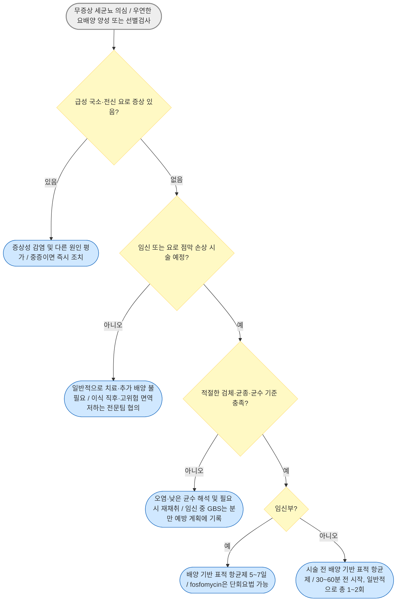

# 무증상 세균뇨 Asymptomatic Bacteriuria, ASB

## <mark style="color:green;">일반 사항</mark>

* 요로 감염을 시사하는 증상 없이 소변 배양 검사에서 유의한 세균이 검출되는 상태
* 정의 <mark style="color:$info;">[IDSA, 2019]</mark> : 발열, 배뇨통, 빈뇨/절박뇨, 육안혈뇨, 치골상부 통증 또는 늑척추각 통증·압통 등 급성 요로 감염을 시사하는 국소·전신 증상이 없으면서 정량적 배양 기준을 충족하는 세균뇨
  * 농뇨나 염증 지표만으로 증상성 요로감염과 구분할 수 없음; ASB는 증상성 요로감염과 구별되는 집락화 상태임
* 농뇨(pyuria)가 동반되더라도 증상이 없으면 항균제 치료의 적응증이 아님
* 유병률 : 건강한 폐경 전 여성 1\~5%, 건강한 폐경 후 여성 2.8\~8.6%; ＞65세 남성 5\~10%; 요양 시설 장기 체류 남성 15\~40%, 여성 25\~50%; 도뇨관 장기 유치 시 \~100% <mark style="color:$info;">[IDSA]</mark>
* 극히 일부 대상(임신부, 요로 점막 손상이 예상되는 비뇨기과 시술 예정자)을 제외하고는 치료 이득이 입증되지 않아 치료하지 않음 - 불필요한 치료는 부작용·내성 발생 등 이득보다 위해가 큼

## <mark style="color:green;">원인</mark>

* 원인균 : 요도/질/항문 주위 상재균 (_E. coli_ 등 장내세균이 흔함)

### <mark style="color:orange;">위험 인자</mark>

* 고령, 여성, 임신
* 당뇨병, 면역 저하, 혈액 투석
* 척수 손상, 신경인성 방광, 소변 저류
* 도뇨관 유치(단기·장기)
* 보호 시설 체류

## <mark style="color:green;">임상 양상</mark>

* 발열, 배뇨통, 빈뇨/절박뇨, 치골상부·늑척추각 통증 또는 압통, 육안혈뇨 등 급성 요로 감염을 시사하는 국소 또는 전신 증상이 없음

### 🚩 Red Flags

<mark style="color:$danger;">**즉각 조치**</mark>

* 저혈압, 의식 저하, 심한 오한·전신 쇠약 등 중증 감염 소견 → 패혈증을 포함한 전신 요로감염 평가 및 응급 처치; 소변배양 양성만으로 감염원을 요로로 단정하지 않음  `$danger`
* 발열·오한과 함께 요로 폐쇄가 의심되거나 무뇨가 발생 → 감염성 폐쇄 가능성; 응급 비뇨의학과 평가 및 필요 시 배액  `$danger`
* 임신부의 발열·옆구리 통증·늑척추각 압통 또는 조기진통 징후 → 신우신염 및 산과적 합병증 평가를 위해 즉시 의뢰  `$danger`

<mark style="color:$warning;">**당일~수일 내 평가**</mark>

* 새로 발생한 발열·오한·옆구리 통증, 또는 척수 손상 환자의 새로운 경직·자율신경반사이상 → **당일** 증상성 요로감염 및 다른 원인 평가  `$warning`
* 새로 발생한 배뇨통·빈뇨·절박뇨·치골상부 통증 또는 육안혈뇨 → 증상성 요로감염 및 혈뇨의 다른 원인 평가  `$warning`
* 점막 손상이 예상되는 비뇨기과 시술을 앞둔 세균뇨 → 시술 전에 배양·감수성 결과와 항균제 투여 계획 확인  `$warning`

<mark style="color:$info;">**조기 평가 및 추적**</mark>

* 임신부에서 치료 후 시행한 배양이 다시 양성 → 검체 오염, 복약 순응도, 내성 및 재발 가능성을 평가하고 산과 추적 계획 조정  `$info`
* Proteus 등 요소분해효소 생성균이 지속적으로 검출되면 결석 동반 여부 평가  `$info`
* 신장이식 직후 또는 고위험 호중구감소증 환자의 세균뇨 → 증상·전신 상태를 재확인하고 해당 전문팀과 개별 관리 계획 수립  `$info`

## <mark style="color:green;">진단</mark>

* U/A : 농뇨, leukocyte esterase 및 nitrite 양성 소견이 동반될 수 있으나 그 자체로는 진단 기준이 아니며, 정량적 배양 검사로 확진함 <mark style="color:$info;">[IDSA]</mark>

<table><thead><tr><th width="230">검체 유형</th><th width="140">기준 균수</th><th>비고</th></tr></thead><tbody><tr><td>청결 채취 자연 배뇨, 여성</td><td>≥10⁵ cfu/㎖</td><td>연속 2회(가급적 2주 이내), 동일 균종</td></tr><tr><td>청결 채취 자연 배뇨, 남성</td><td>≥10⁵ cfu/㎖</td><td>1회로 진단</td></tr><tr><td>단회 도뇨 또는 새 도뇨관 삽입 직후, 남녀 공통</td><td>≥10² cfu/㎖</td><td>실제 세균뇨를 시사할 수 있으나, 무증상 환자에서 낮은 균수의 임상적 의미는 확립되지 않음</td></tr><tr><td>유치 도뇨관 보유</td><td>≥10⁵ cfu/㎖</td><td>낮은 균수는 생물막에서 유래한 오염 가능성; 장기 유치 시 다균종 집락화도 흔함. 무증상이면 선별·치료하지 않음</td></tr></tbody></table>

* 위 표는 일반적인 IDSA 정의임. 임신부 산전 선별은 청결 채취 중간뇨 배양 1회에서 단일 요로병원균 ≥10⁵ cfu/㎖이면 임상적으로 유의한 ASB로 판단하여 치료함 <mark style="color:$info;">[ACOG, 2023]</mark>

* 장기 유치 도뇨관 보유 환자는 세균뇨가 거의 보편적(\~100%)이므로, 무증상 상태에서는 선별 목적의 요배양 검사를 시행하지 않음 (증상 발생 시 또는 침습적 시술 전 등 배양이 필요한 상황은 제외)

### <mark style="color:orange;">검체 해석 및 감별</mark>

* 배양의 균종·균수, 검체 채취법, 급성 증상 유무를 함께 확인함. 검체 오염이나 일시적 세균뇨를 지속성 ASB로 단정하지 않음
* 자연 배뇨 검체의 혼합 상재균·낮은 균수는 오염을 우선 고려함. 임신·시술 전 등 결과가 치료 결정에 필요한 경우에 적절한 중간뇨로 재채취하며, 치료 적응증이 없는 무증상 환자에게 진단 확정만을 위한 반복 배양을 시행하지 않음
* 도뇨관 환자는 배양이 실제 필요한 상황에서 채취 포트를 통해 무균적으로 검체를 얻고, 소변 수집백의 검체를 배양하지 않음 <mark style="color:$info;">[CDC]</mark>
* 소변의 냄새·혼탁 또는 농뇨만으로 증상성 요로감염을 진단하지 않음. 단, 척수 손상·신경인성 방광에서는 평소와 달라진 요실금, 경직, 자율신경반사이상 등도 함께 평가함
* 증상성 요로감염에서는 10⁵ cfu/㎖ 미만도 임상적으로 의미가 있을 수 있으므로, 위 ASB 기준을 치료 배제 기준으로 사용하지 않음
* 병력·진찰에 특이 소견이 없으면 영상검사나 방광경검사는 일률적으로 필요하지 않음. 지속적인 Proteus 검출은 결석을, 젊은 남성의 지속성 세균뇨는 전립선 질환 등을 평가함 <mark style="color:$info;">[EAU, 2026]</mark>
* 칸디다뇨는 세균뇨와 별도 지침으로 접근하며, 이 장의 항균제 치료표를 적용하지 않음

### <mark style="color:orange;">선별 검사</mark>

* 증상이 없는 일반 인구에 대한 ASB(Asymptomatic Bacteriuria) 선별 검사는 권고하지 않음
* 선별 검사 권고 대상 : 임신부는 임신 초기 산전 진료 시 중간뇨 소변배양검사 1회(USPSTF: 임신 12\~16주 또는 더 이른 첫 산전 방문); 요로 점막 손상이 예상되는 비뇨기과 시술 예정자는 시술 전 배양검사

* 임신부에서 최초 배양이 음성이거나 첫 ASB를 적절히 치료한 뒤 정기적으로 재선별하는 전략은 이득에 대한 근거가 불충분함. 일률적인 매월 배양을 권고하지 않으며 산과 위험도에 따라 개별화함 <mark style="color:$info;">[IDSA, 2019; ACOG, 2023]</mark>

***



<p align="center"><strong>무증상 세균뇨 접근 알고리듬</strong></p>

<p align="center"><em><mark style="color:$info;">Ref. IDSA ASB 2019; ACOG UTI 2023; EAU Urological Infections 2026</mark></em></p>

***

## <mark style="background-color:$warning;">Management</mark>

* 대부분의 환자에서 치료 필요 없음 : 무증상 세균뇨는 항균제 치료의 이득이 입증된 임신부와 점막 손상이 예상되는 내시경 비뇨기과 시술 예정자를 제외하고는 치료하지 않음. 불필요한 치료는 위장관 부작용, _C. difficile_ 감염, 항균제 내성 유발 등 위해가 이득보다 큼 <mark style="color:$info;">[IDSA]</mark>

### <mark style="color:orange;">치료 대상</mark>

* 임신부
* 점막 손상이 예상되는 내시경 비뇨기과 시술(경요도 전립선절제술 등) 예정자


요양시설 거주 고령자 등에서 발열·혈역학적 불안정이나 국소 요로 증상 없이 섬망, 낙상, 정신 상태 변화만 나타난 경우 ASB를 요로 감염으로 오인하여 항생제를 투여하지 않도록 주의. 탈수·약물 등 다른 원인을 평가하고 주의 깊게 관찰함. 패혈증이 의심되고 감염원이 불명확하면 요로 및 비요로 감염원을 신속히 평가하면서 지체 없이 적절한 경험적 항균제를 시작함. 새로 발생한 섬망 자체의 원인 평가와 관찰은 반드시 시행함.


* 척수 손상·신경인성 방광에서는 새로 발생한 경직, 자율신경반사이상, 새로운 요실금 등 비전형 UTI 증상을 평가하며, 이를 단순 무증상 상태로 오인하지 않음

### <mark style="color:orange;">치료하지 않는 대상 및 근거가 부족한 특수군</mark>

* 다음에서는 선별 검사와 치료 모두 권고 안 함(임신·점막 손상 시술 적응증은 별도) : 영유아·소아, 건강한 비임신 성인, 폐경 후 여성, 당뇨병 환자, 고령/요양시설 거주자(기능 저하 동반 포함), 척수 손상, 신경인성 방광, 단기 또는 장기 도뇨관 유치 중, 신장이식 후 1개월 초과, 기타 고형 장기 이식
* 도뇨관 제거 시점 : ASB 선별·치료의 이득에 대한 근거가 부족하여 권고 없음(No recommendation). 일부 환자에서 도뇨관 제거 시 예방적 항균제가 증상성 UTI를 줄일 가능성이 있으나, 이는 ASB 선별 후 치료하는 전략과는 다름
* 신장이식 후 1개월 이내 : IDSA(2019)는 근거 부족으로 권고 없음(No recommendation). 이후 연구를 포함한 EAU(2026)는 신장이식 환자의 일률적 ASB 치료를 권고하지 않음. 초기부터 자동 치료하는 근거로 해석하지 말고, 도뇨관·스텐트, 이식신 기능 및 전신 상태를 확인하여 이식팀과 결정
* 고위험 호중구감소증(ANC ＜100/㎣, ≥7일 예상) : 선별·치료에 대한 근거 부족으로 권고 없음(No recommendation); 저위험 호중구감소증은 일반 비호중구감소 환자와 동일하게 접근
* 비뇨기과가 아닌 선택 수술(관절 치환술 등) 예정자 : ASB 선별·치료 권고 안 함; 해당 수술 자체의 표준 예방적 항균제 투여와 구분

## <mark style="color:green;">비-약물 치료 및 예방</mark>

* 치료 적응증이 없는 환자에게는 세균뇨를 없애는 것보다 불필요한 검사·항균제 사용을 줄이고 새로운 증상을 인지하도록 교육하는 것이 중요함
* 유치 도뇨관은 필요성을 재평가하여 가능한 한 조기에 제거하고 폐쇄 배액계를 유지함. ASB만으로 반복 교환하거나 항균제 방광 세척을 하지 않음
* 물을 과도하게 마시거나 크랜베리·유산균 등을 사용하여 ASB를 제거하도록 권고할 근거는 부족함; 심부전·신장질환의 수분 제한이 있으면 기존 계획을 따름

## <mark style="color:green;">약물 치료</mark>

### <mark style="color:orange;">임신부</mark>

* 배양·감수성 결과에 따라 임신 주수, 약물 알레르기, 신기능 및 G6PD 결핍 여부를 고려하여 표적 항균제를 선택함. 치료 기간은 일반적으로 5\~7일이며, fosfomycin 3 g 단회요법은 예외임 <mark style="color:$info;">[ACOG, 2023]</mark>
* nitrofurantoin : 50\~100 ㎎ qid ×5\~7d <mark style="color:blue;">\[보령니트로푸란토인캡슐 50 ㎎]</mark>
  * 국내 50 ㎎ 캡슐의 허가 용법은 1회 50\~100 ㎎, 1일 4회 식후 및 취침 시 투여임. 해외의 100 ㎎ bid 요법은 monohydrate/macrocrystals 복합 제형에 해당하므로 국내 50 ㎎ 캡슐에 그대로 적용하지 않음
  * 임신 2·3삼분기에 사용할 수 있으나, 국내 허가상 G6PD 결핍 환자 및 임신 38\~42주·분만 또는 출산 시에는 용혈 위험으로 금기. 국내 허가사항상 CrCl ＜60 ㎖/min인 신기능 장애, 담즙정체성 황달 또는 이전 nitrofurantoin 관련 간기능 장애 병력에도 금기
  * 국내 허가상 임부는 치료상의 유익성이 위험성을 상회할 때만 사용함.
  * 2025년 대규모 코호트 연구에서는 1삼분기 사용의 뚜렷한 기형 위험 증가가 확인되지 않았으며, ACOG(2023)는 1삼분기에도 다른 적절한 대안이 없다면 사용이 합리적이라고 명시
* amoxicillin : 감수성 확인 시 500 ㎎ tid ×5\~7d; 특히 GBS 등 감수성 균에 좁은 스펙트럼 약제로 고려. 대장균 내성률 때문에 배양 결과 없이 경험적으로 선택하지 않음
* amoxicillin/clavulanate : 500/125 ㎎ tid ×5\~7d <mark style="color:blue;">\[오구멘틴]</mark>
* cephalexin : 250\~500 ㎎ qid ×5\~7d <mark style="color:blue;">\[팔렉신]</mark>
  * 위 용법은 ACOG의 임신부 ASB 권고 요법임. 국내 팔렉신 허가는 경한 요로감염에서 500 ㎎ bid를 제시하므로 지침 용법과 허가 용법을 구분함
* cefpodoxime : 다른 적절한 약제 사용이 곤란하고 감수성이 확인된 경우 대안으로 100 ㎎ bid ×5\~7d <mark style="color:blue;">\[바난]</mark>
* fosfomycin : 3 g ×1회 - 감수성 확인 시 임신부 ASB의 단회 치료 선택지 <mark style="color:blue;">\[모누롤산]</mark>
  * 모누롤산은 국내에 임부의 중증 무증후성 세균뇨 적응증이 있음; CrCl ≤10 ㎖/min 또는 혈액투석은 금기
  * 물 반 컵에 녹여 공복에 복용하고 가능하면 취침 전 배뇨한 뒤 복용함
  * ESBL 생성균의 경우 경구 fosfomycin 근거는 주로 E. coli에 해당함. Klebsiella 등 다른 그람음성균에 감수성 결과만으로 일률 적용하지 않으며 전문가와 상의함. 이는 IDSA(2026)의 증상성 하부 요로감염 자료를 약제 선택에 참고한 것으로, 내성균 검출 자체가 ASB 치료 적응증은 아님
* β-lactam 계열도 신기능 저하 시 제품별 감량·간격 조정이 필요함. Nitrofurantoin의 국내 신기능 금기와 fosfomycin의 중증 신부전 금기를 일반 지침의 낮은 신기능 기준으로 대체하지 않음
* nitrofurantoin과 fosfomycin은 신실질 농도가 충분하지 않으므로 발열·옆구리 통증 등 신우신염이 의심되면 사용하지 않음

#### 임신부의 B군 연쇄상구균 세균뇨

* 무증상이고 GBS(Group B Streptococcus) ≥10⁵ cfu/㎖ : 임신 중 표적 항균제 치료
* GBS ＜10⁵ cfu/㎖ : 무증상이라면 임신 중 항균제 치료는 하지 않으나, 균수와 관계없이 분만 중 GBS 예방적 항균제 투여 적응증이므로 의무기록에 명시
* 증상성 요로감염이면 ASB 균수 기준에 얽매이지 않고 치료함
* 임신 중 GBS 세균뇨가 한 번이라도 확인되면 산전 치료 후 음전 여부와 관계없이 분만 중 예방 계획을 유지함. 단, 진통 시작 전·양막이 보존된 상태에서 제왕절개를 시행하면 GBS만을 위한 분만 중 예방 투여는 필요하지 않음(제왕절개 표준 수술 예방은 별도)
* Clindamycin은 소변 농도가 낮으므로 산전 GBS 세균뇨 치료제로 선택하지 않음; 페니실린 알레르기가 있으면 반응 유형과 감수성에 따라 대체 약제를 결정함 <mark style="color:$info;">[ACOG, 2020·2023]</mark>


**Trimethoprim-sulfamethoxazole은 국내 셉트린정 허가상 임부·임신 가능성이 있는 여성·수유부에 금기임.** 해외 지침의 제한적 사용 허용을 국내 일반 처방에 그대로 적용하지 않음. 엽산 대사 길항 작용이 있으며, 최근 대규모 관찰연구에서 1삼분기 사용이 β-lactam 대비 심장 기형·구순구개열 등 일부 선천성 기형 위험 증가와 연관됨(관찰연구로 인과관계를 확정하지 못함). 만삭에 근접해서는 신생아 고빌리루빈혈증·핵황달의 이론적 위험 때문에 회피.


## <mark style="color:green;">시술 및 기타 처치</mark>

### <mark style="color:orange;">요로 점막 손상이 예상되는 비뇨기과 시술</mark>

* 시술 전 소변 배양검사를 시행하고 감수성 결과에 따른 표적 항균제로 일반적으로 1회 또는 2회 단기요법을 선택하며, 시술 30\~60분 전 초회 투여
* 가능한 한 가장 좁은 스펙트럼의 항균제를 선택하며, 약제와 투여경로는 배양·감수성 결과, 시술 종류 및 기관별 예방적 항균제 지침에 따라 결정
* 경요도 전립선·방광 종양 절제술, 요관경 결석 제거술, 경피적 신결석 제거술 등 요로 점막 손상 시술을 포함함
* 점막 손상이 예상되지 않는 저위험 시술(단순 진단적 방광경 검사, 단순 요도 도뇨관 삽입·교환 등)에는 ASB 선별·치료를 일률적으로 시행하지 않음
* 요관 스텐트·신루관은 단순 유치 중인 상태와 삽입·교환 시점을 구분함. 삽입·교환 시 세균뇨가 감염 위험인자가 될 수 있으므로 담당 비뇨의학과의 배양·시술 전 항균제 계획을 따름 <mark style="color:$info;">[EAU, 2026]</mark>
* 결석 수술의 고위험군 등은 시술별 지침에 따라 더 긴 시술 전 치료가 필요할 수 있으므로 모든 시술에 1\~2회 원칙을 기계적으로 적용하지 않음 <mark style="color:$info;">[EAU Urolithiasis, 2026]</mark>. 증상성 감염이 있으면 ASB 단기요법이 아니라 감염 치료 및 시술 시기 조정이 필요함

***

### 질병코드

<mark style="color:red;">R82.7 요의 미생물학적 검사상 이상소견 Abnormal findings on microbiological examination of urine</mark>

***

## <mark style="color:purple;">처방례</mark>

> **처방례 1. 임신부 ASB, cephalexin 감수성 확인**
>
> ```
> 팔렉신 500 ㎎/cap  1cap  qid × 5일
> ```
>
> _✽배양·감수성 결과에 근거한 ACOG 지침 용법; 국내 팔렉신의 경한 요로감염 허가 용법은 500 ㎎ bid이므로 구분. 신기능 저하 시 조정_

> **처방례 2. 임신부, 1삼분기, 적절한 대안이 없는 경우**
>
> ```
> 보령니트로푸란토인캡슐 50 ㎎/cap  1cap  qid × 5~7일
> ```
>
> _✽대안이 없을 때 1삼분기에도 사용 가능; G6PD 결핍, 국내 허가사항상 CrCl ＜60 ㎖/min, 임신 38~42주·분만 또는 출산 시에는 금기_

> **처방례 3. 침습적 비뇨기과 시술(경요도 전립선절제술 등) 예정**
>
> ```
> 배양·감수성 결과에 기반한 표적 항균제를 시술 30~60분 전 단회 투여
> (필요하면 시술 종류와 기관 지침에 따라 2회째 투여)
> ```
>
> _✽약제와 투여경로는 배양·감수성 결과, 시술 종류 및 기관별 예방적 항균제 지침에 따라 결정_

> **처방례 4. 임신부 ASB, fosfomycin 감수성 확인 시 단회요법**
>
> ```
> 모누롤산(포스포마이신으로서 3 g)/포  1포  1회 복용
> ```
>
> _✽물에 녹여 공복에 복용. ESBL 관련 근거는 주로 E. coli에 해당하며 다른 그람음성균에 일률 적용하지 않음. 신우신염 의심, CrCl ≤10 ㎖/min 또는 혈액투석 시 사용하지 않음_

***

## <mark style="color:$success;">핵심 복약 지도</mark>

> **왜 대부분 치료하지 않나요?**
>
> * ASB는 임신부와 점막 손상이 예상되는 내시경 비뇨기과 시술 예정자를 제외하면 항균제 치료로 얻는 임상적 이득이 입증되지 않았습니다.
> * 불필요한 항균제 사용은 위장관 부작용, C. difficile 감염, 내성균 발생 위험을 높입니다.
> * 요배양 결과만으로 항생제를 처방하지 말고, 반드시 국소 요로 증상(배뇨통, 빈뇨, 절박뇨, 치골상부 압통 등) 유무를 먼저 확인하십시오.
> * 소변이 탁하거나 냄새가 난다는 이유만으로 항생제가 필요한 것은 아닙니다 - 외래에서 가장 흔한 오해 중 하나입니다.

> **임신부 치료 시 주의점**
>
> * 처방된 기간(보통 5\~7일, fosfomycin은 단회)은 증상이 없더라도 끝까지 복용하도록 안내합니다.
> * 1삼분기에는 β-lactam 계열(cephalexin, amoxicillin/clavulanate)을 우선 고려하고, nitrofurantoin은 적절한 대안이 없을 때 사용합니다.
> * nitrofurantoin은 식후 및 취침 시 복용하고, 국내 50 ㎎ 캡슐을 임의로 1일 2회 요법으로 바꾸지 않습니다. 임신 38\~42주·분만 또는 출산 시, CrCl ＜60 ㎖/min 및 G6PD 결핍에서는 금기입니다.
> * nitrofurantoin 복용 중 새 호흡곤란·기침, 황달 또는 손발 저림이 생기면 중단하고 신속히 평가합니다. 소변이 갈색으로 변하는 현상은 약물에 의한 정상 변화일 수 있습니다.
> * fosfomycin은 물 반 컵에 녹여 공복에 복용합니다. 메토클로프라미드 등 위장관 운동촉진제는 약효를 낮출 수 있으므로 병용 여부를 확인합니다.
> * trimethoprim-sulfamethoxazole은 국내 허가상 임부·임신 가능성이 있는 여성·수유부에 금기입니다.
> * 임신부 ASB는 적절한 치료 후 반복 선별검사의 이득에 대한 근거가 불충분하므로 산과 추적 계획을 개별화합니다. 증상성 방광염에서 치료 1\~2주 후 재배양을 고려하는 권고와 구분합니다.

> **언제 다시 병원을 방문해야 하나요?**
>
> * 발열, 옆구리 통증, 오한 등 **신우신염을 시사하는 증상**이 나타나는 경우 - 즉시 내원
> * 배뇨통, 빈뇨, 절박뇨 등 **새로운 요로 증상**이 발생하는 경우
> * 임신부에서 배가 자주 뭉치거나 조기진통 징후가 있는 경우 - 즉시 산과 평가

***

## <mark style="color:green;">주요 참고문헌 및 확인 자료</mark>

### ＜임상 근거＞

* Nicolle LE, et al. IDSA Clinical Practice Guideline for the Management of Asymptomatic Bacteriuria: 2019 Update.
  [공식 지침](https://www.idsociety.org/practice-guideline/asymptomatic-bacteriuria/)

* EAU. Guidelines on Urological Infections. 2026. — ASB 진단·비치료군, 결석·전립선 평가, 기구 삽입·교환 및 임신부 치료.
  [공식 지침](https://uroweb.org/guidelines/urological-infections/chapter/the-guideline)

* EAU. Guidelines on Urolithiasis. 2026. — 감염성 폐쇄의 응급 배액 및 고위험 경피적 신결석 제거술 전 항균제 전략.
  [공식 지침](https://uroweb.org/guidelines/urolithiasis/chapter/guidelines)

* ACOG. Urinary Tract Infections in Pregnant Individuals. Clinical Consensus No. 4. 2023.
  [공식 권고문](https://www.acog.org/clinical/clinical-guidance/clinical-consensus/articles/2023/08/urinary-tract-infections-in-pregnant-individuals)

* ACOG. Prevention of Group B Streptococcal Early-Onset Disease in Newborns. Committee Opinion No. 797. 2020.
  [공식 권고문](https://www.acog.org/clinical/clinical-guidance/committee-opinion/articles/2020/02/prevention-of-group-b-streptococcal-early-onset-disease-in-newborns)

* USPSTF. Asymptomatic Bacteriuria in Adults: Screening. 2019. — 산전 선별 시점 참고; GBS 산전 치료 기준은 ACOG 2020·2023 적용.
  [공식 권고문](https://www.uspreventiveservicestaskforce.org/uspstf/recommendation/asymptomatic-bacteriuria-in-adults-screening)

* IDSA. Guidance on the Treatment of Antimicrobial Resistant Gram-Negative Infections. 2026-07-30. — 경구 fosfomycin의 ESBL 생성 E. coli 관련 근거 및 다른 그람음성균에 대한 제한.
  [공식 지침](https://www.idsociety.org/practice-guideline/amr-guidance/)

* CDC. Guideline for Prevention of Catheter-Associated Urinary Tract Infections: Summary of Recommendations. — 도뇨관 관리와 배양 검체 채취.
  [공식 권고문](https://www.cdc.gov/infection-control/hcp/cauti/summary-of-recommendations.html)

* 질병관리청·대한항균요법학회. 2025 요로감염 항생제 사용 지침(2026 배포본: 요로감염 항생제 적정사용을 위한 실무지침). — 국내 ASB 비치료 원칙과 예외. 일반 요로감염 용량표와 국내 제품별 허가사항이 다른 경우를 구분함.
  [공식 지침](https://www.kdca.go.kr/bbs/kdca/263/307010/download.do)

* First-Trimester Antibiotic Use for Urinary Tract Infection and Risk of Congenital Malformations. JAMA Netw Open. 2025;8:e2519544. — 임신 초기 관찰연구; 인과관계 확정 근거와 구분.
  [https://doi.org/10.1001/jamanetworkopen.2025.19544](https://doi.org/10.1001/jamanetworkopen.2025.19544)

### ＜허가·급여 확인 자료＞

* 식품의약품안전처. 의약품안전나라 — 보령니트로푸란토인캡슐, 모누롤산, 팔렉신캡슐, 셉트린정 등 국내 제품별 적응증·용법·금기 확인. 지침상의 권고와 국내 허가사항을 구분함.
  [https://nedrug.mfds.go.kr/index](https://nedrug.mfds.go.kr/index)

* 국내 제조사 공개 제품정보·설명서 — 팔렉신캡슐 500 ㎎의 경한 요로감염 1일 2회 용법과 지침상의 임신부 용법을 대조.

<mark style="color:$info;">임상 근거 및 공개 품목정보 확인 기준일: 2026-10-27.</mark>

***

## <mark style="color:blue;">환자 안내서</mark>


**소변 검사에서 세균이 나왔지만 증상이 없다면, 대부분 치료가 필요 없습니다**

소변 배양 검사에서 세균이 자랐다고 해서 모두 방광염이나 요로 감염은 아닙니다. 증상이 없다면 검사 때 섞인 세균인지, 실제 세균뇨인지를 먼저 확인합니다. 적절한 검사에서 일정량 이상의 세균이 검출되지만 요로감염 증상이 없는 상태가 '무증상 세균뇨'이며, 대부분 항생제 치료가 필요하지 않습니다.


### <mark style="color:$primary;">왜 치료하지 않는 경우가 많나요?</mark>

* 증상이 없는 세균뇨를 항생제로 치료해도 이후 방광염 발생을 줄이거나 신장을 보호한다는 근거가 없습니다.
* 오히려 불필요한 항생제 사용은 설사, 알레르기 반응 등 부작용을 일으키고, 내성균이 생기는 원인이 됩니다.
* 그래서 건강한 성인, 당뇨병 환자, 고령자, 도뇨관을 가지고 계신 분들은 증상이 없다면 소변 배양 검사 자체를 권하지 않습니다.
* 대부분은 증상이 없는 상태에서 소변 배양 검사를 반복할 필요가 없습니다. 임신 중이거나 특정 비뇨기과 시술을 앞두고 있거나 이식 직후 등 특별한 상황이면 담당 의료진이 검사 계획을 정합니다.
* 소변 냄새나 색깔만으로는 치료가 필요한 상태가 아닙니다.

### <mark style="color:$primary;">그렇다면 언제 치료가 필요한가요?</mark>

* **임신 중 일정 기준 이상의 세균뇨가 확인된 경우** - 신장 감염(신우신염) 위험을 낮추기 위해 치료합니다. 다만 세균의 종류와 양에 따라 지금 치료하는 대신 분만 때 예방 항생제를 준비하는 경우도 있습니다.
* **점막 손상이 예상되는 비뇨기과 내시경 시술을 앞두고 계신 경우** - 시술 중 세균이 혈액으로 들어가는 것을 막기 위해 시술 직전 짧게 항생제를 사용합니다.

### <mark style="color:$primary;">약은 어떻게 써야 하나요?</mark>

* 처방받은 항생제는 **증상이 없더라도 처방된 날짜만큼 끝까지** 복용하십시오.
* 복용 중 발진, 심한 설사 등이 생기면 병원에 알려주십시오. 호흡곤란이나 입술·얼굴 부종이 생기면 복용을 중단하고 즉시 진료받으십시오.
* 임신 중 B군 연쇄상구균이 검출되었다면, 치료 후 검사에서 없어졌더라도 분만 담당 의료진에게 반드시 알려주십시오.

### <mark style="color:$primary;">이럴 때는 즉시 병원을 방문하세요</mark>

* **열이 나거나 옆구리(등 쪽)가 아픈 경우**
* **소변볼 때 아프거나, 소변을 자주/급하게 보게 되는 경우**
* 임신 중이신데 배가 자주 뭉치거나 평소와 다른 느낌이 드는 경우
