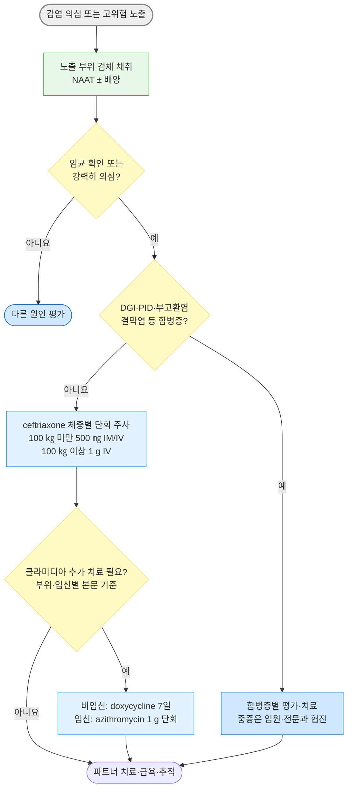

# 임질 Gonorrhea

## <mark style="color:green;">일반 사항</mark>

* 원인균 : _Neisseria gonorrhoeae_
* 감염 시 남성에서는 요도염, 여성에서는 자궁경부염이 흔함
* 법정감염병 : 제4급감염병(표본감시). 표본감시기관은 환자·의사환자를 7일 이내 신고 [질병관리청, 2026 법정감염병 진단·신고 기준] (☞ [성매개감염병](115_-1.STI.md))
* 젊고 성생활이 활발한 연령에서 흔함. 표본감시 신고 건수는 전체 인구의 발생률과 구분하여 해석
* 성관계 금지(CDC 기준 적용) : 임질 단회 주사 후 7일이 지나고, 동반 클라미디아의 7일 요법도 완료되며, 증상이 소실되고 파트너도 각 질환의 동일한 조건을 충족할 때까지 피함. Doxycycline 7일 요법 완료 후 다시 7일을 더 기다린다는 의미는 아님
* 파트너 관리 : 증상 발생 또는 진단 전 60일 이내 성접촉한 파트너에게 평가·검사 및 경험적 치료를 권고; 그 기간에 성접촉이 없었다면 가장 최근 파트너를 평가·치료
* STI 검사 : HIV·매독·클라미디아 검사를 함께 시행. HIV 음성이면 노출 위험을 평가하여 HIV PrEP 상담·진료 연계를 고려 [CDC 2021]
* 합병증 : 부고환염, 골반염(PID), 파종성 임균 감염(DGI), 불임

## <mark style="color:green;">원인</mark>

* 감염된 분비물과 점막의 성 접촉(질, 항문, 구강 성교)을 통해 전파
* 수직 감염 : 분만 시 산도를 통해 신생아에게 전파 → 신생아 결막염, 패혈증 유발

### <mark style="color:orange;">위험 요인</mark>

* 다수의 성 파트너, 새로운 성 파트너
* 콘돔 미사용
* 과거 STI, 감염된 파트너와의 접촉, 성매매 관련 노출, 남성과 성관계하는 남성(MSM)에서의 노출 등; 실제 성행동·노출 부위에 따라 위험 평가
* 젊은 연령

## <mark style="color:green;">임상 양상</mark>

* 흔히 무증상; 남성 요도 감염의 10% 내외, 여성 자궁경부 감염의 70\~80%에서 무증상이며 인두 감염도 대부분 무증상

**남성 요도 감염**

* 잠복기는 보통 2\~7일이나 변이가 있으며 무증상일 수 있음 [국내 2023]
* 화농성 요도 분비물, 배뇨통, 요도구 발적. 편측 고환·부고환 압통이나 종창이 있으면 단순 요도염과 구분하여 부고환염·고환염전 평가

**여성 자궁 경부 감염**

* 무증상인 경우가 많아 잠복기나 증상만으로 감염 시점을 추정하기 어려움
* 점액농성 자궁경부 분비물, 배뇨통, 접촉출혈·성교 후 출혈·월경 사이 출혈. 골반통·성교통이 있으면 PID를 평가; 외음부 가려움은 동반 질염 등도 감별
* 상행 감염 시 PID, 난관 불임, 자궁외 임신 등의 위험이 증가

**인두염**

* 대부분 무증상; 증상이 있으면 인후통, 편도 삼출물, 전경부 림프절병증 등이 나타날 수 있으나 비특이적

**직장 감염**

* 대부분 무증상
* 증상이 있는 경우 : 항문 소양감, 점액농성 분비물, 후중감(tenesmus), 직장 출혈

**파종성 임균 감염 (Disseminated Gonococcal Infection, DGI)**

* 원발 감염의 일부에서 균혈성 파종으로 발생
* 대표 소견 : 사지 원위부의 점상출혈·농포성 피부 병변, 건초염(tenosynovitis), 비대칭성 이동성 다발 관절통 또는 화농성 관절염; 모든 소견이 함께 나타날 필요는 없음
* 발열·오한 동반 가능. 여성, 월경 중, 임신, 말단 보체 결핍 또는 eculizumab 등 보체 억제제 사용 시 위험 증가; 남성에서도 발생 [CDC 2021]
* 원발 생식기 감염의 증상이 없거나 경미한 경우도 흔해 진단이 지연되기 쉬움

**성인 임균성 결막염**

* 드묾; 감염된 분비물의 눈 접촉 등으로 발생. 신생아는 출생 시 산도 노출로 감염될 수 있음
* 심한 화농성 분비물, 결막 충혈; 각막 침범 시 실명 위험

### 🚩 Red Flags

<mark style="color:$danger;">**즉각 조치**</mark>

* 발열·피부 병변·건초염·이동성 관절통 또는 화농성 관절염 중 파종성 감염을 시사하는 소견 → 파종성 임균 감염(DGI) 평가  `$danger`
* 심한 하복부 통증 + 발열 + 복막자극징후 → 중증 PID, 골반 농양  `$danger`
* 신생아 임균성 결막염(수직감염)  `$danger`
* 갑자기 시작한 심한 편측 고환통·종창 → 고환염전 즉시 배제  `$danger`
* 심한 화농성 분비물을 동반한 결막염 → 각막 손상 위험, 즉시 안과 평가  `$danger`

<mark style="color:$warning;">**당일~수일 내 평가**</mark>

* 급성 부고환염이 의심되나 고환염전 가능성이 낮은 고환·부고환 압통 또는 종창 → 당일 평가 및 치료  `$warning`
* 임신부에서 임질 진단 → 당일 치료·산과 연계 및 국내 지침에 따른 완치판정검사 계획  `$warning`

<mark style="color:$info;">**조기 평가 및 추적**</mark>

* 치료 후 3\~5일 내 호전이 없거나 악화하면 신속 재평가; 재감염·다른 원인·치료 실패 확인  `$info`
* 파트너가 치료를 완료하지 못하면 재노출을 막고 파트너 진료를 연계  `$info`

## <mark style="color:green;">진단</mark>

### <mark style="color:orange;">검사</mark>

* 검체 : 남성은 첫 소변(first-catch urine; 중간뇨와 구분), 여성은 질도말을 우선 고려; 검증된 자가 질도말도 가능. 노출 부위에 따라 요도·자궁경부·인두·직장 검체를 추가하며, 소변검사 음성만으로 인두·직장 감염을 배제하지 않음
* 생식기 임질 진단 시 인두 감염 여부를 함께 평가. BASHH 2025는 모든 비뇨생식기 임질 환자와 접촉자에게 인두 검사를 권고하므로 무증상 인두 감염을 놓치지 않도록 검사 범위를 상담 [BASHH 2025]
* 그람염색 : 증상이 있는 남성의 요도 분비물에서 백혈구 내 그람음성 쌍구균은 진단에 유용. 무증상 남성의 음성 결과로 배제할 수 없고 여성 자궁경부·인두·직장 검체에는 진단·배제 목적으로 권장하지 않음
* NAAT(핵산증폭검사) : 생식기 검체의 선호 검사. 인두·직장 검체는 검사실에서 해당 부위에 대해 성능을 검증한 방법을 사용; 국내 2023 지침의 검체 표는 이 부위에 배양을 권고하나 CDC는 적합한 NAAT도 허용
* 배양 및 항생제 감수성 검사 : 치료 실패·내성 의심 시 재치료 전에 반드시 확보. 가능하면 첫 치료 전에도 배양 검체를 채취하며, 검체 운송·배양 조건을 검사실과 협의. NAAT만으로 감수성을 알 수 없음 [BASHH 2025]
* DGI 의심 시 혈액·관절액 등 파종 부위와 노출 점막의 검체를 확보; 결막염은 결막 검체 배양·감수성 검사. 중증 감염은 검체 채취 때문에 항생제 시작을 지연하지 않음
* 재감염이 흔하므로 치료 약 3개월 후 노출 부위 재검사 시행(증상 유무와 무관; 완치판정 검사와 구분)

### <mark style="color:orange;">치료 실패</mark>

* 적절한 치료 후 성접촉이 없는데 3\~5일 내 증상이 호전되지 않거나, 치료 72시간 초과 후 배양 양성 또는 7일 초과 후 NAAT 양성이면 치료 실패를 의심(CDC 기준). **조기 NAAT 양성만으로 내성·실패를 확정하지 않음**; 특히 인두에서는 잔존 핵산에 의한 양성 가능성을 함께 평가
* 지속 증상·재양성에서는 재노출, 파트너 치료, 실제 투여량·경로·복약 여부를 확인. 재감염이 더 흔하지만 실패가 의심되면 배양·감수성 검사 후 감염내과와 재치료를 결정하고, 검사실·관할 보건당국과 내성균 확인을 협의
* 치료 실패로 재치료한 경우 치료 7\~14일 후 배양을 우선하여 완치판정; 분리균 감수성 검사와 파트너 재평가 시행 [CDC 2021]

### <mark style="color:orange;">감별</mark>

* 요도염·자궁경부염·질염 증상을 일으킬 수 있는 다른 원인들과의 감별

<table><thead><tr><th>질환</th><th>감별 단서</th><th>확인 검사·주의점</th></tr></thead><tbody><tr><td>비임균성 요도염(NGU; 클라미디아·마이코플라스마 등)</td><td>점액성 분비물 등으로 나타날 수 있으나 증상만으로 임질과 구분하기 어려움</td><td>임균·클라미디아 NAAT를 함께 고려; 임균과 동시 감염 가능</td></tr><tr><td>트리코모나스 질염 /<br>세균성 질염</td><td>악취, 질 자극감·소양감 등이 동반될 수 있음</td><td>질 분비물 검사·NAAT 등으로 평가; 임질 동시 감염을 배제하지 않음</td></tr><tr><td>반응성 관절염(Reactive arthritis)</td><td>선행 요도염·장염 후 발생한 비화농성 관절염</td><td>발열·급성 관절 종창이 있으면 관절천자 등으로 화농성 관절염/DGI를 우선 배제</td></tr></tbody></table>

***



<p align="center"><strong>진단 및 치료 알고리듬</strong></p>

<p align="center"><em><mark style="color:$info;">Ref. 질병관리청·대한요로생식기감염학회, 성매개감염 진료지침(2023);</mark></em><br><em><mark style="color:$info;">국내 학회 지침 해설(Yang 등, 2024); CDC STI Treatment Guidelines(2021)</mark></em></p>

***

## <mark style="background-color:$warning;">Management</mark>

* 치료 원칙 : 합병증이 없는 요도·자궁경부·직장·인두 감염은 ceftriaxone 단회 주사로 치료. 생식기·직장 감염에서 클라미디아가 배제되지 않은 비임신 환자는 doxycycline을 추가하고, 인두 감염은 아래의 별도 설명을 참고. PID·부고환염·DGI 등에는 각 합병증의 치료 요법을 적용. HIV 감염자도 동일한 원칙으로 치료
* 강력히 의심되는 증상성 감염에서는 검체 채취 후 결과를 기다리지 않고 치료할 수 있음. 항생제 선택은 감염 부위·알레르기·임신 및 감수성 결과를 함께 고려

## <mark style="color:green;">비-약물 치료 및 예방</mark>

* 콘돔을 이용한 안전한 성관계
* 최근 60일 이내 성 파트너에 대한 평가·검사 및 경험적 치료; 그 기간에 성접촉이 없었다면 가장 최근 파트너 평가
* 임질 단회 주사 후 7일 경과, 동반 클라미디아 7일 요법 완료, 증상 소실 및 양측의 질환별 치료·대기 조건 충족까지 성관계를 피함
* 치료 약 3개월 후 재감염 검사(증상 유무와 무관); 불가능하면 치료 후 12개월 이내 다음 진료 시 시행 [CDC 2021]

* 일부 국가에서는 파트너를 직접 진료하지 않고 처방하는 Expedited Partner Therapy(EPT)를 시행하나, 국내에서는 일반적으로 시행하지 않음


**Doxy-PEP(노출 후 예방요법)** - CDC 2024 권고는 최근 12개월 내 매독·클라미디아·임질 중 하나 이상을 진단받은 MSM·트랜스젠더 여성을 대상으로 이득·위해 상담 후 고려. 성 접촉 후 가능한 빨리, 72시간 이내 doxycycline 200 ㎎ 1회(24시간당 최대 200 ㎎), 3\~6개월마다 STI 검사·지속 필요성 재평가. 임질 예방효과는 지역 내성률에 따라 달라지며, 일반 인구로 일률 확대하거나 임질 치료를 대신하지 않음. 국내 예방 목적 허가 외 사용 [CDC 2024] (☞ [성매개감염병](115_-1.STI.md))


## <mark style="color:green;">약물 치료</mark>

* 아래는 성인·청소년 중심의 지침 요법. 소아·신생아에게 그대로 적용하지 않음

#### <mark style="color:$primary;">합병증이 없는 자궁경부·요도·직장 감염</mark>

**1차 선택제 (합병증이 없는 인두 감염 포함)**

* ceftriaxone : 체중 ＜100 ㎏에서 500 ㎎ IM 또는 IV 1회, ≥100 ㎏에서 1 g IV 1회 <mark style="color:blue;">\[트리악손]</mark>. 본문·알고리듬·처방례는 국내 학회 지침 해설 논문의 체중 기준을 적용 <mark style="color:$info;">[KAUTII 지침 해설, 2024]</mark>

<table><thead><tr><th>출처</th><th>단순 임질의 ceftriaxone 요법</th></tr></thead><tbody><tr><td>국내 2023 진료지침 PDF 치료표</td><td>500 ㎎ IM/IV 또는 1 g IV 1회; 표 자체에는 체중 경계값이 없음</td></tr><tr><td>국내 학회 지침 해설 논문(ICU 2024)</td><td>＜100 ㎏: 500 ㎎ IM/IV, ≥100 ㎏: 1 g IV 1회</td></tr><tr><td>CDC 2021</td><td>＜150 ㎏: 500 ㎎ IM, ≥150 ㎏: 1 g IM 1회</td></tr><tr><td>WHO 2024</td><td>성인·청소년(임신부 포함): 1 g IM 1회</td></tr><tr><td>BASHH 2025</td><td>성인 단순 항문생식기·인두 감염: 1 g IM 1회</td></tr></tbody></table>

* 국내 지침 PDF·학회 해설·CDC·WHO·BASHH 사이에 용량과 경로 차이가 있음. 출처와 선택 요법을 일관되게 적용하며, IM 조제에 lidocaine을 사용한 용액은 IV로 투여하지 않음 <mark style="color:$info;">[국내 2023; Yang 등 2024; CDC 2021; WHO 2024; BASHH 2025]</mark>


**지침 용량과 국내 허가 용법의 차이** : 트리악손 국내 품목정보의 임질 용법은 ceftriaxone 250 ㎎ IM 1회이다. 본문의 500 ㎎/1 g 및 IV 요법은 내성 대응을 위한 지침 용법으로, 해당 품목의 임질 허가 용법 외 사용임을 구분한다. 허가 용량 250 ㎎로 임의 감량하지 않는다. Cefixime 800 ㎎ 단회도 슈프락스의 국내 허가 용법(성인 통상 100 ㎎ bid, 중증·불충분 반응 시 200 ㎎ bid까지)과 다른 허가 용법 외 사용이다.


* 생식기·직장 감염에서 클라미디아가 배제되지 않은 비임신 환자에게 ceftriaxone 또는 cefixime을 사용하면 doxycycline 100 ㎎ 경구 bid ×7일을 추가 <mark style="color:blue;">\[독시사이클린]</mark>; 인두 감염은 아래 기준을 참고. Gentamicin+azithromycin 2 g 요법에는 doxycycline을 일률적으로 추가하지 않고 검사 결과와 임상 상황에 따라 판단

**대체제**

* 페니실린 알레르기만으로 모든 세팔로스포린을 자동 배제하지 말고 반응 유형·중증도를 확인. 아나필락시스·중증 피부 이상반응 병력은 별도 평가·전문과 상담 [CDC 2021]

* gentamicin 240 ㎎ IM ×1회 <mark style="color:blue;">\[겐타마이신 주]</mark> _plus_ azithromycin 2 g 경구 ×1회 <mark style="color:blue;">\[지스로맥스]</mark> (세팔로스포린 중증 알레르기에서 제한적으로 고려)
* cefixime : 800 ㎎ 경구 ×1회 <mark style="color:blue;">\[슈프락스]</mark> (ceftriaxone 투여가 불가능할 때 고려하는 CDC 대체요법; 국내 2023 치료표의 대체제에는 없음)
  * cefixime은 ceftriaxone보다 항임균 효과가 낮을 수 있음. Doxycycline 추가는 **배제되지 않은 클라미디아 치료 목적**이며 cefixime의 임균 치료 효과를 보강하는 요법이 아님. CDC 대체요법에는 azithromycin을 통상 병용하지 않으나 WHO 2024는 완치검사 불가·인두 감염 우려 시 cefixime+azithromycin 2 g을 제시하므로 출처별 경로를 혼합하지 않음
  * 인두 감염 완치율이 낮아(약 92%) 인두 감염에는 권장하지 않음


**Spectinomycin: 국내 유통 제품 없음**(2026-10-27 저자 확인). 국내 2023 지침에는 2 g IM 단회 대체요법으로 기재되어 있으나 현재 국내 처방 선택지에서는 제외. 인두 감염에는 효과가 낮아 권장하지 않음.


#### <mark style="color:$primary;">인두 감염</mark>

* 1차 선택제와 동일 (☞ 위 1차 선택제 참고)
* CDC 기준으로 신뢰할 만한 대체 요법이 없음; ceftriaxone 중증 과민반응이 있으면 감염내과와 상의하여 치료 결정
* **인두만 감염된 비임신 환자는 클라미디아 미배제만으로 doxycycline을 일률 추가하지 않음(CDC)**. 인두 검체에서 클라미디아가 확인되면 doxycycline 100 ㎎ 경구 bid ×7일을 추가(임신부는 azithromycin 1 g 경구 단회); 다른 부위의 클라미디아 감염도 평가
* 치료 후 완치판정검사 시행. 배양과 NAAT는 검사 시점을 구분 (☞ 아래 ‘치료 후 검사’ 참고)

#### <mark style="color:$primary;">임신부 감염</mark>

* 1차 선택제와 동일한 ceftriaxone 요법으로 치료
* 클라미디아 배제 안 된 경우 doxycycline 대신 azithromycin 1 g 단회 경구 사용 (임신 중 doxycycline은 사용하지 않음)
* 산과와 연계하고 **국내 2023 지침에 따라 임신부는 감염 부위와 관계없이 임질 완치판정검사를 시행**. 검사법·시점은 아래 추적 계획을 적용. CDC는 권장요법 후 무증상인 단순 비뇨생식기·직장 임질에서 임신만을 이유로 TOC를 요구하지 않으나, 국내 지침 및 BASHH 2025는 임신부 TOC를 권고
* 동반 클라미디아가 확인되면 치료 완료 약 4주 후 NAAT TOC를 별도로 시행; 임질 재감염 검사는 약 3개월 후 시행
* 중증 세팔로스포린 알레르기가 있으면 감염내과·산과 협진. Gentamicin 대체요법을 임신부에게 자동 적용하지 않음(태아·신생아 신독성·이독성 등 우려) [CDC 2021]

#### <mark style="color:$primary;">급성 부고환염</mark>

* 임균·클라미디아를 포함한 원인에 따라 항생제를 병합하고 여러 날 투여해야 함; 단순 임질의 단회 ceftriaxone만으로 치료를 끝내지 않음 (☞ [급성 부고환염](121_-acute-epididymitis.md))

#### <mark style="color:$primary;">골반염(PID)</mark>

* 자궁경부 이동통·자궁 압통·부속기 압통 등으로 의심되면 조기에 PID 치료. 임균 치료 외에 클라미디아·혐기균 등을 포함한 여러 날에 걸친 병합요법이 필요하며 단회 임질 요법만으로 충분하지 않음; 임신·농양·중증 증상은 입원 평가 [CDC PID 지침 2021]

#### <mark style="color:$primary;">파종성 임균 감염 (DGI)</mark>

* 입원·감염내과 협진 후 관절염·피부염형에서는 ceftriaxone 1 g IV/IM 24시간마다 시작. 임상적으로 충분히 호전된 뒤 24\~48시간이 지나고 감수성 검사에서 효과가 확인된 경구제가 있으면 전환을 고려; 총 치료 기간은 최소 7일(CDC 및 국내 지침 상세 설명), 국내 지침 치료 요약표는 최소 10일로 표기하므로 병형·경과에 따라 전문과와 결정
* 수막염·심내막염에서는 ceftriaxone 1\~2 g IV 12\~24시간마다 투여하며 전문과에서 결정. 수막염은 비경구 치료 10\~14일, 심내막염은 4주 이상 필요 <mark style="color:$info;">[CDC 2021]</mark>
* 파종 부위와 노출된 점막 부위의 배양·NAAT 검체 및 감수성 검사를 확보하고, 클라미디아가 배제되지 않으면 적절히 치료. 수막염·심내막염 징후를 함께 평가. 화농성 관절염에서는 관절천자·배액 여부를 평가

#### <mark style="color:$primary;">성인 임균성 결막염</mark>

* 즉시 안과 평가; 성인 임균성 결막염은 ceftriaxone 1 g 1회(국내 2023 PDF: IM/IV; CDC: IM) 및 생리식염수로 눈을 1회 세척하는 것을 고려. 국내 학회 해설 논문의 표에는 단순 감염과 같은 체중별 500 ㎎/1 g이 기재되어 PDF와 차이가 있으므로, 본문은 공식 PDF·CDC의 결막염 1 g 요법을 적용 <mark style="color:$info;">[국내 2023; CDC 2021]</mark>
* 결막 배양·감수성 검체를 확보하되 전신 항생제 치료를 지연하지 않음. 점안제 단독 치료는 불충분. BASHH 2025는 안과와 긴급 공동진료 및 집중 국소 항생제 병용을 권고하며, 국내 점안제 선택·조제는 안과에서 결정. 각막 손상·안와 주위 감염이 있으면 단회 요법으로 종료하지 말고 추가 전신 치료·입원을 평가 [BASHH 2025]


**최근 해외 치료제 변화** : 2025년 12월 미국 FDA는 단순 비뇨생식기 임질에 경구 zoliflodacin(Nuzolvence)과 gepotidacin(Blujepa)을 승인함. Zoliflodacin은 12세 이상·체중 ≥35 ㎏, gepotidacin은 12세 이상·체중 ≥45 ㎏이 허가 대상이며, 후자는 다른 치료 선택지가 제한적인 환자에 한함. 이 허가를 인두·직장 임질, DGI 또는 임신부 치료로 확대 적용하지 않으며, 국내 허가·공급·급여와도 구분함(이번 검토에서 국내 품목을 확정하지 못함). 본 챕터의 국내 표준 처방은 위 ceftriaxone 요법을 유지 <mark style="color:$info;">[FDA 2025]</mark>


### <mark style="color:orange;">치료 후 검사</mark>

* 치료 후 1주 이내 임상 추적: 증상 호전, 파트너 치료, 금욕·복약을 확인. 완치판정검사(TOC)와 재감염 검사는 목적을 구분 [국내 2023; CDC 2021]

<table><thead><tr><th>상황</th><th>완치판정·추적 계획</th></tr></thead><tbody><tr><td>합병증 없는 비뇨생식기·직장 임질<br>비임신·권장요법 후 증상 소실</td><td>통상 TOC 불필요. CDC는 권장 대체요법에도 같은 원칙을 적용하지만, 국내 진료에서는 대체요법·순응도 우려·내성 위험에 따라 TOC를 별도 계획</td></tr><tr><td>인두 임질</td><td>사용 약제와 관계없이 치료 7~14일 후 TOC. <strong>국내 지침의 NAAT 3주 이후 원칙을 적용하려면 7~14일 TOC는 배양으로 시행</strong>. 배양을 할 수 없어 NAAT를 선택할 때는 아래 출처별 시점을 구분</td></tr><tr><td>임신부</td><td>감염 부위와 관계없이 TOC(국내 2023). 인두 이외 부위의 NAAT TOC는 치료 종료 3주 이후; 동반 클라미디아의 임신 중 NAAT TOC는 약 4주 후로 별도 시행</td></tr><tr><td>지속 증상·치료 실패 의심</td><td>즉시 배양·감수성 검사 중심으로 재평가; NAAT 예정일까지 기다리지 않음. 재치료 후 7~14일에 배양 중심 TOC</td></tr><tr><td>모든 치료 환자</td><td>약 3개월 후 노출·감염 부위 재검사로 재감염 확인; TOC와 별개</td></tr></tbody></table>

* **NAAT 시점의 지침 차이**: 국내 2023은 잔존 핵산 위양성을 줄이기 위해 치료 종료 **3주 이후**를 제시. CDC는 인두 감염에서 **7\~14일 후** 배양 또는 NAAT를 허용하나 7일째 위양성 증가를 경고; BASHH 2025는 NAAT TOC를 **최소 2주 후** 권고. CDC 방식으로 인두 NAAT를 시행할 경우 가급적 14일경 계획하고, 조기 양성만으로 실패를 확정하지 않음
* 인두 NAAT 양성 시 재치료 전 확인 배양을 적극 시행하고, TOC 배양 양성 분리균은 감수성 검사. 배양 음성·NAAT 양성은 재노출·채취 시점·검사법을 검토하여 전문과와 재검·치료 결정

## <mark style="color:green;">시술 및 기타 처치</mark>

* 화농성 관절염은 관절천자 및 필요 시 배액; 골반·비뇨생식기 농양은 전문과에서 배액 등 감염원 조절 평가
* 임균성 결막염의 생리식염수 세척은 전신 항생제·안과 진료의 보조 처치

***

### <mark style="color:red;">질병코드</mark>

A54 임균감염

A54.0 요도주위 또는 부속선에 농양이 없는 하부 비뇨생식관의 임균감염

A54.1 요도주위 및 부속선에 농양이 있는 하부 비뇨생식관의 임균감염

A54.2 임균성 골반복막염 및 기타 임균성 비뇨생식기 감염

A54.3 임균성 눈질환

A54.4 임균성 관절병증

A54.5 임균성 인두염

A54.6 항문 및 직장의 임균성 감염

A54.8 기타 임균감염

A54.9 상세불명 임균감염

* 위는 주요 범주. 실제 청구 시 감염 부위·농양·합병증에 맞는 KCD-9 세부코드를 선택

***

## <mark style="color:purple;">처방례</mark>

> **처방례 1. 합병증이 없는 임균성 요도염**
>
> ```
> 트리악손 주 500 ㎎  IM 또는 IV 1회 (체중 ＜100 ㎏)
> 체중 ≥100 ㎏이면 트리악손 주 1 g  IV 1회
> ```
>
> _✽국내 학회 해설 논문의 100 ㎏ 기준 적용(CDC는 150 ㎏). 트리악손의 임질 허가 용법(250 ㎎ IM 단회)과 다른 지침에 따른 허가 용법 외 사용. IM용 lidocaine 조제액은 IV 투여 금지. 클라미디아 동반이 배제되지 않으면 doxycycline 100 ㎎/T 1T 경구 bid ×7일 추가._

> **처방례 2. 세팔로스포린 중증 알레르기(아나필락시스 등)**
>
> ```
> 겐타마이신 주 240 ㎎  IM  1회
> 지스로맥스 250 ㎎/T  8T(총 2 g)  경구 1회
> ```
>
> _✽세팔로스포린 중증 과민반응의 병력과 유형을 확인한 뒤 선택. Gentamicin의 신·이독성 위험과 임신 여부, azithromycin의 QT 연장 위험·상호작용을 확인. Azithromycin 2 g은 복용 직후 구토가 발생할 수 있어 관찰 및 재치료 필요성을 판단. 특히 인두 감염에서는 신뢰할 만한 대체요법이 없으므로 감염내과 협진이 필요. 클라미디아 추가 치료 여부는 검사 결과와 임상 상황에 따라 결정._

> **처방례 3. 인두 임질**
>
> ```
> 트리악손 주 500 ㎎  IM 또는 IV 1회 (체중 ＜100 ㎏)
> 체중 ≥100 ㎏이면 트리악손 주 1 g  IV 1회
> ```
>
> _✽트리악손의 임질 허가 용법과 다른 지침 요법. 국내 기준을 적용한 7\~14일 TOC는 배양으로 시행하고 NAAT 시점은 위 추적 계획 참고. NAAT 양성이면 재치료 전 확인 배양을 적극 시행하고 분리균 감수성 검사. 중증 ceftriaxone 과민반응이 있으면 감염내과 협진._

***

### <mark style="color:$success;">핵심 복약 지도</mark>

> **트리악손(ceftriaxone) 근육주사 안내**
>
> * 근육주사 1회로 대부분 치료가 완료됩니다.
> * 클라미디아 동반 여부가 확인되지 않은 비임신 환자는 처방된 독시사이클린을 7일간 규칙적으로 복용하도록 안내합니다(1일 2회, 충분한 물과 함께 복용, 복용 후 바로 눕지 않기).
> * 임질 주사 후 7일이 지나고, 동반 클라미디아의 7일 복용도 마치며, 증상이 없어지고 파트너도 각 치료·대기 조건을 충족할 때까지 성관계를 피하도록 설명합니다.
> * 최근 60일 이내 성 파트너에게도 평가·검사와 치료가 필요함을 설명합니다.
>
> **언제 다시 병원을 방문해야 하나요?**
>
> * 치료 후 3\~5일 내 분비물·배뇨통이 호전되지 않거나 악화하는 경우
> * 발열, 피부 발진, 관절통이 새로 발생하는 경우 - 파종성 임균 감염 감별 위해 즉시 내원
> * 심한 하복부 통증 또는 발열이 동반되는 경우 - 즉시 내원
> * 인두 감염은 치료 7\~14일 후 완치 확인을 위해 방문합니다. 배양과 유전자검사는 적절한 검사 시점이 달라 의료진이 검사법·일정을 정합니다. 임신부는 국내 지침에 따라 임질 완치판정검사도 받고, 동반 클라미디아가 확인되면 해당 감염의 완치판정검사도 받습니다. 모든 환자는 약 3개월 후 임질 재감염 검사를 받습니다.

***

## <mark style="color:green;">주요 참고문헌 및 확인 자료</mark>

### ＜임상 근거＞

* 질병관리청·대한요로생식기감염학회. [성매개감염 진료지침 2023](https://stiguide.kr/wp-content/uploads/2023/04/Korean_STI_Guidelines_2023.pdf).

* Yang HJ, et al. [2023 Korean Association of Urogenital Tract Infection and Inflammation guidelines for gonococcal infection](https://pmc.ncbi.nlm.nih.gov/articles/PMC10789534/). Investig Clin Urol. 2024;65:1–8. doi:10.4111/icu.20230265.

* CDC. [Gonococcal Infections Among Adolescents and Adults](https://www.cdc.gov/std/treatment-guidelines/gonorrhea-adults.htm). STI Treatment Guidelines 2021.

* CDC. [Pelvic Inflammatory Disease](https://www.cdc.gov/std/treatment-guidelines/pid.htm) 및 [Epididymitis](https://www.cdc.gov/std/treatment-guidelines/epididymitis.htm). STI Treatment Guidelines 2021.

* WHO. [Updated recommendations for gonorrhoea, chlamydia and syphilis, 2024](https://www.who.int/publications/i/item/9789240090767).

* BASHH. [National Guideline for the Management of Gonorrhoea, 2025](https://www.bashh.org/_userfiles/pages/files/gc_guideline_2025_final.pdf). 인두 검사·안구 감염·완치판정검사 기준.

* CDC. [Doxycycline postexposure prophylaxis guidelines, 2024](https://www.cdc.gov/mmwr/volumes/73/rr/rr7302a1.htm).

* 질병관리청. [2026 법정감염병 진단·신고 기준](https://kdca.go.kr/bbs/kdca/55/307100/download.do). 임질의 신고범위·표본감시.

* FDA. [Two oral therapies for uncomplicated urogenital gonorrhea, 2025](https://www.fda.gov/news-events/press-announcements/fda-approves-two-oral-therapies-treat-gonorrhea).

### ＜허가·급여 확인 자료＞

* 식품의약품안전처. 의약품안전나라 — 국내 제품별 적응증·용법·금기 및 허가 상태.
  [https://nedrug.mfds.go.kr/index](https://nedrug.mfds.go.kr/index)

* 국내 용법 대조: 트리악손주사 500 ㎎/1 g, 슈프락스캡슐 100 ㎎의 국내 품목정보·제품설명서. 지침과 허가 용법의 차이는 약물 치료 본문에 명시

* 위 FDA 자료는 미국 허가 근거이며 국내 허가·유통·급여 인정 자료와 구분함. Spectinomycin은 국내 유통 제품 없음(2026-10-27 저자 확인). 해외 신약의 국내 품목 상태는 이번 검토에서 확정하지 못함

* 자료 확인일: 2026-10-27. 국내 표준은 2023 진료지침·2024 학회 해설을 바탕으로 하고, 해외 권고는 출처별 차이를 명시

***

## <mark style="color:blue;">환자 안내서</mark>


**임질, 항생제 주사 한 번으로 대부분 치료됩니다**

임질은 성 접촉으로 전파되는 세균 감염입니다. 적절히 치료하면 대부분 완치되지만, 치료하지 않으면 골반 염증, 불임 등 합병증으로 이어질 수 있습니다.


#### <mark style="color:$primary;">왜 생기나요?</mark>

* 임균이라는 세균이 성 접촉(질, 항문, 구강 성교)을 통해 전파됩니다.
* 증상이 없는 경우도 많아(특히 여성, 인두 감염) 본인도 모르게 다른 사람에게 옮길 수 있습니다.

#### <mark style="color:$primary;">치료는 어떻게 받나요?</mark>

* 대부분 항생제 근육주사 1회로 치료가 끝납니다.
* 클라미디아 감염이 배제되지 않은 경우에는 먹는 항생제를 추가할 수 있습니다. 처방받은 기간을 반드시 채워 복용하십시오. 임신 중에는 약제와 추적검사 계획이 달라집니다.

#### <mark style="color:$primary;">일상생활에서 무엇을 지켜야 하나요?</mark>

* **임질 주사 후 7일이 지나고, 함께 처방된 클라미디아 7일 복용도 마치며, 본인과 파트너 모두 증상이 없고 각 치료·대기 조건을 충족할 때까지 성관계를 피하십시오.** 그전에 성관계를 하면 전파되거나 재감염될 수 있습니다.
* **최근 60일 이내 성 파트너에게 알려 검사와 치료를 받도록 하십시오.** 그 기간에 성접촉이 없었다면 가장 최근 파트너에게 알리십시오.
* 콘돔을 사용하면 재감염과 다른 성매개감염 예방에 도움이 됩니다.
* 인두 감염은 임신 여부와 관계없이 치료 7\~14일 후 완치 확인을 위해 방문하십시오. 검사 종류에 따라 검체를 채취하는 날짜가 달라질 수 있습니다. 임신부는 다른 부위의 임질도 의료진이 안내한 시점에 완치검사를 받으십시오. 임신 중 동반 클라미디아 감염이 확인되었다면 담당 의사가 안내하는 클라미디아 완치판정검사도 받으십시오.
* 치료 약 3개월 후에는 증상이 없어도 재감염 여부를 확인하기 위한 검사를 다시 받으십시오.

#### <mark style="color:$primary;">이럴 때는 즉시 병원을 방문하세요</mark>

* 치료 후 3\~5일 내 분비물·배뇨통이 호전되지 않거나 다시 나타나는 경우
* 열이 나면서 피부에 발진이나 물집 같은 병변이 생기고 관절이 아픈 경우
* 심한 아랫배 통증·발열, 갑자기 시작한 심한 고환통, 눈의 심한 충혈과 고름성 분비물이 생긴 경우

임신 중 임질이 진단되면 지체하지 말고 치료와 산과 진료를 받으십시오. 출산 시 아기에게 전파될 수 있습니다.
