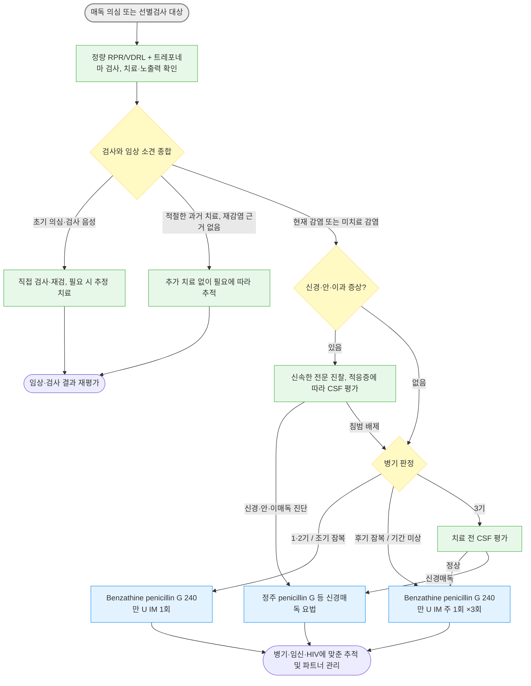

# 매독 Syphilis

## <mark style="color:green;">일반 사항</mark>

* 정의 : _Treponema pallidum_ 감염에 의한 만성 전신성 성매개질환
* 전염 경로 : 감염 병소에 대한 직접 접촉(성관계), 감염 산모의 경태반 수직감염(출산 중 산도 접촉에 의한 감염은 드묾); 수혈을 통한 전파는 극히 드묾
* 법정감염병 : 3급 (전수감시). 1기·2기·3기·조기 잠복·선천매독은 진단 후 24시간 이내 신고 대상 (☞ [성매개감염병](115_-1.STI.md))
* 국내 신고 현황 : 2024년 2,790명, 2025년 2,211명. 2025년 병기별 신고는 1기 721명, 2기 449명, 조기 잠복 979명, 3기 50명, 선천매독 12명. 2024년 전수감시 전환 및 신고 병기 확대 전후의 신고 건수는 단순 비교하지 않음  <mark style="color:$info;">[질병관리청 보도설명자료, 2026-08-19]</mark>

### <mark style="color:orange;">분류</mark>

<mark style="color:cyan;">**Early syphilis**</mark>

* primary syphilis, secondary syphilis, early latent syphilis를 포함
* 1기 병변(굳은궤양) 잠복기 : 평균 약 3주(10\~90일)

<mark style="color:cyan;">**Late syphilis**</mark>

* late latent syphilis, tertiary syphilis를 포함 (neurosyphilis는 병기와 무관하게 조기·후기 어느 시기에서나 발생 가능하여 별도로 분류)
* 초기 단계에서 치료되지 않으면 무증상의 late latent syphilis 또는 감염 합병증 단계(tertiary syphilis)로 진행
* 후기 합병증은 대개 감염 후 수년~수십 년에 걸쳐 발생하며 모든 미치료 환자가 3기로 진행하는 것은 아님. 신경·안·이매독은 조기에도 발생할 수 있으므로 후기매독과 동일시하지 않음

## <mark style="color:green;">원인 및 위험 인자</mark>

* 원인균 : _Treponema pallidum_ subsp. _pallidum_ - 나선형 스피로헤타(spirochete); 표준 배지에서 배양되지 않으며 병변의 직접 확인에는 암시야 현미경, 분자 진단 등을 이용
* 위험 요인
  * 콘돔 미사용 성관계, 다수의 성 파트너, 성매매 관련 접촉
  * 남성 동성 간 성접촉(MSM) - 국내외 모두 주요 위험군
  * HIV 감염 또는 기타 성매개질환(임질, 클라미디아 등) 동반
  * 최근 1년 내 세균성 성매개질환 진단 병력

## <mark style="color:green;">임상 양상</mark>

#### <mark style="color:$primary;">1기 매독 (Primary syphilis)</mark>

* 굳은 궤양(Chancre) : 대개 단일 무통성 papule로 시작 → 침식되고 단단한 바닥과 경계를 가진 궤양으로 진행. 다발성 또는 통증이 있는 병변도 가능
* 구강, 항문, 음경, 질 등에서 평균 감염 약 3주 후(범위 10~90일) 발생하며, 미치료 시에도 대개 3~6주 내 자연 소실될 수 있으나 감염이 치유된 것은 아님
  * 구강 병변은 무통성인 경우가 많아 아프타성 궤양·인후염 등으로 오인되어 진단이 지연되기 쉬움
* 국소 림프절 종대 : 병변 배액 부위에서 대개 무통성·고무 같은(rubbery) 양상으로 촉지. 생식기 병변에서는 서혜부에 흔하지만 구강·항문 병변에서는 위치가 다를 수 있음

#### <mark style="color:$primary;">2기 매독 (Secondary syphilis)</mark>

* 1기 병변이 치유되는 무렵부터 수주~수개월 뒤 발생하며 1기 병변과 겹칠 수 있음. 미치료 시 발진이 사라졌다 재발할 수 있음
* 피부 발진 : 반, 구진, 구진비늘, 농포 등 다양한 형태; 손/발바닥 및 전신 분포; 대개 가려움이 없으나 예외 가능
* 편평콘딜로마(Condylomata lata) : 분홍색 또는 회백색, 넓고 짓무른 papules or plaques; 전염성이 높음
* 전신 증상 : 발열, malaise, 인후통, 두통, 근육통, 관절통, 전신 림프절병증, 체중 감소, 탈모
* 신질환(사구체신염, 신증후군), 간질환(간염) 발생 가능

#### <mark style="color:$primary;">3기 매독 (Tertiary syphilis)</mark>

* 치료받지 않은 환자에서의 late syphilis; cardiovascular syphilis, gummatous syphilis를 포함한 증상 발생
* 고무종(Gumma) : 다양한 크기와 부위(피부, 피하, 골, 내장)의 결절; 궤양과 피부 괴사를 일으킬 수 있음

#### <mark style="color:$primary;">잠복매독 (Latent syphilis)</mark>

* 매독 혈청 검사는 양성이지만 1·2기 또는 3기 매독의 임상 증상이 없는 상태. 정의에 CSF 검사 결과는 포함되지 않음
* 조기 잠복매독 : 진단 전 1년 이내의 혈청전환, 이전 치료자에서 지속적인 역가 4배 상승, 명확한 1·2기 매독 증상 또는 조기 매독 파트너와의 접촉 등으로 최근 1년 내 감염을 뒷받침할 수 있는 경우. 가능한 감염 노출이 최근 12개월에만 있었음이 명확한 경우도 해당
* 잠복매독으로 분류하기 전 구강·생식기·회음부·항문 주위 등 접근 가능한 점막과 피부를 진찰하여 1·2기 병변을 배제
* 후기 잠복매독 : 감염 기간이 1년을 넘는 경우. 최근 1년 내 감염 근거가 없고 감염 시기를 알 수 없는 경우는 '기간 미상 잠복매독'으로 분류하고 후기 잠복매독과 같은 요법으로 치료. 역가만으로 조기 잠복매독을 판정하지 않음

#### <mark style="color:$primary;">신경매독 (Neurosyphilis)</mark>

* 감염 경과 중 어느 시기에나 발생 가능

<mark style="color:cyan;">**조기 신경매독 (Early neurosyphilis)**</mark>

* 뇌막염, 뇌혈관 질환(예: 수막염, 뇌졸중) : 두통, 혼돈, 구역, 구토, 경부 강직
* 안매독(포도막염·망막염·시신경염 등)과 이매독(감각신경성 난청·이명·현훈)은 고립되어 나타날 수 있으며 어느 병기에서도 발생 가능

<mark style="color:cyan;">**만기 신경매독 (Late neurosyphilis)**</mark>

* 뇌/척수 이환 : 치매, general paresis, tabes dorsalis

#### <mark style="color:$primary;">선천매독 (Congenital syphilis)</mark>

* 미치료 매독 임산부에서 태반을 통해 태아로 수직감염; 임신 시기·모체 병기와 무관하게 임신 전 기간에 걸쳐 발생 가능
* 조기 선천매독(2세 미만) : 간·비장비대, 황달, 피부·점막 병변(수포성 발진, 비강 분비물\[snuffles]), 골연골염, 빈혈·혈소판감소증
* 후기 선천매독(2세 이상, 미치료 시) : Hutchinson 삼징후(간질성 각막염, 감각신경성 난청, Hutchinson 치아), 안장코(saddle nose), 군도정강이(saber shin)
* 대부분 임신부 선별검사와 조기 치료로 예방 가능

### 🚩 Red Flags

<mark style="color:$danger;">**즉각 조치**</mark>

* 급성 시력 저하·안통(포도막염·망막염 의심), 급성 청력 소실  <mark style="color:$danger;">[즉각 조치]</mark>
* 두통 + 발열 + 경부 강직, 또는 급성 신경학적 결손(뇌졸중 유사) → 신경매독을 포함한 수막염·뇌졸중 응급 감별  <mark style="color:$danger;">[즉각 조치]</mark>
* 임신부의 활동성 매독 확진 + 조기진통 또는 태아 이상 소견  <mark style="color:$danger;">[즉각 조치]</mark>
* 신생아에서 선천매독 의심 소견(간비대, 황달, 피부병변, 비강 분비물 등), 특히 모체 매독 병력·산전 검사 미시행  <mark style="color:$danger;">[즉각 조치]</mark>
* 치료 후 고열·저혈압·호흡곤란이 발생한 경우 : 심한 Jarisch-Herxheimer 반응 외에 아나필락시스·다른 급성 원인을 즉시 감별; 특히 임신부와 신경매독 환자  <mark style="color:$danger;">[즉각 조치]</mark>

<mark style="color:$warning;">**당일~수일 내 평가**</mark>

* 서서히 진행하는 시력·청력 변화 → 당일 안과·이비인후과 평가; 인지기능 저하 → 신경학적 진찰 후 신속히 신경매독 평가  <mark style="color:$warning;">[당일~수일 내 평가]</mark>
* HIV 선별검사 양성  <mark style="color:$warning;">[당일~수일 내 평가]</mark>
* 3기 매독 소견(심혈관계 증상, 고무종)  <mark style="color:$warning;">[당일~수일 내 평가]</mark>
* 임신부에서 매독 확진(응급 소견 무관)  <mark style="color:$warning;">[당일~수일 내 평가]</mark>
* 모체가 임신 중 매독 치료를 받지 않았거나 치료 반응이 불충분했던 신생아(출생 시 무증상 포함)  <mark style="color:$warning;">[당일~수일 내 평가]</mark>

<mark style="color:$info;">**조기 평가 및 추적**</mark>

* 치료 후 추적 역가의 감소가 불충분한 경우 : 병기·치료 전 역가·재노출·증상 등을 함께 평가하고 추적 계획 수립  <mark style="color:$info;">[조기 평가 및 추적]</mark>
* 적절한 치료 후 낮은 역가가 지속되는 serofast 상태 : 재노출·역가 상승 여부에 따라 평가  <mark style="color:$info;">[조기 평가 및 추적]</mark>


## <mark style="color:green;">진단</mark>

* 통상 혈청학적 진단은 non-treponemal test와 treponemal-specific test를 조합하고 증상·노출력·과거 치료 기록을 함께 해석. 병변의 암시야 검사 또는 검증된 PCR 양성은 직접 진단 근거가 될 수 있음
* 모든 매독 환자는 진단·치료 시 HIV 검사. HIV 음성이고 지속 노출 위험이 있으면 HIV PrEP 상담·연계 및 약 3개월 후 재검을 고려. 노출 부위에 따른 임질·클라미디아 검사와 B·C형간염 평가도 병행
* **임상 소견과 노출력이 강하게 의심되면 초기 혈청검사 음성만으로 치료를 미루지 않음** : 치료 전 검체를 확보하고 추정 치료와 재검을 병행할 수 있음. 특히 추적이 불확실하거나 감염된 파트너와 최근 접촉한 경우

### <mark style="color:orange;">혈청 검사</mark>

#### <mark style="color:$primary;">Non-treponemal test</mark>

* RPR, VDRL
* 위양성은 임신, 자가면역질환, 다른 감염, 최근 예방접종 등에서도 가능하므로 단독 양성을 활동성 매독으로 단정하지 않음
* cardiolipin-lecithin-cholesterol Ag 복합체에 대한 IgG 및 IgM Ab 측정
* 정량 역가는 대체로 질병 활성도를 반영하며 치료 반응 추적에 활용. 4배 변화는 두 단계 희석 변화(예: 1:32 → 1:8)이며, 두 배 변화만으로 재감염·실패를 판정하지 않음
* 같은 검사법의 역가가 2주 이상 지속하여 4배 이상 증가하면 재감염 또는 치료 실패를 시사. 4배 감소는 치료 반응 평가에 활용하되, 감소가 늦다는 이유만으로 즉시 실패로 판정하지 않음
* 치료 전 정량 RPR 또는 VDRL 역가를 기준값으로 확보하고, 추적에는 같은 검사법(가능하면 같은 검사실)을 사용. RPR과 VDRL 역가는 서로 직접 비교하지 않음


**Prozone phenomenon 주의** : 2기 매독처럼 항체가가 매우 높은 경우 검체를 희석하지 않으면 비-트레포네마 검사(RPR/VDRL)가 오히려 위음성으로 나올 수 있음. 2기 매독의 임상 증상이 뚜렷한데 RPR/VDRL이 음성이면 검사실에 혈청 희석 후 재검사를 시행


#### <mark style="color:$primary;">Treponemal-specific test</mark>

* TPPA, EIA/CIA, FTA-ABS, 신속 면역크로마토그래피 검사(ICS) 등. 추가 수기 확인검사는 검사 성능·재현성을 고려하여 TPPA를 우선 고려
* 질병 활성도와 항체가의 상관관계는 없음
* 초기 위음성 가능
* 치료 후에도 대부분 평생 양성으로 남아 과거 감염을 반영하므로 치료 반응 평가에는 사용할 수 없음. 초기 치료 후 일부에서 음전될 수도 있으므로 평생 양성 여부로 치료 성공을 판정하지 않음


**Reverse sequence screening** : EIA/CIA 양성이면 정량 RPR/VDRL을 시행하고, 음성이면 최초 검사와 다른 treponemal test(가급적 TPPA)로 확인. TPPA도 양성이면 과거 치료력·재노출·최근 감염 가능성을 확인. 적절한 과거 치료가 확인되고 재노출이 없으면 추가 치료가 통상 불필요하며, 최근 재노출이 있으면 진찰과 2\~4주 후 정량 RPR/VDRL 재검으로 초기 재감염을 평가. 치료력이 없으며 최근 감염 근거가 없으면 기간 미상 잠복매독으로 치료. TPPA 음성이고 임상적·역학적 가능성이 낮으면 추가 평가·치료가 불필요할 수 있음. ✽국내 지침은 두 종류의 혈청검사를 함께 시행하도록 제시하며, 실제 검사실의 선별 순서와 반사검사 정책을 확인


### <mark style="color:orange;">검사 조합의 실무 해석</mark>

<table><thead><tr><th>비-트레포네마 검사</th><th>트레포네마 검사</th><th>해석과 다음 조치</th></tr></thead><tbody><tr><td>양성</td><td>양성</td><td>현재 감염, 치료 후 잔존 항체, 재감염 가능. 과거 치료 기록·정량 역가·진찰로 구분하며 검사 조합만으로 병기를 결정하지 않음</td></tr><tr><td>양성</td><td>음성</td><td>생물학적 위양성 가능. 최근 노출·병변이 있으면 초기 감염도 고려하여 재검 또는 다른 트레포네마 검사</td></tr><tr><td>음성</td><td>양성</td><td>역순 선별검사라면 다른 트레포네마 검사(가급적 TPPA)로 확인 후 과거 치료·초기 감염·후기 감염·위양성을 구분</td></tr><tr><td>음성</td><td>음성</td><td>통상 감염 근거 없음. 단, 초기 창기간은 배제할 수 없어 의심 병변의 직접 검사·2~4주 후 혈청 재검 또는 추정 치료를 결정</td></tr></tbody></table>

### <mark style="color:orange;">암시야 현미경 검사</mark>

* Darkfield microscopy of 생식기·항문 병변 : 병변에서 균을 직접 확인; 초기 혈청 검사 위음성 구간에서 유용. 구강 병변은 비병원성 스피로헤타와 구별이 어려워 통상 권장되지 않음


검사 민감도는 병기뿐 아니라 검사 종류, 병변의 지속 기간 및 비교 기준에 따라 달라진다. 특히 초기 1기 매독에서는 두 종류의 혈청검사가 모두 음성일 수 있고, 후기 잠복매독에서는 비-트레포네마 검사 민감도가 감소할 수 있다. 병변·노출력이 강하게 의심되면 초기 음성만으로 배제하지 않고 직접 검사 또는 2\~4주 후 재검을 고려한다.


### <mark style="color:orange;">CSF 검사 (신경매독 평가)</mark>

* CSF 평가가 필요한 경우 : 매독 환자의 뇌신경 이상, 수막염, 뇌졸중, 인지·의식 변화, 운동·감각 이상 등 신경학적 징후; 3기 매독의 치료 전 평가. 치료 후 재감염·치료 실패가 의심되며 신경학적 징후가 있거나 임상 상황상 신경매독 평가가 필요한 경우에도 고려
* 안과 증상 + 양성 매독 혈청검사 : 즉시 안과 진찰(뇌신경 검사 포함). 안매독이 확인되고 다른 신경학적 이상이 없다면 치료 전 CSF 검사는 필수가 아님. 뇌신경 이상이 있으면 CSF 평가
* 고립된 이과 증상 + 양성 혈청검사 + 정상 신경학적 진찰 : 이비인후과 협진; 치료 전 CSF 검사는 통상 불필요
* HIV 감염에서 CD4 ≤350/㎣ 또는 RPR ≥1:32라는 수치만으로 무증상 환자의 CSF 검사를 시행하지 않음. 신경·안·이과 진찰 소견에 따라 결정
* CSF-VDRL은 특이도가 높지만 민감도가 낮으므로 음성만으로 신경매독을 배제하지 않음. 혈액 혼입이 없는 검체의 양성 결과, 신경학적 소견, CSF 백혈구·단백질을 종합하며 필요 시 CSF FTA-ABS/TPPA를 전문과와 해석. CSF 트레포네마 검사 양성만으로 확진하지 않으며, 음성은 특히 비특이적 신경 증상 환자에서 신경매독 가능성을 낮춤 <mark style="color:$info;">[CDC 검사 권고 2024]</mark>

### <mark style="color:orange;">감별</mark>

* 생식기 궤양·전신 발진을 일으키는 질환과의 감별

<table><thead><tr><th width="144.28570556640625">질환</th><th width="230">병변 특징</th><th>구분 포인트</th></tr></thead><tbody><tr><td><a href="../229_/181_-herpes-simplex.md#herpes-genitalis">생식기 헤르페스</a></td><td>통증성 다발성 수포·궤양</td><td>재발성, 국소 림프절 압통</td></tr><tr><td><a href="115_-1.STI.md#chancroid">연성하감</a></td><td>통증성 궤양, 화농성 기저부</td><td>서혜부 림프절병증(bubo) 동반, 국내 드묾</td></tr><tr><td>첨규콘딜롬(HPV)</td><td>사마귀양 병변</td><td>편평콘딜로마와 병변 형태로 구분(생검 필요시)</td></tr></tbody></table>

* 기타 감별 : 비전형적·통증성 궤양은 엠폭스, 외상, 아프타·베체트병, 고정약진, 악성 종양 등을 고려. 전신 발진은 약진·장미색비강진·급성 HIV 감염 등과 감별하며 동시 감염도 가능

***



* 성인 표준 요법을 표시함. 임신부·페니실린 알레르기는 아래 별도 기준을 적용하며, 검사 결과를 기다리는 동안 응급 평가·필요한 치료를 지연하지 않음.

<p align="center"><strong>진단 및 병기별 치료 알고리듬</strong></p>

<p align="center"><em><mark style="color:$info;">Ref. 성매개감염 진료지침 2023; CDC STI Treatment Guidelines, 2021</mark></em></p>

***

## <mark style="background-color:$warning;">Management</mark>

* **병기에 따른 페니실린 제형 선택** : 신경·안·이매독이 없는 1·2기 및 잠복매독에는 benzathine penicillin G 근육주사가 표준. 신경·안·이매독에는 CSF에 도달하는 aqueous crystalline penicillin G 정맥주사 요법이 표준이며, benzathine 제형만으로 치료하지 않음. 3기 매독은 치료 전 CSF 평가 결과에 따라 요법 결정
* **Jarisch-Herxheimer 반응** : 치료 시작 24시간 이내 발열, 오한, 근육통, 두통이 나타날 수 있으며 페니실린 알레르기 반응이 아닌 치료에 대한 급성 반응임. 알레르기가 아니므로 이후 페니실린 재투여의 금기 사유가 되지 않음. 조기 매독에서 더 흔하며, 임신부에서는 조기진통·태아곤란을 유발할 수 있으므로 환자에게 사전 안내가 필요
* **페니실린 알레르기는 반응 유형부터 확인** : 과거 위장관 불편감·가족력만으로 알레르기를 확정하지 않음. IgE 매개 알레르기가 확인되고 페니실린이 필요한 임신부 등은 감시 가능한 환경에서 전문의의 탈감작 후 치료. **SJS/TEN·DRESS 또는 약물 유발 중증 장기손상 병력은 피부검사·유발검사 및 통상적인 탈감작 대상으로 삼지 않으며 원인 약제와 관련 β-lactam을 회피하고 알레르기·감염 전문의와 치료 결정**  <mark style="color:$info;">[CDC 페니실린 알레르기]</mark>
* **Azithromycin은 매독 치료에 사용하지 않음** : _T. pallidum_의 macrolide 내성 및 치료 실패가 보고되어 대체제로 권장되지 않음

### <mark style="color:orange;">비-약물 치료 및 예방</mark>

* 1·2기 매독은 치료 완료 후 병변이 완전히 치유될 때까지 성관계를 피하고 파트너의 평가·필요한 치료도 확인. 국내 지침은 병변 치유 시까지 또는 약 1개월의 금욕을 제시. 확실한 후기 잠복매독은 성접촉 전염력이 없어 병기만으로 별도 금욕기간을 요구하지 않음
* 최근 성 파트너는 아래 기준에 따라 검사·필요한 치료
* 진단 시 HIV·기타 성매개질환 동시 검사 권고
* 콘돔 사용으로 전파 위험 감소 (단, 병변이 콘돔으로 덮이지 않는 부위에 있으면 예방 효과 제한적)


**Doxy-PEP(노출 후 예방요법)** - CDC 2024 지침은 최근 12개월 내 매독·클라미디아·임질 진단 병력이 있는 MSM 및 트랜스젠더 여성에게 이득·위험을 상담하고 공동 의사결정으로 제공하도록 권고. 성관계 후 72시간 이내 doxycycline 200 ㎎ 1회(24시간 내 200 ㎎ 초과 금지); 3~6개월마다 STI/HIV 검사, 지속 필요성 및 내성·이상반응 평가 병행. 국내에서는 **허가 외 예방 사용**임을 설명하고 적용 여부를 개별 결정하며, 매독 확진자의 치료를 대신하지 않음. 전체 환자에게 일률적으로 적용하는 예방책은 아님 (☞ [성매개감염병](115_-1.STI.md#doxy-pep))



#### <mark style="color:orange;">성 파트너 관리</mark>

* 성접촉 전파는 주로 피부·점막 병변이 있을 때 발생. 잠복매독 자체는 성접촉 전파를 일으키지 않지만, 조기 잠복매독에서는 최근 병변 노출 가능성 때문에 파트너 관리가 필요. 태아 수직감염은 잠복매독에서도 가능

**평가 대상**

* 1기 매독 환자와 3개월 + 증상 지속 기간 내 접촉자
* 2기 매독 환자와 6개월 + 증상 지속 기간 내 접촉자
* 조기 잠복매독 환자와 1년 내 접촉자
* 후기 잠복매독 환자의 장기 성 파트너 : 임상·혈청학적 평가

**조치**

* 1기·2기·조기 잠복매독 환자의 진단 전 90일 이내 접촉자 : 혈청 검사가 음성이어도 조기 매독에 대한 추정 치료
* 90일 이전 접촉자 : 혈청 검사 음성이면 치료 불필요; 검사 결과를 즉시 확인할 수 없고 추적 방문도 불확실하면 조기 매독에 대한 추정 치료. 양성이면 파트너의 임상 소견과 병기에 따라 치료
* 파트너 추적이 어려운 경우 관할 보건소 등 공중보건기관에 협조 요청 가능

### <mark style="color:orange;">약물 치료</mark>

#### <mark style="color:orange;">Early syphilis (1기·2기·조기 잠복매독)</mark>

**1차 선택제**

* benzathine penicillin G : 240만 U IM 1회
  * 상품명·바이알 수는 실제 확보한 benzathine 제형의 함량·허가 상태·공급 경로를 기준으로 정함. 과거 상품명 정보만으로 현행 공급을 판단하지 않으며 procaine 또는 aqueous 제형으로 임의 치환하지 않음
  * 비임신 조기 매독에서는 HIV 감염 여부와 무관하게 1회가 표준. 2025년 무작위시험에서도 1회 요법이 주 1회 ×3회 요법에 비열등함을 확인. 이 결과를 후기·기간 미상 잠복매독, 신경매독 또는 임신부의 태아 치료에 확대하지 않음. 임신부의 2차 투여 고려는 아래 별도 기술 <mark style="color:$info;">[Hook 등, NEJM 2025]</mark>

**대체제** (페니실린 사용 불가 시; 비임신 성인에 한함)

* doxycycline : 100 ㎎ bid ×14일
* tetracycline : 500 ㎎ qid ×14일은 국제 지침상 대안이나 doxycycline보다 위장관 부작용·복용 횟수 부담이 큼. **이 장에서는 국내 공급 제품을 확인하지 못하여 실무 처방례로 제시하지 않음**
* ceftriaxone : 1 g qd IM/IV ×10일 (1·2기 매독에서 고려; 최적 용량·기간은 확립되지 않았으므로 전문의와 상의하고 밀착 추적)

**모니터링**

* 국내 지침 : 치료 후 1, 3, 6, 12개월에 임상 및 정량 비-트레포네마 검사 추적. CDC는 1·2기 매독에서 6, 12개월 평가를 권고하며, 재감염 위험이나 추적 소실 우려가 있으면 더 자주 검사
* 지속·재발 증상 또는 2주 이상 지속하는 역가 4배 증가(예: 1:8 → 1:32) 시 재감염/치료 실패를 평가하고 HIV 재검. 1·2기에서 신경학적 이상이 있거나 최근 3~6개월 성접촉이 없어 치료 실패 가능성이 높으면 CSF 평가. 신경학적 이상 없이 재노출이 있으면 조기 매독으로 재치료. 잠복매독 치료 후 역가 상승은 아래 잠복매독 기준 적용
* 12개월에 역가가 4배 감소하지 않아도 자동으로 치료 실패는 아님(적절히 치료받은 1·2기 환자의 약 10\~20%에서 관찰). 초기 저역가·과거 치료력 등을 고려해 신경학적 진찰, 임상·혈청학적 추적을 지속하고 추적 불가능하거나 신경학적 소견이 있으면 추가 평가·재치료 고려
* **조기 잠복매독의 추적은 1·2기와 구분** : 국내 지침은 1·3·6·12개월 검사를 제시하며, CDC는 잠복매독 전체에서 6·12·24개월 추적을 권고. 조기 잠복매독도 24개월 평가를 포함하여 계획하고 12개월 미감소만으로 실패를 단정하지 않음
* Serofast state : 적절한 치료 후 역가가 낮은 수준에서 안정적으로 지속 양성인 상태. 반드시 먼저 4배 감소해야만 정의되는 것은 아니며, 과거 치료·기준 역가·재노출·증상·역가 추이를 함께 보고 재치료 여부 결정. 적절한 재평가·재치료 후에도 낮은 역가가 안정적이면 반복 항생제의 이득은 불명확하므로 정기 추적

#### <mark style="color:orange;">Late syphilis (후기 잠복·3기 매독)</mark>

**1차 선택제**

* benzathine penicillin G : 240만 U qwk IM ×3주 (총 720만 U). 3기 매독에서는 치료 전 CSF 검사 결과가 정상인 경우에 적용; CSF 이상 시 신경매독 요법으로 치료

**페니실린 알레르기 시**

* 후기 잠복매독 또는 기간 미상 잠복매독(비임신 성인) : doxycycline 100 ㎎ bid ×28일. 국제 지침상 tetracycline 500 ㎎ qid ×28일도 대안이나 이 검토에서는 국내 공급 제품을 확인하지 못함. 밀착 임상·혈청 추적이 가능해야 하며, 순응도/추적이 불확실하면 알레르기 유형을 평가하여 적합한 경우 탈감작 후 페니실린 고려
* Ceftriaxone은 후기 잠복매독에서 최적 용량·기간이 확립되지 않아 전문의와 상의. 3기 매독의 페니실린 대체 치료도 근거가 부족하므로 감염내과 등과 협의

**모니터링**

* 치료 후 6, 12, 24개월째 non-treponemal test 시행
* 역가가 2주 이상 지속하여 4배 상승하거나 증상이 재발하면 재감염·치료 실패와 HIV 재검을 평가. 신경학적 소견이 있거나, 신경학적 소견은 없더라도 최근 1년간 성접촉이 없어 재감염 가능성이 낮으면 CSF 평가. 신경학적 이상 없이 성생활을 지속한 경우에는 재감염을 고려하여 benzathine penicillin G 240만 U 주 1회 ×3회 재치료 <mark style="color:$info;">[CDC 잠복매독]</mark>
* 초기 역가가 높았고(예: ＞1:32) 24개월에도 4배 감소하지 않았거나 추적을 보장하기 어려우면 3회 요법 재치료와 CSF 평가 필요성을 판단. 초기 저역가 환자는 감소 폭만으로 실패를 판정하지 않음 <mark style="color:$info;">[CDC 잠복매독]</mark>
* 재투여 간격 : 7일 간격이 원칙이며 7\~9일 간격이 바람직함
  * 비임신 성인은 임상 상황에 따라 10\~14일 간격까지 허용될 수 있으나 최적 간격은 아니며, 이를 초과하면 전체 요법 재시작 고려
  * 임신부는 9일을 초과하면 예외 없이 처음부터 전체 3회 요법을 재시작해야 함

#### <mark style="color:orange;">신경매독</mark>

**1차 선택제**

* aqueous crystalline penicillin G : 1,800\~2,400만 U/d 지속 IV 점적 또는 300\~400만 U q4hr IV. 두 방식 모두 10\~14일간 투여
* procaine penicillin G : 240만 U/d IM + probenecid 500 ㎎ PO qid, 각각 ×10\~14일 (투약 순응도를 보장할 수 있는 경우의 국제 지침상 대안; 국내 공급 가능성은 별도 확인)

* 안매독·이매독(시력저하·포도막염·이명·난청 등)은 CSF 검사 결과와 무관하게 신경매독 요법과 동일하게 치료
* 신경매독 치료 기간이 잠복매독 요법보다 짧으므로, 병기·총 치료 기간에 따라 정주 치료 완료 후 benzathine penicillin G 240만 U IM 주 1회 ×1\~3회 추가를 고려할 수 있음; 모든 환자에게 자동 추가하는 처방은 아님 <mark style="color:$info;">[CDC 신경매독]</mark>
* 안·이매독에서 보조 전신 스테로이드가 사용되기도 하나 예후 개선 효과는 입증되지 않음. 전문과 판단에 따르며 항생제 치료를 대신하지 않음
* Procaine penicillin은 반드시 근육주사로 투여. 혈관 내 투여 시 중증 신경·정신 증상이 발생할 수 있음

**대체제**

* ceftriaxone : 1\~2 g qd IM/IV ×10\~14일 (페니실린 알레르기 시 전문의와 협의; 근거 제한)

**모니터링**

* 국내 지침에 따라 치료 후 6·12·24개월에 정량 RPR/VDRL 및 임상 추적. HIV 동반 시 아래 HIV 추적 일정도 함께 고려
* HIV 미감염자 또는 효과적인 ART를 복용 중인 HIV 감염자에서 임상·혈청학적 반응이 충분하면 통상 CSF 재검사는 불필요. 반응이 불충분하거나 증상이 지속·재발하면 전문의와 재평가

#### <mark style="color:orange;">HIV 동반 매독</mark>

* 치료 원칙은 HIV 음성 환자와 동일 - early syphilis에서 benzathine penicillin G 240만 U 단회 IM이 표준. 2026년 메타분석도 단회와 3회 간 혈청학적 반응 차이를 확인하지 못했으나, 미치료 HIV·진행된 면역억제 하위군의 근거는 제한적이므로 ART 및 면밀한 추적을 병행  <mark style="color:$info;">[Cevallos-Cueva 등, 2026]</mark>
* 국내 지침은 HIV 감염인에서 치료 후 1·3·6·12·24개월 및 이후 매년 추적. CDC는 1·2기에서 3·6·9·12·24개월, 잠복매독에서 6·12·18·24개월을 권고. 국내 일정을 기본으로 병기·ART 상태·재노출 위험에 맞춰 중간 검사를 추가
* 신경·안·이과 진찰을 시행. CD4 ≤350/㎣ 또는 RPR ≥1:32만으로 무증상 환자의 CSF 검사를 시행하지 않음
* 매독 진단 시 미검사자는 반드시 HIV 검사 시행, 고위험군은 정기 재검 권고

#### <mark style="color:orange;">임신부 매독</mark>

* 산전 선별검사 : 모든 임신부는 첫 산전 방문 시 검사. CDC는 고위험군·고유병 지역에서 임신 28주경 및 분만 시 재검을 권고하며, **ACOG 2024는 위험도와 관계없이 모든 임신부에게 임신 3분기 및 분만 시 재선별**을 권고. 국내 필수 검사·급여 기준과 해외 권고를 구분하여 산전 검사 계획 수립 <mark style="color:$info;">[CDC 2021; ACOG 2024]</mark>
* 치료 원칙 : 태아 치료와 선천매독 예방에 효과가 입증된 약제는 페니실린 G. 병기에 맞춰 benzathine penicillin G를 투여하며, 신경·안·이매독에서는 aqueous crystalline penicillin G 정맥주사 요법을 적용. 임신 중 doxycycline·tetracycline은 사용하지 않음
* 1·2기·조기 잠복매독에서는 태아 치료를 위해 최초 240만 U 투여 1주 후 240만 U IM 추가 투여를 고려할 수 있음. 임신 후반기 진단 시 태아 초음파 평가를 시행하되 치료를 지연하지 않음
* IgE 매개 페니실린 알레르기가 확인되면 전문의의 탈감작(desensitization) 후 페니실린 투여가 원칙(대체 요법의 태아 매독 예방 효과는 확립되지 않음). 중증 지연형 반응은 Management의 예외 원칙 적용
* 치료 후 Jarisch-Herxheimer 반응이 조기진통·태아 심박수 이상을 유발할 수 있어 특히 임신 후반기에는 치료 후 관찰이 필요
* 임신 **24주 이하**에 진단·치료한 경우 치료 약 8주 후와 분만 시, 24주 초과에 진단·치료한 경우 분만 시 정량 역가 확인(CDC 기준). 재감염·치료 실패가 의심되면 더 일찍 검사. 분만 전 4배 감소가 없다는 사실만으로 치료 실패로 판정하지 않음
* 모체가 분만 전 **30일 미만에 치료를 시작**했거나 병기에 맞는 치료를 완료하지 못한 경우, 분만 시 병변·역가 4배 상승 등 재감염/실패 근거가 있으면 신생아의 선천매독 평가가 필요. 모체 치료 기록과 분만 시 모자 정량 역가, 신생아 진찰을 바탕으로 신생아과/감염 전문가와 협의
* 최신 근거 : 2기·조기 잠복매독 임신부 23명의 소규모 무작위시험에서 단회 대비 주 1회 ×3회 치료의 모체 혈청반응·신생아 결과 개선은 확인되지 않음. 표본이 작아 드문 태아 감염 위험을 배제하거나 CDC의 선택적 2차 투여 고려를 폐기할 근거로는 부족하다고 판단  <mark style="color:$info;">[Kaminiów 등, 2026; 근거의 임상적 해석]</mark>

#### <mark style="color:orange;">선천매독 의심 신생아</mark>

* 출생 시 무증상·혈청검사 음성이라도 모체 미치료·불충분 치료가 있으면 배제할 수 없어 신생아 전문 평가가 필요
* 분만 시 모체와 **신생아 말초혈액**의 같은 정량 RPR/VDRL을 비교(제대혈 사용 회피). 신생아 역가가 모체의 4배 이상이면 강하게 시사하나 4배 미만이어도 배제되지 않음. 트레포네마 항체는 모체 항체가 남아 있어 초기 확진·치료반응 판단에 부적합
* 확진·고도 의심 시 신생아과에서 CSF·혈구검사·장골 영상 등을 평가하고 통상 수용성 penicillin G 10일 요법 시행. 성인의 benzathine 단회 요법을 그대로 적용하지 않음
* 혈청 양성 신생아는 통상 2~3개월마다 추적. 출생 시 음성이어도 분만 시 모체 혈청 양성이면 생후 3개월 재검. 치료 없이 관찰한 영아에서 생후 6개월에도 비-트레포네마 검사 양성이면 감염을 평가·치료  <mark style="color:$info;">[CDC 선천매독]</mark>
* 위 내용은 CDC의 임상 평가 원칙이며, 국내 선천매독 발생 신고의 확진·추정 구분과 검사 항목은 질병관리청 신고 기준을 별도로 적용. 두 기준을 동일한 검사 알고리듬으로 취급하지 않음

#### <mark style="color:purple;">처방례</mark>

> **처방례 1. Early syphilis (1기·2기·조기 잠복매독) 표준 치료**
>
> ```
> Benzathine penicillin G  240만 U  1회 IM
> ```
>
> _✽ 240만 U 근육주사. 실제 공급 제형·함량에 따라 주사 부위·방법을 결정; **benzathine penicillin G는 근육주사 전용이며 정맥주사하지 않음.** 주사 후 과민반응 관찰 및 Jarisch-Herxheimer 반응 사전 안내_

> **처방례 2. Early syphilis, 페니실린 사용 불가 시(비임신)**
>
> ```
> 독시사이클린 100 ㎎/C  1C bid  14일간
> ```
>
> _✽ 임신부는 doxycycline 금기 - IgE 매개 페니실린 알레르기는 탈감작 후 투여가 원칙(중증 지연형 반응은 전문의가 별도 판단); 순응도 확보를 위해 복용 완료까지 추적 안내_

> **처방례 3. Late syphilis (후기 잠복매독, 병기 불명)**
>
> ```
> Benzathine penicillin G  240만 U  IM 1주 간격 ×3회 (총 720만 U)
> ```
>
> _✽ 후기 잠복·기간 미상 잠복매독, 또는 치료 전 CSF 결과가 정상인 3기 매독에 적용. 1주 간격이 원칙(가능하면 7\~9일); 비임신 성인은 10\~14일 간격까지 허용 가능하나 더 지연되면 재시작 고려, 임신부는 9일 초과 시 처음부터 재시작_

> **처방례 4. 신경매독 의심 시**
>
> ```
> 입원 후 aqueous penicillin G 정주 요법 시행
> ```
>
> _✽ 신경학적 징후가 있으면 CSF 평가와 신속한 전문 치료를 위해 의뢰. 확인된 안매독 또는 고립된 이매독은 CSF 검사를 치료의 선행 조건으로 삼지 않으며 신경매독 요법으로 치료_

> **처방례 5. 임신부, IgE 매개 페니실린 알레르기(탈감작 후)**
>
> ```
> 알레르기내과/감염내과 협진 하 페니실린 탈감작 프로토콜 시행 후
> Benzathine penicillin G  240만 U  1회 IM (병기에 따라 반복)
> ```
>
> _✽ 임신 중 doxycycline·tetracycline은 사용하지 않으며, 대체 요법의 태아 매독 예방 효과가 입증되지 않아 IgE 매개 알레르기에서는 탈감작 후 페니실린 치료가 원칙. SJS/TEN·DRESS 등 중증 지연형 반응 병력은 통상적인 탈감작 대상에서 제외. 탈감작은 모니터링 가능한 환경에서 시행; 1·2기·조기 잠복매독에서는 태아 치료를 위한 1주 후 추가 240만 U 투여를 고려_


### <mark style="color:orange;">시술 및 기타 처치</mark>

* 급성 신경학적 결손·수막염 소견은 응급 평가. 안매독·이매독 의심은 신속한 안과·이비인후과 협진과 감염 치료
* CSF 검사는 적응증에 따라 시행하며, 확인된 고립 안매독·이매독에서 요추천자를 치료의 선행 조건으로 삼지 않음
* 심혈관매독은 대동맥·판막 등 침범 평가와 심장혈관 전문 진료가 필요

***

## <mark style="color:red;">질병코드</mark>

* 사용자 제공 「KCD9_251216(1).xlsx」의 ‘상병분류기호(전체)’ 및 ‘상병분류기호(완전코드)’ 시트와 대조. 아래 명칭은 코드의 표제어이며, 세부 포함용어와 구분함

<table><thead><tr><th>코드</th><th>KCD-9 공식 명칭</th><th>구분</th></tr></thead><tbody><tr><td>A50</td><td>선천매독</td><td>상위 분류·불완전코드</td></tr><tr><td>A51</td><td>조기매독</td><td>상위 분류·불완전코드</td></tr><tr><td>A51.0</td><td>생식기의 일차매독</td><td>완전코드</td></tr><tr><td>A51.3</td><td>피부 및 점막의 이차매독</td><td>완전코드</td></tr><tr><td>A51.5</td><td>잠복성 조기매독</td><td>완전코드</td></tr><tr><td>A52</td><td>만기매독</td><td>상위 분류·불완전코드</td></tr><tr><td>A52.1</td><td>증상성 신경매독</td><td>완전코드</td></tr><tr><td>A52.8</td><td>잠복성 만기매독</td><td>완전코드</td></tr><tr><td>A53</td><td>기타 및 상세불명의 매독</td><td>상위 분류·불완전코드</td></tr><tr><td>A53.0</td><td>조기인지 만기인지 상세불명의 잠복매독</td><td>완전코드</td></tr><tr><td>A53.9</td><td>상세불명의 매독</td><td>완전코드</td></tr></tbody></table>

* A50·A51·A52·A53은 첨부 자료에서 ‘N(불완전코드)’로 표시된 상위 분류. 실제 청구 시에는 확정된 진단에 맞는 완전코드를 선택
* 감염 기간 미상 잠복매독은 치료를 후기 요법으로 하더라도 진단코드는 A53.0 등 실제 진단과 분류 기준에 따라 선택하며 무조건 A52.8로 기재하지 않음


**KCD 분류의 포함용어와 임상적 병기·치료 기준 구분**

* 첨부 KCD-9 자료의 포함용어는 A51.5에 ‘감염 후 2년 이내’, A52.8에 ‘감염 후 2년 이상’이라는 표현을 사용함. A51.5의 영문 포함용어는 ‘less than two years’로 기재되어 있어 정확히 2년인 경계에서는 A52.8의 ‘two years or more’와 함께 해석
* 본문의 국내 진료지침·CDC 기준은 **최근 1년 내 감염을 뒷받침하는 근거**가 있을 때 조기 잠복매독으로 판단함. 그 근거가 없으면 후기 또는 기간 미상 잠복매독으로 치료. **KCD 포함용어의 2년 기준을 치료에 그대로 적용하여 1~2년 경과 감염을 조기 단회 요법으로 바꾸지 않음**
* 코드 선택 시에는 KCD의 표제어·포함용어와 실제 진단을 확인하고, 치료 병기 및 감염 시기 판단 근거를 의무기록에 별도로 남김
* KCD 포함용어에 있는 ‘척수액의 매독반응 음성’이라는 표현을 무증상 잠복매독 환자 모두에게 CSF 검사를 시행해야 한다는 뜻으로 사용하지 않음. CSF 검사 여부는 위 진단 절의 임상 적응증에 따라 결정
* 법정감염병 신고는 코드에 부착된 감염병 표시만으로 결정하지 않고 질병관리청의 병기별 신고 기준을 적용


***

### <mark style="color:$success;">핵심 복약 지도</mark>

> **페니실린 주사 전후 안내**
>
> 1. 주사 전 페니실린 알레르기 기왕력을 반드시 확인하십시오.
> 2. 주사 후 24시간 이내 발열·오한·근육통이 발생할 수 있음(Jarisch-Herxheimer 반응)을 미리 안내하고, 해열제로 대증 조절 가능함을 설명하십시오.
> 3. 전형적인 Jarisch-Herxheimer 반응은 알레르기가 아니므로 이후 페니실린 재투여의 금기 사유가 되지 않습니다. 두드러기·호흡곤란·저혈압이 나타나면 아나필락시스를 포함해 즉시 평가하십시오.
> 4. **임신부에서는 이 반응이 조기진통을 유발할 수 있어** 산과와 사전 협의가 필요합니다.

> **doxycycline 대체 요법 시**
>
> * 조기 매독은 14일, 후기 잠복·기간 미상 잠복매독은 28일 요법을 끝까지 복용하도록 강조 - 임의 중단 시 치료 실패 위험
> * 충분한 물로 복용하고 식도염 예방을 위해 복용 후 적어도 30분은 눕지 않도록 안내. 제산제·철분·칼슘 등 다가양이온 함유 제제와 동시 복용을 피하고 제품별 간격 준수; 광과민반응에 대비해 자외선 노출 주의
> * 이 장의 매독 대체 처방은 비임신 성인 기준. 소아에 성인 용법을 적용하지 않으며 국내 doxycycline 허가상 12세 미만 금기

> **언제 다시 병원을 방문해야 하나요?**
>
> * 병기에 따라 예약된 정량 혈청검사에서 역가 변화 확인이 필요한 경우(치료 반응 평가 시점을 놓치지 않도록 예약)
> * 새로운 신경학적 증상(시력·청력 변화, 심한 두통)이 발생하는 경우 - 즉시 내원
> * 임신 중이거나 임신 계획이 있는 경우 - 즉시 산과 협진

***

## <mark style="color:green;">주요 참고문헌 및 확인 자료</mark>

### ＜임상 근거＞

* 질병관리청·대한요로생식기감염학회. [성매개감염 진료지침 2023](https://stiguide.kr/wp-content/uploads/2023/04/Korean_STI_Guidelines_2023.pdf).

* CDC. [Syphilis](https://www.cdc.gov/std/treatment-guidelines/syphilis.htm), [Primary and Secondary Syphilis](https://www.cdc.gov/std/treatment-guidelines/p-and-s-syphilis.htm), [Latent Syphilis](https://www.cdc.gov/std/treatment-guidelines/latent-syphilis.htm), [Neurosyphilis/Ocular/Otosyphilis](https://www.cdc.gov/std/treatment-guidelines/neurosyphilis.htm), [Pregnancy](https://www.cdc.gov/std/treatment-guidelines/syphilis-pregnancy.htm). STI Treatment Guidelines 2021. [HIV 동반 매독](https://www.cdc.gov/std/treatment-guidelines/syphilis-hiv.htm), [선천매독](https://www.cdc.gov/std/treatment-guidelines/congenital-syphilis.htm), [페니실린 알레르기](https://www.cdc.gov/std/treatment-guidelines/penicillin-allergy.htm).

* CDC. [Laboratory Recommendations for Syphilis Testing, 2024](https://www.cdc.gov/mmwr/volumes/73/rr/rr7301a1.htm).

* Hook EW III, et al. [One Dose versus Three Doses of Benzathine Penicillin G in Early Syphilis](https://doi.org/10.1056/NEJMoa2401802). N Engl J Med. 2025;393:869–878.

* Kaminiów K, et al. [Single versus three doses of benzathine penicillin G for early syphilis in pregnancy](https://pubmed.ncbi.nlm.nih.gov/41314798/). Sex Transm Infect. 2026;102:305–309. doi:10.1136/sextrans-2025-056744. (2025년 온라인 선게재)

* Cevallos-Cueva M, et al. [One Dose versus Three Doses of Benzathine Penicillin G in Early Syphilis in People Living with HIV: A Systematic Review and Meta-Analysis](https://pubmed.ncbi.nlm.nih.gov/42886493/). Sex Transm Dis. 2026 Oct 16. doi:10.1097/OLQ.0000000000002437.

* CDC. [Doxy PEP for Bacterial STI Prevention](https://www.cdc.gov/sti/hcp/doxy-pep/index.html). 2024.

* ACOG. [Screening for Syphilis in Pregnancy, 2024](https://www.acog.org/clinical/clinical-guidance/practice-advisory/articles/2024/04/screening-for-syphilis-in-pregnancy).

* 질병관리청. [매독 전수감시체계 전환 및 신고 현황](https://kdca.go.kr/bbs/kdca/43/309126/download.do).
* 질병관리청. [매독 전수감시 전환 관련 신고 안내서](https://www.kdca.go.kr/bbs/kdca/55/259957/download.do) — 병기별 신고 범위와 진단코드 해석. 신고 적용 시 현행 관리지침과 함께 확인.

### ＜허가·급여 확인 자료＞

* 건강보험심사평가원. [의약품 정보 및 급여기준](https://www.hira.or.kr/) — 사용 성분·투여 경로·품목별 적용 기준 확인.
* 사용자 제공 「KCD9_251216(1).xlsx」 — KCD 9차 개정을 반영한 상병분류기호. ‘상병분류기호(전체)’ 및 ‘상병분류기호(완전코드)’ 시트의 매독 관련 코드·공식 명칭·완전코드 여부·포함용어를 직접 대조.
* 통계분류포털. [한국표준질병·사인분류](https://kssc.kostat.go.kr/) — KCD 분류·포함용어 해석 참고.
* Benzathine/procaine penicillin G, probenecid 및 tetracycline의 국내 공급 제품·수입 경로는 이 검토에서 확정하지 못함. 특정 상품의 현행 유통·급여를 확인한 것으로 해석하지 않으며 국제 지침상 대안은 공급 가능성과 구분.

* 식품의약품안전처. 의약품안전나라 — 국내 제품별 적응증·용법·금기 및 허가 상태.
  [https://nedrug.mfds.go.kr/index](https://nedrug.mfds.go.kr/index)

***

## <mark style="color:blue;">환자 안내서</mark>


**매독, 조기에 발견하면 페니실린 주사로 완치할 수 있습니다**

매독은 성 접촉으로 전파되는 세균 감염증으로, 초기에 궤양이나 발진이 생겼다가 저절로 없어지기도 합니다. 하지만 치료하지 않으면 수년 뒤 신경계나 심장 등 여러 장기에 심각한 합병증을 일으킬 수 있어, 증상이 사라져도 반드시 진단·치료가 필요합니다.


### <mark style="color:$primary;">왜 매독에 걸리나요?</mark>

* 매독균이 감염 부위와의 직접 접촉(성 접촉)으로 전파됩니다.
* 초기 궤양은 통증이 없어 모르고 지나치기 쉽습니다.
* 임신 중 치료하지 않으면 태아에게도 감염될 수 있어(선천매독), 임신부는 반드시 선별검사와 치료가 필요합니다.

### <mark style="color:$primary;">치료는 어떻게 하나요?</mark>

* 일반적인 매독은 병기에 따라 페니실린 근육주사 1회 또는 1주 간격 3회로 치료합니다. 눈·귀·신경계에 침범한 경우에는 다른 주사 치료가 필요합니다.
* 주사 후 하루 이내 열이나 몸살 기운이 있을 수 있습니다. 두드러기·호흡곤란·어지럼과 함께 혈압이 떨어지는 느낌이 들면 즉시 진료받으십시오.

### <mark style="color:$primary;">치료 후 무엇을 확인하나요?</mark>

* 치료 후 정해진 날짜에 혈액검사를 반복해야 합니다. 보통 조기 매독은 1·3·6·12개월에 검사하며, 잠복매독은 24개월까지 확인할 수 있습니다. HIV 감염·임신 등에서는 검사 일정이 달라집니다.
* 일부 항체검사는 완치 후에도 오랫동안 양성일 수 있습니다. 양성이라는 이유만으로 계속 치료받는 것은 아니며, 이전 치료 기록과 항체 수치 변화를 함께 판단합니다. 치료받아도 면역이 생기지 않아 다시 감염될 수 있습니다.
* 최근 성 파트너도 함께 검사·치료를 받아야 재감염을 막을 수 있습니다.
* 전염성 궤양·발진이 있던 경우 치료를 마치고 병변이 완전히 나을 때까지 성관계를 피하십시오. 최근 파트너의 검사·필요한 치료도 확인하십시오. 후기 잠복매독에서는 담당 의사가 병기에 맞게 안내합니다.

### <mark style="color:$primary;">이럴 때는 즉시 병원을 방문하세요</mark>

* 시력이나 청력에 변화가 생기는 경우
* 심한 두통이나 목이 뻣뻣해지는 느낌이 동반되는 경우
* 임신 중이거나 임신을 계획 중인 경우

