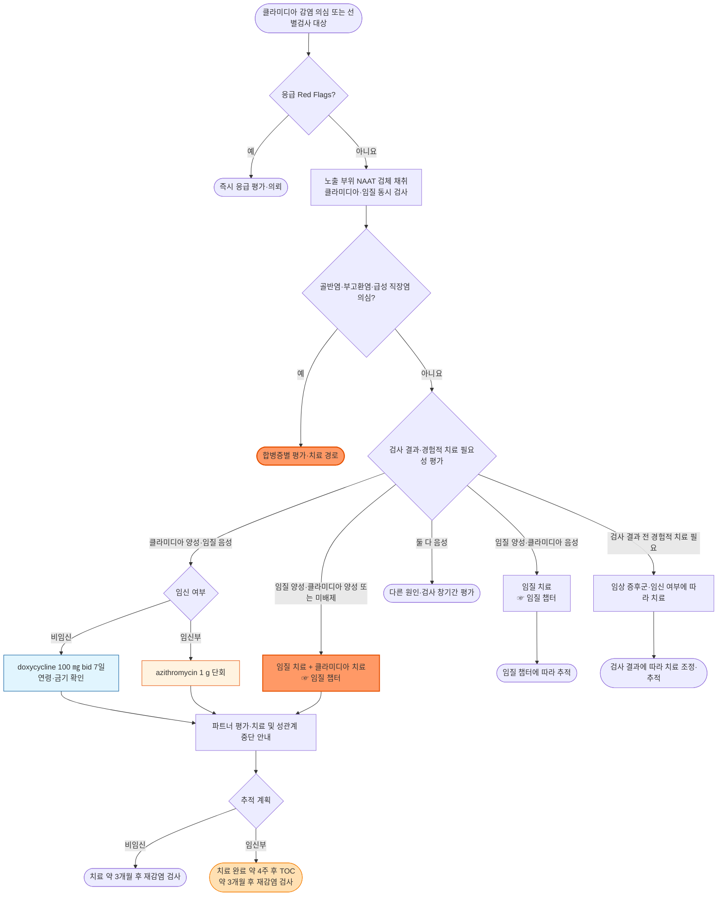

# 클라미디아감염증 Chlamydia Infection

## <mark style="color:green;">일반 사항</mark>

* 세포 내 기생 세균인 _Chlamydia trachomatis_(혈청형 D\~K)에 의한 비뇨생식기(요도염·자궁경부염)·직장·인두 감염; 성매개 세균 감염증이며 무증상 감염이 매우 흔함
* 법정감염병 : 4급 감염병 (표본감시) (☞ [성매개감염병](115_-1.STI.md))
* 역학 : 국내 표본감시 자료만으로 정확한 발생률 산출은 제한적임. 클라미디아는 비임균성 요도염(NGU)의 주요 원인이고 젊은 성 활동 여성에서 흔하며, 국내외 신고에서 높은 비중을 차지함
* 합병증 : 골반염(PID), 난관인자 불임, 자궁외임신, 만성 골반통, 부고환염·부고환고환염, Fitz-Hugh-Curtis 증후군(간주위염), 반응성 관절염, 신생아 결막염·폐렴(분만 중 수직감염)

## <mark style="color:green;">원인 및 위험 인자</mark>

* 원인균 : _Chlamydia trachomatis_ (혈청형 D\~K)
  * 혈청형 L1\~L3에 의한 성병림프육아종(lymphogranuloma venereum, LGV)은 별도 임상 질환으로 취급
* 전파 : 질·항문·구강 성교; 분만 시 산모에서 신생아로 수직감염
* 잠복기 : 증상이 생기는 경우 보통 1\~3주; 국내 2023 지침은 보통 2\~3주, 최대 6주까지 제시. 무증상 감염이 많으므로 증상 발생 시점이나 양성검사만으로 감염 시기·전파자를 특정할 수 없음

#### <mark style="color:$primary;">위험 인자</mark>

* 25세 미만 성 활동 여성
* 다수 성 파트너 또는 새 파트너
* 콘돔 미사용
* 성매개질환 기왕력
* 남성 동성 간 성접촉(직장감염 위험)

## <mark style="color:green;">임상 양상</mark>

* 여성 : 대부분 무증상(국내 2023 지침 약 70\~80%; 대상군에 따라 차이); 증상 시 점액농성 자궁경부염, 성교 후 출혈, 비정상 질출혈, 배뇨통
* 남성 : 요도염(투명\~점액성 분비물, 배뇨통); 약 50%는 무증상
* 직장 감염 : 대개 무증상이지만 직장통·분비물·출혈을 동반한 직장염 가능; 여성에서는 항문성교력이 없어도 비뇨생식기 감염과 함께 발견될 수 있음
  * 심한 직장통·혈성 분비물·후중감(tenesmus) 또는 궤양을 동반한 직장염, 혹은 심한 서혜부 림프절병증 시 → LGV(혈청형 L1\~L3) 고려(특히 MSM); 두 양상이 반드시 함께 나타나지는 않음
* 인두 감염 : 대개 무증상
* 결막염 : 감염된 생식기 분비물의 직접 접촉 또는 자가접종으로 발생; 지속되는 편측 여포결막염·점액농성 분비물에서 의심. 결막 검체 NAAT와 생식기 동반 감염 평가를 고려
* 신생아 결막염(생후 5\~12일), 폐렴(생후 1\~3개월) : 산모 감염에서 분만 중 수직감염; 신생아 예방적 erythromycin 안연고는 임균성 결막염 예방 목적이며 클라미디아 결막염을 예방하지 못함

### <mark style="color:$danger;">🚩 Red Flags!</mark>

<mark style="color:$danger;">**즉각 조치**</mark>

* 심한 골반·하복부 통증, 복막자극징후 또는 전신상태 악화 → 골반염(PID), 난관-난소농양 등 응급 평가; 발열이 없어도 골반염 가능  `$danger`
* 임신 가능성 또는 임신 반응 양성 + 복통·질출혈·실신 중 하나 → 자궁외임신 배제  `$danger`
* 갑작스럽고 심한 편측 음낭·고환 통증 → 고환염전 우선 배제; 클라미디아 양성이어도 응급 비뇨의학과 평가를 지연하지 않음  `$danger`
* 시력 저하·심한 안구 통증·각막혼탁 또는 다량의 화농성 눈 분비물 → 각막염·임균성 결막염 등 응급 안과 평가  `$danger`
* 영아의 무호흡·청색증·호흡곤란·수유 불량 → 즉시 응급 평가  `$danger`

<mark style="color:$warning;">**당일~수일 내 평가**</mark>

* 골반·하복부 통증과 자궁경부 움직임 압통·자궁 압통·부속기 압통 중 하나 → 골반염 평가(**당일**); 발열은 필수 조건이 아님  `$warning`
* 상복부, 특히 우상복부 통증과 골반염 의심 소견 → Fitz-Hugh-Curtis 증후군 평가(**당일**)  `$warning`
* 생후 수 주 영아의 결막염 또는 1\~3개월 영아의 폐렴 → 산모 감염력이 확인되지 않아도 소아과 평가(**당일**)  `$warning`
* 새로 발생한 관절염, 특히 최근 요도염·자궁경부염·결막염 병력 → 반응성 관절염 평가; 세 증상이 모두 필요한 것은 아님. 급성 단관절의 심한 통증·열감·발열이 있으면 패혈성 관절염 배제를 위해 **당일** 평가  `$warning`
* 점진적으로 발생한 편측 음낭 통증·종창 → 부고환염 평가(**당일**); 단순 요도염 7일 요법과 구분  `$warning`
* 임신부에서 확진 → 치료를 지연하지 말고 산전 진료와 연계(**당일**)  `$warning`
* 혈성 분비물·후중감·궤양을 동반한 직장염 또는 심한 서혜부 림프절병증(특히 MSM) → LGV 평가 및 경험적 치료 고려(**당일**)  `$warning`
* 표준 치료 후 증상 지속·재발 → 재노출, 복약, 골반염·부고환염 및 다른 원인 평가  `$warning`

<mark style="color:$info;">**조기 평가 및 추적**</mark>

* 임신부 : 치료 완료 약 4주 후 NAAT 완치판정검사, 치료 약 3개월 후 재감염 검사  `$info`
* 비임신 환자 : 치료 약 3개월 후 재감염 검사(완치판정검사와 구분)  `$info`

## <mark style="color:green;">진단</mark>

* NAAT(핵산증폭검사)가 표준; 해당 검체 부위에 검증된 검사법 사용
  * 검체 채취 방법 : 남성 - 첫 소변(first-catch urine) 또는 요도 면봉; 여성 - 질 면봉(자가 채취 포함, 민감도 우수). 소변 NAAT는 요배양용 중간뇨와 구분하며 채취 전 배뇨 간격·양은 검사법 지침 적용
* 직장 노출 또는 직장염 증상이 있으면 직장 검체 NAAT를 고려; 여성의 직장 감염은 항문성교력이 없어도 동반될 수 있음. 소변 검사만으로 직장 감염은 배제되지 않음
* 무증상 인두 클라미디아의 일상 선별검사는 권고되지 않음. 인두 임질 검사에서 클라미디아가 함께 검출되면 치료하고, 인두 증상이 있으면 임상 상황과 사용 가능한 검사를 고려
* 증상·확진 파트너 노출이 있으면 첫 방문에 검사. 마지막 노출 후 2주 이내의 음성 NAAT는 초기 감염을 배제하지 못하므로, 치료하지 않고 경과를 보는 경우 노출 약 2주 후 재검사를 계획(BASHH 2026, 전문가 의견). 이는 치료 후 완치판정검사 시점과 다름
* 임질 동시 검사 권고 - 공동감염이 흔함
* HIV·매독 동시 검사 권고; 초기 노출 창기간이면 적절한 시점에 재검사. HIV 음성인 직장 클라미디아 감염 MSM 등에서는 HIV PrEP 상담·연계도 고려
* 혈청 항체검사로 단순 생식기 클라미디아의 현재 감염·완치를 판단하지 않음. 음성 소변 NAAT만으로 골반염 등 상부 생식기 감염을 배제하지 않음
* 선별검사 대상(CDC 기준; 국내 국가검진 사업 대상·급여기준을 뜻하지 않음) : 25세 미만 성 활동 여성(매년), 25세 이상 위험 요인이 있는 여성 등; 첫 산전 방문에서는 25세 미만 전원과 25세 이상 위험군을 선별하고 이 대상은 임신 3분기에 재검사
* 성 활동 MSM은 노출 부위의 연 1회 검사를 기본으로 고려하고, 고위험군은 위험도에 따라 3\~6개월 간격 검사. 무증상 인두 클라미디아만을 정기 검사하지 않음
* IUSTI 2025는 무증상 일반 인구에 대한 광범위 선별검사의 집단 수준 효과와 불임 예방 근거가 제한적임을 강조함. 이를 유증상자·확진자의 파트너에 대한 검사·치료 생략 근거로 해석하지 않음

### <mark style="color:orange;">감별</mark>

* 요도염·자궁경부염을 일으키는 다른 원인과의 감별

<table><thead><tr><th>핵심 소견</th><th>시사 질환</th><th>구분 포인트</th></tr></thead><tbody>
<tr><td>화농성 요도 분비물, 남성 요도 도말에서 세포내 그람음성 쌍구균</td><td>임질</td><td>임질 NAAT; 임상 양상만으로 구분하지 않으며 공동감염 가능</td></tr>
<tr><td>표준 치료 후 지속·재발하는 요도염·자궁경부염</td><td><em>M. genitalium</em></td><td>객관적 염증과 재노출·복약 상황 확인 후 NAAT 및 가능하면 내성검사; azithromycin 1 g 단회를 반복하지 않음</td></tr>
<tr><td>거품성·악취 질분비물 또는 이성애 남성의 지속성 요도염</td><td>트리코모나스증</td><td>NAAT 우선 고려; 습식도말 음성으로 배제할 수 없음</td></tr>
<tr><td>외음부 궤양·요도구염·심한 배뇨통 또는 결막염을 동반한 요도염</td><td>HSV·아데노바이러스 등</td><td>노출력·병변에 맞추어 검사. 생식기 궤양은 매독도 검사하며, 매독 병변이 반드시 무통성 단일 궤양인 것은 아님</td></tr>
<tr><td>혈성 분비물·후중감·궤양성 직장염 또는 심한 서혜부 림프절병증</td><td>LGV, 혈청형 L1\~L3</td><td>일반 클라미디아 NAAT로 LGV를 구분할 수 없음; 유전자형 검사 가능 기관과 협의하되 경험적 치료를 지연하지 않음</td></tr>
<tr><td>빈뇨·절박뇨, STI 검사가 음성인 지속성 증상</td><td>요로감염·질염·비감염성 자극 등</td><td>요검사·요배양 및 질염 평가; 염증 증거 없이 항생제만 반복하지 않음</td></tr>
</tbody></table>

***



<p align="center"><strong>진단 및 치료 알고리듬</strong></p>

<p align="center"><em><mark style="color:$info;">Ref. 질병관리청·대한요로생식기감염학회, 성매개감염 진료지침 2023; CDC Sexually Transmitted Infections Treatment Guidelines, 2021; 2025 European Guideline on the Management of Chlamydia trachomatis Infections (IUSTI)</mark></em></p>

***

## <mark style="background-color:$warning;">Management</mark>

* 단순 감염의 권고 1차 치료제 : 금기가 없는 비임신 성인·청소년은 doxycycline 100 ㎎ bid 7일. 특히 직장 감염에서 azithromycin 1 g 단회보다 치료 성공률이 높아 우선 권고됨; azithromycin은 순응도가 우려되는 비임신 환자의 대안 또는 임신부의 1차 치료제(국내·CDC 기준); BASHH의 azithromycin 대안 용법은 아래 별도 설명 <mark style="color:$info;">[국내 2023; CDC 2021; IUSTI 2025; BASHH 2026]</mark>
* 골반염·부고환염·급성 직장염·LGV 등 별도 증후군은 해당 지침 적용. 예를 들어 성매개 부고환염의 CDC 요법은 ceftriaxone + doxycycline 10일, 골반염은 14일 병합요법으로 단순 감염 7일 단독요법과 다름
* 확진자는 증상 유무와 관계없이 신속히 치료. 결과 전 경험적 치료는 객관적 요도염·고위험 자궁경부염, 추적 곤란, 확진자의 파트너 등에 적용하고 임질 포함 여부를 판단; 검사·추적이 가능한 저위험 환자는 결과를 기다려 표적 치료할 수 있음
* HIV 감염 자체만으로 단순 클라미디아의 약제·기간을 변경하지 않음

<table><thead><tr><th width="213.33331298828125">대상</th><th width="225.71435546875">1차 치료</th><th>대안·주의</th></tr></thead><tbody><tr><td>비임신 성인·청소년의 단순 감염(금기 확인)</td><td>doxycycline 100 ㎎ bid 7일</td><td>azithromycin 1 g 단회(doxycycline 금기·불내약 또는 7일 요법 순응도가 크게 우려될 때); 직장 감염에 대한 치료 효과가 낮을 수 있음</td></tr><tr><td>임신부의 단순 감염</td><td>azithromycin 1 g 단회</td><td>amoxicillin 500 ㎎ tid 7일(국내 확인 품목에서 해당 적응증 허가 외)</td></tr><tr><td>임질 양성이고 클라미디아가 확인되었거나 배제되지 않은 경우</td><td>임질 치료 + 해당 클라미디아 치료</td><td>클라미디아 음성 확인 시 임질 치료만 시행. ☞ <a href="115_-2.gonorrhea.md">임질</a></td></tr></tbody></table>

## <mark style="color:green;">비-약물 치료 및 예방</mark>

* 성관계 금지 기간(본 장은 CDC 기준 적용, 구강·질·항문 성교 포함) : doxycycline 7일 요법은 치료를 모두 마칠 때까지, azithromycin 단회 요법은 복용 후 7일까지, 그리고 모든 파트너의 치료가 완료되고 증상이 소실될 때까지 성관계를 피함. 임질 동시 감염에서는 임질 치료 후 최소 7일 경과 조건도 충족해야 함
* **국내 2023 파트너 범위** : 유증상 환자는 증상 발현 전 8주 이내, 무증상 환자는 진단 전 6개월 이내 파트너를 평가·검사하고 증상 유무와 관계없이 추정 치료. **CDC 기준**은 증상 시작 또는 진단 전 60일 이내 및 그 기간에 접촉이 없으면 가장 최근 파트너로 차이가 있음. 본 챕터의 국내 진료에서는 국내 기간을 우선 안내하고 파트너의 직접 진료를 연계 <mark style="color:$info;">[국내 2023; CDC 2021]</mark>
* 콘돔 사용으로 재감염 위험 감소
* 치료 약 3개월 후 재검사 권고(재감염 확인 목적); 그 시점에 불가능하면 치료 후 12개월 이내 다음 진료 기회에 시행. BASHH 2026은 25세 미만에서 치료 후 2\~6개월 재검을 권고하므로 본 장의 3개월 계획과 양립함. 비임신 환자는 완치판정검사를 통상 시행하지 않지만, 복약 불확실·증상 지속·재감염 의심 또는 직장 감염에 azithromycin을 사용한 경우에는 TOC를 고려. 국내 2023은 NAAT를 치료 완료 최소 3주 후로 제시하나, 본 챕터는 CDC·IUSTI에 따라 **약 4주 후**를 적용하여 잔존 핵산 위양성을 줄임 <mark style="color:$info;">[국내 2023; CDC 2021; IUSTI 2025; BASHH 2026]</mark>

✽ **지침 간 차이** : IUSTI 2025의 성접촉 중단 권고는 본인과 파트너가 치료를 완료하고 증상이 소실된 뒤 추가 7일로 더 보수적임. 파트너는 검사하고 양성 또는 검사 창기간 노출 시 치료하는 접근을 제시하며, 국내·CDC의 추정 치료와 다름. 연락 기간도 유증상 남성은 증상 시작 이후와 그 전 4주, 그 외에는 진료 전 6개월로 출처별 차이가 있음 <mark style="color:$info;">[IUSTI 2025]</mark>


**Doxy-PEP(노출 후 예방요법)** - 모든 환자에게 적용하는 예방요법은 아님. CDC 2024는 최근 12개월 내 세균성 STI가 있었던 MSM 및 트랜스젠더 여성에서 상담과 공유 의사결정을 권고함. 해당 대상에서 성접촉 후 72시간 이내 doxycycline 200 ㎎을 사용하며 24시간에 200 ㎎을 초과하지 않음 (☞ [성매개감염병](115_-1.STI.md))


## <mark style="color:green;">약물 치료</mark>

* Doxy-PEP를 사용했더라도 클라미디아가 확인되면 표준 치료를 모두 시행함. 비임신 단순 감염에서는 doxycycline 100 ㎎ bid 7일이며, PEP 200 ㎎을 반복하는 것으로 치료를 대신하지 않음 <mark style="color:$info;">[BASHH 2026]</mark>
* 성인 클라미디아 결막염도 전신 경구 치료와 파트너 관리가 필요하며 점안제만으로 치료하지 않음. 영아 결막염·폐렴은 성인 처방을 적용하지 말고 소아과에서 평가·치료 <mark style="color:$info;">[IUSTI 2025; BASHH 2026]</mark>


**Doxycycline 국내 허가상 금기** : 임부·수유부, 12세 미만(테트라사이클린 계열의 전통적 8세 기준과 구분), 신부전, 중증 간기능 이상, 테트라사이클린 과민반응, 레티노이드(이소트레티노인 등) 병용, 중증 근육무력증. 국내 독시정·독시메디정 품목정보를 대조하였음. 국제 자료의 신기능 조정 불필요 설명으로 국내 신부전 금기를 무시하지 않음. 12세 미만의 중증 감염 예외는 일반 클라미디아 치료에 적용하지 않음. 12세 이상이라도 체중 45 ㎏ 이하이면 성인 고정용량을 일률 적용하지 않고 소아 전문 진료와 연계.


**1차 선택제**

* doxycycline : 100 ㎎ bid 7일 <mark style="color:blue;">\[독시정 등]</mark>; 금기가 없는 비임신 성인·청소년의 단순 비뇨생식기·직장·인두 감염에 1차로 권고됨. 이 7일 용법은 성매개감염 지침 용법이며 국내 품목의 일반 유지용량(100 ㎎/day)과 구분. azithromycin 대비 우월성은 특히 직장 감염에서 분명함

**대안 및 임신부**

* azithromycin <mark style="color:blue;">\[지스로맥스]</mark>: 1 g 단회; 임신부 1차, 또는 doxycycline 금기·불내약·순응도 문제가 있는 비임신 환자의 대안(직접 복용 확인 가능 시)
* amoxicillin : 500 ㎎ tid 7일; 임신부에서 azithromycin 사용이 어려운 경우 대안. 국내 확인 품목의 유효균종에 클라미디아가 포함되지 않아 **해당 적응증 허가 외 사용**이며 지침 근거·이유 설명 필요; 페니실린 알레르기 확인, 신기능 저하 시 용법 조정
* levofloxacin : 500 ㎎ qd 7일은 국내 2023·CDC의 비임신 성인 대안. 우선 약제를 쓸 수 없을 때 제한적으로 고려; 신기능에 따른 감량, 건병증·말초신경병증 등 중대한 이상반응에 주의하며 임부·수유부·소아에는 적용하지 않음
* 국내 2023에는 minocycline 100 ㎎ bid 7일도 권장 요법으로 병기되어 있으나, 본 장은 최신 국제지침의 근거에 따라 doxycycline을 우선 제시함
* azithromycin 주의 : 마크로라이드 과민반응·에르고트 병용 금기. QT 연장, 저칼륨·저마그네슘혈증, 서맥 및 QT 연장 약물 병용을 확인하고, 중증 간장애·GFR ＜10 mL/min에서는 신중히 사용. 지스로맥스정의 국내 허가 용법은 단순 생식기 감염에 1 g 단회이며 임신 중에는 치료상 유익성을 평가하여 투여
* 신생아·영아 : 결막염·폐렴은 전신 항생제 치료가 필요; 점안제만으로 치료하지 않음. 생후 6주 미만에서 macrolide 투여 시 비대성 유문협착증 관련 구토·수유 곤란을 관찰하고 치료 반응을 추적. 감염 산모에게서 태어났다는 이유만으로 무증상 신생아에게 일률적 예방 항생제를 투여하지 않고 증상 감시·소아과 연계


**Azithromycin 대안 요법의 지침 차이** : 국내 2023·CDC 2021은 1 g 단회를 제시하나, BASHH 2026은 doxycycline을 사용할 수 없는 경우 첫날 1 g + 이후 500 ㎎ qd ×2일을 선호하며, 1 g 단회는 _M. genitalium_ 동반 감염이 배제된 경우의 선택지로 제한함. 이 3일 총 2 g 요법은 국내 클라미디아 허가 용법과 다르며 **허가 외 용법**임. 연장요법의 우월성을 입증한 직접 비교시험이 없고 전문가 의견에 따른 권고이며, 임신부의 국내 1차 요법을 자동 변경하지 않음. _M. genitalium_ 또는 원인 미상 NGU가 의심되면 [요도염](115_-urethritis.md) 챕터의 검사·내성 기반 경로 적용 <mark style="color:$info;">[BASHH 2026]</mark>


## <mark style="color:green;">시술 및 기타 처치</mark>

* 단순 클라미디아 감염에는 시술이 필요하지 않음. LGV의 화농성 가래톳·농양은 전문기관에서 흡인·배액을 고려하며, 임신부·수유부 LGV는 약제 선택을 전문의와 협의

## <mark style="color:purple;">처방례</mark>

> **처방례 1. 비임신 성인 표준 치료**
>
> ```
> doxycycline 100 ㎎ 제제  1회 100 ㎎ bid  7일간
> ```
>
> _✽ 금기가 없는 비임신 성인 기준. 신부전·수유·연령·병용약 확인. 충분한 물과 함께 복용하고 복용 후 최소 30분간 눕지 않도록 안내(식도 자극 예방). 속이 불편하면 음식과 함께 복용할 수 있음; 특히 직장 감염에서 azithromycin보다 치료 성공률이 높음._

> **처방례 2.** **임신부**
>
> ```
> 지스로맥스 250 ㎎/T  4T(총 1 g)  1회 경구
> ```
>
> _✽ 국내 지침은 임신 중 azithromycin 단회요법을 1차로 권고하며 국내 doxycycline 품목은 임부 금기임. CDC의 2·3분기 금기 문구를 근거로 임신 1분기에 일상 처방하지 않음. 치료 완료 약 4주 후 NAAT 완치판정검사 및 약 3개월 후 재검사를 계획._

> **처방례 3. 임질 확인·의심 + 클라미디아 확인 또는 아직 배제되지 않은 비임신 성인**
>
> ```
> 트리악손 주 500 ㎎  IM 또는 IV 1회 (체중 ＜100 ㎏)
> 체중 ≥100 ㎏이면 트리악손 주 1 g  IV 1회
> doxycycline 100 ㎎ 제제  1회 100 ㎎ bid  7일간
> ```
>
> _✽국내 학회 지침 해설 논문의 100 ㎏ 증량 기준을 적용하며 CDC의 150 ㎏ 기준과 구분(☞ [임질](115_-2.gonorrhea.md)). IM용 lidocaine 조제액은 IV 투여 금지. 클라미디아 음성이 확인되면 doxycycline을 추가하지 않음. 임신부는 같은 체중별 ceftriaxone 요법 + azithromycin 1 g 단회 경구를 사용. 골반염·부고환염·급성 직장염 의심 시 해당 증후군의 치료 지침을 적용._

> **처방례 4. 치료 순응도가 우려되는 경우(추적 어려운 환자)**
>
> ```
> 지스로맥스 250 ㎎/T  4T(총 1 g)  1회 경구, 진료실 내 직접 복용 확인(DOT)
> ```
>
> _✽ 7일 요법 완주가 어려울 것으로 예상되는 환자에서 단회 요법으로 순응도 확보; 직장 감염이 있거나 배제되지 않은 경우 doxycycline 대비 치료 실패 위험을 설명하고 치료 후 증상·재노출·복약 상황 확인 및 치료 완료 약 4주 후 NAAT TOC를 고려._

> **처방례 5. 증상성 LGV 의심 또는 확인(비임신 성인, 금기 없음)**
>
> ```
> doxycycline 100 ㎎ 제제  1회 100 ㎎ bid  21일간
> ```
>
> _✽ 증상성 LGV의 표준은 21일 요법(CDC 2021). 무증상 감염이나 무증상 파트너의 기간까지 자동으로 21일로 연장하지 않고 전문의와 결정; 혈성 분비물·후중감·궤양을 동반한 직장염 또는 심한 서혜부 림프절병증 등 LGV가 임상적으로 의심되면 유전자형 검사 결과를 기다리느라 치료를 지연하지 않음. 성매개감염 전문 진료기관 협진 권장._

***

### <mark style="color:red;">질병코드</mark>

<table><thead><tr><th>KCD-9</th><th>공식 명칭</th><th>적용 예·주의</th></tr></thead><tbody>
<tr><td>A56.0</td><td>하부비뇨생식관의 클라미디아감염</td><td>요도염·자궁경부염·방광염·외음질염</td></tr>
<tr><td>A56.1</td><td>골반복막 및 기타 비뇨생식기관의 클라미디아감염</td><td>골반염·부고환염·고환염</td></tr>
<tr><td>A56.2</td><td>상세불명의 비뇨생식관의 클라미디아감염</td><td>감염 부위를 특정하지 못한 경우</td></tr>
<tr><td>A56.3</td><td>항문 및 직장의 클라미디아감염</td><td>LGV는 A55와 구분</td></tr>
<tr><td>A56.4</td><td>인두의 클라미디아감염</td><td>인두 감염</td></tr>
<tr><td>A56.8</td><td>기타 부위의 성행위로 전파되는 클라미디아감염</td><td>별도 분류된 결막염·신생아 감염을 일률적으로 포함하지 않음</td></tr>
<tr><td>A55</td><td>클라미디아림프육아종(성병성)</td><td>LGV</td></tr>
<tr><td>A74.0</td><td>클라미디아결막염(H13.1*)</td><td>신생아 결막염은 P39.1로 별도 분류</td></tr>
<tr><td>P39.1</td><td>신생아 결막염 및 누낭염</td><td>신생아클라미디아결막염 포함</td></tr>
</tbody></table>

✽ 제공된 KCD-9 「상병분류기호(완전코드)」와 대조. 표의 A56.0·A56.1 등은 완전코드이며 임의로 미국 ICD-10-CM 세부코드를 붙이지 않음. 별표(*) 코드는 발현 분류 표기이므로 단독 원인코드로 사용하지 않음.

***

### <mark style="color:$success;">핵심 복약 지도</mark>

> **독시사이클린 복용 안내**
>
> 1. 충분한 물(최소 한 컵)과 함께 복용하십시오. 속이 불편하면 음식과 함께 복용할 수 있습니다.
> 2. 복용 후 최소 30분간 눕지 마십시오 - 식도 자극·궤양 예방. 취침 직전에는 복용하지 마십시오.
> 3. 복용 기간 중 강한 직사광선 노출을 피하고 자외선 차단제를 사용하십시오(광과민 반응 가능).
> 4. 제산제·철분제·칼슘/마그네슘 영양제·아연 함유 종합비타민은 2시간 이상 간격을 두십시오. 유제품과의 간격은 복용 제품의 안내를 따르십시오.
> 5. 심한 두통·시야 변화, 심한 발진·호흡곤란 또는 심한 지속성 설사가 생기면 즉시 진료받으십시오.

> **공통 안내**
>
> * 증상이 좋아져도 처방된 기간까지 약을 모두 복용하십시오.
> * 7일 요법은 치료를 모두 마칠 때까지, 단회요법은 복용 후 7일까지 성관계를 피하십시오. 파트너도 치료를 마치고 증상이 있다면 소실될 때까지 피해야 합니다.
> * 국내 지침에 따라 증상이 있었다면 증상 시작 전 8주, 무증상이었다면 진단 전 6개월 내 성 파트너가 증상이 없어도 검사·치료받도록 안내하십시오. CDC의 60일 기준과 기간이 다릅니다.
> * 치료 후 약 3개월에 재검사를 권장합니다(완치 확인과 별개로 재감염을 확인하는 검사).
> * 임신부는 치료 완료 약 4주 후 완치판정검사도 받아야 합니다.

> **언제 다시 병원을 방문해야 하나요?**
>
> * 새로 심한 아랫배 통증, 복막자극 증상, 심한 음낭 통증 또는 전신상태 악화가 생기면 즉시 진료받으십시오.
> * 치료 후에도 증상이 지속되거나 다시 나타나면 조기에 재평가받으십시오(재노출·복약 불이행·골반염·부고환염 및 다른 원인 감별).
> * 임신 중이거나 임신 계획·수유 중이면 처방 전 알리십시오. 신장·간질환과 여드름 치료제(이소트레티노인 등) 복용도 알리십시오.
> * 파트너가 아직 치료받지 못했다면 성관계를 피하고 파트너가 직접 진료·치료받도록 안내하십시오.

***

## <mark style="color:green;">주요 참고문헌 및 확인 자료</mark>

### ＜임상 근거＞

* 질병관리청·대한요로생식기감염학회. [성매개감염 진료지침 2023](https://stiguide.kr/wp-content/uploads/2023/04/Korean_STI_Guidelines_2023.pdf).

* CDC. [Chlamydial Infections](https://www.cdc.gov/std/treatment-guidelines/chlamydia.htm). STI Treatment Guidelines 2021.

* White JA, et al. [2025 European guideline on Chlamydia trachomatis infections](https://iusti.org/wp-content/uploads/2025/03/white-et-al-2025-2025-european-guideline-on-the-management-of-chlamydia-trachomatis-infections.pdf). doi:10.1177/09564624251323678.

* BASHH. [National guideline for Chlamydia trachomatis, 2026](https://www.bashh.org/_userfiles/pages/files/national_guideline_for_the_management_of_infection_chlamydia_trachomatis_2026.pdf).

* Yang HJ, et al. [국내 임질 지침 해설](https://pmc.ncbi.nlm.nih.gov/articles/PMC10789534/). Investig Clin Urol. 2024;65:1–8.

* CDC. [요도염·자궁경부염](https://www.cdc.gov/std/treatment-guidelines/urethritis-and-cervicitis.htm), [부고환염](https://www.cdc.gov/std/treatment-guidelines/epididymitis.htm), [LGV](https://www.cdc.gov/std/treatment-guidelines/lgv.htm), [골반염](https://www.cdc.gov/std/treatment-guidelines/pid.htm), [트리코모나스증](https://www.cdc.gov/std/treatment-guidelines/trichomoniasis.htm). STI Treatment Guidelines 2021.

* CDC. [Doxy-PEP 임상지침 2024](https://www.cdc.gov/mmwr/volumes/73/rr/rr7302a1.htm).

### ＜허가·급여 확인 자료＞

* 식품의약품안전처. 의약품안전나라 — 독시정·독시메디정, 지스로맥스정250밀리그람, 휴온스아목시실린캡슐500mg의 적응증·용법·금기 대조(2026-10-27 확인). 급여 인정과 개별 공급 여부는 별도 사항.
  [https://nedrug.mfds.go.kr/index](https://nedrug.mfds.go.kr/index)

* 제공 자료: KCD9_251216(1).xlsx. 「상병분류기호(완전코드)」의 A55, A56.0\~A56.8, A74.0, P39.1 및 포함 용어 대조.

***

### <mark style="color:blue;">환자 안내서</mark>


**클라미디아감염증, 증상이 없어도 치료가 필요합니다**

클라미디아는 흔한 성매개 세균 감염 중 하나이며, 특히 여성의 상당수는 아무 증상이 없습니다. 증상이 없다고 해서 안전한 것은 아니며, 방치하면 골반염이나 불임 같은 합병증으로 이어질 수 있습니다.


#### <mark style="color:$primary;">왜 클라미디아에 걸리나요?</mark>

* 클라미디아균이 성 접촉(질·항문·구강)을 통해 전파됩니다.
* 감염되어도 증상이 없는 경우가 많아, 본인도 모르게 다른 사람에게 옮길 수 있습니다.
* 항문성교를 했거나 직장 증상이 있다면 직장 검사가 필요한지 상담하십시오. 소변 검사만으로 직장 감염을 확인할 수 없습니다. 목의 클라미디아는 증상이 없을 때 일률적으로 검사하지 않으며, 검사 필요성은 진료 상황에 따라 판단합니다.

#### <mark style="color:$primary;">일상생활에서 어떻게 관리하나요?</mark>

* **7일 복용 약은 복용을 마칠 때까지, 단회 복용 약은 복용 후 7일간 성관계를 피하십시오. 파트너의 치료가 끝나고 증상도 없어져야 합니다.**
* 치료를 받았더라도 이전 성 파트너가 치료받지 않으면 다시 감염될 수 있습니다. 최근 성 파트너도 함께 검사·치료를 받아야 재감염을 막을 수 있습니다.
* 치료 후 3개월 뒤 다시 검사받는 것이 좋습니다(재감염을 확인하는 검사이며, 치료가 잘 되었어도 다시 감염될 수 있기 때문입니다).

#### <mark style="color:$primary;">약은 어떻게 써야 하나요?</mark>

* 처방된 항생제는 증상이 없어져도 끝까지 복용하십시오.
* 독시사이클린은 충분한 물과 함께 복용하고, 복용 후 최소 30분간 눕지 마십시오. 속이 불편하면 음식과 함께 복용할 수 있습니다. 취침 직전에는 복용하지 마십시오.

* 임신 가능성·수유 여부, 신장·간질환, 함께 복용하는 약을 처방 전에 알리십시오. 단회 복용 후 곧 토했다면 임의로 다시 복용하지 말고 병원에 문의하십시오.

#### <mark style="color:$primary;">이럴 때는 즉시 병원을 방문하세요</mark>

* 심한 아랫배 통증, 어지럼·실신, 심한 음낭 통증 또는 전신상태 악화가 생기는 경우(열이 없어도 해당)
* 임신 가능성이 있거나 임신 중인데 아랫배 통증·질출혈이 생기는 경우

치료 후에도 증상이 좋아지지 않거나 다시 나타나면 조기에 진료받으십시오. 임신 중 확진되었다면 치료 완료 약 4주 후 완치 여부를 확인하고 약 3개월 후 재검사를 받으십시오.

***
