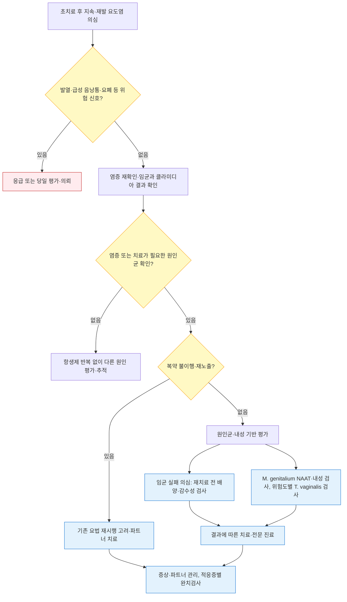

# 요도염 Urethritis

## <mark style="color:green;">일반 사항</mark>

* 요도의 감염성(더 흔함) 또는 비-감염성 염증
* 잠복기는 병원체마다 다름. 임균은 대개 수일 내, 클라미디아는 흔히 1\~3주 후 증상이 나타나지만 무증상 감염도 흔하므로 증상 발생 시점만으로 감염 시기나 원인균을 단정하지 않음
* 비감염성 염증은 자극물·외상·기구 조작 등과 관련될 수 있으며 일정한 잠복기로 정의하지 않음
* 아래 객관적 염증 기준과 NGU 치료 경로는 주로 성인 남성에 적용. 여성의 배뇨통은 방광염·질염·자궁경부염·골반염을 함께 평가
* 분류 : 임균성 요도염(gonococcal urethritis, GU), 비임균성 요도염(nongonococcal urethritis, NGU)

#### <mark style="color:$primary;">Chlamydia 감염</mark>

* 흔한 세균성 STI(성매개감염)
* 전염 경로 : 성관계, 질식 분만 수직 감염
* 대부분 무증상(특히 여성에서)으로, 진단되지 않은 상태로 전파될 수 있음
* 감염 빈도는 지역·연령·대상집단에 따라 다르며 젊은 연령에서 높음
* 유발 질환 : \[여성] 자궁경부염, 자궁내막염, PID → 자궁외임신, 불임, 만성골반통; \[남성] 부고환염, 전립선염·반응성 관절염; \[신생아] 결막염, 폐렴

#### <mark style="color:$primary;">여성 요도증후군 (Female urethral syndrome)</mark>

* 빈뇨·배뇨통 등의 증상을 묶어 부르는 용어로 정의가 일정하지 않음. 통상적인 요배양 음성만으로 비감염성으로 단정하지 말고, STI·저균수 세균뇨·질염·폐경 관련 비뇨생식기증후군 등을 평가. 급성 방광염과 동의어가 아님
* 원인 : 불명
  * 폐경 후 에스트로겐 감소, Skene gland dysfunction, pelvic floor dysfunction, 과민방광, 이전 UTI 병력, 환경 자극(예: 뒷물, 거품 목욕, 향이 강한 여성청결제) 등이 추정됨
* 기능적 요인이 의심되면 배뇨 일지, 요속 검사(uroflowmetry) 등 평가를 고려
* 종종 악화와 완화가 반복되어 비뇨기계 증상뿐 아니라 불안 등의 심리적 증상을 초래함

## <mark style="color:green;">원인</mark>

#### <mark style="color:$primary;">감염성</mark>

* 임균 : _N. gonorrhoeae_ (☞ [임질](115_-2.gonorrhea.md))
* 비임균 : _Chlamydia trachomatis_, _Mycoplasma genitalium_(특히 지속·재발 NGU), _Trichomonas vaginalis_(지역별 유병률 차이), HSV, adenovirus, 구강성교와 관련된 _Haemophilus_ spp.·_N. meningitidis_ 등; _U. urealyticum_ 검출만으로 원인균으로 단정하지 않으며 _U. parvum_의 병원성은 불확실
* 다중 PCR에서 _M. hominis_, _U. parvum_, _U. urealyticum_이 검출되었다는 이유만으로 일률적으로 치료하지 않음. 집락화와 실제 질환을 구분하고 임균·클라미디아·_M. genitalium_ 등 주요 원인을 먼저 평가

#### <mark style="color:$primary;">비-감염성</mark>

* 화학적 자극 : 비누, 샴푸, 질 세척, 살정자제
* 이물, 요도 기구

### <mark style="color:orange;">위험 인자</mark>

* 콘돔 없는 성관계, 다수의 성 파트너
* 성 매개 질환 병력
* 새로운 파트너, 25세 미만
* 남성과 성관계하는 남성(MSM); 성적 지향 자체보다 노출 부위·행동·파트너 감염력을 평가

## <mark style="color:green;">임상 양상</mark>

* 무증상 감염도 흔하나 비율은 병원체·검사 부위·대상집단에 따라 다름
* 증상 지속 기간만으로 방광염과 요도염을 구별하지 않음
* 빈뇨, 배뇨통(작열감)
* 요도 가려움·요도구 자극감. 외부 가려움·발적이 주된 경우 귀두염·외음부염 등도 감별
* 점액성\~농성 요도 분비물
* 드물게 혈뇨
* 여성에서는 질염·자궁경부염이 동반될 수 있음
* 심한 배뇨통·요도구 염증·생식기 궤양은 HSV, 배뇨통·요도구 염증과 결막염의 조합은 adenovirus를 시사할 수 있음

### 🚩Red Flags

**즉각 조치**

* 갑자기 발생한 심한 한쪽 음낭통 → 고환 염전 응급 평가; 고환의 높은 위치·고환거근반사 소실이 없어도 배제할 수 없음  <mark style="color:$danger;">[응급]</mark>
* 저혈압·의식 변화·전신 상태 악화를 동반한 발열, 오한, 옆구리 통증 → 패혈증·전신 요로감염 응급 평가  <mark style="color:$danger;">[응급]</mark>
* 배뇨 불능과 심한 하복부 팽만·통증 → 급성 요폐 즉시 평가  <mark style="color:$danger;">[응급]</mark>

**당일~수일 내 평가**

* 발열·오한·옆구리 통증 **(당일)** → 신우신염·급성 전립선염 등 평가  <mark style="color:$warning;">[당일 평가]</mark>
* 이동성 다발관절통·건초염·농포성 피부 병변 또는 급성 관절 종창 **(당일)** → 발열이 없어도 파종성 임균 감염 평가·의뢰  <mark style="color:$warning;">[당일 평가]</mark>
* 음낭통·압통·부종 **(당일)** → 부고환염 평가; 갑작스러운 심한 통증은 고환 염전부터 배제  <mark style="color:$warning;">[당일 평가]</mark>
* 여성의 하복부·골반통 **(당일)** → 골반염 평가; 임신 가능성이 있고 심한 통증·질출혈·실신이 동반되면 자궁외임신 응급 평가  <mark style="color:$warning;">[당일 평가]</mark>
* 임질 치료 후 재노출이 없는데 3\~5일 내 호전되지 않음 **(당일)** → 치료 실패·다른 원인 평가, 재치료 전 배양·감수성 검사  <mark style="color:$warning;">[당일 평가]</mark>
* 임신부의 STI 의심·확진 또는 임신한 파트너의 노출 → 약제 선택과 산과적 평가·파트너 치료를 신속히 계획  <mark style="color:$warning;">[신속 평가]</mark>
* 심한 배뇨장애·혈뇨 또는 협착·이물 의심 → 비뇨의학과 평가  <mark style="color:$warning;">[신속 평가]</mark>

**조기 평가 및 추적**

* 치료 완료 후 요도 분비물·배뇨통 지속 또는 재발 → 염증·원인균·복약·재노출 재평가  <mark style="color:$info;">[재평가]</mark>
* 파트너의 불완전한 치료 또는 재노출 → 파트너 진료·재감염 평가  <mark style="color:$info;">[추적]</mark>
* 반복적 요도염 또는 3개월 이상 지속되는 골반·회음부·사정 관련 통증 → 만성 골반통 증후군 등 평가  <mark style="color:$info;">[조기 의뢰]</mark>

## <mark style="color:green;">진단</mark>

### <mark style="color:orange;">진단 기준</mark>

* 다음의 객관적 염증 기준은 주로 **남성 요도염**에 적용하며 증상만으로 원인균을 구별할 수 없음
* 관찰되는 점액성·점액농성 또는 농성 요도 분비물
* 요도 분비물 그람염색의 다형핵백혈구(PMNL) : 고유병률 환경에서 ≥2 WBC/oil immersion field, 저유병률 환경에서 ≥5 WBC/oil immersion field; 세포내 그람음성 쌍구균이 보이면 임질 추정. 임균 NAAT 음성이면 _N. meningitidis_ 등도 배양으로 감별
* **초회뇨(first-void/first-catch urine)**의 leukocyte esterase(+) 또는 원심분리한 초회뇨 침사 WBC ≥10/HPF <mark style="color:$info;">[CDC 2021]</mark>. '아침에 처음 보는 소변'이라는 뜻은 아님. 음성 LE만으로 요도염을 배제하지 않음
* BASHH 2026은 초회뇨 LE 시험지를 NGU 진단검사로 더 이상 권고하지 않으며, 요도 도말/자동 요세포 분석과 NAAT를 활용함; CDC 2021의 LE 기준과 구분

### <mark style="color:orange;">추가 검사</mark>

* 남성의 초회뇨 또는 적절한 요도 검체로 **임균·클라미디아 NAAT**(PCR, TMA 등)를 우선 시행; 성접촉 부위에 따라 인두·직장 검체도 평가
* 여성은 **질 면봉 NAAT(자가 또는 의료진 채취)**를 우선 고려하며 자궁경부 면봉·초회뇨도 검사법에 따라 사용. 자궁경부염·골반염 징후와 임신 가능성을 함께 확인
* NAAT용 초회뇨는 배뇨 시작 부분을 채취하며, 채취량·채취 전 배뇨 제한 시간은 검사 키트 지침을 따름. 방광염·전립선염 의심으로 일반 요배양이 필요하면 **중간뇨**를 별도로 채취
* 임균 치료 실패 의심 시 해당 부위 **배양 및 항생제 감수성 검사**(NAAT만으로 감수성 확인 불가)
* BASHH 2026은 증상이 있는 NGU로 진단된 모든 남성에서 _M. genitalium_ NAAT를 권고함; CDC 2021은 지속·재발 NGU에서 우선 권고하므로 검사 가능성과 국내 진료 경로에 따라 적용
* 지속·재발 NGU에서는 염증·복약·재노출 확인 후 _M. genitalium_ NAAT와 가능한 내성 검사, 위험도에 따른 _T. vaginalis_ 검사; 심한 배뇨통·요도구 염증·궤양 등에서는 HSV NAAT 고려
* HIV·매독 검사, B형간염 면역·접종력 확인; HCV 등은 위험도에 따라 검사
* _M. genitalium_은 무증상 일반인의 일률적 선별검사나 비뇨생식기 이외 부위의 일률적 검사를 권하지 않음. 확진자의 현재 파트너 검사는 별도 적응증으로 평가
* 요도방광경검사 : 이물·협착 등 구조적 이상 의심 시 고려; 단순 요도염의 통상 검사로 시행하지 않음

### <mark style="color:orange;">STI 선별 검사 대상</mark>

* **요도염 진료 시** : 임균·클라미디아 NAAT와 HIV·매독 검사를 우선 고려; 노출 부위·파트너 감염·임신 가능성에 따라 검사 범위 조정
* **일반 선별검사(CDC 기준)** : HIV는 13\~64세 최소 1회, HCV는 18세 이상 최소 1회 권고; 지속 위험 노출 시 반복 평가
* 성적으로 활동하는 **25세 미만 여성**은 임균·클라미디아 연 1회, 25세 이상은 새로운·복수 파트너 등 위험 인자에 따라 선별. 자궁경부가 있는 사람에게 해당 부위의 선별 기준 적용
* MSM·HIV 감염인은 성접촉 부위별 임균·클라미디아·매독 등을 선별하고 지속 위험 노출·HIV PrEP 이용 시 3\~6개월 간격 고려. HAV·HBV 면역·접종력 확인 및 필요한 예방접종, 위험도에 따른 HCV 반복검사
* 임신부는 산전 지침에 따른 매독·HIV·B형간염 검사, 연령·위험도에 따른 임균·클라미디아 검사; 임신 중 클라미디아 확진 시 완치검사 계획

### <mark style="color:orange;">감별</mark>

* 배뇨통·요도 증상의 감별

<table><thead><tr><th>임상 상황</th><th>주요 감별 및 평가</th></tr></thead><tbody><tr><td>분비물 없이 배뇨통·빈뇨·절박뇨</td><td>방광염·요도염 모두 가능. 요검사·배양과 노출력에 따른 STI NAAT; 분비물 유무만으로 배제하지 않음</td></tr><tr><td>발열·회음부 통증·배뇨장애</td><td>급성 세균성 전립선염. 패혈증·요폐 평가; 전립선 마사지 금지</td></tr><tr><td>감염 증거 없이 골반·회음부·사정 관련 통증이 3개월 이상 지속</td><td>만성 전립선염/만성 골반통 증후군. 항생제 반복보다 골반저·통증 평가</td></tr><tr><td>여성의 질 분비물·가려움·외부 작열감</td><td>질염·외음부 질환. 농뇨가 없다는 이유만으로 질염을 확정하지 않음</td></tr><tr><td>여성의 성교 후 출혈·자궁경부 분비물 또는 골반통</td><td>자궁경부염·골반염. 임신 가능성·자궁경부 운동통·자궁/부속기 압통 평가</td></tr><tr><td>통증성 생식기 궤양·심한 요도구 염증</td><td>HSV 감염; 병변 또는 적절한 요도 검체 NAAT 고려</td></tr><tr><td>감염이 배제되었는데 증상 지속</td><td>자극성 염증, 폐경 관련 비뇨생식기증후군, 방광통증증후군, 골반저 기능 이상, 결석·협착 등을 증상에 따라 감별</td></tr></tbody></table>

***



<p align="center"><strong>초치료 후 지속되는 남성 요도염 증상의 평가</strong></p>
<p align="center"><em><mark style="color:$info;">Ref. 국내 성매개감염 진료지침 2023; CDC STI Treatment Guidelines 2021; BASHH NGU 2026</mark></em></p>

***

## <mark style="background-color:$warning;">Management</mark>

### <mark style="color:orange;">치료 방침</mark>

* CDC 기준 증상 발생·진단 전 60일 이내 파트너 및 그 이전이라도 가장 최근 파트너를 평가·치료. 국내 2023 클라미디아 지침은 유증상자 증상 전 8주, 무증상자 진단 전 6개월을 제시하므로 병원체 확진 후 해당 챕터 기준 적용
* 1회 요법 후 7일 또는 다회 요법 완료까지, 증상 소실과 파트너별 제한 기간 충족까지 성관계 제한(병원체·약제별 지침 확인)
* 객관적 요도염 확인 시 검체 채취 후 경험적 치료. NAAT로 임균·클라미디아가 확인되면 현재 염증 소견이 없더라도 해당 병원체를 치료. 임균을 배제할 수 없다면 임균·클라미디아 양쪽에 효과적인 요법 선택
* 염증 증거가 없는 유증상 남성도 NAAT를 시행하되, 결과 확인 전 경험적 항생제는 고위험이고 추적이 어려운 경우에 제한
* 증상이 경미하고 추적이 확실하면 NAAT 결과를 기다린 표적 치료도 고려(BASHH 2026). 중증 증상·합병증 의심에서는 치료를 지연하지 않음
* _M. genitalium_ 확진자의 **현재/지속적 파트너**는 검사 후 양성 시 치료를 우선하며, 검사가 불가능하면 지표 환자와 같은 요법을 고려(CDC). NGU의 경험적 파트너 치료와 병원체 확진 후 관리를 구분

<mark style="color:cyan;">**단계별 치료 전략**</mark>

<table><thead><tr><th>대상</th><th>단계</th><th>핵심 치료</th></tr></thead><tbody><tr><td>객관적 요도염 확인</td><td>Step 1</td><td>검체 채취 후 경험적 치료; 임균 배제 여부에 따라 선택</td></tr><tr><td>원인균 확인</td><td>Step 2</td><td>표적 치료·성 파트너 관리</td></tr><tr><td>증상 지속·재발</td><td>Step 3</td><td>염증·복약·재노출 재평가 후 원인균 검사; 임질 실패 의심 시 조기 배양·감수성 검사</td></tr></tbody></table>

### <mark style="color:orange;">치료 후 모니터링</mark>

* 증상 지속·재발 시 **객관적 염증**, 복약 이행·재노출을 재평가; 증상만으로 항생제를 연장·반복하지 않음
* CDC 기준으로 권장요법 후 합병증 없는 요도·직장 임질과 비임신 클라미디아의 일률적 완치검사는 불필요. 국내 임질 지침의 고위험·대체요법·임신 등 추적 기준은 별도 적용; 복약 불확실·증상 지속·재감염 의심 시 재평가
* **임신부 임질** : 국내 2023 지침에 따라 부위와 관계없이 완치검사 계획. 인두 이외 부위 NAAT는 일반적으로 치료 완료 3주 이후 시행; 실패 의심 시 검사를 기다리며 평가를 지연하지 않음
* **인두 임질** : 치료 후 7\~14일에 배양 또는 NAAT로 완치검사(7일째 NAAT의 잔여 핵산 양성에 주의)
* **임신 중 클라미디아** : 치료 완료 약 4주 후 NAAT로 완치검사. 비임신자에서 완치검사가 필요한 경우에도 치료 완료 4주 미만 NAAT는 잔여 핵산 위양성 가능성에 주의
* Azithromycin으로 치료한 직장 클라미디아는 낮은 치료 효과를 고려해 치료 후 평가·필요 시 검사
* 임질·클라미디아 확진자는 완치검사와 별도로 치료 약 3개월 후 재감염 확인 검사
* 여성의 트리코모나스증은 약 3개월 후 재검사; 남성의 통상 재검사를 뒷받침하는 근거는 부족. 지속·재발 트리코모나스증에서 NAAT를 시행한다면 치료 완료 3주 이전 검사는 피함
* _M. genitalium_은 국내 2023 지침에 따라 증상 소실 여부와 무관하게 치료 완료 3주(21일) 이후 NAAT 완치검사; CDC와 BASHH 2025는 권장요법 후 무증상인 경우 일률적 검사를 요구하지 않아 차이가 있음. 이 챕터는 국내 완치검사 기준을 적용

#### <mark style="color:$primary;">지속 또는 재발성 non-gonococcal urethritis(NGU)</mark>

* 염증 재확인 → 복약 이행·치료받지 않은 파트너와 재노출 확인 → 임균·클라미디아 검사 이력과 재감염 가능성 평가
* 초치료 불이행·재노출이면 기존 요법 재시행 고려. 적절한 치료와 재노출 없음이 확인되면 _M. genitalium_ NAAT·가능한 내성 검사, 이성 파트너·지역 유병률·파트너 감염에 따른 _T. vaginalis_ 평가
* 임질 치료 후 성접촉이 없고 3\~5일 내 호전되지 않으면 임균 배양·감수성 검사로 치료 실패 평가
* 골반·회음부 또는 사정 관련 통증이 3개월 넘게 지속되면 만성 전립선염/만성 골반통 증후군 평가; 요도구 염증·심한 배뇨통·궤양 등에서는 HSV NAAT 고려


**BASHH 2026의 별도 지속·재발 NGU 접근** : 염증과 복약·재노출을 평가한 뒤, doxycycline 초치료 후 지속 시 azithromycin 첫날 1 g + 500 ㎎ qd ×3d와 metronidazole 400\~500 ㎎ bid ×7d, azithromycin 초치료 후 지속 시 doxycycline 100 ㎎ bid ×7d와 metronidazole 400\~500 ㎎ bid ×7d를 제시. 병원체 미확정 상태의 영국 경험적 재치료 경로임. _M. genitalium_ 양성 또는 macrolide 내성·선행 azithromycin 실패가 확인된 경우에는 이를 자동 적용하지 않고 병원체별 내성 기반 요법을 우선함. 모든 재발 환자에게 metronidazole을 일률적으로 추가하지 않음


***

## <mark style="color:green;">비-약물 치료 및 예방</mark>

* 성 파트너 검사 및 치료 : 위 CDC 60일 기준과 국내 클라미디아의 8주/6개월 기준을 구분하여 병원체별로 적용. 파트너의 직접 진료·처방을 안내
* 콘돔의 일관되고 올바른 사용 : 재감염 위험을 크게 낮춤
* 화학적 자극 원인(비누, 질 세척, 살정자제 등) 회피 - 비감염성 요도염/여성 요도증후군에서 특히 중요
* 요도염 진료 시 HIV·매독 검사, B형간염 면역·접종력 및 위험도별 HCV 검사 평가


**Doxy-PEP(노출 후 예방요법)** : CDC 2024는 최근 12개월 내 세균성 STI 진단력이 있는 MSM·트랜스젠더 여성에게 이득·위해를 설명하고 공동 의사결정으로 제공하도록 권고. 모든 요도염 환자에게 일률적으로 적용하지 않음(☞ [성매개감염병](115_-1.STI.md#doxy-pep))


## <mark style="color:green;">약물 치료</mark>


초기 경험적 치료와 지속·재발 시 원인균별 치료를 구분함. 확진 후 상세 용법·모니터링은 [클라미디아](115_-4.chlamydia.md), [임질](115_-2.gonorrhea.md) 챕터 참조


### <mark style="color:orange;">1차 선택제</mark>

* doxycycline : 100 ㎎ bid ×7d <mark style="color:blue;">\[독시사이클린]</mark>
  * 성인 비임신자의 일반 요법. 국내 doxycycline 허가상 임부·수유부 및 12세 미만 금기이므로 해당 대상에게 일률 적용하지 않음
  * 임신부의 클라미디아 : azithromycin 1 g 경구 1회. 사용할 수 없으면 amoxicillin 500 ㎎ tid ×7d를 대안으로 고려; 이는 클라미디아에 대한 요법이며 임균·_M. genitalium_ 치료를 대체하지 않음

_plus (임균 감염이 배제되지 않은 경우)_

* ceftriaxone : 체중 ＜100 ㎏이면 500 ㎎ IM 또는 IV 1회, ≥100 ㎏이면 1 g IV 1회 <mark style="color:blue;">\[트리악손]</mark> <mark style="color:$info;">[국내 학회 지침 해설, Yang 등 2024]</mark>
  * 국내 2023 진료지침 PDF 치료표 자체는 체중 경계값 없이 500 ㎎ IM/IV 또는 1 g IV를 제시하며, 100 ㎏ 경계는 국내 학회 지침 해설 논문(ICU 2024)에 명시됨. CDC 2021은 ＜150 ㎏ 500 ㎎ IM, ≥150 ㎏ 1 g IM; WHO 2024는 1 g IM으로 차이가 있음. 본문·처방례는 국내 학회 해설의 체중 기준 적용
  * **허가 용법과 구분** : 트리악손의 공개 허가정보에는 임질 250 ㎎ IM 1회로 기재되어 있어 본문의 500 ㎎/1 g 및 IV 요법은 진료지침에 근거한 허가 용법 외 사용임. 내성 대응을 위한 지침 용량을 임의로 250 ㎎으로 낮추지 않음
  * Ceftriaxone·cephalosporin 중증 과민반응 병력은 대체요법·전문 진료를 고려. Lidocaine으로 조제한 IM 용액은 IV 투여 금지
  * 국내 지침·CDC 모두 단순 임질에 azithromycin을 통상 병용하지 않음; 클라미디아가 배제되지 않으면 별도의 항클라미디아 치료를 병용

### <mark style="color:orange;">대체제</mark>

* azithromycin : 500 ㎎ 1회, 이후 250 ㎎ qd ×4d **또는** 1 g 1회 <mark style="color:blue;">\[지스로맥스]</mark> <mark style="color:$info;">[CDC 2021 NGU 대체 요법]</mark>. 내성 선택·클라미디아 치료 실패를 고려해 doxycycline이 어려울 때 제한적으로 선택
  * 지침 차이 : BASHH 2026은 NGU의 azithromycin 1 g 단회 요법을 권하지 않으며, 대체 요법으로 첫날 1 g + 500 ㎎ qd ×2d를 제시; 이 경로를 선택하면 투여 시작 후 14일 및 증상 소실·파트너 치료 완료까지 성관계 제한. 임신 중 클라미디아는 별도 임신부 지침 적용
* levofloxacin은 **클라미디아 확진** 시 대체제가 될 수 있으나 원인 미확정 NGU에는 권하지 않음. Ofloxacin을 NGU 일반 대체제나 임균 경험적 치료제로 사용하지 않음

### <mark style="color:orange;">재발성 및 지속성 요도염</mark>

* _M. genitalium_ **NAAT 양성** 시 가능한 macrolide 내성 검사에 따라 치료 선택
  * macrolide **감수성 확인** : doxycycline 100 ㎎ bid ×7d → azithromycin 첫날 1 g + 500 ㎎ qd ×3d(총 2.5 g)
  * macrolide **내성 확인** : doxycycline 100 ㎎ bid ×7d → moxifloxacin 400 ㎎ qd ×7d <mark style="color:blue;">\[아벨록스]</mark>(국내 _M. genitalium_ 치료는 허가 외 사용; QT 연장·건병증 등 확인)
  * **내성 검사 불가** : CDC 2021은 _M. genitalium_ 양성 시 doxycycline → moxifloxacin을 권고. 국내 성매개감염 진료지침 2023은 재발·치료 실패 시 doxycycline(또는 minocycline) → azithromycin 총 2.5 g과 **치료 완료 21일 후 완치검사**를 제시. 내성 미확인을 감수성 확인으로 간주하지 않으며, 선행 azithromycin 실패가 있으면 같은 약제를 경험적으로 반복하지 않음. CDC의 doxycycline → azithromycin 총 2.5 g 대안은 moxifloxacin을 사용할 수 없고 추적 완치검사가 가능한 경우에 한해 고려. 국내 내성 양상·금기·선행 약제·검사 가능성에 따라 경로를 명시하여 선택
  * 선행 NGU 치료로 doxycycline 7일을 이미 완료했다면 경과와 후속 약제 시작 시점을 확인하여 반복 투여 여부 판단. 순차 요법은 후속 약제를 가능한 한 바로 이어서 사용. 국내 doxycycline의 적응증에는 요도염이 포함되지만, azithromycin·moxifloxacin의 _M. genitalium_ 치료는 허가 외 사용으로 설명
  * **Azithromycin 1 g 단회는 _M. genitalium_ 치료에 사용하지 않음.** Azithromycin 실패 후 단순 증량·반복 처방을 피하고 내성·재감염을 평가. Moxifloxacin 실패·금기 또는 반복 실패 시 비뇨의학과/감염내과 의뢰
  * 현재 순차 요법은 **합병증 없는 요도 감염** 기준. _M. genitalium_ 관련 골반염·부고환염 및 임신 중 감염은 별도 전문 진료
  * BASHH 2025는 내성 미확인 시의 약제 선택과 azithromycin 총량이 국내·CDC 경로와 다르므로 서로 다른 지침의 용량을 섞지 않음
* _T. vaginalis_(아래 단회요법은 남성 요도염 기준) : 이성 파트너가 있고 지역·집단 유병률이 높거나 파트너 감염이 확인된 지속·재발 요도염에서 검사 및 경험적 치료 고려
  * metronidazole : 2 g 경구 **1회** <mark style="color:blue;">\[후라시닐]</mark>; 지침상 남성 요법이며 국내 후라시닐정의 트리코모나스증 허가 용법(250 ㎎ bid ×10일)과 다름
  * tinidazole : 2 g 경구 **1회** <mark style="color:blue;">\[티니다진]</mark>; 국내 성인 트리코모나스증 허가 용법에 포함. 500 ㎎ 정제 4정을 식사와 함께 복용
  * 여성 트리코모나스증은 metronidazole 500 ㎎ bid ×7d를 우선 사용(국내 2023·CDC); 남성 2 g 단회요법을 여성에게 일률 적용하지 않음. 후라시닐의 해당 지침 용법은 국내 허가 용법과 다름
  * 남성이 metronidazole 2 g 단회 후 지속 감염 : 재노출 시 같은 단회요법 재시행, 재노출이 없으면 metronidazole 500 ㎎ bid ×7d 고려(CDC)
  * 임부·수유부 : 티니다진은 국내 허가상 금기. 후라시닐은 임신 첫 3개월 금기이고 수유 중단 안내가 있어, 해외 임신부 권고를 그대로 적용하지 말고 산부인과와 치료·수유 계획을 결정
  * 파트너 평가·치료. 국내 후라시닐·티니다진 허가정보에 따라 투여 중·종료 후 최소 3일간 금주
* 초치료 불이행 또는 치료받지 않은 파트너와 재노출 → 객관적 염증·병력 확인 후 초치료 재시행 고려

### <mark style="color:orange;">여성에서 배뇨통이 지속될 때</mark>

* 자궁경부염·질염·성매개감염, 단순 방광염, 폐경 관련 비뇨생식기증후군, 방광통증증후군, 골반저 기능 이상 등을 감별
* STI 확인 시 병원체별 치료와 파트너 평가. **단순 방광염으로 진단한 경우에만** 방광염 권고 항생제를 선택(☞ 급성 방광염 챕터)
* 감염과 방광염이 배제된 여성 요도증후군에 TMP/SMX·nitrofurantoin·fosfomycin·pivmecillinam을 일률적으로 처방하지 않음. 자극물 회피, 배뇨 양상·폐경 관련 증상·골반저 평가 등 원인 중심 관리

### <mark style="color:orange;">주요 안전성 확인</mark>

* Azithromycin·moxifloxacin : QT 연장, 저칼륨혈증, 부정맥 병력과 다른 QT 연장 약제(일부 항부정맥제·항정신병약·항우울제 등)를 확인; 위험 시 심전도·전해질 평가. Moxifloxacin은 QT 연장·교정되지 않은 저칼륨혈증·해당 QT 연장 약제 병용 등 국내 허가상 금기에 해당하면 사용하지 않음
* Moxifloxacin : 건병증·건파열, 말초신경병증·중추신경계 이상 등 중대한 fluoroquinolone 이상반응을 설명. 건 통증·저림·감각 이상·심한 신경정신 증상 발생 시 중단하고 즉시 평가
* Metronidazole·tinidazole : warfarin의 항응고 효과 증강에 주의. 후라시닐은 lithium 병용과 최근 2주 내 disulfiram 복용도 확인
* 통증 조절은 필요할 때 환자의 금기·동반 질환에 맞춰 개별 선택하며 소염진통제를 항생제 처방에 통상 묶어 투여하지 않음

## <mark style="color:green;">시술 및 기타 처치</mark>

* 합병증 없는 요도염에는 통상적인 요도 세척·기구 삽입이나 시술이 필요하지 않음
* 요폐·협착·이물·농양 등 합병증이 의심되면 비뇨의학과 평가 후 원인에 맞게 처치

***

## <mark style="color:red;">질병코드</mark>

N34.1 비특이성 요도염

A56.0 하부 비뇨생식기관의 클라미디아 감염

A54.0 요도주위 및 부속선 농양을 동반하지 않은 하부 비뇨생식기관의 임균 감염

A59.0 비뇨생식기 트리코모나스증

A64 상세불명의 성매개질환

* 병원체가 확인되면 원인·감염 부위·합병증에 맞는 코드를 우선 적용. 모든 요도염을 A64로 청구하거나 단순 집락화 검출을 STI로 코딩하지 않음

***

## <mark style="color:purple;">처방례</mark>

> **처방례 1. 비-임균성 요도염**
>
> ```
> 독시사이클린 100 ㎎/C  2C  #2 ×7d
> ```
>
> _✽비임균성 요도염의 1차 선택제. 복용을 마치고 증상이 없어지며 파트너도 치료받을 때까지 성관계 제한_

> **처방례 2. 미확정 요도염 (임균 감염이 배제되지 않은 경우)**
>
> ```
> 트리악손 주 500 ㎎  IM 또는 IV 1회 (체중 ＜100 ㎏)
> 체중 ≥100 ㎏이면 트리악손 주 1 g  IV 1회
> 독시사이클린 100 ㎎/C  2C  #2 ×7d  (Chlamydia 동반이 배제되지 않은 경우)
> ```
>
> _✽국내 학회 지침 해설 논문의 체중 100 ㎏ 증량 기준 적용(CDC는 150 ㎏ 기준). 단순 임질에 azithromycin을 통상 병용하지 않으며, Chlamydia가 배제되지 않으면 비임신자는 doxycycline 병용. 지침 용량·IV 경로는 트리악손 임질 허가 용법(250 ㎎ IM 1회)과 다름. Lidocaine으로 조제한 IM 주사액은 IV로 투여하지 않음_

> **처방례 3. 남성의 지속·재발 요도염 (T. vaginalis 의심/확진)**
>
> ```
> 후라시닐 250 ㎎/T  8T  #1 ×1d
> ```
>
> _✽metronidazole 2 g(후라시닐 250 ㎎ 8정)을 한 번에 복용하는 지침 요법으로 국내 제품 허가 용법(250 ㎎ bid ×10일)과 구분. 투여 중·종료 후 3일간 금주_

> **처방례 4. 지속성 요도염 (_M. genitalium_ 양성, macrolide 감수성 확인)**
>
> ```
> 독시사이클린 100 ㎎/C  2C  #2 ×7d  선행 투여
> 지스로맥스 250 ㎎/T  4T  #1 ×1d, 이후 250 ㎎/T  2T  #1 ×3d
> ```
>
> _✽감수성 확인 시의 순차 요법. doxycycline을 이미 완료했다면 재투여와 후속 약제 시점 판단. 국내 지침에 따라 치료 완료 21일 이후 완치검사. 감수성 미확인 시 본문에 구분한 국내·CDC 경로 적용_

***

### <mark style="color:$success;">핵심 복약 지도</mark>

> **항생제 복용 및 성관계 제한**
>
> * 처방된 항생제는 증상이 빨리 좋아지더라도 처방된 기간까지 빠짐없이 복용하십시오.
> * 1회 요법은 치료 후 7일간, 7일 요법은 완료까지 성관계를 피하십시오. 증상이 없어지고 파트너도 치료와 필요한 대기 기간을 마칠 때까지 관계를 재개하지 마십시오. 약제별 안내를 따르십시오. BASHH 방식의 azithromycin 연장요법을 쓰면 시작 후 14일까지 제한하는 별도 지침이 있습니다.
> * 최근 성 파트너도 함께 검사·치료받아야 합니다. 파트너를 확인할 기간은 원인균과 증상 유무에 따라 달라 의료진이 안내한 범위를 따르십시오.

> **doxycycline 복용 시 주의사항**
>
> * 임신·수유 중이거나 12세 미만이면 복용 전에 반드시 알리십시오.
> * 제산제·철분·칼슘 등 미네랄 보충제와는 2시간 이상 간격을 두고 복용하십시오. 유제품은 선택 제품의 복약안내에 따르십시오.
> * 충분한 물과 함께 복용하고 적어도 30분간 눕지 마십시오. 취침 직전 복용은 피하십시오(식도 자극·궤양 예방).
> * 복용 기간 중 광과민 반응이 있을 수 있어 과도한 자외선 노출을 피하십시오.

> **metronidazole/tinidazole 복용 시 주의사항**
>
> * 두 약 모두 국내 허가정보에 따라 복용 중과 마지막 복용 후 최소 3일간 술을 피하십시오.
> * Warfarin·lithium을 복용 중이거나 임신·수유 중이라면 처방 전에 알리십시오.

> **moxifloxacin을 처방받은 경우**
>
> * 힘줄 통증·부종, 새로 발생한 저림·감각 저하, 심한 신경정신 증상이 있으면 복용을 중단하고 바로 진료받으십시오. 실신·심한 두근거림이 생기면 즉시 진료받으십시오.

> **언제 다시 병원을 방문해야 하나요?**
>
> * 항생제 복용 완료 후에도 요도 분비물, 배뇨통이 지속되거나 재발하는 경우
> * 고열, 심한 옆구리 통증, 음낭 통증·부종이 새로 발생하는 경우 - 즉시 내원
> * 관절통, 피부 발진이 동반되는 경우 - 즉시 내원 (파종성 임균 감염 의심)

***

## <mark style="color:green;">주요 참고문헌 및 확인 자료</mark>

### ＜임상 근거＞

* Yang HJ, et al. [국내 임질 지침 해설(ICU 2024)](https://doi.org/10.4111/icu.20230265); WHO. [Updated STI treatment recommendations 2024](https://www.who.int/publications/i/item/9789240090767).

* 질병관리청·대한요로생식기감염학회. 성매개감염 진료지침 2023.
  [공식 지침 PDF](https://stiguide.kr/wp-content/uploads/2023/04/Korean_STI_Guidelines_2023.pdf)

* Crofts M, et al. BASHH National Guideline on the Management of Non-gonococcal Urethritis (NGU), 2026.
  [공식 지침 PDF](https://www.bashh.org/_userfiles/pages/files/resources/ngu_2026.pdf)

* Soni S, et al. BASHH National guideline for the management of infection with Mycoplasma genitalium, 2025.
  [공식 지침 PDF](https://www.bashh.org/_userfiles/pages/files/bashh_mgen_2025.pdf) — 검사 대상·순차 요법·fluoroquinolone 안전성·완치검사 기준 대조.

* NYSDOH AIDS Institute. Mycoplasma genitalium Management in Adults, 2026.
  [공식 지침](https://www.hivguidelines.org/guideline/m-gen-infection/) — 현재 파트너의 검사·양성자 치료, 내성 기반 치료 확인.

* CDC. Sexually Transmitted Infections Treatment Guidelines, 2021. — 국내 지침과 용량·완치검사 기준이 다른 부분을 구분.
  [요도염](https://www.cdc.gov/std/treatment-guidelines/urethritis-and-cervicitis.htm) · [클라미디아](https://www.cdc.gov/std/treatment-guidelines/chlamydia.htm) · [임질](https://www.cdc.gov/std/treatment-guidelines/gonorrhea-adults.htm) · [M. genitalium](https://www.cdc.gov/std/treatment-guidelines/mycoplasmagenitalium.htm) · [트리코모나스증](https://www.cdc.gov/std/treatment-guidelines/trichomoniasis.htm)

### ＜허가·급여 확인 자료＞

* 식품의약품안전처. 의약품안전나라 — 국내 제품별 적응증·용법·금기 및 허가 상태.
  [https://nedrug.mfds.go.kr/index](https://nedrug.mfds.go.kr/index)

* 국내 허가정보 대조 : 트리악손(임질 250 ㎎ IM 단회), 후라시닐(트리코모나스증 250 ㎎ bid ×10일), 티니다진(성인 트리코모나스증 2 g 단회·임부/수유부 금기). 의약품안전나라 직접 원문 접근이 제한되어 식약처 자료출처를 명시한 공개 허가정보 전재본을 함께 대조함. 허가정보 등재가 현재 공급을 보증하지는 않음.

* 국가데이터처(구 통계청). [제9차 한국표준질병·사인분류 개정고시](https://www.mods.go.kr/board.es?act=view&bid=246&list_no=437418&mid=a10301150000) — 2026년 1월 1일 시행.

* 확인 기준일 : 2026년 10월 27일.

***

## <mark style="color:blue;">환자 안내서</mark>


**요도염의 원인을 확인하고 성 파트너도 함께 살핍니다**

요도염은 성 접촉으로 전염되는 감염이 흔하지만 바이러스나 자극물 등 다른 원인도 있습니다. 성매개감염이 의심되거나 확인되면 최근 성 파트너도 검사·치료를 받아야 재감염을 막을 수 있습니다.


#### <mark style="color:$primary;">왜 요도염이 생기나요?</mark>

* 대부분 성관계를 통해 옮는 세균(클라미디아, 임균 등)이 요도에 염증을 일으켜 발생합니다.
* 비누, 세정제 등 화학적 자극으로도 감염 없이 비슷한 증상이 생길 수 있습니다.
* 성매개감염은 증상이 없을 수도 있으므로 필요한 검사를 받으십시오.

#### <mark style="color:$primary;">치료는 어떻게 하나요?</mark>

* **처방된 항생제는 정해진 기간 복용하십시오.** 심한 알레르기 반응이나 약제별로 안내받은 중대한 이상반응이 생기면 중단하고 즉시 진료받으십시오.
* 검사 결과와 염증 소견에 따라 항생제가 필요하지 않을 수도 있습니다. 증상이 남았다는 이유로 남은 항생제를 임의로 더 복용하지 마십시오.
* **7일 요법은 모두 복용할 때까지, 1회 요법은 치료 후 7일간 성관계를 피하십시오.** 증상이 없어지고 파트너도 치료와 필요한 대기 기간을 마친 뒤 관계를 재개하십시오.
* **최근 성 파트너에게도 알리고 진료를 받도록 하십시오.** 필요한 검사·치료 범위는 확인된 원인균에 따라 의료진이 안내합니다. 성매개감염은 오래 무증상일 수 있어 검사 양성만으로 감염 시점이나 상대를 단정할 수 없습니다.

#### <mark style="color:$primary;">일상생활에서 어떻게 관리하나요?</mark>

* 콘돔을 일관되고 올바르게 사용하면 재감염 위험을 크게 줄일 수 있습니다.
* 비누, 질 세정제, 살정자제 등 자극이 될 수 있는 제품은 피하십시오. 증상이 지속되면 다른 원인에 대한 진료를 받으십시오.

#### <mark style="color:$primary;">치료 후 언제 다시 검사받아야 하나요?</mark>

* 클라미디아·임질에 감염되었던 경우, 재감염 여부 확인을 위해 치료 3개월 후 재검사를 받는 것이 좋습니다.
* 완치검사의 필요성과 시점은 원인균에 따라 다릅니다. 임신 중 클라미디아는 치료 완료 약 4주 후, 인두 임질은 치료 후 7\~14일, 마이코플라즈마 제니탈리움은 국내 지침에 따라 치료 완료 3주 이후 검사합니다.

#### <mark style="color:$primary;">이럴 때는 다시 진료받으세요</mark>

* 치료 후에도 분비물이나 배뇨통이 계속되거나 다시 생기는 경우(재평가 필요)
* 열이 나거나 옆구리·아랫배가 심하게 아픈 경우 — 즉시 진료
* 갑자기 고환이 심하게 아프거나 소변이 전혀 나오지 않는 경우 — 즉시 응급 평가
* 관절통·피부 발진이 새로 생긴 경우 — 즉시 진료
* 해외 BASHH 방식의 azithromycin 연장요법을 처방받았다면, 시작 후 14일까지 성관계를 피하라는 별도 안내를 따르십시오.

***
