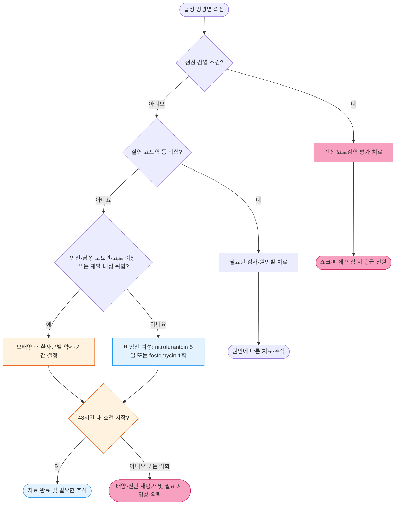

# 급성 방광염 Acute Cystitis

## <mark style="color:green;">일반 사항</mark>

* 방광에 국한된 급성 하부요로감염. 이 장의 기본 약제·처방례는 **비임신 성인 여성의 전형적인 급성 방광염**을 대상으로 하며, 남성·임신부·도뇨관 유치 환자 등은 별도로 평가
* 분류 : EAU는 국소형(방광염)/전신형 요로감염을 구분하며, IDSA 2025도 방광을 넘어선 침범을 시사하는 임상상에 중점을 두되 도뇨관 사용 등도 분류에 고려함. 이 명칭을 성별·기저질환 중심의 전통적 단순/복잡 분류와 혼용하지 않음 <mark style="color:$info;">[EAU 2025/2026; IDSA 2025; 질병관리청 실무지침]</mark>
  * 당뇨병, 면역저하, 남성이 무조건 "복잡성" 요인은 아니며, 방광을 벗어난 침범을 시사하는 증상·징후가 분류의 핵심 기준임. 다만 이들 환자군에서는 치료 실패·중증화 위험을 별도로 고려하며, 도뇨관·요로 폐쇄·잔뇨·최근 시술·내성균 위험을 함께 평가
* 감염 경로 : 주로 장내 세균이 회음부·요도 주위에 집락화한 뒤 요도를 통해 상행. 일반적인 세균성 방광염은 성매개감염으로 분류하지 않음
* 합병증 : 신우신염(전신 요로감염)으로의 진행
  * 스웨덴의 비임신 여성 관찰 연구에서 진단 후 30일 내 신우신염 발생은 진단 후 5일 이내 항생제 조제군 0.47%, 비조제군 1.43%로 보고됨. 관찰 연구의 연관성이며 남성·임신부·면역저하 환자에게 그대로 적용할 수 없음 <mark style="color:$info;">[Jansåker, et al. Antibiotics 2022]</mark>
* 재발성 방광염 : 6개월 내 ≥2회 또는 12개월 내 ≥3회 증상성 감염. 재발 진단과 예방요법 결정 전에는 요배양으로 감염을 확인하고 다른 원인을 감별

## <mark style="color:green;">원인</mark>

* 원인균 : _E. coli_(가장 흔함, 국소 요로감염의 약 70\~80%), _Staphylococcus saprophyticus_(특히 젊은 여성)
  * 기타 : _Klebsiella pneumoniae_, _Proteus mirabilis_, _Enterococcus_ spp.; _Pseudomonas_는 요로기구·의료관련 감염 등에서 고려하며 _Candida_는 별도의 진균성 감염/집락화로 구분

### <mark style="color:orange;">위험 인자</mark>

* 여성(요도 길이가 짧고 항문과 근접)
* 성관계, 살정자제·다이아프램 사용
* 폐경 후 상태(에스트로겐 감소로 인한 질 미생물총 변화)
* 고령
* 당뇨병, 면역 저하
* UTI 과거력, 재발성 UTI의 가족력
* 배뇨 장애 질환(예 : 요실금, 신경인성 방광)
* 도뇨관 유치, 입원, 최근 비뇨기계 시술

## <mark style="color:green;">임상 양상</mark>

* 흔한 증상 : 갑자기 발생한 빈뇨, 절박뇨, 배뇨통
* 동반 가능 증상 : 육안적 혈뇨, 치골상부 불쾌감/압통
* 소변의 악취·혼탁만으로 방광염을 진단하거나 항생제를 처방하지 않음
* 발열·오한·옆구리 통증·혈역학적 불안정은 단순한 방광염보다 전신 요로감염을 시사. 고령·면역저하 환자는 발열이 뚜렷하지 않을 수 있음
* 고령자의 섬망·기능 저하에서는 요로감염 외 원인과 무증상 세균뇨를 함께 감별
  * 단, 국소 요로 증상이나 전신 감염 소견 없이 섬망만으로 UTI를 진단하거나 항생제를 시작해서는 안 됨 <mark style="color:$info;">[IDSA, AGS Choosing Wisely]</mark>

### 🚩Red Flags

**즉각 조치**

* 요로감염이 의심되면서 저혈압, 의식 변화, 호흡곤란, 심한 전신 쇠약 등 패혈증·쇼크 의심 소견 → 응급 평가·전원 및 전신 요로감염 치료  <mark style="color:$danger;">[즉각 조치]</mark>
* 감염 증상과 함께 무뇨·급성 요폐, 폐쇄성 결석 의심 → 요로 폐쇄·감염성 수신증 평가 및 신속한 배액 필요성 판단  <mark style="color:$danger;">[즉각 조치]</mark>
* 임신 중 발열·옆구리 통증 등 신우신염 의심 → 즉시 병원 평가, 초기 입원 치료 고려  <mark style="color:$danger;">[즉각 조치]</mark>

**당일~수일 내 평가**

* 발열(≥38℃)·오한·옆구리 통증·늑골척추각 압통 중 하나라도 동반 → **당일** 전신 요로감염 평가  <mark style="color:$warning;">[당일~수일 내 평가]</mark>
* 치료 시작 48~72시간 후에도 호전 없음, 또는 언제든 악화 → **당일** 재평가; 전신 불안정이 있으면 즉각 조치  <mark style="color:$warning;">[당일~수일 내 평가]</mark>
* 남성의 발열·회음부/골반통·사정통·배뇨 곤란 → **당일** 급성 세균성 전립선염·요폐 평가  <mark style="color:$warning;">[당일~수일 내 평가]</mark>
* 임신부의 증상성 UTI → **당일** 평가. 무증상 세균뇨는 수일 내 산과와 치료 계획 수립  <mark style="color:$warning;">[당일~수일 내 평가]</mark>
* 면역저하·당뇨병 환자에서 심한 증상, 반복 구토·탈수, 경구 복용 곤란 또는 치료 반응 지연 → 조기 재평가; 중증화 소견은 **당일** 평가  <mark style="color:$warning;">[당일~수일 내 평가]</mark>

**조기 평가 및 추적**

* 최근 6개월 내 ≥2회 또는 12개월 내 ≥3회 재발 → 요배양으로 확인하고 잔뇨·결석·폐경 관련 변화 등 평가  <mark style="color:$info;">[조기 평가 및 추적]</mark>
* 치료 후에도 육안적 혈뇨가 지속·재발하거나 현미경적 혈뇨가 남음 → 혈뇨 위험도에 따른 비뇨의학과 평가  <mark style="color:$info;">[조기 평가 및 추적]</mark>
* 배양 음성 또는 균 소실 후에도 배뇨통·빈뇨 지속 → 질염·성매개감염·폐경비뇨생식기증후군·방광통증후군 등 재평가  <mark style="color:$info;">[조기 평가 및 추적]</mark>

## <mark style="color:green;">진단</mark>

* 급성 방광염은 방광에 국한된 급성 증상과 검사 결과를 종합하여 진단함. 국내 실무지침의 요약 기준은 요로 증상 + 농뇨(≥10 WBC/HPF) 또는 세균뇨(≥10⁵ CFU/㎖)이나, ≥10⁵ CFU/㎖를 모든 증상성 환자의 필수 배양 기준으로 적용하지 않음
* 전형적인 배뇨통·빈뇨를 보이고 질 분비물·질 자극 증상이 없는 비임신 여성에서는 요검사 없이도 임상적으로 진단 가능하며, 요검사는 진단을 지지하는 소견으로 활용함 <mark style="color:$info;">[EAU, NICE]</mark>

### <mark style="color:orange;">소변 검사</mark>

* U/A : 농뇨(WBC ≥10/HPF), 세균뇨; 증상의 중증도와 농뇨/세균뇨 정도가 일치하지는 않음
* 시험지봉 검사 : leukocyte esterase, nitrite; 양성은 진단을 지지하나 예측도는 증상·사전확률에 따라 달라지며 음성만으로 감염을 배제하지 않음
* 배양 검사 : 위험 인자가 없는 비임신 여성의 첫 전형적 급성 방광염에서는 생략 가능. 아래 환자군은 가능하면 **항생제 투여 전 중간뇨로 요배양·감수성 검사**를 시행하되, 중증 환자의 치료를 지연하지 않음
  * 검사 대상 : 진단이 불확실한 경우, 전신 요로감염(신우신염) 의심, 비전형적 증상, 임신부, 남성, 재발성 감염의 각 증상성 에피소드, 최근 항생제 치료 실패 또는 치료 종료 후 4주 내 증상 재발, 최근 항생제·입원력/과거 내성균 등 내성 위험이 높은 환자
  * 전형적 증상·농뇨가 있는 선택된 여성에서 단일 요로병원균 ≥10² CFU/㎖도 의미가 있을 수 있음; 검체 채취법·성별·임신 여부·항생제 선행 투여에 따라 기준을 달리 해석. 임신부 무증상 세균뇨의 ≥10⁵ CFU/㎖ 기준을 증상성 비임신 여성에게 그대로 적용하지 않음
  * 혼합균·다수 상피세포 등 오염이 의심되면 검체를 다시 채취하고, 필요한 경우 도뇨 검체를 고려
  * 농뇨만으로 감염을 확진하지 않음. 농뇨가 없고 배양도 음성이면 감염 가능성과 대체 진단을 다시 검토; 선행 항생제·검체 문제도 확인

### <mark style="color:orange;">영상 검사</mark>

* 전형적인 여성 국소 요로감염에서는 불필요
* 남성은 전립선 침범·폐색 증상·반복 감염을 평가하고, 적응증이 있으면 잔뇨 측정·신장/방광 초음파 시행. 남성이라는 이유만으로 모든 환자에게 CT·방광경 검사를 시행하지 않음
* 재발성 방광염만 있고 비전형적 소견이 없는 여성에게도 CT·방광경 검사를 일률적으로 시행하지 않음
* 초음파/CT : 폐쇄·결석·농양 의심, 중증 전신 감염, 적절한 치료 48~72시간 후에도 호전 없음 등에서 고려. 폐쇄·중증화가 의심되면 72시간을 기다리지 않음. 임신부는 초음파 우선
* 치료 전 혈뇨가 있었다면 치료·증상 소실 후 현미경적 요검사로 소실 확인. 잔여 현미경적 혈뇨는 염증 소실에 필요한 시간을 고려해 재검하며, 육안적 혈뇨가 지속·재발하면 신속히 별도 평가 <mark style="color:$info;">[AUA/SUFU 2025 혈뇨 지침]</mark>

### <mark style="color:orange;">감별</mark>

* 고열, 오한, 옆구리 통증, 근육통 → 신우신염(전신 요로감염), 세균성 전립선염
* 남성에서의 골반/음경 통증, 사정통, 배뇨 지연·점적 → 세균성 전립선염
* 남성에서 동일 균에 의한 반복 감염 → 만성 세균성 전립선염 고려. 반복 배양 음성의 만성 골반통은 만성 골반통증후군 등과 감별하며, 단일 요배양 결과만으로 구분하지 않음
* 새 성접촉력, 요도·질 분비물 또는 질 자극 증상이 있는 경우 → 요도염(_C. trachomatis_, _N. gonorrhoeae_ 등), 질염; 의심 시 적절한 검체로 STI 검사 고려
* 반복 배양 음성 또는 균 소실 후 지속되는 증상 → 폐경비뇨생식기증후군, 질염·외음부 질환, 결석·종양, 약물·화학적 자극, 방광통증후군, 과민성 방광 등. 방광통증후군은 방광 충만 시 통증과 배뇨 후 완화·만성 경과를 확인하고, 급성 배양 음성만으로 진단하지 않음
* 농뇨는 있으나 일반 배양 음성 → 선행 항생제 외 요도염/STI, 결석 등을 고려; 역학·위험 인자가 있으면 비뇨생식기 결핵 등 평가
* 무증상 세균뇨 → 증상이 없으므로 치료하지 않음(임신부·점막 손상이 예상되는 비뇨기계 시술 예정자 제외)

<table><thead><tr><th>질환</th><th>방광염과의 차이점</th><th>핵심 감별 포인트</th></tr></thead><tbody><tr><td>신우신염(전신 요로감염)</td><td>감염이 방광을 넘어 진행</td><td>발열, 오한, 옆구리 통증, 늑골척추각 압통, 전신 증상 동반</td></tr><tr><td>세균성 전립선염</td><td>남성에서 전립선까지 침범</td><td>회음부·골반통, 배뇨 지연, 직장수지검사 시 전립선 압통</td></tr><tr><td>요도염·질염</td><td>방광 외 부위의 감염·염증</td><td>요도·질 분비물, 질 자극 증상, 성접촉력; 의심 시 STI 검사</td></tr><tr><td>간질성 방광염/방광통증후군</td><td>비감염성, 만성 경과</td><td>반복되는 배양 음성, 만성적 골반통, 항생제 반응 없음</td></tr><tr><td>무증상 세균뇨</td><td>세균뇨는 있으나 증상 없음</td><td>급성 요로 증상 부재 → 원칙적으로 치료 불필요</td></tr></tbody></table>

***



<p align="center"><strong>급성 방광염 진단 및 치료 알고리듬</strong></p>

<p align="center"><em><mark style="color:$info;">Ref. 질병관리청·대한항균요법학회 실무지침(2026 배포본); EAU Urological Infections(2026)</mark></em></p>

***

## <mark style="background-color:$warning;">Management</mark>

* **경험적 항생제 선택 단계** <mark style="color:$info;">[요로감염 항생제 사용지침, 2025]</mark>
  * 0단계 증상에 따른 질환 분류(국소 vs 전신)\
    → 1단계 중증도(패혈증 여부) 평가\
    → 2단계 내성균 위험 인자 평가(최근 6개월 내 항생제/입원력, 요양시설 거주, ESBL 분리력 등)\
    → 3단계 환자별 고려사항(알레르기, 신기능, 약물 상호작용)\
    → 4단계(패혈증 시) 기관 항생제 감수성 결과 활용

### <mark style="color:orange;">치료 방침</mark>

* 국내 실무지침은 국소 요로감염에 nitrofurantoin 또는 fosfomycin을 권장함. 다만 분류상 국소 감염이어도 임신부·남성·도뇨관 유치 환자·요로 구조/기능 이상 환자에게 여성 단순 방광염의 약제·기간·추적 계획을 일률적으로 적용하지 않음
  * 남성 : 치료 전 요배양 및 전립선 침범·요폐 평가. 감수성에 맞는 TMP/SMX 등은 통상 7일 치료를 고려하며, 전립선염은 별도 약제·기간 적용. 전립선 침범을 확실히 배제한 일부 젊은 남성에서 nitrofurantoin을 고려할 수 있으나 최적 기간 근거가 제한적임(EAU 2026; NICE는 7일 제시). 여성의 3일/단회 요법을 그대로 적용하지 않으며 fosfomycin 3 g 단회는 국내 남성 방광염 허가 용법이 아님
  * 임신부 : 치료 전 요배양 후 감수성·임신 주수를 고려하여 일반적으로 5~7일 표적 치료. Fosfomycin 3 g 단회는 적절한 하부 요로감염의 예외적 단회 선택지. Cephalosporin 등 임신 중 사용할 수 있는 약제를 검토하고, amoxicillin/ampicillin은 높은 내성률 때문에 경험적으로 우선 선택하지 않음. 치료 종료 1~2주 뒤 요배양 또는 증상 재발 시 검사를 고려(최적 추적 전략 근거는 제한적). 신우신염에는 nitrofurantoin·경구 fosfomycin을 사용하지 않음 <mark style="color:$info;">[ACOG 2023]</mark>
  * 도뇨관·요로 이상 : 증상과 집락화를 구분하고 도뇨관 교체·폐쇄 해소 등 원인 교정 여부와 항생제 선택·기간을 개별 결정
* Ciprofloxacin 등 fluoroquinolone은 중대한 이상반응·내성 문제로 단순 방광염의 경험적 1차 약제로 권하지 않음. 다른 적절한 치료 선택지가 없을 때 감수성·위험을 검토
  * 국내 ciprofloxacin 경구제 급여는 1차 약제에 호전되지 않을 때 투여하는 것이 원칙이나 **타 항생제 내성, 면역기능 저하, 중증·심부장기 감염 등 예외**가 있음. 예외 해당 사유와 감수성을 확인하여 적용 <mark style="color:$info;">[심평원 고시 제2017-77호]</mark>
* 일부 저위험 비임신·비고령 여성에서는 공동 의사결정으로 지연 항생제 처방 등 항생제 절약 접근을 고려할 수 있으나, 증상 지속·신우신염 위험 증가 가능성과 재진 기준을 설명해야 함. 임신·전신 증상·면역저하 등 위험군에는 적용하지 않으며 진통제 단독 치료를 일률적으로 권하지 않음 <mark style="color:$info;">[EAU 2026]</mark>
* 위험 인자가 없는 비임신 여성은 치료 후 증상 소실 시 치유 확인 목적의 정기 U/A·배양이 불필요. 다만 **혈뇨 소실 확인, 임신 추적, 지속·재발 증상 평가**는 별개임
* 48\~72시간 치료에도 반응이 없으면 배양·감수성 재확인 및 항생제 조정, 구조적 이상(요로 폐쇄·농양 등) 감별 필요
  * Fosfomycin 단회 복용 후 증상 소실까지 2~3일 걸릴 수 있어 잔여 증상만으로 임의 추가 복용·항생제 중복을 하지 않음. 그러나 **48시간 내 호전이 시작되지 않거나 언제든 악화하면 재평가**하며, 요중 약물 농도를 이유로 진료를 늦추지 않음


**2026년 새 근거 — fosfomycin 단회와 nitrofurantoin의 효과 비교**

SCOUT 연구(스페인 일차의료, 성인 여성 768명 무작위배정)의 자료가 확보된 720명 분석에서 7일째 모든 증상 소실은 nitrofurantoin 5일군 74%, fosfomycin 3 g 단회군 59%였음(차이 15.5%p). 두 번 투여한 fosfomycin은 단회 대비 유의한 개선을 입증하지 못함. 국내 실무지침의 두 1차 선택지는 유지하되 효과가 동일하다고 단정하지 않으며, 금기·순응도·과거 배양을 함께 고려. 연구의 nitrofurantoin 용법은 100 ㎎ tid로 **국내 허가 qid 용법과 다르므로 그대로 처방에 옮기지 않음**. 이 결과만으로 fosfomycin 2회 요법을 일상적으로 도입하지 않음. <mark style="color:$info;">[Llor, et al. Lancet 2026;407:1603–1613]</mark>


## <mark style="color:green;">비-약물 치료 및 예방</mark>

* 탈수되지 않을 정도의 수분 섭취 권장. 심부전·진행된 신장질환 등 수분 제한이 필요하면 개별화하며, 과도한 강제 이뇨는 권하지 않음
  * 평소 수분 섭취가 하루 1.5 L 미만인 폐경 전 여성에서 하루 1.5 L를 추가 섭취하면 재발이 48% 감소한다는 보고가 있음
* **배변 후** 앞에서 뒤로 닦기, 습관적인 배뇨 지연 피하기. 위생·성관계 후 배뇨만으로 재발을 확실히 예방한다고 설명하지 않음
* 성관계 후 배뇨 습관 - 재발 예방 효과에 대한 근거는 제한적이나 흔히 권고됨
* 살정자제(spermicide)·다이아프램 사용을 피하면 재발 위험을 줄일 수 있음
* 프로바이오틱스(락토바실루스 등), 시판 "요로 건강" 보조제는 예방 효과에 대한 근거가 불충분함

### <mark style="color:orange;">재발성 방광염 예방 (AUA/CUA/SUFU 2025; EAU 2026; NICE NG112)</mark>

* 항생제 예방요법의 "collateral damage"(내성 유발, 부작용)를 고려하여 비항생제 전략을 우선 고려
* 폐경 이행기·폐경 후 여성 : 금기가 없으면 저용량 질 에스트로겐 고려. 전신 호르몬요법을 UTI 예방만을 위해 시작하지 않음. 국내 제품의 적응증은 위축성 질염 등으로 확인하며 **UTI 예방 목적 사용은 허가 외일 수 있음**; 유방암 병력·원인 불명 질출혈 등은 관련 전문의와 판단
* Cranberry(크랜베리) 제제 : AUA/CUA/SUFU 2025는 여성 재발성 UTI 예방 선택지로 권고(중등도 권고, 근거 B). 제품별 유효 성분·함량 차이 및 효과의 개인차를 설명
* D-mannose : 대규모 위약 대조시험에서 재발 예방 효과가 확인되지 않아 일상적으로 권고하지 않음
* Methenamine hippurate <mark style="color:blue;">\[유로렉스정]</mark> : 항생제 예방요법 대비 비열등 근거(ALTAR trial)가 있어 일부 재발성 감염에서 대안으로 고려; 1,000 ㎎ bid
  * 국내 허가사항은 원인균·감수성 정보를 이용할 수 없거나 적절한 항생제가 없는 환자에서 사용하도록 제한
  * 신장애·중증 간장애·중증 탈수·고인산혈증 금기, TMP/SMX 등 설폰아마이드계 약물·요 알칼리화제 병용 금기
  * 급성 감염 치료를 마친 뒤 예방 목적으로 사용하며 급성 감염의 항생제 치료를 대체하지 않음
  * 소변 pH, 신·간기능·혈청 인산/나트륨을 점검하고 6개월 이내 효과·이상반응을 재평가(이후 최소 연 1회). 임신부·남성·상부 요로 재발/구조적 이상은 전문의와 상의
* 위 방법으로 조절되지 않는 배양 확인 재발성 감염에서 저용량 지속 또는 성관계 관련 단회 예방을 고려. 과거 감수성에 맞춰 선택하고 현재 급성 감염은 먼저 치료
  * Nitrofurantoin : 지속 억제 치료 50~100 ㎎ 1일 1회(국내 허가 용법). 성관계 관련 예방 50~100 ㎎ 1회는 국제 지침에 근거한 **국내 허가 외 투여 일정**으로 구분
  * 효과·내성·부작용을 적어도 6개월마다 재평가하고 중단 가능성을 검토. 장기 nitrofurantoin 사용 시 폐·간·신경 독성과 신기능을 감시
* 배양으로 감염이 확인되고 증상 인지가 정확한 일부 여성은 사전에 정한 단기 자가 시작 치료를 고려할 수 있으나, 가능하면 투약 전 배양 검체를 확보하고 임신·전신 증상이 있으면 적용하지 않음
* OM-89 등 면역조절제의 예방 효과는 제제별로 일관되지 않으며, EAU 2026은 면역조절 예방요법을 잘 관리된 임상시험 내 사용으로 제한하는 약한 권고를 제시함. 통상적인 표준 예방요법으로 권하지 않음

***

## <mark style="color:green;">약물 치료</mark>

### <mark style="color:orange;">항생제 — 비임신 성인 여성의 전형적 급성 방광염</mark>

<table><thead><tr><th>구분</th><th>성분명 [상품명]</th><th>성인 용법</th><th>기간·주요 주의사항</th></tr></thead><tbody><tr><td>1차¹⁾</td><td>nitrofurantoin<br>[<mark style="color:blue;">보령니트로푸란토인캡슐 50 ㎎</mark>]</td><td>50~100 ㎎ qid (식후 및 취침 전)</td><td>5일(국내 실무지침). CrCl ＜60 ㎖/min·G6PD 결핍·임신 38~42주/분만/출산 시 및 이 약 관련 간손상 병력 등 금기. 신우신염·전립선염에는 부적절</td></tr><tr><td>1차²⁾</td><td>fosfomycin trometamol<br>[<mark style="color:blue;">모누롤산</mark>]</td><td>포스포마이신으로서 3 g 1회 (물에 녹여 공복·취침 전, 배뇨 후)</td><td>성인 여성 급성 단순 방광염의 국내 허가 적응증; CrCl ≤10 ㎖/min·혈액투석 금기. 신우신염에는 부적절</td></tr><tr><td>대안</td><td>TMP/SMX<br>[<mark style="color:blue;">셉트린정 80/400 ㎎</mark>]</td><td>160/800 ㎎ bid (1회 2정)</td><td>비임신 여성 3일(국제 지침의 단기요법); 감수성 확인 후 사용 우선. 국내 제품 허가상 CrCl 15~30 ㎖/min은 통상량의 1/2, ≤15는 투여 비권장; 임부·임신하고 있을 가능성이 있는 여성·수유부 및 G6PD 결핍 등 금기. Methotrexate 병용 금기; 고칼륨혈증·warfarin 상호작용 주의</td></tr><tr><td>대안</td><td>ciprofloxacin³⁾<br>[<mark style="color:blue;">씨프로바이정 250 ㎎</mark>]</td><td>250 ㎎ bid</td><td>비임신 여성 3일(지침 단기요법). 다른 적절한 치료 선택지가 없는 경우만 검토; 감수성 및 급여 예외 확인. 국내 허가상 임부·수유부·18세 미만·간질·퀴놀론 관련 힘줄손상 병력 등 금기; tizanidine·ketoprofen 병용 금기. 신기능별 조정 및 다가 양이온 제제와 복용 간격 필요</td></tr></tbody></table>

¹⁾ _국내 보령니트로푸란토인캡슐 50 ㎎의 허가 용법은 50~100 ㎎ qid이며, 국제 지침의 macrocrystal/monohydrate 100 ㎎ bid와 제형·용법이 다름. 해외 eGFR 30 또는 45 기준과 국내 허가상 CrCl ＜60 금기를 혼용하지 않음._

²⁾ _Fosfomycin 단회 요법은 성인 여성 급성 단순 방광염에서 고려하며, 남성·도뇨관 관련 감염에 동일하게 확대하지 않음._

³⁾ _Fluoroquinolone의 건염·건파열, 대동맥류/박리 위험, QT 연장, 혈당 이상, 말초신경병증 등을 고려. 표의 3일 단기요법을 남성·임신부·전립선염에 확대하지 않음. TMP/SMX·ciprofloxacin의 3일 요법은 국제 지침에 근거한 단기요법이며, 국내 제품의 일반 급성감염 투여기간 문구와 구분함._


**여성 단순 방광염에서 분리된 _E. coli_의 항생제 감수성** : nitrofurantoin 98.9%, fosfomycin 96.8%, cefotaxime 82.4%, ciprofloxacin 50.9%, TMP-SMX 68.1% (대한요로생식기감염학회, 2023년 여성 단순 방광염의 E. coli 전국 감시자료; Yu SH, et al. Antibiotics 2024;13:1075, 2025 정정 포함); ciprofloxacin은 감수성이 낮고(50.9%), TMP-SMX는 68.1%로 내성률이 약 30%대에 달해 경험적 1차 약제로는 권장되지 않음. 이 수치는 당시 연구 집단의 자료이며 모든 국소 감염·개별 의료기관에 그대로 적용하지 않음



**경구 베타락탐계(cefpodoxime, cefdinir, cefcapene, cefditoren, cefixime, amoxicillin/clavulanate)에 대하여**\
2010년 IDSA/ESCMID 지침은 amoxicillin/clavulanate, cefdinir, cefpodoxime 등 일부 경구 베타락탐계를 다른 권장 약제를 사용할 수 없을 때의 대안으로 언급함. 2025년 국내 실무 지침의 국소 요로감염 경험적 권장·대안 목록에는 경구 베타락탐계가 포함되지 않음. 임신 여부, 이전 배양·감수성, 약제 금기 및 다른 치료 선택지를 고려해 필요한 경우 개별적으로 선택



**ESBL 생성균이 배양된 경우**

방광에 국한된 감염이고 감수성이 확인되면 nitrofurantoin·TMP/SMX 등 경구 약제를 선택할 수 있으며, ESBL 검출만으로 carbapenem 주사 치료가 반드시 필요한 것은 아님. ESBL 감염의 경구 fosfomycin은 **E. coli 방광염의 대안**으로 고려하며 Klebsiella 등 다른 균종에 일률적으로 확대하지 않음. 전신 감염·전립선 침범은 별도 치료가 필요하고 nitrofurantoin·단회 경구 fosfomycin으로 치료하지 않음. <mark style="color:$info;">[IDSA AMR Guidance 2026]</mark>


### <mark style="color:orange;">기타</mark>

* 항진균제 : 칸디다뇨만으로 투여하지 않음. 무증상 칸디다뇨에서는 도뇨관 등 유발 요인을 먼저 교정하고, 중증 호중구감소증·비뇨기계 처치 예정 등 예외 상황을 별도 평가
  * 감수성 균에 의한 **증상성 칸디다 방광염** : fluconazole 200 ㎎/d ×2주 <mark style="color:blue;">\[푸루나졸]</mark>; 신기능에 따른 용량 조정 및 도뇨관 제거·교체 고려; 임신부의 경구 fluconazole 사용은 피하고 전문의와 상의 <mark style="color:$info;">[IDSA Candidiasis 2016]</mark>
* 진경제 : 급성 방광염의 표준 병용약이 아니며 직접적인 증상 완화 근거가 제한적임. 항콜린성 약제는 요폐·폐쇄각 녹내장·고령자의 섬망·변비 위험에 유의
* 진통제 (☞ [통증](../220_/001_-pain.md))
  * ibuprofen : 200\~400 ㎎ tid 필요 시 단기간(일반적인 경증 통증의 증상 완화 용량); 탈수·AKI에서는 피함. 부루펜 국내 허가상 위장관궤양/출혈 또는 그 병력·기관지천식 또는 그 병력·NSAID 과민반응 병력·중증 간/신/심장장애·심한 고혈압·임신 말기 등 금기. 수유 중에는 약물 또는 수유 중단 여부를 결정. 항생제 치료가 필요한 환자에서 진통제 단독으로 대체하지 않음 <mark style="color:blue;">\[부루펜]</mark>
  * acetaminophen : 일반정 500\~1,000 ㎎ q6h 필요 시, 최대 4 g/d; 고령·쇠약·만성 음주·간질환 등에서는 상한을 낮춤. 650 ㎎ 서방정은 1\~2정 q8h, 최대 6정/d로 구분 <mark style="color:blue;">\[타이레놀]</mark>
* 방광 진통제 : phenazopyridine 200 ㎎ tid ×최대 2일은 요로 작열감의 일시적 완화에 사용되며 감염을 치료하지 않음. 해외 용법 참고이며 현행 국내 허가·공급을 확정하지 못해 국내 표준 처방례에는 포함하지 않음
  * 신부전·간질환·G6PD 결핍에서는 사용하지 않으며, 소변·눈물의 주황색 착색과 요검사 간섭 가능성을 설명

## <mark style="color:green;">시술 및 기타 처치</mark>

* 전형적인 급성 방광염에는 시술이 필요하지 않음
* 급성 요폐·감염성 폐쇄는 신속히 의뢰하여 배액·폐쇄 해소. 도뇨관 관련 감염은 필요성을 재평가하여 제거·교체하고, 배양은 배액 주머니가 아닌 적절한 채취 부위에서 시행
* 방광 내 약물 주입 등은 일반적인 급성 치료가 아니며, 다른 예방방법에 실패한 선택된 재발성 감염에서 비뇨의학과 평가 후 검토

***

## <mark style="color:purple;">처방례</mark>

> **처방례 1. 1차 선택 - 전형적 경증 방광염**
>
> ```
> 보령니트로푸란토인캡슐 50 ㎎  8Cap/일(1회 2Cap=100 ㎎)  #4 ×5일 (총 40Cap, 식후·취침 전)
> 타이레놀 일반정 500 ㎎/T  1~2T/회  q6h 필요 시 단기간 (모든 제품 합계 최대 8T/일)
> ```
>
> _✽비임신 성인 여성의 전형적 방광염 예시. Nitrofurantoin은 국내 E. coli 감수성이 98.9%로 높으나 신우신염·전립선염 의심 시에는 부적절. 신기능·임신 주수·G6PD 결핍·약물 관련 간손상 병력 확인. 진통제는 통증이 있을 때만 사용하며 간질환·만성 음주·쇠약 환자는 acetaminophen 상한을 낮춤_

> **처방례 2. 순응도 우선 - 단회 요법**
>
> ```
> 모누롤산(포스포마이신으로서 3 g)  1포  1회 (물에 녹여 공복, 취침 전 배뇨 후)
> ```
>
> _✽성인 여성의 급성 단순 방광염에서 허가된 단회 요법. 단회 복용의 편의성과 치료 효과 차이에 관한 최신 근거를 함께 설명. 신우신염에는 부적절하며 CrCl ≤10 ㎖/min에서는 금기. 1포의 분말 총량과 포스포마이신 역가 3 g을 구분_

> **처방례 3. 1차 약제 사용 불가 시(감수성 확인 권장)**
>
> ```
> 셉트린정 80/400 ㎎/T  4T/일(1회 2T=160/800 ㎎)  #2 ×3일 (총 12T)
> ```
>
> _✽비임신 성인 여성의 예시. 국내 TMP/SMX 감수성은 68.1%이므로 가능하면 배양 결과 확인 후 처방. 셉트린정 1정은 TMP/SMX 80/400 ㎎이며, 신기능·고칼륨혈증 위험과 병용약을 확인_

> **처방례 4. 재발성 방광염 - 성관계 후 예방**
>
> ```
> 보령니트로푸란토인캡슐 50 ㎎  2Cap  성관계 후 2시간 이내 1회
> ```
>
> _✽배양으로 확인되고 성관계와 뚜렷하게 연관된 재발성 방광염의 예시. **국제 지침에 근거한 국내 허가 외 투여 일정**이며 국내 허가의 지속 억제 용법(50~100 ㎎ 1일 1회)과 구분. 비약물·비항생제 예방 후 선택하고, CrCl ≥60 ㎖/min 및 금기 부재를 확인. 적어도 6개월마다 필요성·폐/간/신경 이상반응을 재평가_

***

### <mark style="color:red;">질병코드</mark>

<table><thead><tr><th>KCD-9</th><th>진단명·적용</th></tr></thead><tbody><tr><td>N30.0</td><td>급성 방광염 — 급성 진단이 명확하면 이 코드 사용</td></tr><tr><td>N30.9</td><td>상세불명의 방광염 — 급성/만성 등이 불명확할 때</td></tr></tbody></table>

* N30 ‘방광염’은 상위 범주. 미국 ICD-10-CM의 혈뇨 유무별 N30.00/N30.01을 KCD-9 코드로 가져오지 않음

***

### <mark style="color:$success;">핵심 복약 지도</mark>

> **nitrofurantoin 복용 시 주의사항**
>
> * 반드시 식사와 함께 또는 식후 복용 - 위장 자극 감소 및 흡수율 향상
> * 국내 허가상 CrCl 60 ㎖/min 미만 및 G6PD 결핍은 금기(고령자는 신기능 확인 필요)
> * 단기 복용 첫 주에도 드물게 급성 폐 반응이 나타날 수 있어 새 기침·호흡곤란·흉통이 발생하면 중단하고 즉시 상담
> * 발열·옆구리 통증 등 신우신염이 의심되면 즉시 재평가 및 치료 변경 - nitrofurantoin은 신실질 내 농도가 낮아 상부 요로감염에는 부적절함
> * 임신 38~42주·분만·출산 시에는 신생아 용혈성 빈혈 위험으로 금기
> * 황달·심한 피로·손발 저림이 생기면 중단 후 평가. 장기 예방요법에서는 폐·간·신기능을 주기적으로 점검
> * 수유 중에는 영아 연령을 확인. 국내 허가사항은 생후 3개월 미만 영아 수유 시 수유 또는 약물 중단 여부를 결정하도록 함

> **fosfomycin 복용 시 주의사항**
>
> * 1회 복용으로 치료가 종료되나, 증상이 완전히 사라지기까지 2\~3일이 걸릴 수 있음을 미리 설명
> * 모누롤산 1포를 물에 녹여 공복(식사 전 2~3시간)에 복용하며, 가능하면 취침 전 배뇨 후 복용. 복용 후 억지로 소변을 참을 필요는 없음. CrCl ≤10 ㎖/min·혈액투석은 금기
> * Metoclopramide 등 위장운동 촉진제는 약물 농도를 낮출 수 있어 병용약 확인. 페닐케톤뇨증 및 일부 유전적 당 불내성도 제품 금기 확인
> * 임의로 다음 날 추가 복용하지 않으며, 48시간 내 호전이 시작되지 않거나 전신 증상이 생기면 진료

> **언제 다시 병원을 방문해야 하나요?**
>
> * 치료 시작 후 48시간이 지나도 호전이 시작되지 않거나, 언제든 증상이 악화되는 경우
> * **발열, 오한, 옆구리 통증**이 새로 나타나는 경우 - 신우신염 가능성, 즉시 내원
> * 임신 중 요로 증상 또는 선별 요배양 양성인 경우 - 진료 후 치료·산과 추적 계획 수립
> * 육안적 혈뇨가 지속·재발하거나 치료 후에도 혈뇨가 남는 경우
> * 6개월에 2회 이상 또는 1년에 3회 이상 재발하는 경우 - 재발 원인 평가 필요

***

## <mark style="color:green;">주요 참고문헌 및 확인 자료</mark>

### ＜임상 근거＞

* 질병관리청·대한항균요법학회. 2025 요로감염 항생제 사용 지침(2026 배포본: 요로감염 항생제 적정사용을 위한 실무지침). — 국내 국소형/전신형 분류, 약제 선택 및 기간.
  [공식 지침](https://www.kdca.go.kr/bbs/kdca/55/306854/download.do)

* European Association of Urology. EAU Guidelines on Urological Infections. 2026.
  [공식 지침](https://uroweb.org/guidelines/urological-infections/chapter/the-guideline)

* IDSA. 2025 Guideline on Management and Treatment of Complicated Urinary Tract Infections. — 단기요법·경구 전환과 적용 제외군.
  [공식 지침](https://www.idsociety.org/practice-guideline/complicated-urinary-tract-infections/)

* AUA/CUA/SUFU. Recurrent Uncomplicated Urinary Tract Infections in Women. 2025 Amendment.
  [개정 권고문](https://www.auanet.org/documents/Guidelines/PDF/2025%20Guidelines/rUTI%20Update/rUTI%202025%20Amendment%20Summary%20Final.pdf)

* Yu SH, et al. Antimicrobial Resistance of Escherichia coli for Uncomplicated Cystitis: Korean Antimicrobial Resistance Monitoring System. Antibiotics. 2024;13(11):1075. 정정: Antibiotics. 2025;14(3):234. — 2023년 E. coli 감수성 자료; 전체 원인균 분석 논문(Investig Clin Urol 2025)과 구분.
  [https://doi.org/10.3390/antibiotics13111075](https://doi.org/10.3390/antibiotics13111075)

* NICE. Urinary tract infection (recurrent): antimicrobial prescribing. NG112(2024 개정). — 유발 요인 후/지속 예방 및 methenamine.
  [권고문](https://www.nice.org.uk/guidance/ng112/chapter/recommendations)

* Hayward G, et al. d-Mannose for Prevention of Recurrent Urinary Tract Infection Among Women: A Randomized Clinical Trial. JAMA Intern Med. 2024;184:619–628.
  [https://doi.org/10.1001/jamainternmed.2024.0264](https://doi.org/10.1001/jamainternmed.2024.0264)

* Harding C, et al. Alternative to prophylactic antibiotics for the treatment of recurrent urinary tract infections in women: multicentre, open label, randomised, non-inferiority trial(ALTAR). BMJ. 2022;376:e068229.
  [https://doi.org/10.1136/bmj-2021-0068229](https://doi.org/10.1136/bmj-2021-0068229)

* MHRA. Nitrofurantoin: reminder of the risks of pulmonary and hepatic adverse drug reactions. 2023.
  [안전성 정보](https://www.gov.uk/drug-safety-update/nitrofurantoin-reminder-of-the-risks-of-pulmonary-and-hepatic-adverse-drug-reactions)

* Llor C, et al. Clinical and bacteriological effectiveness of three different short-course antibiotic regimens and single-dose fosfomycin for uncomplicated lower urinary tract infections in women (SCOUT). Lancet. 2026;407:1603–1613.
  [https://doi.org/10.1016/S0140-6736(25)02171-3](https://doi.org/10.1016/S0140-6736(25)02171-3)

* ACOG. Urinary Tract Infections in Pregnant Individuals. Clinical Consensus. 2023.
  [공식 권고문](https://www.acog.org/clinical/clinical-guidance/clinical-consensus/articles/2023/08/urinary-tract-infections-in-pregnant-individuals)

* AUA/SUFU. Microhematuria Guideline. 2025 Amendment. — 감염 관련 혈뇨의 치료 후 확인 및 지속 혈뇨 평가.
  [공식 지침](https://www.auanet.org/documents/Guidelines/PDF/2025%20Guidelines/MH%20Unabridged%2002.2025FINAL3-1.pdf)

* NICE. Urinary tract infection (lower): antimicrobial prescribing. NG109. — 남성 하부 요로감염의 7일 요법과 전립선 침범 주의.
  [공식 권고문](https://www.nice.org.uk/guidance/ng109/chapter/Recommendations)

* IDSA. Clinical Practice Guideline for the Management of Candidiasis. 2016. — 증상성 칸디다 방광염·무증상 칸디다뇨.
  [공식 지침](https://www.idsociety.org/practice-guideline/candidiasis/)

* Jansåker F, et al. The Risk of Pyelonephritis Following Uncomplicated Cystitis: A Nationwide Primary Healthcare Study. Antibiotics. 2022;11:1695.
  [https://doi.org/10.3390/antibiotics11121695](https://doi.org/10.3390/antibiotics11121695)

* Hooton TM, et al. Effect of Increased Daily Water Intake in Premenopausal Women With Recurrent Urinary Tract Infections. JAMA Intern Med. 2018;178:1509–1515. — 평소 저수분 섭취 여성의 수분 추가 섭취 연구.
  [https://doi.org/10.1001/jamainternmed.2018.4204](https://doi.org/10.1001/jamainternmed.2018.4204)

* IDSA. 2026 Guidance on the Treatment of Antimicrobial-Resistant Gram-Negative Infections. — ESBL 생성균의 방광 국한 감염에서 약제 선택.
  [공식 지침](https://www.idsociety.org/practice-guideline/amr-guidance/)

* IDSA/ESCMID. International Clinical Practice Guidelines for Acute Uncomplicated Cystitis and Pyelonephritis in Women: 2010 Update. Clin Infect Dis. 2011;52:e103–e120. — TMP/SMX·fluoroquinolone 단기요법과 경구 베타락탐 대안.
  [https://doi.org/10.1093/cid/ciq257](https://doi.org/10.1093/cid/ciq257)

* IDSA. Clinical Practice Guideline for the Management of Asymptomatic Bacteriuria. 2019. — 국소 증상·전신 감염 소견 없는 고령자 섬망과 세균뇨.
  [공식 지침](https://www.idsociety.org/practice-guideline/asymptomatic-bacteriuria/)

### ＜허가·급여 확인 자료＞

* 식품의약품안전처. 의약품안전나라 — 국내 제품별 적응증·용법·금기 및 허가 상태.
  [https://nedrug.mfds.go.kr/index](https://nedrug.mfds.go.kr/index)

* 건강보험심사평가원. Ciprofloxacin 경구제 보험인정기준, 고시 제2017-77호(2017.5.1.) — 단계적 사용 원칙과 타 항생제 내성·면역저하 등 예외.
  [급여기준 원문](https://www.hira.or.kr/rc/insu/insuadtcrtr/InsuAdtCrtrPopup.do?mtgHmeDd=20170501&mtgMtrRegSno=0012&sno=1)

* 보령니트로푸란토인캡슐·모누롤산·셉트린정·씨프로바이정250㎎·유로렉스정·부루펜정200㎎: 식약처 공개 허가사항 및 제품설명서 대조. 일부 품목은 식약처 자료를 전재한 약학정보원 허가정보를 보조 확인 자료로 사용.

* KCD-9 분류표(사용자 제공 KCD9_251216(1).xlsx): N30/N30.0/N30.9 확인.

* 검토 기준일: 2026-10-28. 임상 권고와 국내 허가·급여 적용 범위가 다른 부분은 본문에 구분 표기.

***

## <mark style="color:blue;">환자 안내서</mark>


**급성 방광염, 흔하지만 제대로 치료하면 대부분 빨리 좋아집니다**

방광염은 세균이 요도를 통해 방광으로 들어가 염증을 일으키는 흔한 감염입니다. 여성에게 특히 흔하며, 처방받은 항생제를 정해진 기간 동안 복용하면 대부분 며칠 안에 증상이 좋아집니다.


### <mark style="color:orange;">왜 방광염이 생기나요?</mark>

* 여성은 요도가 짧고 항문과 가까워 세균(주로 대장균)이 방광으로 들어가기 쉽습니다.
* 성관계, 배뇨를 오래 참는 습관, 폐경 이후 호르몬 변화 등이 위험을 높일 수 있습니다.

### <mark style="color:orange;">일상생활에서 어떻게 관리하나요?</mark>

* **평소 부족하지 않게 물을 드십시오.** 무리하게 많은 양의 물을 한꺼번에 마실 필요는 없습니다.
* **소변을 습관적으로 오래 참지 마십시오.** 다만 배뇨 습관만으로 재발을 확실히 예방할 수 있는 것은 아닙니다.
* **배변 후에는 앞에서 뒤로 닦으십시오.** 성관계 후 배뇨와 같은 위생 습관은 시도할 수 있으나 재발 예방 효과에 대한 직접 근거는 제한적입니다.
* 성관계와 관련하여 자주 재발하면 살정자제 사용 여부와 예방약의 필요성을 담당 의사와 상의하십시오. 방광염이 반복된다고 위생 관리가 잘못되었다는 뜻은 아닙니다.

### <mark style="color:orange;">약은 어떻게 써야 하나요?</mark>

* 증상이 하루 이틀 만에 좋아지더라도 **의료진이 정한 기간과 방법대로 항생제를 복용**하십시오. 다만 심한 발진·호흡곤란 등 이상반응이 생기면 복용을 중단하고 즉시 진료받으십시오.
* 1회만 복용하는 약(fosfomycin)을 처방받았다면, 증상이 완전히 사라지기까지 2~3일 정도 걸릴 수 있습니다. 다음 날 임의로 한 포를 더 복용하지 마십시오.
* 처방받은 진통제는 불편한 증상을 줄이는 용도이며, 항생제를 대신하지 않습니다.

### <mark style="color:orange;">이럴 때는 다시 진료받으세요</mark>

* 열이 나거나 옆구리(등쪽)가 아픈 경우
* 치료 후 **48시간이 지나도 호전이 시작되지 않거나 언제든 악화하면** 재평가를 받으십시오. 처방약의 효과를 기다린다며 열·옆구리 통증을 참고 지내지 마십시오.
* 혈뇨가 계속되거나 다시 나타나면 진료받으십시오. 처음 피가 섞였던 경우 치료 후 확인 검사가 필요할 수 있습니다.
* 임신 중 방광염 증상이 있으면 그날 의료진과 상의하고, 치료 후 검사 계획을 확인하십시오.
* 6개월에 2번 이상 또는 1년에 3번 이상 증상이 반복되면 진료를 받아 감염 여부와 예방 방법을 확인하십시오.
