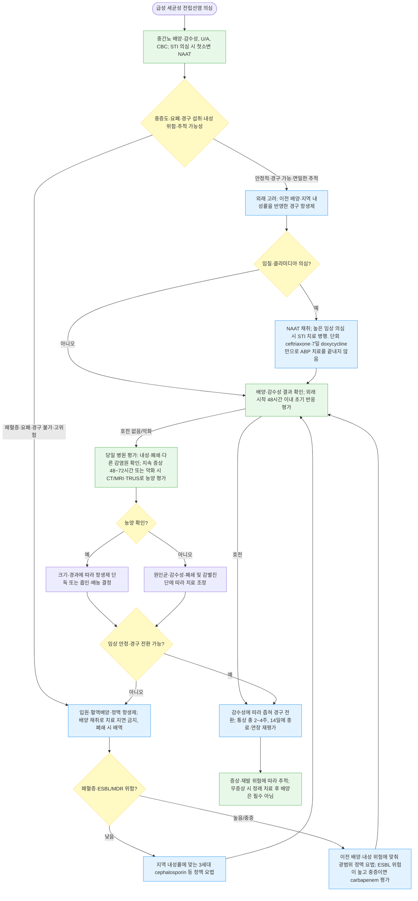
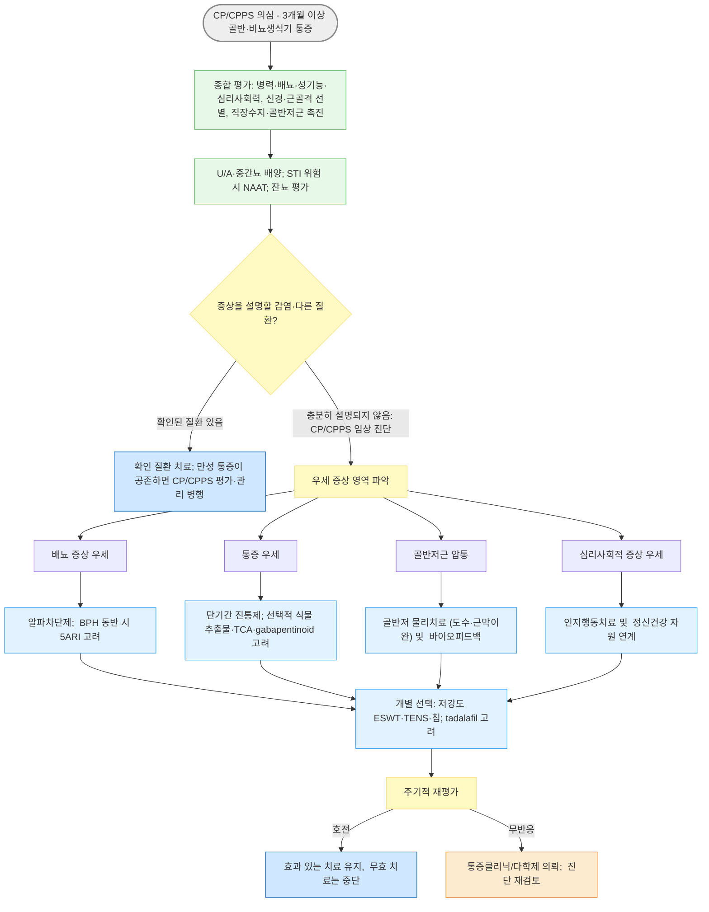

# 전립선염 Prostatitis

## <mark style="color:green;">일반 사항</mark>

* 전립선염으로 분류하는 여러 임상 증후군의 총칭으로, 비뇨생식계 통증·배뇨 장애·성기능 장애 등이 나타남. 확인된 세균 감염은 전체의 10% 미만이며, CP/CPPS는 전립선의 감염이나 조직학적 염증을 필수 조건으로 하지 않음
* 만성 전립선염/만성 골반통증증후군(chronic prostatitis/chronic pelvic pain syndrome, CP/CPPS) : ≥3개월 지속·재발하는 골반·비뇨생식기 통증으로, 감염이나 다른 원인 질환으로 충분히 설명되지 않는 임상 증후군. 전통적인 연구 정의는 최근 6개월 중 ≥3개월의 증상이며, 진료·치료를 위해 반드시 6개월을 기다리지는 않음. 만성 세균성 전립선염은 ≥3개월의 증상·경과와 지속·재발 감염의 증거를 종합하여 구분
* 유병률 : 남성의 2.2\~16%(중앙값 7.1%)에서 전립선염 유사 증상을 경험; 미국 성인 남성의 1.8%(약 200만 명)가 CP/CPPS 증상 기준에 해당(RICE 연구, 미국 남성 대상 설문 추정치이며 국내 확진 유병률과 구분)
* 급성·만성 세균성 전립선염과 CP/CPPS는 다양한 성인 연령에서 발생함. 연령만으로 세균성 여부·원인균을 단정하지 않음
  * 재발성 UTI·BPH/폐쇄·전립선 결석·요로 시술력은 세균성 감염 위험 평가에 활용하며, CP/CPPS에서는 골반저근·신경계·심리사회 요인을 함께 평가
* 치료 경과
  * 급성 세균성 전립선염은 적절한 항생제 치료 후 수일 내 호전되기 시작함. **외래 치료 시작 48시간 이내 호전이 시작되지 않으면 당일 재평가 및 병원 의뢰를 고려**; 악화·패혈증 징후는 즉시 평가. 48\~72시간의 적절한 치료에도 증상이 지속되면 농양·폐쇄 등을 위한 단면 영상검사를 적극 고려 <mark style="color:$info;">[NICE NG110; EAU 2026]</mark>
  * 만성 세균성 전립선염은 치료가 어려운 편이며 재발·재감염이 흔함
  * CP/CPPS는 증상이 변동·재발할 수 있으나 의미 있는 호전이 가능함. 통증 감소, 배뇨·성기능·일상 기능 및 삶의 질 회복을 치료 목표로 설정

### <mark style="color:orange;">분류 \[NIH]</mark>

<table><thead><tr><th>NIH 유형</th><th>핵심 소견</th><th>세균·염증 소견</th><th>검사 시 주의</th></tr></thead><tbody><tr><td><strong>Ⅰ. 급성 세균성 전립선염</strong></td><td>급성 배뇨 증상·골반통 ± 발열/전신 증상</td><td>중간뇨 배양으로 원인균 평가; 농뇨가 흔함</td><td><mark style="background-color:$warning;">전립선 마사지·EPS/VB3 채취 금지</mark></td></tr><tr><td><strong>Ⅱ. 만성 세균성 전립선염</strong></td><td>동일 균에 의한 반복 UTI, 지속·재발 감염</td><td>EPS/VB3에서 전립선 유래 균의 국소화 확인 가능</td><td>불명확하면 2-glass 또는 4-glass 검사</td></tr><tr><td><strong>ⅢA. 염증형 CP/CPPS</strong></td><td>만성 골반통, 확인된 원인 감염 없음</td><td>EPS·VB3 또는 정액에서 염증세포 관찰 가능</td><td rowspan="2">염증세포 유무만으로 항생제 필요성·중증도를 판단하지 않음</td></tr><tr><td><strong>ⅢB. 비염증형 CP/CPPS</strong></td><td>만성 골반통, 확인된 원인 감염 없음</td><td>해당 검체에서 염증세포가 관찰되지 않음</td></tr><tr><td><strong>Ⅳ. 무증상 염증성 전립선염</strong></td><td>전립선염 관련 증상 없이 우연히 염증 확인</td><td>조직 또는 전립선 관련 검체에서 염증세포 관찰</td><td>염증 소견만으로 항생제 투여하지 않음</td></tr></tbody></table>

_VB1=첫 약 10 ㎖ 소변(요도 검체), VB2=중간뇨(방광 검체), EPS=전립선 압출액, VB3=전립선 마사지 후 첫 소변. 급성기에는 EPS·VB3를 채취하지 않음._

_✽유형별 일률적인 WBC 절단값이나 모든 검체의 배양 +/- 조합을 필수 진단 기준으로 사용하지 않음. 만성 세균성 전립선염 감별에서는 요도·방광 검체 대비 전립선 유래 검체의 동일 균 검출(localization)과 임상 경과를 종합함._


**Ⅰ·Ⅱ(세균성)와 Ⅲ(CP/CPPS)의 구분이 진료의 핵심** : Ⅲ(CP/CPPS)은 감염·다른 원인 질환으로 충분히 설명되지 않는 만성 통증을 병력·진찰·선별 검사로 평가하여 내리는 임상 진단임. 단 한 번의 음성 배양만으로 확정하지 않음. **Ⅲ(CP/CPPS)의 두 아형(ⅢA/ⅢB)** 사이에 임상적으로 유의미한 차이가 입증되지 않아, 통상적인 진료에서 ⅢA/ⅢB를 나누기 위한 반복 검사는 불필요한 경우가 많음. 치료는 배뇨·통증·골반저근 등 임상 표현형에 맞춤 <mark style="color:$info;">[AUA 2025]</mark>


## <mark style="color:green;">원인</mark>

#### <mark style="color:$primary;">급성·만성 세균성 전립선염 (Ⅰ, Ⅱ)</mark>

* 원인균 : _E. coli_가 가장 흔하며, _Klebsiella_, _Proteus_ 등 장내세균이 주요 원인. _Pseudomonas_는 요로 시술·도뇨관·의료 관련 감염에서 특히 고려
  * _Enterococcus_ 등 그람양성균도 가능하며 만성 감염에서 고려
  * _N. gonorrhoeae_, _C. trachomatis_ 등 STI는 성 노출력·요도 분비물·요도염 소견에 따라 평가. 젊은 연령만으로 STI성 전립선염을 추정하지 않으며, 초회뇨 NAAT 양성만으로 전립선 내 감염이 입증되는 것은 아님
* 관련 인자(만성) : 급성 세균성 전립선염에 대한 부적절한 치료, 재발성 방광염, 요도염, 부고환염
  * 만성 세균성 전립선염은 선행 급성 전립선염 병력이 없어도 발생 가능

#### <mark style="color:$primary;">만성 골반통증증후군 (Ⅲ, CP/CPPS)</mark>

* 단일 병인이 밝혀지지 않은 다인성 증후군. 지속적인 세균 감염이 확인되지 않으며, 특정 미생물이나 미생물 DNA의 검출만으로 원인 감염·항생제 적응증을 단정하지 않음
* 염증, 자가면역, 내분비, 골반저 근육, 말초/중추 신경계 민감화, 정신심리적 요인이 상호 작용하여 발생하는 것으로 이해됨
* 우울, 불안, catastrophizing(파국화 사고), 낮은 사회적 지지, 스트레스가 증상 강도와 상관관계를 보임
* 통증은 조직 손상에 대한 반응뿐 아니라 신경학적 기원(중추 민감화)에서도 유래할 수 있음 - 만성 통증 자체를 하나의 질환으로 접근해야 함

### <mark style="color:orange;">위험 인자 및 관련 질환</mark>

* 세균성 감염·합병증 위험 : 반복 UTI, 소변 저류·BPH·요도 협착, 전립선 결석, 도뇨관·방광경·전립선생검 등 요로 조작; 당뇨병·면역저하(조절되지 않는 HIV 감염 포함)는 중증 감염·농양 위험 평가에 반영
* STI 위험 : 성 노출력 및 동반 요도염·부고환염 소견
* CP/CPPS 관련 요인 : 골반저근 과긴장·근육통, 스트레스·불안·우울, 다른 만성 통증 질환(과민성 대장 증후군·섬유근통·편두통 등)
* 장시간 자전거·승마·앉기 등 회음부 압박은 일부 환자의 증상 유발·악화 요인으로 평가하며 세균성 전립선염의 공통 원인으로 단정하지 않음

## <mark style="color:green;">임상 양상</mark>

#### <mark style="color:$primary;">급성 세균성 전립선염</mark>

* 방광 자극 증상 : 빈뇨, 절박뇨, 야간뇨, 배뇨통
* 요로 폐쇄 증상 : 소변 줄기가 끊어지거나 가늘어짐, 배뇨 시 힘주기, 불완전한 비움(잔뇨감)
* 하복부 증상 : 하복부/회음부/고환/음경부 통증, 방광 팽만감
* 비뇨기 외 증상 : 발열, 오한, 전신 권태감, 요통, 구역, 구토, 빈맥, 저혈압
* 전립선 수지 검사 : 부어 있고 심한 압통이 있는 전립선(불필요한 반복·강한 압박 회피)
  * 전립선 마사지 금기(균혈증·패혈증 위험); 진단에 필요한 부드러운 직장수지검사와 구분
* 치료하지 않는 경우 패혈증 또는 전립선 농양으로 진행 가능

#### <mark style="color:$primary;">만성 세균성 전립선염</mark>

* 다양한 수준의 증상(간혹 무증상), 서서히 진행; 농뇨/세균뇨가 있어도 자각 증상이 없을 수 있음
* 방광 자극 증상, 요로 폐쇄 증상, 하복부 증상, 사정 중 또는 사정 후 통증
* 전신 증상은 대개 뚜렷하지 않음. 새 발열·오한은 급성 악화·상부 요로 감염·농양 등 별도 평가가 필요하며 만성 전립선염의 통상 소견으로 넘기지 않음
* 직장수지검사는 정상일 수 있으며 압통·비대가 있어도 비특이적임. 딱딱한 결절·비대칭 경결은 암 등 별도 감별이 필요한 소견
  * 급성 감염 소견이 없는 안정기에는 필요 시 국소화 검사를 위한 전립선 마사지를 시행할 수 있음

#### <mark style="color:$primary;">만성 골반통증증후군 (CP/CPPS)</mark>

* 회음부/치골 상부/골반의 만성 통증이 가장 흔함
* 음경통, 사정통, 배뇨통, 성기능 장애(발기부전)도 흔함
* 방광 자극 증상, 요로 폐쇄 증상이 동반될 수 있음
  * 방광 충만 시 악화되고 배뇨 후 완화되는 통증 양상은 남성 간질성 방광염/방광통증증후군(IC/BPS)에서도 나타날 수 있어 감별이 필요; 이런 양상이 두드러지거나 야간뇨·심한 절박뇨가 동반되면 IC/BPS 가능성을 고려하고 필요시 방광경 검사
* 고환·서혜부·허리 통증이 동반될 수 있음
* 골반 외 통증·수면장애·우울·불안이 동반될 수 있으며, 광범위 통증은 전신적 통증 표현형을 평가하는 단서
* 골반저근 과긴장·압통이 흔하므로 진찰에서 확인하고 근육통 동반 여부를 치료 선택에 반영
* 전립선 수지 검사 : 종종 정상

#### <mark style="color:$primary;">무증상 염증성 전립선염</mark>

* 전립선염 또는 요로 감염의 증상 없이 염증 세포가 관찰되는 상태
* 보통 불임 검사, 전립선암 선별검사 등 다른 진료에서 부가적으로 발견됨
* 임상적 의미는 아직 모호하며, 불임·전립선암 위험과의 연관성을 탐구하는 연구가 진행 중이나 현재까지 확립된 인과관계는 없음
* 염증세포 또는 PSA 상승만을 이유로 항생제를 투여하지 않으며, 검사의 계기가 된 원인 질환을 평가·관리

### 🚩Red Flags

<mark style="color:$danger;">**즉각 조치**</mark>

* 저혈압·빈맥·급성 의식 변화 등 패혈증/장기기능장애 의심; 고열이 없어도 배제하지 않음  <mark style="color:$danger;">[즉각 조치]</mark>
* 경구 섭취 불가·반복 구토·심한 탈수 또는 급성 요폐  <mark style="color:$danger;">[즉각 조치]</mark>
* 갑작스러운 심한 편측 음낭통(고환염전 감별), 새 하지 근력저하·회음부 감각저하와 요폐/배변 장애(마미증후군 감별)  <mark style="color:$danger;">[즉각 조치]</mark>
* 혈괴 요폐·지속 출혈·전신 악화를 동반한 육안적 혈뇨  <mark style="color:$danger;">[즉각 조치]</mark>

<mark style="color:$warning;">**당일~수일 내 평가**</mark>

* 급성 세균성 전립선염의 외래 항생제 치료 시작 48시간 이내 호전이 시작되지 않음 : **(당일)** 재평가 및 병원 의뢰 고려; 악화 시 즉각 조치  <mark style="color:$warning;">[당일~수일 내 평가]</mark>
* 치료 중 지속 발열·심한 국소 압통/부종, 특히 당뇨병·면역저하·요로 조작력 동반 : **(당일)** 농양·내성균·폐쇄 평가  <mark style="color:$warning;">[당일~수일 내 평가]</mark>
* 딱딱한 전립선 결절·비대칭 경결, 새 육안적 혈뇨·배뇨 증상의 급격한 변화·설명되지 않는 체중 감소 : 암·폐쇄 등을 신속히 평가  <mark style="color:$warning;">[당일~수일 내 평가]</mark>

<mark style="color:$info;">**조기 평가 및 추적**</mark>

* CP/CPPS의 증상 영역에 맞춘 초기 치료 후 4\~6주에도 호전이 없거나 일상 기능 저하가 큼 : 진단·치료 반응 재검토 및 협진  <mark style="color:$info;">[조기 평가 및 추적]</mark>
* 만성 세균성 전립선염의 반복 재발·지속 배양 양성, 잔뇨 증가·폐쇄 의심  <mark style="color:$info;">[조기 평가 및 추적]</mark>

## <mark style="color:green;">진단</mark>

* CP/CPPS는 병력·검사로 다른 질환들을 평가·배제하면서 임상적으로 진단하는 배제 진단임 <mark style="color:$info;">[AUA 2025]</mark> - 가능한 모든 질환을 완전히 배제해야만 진단할 수 있다는 뜻은 아니며, "감염·다른 원인 질환으로 충분히 설명되지 않는 만성 골반·비뇨생식기 통증"이 핵심임

### <mark style="color:orange;">공통 초기 평가</mark>

* 병력 : 증상 발생 시기·기간·부위·양상, 악화/완화 인자, 배뇨·성기능 증상, 요로 감염 병력, 이전 치료 반응
* 계통 문진 : 위장관(과민성 대장 증후군), 근골격/류마티스, 신경학적(허리 통증, 하지 저림), 정신심리(불안, 우울, 스트레스, 외상 경험)
* 신체 검사 : 복부·서혜부·음낭 및 필요 시 부드러운 직장수지검사. 만성 통증에서는 경직장 골반저근 촉진으로 근육통·압통을 평가하되, 급성 세균성 전립선염에서는 통증을 유발하는 반복 촉진·전립선 마사지를 시행하지 않음
* U/A 및 중간뇨 배양 검사 : 모든 환자에서 기본 - 가능하면 경험적 항생제 투여 전에 배양 검체를 채취하고, 이후 배양·감수성 결과에 따라 항생제를 조정(최근 항생제 사용, 반복 UTI, 요로 조작 병력이 있으면 경험적 FQ의 적절성이 낮을 수 있어 특히 중요)
* 잔뇨량(PVR) : 배뇨 증상·폐쇄 의심 시 측정하고, 만성 골반통 초기 평가에서도 비침습 초음파 측정을 고려. 증가 시 요류 검사·폐쇄/배뇨근 기능 평가로 연결
* 방광경·요역동학·CT/MRI는 모든 CP/CPPS 환자의 필수 검사가 아니며 혈뇨·폐쇄·결석·종양 의심 또는 진단 불명확 시 선택

### <mark style="color:orange;">아형별 진단</mark>

#### <mark style="color:$primary;">급성 세균성 전립선염</mark>

* 소변 검사 : U/A(농뇨, 세균뇨, 혈뇨) 및 중간뇨 배양·감수성 검사; 소변 그람염색은 필요시 추가
* 혈액 검사 : CBC·신기능·전해질, 필요시 CRP 등. EAU는 ABP에서 CBC·혈액배양을 권고(약한 권고); 특히 발열·전신 증상·입원 환자에서는 항생제 투여 전 혈액배양을 채취하되, 채취 때문에 중증 감염의 치료를 지연하지 않음
  * PSA는 급성 염증기에 상승할 수 있어 급성 세균성 전립선염 진단 목적으로 시행하지 않음; 암 평가가 필요하면 감염·염증 해소 후 통상 ≥6주 뒤 재평가를 고려. 악성 의심 직장수지 소견은 PSA 재검 시점까지 의뢰를 미루지 않음
* 경직장 초음파(TRUS)(필요시 골반 CT/MRI) : 항생제 투여 후 발열이 지속되거나 48\~72시간 내 임상 호전이 없는 경우 전립선농양·폐쇄 등 합병증 평가를 위해 고려; 혈역학적으로 악화되면 기다리지 않고 영상·원인 평가


급성 세균성 전립선염이 의심될 때 전립선 마사지는 금기


#### <mark style="color:$primary;">만성 세균성 전립선염</mark>

* U/A : 중간뇨(VB2)로 시행; 감염 간 무증상기에는 정상일 수 있음. 농뇨·세균뇨의 유무만으로 전립선 내 지속 감염을 확정·배제하지 않음
* VB2 배양·감수성 검사 : 기본 항목. STI 검사는 성 노출력·요도염 소견 등 적응증에 따라 표적 시행; _M. hominis_·_Ureaplasma_의 단순 검출을 원인균으로 단정하여 치료하지 않음
  * 배양 음성만으로 CP/CPPS를 확정하지 않으며, 최근 항생제 투여·검체 조건·반복 UTI 병력과 필요 시 국소화 검사를 종합하여 감별
* EPS, VB3(전립선 마사지 후 채뇨) : 염증세포 및 세균 국소화를 함께 평가; WBC ＞10/HPF 자체는 세균성 전립선염의 필수·단독 기준이 아님
  * 염증세포 수·균수만으로 통증 강도나 임상적 중증도를 판정하지 않음
* 정액 검사는 보조적으로 사용할 수 있으나, 정액 단독 배양 검사만으로 만성 세균성 전립선염을 진단하는 것은 권장하지 않음

#### <mark style="color:$primary;">만성 세균성 전립선염과 CP/CPPS의 감별</mark>

* 임상 경과(재발성 요로 감염 병력, 항생제 반응, 감염 간 무증상 여부)만으로 대개 구분되지만, 불명확한 경우 Meares-Stamey 4-glass 검사 또는 간소화된 2-glass 검사를 시행할 수 있음
  * 4-glass : VB1(첫 10 ㎖ 배뇨, 요도 검체) → VB2(중간뇨, 방광 검체) → 전립선 마사지 → EPS → VB3(마사지 후 배뇨, 전립선 검체)
  * 2-glass(간소화) : VB2(중간뇨) → 전립선 마사지 → VB3(마사지 후 배뇨)
  * 만성 세균성 전립선염 : VB1·VB2 대비 EPS·VB3에서 유의하게 증가한 동일 세균이 검출(localization); CP/CPPS는 병원성 세균의 일관된 증거가 없음(단, 염증세포는 있을 수 있어 WBC 유무만으로 세균성 여부를 판단하지 않음)
  * 무증상 남성에서도 양성 결과가 나올 수 있어 오염·집락화·재발성 UTI 병력과 함께 해석. 초회뇨 STI 검체와 중간뇨 배양 검체를 구분
* 성매개감염 의심 시 첫소변(초회뇨) NAAT로 임질·클라미디아 검사; 지속/재발성 요도염 등 해당 적응증에서는 트리코모나스·_M. genitalium_ 검사 고려 (☞ [성매개감염](115_-1.STI.md))
* 비정형 병원체 배양이나 NGS(차세대 염기서열 분석)를 통한 세균 DNA 검사는 일상적으로 시행하지 않음

### <mark style="color:orange;">CP/CPPS 증상 평가 설문지</mark>

<mark style="color:cyan;">**NIH-CPSI (NIH Chronic Prostatitis Symptom Index)**</mark>

* 통증·배뇨·삶의 질 세 영역을 평가하는 9문항 설문지. 아래는 진료용 요약이며 정식 평가에는 검증된 한국어판 또는 원문 서식을 사용; 확진 검사로 사용하지 않음

**1. 통증 또는 불편**\
⑴ 지난 1주일간 다음 부위에서 통증·불편감을 경험했는가(있으면 각 항목 1점) : ① 고환과 항문 사이(회음부), ② 고환, ③ 성기 끝(배뇨와 무관), ④ 아래 배·치골·방광 부위\
⑵ 지난 1주일간 다음 증상이 있었는가(있으면 각 항목 1점) : ① 소변 볼 때 통증·따끔거림, ② 성관계에서 절정/사정 시 또는 그 이후 통증·불편감\
⑶ 지난 1주일간 통증·불편함의 빈도 : 전혀 없음 0점\~항상 5점\
⑷ 지난 1주일 중 통증이 있었던 날의 **평균** 통증·불편감 : 없음 0점\~상상할 수 있는 가장 심한 통증 10점

**2. 배뇨 문제**\
아래 두 항목에 대하여: 전혀 없음=0점, 5회 중 1회 미만=1점, 절반 미만=2점, 약 절반=3점, 절반 초과=4점, 거의 항상=5점\
⑸ 배뇨 후에도 소변이 방광에 남아 있는 느낌의 빈도\
⑹ 배뇨 후 2시간 이내 재배뇨의 빈도

**3. 증상으로 인한 영향**\
⑺ 지난 1주일간 증상으로 인한 일상생활 지장 정도 : 없다 0점\~많다 3점\
⑻ 지난 1주일간 증상에 대해 생각한 정도 : 없다 0점\~많다 3점

**4. 삶의 질**\
⑼ 지난 1주일간의 증상이 남은 평생 지속된다면 어떻게 느낄지 : 아주 좋다 0점\~끔찍하다 6점

* 채점 : 통증{⑴\~⑷ 합, 0\~21점} + 배뇨{⑸\~⑹ 합, 0\~10점} + 삶의 질{⑺\~⑼ 합, 0\~12점} = 총 0\~43점
* 총점이 높을수록 증상 부담이 크며, 단일 절단값으로 중증도를 확정하기보다 치료 전후 변화를 추적. 총점 약 6점 감소는 치료 반응을 판단하는 한 기준이나 기능·삶의 질과 함께 해석 <mark style="color:$info;">[NIH-CPSI 반응성 검증 연구]</mark>

* [**GUPI**](https://www.painful-bladder.org/archive/GUPI%20Male%20&%20Female%20Pain%20Score/) (Genitourinary Pain Index) : NIH-CPSI에 방광 충만통·배뇨 후 통증 완화 항목을 추가한 검증된 도구. CP/CPPS·IC/BPS의 증상 평가·추적에 사용 가능하며 NIH-CPSI보다 열등하거나 보조 검사만을 위한 도구는 아님; 동일 도구로 경과를 추적

### <mark style="color:orange;">감별</mark>

* 만성 증상 시 감별 질환 : BPH, 배뇨 기능 장애, 전립선 또는 뮐러관 잔유물, 비감염성 방광염, 신경병증성 통증, 사정관 폐쇄, 방광암, 전립선암, 요도 협착, 신경인성 방광, 남성 간질성 방광염/방광통증증후군(IC/BPS)

<table data-search="false"><thead><tr><th width="154">질환</th><th>CP/CPPS와의 감별 포인트</th></tr></thead><tbody><tr><td>BPH /<br>배뇨 기능 장애</td><td>골반통 없이 하부 요로 증상(LUTS)이 주된 호소; 골반통 유무가 중요한 감별점이나 CP/CPPS와 공존 가능</td></tr><tr><td>과민성 방광(OAB)</td><td>절박뇨·빈뇨 위주이며 골반·방광통이 동반되지 않음</td></tr><tr><td>남성 간질성 방광염/방광통증증후군(IC/BPS)</td><td>방광 충만과 관련된 통증·불편감이 6주 이상 지속하며 감염 등 다른 원인이 없음; 진단 불명확·혈뇨·Hunner 병변 의심 시 방광경 고려(Hunner 병변이 없어도 IC/BPS는 배제되지 않음)</td></tr><tr><td>요도 협착 /<br>신경인성 방광</td><td>요류 검사·요역동학 검사로 감별; 배뇨 증상이 주 소견</td></tr><tr><td>골반저근 근육통</td><td>경직장 촉진에서 항문거근·폐쇄근 압통(+); CP/CPPS와 흔히 동반</td></tr><tr><td>사정관 폐쇄</td><td>정액량 감소, 사정통이 주 증상; 경직장 초음파·MRI로 확인</td></tr><tr><td>방광암 / 전립선암</td><td>육안적 혈뇨, 체중 감소, 전립선 결절 등 경고 증상 동반 시 감별; 필요에 따라 방광경·PSA·영상·조직검사(급성 세균성 전립선염 중 전립선생검 회피)</td></tr><tr><td>만성 골반 신경병증(음부신경 포착 등)</td><td>앉으면 악화되는 편측 작열통, 신경 분포를 따르는 통증</td></tr></tbody></table>

***



<p align="center"><strong>급성 세균성 전립선염의 진단 및 관리 알고리듬</strong></p>

<p align="center"><em><mark style="color:$info;">Ref. 국내 지역사회획득 요로감염 항생제 지침(2018); EAU Urological Infections Guideline(2026); IDSA cUTI Guideline(2025)의 적용 범위를 구분하여 반영</mark></em></p>

***



<p align="center"><strong>만성 골반통증증후군(CP/CPPS)의 진단·다면적 관리 알고리듬</strong></p>

<p align="center"><em><mark style="color:$info;">Ref. Diagnosis and Management of Male Chronic Pelvic Pain(CP/CPPS and CSCP): AUA Guideline(2025)</mark></em></p>

***

## <mark style="background-color:$warning;">Management</mark>


**Fluoroquinolone 사용 시 주의** : Ciprofloxacin·levofloxacin은 감수성 세균성 전립선염의 주요 선택지이나 건염·건 파열, 말초신경병증, 중추신경계 이상, 중증 근무력증 악화, 혈당 이상·QT 연장 및 대동맥류/박리 관련 경고를 확인. 고령·신장애·스테로이드 병용·대동맥질환은 대체제 필요성을 특히 평가. **Ciprofloxacin과 tizanidine·ketoprofen/dexketoprofen은 병용 금기**이므로 골반통·근육통 약제를 함께 확인 <mark style="color:$info;">[식약처 허가사항·DUR]</mark>



**CP/CPPS에서 피해야 할 치료 <mark style="color:$info;">[AUA 2025]</mark>**\
・배양·성매개감염 검사가 음성인 상태에서 반복적인 항생제 치료를 시행하지 않음\
・통증 완화 목적의 전립선 수술(근치 전립선절제술, BPH 배출로 수술)을 시행하지 않음(전립선암·방광출구폐쇄가 동반된 경우는 예외)\
・전신(경구) 스테로이드 장기 투여를 하지 않음\
・적절한 의학적 평가 없이 신체화(somatization)로 단정해 심리적 개입으로만 보내지 않음


### <mark style="color:orange;">비-약물 치료 및 예방</mark>

* 탈수를 피하도록 수분을 섭취하되 심부전·신장질환의 제한과 배뇨 증상을 고려하여 개별화; 증상을 악화시킬 정도의 과도한 음수를 권하지 않음
* 장시간 앉기·자전거 타기 등 증상을 유발하는 활동은 일시적으로 줄이고, 개인별 유발 요인을 확인
* 취침 전 5\~10분간 온수 좌욕 또는 온열 패드 적용
* 카페인·알코올·맵거나 신 음식이 개인별 증상을 유발하면 줄임; 모든 환자에게 광범위한 식이 제한을 일률적으로 요구하지 않음
* 스트레스 해소, 규칙적 운동
* CP/CPPS : 생활 습관 교정(식이, 유산소 운동) 고려

### <mark style="color:orange;">약물 치료</mark>

* 항생제 : 급성 세균성 전립선염은 중증도·내성 위험·이전 배양 결과에 따라 초기 정맥 또는 경구 요법을 선택하고 감수성 결과에 맞춰 조정. 만성 세균성 전립선염은 감수성과 금기 사항을 고려해 fluoroquinolone을 우선 고려
* 통증·발열 : acetaminophen 또는 단기간 NSAID. NSAID는 신기능 저하·탈수·위장관 출혈·심혈관 위험을 평가하고 최소 유효 용량·기간 사용
* 배뇨 증상 개선 : α-blocker(tamsulosin, alfuzosin, silodosin) (☞ [BPH](124_-benign-prostatic-hyperplasia-bph.md))

#### <mark style="color:$primary;">Ⅰ. 급성 세균성 전립선염 (ABP)</mark>

* 성매개감염 의심 동반 : 중간뇨 배양과 임질·클라미디아 첫소변 NAAT를 먼저 채취. 동반 단순 임질이 확인되거나 강하게 의심되면 ceftriaxone **체중 ＜100 ㎏ 500 ㎎ IM/IV 1회, ≥100 ㎏ 1 g IV 1회** <mark style="color:blue;">[트리악손]</mark>(국내 학회 지침 해설 기준; CDC는 150 ㎏ 경계). 클라미디아가 배제되지 않으면 doxycycline 100 ㎎ bid <mark style="color:blue;">[독시사이클린]</mark> ×7일 병용 (☞ [임질](115_-2.gonorrhea.md), [클라미디아](115_-4.chlamydia.md)) <mark style="color:$info;">[KAUTII 지침 해설 2024; CDC 2021]</mark>
  * 이는 **동반 비복잡성 임질·클라미디아 치료 용법**으로, 급성 세균성 전립선염 전체 치료의 대체 처방이 아님. 전립선 감염은 장내세균 가능성·전신 상태·배양 결과에 따라 별도 치료 계획을 세우고, 확인된 STI의 성 파트너 평가·치료와 HIV·매독 검사도 고려
  * 임질 대체요법인 cefixime 800 ㎎ PO 1회도 비복잡성 임질용이며 전립선염 완결 요법으로 사용하지 않음. 임질이 확인되거나 강하게 의심되면서 전립선 감염이 지속되면 비뇨의학과·감염내과 협진을 고려
  * 위 용법은 **동반 단순 점막 STI**의 추가 치료임. 부고환염이 함께 있으면 [급성 부고환염](121_-acute-epididymitis.md)의 질환별 요법을 적용하며, 단순 임질 용량·클라미디아 7일 요법을 그대로 적용하지 않음. 이미 ceftriaxone 정주 치료 중이면 단회 IM/IV를 기계적으로 중복하지 않으며 병용·중복 항균제를 조정
* 장내세균성 감염이 의심되고 외래 경구 치료가 가능한 환자 : 소변배양 검체를 먼저 채취하고 이전 감수성 결과·지역 내성률·최근 fluoroquinolone 노출을 고려하여 ciprofloxacin 500 ㎎ bid <mark style="color:blue;">\[씨프로바이]</mark> or levofloxacin 500 ㎎ qd <mark style="color:blue;">\[크라비트]</mark>; 감수성 확인 시 대체 TMP/SMX 160/800 ㎎ bid (<mark style="color:blue;">셉트린정</mark> SMX/TMP 400/80 ㎎ 2T bid)
  * 경험적 FQ는 최근 6개월 FQ 사용력·비뇨의학과 의료 관련 감염·높은 지역 내성률이 있으면 피하고, 적절한 초기 정주 요법 또는 전문과 평가를 우선 고려. 이후 감수성이 확인되면 표적 경구 치료로 사용할 수 있음 <mark style="color:$info;">[EAU 2026]</mark>
  * Levofloxacin 500 ㎎ qd는 ABP 지침 용법이며, 국내 크라비트의 CBP 28일 허가 용법·신기능 조정표 및 다른 UTI 적응증의 용법을 구분하여 확인
  * 본 챕터의 안정적 외래 환자는 **14일 치료 후 재평가하여 종료 또는 추가 14일**을 결정하는 NICE 경로를 적용. EAU는 총 2\~4주를 제시. IDSA 2025는 전립선염 의심 발열성 남성 UTI에서 10\~14일의 가능성도 언급하나 근거가 부족하며, 일반 cUTI 5\~7일 권고를 확진 ABP에 자동 적용하지 않음. 농양·지연 반응·지속 감염은 별도 개별화. 효과 있는 항생제를 투여한 첫날부터 기간을 계산 <mark style="color:$info;">[NICE NG110; EAU 2026; IDSA 2025]</mark>
* 입원·정맥 치료 고려 : 패혈증/혈역학적 불안정, 요폐 또는 폐쇄, 경구 섭취 불가, 중증 전신 증상, 내성균 위험, 외래 치료 실패 또는 신속한 재평가가 어려운 경우. 국내 지침(2018)은 입원·정맥 치료를 강하게 권고하므로 외래 치료는 안정적이고 추적 가능한 경증 환자에서 신중히 선택
* 입원 초기 요법 : 이전 배양 결과와 지역 감수성에 따라 3세대 cephalosporin(예: ceftriaxone 2 g IV q24h) 또는 적절한 광범위 β-lactam 등을 선택. 패혈증·ESBL/MDR 위험이 높으면 carbapenem 필요성을 평가하고, 감수성 확인 후 좁은 요법으로 조정. piperacillin/tazobactam이나 3세대 cephalosporin을 ESBL 고위험 중증 감염의 일괄 선택지로 간주하지 않음
* 요폐가 있으면 즉시 비뇨의학과에 의뢰. 요도·치골상부 도뇨를 상태·술기 가능성에 따라 결정하며, 저항이 있는 요도로 무리하게 반복 삽입하지 않음. 농양은 크기·다방성·패혈증·치료 반응에 따라 항생제 단독 또는 흡인·배농을 선택; 한 가지 크기 절단값만으로 결정하지 않음
* 급성 세균성 전립선염은 전신 요로 감염(systemic UTI) 치료 원칙에 준함. ESBL 균이 확인되면 감수성에 따른 FQ/TMP-SMX 또는 carbapenem 등으로 선택하며, 패혈증·농양에서는 적절한 정주 치료와 감염원 조절이 우선 <mark style="color:$info;">[EAU 2026; IDSA AMR 2026]</mark>

#### <mark style="color:$primary;">Ⅱ. 만성 세균성 전립선염 (CBP)</mark>

* 치료가 어려운 편이며 적절한 항생제 치료 후에도 재발할 수 있음
* 재발 시 배양 및 감수성 결과에 따라 치료를 재조정(단순한 반복 처방이 아니라 근거 기반 재선택이 원칙)

**1차 선택**

* 통상 4\~6주간 투여하며, 반응이 없을 때 기간만 자동 연장하지 않음. 2026년 CID 임상 종설은 6주를 제안하며, 이는 새로운 확정 지침과 구분 <mark style="color:$info;">[EAU 2026; Kulkarni 등 2026]</mark>
* ciprofloxacin : 500 ㎎ bid <mark style="color:blue;">\[씨프로바이]</mark>
* levofloxacin : 500 ㎎ qd <mark style="color:blue;">\[크라비트]</mark>
  * 국내 크라비트정500㎎의 만성 세균성 전립선염 허가 용법은 500 ㎎ qd ×28일로, 지침의 4\~6주와 구분
  * **국내 제품의 신장애 조정표에 주의** : 이 적응증에서 CrCl 50\~80 및 20\~49 ㎖/min은 초회 500 ㎎ 후 250 ㎎ qd, CrCl 10\~19 또는 혈액/복막투석은 초회 500 ㎎ 후 250 ㎎ q48h로 기재됨. 해외의 일률적인 CrCl ＜50 감량 기준과 혼용하지 않음 <mark style="color:$info;">[식약처 크라비트정500㎎ 허가사항]</mark>
* TMP/SMX : fluoroquinolone 사용이 어렵고 감수성이 확인된 경우의 대안; 치료 기간은 임상 반응·배양 결과에 따라 결정; 160/800 ㎎ bid <mark style="color:blue;">\[셉트린]</mark>

**내성균·표준약 사용 불가 시**

* Nitrofurantoin은 전립선 조직 농도가 불충분하여 세균성 전립선염 치료제로 사용하지 않음. 단순 방광염용 항생제·단회 요법을 그대로 적용하지 않음
* 경구 fosfomycin은 표준 경구약에 내성·불내성이 있는 일부 CBP에서 감수성을 확인한 뒤 전문과와 구제요법을 고려할 수 있음(관찰연구 근거, 국내 전립선염 목적 허가 외 사용). 연구 용법의 예는 3 g q24h ×1주 후 q48h로 총 6\~12주이며, 이를 일반 외래 처방이나 모든 균종의 표준으로 제시하지 않음. 특히 _E. coli_ 외 균종·농양·패혈증에는 신중히 판단하고, 단순 방광염의 3 g 단회요법으로 대체하지 않음 <mark style="color:$info;">[Karaiskos 등 2019]</mark>

**원인균별 치료**

* _C. trachomatis_가 원인균으로 확인된 경우 doxycycline 또는 적절한 macrolide를 고려. EAU 2026은 서술부의 doxycycline ≥3\~4주와 요법표의 100 ㎎ bid ×10일이 달라, 확인된 전립선 감염의 기간은 전문과와 결정. **_M. genitalium_을 기타 mycoplasma와 묶어 doxycycline/macrolide 단독으로 치료하지 않으며**, 내성 기반 요법은 [요도염](115_-urethritis.md) 챕터 참조 <mark style="color:$info;">[EAU 2026; CDC 2021]</mark>
* _N. gonorrhoeae_가 확인된 경우 : 임질의 최신 치료 지침에 따라 치료하고, 지속되는 전립선 감염의 치료는 별도로 비뇨의학과·감염내과와 상의. 임질을 다른 세포내 병원체와 동일한 doxycycline/macrolide 대체 치료군으로 묶지 않음
* _T. vaginalis_가 원인균으로 확인된 드문 만성 세균성 전립선염 : metronidazole 등 병원체별 치료를 고려

#### <mark style="color:$primary;">Ⅲ. 만성 골반통증증후군 (CP/CPPS)</mark>

* 모든 환자에게 일관되게 효과적인 단일 치료법은 없으며, 증상 영역별 다면적(multimodal) 접근이 권장됨 <mark style="color:$info;">[AUA 2025]</mark>
* 배양·STI 검사가 음성이고 감염 근거가 없는 CP/CPPS에 항생제를 일률적으로 투여·반복하지 않음 <mark style="color:$info;">[AUA 2025]</mark>
  * 지침 차이 : EAU 2026은 치료 경험이 없고 증상 기간 ＜1년인 원발성 전립선통증증후군(PPPS)에서 최소 6주 항생제를 권고하지만, 평균 이득은 작고 한 차례 실패 후 다른 치료로 전환하도록 함. **AUA의 명시적 금지 대상은 감염 검사 음성 상태의 반복 치료**이며, 모든 초회 경험적 치료를 금지한 것으로 확대 해석하지 않음. 본 챕터는 국내 내성·FQ 위해를 고려하여 감염 근거 없는 일률적 투여·반복을 피하고, 초회 시험을 검토한다면 불확실성과 중단 기준을 먼저 설명하는 경로를 적용 <mark style="color:$info;">[EAU 만성 골반통 2026]</mark>
* 협진/의뢰를 적극 고려(비뇨의학과, 골반저 물리치료, 통증클리닉, 정신건강의학과 등)

**배뇨 증상**

* α-차단제, 배뇨 증상이 있으면 투여를 권고 <mark style="color:$info;">[AUA 2025]</mark>; 4\~6주에 초기 효과·이상반응을 재평가하고 필요 시 8\~12주까지 반응을 확인하되, 모든 환자에게 12주 지속을 의무화하지 않음
  * 아래 α-차단제의 CP/CPPS 목적 사용은 국내 BPH 적응증과 구분되는 허가 외 사용임
  * tamsulosin : 0.2 ㎎ qd 식후 복용으로 시작하여 반응·내약성에 따라 0.4 ㎎ qd 고려 <mark style="color:blue;">\[하루날 디]</mark>. 기립저혈압·어지럼·사정 장애에 유의; 백내장 수술 예정 시 과거·현재 복용력을 안과에 알림
  * alfuzosin : 서방정 10 ㎎ qd 식후 <mark style="color:blue;">[자트랄 엑스엘]</mark>; 씹거나 부수지 않음
* BPH 동반 시 : 전립선 비대·LUTS가 있는 경우 5ARI 고려(CP/CPPS 자체의 치료제가 아니라 동반된 BPH/LUTS를 겨냥한 것임에 유의; 근거 수준 낮음 <mark style="color:$info;">[AUA 2025, Expert Opinion]</mark>); 6개월 이상 반응을 평가하고 효과가 있으면 BPH 경과에 따라 지속 (☞ [BPH](124_-benign-prostatic-hyperplasia-bph.md))
  * finasteride : 5 ㎎ qd <mark style="color:blue;">\[프로스카]</mark>
  * dutasteride : 0.5 ㎎ qd <mark style="color:blue;">\[아보다트]</mark>

**통증**

* NSAID 등 항염증제를 다면적 통증 관리의 일부로 사용 (☞ [통증](../220_/001_-pain.md))
* 작열통·이질통·감각 이상 및 신경해부학적 분포 등을 평가하여 신경병증성 통증 약제를 선택적으로 고려. 통증이 심하거나 진찰 소견에 비해 크다는 이유만으로 신경병증으로 단정하지 않음. Duloxetine 등 SNRI 사용은 일반 신경병증성 통증 근거를 외삽한 것으로 CP/CPPS에서 확립된 우선약은 아님 <mark style="color:$info;">[AUA 2025; EAU 만성 골반통 2026]</mark>
  * gabapentinoids : gabapentin 100\~300 ㎎ 취침 시부터 내약성에 따라 분할·증량 <mark style="color:blue;">[뉴론틴]</mark>; pregabalin 75 ㎎ bid 등 저용량부터 개별 조정 <mark style="color:blue;">[리리카]</mark>. 고령·신장애는 더 낮게 시작하고 CrCl별 용량 조정. **CP/CPPS 목적은 허가 외 사용**이며 국내 개별 신경병증성 통증 적응증·급여와 구분
  * TCA : nortriptyline 10 ㎎ 취침 시 <mark style="color:blue;">\[센시발]</mark> 또는 amitriptyline 10 ㎎ 취침 시부터 점차 증량. 센시발은 nortriptyline 제제이며 CP/CPPS 목적 TCA 처방은 허가 외 사용임. 항콜린성 배뇨곤란·요폐, 진정·기립저혈압·QT 연장 위험을 평가하며 배뇨 증상만 있는 환자에게 통상 병용하지 않음
  * Pregabalin은 CP/CPPS 무작위시험에서 1차 평가변수(6주 NIH-CPSI ≥6점 감소)를 충족하지 못함. 모든 CP/CPPS 환자의 표준 진통제로 사용하지 않으며, gabapentinoid는 선택적 시험 투여 후 효과·졸림·부종을 평가하고 신기능에 맞춰 조정. 국내 pregabalin의 성인 신경병증성 통증 적응증과 CP/CPPS 진단 자체를 동일시하지 않음 <mark style="color:$info;">[Pontari 등 2010; AUA 2025; EAU 2026]</mark>
* PDE5 억제제 : 발기부전 동반 여부와 무관하게 tadalafil 5 ㎎ qd <mark style="color:blue;">\[시알리스]</mark>를 고려 가능(AUA 조건부 권고, 근거 B). **CP/CPPS 증상 개선 목적은 국내 허가 외 사용**이며, 국내 ED·BPH 적응증과 구분. 질산염·riociguat 병용 금기 및 α-차단제 병용 시 저혈압 위험 확인 <mark style="color:$info;">[AUA 2025]</mark>
* Phytotherapeutics : saw palmetto·quercetin·pollen extract를 보조적으로 고려 가능(AUA 조건부 권고, 근거 B). 연구에 사용한 추출물·표준화 제형의 결과를 성분·함량이 다른 국내 건강기능식품 전체에 일반화하지 않음 <mark style="color:$info;">[AUA 2025]</mark>

**골반저근 근육통**

* 도수 물리치료(내·외부 근막이완 등 개별화된 기법)를 제공 가능
* 근전도 바이오피드백으로 골반저근 안정 시 긴장도 및 이완 시간을 개선. 과긴장형에서는 이완·스트레칭을 중심으로 지도하고 수축 강화 운동을 일률적으로 권하지 않음
* 온열 요법, 좌욕 등도 보조적으로 고려

* benzodiazepine은 의존성·진정 위험이 있어 골반저근 근육통의 일반적 치료제로 권고하지 않음

**심리사회적 개입**

* 인지행동치료(CBT)를 다른 치료의 보조 요법으로 제공 가능
* 우울·불안이 동반되면 해당 질환을 평가·치료하고 필요시 정신건강의학과 협진. 항불안제·benzodiazepine을 통상 병용하지 않음

**추적 관찰**

* 정기적인 소변검사·배양 재검을 routine으로 반복할 근거는 없음; 새로운 발열, 배뇨통 악화, 농뇨·세균뇨 등 감염을 시사하는 소견이 있을 때 재검
* 증상 영역별 치료 효과를 NIH-CPSI 등으로 주기적으로 재평가하고, 효과 없는 치료는 중단; 여러 치료에도 호전이 없으면 진단 자체를 재고려

### <mark style="color:orange;">시술 및 기타 처치</mark>

* 저강도 체외충격파 치료(low-intensity ESWT) : 일부 환자에서 증상 개선을 위해 고려할 수 있으며, 논의를 권고할 정도로 근거 수준이 비교적 높음(AUA 2025: 중등도 권고, 근거 A <mark style="color:$info;">[AUA 2025]</mark>)
* ESWT는 주로 단기 증상 개선 근거이며 장기 지속 효과·최적 프로토콜의 불확실성과 비용을 설명; 모든 환자의 우선 치료 또는 완치 시술로 제시하지 않음
* 경피 신경 전기 자극(TENS) : 통증 조절 목적으로 제공 가능
* 침(acupuncture) : 제공 가능
* 골반저 물리치료 · 바이오피드백 : 골반저근 근육통 동반 시 우선 고려
* 각 비약물 요법은 환자 증상·선호·접근성에 맞춰 선택. 약물 병용이 모든 시술의 필수 조건이거나 병용의 우월성이 일관되게 입증된 것으로 기술하지 않음

***

## <mark style="color:red;">질병코드</mark>

<table><thead><tr><th>코드</th><th>KCD-9 명칭</th><th>적용 시 참고</th></tr></thead><tbody><tr><td>N41.0</td><td>급성 전립선염</td><td>급성 세균성 전립선염</td></tr><tr><td>N41.1</td><td>만성 전립선염</td><td>만성 전립선염으로 진단한 경우; 코드 자체는 세균성 여부를 구분하지 않음</td></tr><tr><td>N41.2</td><td>전립선의 농양</td><td>전립선농양 진단 시</td></tr><tr><td>N41.3</td><td>전립선방광염</td><td>해당 진단이 확인된 경우</td></tr><tr><td>N41.8</td><td>전립선의 기타 염증성 질환</td><td>기타 명시된 염증성 질환</td></tr><tr><td>N41.9</td><td>전립선의 상세불명의 염증성 질환</td><td>전립선염 NOS 포함; 유형이 확인되면 해당 세부 코드 사용</td></tr><tr><td>R10.2</td><td>골반 및 회음부 통증</td><td>원인 질환이 확정되지 않은 골반·회음부 통증 등 실제 진단·기록에 맞춰 선택</td></tr></tbody></table>

* 위 코드는 첨부 KCD-9 자료의 「상병분류기호(완전코드)」 시트에서 확인. 상위 분류 <strong>N41</strong>은 불완전코드이므로 N41.0 등 해당 완전코드로 분류
* CP/CPPS라는 약어 자체는 첨부 자료에 별도 병명으로 등재되어 있지 않음. 만성 전립선염으로 진단한 경우 N41.1 등 실제 진단에 맞는 코드를 선택하며, 모든 CP/CPPS에 R10.2를 일률적으로 추가하지 않음
* 특정 감염이 원인으로 확인된 경우에는 해당 감염의 분류를 적용
  * **A54.2 임균성 골반복막염 및 기타 임균성 비뇨생식기감염** : 포함 용어에 임균성 전립선염(N51.0*)이 명시됨
  * **A59.08 기타 및 상세불명의 비뇨생식기계 편모충증** : 포함 용어에 편모충성 전립선염(N51.0*)이 명시됨
  * **N51.0* 달리 분류된 질환에서의 전립선장애**는 원인 질환 코드와 연결하는 발현 코드이며 단독으로 사용하지 않음

_✽상병코드 확인과 약제 급여 인정은 별개임. 증상 코드를 추가하는 것만으로 약제 급여가 인정되지는 않음._

***

## <mark style="color:purple;">처방례</mark>

> **처방례 1. 급성 세균성 전립선염에 임질·클라미디아 감염이 의심되는 경우의 STI 추가 치료**
>
> ```
> 트리악손 주 500 ㎎  IM 또는 IV 1회 (체중 <100 ㎏)
> 체중 ≥100 ㎏이면 트리악손 주 1 g  IV 1회
> 독시사이클린 100 ㎎/C  1C bid  7일간 (C. trachomatis 배제 안 된 경우)
> ```
>
> _✽중간뇨 배양과 임질·클라미디아 첫소변 NAAT를 먼저 채취. 위 두 약제는 동반 비복잡성 STI 치료를 위한 **추가 처방**이며, 이것만으로 급성 세균성 전립선염 치료를 끝내지 않음. 전립선염의 원인균·중증도에 맞춘 별도 항생제 계획을 즉시 세우고 배양 결과에 따라 조정. STI의 성 파트너 평가·치료와 HIV·매독 검사도 고려. Ceftriaxone은 국내 학회 해설의 100 ㎏ 기준을 적용(CDC 단순 임질은 150 ㎏). IM용 lidocaine 조제액은 IV 투여 금지; 이미 ceftriaxone 정주 중이면 기계적으로 중복 투여하지 않음_

> **처방례 2. 안정적인 경증 급성 세균성 전립선염, 장내세균 감염 의심·외래 치료 가능**
>
> ```
> 씨프로바이 250 ㎎/T  2T bid 식간  14일 후 재평가
> ```
>
> _✽치료 전 중간뇨 배양 채취. 이전 배양·지역 내성률·최근 6개월 FQ 노출을 확인. 내성이 높거나 최근 FQ 사용력이 있으면 이 처방을 경험적으로 적용하지 말고 초기 정주 치료·병원 평가를 고려. 결과에 따라 조정. 48시간 이내 초기 임상 경과를 확인하며, 14일 시점에 종료 또는 추가 14일 치료를 결정(전립선 침범·중증도·합병증에 따라 총 2\~4주 고려). 지속 발열·악화 시 기간만 연장하지 말고 즉시 재평가. TMP/SMX는 감수성 확인 시 대안_

> **처방례 3. 만성 세균성 전립선염**
>
> ```
> 크라비트 500 ㎎/T  1T qd  28일 후 재평가 (CrCl >80 ㎖/min인 예)
> 부루펜 200 ㎎/T  2T tid 식후 필요 시  최대 3일간
> ```
>
> _✽감수성 확인 및 국내 제품의 신기능별 감량표 적용. 크라비트의 국내 허가 기간은 28일, EAU의 4\~6주와 구분. 부루펜은 항생제 기간 내내 정규 복용하는 처방이 아니며 최소 유효 기간 사용. 4\~6주 후에도 증상·배양 양성이 지속되면 재감염·농양·폐쇄 등 원인을 평가하고, 감수성에 따라 치료 변경 또는 전문가 의뢰를 고려. 항생제를 일률적으로 3개월까지 연장하지 않음_

> **처방례 4. 만성 골반통증증후군 - 배뇨 증상 우세형**
>
> ```
> 하루날 디 0.2 ㎎/T  1T qd 식후
> 반응·내약성에 따라 0.4 ㎎ qd 고려
> ```
>
> _✽배뇨 증상 우세형에서의 선택적 처방이며 CP/CPPS 목적은 허가 외 사용. 항우울제·신경병증성 통증 약제를 자동 병용하지 않음. 기립저혈압·어지럼을 확인하고 4\~6주부터 반응을 평가하며 효과가 없으면 진단·증상 영역을 재검토._

> **처방례 5. 신경병증성 통증 소견을 동반한 CP/CPPS의 선택적 약물 시험**
>
> ```
> 리리카 75 ㎎/C  1C bid (신기능 정상 성인의 선택적 시작 용량 예)
> ```
>
> _✽CP/CPPS 목적은 허가 외 사용이며, 전체 환자에서 효과가 확립된 표준약이 아니므로 통증 소견·환자 선호에 따라 선택하고, 신장애 감량·졸림·부종을 확인. 중단할 때는 갑자기 끊지 말고 최소 1주 이상 감량. 4\~6주 반응이 없으면 저강도 체외충격파 치료(LI-ESWT) 또는 통증클리닉/다학제 의뢰를 고려; 골반저근 압통이 동반되면 골반저 물리치료 병행. phytotherapy를 고려한다면 quercetin 등 연구 제제와 성분·함량·표준화가 같은지 확인. Diosmin/hesperidin 제제는 성분이 달라 quercetin 연구 결과를 그대로 적용할 수 없음_

***

### <mark style="color:$success;">핵심 복약 지도</mark>

> **항생제는 의료진이 정한 기간·재평가 계획에 따라 복용합니다**
>
> * 적절한 항생제를 시작하면 수일 내 발열·배뇨통이 호전될 수 있으나, 처방 기간은 중증도·원인균·임상반응에 따라 달라짐. 본 챕터의 급성 세균성 전립선염 외래 처방은 14일 후 재평가하고 통상 총 2\~4주 범위에서 치료를 결정하므로, 의료진이 정한 기간과 재진 일정을 지킬 것
> * 임의로 중단·연장하거나 남은 항생제를 재사용하지 않음. 배양 결과·경과에 따른 의료진의 변경·단축·중단 지시를 따르고, 중대한 이상반응 의심 시 즉시 연락

> **Fluoroquinolone 처방 시 설명할 점**
>
> * 힘줄 통증·부종(특히 아킬레스건)이나 손발 저림 등 말초신경병증 증상이 나타나면 **즉시 복용을 중단**하고 내원하도록 안내
> * 갑작스러운 심한 흉통·복통·등통증(대동맥 관련 증상)은 지체하지 말고 응급 진료를 받도록 안내
> * 고령, 스테로이드 병용, 대동맥질환 병력이 있는 환자에서는 대체 가능한 항생제가 적절한 경우 fluoroquinolone 회피를 우선 고려

> **함께 복용하는 약·영양제 확인**
>
> * Ciprofloxacin은 제산제·철·칼슘·아연 등 다가양이온 제제와 동시에 복용하지 않고, 실제 처방 제품의 허가사항에 따라 복용 간격을 지정. Levofloxacin은 해당 제제와 전후 ≥2시간 간격을 둠
> * Ciprofloxacin을 우유·요구르트·칼슘 강화음료만으로 복용하지 않음; 식사에 포함된 칼슘을 모두 제한할 필요는 없음
> * 근이완제 tizanidine, NSAID ketoprofen/dexketoprofen 등은 ciprofloxacin 병용 금기임을 확인

> **CP/CPPS는 통증·기능·삶의 질의 회복을 함께 목표로 함**
>
> * 단일 약제로 극적인 효과를 기대하기보다, 배뇨·통증·골반저근·심리사회 등 우세한 증상 영역에 맞춘 다면적 치료를 함께 시행해야 함
> * 각 치료는 4\~12주 단위로 효과를 재평가하고, 효과가 없는 치료는 지속하지 말고 중단
> * 감염 근거 없는 반복 항생제는 이득이 불분명하고 내성·약물 이상반응을 일으킬 수 있음을 설명

> **언제 다시 병원을 방문해야 하나요?**
>
> * 외래 항생제 치료 시작 48시간 이내 발열·증상의 호전이 시작되지 않으면 당일 재평가 및 병원 의뢰를 고려하며, 언제든 악화되거나 심한 오한·의식 변화가 생기면 즉시 내원(농양·패혈증 등 감별)
> * 소변이 전혀 나오지 않거나 심한 하복부 팽만감이 동반되는 경우 - 즉시 내원
> * 오한, 고열, 혈압 저하 등 전신 증상이 동반되는 경우 - 즉시 내원(패혈증 감별)
> * CP/CPPS의 증상에 맞춘 초기 치료 4\~6주 후에도 호전이 없는 경우 - 비뇨의학과 의뢰

***

## <mark style="color:green;">주요 참고문헌 및 확인 자료</mark>

_확인 기준일 : 2026-10-28. 지침 권고·연구 용법은 국내 제품별 허가·급여와 구분._

### 임상 근거

* EAU. [Urological Infections 2026 — bacterial prostatitis·systemic UTI](https://uroweb.org/guidelines/urological-infections/chapter/the-guideline).
* AUA. [Diagnosis and Management of Male Chronic Pelvic Pain, 2025](https://www.auanet.org/guidelines-and-quality/guidelines/male-chronic-pelvic-pain); [공식 지침 PDF](https://www.auanet.org/documents/Guidelines/PDF/2025%20Guidelines/CPP%20Unabridged%20041025.pdf).
* EAU. [Chronic Pelvic Pain 2026 — management](https://uroweb.org/guidelines/chronic-pelvic-pain/chapter/management); [diagnostic evaluation](https://uroweb.org/guidelines/chronic-pelvic-pain/chapter/diagnostic-evaluation).
* NICE. [NG110: Prostatitis (acute), antimicrobial prescribing](https://www.nice.org.uk/guidance/ng110/chapter/Recommendations).
* IDSA. [Complicated UTI Guideline 2025](https://www.idsociety.org/practice-guideline/complicated-urinary-tract-infections/); [AMR Gram-negative Infections Guidance 2026](https://www.idsociety.org/practice-guideline/amr-guidance/).
* Kulkarni PA, et al. [State-of-the-Art Review: Diagnosis and Management of Acute and Chronic Bacterial Prostatitis](https://pubmed.ncbi.nlm.nih.gov/41657226/). Clin Infect Dis. 2026;82:1–13. doi:10.1093/cid/ciaf483.
* Kang CI, et al. [Clinical Practice Guidelines for the Antibiotic Treatment of Community-Acquired Urinary Tract Infections](https://pmc.ncbi.nlm.nih.gov/articles/PMC5895837/). Infect Chemother. 2018;50:67–100.
* 대한요로생식기감염학회·질병관리청. [성매개감염 진료지침 2023](https://www.uti.or.kr/include/pdf/KOREAN_STI_GUIDELINES_2023.pdf); Yang HJ, et al. [국내 임질 지침 해설](https://www.icurology.org/DOIx.php?id=10.4111/icu.20230265). Investig Clin Urol. 2024;65:1–8.
* Pontari MA, et al. [Pregabalin for CP/CPPS: randomized controlled trial](https://pmc.ncbi.nlm.nih.gov/articles/PMC3767281/). Arch Intern Med. 2010;170:1586–1593.
* Karaiskos I, et al. [Oral fosfomycin for the treatment of chronic bacterial prostatitis](https://pubmed.ncbi.nlm.nih.gov/30796442/). J Antimicrob Chemother. 2019;74:1430–1437. doi:10.1093/jac/dkz015. (관찰연구)
* Propert KJ, et al. [Responsiveness of the NIH-CPSI](https://pubmed.ncbi.nlm.nih.gov/16468084/). Qual Life Res. 2006;15:299–305; BAUS. [NIH-CPSI 원문 서식](https://www.baus.org.uk/_userfiles/pages/files/patients/leaflets/NIH-CPSI.pdf).
* Suskind AM, et al. [RICE male study](https://pmc.ncbi.nlm.nih.gov/articles/PMC3894747/). J Urol. 2013;189:141–145.

* CDC. [STI Treatment Guidelines — urethritis and cervicitis](https://www.cdc.gov/std/treatment-guidelines/urethritis-and-cervicitis.htm).

### 허가·급여 및 질병분류 확인 자료

* 식품의약품안전처. [의약품안전나라](https://nedrug.mfds.go.kr/index); [크라비트정500밀리그람 허가사항 — 품목기준코드 200600109](https://nedrug.mfds.go.kr/pbp/CCBBB01/getItemDetail?itemSeq=200600109); [하루날디정0.2밀리그람 — 품목기준코드 200606210](https://nedrug.mfds.go.kr/pbp/CCBBB01/getItemDetail?itemSeq=200606210).
* 식품의약품안전처. [씨프로바이정250밀리그램 — 품목기준코드 201905731](https://nedrug.mfds.go.kr/pbp/CCBBB01/getItemDetail?itemSeq=201905731); [리리카캡슐75밀리그램 — 품목기준코드 200511057](https://nedrug.mfds.go.kr/pbp/CCBBB01/getItemDetail?itemSeq=200511057).
* 건강보험심사평가원. [약제 급여기준 조회](https://www.hira.or.kr/). CP/CPPS 목적 α-차단제·tadalafil·신경병증성 통증 약제의 급여는 동반 질환·개별 기준에 따라 별도 확인하며, 허가 외 사용이나 상병코드 기재만으로 급여를 보장하지 않음.
* 한국표준질병·사인분류 제9차(KCD-9). 사용자 제공 「KCD9_251216(2).xlsx」의 「상병분류기호(전체)」·「상병분류기호(완전코드)」 시트로 코드·명칭·완전코드 여부 대조.
* [통계분류포털](https://kssc.kostat.go.kr/). 검표(†)·별표(*) 이원분류는 원인 질환과 발현 병태의 분류 원칙에 따라 적용.

***

## <mark style="color:blue;">환자 안내서</mark>


**전립선염, 급성과 만성은 치료 방향이 다릅니다**

전립선염이라는 이름은 세균이 전립선에 감염된 질환과, 감염이나 뚜렷한 전립선 염증이 확인되지 않아도 골반·회음부 통증이 지속되는 증후군을 함께 가리킬 때 쓰입니다. 두 경우 모두 배뇨 불편감이나 골반·회음부 통증을 일으키지만, 치료 방법과 경과는 크게 다릅니다.


#### <mark style="color:$primary;">왜 전립선염이 생기나요?</mark>

* 급성·만성 세균성 전립선염은 대장균 등 세균이 요도를 통해 전립선으로 들어가 감염을 일으켜 생깁니다.
* 반면 만성 골반통증증후군은 세균 감염이 확인되지 않는 경우가 대부분입니다. 염증, 신경 과민, 골반 근육 긴장, 스트레스 등 여러 요인이 함께 작용하는 것으로 알려져 있으며, **감염이 없다고 해서 통증이 가짜인 것은 아닙니다.**

#### <mark style="color:$primary;">일상생활에서 어떻게 관리하나요?</mark>

* **오래 앉아 있거나 자전거 타는 것이 증상을 악화시킨다면 그 시간을 줄여보십시오.** 사람마다 증상을 유발하는 활동이 다를 수 있으니 본인에게 맞는 요인을 확인해 보십시오.
* **카페인, 술, 맵고 신 음식이 증상을 악화시키면 줄이십시오.** 음식에 대한 반응은 개인마다 다르며, 증상과 관련이 없는 음식까지 광범위하게 제한할 필요는 없습니다.
* **취침 전 5\~10분 온수 좌욕**을 해보십시오. 골반 근육 긴장을 풀어주는 데 도움이 됩니다.
* 규칙적인 유산소 운동과 스트레스 관리는 증상 완화에 도움이 됩니다. 골반 근육이 과도하게 긴장된 경우에는 이완·호흡·스트레칭을 배우고, 케겔 운동을 무리하게 반복하지 마십시오.
* 갈증과 활동량에 맞춰 적절히 물을 섭취하십시오. 증상이 악화될 정도로 과도하게 마시지는 않도록 합니다.

#### <mark style="color:$primary;">약은 어떻게 써야 하나요?</mark>

* 세균 감염으로 인한 전립선염이라면, **의료진이 정한 기간과 재진 일정을 지켜 항생제를 복용**하십시오. 검사 결과에 따라 약이나 기간을 바꿀 수 있으므로 임의로 중단·연장하지 마십시오. 힘줄 통증·손발 저림 등 중대한 부작용이 의심되면 복용을 중단하고 바로 진료받으십시오.
* 만성 골반통증증후군은 한 가지 약으로 한 번에 좋아지기보다, 배뇨·통증·근육 긴장 등 본인의 주된 불편함에 맞춘 여러 치료를 함께 시도하며 몇 주에 걸쳐 효과를 지켜보는 경우가 많습니다.

#### <mark style="color:$primary;">만성 골반통증증후군, 왜 잘 낫지 않는 것 같나요?</mark>

* 만성 골반통증증후군은 여러 요인이 함께 작용하여 호전과 악화가 반복될 수 있지만, **통증을 줄이고 일상생활을 회복할 수 있습니다.** 본인에게 효과 있는 치료를 찾고 주기적으로 조정하는 것이 중요합니다.
* 통증이 오래 지속되면 신경이 통증에 더 예민해지는 경우가 있는데, 이는 "마음의 문제"가 아니라 실제로 몸에서 일어나는 변화입니다. 필요하다면 통증클리닉, 골반저 물리치료, 정신건강 상담 등 여러 전문 분야의 도움을 함께 받는 것이 회복에 도움이 됩니다.

#### <mark style="color:$primary;">이럴 때는 즉시 병원을 방문하세요</mark>

* 갑작스러운 고열·오한, 의식 변화와 함께 통증이 심해지는 경우
* 외래 항생제 복용 시작 48시간 이내 호전이 시작되지 않는 경우에는 당일 다시 진료받으십시오
* 소변이 전혀 나오지 않는 경우
* 항생제 복용 중 힘줄 통증·부종, 손발 저림, 갑작스러운 심한 흉통·복통이 생기는 경우
