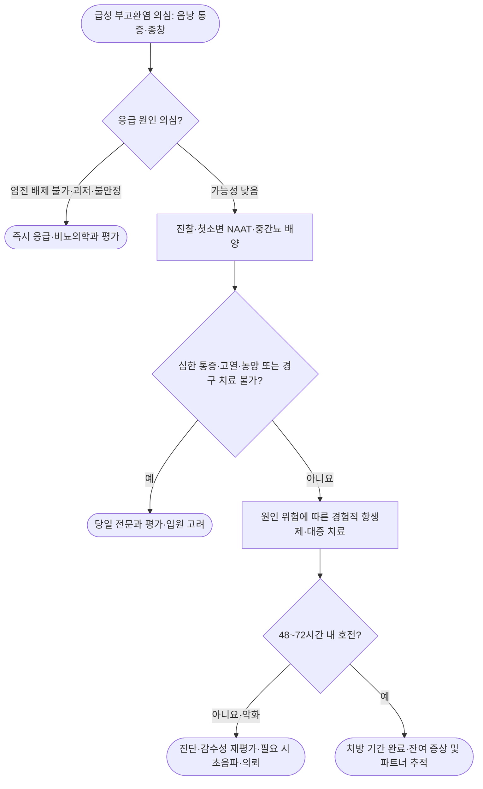

# 급성 부고환염 Acute Epididymitis

## <mark style="color:green;">일반 사항</mark>

* 정의 : 음낭 부종과 통증을 동반하는 부고환의 염증. 흔히 감염성이고 드물게 비감염성 원인에 의함
* 분류 : 급성 ＜6주, 만성 ≥6주
* 역학 : 성활동 남성과 요로폐색·요로 시술 등 위험 인자가 있는 환자에서 발생; 외래 방문 건수와 실제 발생률을 동일시하지 않음
* 경과 : 신속한 치료 시 대부분 양호; 항생제 치료가 종료된 후에도 부종·압통 등 국소 증상은 수 주간 지속될 수 있으며, 이는 그 자체로 치료 실패를 의미하지 않음
* 합병증 : 치료가 지연되거나 부적절한 경우 epididymo-orchitis, abscess 발생, fertility 저하

## <mark style="color:green;">원인</mark>

#### <mark style="color:$primary;">감염성 (Infectious epididymitis)</mark>

* 기전 : 소변의 세균이 정관을 통하여 부고환으로 retrograde, 드물게 혈행성
* 성매개감염이 관련된 경우 : C. trachomatis, N. gonorrhoeae 중심(±M. genitalium); 성활동 연령·병력만으로 원인균을 단정하지 않음
* Insertive anal sex : STI 균주 + 장내세균
* BPH, 요로폐색, 요로 조작/수술(도뇨관 유치, 전립선 생검 등) : E. coli 등 장내세균 중심; 카테터가 있으면 배양 균이 정착·오염인지 실제 감염 원인인지 임상 소견과 함께 판단
* M. tuberculosis : 만성·육아종성 부고환염에서 고려(급성 원인균으로는 드묾)
* ✽나이(＞35세)는 STI 위험이 낮고 장내세균 위험이 높음을 시사하는 보조적 지표일 뿐, 고령에서도 STI가 배제되지 않음

#### <mark style="color:$primary;">비-감염성 (Sterile epididymitis)</mark>

* 기전 : 드물게 감염 없이 염증이 발생하며, 무균성 소변의 역류나 격한 신체 활동과의 연관성이 보고됨. 병력만으로 비감염성을 확진할 수 없음
* 약물성 : 고용량·장기간 amiodarone 사용과 관련된 무균성 부고환염이 보고됨. 의심 시 처방의와 상의하여 용량 조정 또는 대체를 검토하며 임의로 중단하지 않음
* ✽감염 원인이 배제된 비-감염성 부고환염으로 판단되면 항생제는 필요하지 않으며 대증치료(안정, NSAID, 냉찜질)로 관리; 다만 비-감염성 진단은 감염을 배제한 후에 내리는 진단임에 유의

### <mark style="color:orange;">위험 인자</mark>

* 요로 감염, 전립선염
* 도뇨관 유치, 요로 조작/수술, 경직장 전립선 시술
* 배뇨장애·요로폐색 : 요도 협착, 전립선비대증, 신경인성 방광 등
* 전신 질환, 면역 저하, 결핵(특히 만성 부고환염)
* 임균·클라미디아 노출 위험이 있는 성접촉; 삽입 항문성교는 장내세균 노출도 고려
* ✽격한 신체 활동·소변 참기 등과 비감염성 부고환염의 연관성은 보고 수준이며, 일반적인 감염성 부고환염의 확립된 위험 인자로 취급하지 않음

## <mark style="color:green;">임상 양상</mark>

* 대개 수일에 걸쳐 진행하는 편측 고환 뒤쪽 통증·압통·부종·발적. 갑작스럽고 심한 통증은 고환염전을 우선 평가하며 증상 시작 양상만으로 확진·배제하지 않음
* 서혜부, 하복부, 또는 옆구리로의 방사통
* 하부 요로 증상 : 빈뇨, 배뇨통, 혼탁뇨, 혈뇨; 동반 요도염은 무증상일 수 있으며 요도 분비물이 없다고 STI를 배제하지 않음
* reactive hydrocele
* 발열·회음부 통증·배뇨장애 등으로 급성 전립선염이 별도로 의심되는 경우, 상태와 필요성을 판단하여 부드러운 직장수지검사를 고려(전립선 마사지 금지)
* (고환염 발생 시) 고환 및 spermatic cord 압통
* 심한 경우 발열·오한·전신 쇠약
* 양측성 통증·종창은 다른 원인도 적극 감별. 바이러스 전구 증상·이하선 종창을 동반하면 볼거리 고환염을 고려
* ✽당뇨병신경병증이 있는 고령의 환자에서는 통증을 잘 느끼지 못할 수 있음

### 🚩Red Flags

**즉각 조치**

* 갑작스런 심한 편측 고환 통증, 구역·구토, 고환 상승·가로놓임 또는 염전 배제 불가 → 즉시 비뇨의학과/응급실 평가. 도플러 초음파 대기로 수술적 평가를 지연하지 않음  <mark style="color:$danger;">즉각 조치</mark>
* 저혈압·의식 변화 등 혈역학적 불안정 또는 패혈증 의심 → 즉시 응급 평가  <mark style="color:$danger;">즉각 조치</mark>
* 음낭·회음부 발적/부종이 빠르게 퍼짐, 피부 변색·괴사, 염발음 또는 국소 소견보다 심한 통증(Fournier 괴저 의심) → 즉시 응급 평가. 피부 괴사·염발음이 없다고 초기 괴저를 배제하지 않음  <mark style="color:$danger;">즉각 조치</mark>

**당일~수일 내 평가**

* 심한 통증·고열, 농양·고환경색 의심 → **당일** 비뇨의학과/응급 평가 및 입원 여부 판단  <mark style="color:$warning;">당일~수일 내 평가</mark>
* 경구 치료 불가, 빠르게 진행하는 국소 염증 또는 요폐 → **당일** 평가. 고령·당뇨병·면역 저하·CRP 상승 등은 입원 필요성을 높이는 보조 소견  <mark style="color:$warning;">당일~수일 내 평가</mark>
* 치료 시작 후 72시간 이내 호전이 없거나 악화 → 진단·치료 재평가. 악화하거나 합병증이 의심되면 **당일** 의뢰  <mark style="color:$warning;">당일~수일 내 평가</mark>

**조기 평가 및 추적**

* 치료 종료 후에도 뚜렷한 부종·압통, 단단한 종괴, 누공 또는 재발 → 종양·농양·경색·결핵 등 감별. 가벼운 잔여 불편감도 호전 추세를 확인  <mark style="color:$info;">조기 평가 및 추적</mark>

## <mark style="color:green;">진단</mark>

* 재발·장내세균 검출·배뇨장애가 있으면 하부 요로폐색·잔뇨·시술력 등을 평가. 모든 초발 환자에게 방광경·전 요로 영상검사를 일률적으로 시행하지 않음

### <mark style="color:orange;">실험실 검사</mark>

* CBC, CRP : 발열·전신 증상 등 중증도 평가가 필요한 경우 고려(백혈구 증가/좌방이동은 비특이적). 신기능·전해질은 fluoroquinolone(FQ) 또는 trimethoprim/sulfamethoxazole(TMP/SMX) 사용, 고령·탈수·신장질환이 있을 때 확인; 패혈증·중증 전신 감염이 의심되면 혈액배양 등 입원 평가
* 첫소변(first-void urine) : leukocyte esterase 양성 또는 원심분리한 침사에서 WBC ≥10/HPF 등 요도 염증의 객관적 소견 확인
* 요도 분비물이 있으면 Gram stain 등에서 WBC ≥2/oil immersion field 확인; 세포내 그람음성 쌍구균은 임균 감염을 시사. 염증 소견이나 분비물이 없다고 부고환염·STI를 배제하지 않음
* 모든 성인 급성 부고환염 의심 환자 : 첫소변 N. gonorrhoeae·C. trachomatis NAAT와 일반 세균배양용 중간뇨 채취(가능하면 항생제 투여 전). 일반 소변배양은 임균·클라미디아 진단을 대신하지 않음
* 모든 성인 급성 부고환염 환자에서 HIV 검사 및 매독 혈청검사 권고; 성접촉 부위에 따라 인두·직장 임균/클라미디아 NAAT 등도 고려
* 임균 치료 실패·내성이 의심되면 가능하면 재치료 전 임균 배양·감수성 검사; NAAT만으로 항균제 감수성을 알 수 없음
* M. genitalium NAAT : 모든 초발 환자에게 일률적으로 추가하기보다, 임균·클라미디아 등 다른 원인을 평가한 뒤 증상이 지속하고 의심도가 높을 때 고려. 가능하면 내성검사와 연계하며 무증상 선별검사는 권고하지 않음 <mark style="color:$info;">[BASHH 2025]</mark>

* 결핵 의심(만성 결절·음낭 누공, 결핵 병력/노출, 통상 치료 무반응 등) : 연속 3일 이른 아침 소변으로 항산균 배양 및 결핵 NAAT. 필요하면 누공 분비물·조직검사 등을 전문과와 계획하며 소변 검사 음성만으로 배제하지 않음; 흉부 영상은 동반 결핵 평가 시 고려 <mark style="color:$info;">[EAU 2026]</mark>

### <mark style="color:orange;">영상 검사</mark>

* 진단이 불확실하거나 torsion·농양·종양·경색 등 다른 병태가 의심되는 경우, 또는 적절한 치료에도 호전되지 않는 경우 시행
* Color Doppler 초음파 : 급성 음낭통의 감별에 유용하나 부분 염전에서는 부고환염과 비슷하게 보일 수 있음. 염전이 강하게 의심되면 초음파 대기로 즉각적인 비뇨의학과 평가·수술적 탐색을 지연하지 않음
* 정상 또는 음성 도플러 검사만으로 부고환염을 배제하지 않음. 고환 혈류가 유지되어도 초기·부분·간헐 염전이 가능하므로 임상적으로 염전이 의심되면 즉시 재평가

### <mark style="color:orange;">감별 - Acute Scrotal Pain</mark>

<table><thead><tr><th width="156">질환</th><th>시사하는 병력</th><th>진찰 소견(배제 기준은 아님)</th></tr></thead><tbody><tr><td><strong>Epididymitis</strong></td><td>• 수일에 걸쳐 진행 가능 • 배뇨 증상이나 요도 분비물은 없을 수도 있음 • 성접촉·요로 시술 병력 확인</td><td>• 부고환 중심의 압통·종창 • 반응성 음낭수종 가능</td></tr><tr><td><strong>Testicular torsion</strong></td><td>• 갑작스런 심한 편측 통증 • 구역·구토 또는 복통 가능 • 증상 시작 양상만으로 배제 불가</td><td>• 고환의 상승/가로놓임 또는 고환올림근반사 소실이 시사적이나, 없다고 배제 불가</td></tr><tr><td><strong>Torsion of the appendix testis</strong></td><td>• 비교적 국소적인 통증으로 시작 가능</td><td>• 고환 상극의 국소 압통 • blue dot sign이 보일 수 있음</td></tr></tbody></table>

_\*Prehn's sign : 고환을 손으로 밑에서 받쳐 올리면 통증 감소_\
_✽Prehn's sign과 고환올림근반사는 단독으로 염전을 배제하지 못함. 부분 염전에서는 도플러 초음파도 감별이 어려울 수 있어 임상적으로 염전이 의심되면 즉시 비뇨의학과 평가_\
_Ref. CDC STI Treatment Guidelines 2021; EAU Paediatric Urology 2026, Acute scrotum_

* 추가 감별 : 감돈 서혜부탈장, 외상·혈종·고환 파열, 고환 종양, 볼거리 고환염, 고환경색, Fournier 괴저. 서혜부 종괴·복통·구토, 외상력, 양측성 종창, 단단한 종괴 등을 확인
* 농뇨나 세균뇨가 있어도 고환염전이 배제되는 것은 아님. 염전은 청소년에서 특히 중요하나 성인에서도 발생

***



<p align="center"><strong>급성 음낭통 감별 알고리듬</strong></p>

<p align="center"><em><mark style="color:$info;">✽초음파를 기다리느라 수술적 평가를 늦추지 않으며, 증상 시작 후 6시간이 지났어도 긴급 평가가 필요함. Ref. CDC STI Treatment Guidelines 2021; EAU Paediatric Urology 2026</mark></em></p>

***

## <mark style="background-color:$warning;">Management</mark>

### <mark style="color:orange;">치료 방침</mark>

* 감염성 부고환염이 의심되면 검체 채취 후 원인 위험에 따른 경험적 항생제를 시작하며, 검사 결과를 기다리느라 필요한 치료를 지연하지 않음. 배양·감수성, NAAT 및 임상 반응에 따라 조정
* 고열·중증 전신 증상·농양·경구 치료 불가 등은 입원 정주 항생제·수액 치료를 고려. 최근 항생제·요로 시술·내성균 배양력이 있으면 기존 배양 및 지역 내성을 반영하며 경구 FQ를 기계적으로 선택하지 않음
* 사춘기 이전 소아는 성인과 원인·치료가 다름. 염전을 우선 배제하고, 전신 상태가 양호하며 소변검사·배양에서 세균 감염 근거가 없으면 항생제가 보통 필요하지 않음. 영아·전신 감염 의심·재발·배뇨 이상은 소아비뇨의학과 평가 <mark style="color:$info;">[EAU 소아비뇨의학 2026]</mark>
* STI 관련 부고환염에서는 본인·파트너 모두 해당 치료를 완료하고 증상이 소실될 때까지 성관계 중단. 단순 클라미디아의 7일 치료 후 재개 기준을 본인 부고환염의 10일 치료에 그대로 적용하지 않음
  * CDC 부고환염 기준은 증상 발생 전 60일 이내 파트너 및 그 이전이라도 가장 최근 파트너를 평가·검사·추정 치료. 국내 클라미디아 지침은 유증상 8주·무증상 6개월로 차이가 있으므로 확진 병원체와 파트너 상황에 따라 [클라미디아](115_-4.chlamydia.md) 챕터 기준도 적용. 파트너는 직접 진료를 연계 <mark style="color:$info;">[CDC 2021; 국내 STI 2023]</mark>

## <mark style="color:green;">비-약물 치료 및 예방</mark>

* 대증 치료 : 안정/활동 제한, 음낭 거상·지지(예: scrotal supporter), 냉찜질. 냉팩은 수건으로 감싸 한 번에 10~15분 정도 적용하고 피부에 직접 대거나 잠든 채 사용하지 않음. 통증·발열에 대한 약제는 아래 약물 치료 참조
* 예방
  * 동반된 배뇨장애·전립선비대증·요로감염은 원인에 따라 평가·치료
  * 비감염성 부고환염이 의심되면 증상을 악화시키는 활동을 한동안 줄이고 충분히 회복한 뒤 활동 재개
  * 요로 조작/수술 전 예방적 항생제 투여 여부는 해당 시술의 감염예방 지침에 따라 결정
  * ✽볼거리(mumps) 백신 : 세균성 부고환염이 아닌 볼거리 바이러스성 orchitis 예방 목적
  * ✽doxycycline PEP : 부고환염 자체의 예방 요법은 아님. 최근 12개월 내 세균성 STI 병력이 있는 MSM/TGW에서는 CDC 2024 STI 예방 지침에 따라 성접촉 후 72시간 이내 doxycycline 200 ㎎(24시간 최대 200 ㎎) 사용의 이득·위험을 개별 상담; 국내 STI 예방 목적은 허가 외 사용(☞ [STI](115_-1.STI.md#doxy-pep))

## <mark style="color:green;">약물 치료</mark>

### <mark style="color:orange;">항생제 \[CDC 2021 중심]</mark>

* 아래 처방례는 성인 기준이며 소아·청소년에는 그대로 적용하지 않음. 국내 크라비트정은 소아 및 18세 이하 성장 중인 청소년에서 금기이며, doxycycline은 국내 허가상 12세 미만 금기(테트라사이클린 계열의 전통적인 8세 기준과 구분)


**Ceftriaxone 용량 - 지침별 차이**\
CDC 2021 부고환염 요법 : ceftriaxone 500 ㎎ IM ×1회(체중 ≥150 kg이면 1 g IM) + doxycycline 100 ㎎ bid ×10일\
2024 European 부고환-고환염 지침(2026년 출판) : 임균 등 STI 가능성이 높으면 ceftriaxone 1 g IM ×1회 + doxycycline 권고(azithromycin의 일률적 병용 비권고)\
EAU 2026 : 임균 가능성이 높으면 ceftriaxone 1 g IM/IV ×1회 + doxycycline 10~14일 등\
국내 성매개감염 진료지침 2023의 임균 감염 치료 용량 : ceftriaxone 500 ㎎ IM/IV 또는 1 g IV ×1회(부고환염 전용 요법은 아님). 아래 처방례는 **CDC 2021 부고환염 전용 요법**에 따르며, 단순 임질 챕터의 국내 학회 100 kg 기준을 부고환염에 자동 대입하지 않음. Doxycycline 10일과 단순 클라미디아 7일 요법의 차이도 질환에 따른 것임


* STI(Chlamydia or Gonorrhea) 의심 : ceftriaxone 500 ㎎ IM ×1회(체중 ≥150 ㎏은 1 g IM) <mark style="color:blue;">\[트리악손]</mark> plus doxycycline 100 ㎎ bid ×10d <mark style="color:blue;">\[독시사이클린]</mark>
* Insertive anal sex 등으로 STI와 장내 균주가 모두 의심 : ceftriaxone 500 ㎎ IM ×1회(체중 ≥150 ㎏은 1 g IM) plus levofloxacin 500 ㎎ qd ×10d
* 장내 균주만 의심 : 임균 가능성이 낮고 임균을 배제한 경우 levofloxacin 500 ㎎ qd ×10d <mark style="color:blue;">\[크라비트]</mark> 단독. 요도 분비물이 없거나 그람염색이 음성이라는 이유만으로 무증상 임균 감염을 배제하지 말고 성접촉 병력·NAAT를 함께 고려; 배양·감수성 결과에 따라 조정
* Mycoplasma genitalium이 검출되고 다른 원인 및 동반감염을 평가하여 관련 부고환염으로 판단한 경우 : moxifloxacin 400 ㎎ qd ×14d <mark style="color:blue;">\[아벨록스]</mark> (IUSTI 2021 및 BASHH 2025 복잡 감염 권고, Grade 1C). 균 검출만으로 부고환염의 원인이라고 단정하지 않으며 전문의와 상의하여 적용. 국내 아벨록스정 허가 적응증에 부고환염이 없어 허가 외 사용에 해당; QT 연장·저칼륨혈증·병용약 확인. BASHH 2025에서는 이 복잡 감염 요법 전에 doxycycline을 의무적으로 선행할 필요는 없다고 함. levofloxacin/ofloxacin은 M. genitalium 대체제로 권장하지 않음
* 위 levofloxacin 500 ㎎ qd ×10일은 **CDC 부고환염 지침 요법**으로, 국내 크라비트정500㎎에는 부고환염이 별도 허가 적응증으로 명시되어 있지 않아 허가 외 사용임. 신기능·배양 감수성을 반영하며 국내 제품별 신기능 조정표를 따름; 만성 전립선염의 국내 허가 용법은 해당 챕터 참조 <mark style="color:$info;">[CDC 2021; 식약처 크라비트정500㎎]</mark>
* 세팔로스포린 중증 과민반응, 특히 임균 치료에 ceftriaxone을 사용할 수 없는 경우는 전문과와 대안을 결정. 단순 임질의 gentamicin+azithromycin 단회 처방을 부고환염의 완결 요법으로 전용하지 않음 <mark style="color:$info;">[CDC 2021]</mark>
* **FQ를 사용할 수 없는 경우의 EAU 2026 대안** : 임균을 배제하고 장내세균 감수성을 고려하여 선택. 임균 가능성이 남아 있으면 아래 요법만으로 치료하지 않음
  * 장내세균만 원인으로 판단 : TMP/SMX 160/800 ㎎ bid ×10~14일
  * 임균 위험이 낮으나 클라미디아와 장내세균을 모두 포괄해야 함 : doxycycline(초회 200 ㎎ 후 100 ㎎ bid) + TMP/SMX 160/800 ㎎ bid ×10~14일. 병원체와 반응에 따라 기간 조정
  * TMP/SMX 160/800 ㎎은 국내 셉트린정(TMP 80 ㎎/SMX 400 ㎎) **1회 2정**에 해당. 국내 해당 제품에 부고환염은 별도 허가 적응증이 없어 허가 외 사용; 설폰아미드 과민반응·신기능·혈구감소·고칼륨혈증 및 ACE 억제제/ARB·spironolactone·warfarin 등 병용약 확인. 국내 허가상 CrCl 15~30 mL/min은 정상 용량의 1/2, 15 mL/min 이하는 투여가 권장되지 않음. 경계값·제형은 제품표 확인


**Levofloxacin 신기능 조정은 국내 제품표를 확인**

본 장의 500 ㎎ qd ×10일은 신기능이 보존된 성인의 CDC 지침 요법이며, 크라비트정500㎎의 부고환염 전용 허가 용법은 없습니다. 해당 국내 제품의 다른 적응증(500 ㎎ 시작 요법) 조정표에는 CrCl 50~80 mL/min에서도 초회 500 ㎎ 후 250 ㎎ q24h가 기재되어 있어, 해외의 ‘CrCl ＜50에서 조정’ 기준과 차이가 있습니다. 부고환염에 다른 적응증 표를 그대로 대입하거나 CrCl 50 이상이면 무조건 500 ㎎을 유지하지 말고, 선택 제품의 허가표·감염 중증도·감수성을 바탕으로 용량을 결정합니다.


* FQ는 임균 치료제로 사용하지 않음. Moxifloxacin을 장내세균성 부고환염의 levofloxacin 대체제로 일률적으로 사용하지 않음
* ✽임균 치료에 azithromycin을 일률적으로 병용하지 않음. 위 doxycycline 병용은 동반 클라미디아 감염의 치료·경험적 포괄을 위한 것

### <mark style="color:orange;">항생제 안전성·상호작용</mark>

* Doxycycline 100 ㎎ bid ×10일도 부고환염 지침 요법이며, 위 처방례의 국제독시사이클린캡슐에는 부고환염이 별도 허가 적응증으로 명시되어 있지 않음(허가 외 사용). 요도염 등 다른 적응증의 허가와 구분

* FQ : 과거 FQ 관련 건염/건파열·중대한 신경계 이상반응, 중증근무력증, QT 연장·병용약, 대동맥류/박리 고위험 및 혈당 이상 위험 등을 평가. 크라비트정은 뇌전증 환자에게 금기이며 전신 corticosteroid 병용은 건파열 위험 때문에 피함. 새 힘줄 통증·말초신경 증상이 나타나면 중단·재평가
* Doxycycline : 충분한 물과 함께 앉거나 선 자세로 복용하고 취침 최소 1시간 전에 복용. 철·아연·칼슘/마그네슘/알루미늄 함유 제제와 2시간 이상 간격; isotretinoin 등 retinoid 병용 금지
* Levofloxacin : 철·아연·제산제·수크랄페이트 등 다가 양이온 제제와 전후 2시간 이상 간격. Warfarin 병용 시 INR 변화에 주의

### <mark style="color:orange;">통증</mark>

* NSAID는 최소 유효 용량·기간으로 선택하고 신·위장관·심혈관 위험 및 탈수를 평가. 여러 NSAID를 병용하지 않으며 FQ와 NSAID 병용 시 경련 위험 인자를 확인
* NSAID : naproxen <mark style="color:blue;">\[낙센]</mark>, ibuprofen <mark style="color:blue;">\[부루펜]</mark>. 부루펜은 국내 허가상 위장관궤양/출혈, 중증 간·신·심장기능장애, 심한 고혈압, 기관지천식 및 aspirin/NSAID 유발 천식·두드러기·알레르기 반응 병력 등에서 금기. 궤양·출혈 병력 등 제품별 상세 금기는 통증 챕터 참조
* dexibuprofen <mark style="color:blue;">\[애니펜]</mark> : NSAID 대안; 1회 300 ㎎, 1일 2~4회(최대 1,200 ㎎/일). 기저 신장·위장관·심혈관 위험 및 제품별 금기를 확인하여 단기간 사용
* NSAID 사용이 어렵거나 추가 진통이 필요하면 acetaminophen 등을 고려(☞ [통증](../220_/001_-pain.md)). 심한 통증은 약제를 강화하기 전에 염전·농양·경색을 재평가하며 opioid 복합제를 통상 처방으로 제시하지 않음

## <mark style="color:green;">시술 및 기타 처치</mark>

* 농양·괴사 또는 적절한 항생제에도 진행하는 감염 : 비뇨의학과에서 배농·괴사 조직 제거 등 수술적 치료 여부 결정
* 고환염전 의심 : 항생제 반응을 기다리지 않고 즉시 수술적 평가
* 정삭 차단(spermatic cord block)은 염전·농양 등 응급 원인을 배제한 뒤 전문의가 시행하는 선택적 통증 치료

### <mark style="color:orange;">추적 관리</mark>

* 치료 개시 후 48~72시간에 증상 호전 여부 확인. 호전이 없거나 악화하면 예정된 치료 종료일까지 기다리지 않고 진단·항생제 선택 재평가; torsion, abscess, tumor, infarction 등 배제
* 항생제 종료 후에도 부종·압통이 뚜렷하게 남거나 악화하면 abscess, tumor, infarction, TB 등 감별 및 비뇨의학과 의뢰. 국소 불편감이 수 주간 남을 수 있으므로 호전 추세·새로운 소견을 함께 판단
* STI 가능성이 높거나 확진된 경우 치료 종료 약 2주 후 임상 회복·파트너 평가/치료 여부 확인(EAU). 이 방문 자체가 일률적인 NAAT 완치검사 시점을 뜻하지 않음
* 임균 또는 클라미디아 양성이었던 경우 : 재감염 탐지를 위해 치료 완료 3개월 후 재검사(CDC) - 치료 실패 확인용 test-of-cure와는 별개의 개념
* 임균/클라미디아 등 개별 STI의 test-of-cure 적응증은 해당 STI 챕터 기준을 따름
* _M. genitalium_ 완치검사(TOC) : **국내 STI 2023은 증상 소실 여부와 관계없이 모든 치료 환자에서 치료 완료 3주 이후 NAAT 완치검사를 권고**하므로 국내 적용의 기본 추적 계획으로 제시. IUSTI 2021은 모든 환자에서 TOC를 고려하고 최소 3주 후 검체 채취를 권고. 반면 BASHH 2025는 증상 소실 시 일률적인 TOC를 권고하지 않고 지속 증상·지속 감염 의심 때 재검을 고려함. 이 지침 차이를 설명하고 내성·재감염 위험과 복잡 감염 경과를 반영하여 전문과와 추적; TOC를 계획했다면 음성 확인 전 무방비 성접촉을 피하도록 안내 <mark style="color:$info;">[국내 STI 2023; IUSTI 2021; BASHH 2025]</mark>

***

## <mark style="color:red;">질병코드</mark>

* **N45는 상위 분류**이며 다음 KCD-9 완전코드를 병변·농양 유무에 따라 선택

<table><thead><tr><th>코드</th><th>진단명</th></tr></thead><tbody><tr><td>N45.90</td><td>농양을 동반하지 않은 부고환염</td></tr><tr><td>N45.92</td><td>농양을 동반하지 않은 부고환-고환염</td></tr><tr><td>N45.00</td><td>농양을 동반한 부고환염</td></tr><tr><td>N45.02</td><td>농양을 동반한 부고환-고환염</td></tr></tbody></table>

* 특정 감염으로 확진되면 원인 질환의 분류 지침을 우선 확인
  * 임균성 부고환염 : A54.2†, 발현 코드 N51.1*
  * 클라미디아 부고환염 : A56.1†, 발현 코드 N51.1*
  * 결핵성 부고환염 : A18.14†, 발현 코드 N51.1*
* †는 원인 질환, *는 달리 분류된 질환의 발현 코드로 *코드만 단독 사용하지 않음. 위 확진 원인 질환을 단순히 N45 또는 하부요로감염 코드 A54.0/A56.0으로 대체하지 않음
* 확인 자료 : 제공된 KCD9_251216(2).xlsx의 「상병분류기호(완전코드)」 및 포함 항목

***

## <mark style="color:purple;">처방례</mark>

> **처방례 1. STI(클라미디아/임균) 의심**
>
> ```
> 트리악손 주 500 ㎎  IM 1회 (체중 ＜150 ㎏)
> 체중 ≥150 ㎏이면 트리악손 주 1 g  IM 1회
> 국제독시사이클린 100 ㎎/C  1C bid  10일간
> 애니펜 300 ㎎/T  1T tid 필요 시  3일간
> ```
>
> _✽체중 ≥150 ㎏은 ceftriaxone 1 g IM. Lidocaine으로 조제한 IM 주사액은 IV 투여 금지. Ceftriaxone 500 ㎎ IM 1회 + doxycycline 100 ㎎ bid ×10d 병용(CDC 2021 부고환염 요법); 애니펜은 dexibuprofen으로 통증 조절용 NSAID_

> **처방례 2. 장내 균주만 의심·임균 배제**
>
> ```
> 크라비트 500 ㎎/T  1T qd  ×10d
> 부루펜 200 ㎎/T  2T tid 필요 시  3일간
> ```
>
> _✽levofloxacin은 국내 해당 제품의 부고환염 허가 외 사용이며 신기능별 용량 조정. 단독 요법(CDC 2021); 장내세균 원인이 유력하고 임균 가능성을 평가·배제한 경우에만 사용. 배양·감수성 결과에 따라 조정_

> **처방례 3. STI + 장내 균주 동시 의심**
>
> ```
> 트리악손 주 500 ㎎  IM 1회 (체중 ＜150 ㎏)
> 체중 ≥150 ㎏이면 트리악손 주 1 g  IM 1회
> 크라비트 500 ㎎/T  1T qd  ×10d
> 부루펜 200 ㎎/T  2T tid 필요 시  3일간
> ```
>
> _✽체중 ≥150 ㎏은 ceftriaxone 1 g IM. Levofloxacin은 국내 해당 제품의 부고환염 허가 외 사용. Ceftriaxone 500 ㎎ IM 1회 + levofloxacin 500 ㎎ qd ×10d 병용(CDC 2021 부고환염 요법); 임균·클라미디아와 장내세균이 모두 의심되는 경우(예: 삽입 항문성교). 국내 임균 지침과 유럽 부고환염 지침의 ceftriaxone 용량 차이는 상단 hint 참조_

> **처방례 4. M. genitalium 관련 부고환염으로 판단된 경우**
>
> ```
> 아벨록스 400 ㎎/T  1T qd  ×14d
> 부루펜 200 ㎎/T  2T tid 필요 시  3일간
> ```
>
> _✽M. genitalium 검출만으로 인과관계를 확정하지 않음. 다른 원인·동반감염을 평가하고 M. genitalium 관련 복잡 감염으로 판단한 경우 IUSTI 2021/BASHH 2025 복잡 감염 권고(Grade 1C)에 따름. 국내 허가 외 사용으로 QT 연장 위험·병용약 확인 및 완치검사 여부를 포함한 추적 계획 필요_

***

### <mark style="color:$success;">핵심 복약 지도</mark>

> **항생제, 처방된 기간까지 반드시 완료하세요**
>
> * 처방된 항생제는 정해진 용량과 기간에 따라 복용하고, 증상이 좋아졌다고 임의로 중단하거나 남은 약을 임의로 연장하지 않도록 안내
> * 치료 시작 후 72시간 이내 호전이 없거나 악화하면 치료 종료를 기다리지 말고 재평가; 치료 종료 후에도 뚜렷한 부종·압통이 남거나 악화할 때도 평가 필요
> * doxycycline 복용 시 충분한 물과 함께 복용, 앉거나 선 자세로 복용하며 취침 최소 1시간 전에 복용하도록 안내(식도 자극 예방); 광과민 반응 주의(자외선 차단)
> * levofloxacin·moxifloxacin 복용 중 새로 생긴 힘줄 통증·부종, 저림·감각 이상 등이 나타나면 복용을 중단하고 즉시 처방의와 상담. levofloxacin은 신기능 저하 시 용량 조정 여부 확인
> * doxycycline과 levofloxacin은 철분·아연·제산제 등과 2시간 이상 간격을 두고 복용; 다른 약도 복용한다면 약제별 간격 확인
> * NSAID는 항생제 복용 기간 내내 자동으로 복용하지 말고 필요한 최소 기간만 사용; 진통제를 늘려야 할 정도로 통증이 지속되면 재평가
> * STI가 원인으로 확인/의심되는 경우, 본인과 성 파트너의 치료가 모두 완료되고 증상이 소실될 때까지 성관계 금지; 최근 성 파트너도 함께 검사·치료 받도록 안내

> **음낭 지지와 냉찜질, 통증 조절**
>
> * scrotal supporter 착용 및 안정으로 부종·통증 완화
> * 냉팩을 수건에 감싸 한 번에 10~15분 정도 냉찜질; 피부에 직접 대지 않음
> * NSAID로 조절되지 않는 심한 통증은 torsion·abscess 등 재평가 우선, 배제 후 전문의가 추가 통증 치료 고려

> **언제 다시 병원을 방문해야 하나요?**
>
> * 치료 시작 후 72시간 이내 증상이 호전되지 않거나 악화하는 경우(치료 종료까지 기다리지 않음)
> * 치료 종료 후에도 부종·압통이 뚜렷하게 남거나 악화하는 경우
> * **갑자기 통증이 심해지거나 고환이 위로 당겨 올라간 느낌**, 발열·오한이 동반되는 경우 - 즉시 응급실 방문(testicular torsion, abscess 감별)
> * 항생제 복용 중 심한 설사, 발진 등 약물 이상반응이 생긴 경우

***

## <mark style="color:green;">주요 참고문헌 및 확인 자료</mark>

### ＜임상 근거＞

* CDC. [Epididymitis, STI Treatment Guidelines 2021](https://www.cdc.gov/std/treatment-guidelines/epididymitis.htm).

* EAU. [Urological Infections 2026: acute epididymitis](https://uroweb.org/guidelines/urological-infections/chapter/the-guideline).

* Justice ED, et al. [The 2024 European guideline on epididymo-orchitis](https://pubmed.ncbi.nlm.nih.gov/40698982/). J Eur Acad Dermatol Venereol. 2026;40(2):166–173. doi:10.1111/jdv.20865 (온라인 2025).

* Jensen JS, et al. [2021 European guideline on Mycoplasma genitalium infections](https://iusti.org/wp-content/uploads/2022/03/Jensen-et-al_Published.pdf). J Eur Acad Dermatol Venereol. 2022;36:641–650. doi:10.1111/jdv.17972.

* 질병관리청·대한요로생식기감염학회. [성매개감염 진료지침 2023](https://stiguide.kr/wp-content/uploads/2023/04/Korean_STI_Guidelines_2023.pdf).

* BASHH. Soni S, et al. [Mycoplasma genitalium guideline 2025](https://www.bashh.org/_userfiles/pages/files/bashh_mgen_2025.pdf). Int J STD AIDS. 2026;37(6):576–588. doi:10.1177/09564624251359054 (온라인 2025).

* EAU/ESPU. [Paediatric Urology 2026: Acute scrotum](https://uroweb.org/guidelines/paediatric-urology/chapter/acute-scrotum).

* CDC. [Doxy-PEP Guidelines 2024](https://www.cdc.gov/mmwr/volumes/73/rr/rr7302a1.htm).

### ＜허가·급여 확인 자료＞

* 식품의약품안전처. 의약품안전나라 — 국내 제품별 적응증·용법·금기 및 허가 상태(허가 외 사용의 급여 인정 여부와는 별개). 크라비트정500밀리그람, 아벨록스정400밀리그람, 국제독시사이클린하이클레이트수화물캡슐100밀리그램, 셉트린정, 애니펜정300밀리그램, 부루펜정200밀리그램 대조(2026-10-28).
  [https://nedrug.mfds.go.kr/index](https://nedrug.mfds.go.kr/index)

* 질병코드 확인 : 제공된 KCD9_251216(2).xlsx(2026년 시행 KCD-9), 상병분류기호(완전코드).

***

### <mark style="color:blue;">환자 안내서</mark>


**부고환염, 대부분 항생제 치료로 잘 낫습니다**

부고환염은 고환 뒤쪽에 있는 '부고환'이라는 관에 염증이 생기는 질환입니다. 방광염처럼 세균 감염이 원인인 경우가 많고, 적절한 항생제 치료를 받으면 대부분 좋아집니다.


#### <mark style="color:$primary;">왜 생기나요?</mark>

* 요로의 장내세균이나 성 접촉을 통해 옮는 세균(클라미디아·임균 등)이 원인이 될 수 있습니다. 나이만으로 원인을 단정할 수 없어 검사와 병력을 함께 봅니다.
* 드물게 감염이 없는 염증도 생길 수 있지만, 감염을 평가한 뒤 판단합니다.
* 성매개감염이 원인이라면 성 파트너도 검사·치료가 필요합니다.

#### <mark style="color:$primary;">일상생활에서 어떻게 관리하나요?</mark>

* **음낭을 받쳐 올려주는 서포터(scrotal supporter)를 착용하십시오.** 통증과 부종을 줄여줍니다.
* **최대한 안정을 취하고 심한 신체 활동은 피하십시오.**
* **초기에는 냉찜질을 하십시오.** 냉팩은 수건에 감싸 한 번에 10~15분 정도 사용하고 피부에 직접 대거나 잠든 채 사용하지 마십시오.
* 불편감을 악화시키는 활동은 회복될 때까지 줄이십시오. 배뇨장애가 있다면 진료 시 알려주십시오.

#### <mark style="color:$primary;">항생제는 어떻게 써야 하나요?</mark>

* **처방된 항생제는 정해진 용량과 기간에 따라 복용하고, 증상이 좋아졌다고 임의로 중단하거나 남은 약을 임의로 연장하지 마십시오.** 중간에 끊으면 치료가 불완전해지고 재발할 수 있습니다.
* 원인이 성 접촉으로 인한 감염으로 확인·의심되는 경우, **본인과 성 파트너의 치료가 모두 끝나고 증상이 없어질 때까지 성관계를 피하십시오.** 최근 성 파트너도 검사와 치료를 받아야 합니다.
* 독시사이클린은 충분한 물과 함께 앉거나 선 자세로 복용하고 취침 최소 1시간 전에 복용하십시오. 철분·제산제 등과 복용 간격을 확인하십시오.
* 레보플록사신·목시플록사신 복용 중 힘줄이 아프거나 붓고, 저림·감각 이상이 새로 생기면 복용을 중단하고 즉시 처방의와 상담하십시오.
* 통증은 수일 안에 호전되기 시작하지만 부기·불편감은 수 주간 남을 수 있습니다. 남은 증상만으로 항생제를 임의로 연장하지 말고 경과를 확인받으십시오.

#### <mark style="color:$primary;">이럴 때는 즉시 병원을 방문하세요</mark>

* **갑자기 고환 통증이 매우 심해지거나 고환이 평소보다 위로 당겨 올라간 느낌이 들 때**
* 심한 발열, 오한이 동반될 때
* 치료 시작 후 72시간 이내 증상이 좋아지지 않거나 오히려 악화할 때(항생제가 끝날 때까지 기다리지 마십시오)
* 음낭·회음부의 붓기나 붉은 부위가 빠르게 퍼지거나 피부가 검게 변할 때
