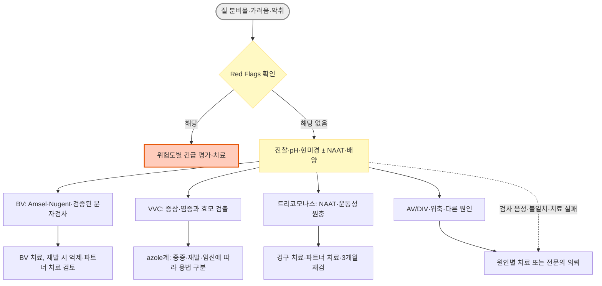

# 음문질 감염증 Vulvovaginal Infections

## <mark style="color:green;">일반 사항</mark>

_임상 근거 및 제품 정보 확인: 2026-10-28. 국제 지침의 권고 요법과 국내 제품별 허가사항이 다른 경우를 구분하여 기술함._

* 비정상적인 질 분비물, 악취, 가려움, 작열감 등의 증상을 일으키는 감염, 염증, 또는 normal flora 변화와 관련된 외음질의 질환군
* vaginosis - 질내균총 불균형이 중심이며 뚜렷한 염증은 대개 적음; vaginitis - 질 염증 소견 동반
* 원인 질환에 따라 재발할 수 있음. 트리코모나스 질염은 첫 진단부터 성 파트너의 동시 치료가 필요하며, 반복성 세균성 질증은 파트너 치료를 개별적으로 고려

## <mark style="color:green;">원인 및 위험 인자</mark>

* 주요 감염·질내균총 이상 : 세균성 질증(BV), 외음질 칸디다증(VVC), 트리코모나스 질염. 각 원인의 비율은 지역·연령·진료 환경·검사법에 따라 달라 고정된 비율을 국내 환자에게 적용하지 않음
* 비감염성 원인 : estrogen 감소(위축성 질염), 물리적/화학적 자극, 알레르기, 이물질, 박리성 염증성 질염
* 동반·감별 질환 : 자궁경부염, 골반염(PID), 외음부 피부질환
* 위험 인자
  * BV : 새로운 또는 다수의 성 파트너, 콘돔 미사용, 질 세척(douching), 흡연과 연관. 구리 자궁 내 장치 사용 시 BV 빈도가 증가할 수 있으나 모든 자궁 내 장치를 자극성 질염의 원인으로 묶지 않음
  * VVC : 항생제·스테로이드 사용, 당뇨병, 면역저하, 임신, SGLT2 억제제 사용. 건강한 여성에서는 뚜렷한 유발 요인이 없는 경우도 흔함
  * 비감염성 : estrogen 감소(폐경, 난소 제거술, 수유기), 질 세정제·향이 있는 비누·국소 약제 등 자극·알레르기 유발 물질
  * 조이는 옷·습한 환경은 자극을 악화시킬 수 있으나 VVC의 확립된 원인으로 단정하지 않음

## <mark style="color:green;">임상 양상</mark>

* 주요 증상 : 질 분비물, 가려움, 악취 - 세 증상이 항상 함께 나타나는 것은 아니며, 세균성 질증·편모충증에서 악취가 흔함
* 작열감, 통증, 자극 증상, 외음부 배뇨통(배뇨 시 소변이 음순·질 입구를 자극)

### <mark style="color:orange;">아형별 비교</mark>

<table><thead><tr><th width="140">질환</th><th width="110">무증상 감염·집락</th><th width="220">분비물 특징</th><th width="90">악취</th><th>기타 소견</th></tr></thead><tbody><tr><td>세균성 질증(BV)</td><td>무증상이 흔함</td><td>흰색, 낮은 점도, 균질, 질 벽을 coating</td><td>+(fishy)</td><td>뚜렷한 염증은 대개 적음</td></tr><tr><td>Aerobic vaginitis</td><td>증상·현미경 소견으로 평가</td><td>농성 분비물</td><td>-/±</td><td>질 작열감·따가움, 성교통, 질 홍반/점상출혈; 궤양은 HSV·피부질환 등 감별</td></tr><tr><td>칸디다증(VVC)</td><td>무증상 집락과 구분</td><td>덩어리(치즈 모양)</td><td>-</td><td>질 통증/가려움, 성교통, 질 홍반/부종, vulval fissuring, 위성 피부 병변</td></tr><tr><td>트리코모나스 질염</td><td>무증상이 흔함</td><td>거품/노란색~초록색</td><td>+</td><td>질 가려움/자극, 배뇨통, strawberry cervix(딸기 모양 자궁경부, 드묾)</td></tr></tbody></table>

_✽건강한 여성의 약 10\~20%에서 Candida가 무증상으로 집락되어 있으며, 이를 증상성 외음질 칸디다증과 구분함 <mark style="color:$info;">\[CDC 2021]</mark>_

### <mark style="color:orange;">세균성 질증 (Bacterial vaginosis, BV)</mark>

* 가임기 여성에서 비정상 질 분비물의 가장 흔한 원인
* 기전 : 혐기성 균주가 정상 Lactobacilli를 대치 → lactic acid 생성 감소 → 질 pH 상승(산성도 감소) → 혐기성 균주 증식 → G. vaginalis 등에 의한 biofilm 형성
* 원인균 : Gardnerella vaginalis, Prevotella, Fannyhessea vaginae(이전 명칭 Atopobium vaginae), Megasphaera, Mobiluncus 등 polymicrobial
* 증상 : 무증상이 흔함; 증상 시 흰색\~회색의 낮은 점도, 균질, 생선 비린내가 나는 분비물이 질 벽을 coating; 다른 원인에 비해 염증·자극 증상은 상대적으로 적음
* 재발이 흔하며 연구·추적 기간에 따라 차이가 큼; 치료 후 12개월 내 약 절반 이상에서 재발 가능 <mark style="color:$info;">\[IUSTI 2023]</mark>

### <mark style="color:orange;">Aerobic vaginitis</mark>

* 기전 : Lactobacilli 감소 및 질 pH 상승과 함께 호기성 균(예: E. coli, group B Streptococcus, S. aureus)이 우세해지는 상태 - 염증성 질환으로 분류되지만 병태생리가 명확히 규명되지는 않음
* ✽CDC의 별도 진단·치료 기준은 없으나 IUSTI 2023 유럽 지침은 현미경 소견에 따른 평가·치료를 제시함. 균 배양 양성만으로 진단하지 않으며 위축성 변화·피부질환·혼합감염을 감별 <mark style="color:$info;">\[IUSTI 2023]</mark>
* 증상 : 농성 분비물, 질 홍반·작열감·성교통. 현미경에서 lactobacilli 감소, 백혈구 증가·독성 백혈구, 방기저세포(parabasal cell) 등을 평가함
* 박리성 염증성 질염(desquamative inflammatory vaginitis, DIV)은 AV와 소견이 겹칠 수 있으나 단순 세균 배양 양성으로 진단하는 질환이 아님. 감염·저에스트로겐 상태·미란성 편평태선 등을 배제하여 진단하며 재발·지속 시 전문의 평가

### <mark style="color:orange;">외음질 칸디다증 (Vulvovaginal Candidiasis, VVC)</mark>

* 건강한 여성의 약 10\~20%에서 Candida가 무증상으로 질 내에 집락(colonization)되어 있음; 여성의 75%가 평생 ≥1회 증상성 VVC를 경험 <mark style="color:$info;">\[CDC 2021]</mark>
* ✽무증상 집락(colonization) 자체는 치료 적응증이 아님. 증상·염증 소견과 효모 검출을 함께 해석하며, 가려움이나 양성 PCR만으로 VVC를 확정하지 않음
* 원인균 : C. albicans가 대부분. non-albicans(C. glabrata 등)는 재발성 VVC에서 약 10\~20%를 차지하며 azole 반응이 낮을 수 있음
* 기전 : Candida의 과증식·상피와의 상호작용 및 국소 염증 반응; 단순 집락과 증상성 감염을 구분
* 위험 인자 : 스테로이드·항생제 사용, 당뇨병, 면역저하, 임신, SGLT2 억제제. 재발 시 혈당과 복용 약물을 확인 <mark style="color:$info;">\[CDC 2021; empagliflozin 허가정보 2026]</mark>
* 분비물 : 흰색, 높은 점도, 덩어리(치즈 모양), 악취 없음
* 분비물 외 증상 : 가려움, 작열감, 배뇨 곤란, 성교통

#### <mark style="color:$primary;">Uncomplicated VVC</mark>

* C. albicans가 추정되는 경증\~중등증 VVC가 면역 정상 여성에서 산발적·드물게 발생하고, complicated VVC의 숙주 요인이 없는 경우

#### <mark style="color:$primary;">Complicated VVC</mark>

* 재발성(RVVC), 중증(심한 외음부 발적·부종·찰상·열상), non-albicans 감염, 또는 당뇨병·면역저하·면역억제 치료 등 숙주 요인이 동반된 경우 <mark style="color:$info;">\[CDC 2021]</mark>
* ✽CDC 분류표에는 당뇨병 자체가 complicated VVC에 포함됨. 특히 혈당 조절 불량·면역저하에서는 단기 요법 반응이 낮아 7\~14일 치료가 필요
* ✽CDC 2021은 임신을 별도 특수 상황(special population)에서 다룸. 임신 중에는 국소 azole계 7일 요법을 적용

### <mark style="color:orange;">편모충 질염 (Trichomonal vaginitis)</mark>

* 원인균 : Trichomonas vaginalis (성매개)
* 기전 : 성관계를 통해 전파되어 질·요도 상피세포를 침범(요도·질주위샘에도 감염될 수 있어 질 내 국소제만으로 치료하지 않음)
* 무증상이 흔함(문헌마다 보고 비율 편차가 큼)
* 분비물 : 화농성, 악취, 노란색\~초록색
* 분비물 외 증상 : 작열감, 가려움, 배뇨 곤란, 성교통, 성관계 후 출혈
* ✽HIV 감염 여성에서는 무증상이라도 진료 시작 시 및 이후 적어도 매년 선별 검사가 권고됨 <mark style="color:$info;">\[CDC 2021]</mark>

### <mark style="color:orange;">자극성 및 알레르기성 질염 (Irritant and Allergic vaginitis)</mark>

* 원인 : 살정제, 질 세정 용액, 피임용 격막(diaphragm), 라텍스 콘돔, 국소 의약품
* 증상 : 가려움, 질 불편감

### <mark style="color:orange;">위축성 질염 (Atrophic vaginitis)</mark>

* 질과 질 주변 조직이 건조·위축되고 염증을 일으킨 상태
* 원인 : estrogen 결핍(폐경, 난소 제거술, 수유기, 항에스트로겐 치료)
* 증상 : 질 건조, 자극감, 화끈거림, 성교통, 마찰·자극 시 출혈, 질 분비물, 방광 자극 증상(빈뇨, 배뇨통)

### 🚩Red Flags

<mark style="color:$danger;">**즉각 조치**</mark>

* 심한 하복부 통증, 복막 자극 징후, 전신 상태 불량을 동반한 고열·구토 또는 골반농양 의심 <mark style="color:$danger;">\[응급 평가]</mark>
* 임신 중 복통·질 출혈, 특히 편측통·어지럼·실신·혈역학적 불안정 동반 <mark style="color:$danger;">\[자궁외임신 등 긴급 감별]</mark>
* 심한 외음부·회음부 통증, 급속한 부종·괴사 또는 저혈압; SGLT2 억제제 사용 시 괴사성 감염이 의심되면 중단하고 긴급 처치 <mark style="color:$danger;">\[괴사성 감염·패혈증]</mark>
* 성적 학대 의심 정황과 함께 즉각적인 안전 위협 또는 급성 외상이 있음 <mark style="color:$danger;">\[안전 확보·전문기관 연계]</mark>

<mark style="color:$warning;">**당일\~수일 내 평가**</mark>

* 골반통·하복통과 자궁경부 운동통·자궁 압통·부속기 압통 중 하나 이상; 발열은 필수 조건이 아님 <mark style="color:$warning;">\[</mark><mark style="color:$warning;">**당일**</mark> <mark style="color:$warning;"></mark><mark style="color:$warning;">PID 평가·치료]</mark>
* 폐경 후 새로운 질 출혈; 다량 출혈·실신·혈역학적 불안정 시에는 즉각 조치 <mark style="color:$warning;">\[수일 내 출혈 원인 평가]</mark>
* 새로운 질·외음부 궤양·수포, 지속성 미란, 비정형 병변 또는 종괴 <mark style="color:$warning;">\[조기 STI 검사·종양 감별]</mark>
* 면역저하 상태에서 심하거나 비정형적인 감염, 또는 소아에서 성매개감염·학대 가능성이 의심됨 <mark style="color:$warning;">\[</mark><mark style="color:$warning;">**당일**</mark> <mark style="color:$warning;"></mark><mark style="color:$warning;">전문 평가]</mark>

<mark style="color:$info;">**조기 평가 및 추적**</mark>

* 표준 치료 후 증상 지속·조기 재발 또는 원인 불명확 <mark style="color:$info;">\[진단·균종·비감염성 원인 재평가]</mark>
* 1년 이내 증상성 칸디다증 ≥3회 <mark style="color:$info;">\[배양·재발성 VVC 평가]</mark>
* 세균성 질증의 잦은 재발 <mark style="color:$info;">\[확진·억제 요법·파트너 치료 검토]</mark>

## <mark style="color:green;">진단</mark>

### <mark style="color:orange;">병력 및 진찰</mark>

* 발병·재발 양상, 월경·폐경, 임신 가능성·수유, 성접촉·파트너, 항생제·면역억제제·SGLT2 억제제, 당뇨병, 질 세척·국소 제품 사용과 자가 치료력을 확인
* 외음부 피부와 질 입구를 먼저 관찰하고, 필요 시 질경으로 질벽·자궁경부·분비물·이물질을 평가. 골반통이 있으면 PID 평가를 위한 양손 진찰을 포함
* 분비물의 색·점도·악취나 증상만으로 병원체를 확정하지 않음. 여러 원인이 동시에 증상을 유발하는 혼합 질염과, 증상과 무관한 동시 집락을 구분

### <mark style="color:orange;">검사</mark>

* pH test : 칸디다증은 대개 정상 질 pH 범위(＜4.5), 세균성 질증 ＞4.5, 편모충증은 흔히 ＞4.5; pH 상승 시 BV·트리코모나스·혼합감염 등을 고려하되 비특이적 소견이므로 단독 진단에는 한계
* pH는 질 측벽 분비물에서 측정하고 혈액·정액·자궁경부 점액 혼입에 따른 상승에 유의. 폐경·수유기 등의 저에스트로겐 상태에서도 pH가 높아질 수 있음
* 그람염색 Nugent score : 0\~3 정상, 4\~6 중간형, 7\~10 BV. BV 진단의 참고표준(reference standard)이며 중간형만으로 BV를 확정하지 않음. Hay-Ison criteria는 유럽권의 대안적 등급 분류법; Amsel criteria는 임상 진단 기준
* 배양 검사 : polymicrobial infection이 흔하므로 BV 진단을 위한 일상적 배양 검사는 권고하지 않음(단, 재발성 칸디다증에서 균종 확인 목적의 배양은 권고)
* 질 분비물 생리식염수 습식 도말 : 움직이는 T. vaginalis, clue cell, 백혈구·방기저세포 등을 확인. 트리코모나스 습식 검경은 민감도가 낮고 채취 후 지연 시 더 낮아지므로 즉시 관찰하며, 음성이라도 의심되면 NAAT 시행
* KOH 현미경 검사 : blastospore 또는 pseudohyphae 관찰 - 칸디다증 진단(민감도 약 50%로 낮아 임상적으로 의심되나 음성일 때 배양 검사 고려)
* ✽골반통·하복통에 위 압통 소견이 동반되고 다른 원인으로 설명되지 않으면 PID 경험적 치료를 지체하지 않음. 임신 가능성이 있는 복통·출혈은 임신 검사와 자궁외임신 감별이 필요함 <mark style="color:$info;">\[CDC 2021, PID]</mark>
* NAAT(핵산증폭검사) : 트리코모나스 진단에 우선 고려. 자궁경부 세포검사(Pap)에서 우연히 트리코모나스가 보고되면 민감한 진단 검사로 확인한 뒤 치료 <mark style="color:$info;">\[CDC 2021]</mark>
* BV 분자진단은 일반적으로 증상성 여성에서 검증된 BV 알고리듬·패널을 사용. Gardnerella 단독 PCR 양성은 BV 확진이 아님. 다중 PCR에서 M. hominis·Ureaplasma spp.가 검출되더라도 이 결과만으로 질염 원인으로 단정하거나 제균하지 않음 <mark style="color:$info;">\[CDC 2021; IUSTI position statement 2018]</mark>
* AV/DIV : 현미경에서 lactobacilli 감소, 염증·독성 백혈구, 방기저세포를 평가. 호기성 균 배양이나 pH 상승만으로 진단하지 않음
* 신속 항원검사(예: OSOM®)는 현장 진단의 대안이며, NAAT와 원리·민감도가 다름. 검사 성능과 결과 소요시간은 제품·검체별로 다르므로 일률적으로 즉시 진단 검사로 분류하지 않음

### <mark style="color:orange;">Amsel's criteria - 세균성 질증 감별</mark>

다음 4가지 중 ≥3가지이면 세균성 질증으로 진단 <mark style="color:$info;">\[CDC 2021]</mark>

① 질 벽을 매끄럽게 코팅하는 낮은 점도의 균질한 유백색\~회백색 분비물\
② 현미경 검사상 총 상피 세포의 ≥20%에서 clue cell 관찰\
③ 질 분비물 pH ＞4.5\
④ 질 분비물의 생선 비린내(특히 KOH 도포 시, whiff test 양성)

### <mark style="color:orange;">감별 진단</mark>

* 유사한 증상(비정상 분비물, 가려움, 자극감)으로 나타날 수 있는 다른 외음질 질환들의 감별이 필요

<table><thead><tr><th width="150">질환</th><th width="260">주요 특징</th><th>핵심 감별 포인트</th></tr></thead><tbody><tr><td>자궁경부염(Cervicitis)</td><td>점액농성 경부 분비물, 접촉 출혈</td><td>경부 시진·클라미디아/임질 NAAT로 확인</td></tr><tr><td>골반염증성 질환(PID)</td><td>하복부 통증, 발열, 부속기 압통</td><td>골반통·하복통과 자궁경부 운동통·자궁 압통·부속기 압통 중 하나 이상이면 의심; 발열·양측성 압통은 필수 조건이 아님</td></tr><tr><td>단순포진 바이러스(HSV) 감염</td><td>통증성 수포·궤양</td><td>병변 형태로 감별; NAAT/배양으로 확진</td></tr><tr><td>접촉성/자극성 피부염</td><td>국소 자극 물질 사용력, 가려움 위주</td><td>분비물 특징적 소견 없음, 유발 물질 병력</td></tr><tr><td>외음부 경화태선</td><td>백색 위축성 판, 균열, 외음부 구조 변화·심한 가려움</td><td>질 내부는 보통 침범하지 않음. 비정형·지속 병변은 조직검사 고려</td></tr><tr><td>미란성 편평태선</td><td>통증성 미란·홍반, 성교통, 질 침범·유착 가능</td><td>경화태선과 병변 형태·질 침범을 구분. 구강 병변 확인 및 전문 평가</td></tr><tr><td>AV/DIV</td><td>농성 분비물, 질 홍반·점상출혈, pH 상승</td><td>백혈구·방기저세포 증가 등 현미경 소견과 감염·위축·피부질환 감별</td></tr><tr><td>저에스트로겐 상태/GSM</td><td>건조, 성교통, 위축, pH 상승</td><td>폐경·수유 등 병력과 진찰로 평가. 출혈을 위축만으로 설명하지 않음</td></tr><tr><td>생리적 분비물</td><td>주기에 따라 변하는 맑거나 흰 분비물</td><td>악취·가려움·염증이 없으면 치료 대상 질염과 구분</td></tr><tr><td>이물질(잔류 탐폰 등)</td><td>악취가 심한 지속성 분비물</td><td>질경 검사로 확인 및 제거</td></tr></tbody></table>

***



<p align="center"><strong>질 분비물/외음질 증상 진단 알고리듬</strong></p>

<p align="center"><em><mark style="color:$info;">Ref. [CDC 2021; IUSTI 2023; ACOG 2025; NYSDOH 2026]. pH·분비물 외양은 보조 소견이며 정상 pH도 트리코모나스를 배제하지 못함. BV·VVC는 증상과 검사 결과를 함께 해석하고, 현미경 음성이라도 의심이 지속되면 NAAT·배양 등 추가 검사.</mark></em></p>

***

## <mark style="background-color:$warning;">Management</mark>

## <mark style="color:green;">비-약물 치료 및 예방</mark>

* 위험 요인 회피 : 잦은 질 세척 중단, 금연, 성관계 시 콘돔 사용(질 내 제제 사용 중·후에는 제품별 라텍스 주의사항 확인)
* 물리적/화학적 자극 회피 : 질 세정제, 향수 비누, 조이는 옷, 불필요한 질 내 제품 사용
* 폐경 관련 건조감·성교통 : 질 보습제 및 성교 시 윤활제를 단독 또는 국소 estrogen과 병용하여 고려 <mark style="color:$info;">\[AUA/SUFU/AUGS 2025]</mark>

## <mark style="color:green;">약물 치료</mark>

* 1일 1회 질 내 제제는 취침 시 적용. 아래 경구·질 내 요법 중 질환과 상황에 맞는 요법을 선택하며, 일률적인 경구·질 내 항균제 병용은 하지 않음
* 오일 기반 질 크림·좌제는 콘돔 및 질 diaphragm의 라텍스를 약화시킬 수 있음. clindamycin 2% 질크림은 사용 후 5일, clindamycin 질좌제는 사용 후 72시간 동안 라텍스 제품 사용을 피하고, 항진균 질 제제는 제품별 첨부문서를 확인 <mark style="color:$info;">\[CDC 2021]</mark>


**metronidazole·tinidazole 복용 중 금주 지침 업데이트**\
CDC 2021 지침은 metronidazole의 disulfiram 유사 반응 근거가 부족하여 metronidazole·tinidazole 모두 금주가 의학적으로 필수는 아니라고 설명함. 그러나 **국내 처방 시에는 실제 제품의 첨부문서(허가사항)에 기재된 금주 기간을 확인하여 안내**할 것. 예를 들어 후라시닐정의 국내 복약 안내는 투여 중 및 종료 후 3일간 금주를 명시함 <mark style="color:$info;">\[CDC 2021; 국내 제품 안내]</mark>


### <mark style="color:orange;">세균성 질증(Bacterial vaginosis)</mark>

* 증상성 반복·지속성 BV가 확진된 경우 남성 파트너 동시 치료를 고려함. 2025년 StepUp 무작위시험과 ACOG 2025, ISSVD 2026 권고를 반영한 것으로, CDC 2021의 일상적인 파트너 치료 비권고와 구분함. 초발 증상성 BV·여성 파트너는 공동 의사결정으로 개별화. 무증상인 여성 환자의 BV에 대한 파트너 치료와, 증상성 환자의 무증상 파트너를 치료하는 상황을 구분 <mark style="color:$info;">\[StepUp 2025; ACOG 2025; ISSVD 2026]</mark>
  * StepUp 연구의 남성 파트너 요법 : metronidazole 400 ㎎ bid + clindamycin 2% 크림을 음경 피부에 bid, 모두 7일. 12주 재발률은 동시 치료군 35%, 여성만 치료한 군 63%. 단일 남성 파트너와 관계를 유지한 커플 대상·짧은 추적 기간의 근거이므로 다른 집단에 일괄 확대하지 않음
  * NYSDOH 2026은 제형을 고려하여 남성 파트너에게 metronidazole 500 ㎎ bid + clindamycin 2% 크림을 귀두·음경 몸통 피부에 bid, 모두 7일 요법을 제시. 남성은 별도 진료 후 처방하며, 질크림의 음경 사용은 국내 허가 외 사용임. 1% 여드름용 clindamycin을 동등한 요법으로 대체하지 않음 <mark style="color:$info;">\[NYSDOH 2026]</mark>
  * 동시 치료 시 양쪽 모두 치료를 완료할 때까지 성관계를 피하도록 안내하고 크림의 라텍스 약화 가능성을 설명. BV 관련 균의 공유는 외도나 최근 외부 성접촉을 입증하는 소견이 아님
  * 여성 파트너 : ISSVD 2026은 무증상이어도 BV 평가를 제안하며, ACOG 2025는 동시 치료 여부에 공동 의사결정을 권고. 직접적인 재발 예방 시험 근거는 부족함. 남성의 경구·음경 크림 병용 요법을 여성 파트너에 적용하지 않음
* HIV 및 다른 STI 검사도 시행하고, BV 증상이 소실되면 일상적인 치료 확인 검사는 필요하지 않음 <mark style="color:$info;">\[CDC 2021]</mark>

#### <mark style="color:$primary;">1차 선택제</mark>

* metronidazole : 500 ㎎ bid ×7d <mark style="color:blue;">\[후라시닐]</mark>
* metronidazole 겔 : 0.75%, 5 g 질 내 도포 qd ×5d <mark style="color:blue;">\[메로겔]</mark> - 국내 허가 용법은 5 g 1일 1\~2회 ×5일이며, 여기서는 지침의 1일 1회 요법을 제시
* clindamycin 크림 : 2%, 5 g 질 내 도포 qd ×7d <mark style="color:blue;">\[크레오신 질크림]</mark>

#### <mark style="color:$primary;">대체제</mark>

* clindamycin : 300 ㎎ bid ×7d <mark style="color:blue;">\[훌그램]</mark>
* ✽CDC의 clindamycin 질좌제 100 ㎎ qd ×3d는 국외 regimen임. 국내에서 사용 가능한 해당 함량의 질 내 제제가 확인되지 않아 상품명·처방례로 제시하지 않음
* tinidazole : 2 g qd ×2d, 또는 1 g qd ×5d <mark style="color:blue;">\[티니다진]</mark> - 지침 요법이며 국내 처방 제품의 허가 용법·금주·임신·수유 제한을 별도로 확인
* secnidazole 2 g 경구 과립 1회 요법(국외 요법) - 비용이 높고 장기 성적 자료가 제한적이어서 대체제로 분류 <mark style="color:$info;">\[CDC 2021]</mark>
* ✽국외 비항생제 옵션 : dequalinium chloride 10 ㎎ 질정 qd ×6d는 2024년 무작위시험에서 초기 임상적 치유율에서 metronidazole 대비 비열등성을 보였음. 소규모·단기 결과를 장기 재발 예방 효과로 해석하지 않으며, 국내 처방례에는 포함하지 않음 <mark style="color:$info;">\[Raba 2024]</mark>

#### <mark style="color:$primary;">지속·재발 시 평가 및 억제 요법</mark>

* 먼저 BV를 다시 확인하고 복약 순응도, 트리코모나스·칸디다·경부염·AV/DIV·GSM을 재평가. 첫 재발은 같은 표준 요법 반복 또는 다른 표준 요법으로 변경 가능
* metronidazole gel : 0.75% 제제 5 g 질 내 주 2회 ×4\~6개월(재발 억제 목적의 허가 외 장기 요법)\
  ✽억제 요법 전 증상성 BV를 먼저 치료. 중단 후 재발이 흔하며 장기 사용 시 칸디다증 발생이 증가할 수 있음
* Probiotics : 일반적인 경구·질 내 프로바이오틱스를 BV의 표준 단독 또는 보조 치료로 권고할 근거는 부족 <mark style="color:$info;">\[CDC 2021]</mark>\
  ✽특정 연구용 L. crispatus CTV-05(Lactin-V) 질 내 제제를 항균제 치료 후 사용한 임상시험에서 재발 감소가 보고되었으나, 시판 일반 유산균 제품에 그대로 적용할 수 없음

#### <mark style="color:$primary;">임신</mark>

* metronidazole : 500 ㎎ bid 또는 250 ㎎ tid ×7d\
  ✽증상성 임신부는 치료. 무증상 임신부의 조산 예방 목적 일상 선별·치료는 권고되지 않으며, 고위험 임신부의 치료 효과는 연구마다 다름 <mark style="color:$info;">\[CDC 2021]</mark>
* 대체제(metronidazole 알레르기·불내약 시) : clindamycin 300 ㎎ bid ×7d 경구, 또는 clindamycin 크림 2% 질 내 qd ×7d - 임신 중에도 CDC 2021 기준 비임신 여성과 동일한 권장 regimen 사용 가능 <mark style="color:$info;">\[CDC 2021]</mark>
* ✽tinidazole은 임신 중 피함. secnidazole, metronidazole 1.3% 겔, 750 ㎎ 질정 등도 임신 중 자료 부족으로 피함
* ✽CDC의 임신 중 metronidazole 권고와 달리 후라시닐정 국내 허가는 임신 첫 3개월 이내 투여 금기임. 메로겔도 임신 3개월까지 사용하지 않도록 기재되어 있어 국내 처방 시 임신 시기·제형을 구분하며 산과와 치료를 결정함 <mark style="color:$info;">\[국내 제품 허가사항]</mark>

### <mark style="color:orange;">Aerobic vaginitis</mark>

* CDC의 별도 지침은 없으나 IUSTI 2023 유럽 지침은 현미경 소견(Donders scoring 등)에 따른 평가·치료를 제시함. 다른 원인을 감별하고 필요 시 부인과와 치료 방침을 결정
* 1차 진료에서 시도 가능한 옵션 : clindamycin 크림 2%, 5 g 질 내 도포 qd ×7\~21d <mark style="color:blue;">\[크레오신 질크림]</mark>
* ✽근거 수준은 BV·VVC보다 낮음. IUSTI 2023은 심한 AV/DIV의 국소 steroid 병용, 위축이 뚜렷하면 국소 estrogen 추가를 제시하므로 현미경 소견에 따라 부인과 협진으로 개별화. 단순 배양 양성을 근거로 metronidazole을 반복하지 않음. clindamycin 질크림의 국내 허가 적응증은 BV이므로 AV/DIV 치료는 허가 외 사용임

### <mark style="color:orange;">외음질 칸디다증(Vulvovaginal Candidiasis)</mark>

* 무증상 질 집락 및 무증상 성 파트너에 대한 치료는 권고하지 않음; 증상이 있는 남성 파트너는 칸디다 귀두포피염 여부를 평가·치료
* 자가 항진균제 사용 후 증상이 지속되거나 치료 후 2개월 이내 재발하면 진찰·검사. 증상 호전 후 일상적인 배양·치료 확인 검사는 불필요. 프로바이오틱스·동종요법을 VVC 치료 대안으로 권고할 근거는 부족

#### <mark style="color:$primary;">Uncomplicated</mark>

* 경구제 : fluconazole 150 ㎎ 1회 <mark style="color:blue;">\[푸루나졸]</mark> 또는 itraconazole 200 ㎎ bid ×1d <mark style="color:blue;">\[스포라녹스]</mark>(캡슐은 식사 직후 복용)
* 국소제(질 내) - 아래 clotrimazole 제품과 국외 제형·요법을 구분
  * clotrimazole 질정 : 500 ㎎ 1정 1회 <mark style="color:blue;">\[카네스텐1 질정]</mark>; 100 ㎎ 1정 qd ×6d 또는 100 ㎎ 2정 qd ×3d <mark style="color:blue;">\[카네스텐 질정 100 ㎎]</mark>
  * 국외 제형·요법(IUSTI 2023) - miconazole 질정 : 1200 ㎎ 1회 또는 400 ㎎ qd ×3d
  * 국외 제형·요법(IUSTI 2023) - econazole pessary : 150 ㎎ 1회
  * 국외 질용 크림 요법(CDC 2021) - clotrimazole 크림 : 1% 5 g 질 내 qd ×7\~14d 또는 2% 5 g 질 내 qd ×3d
  * 국외 질용 크림 요법(CDC 2021) - miconazole 크림 : 2% 5 g 질 내 qd ×7d 또는 4% 5 g 질 내 qd ×3d
* ✽질 내 투여는 질용으로 허가된 제형을 사용하며, 외음부·피부 도포용 크림을 질 내 제제로 대체하지 않음
* 경구 azole계 : 간독성·QT 연장 및 약물 상호작용에 유의. fluconazole은 warfarin(INR 상승), 일부 statin·혈당강하제 등과 상호작용이 있으며, itraconazole은 심부전 환자에서 피함

#### <mark style="color:$primary;">Complicated VVC</mark>

* 대상 범주 : 중증(severe), non-albicans 감염, 재발성(RVVC, 아래 별도 서술), 당뇨병·면역저하·면역억제 치료 등 숙주 요인 동반(임신은 별도 특수 상황으로 아래에서 다룸) <mark style="color:$info;">\[CDC 2021]</mark>
* Complicated VVC가 의심되면 vaginal culture 또는 PCR로 균종을 확인 - C. glabrata는 pseudohyphae를 형성하지 않아 KOH 현미경에서 잘 관찰되지 않음 <mark style="color:$info;">\[CDC 2021]</mark>

**Severe VVC(중증)**

* 국소 azole계 7\~14d, 또는 fluconazole 150 ㎎ PO 72시간 간격 2회(총 2회) - RVVC induction 요법(아래, 총 3회)과 용법이 다르므로 구분 필요 <mark style="color:$info;">\[CDC 2021]</mark>

**Non-albicans VVC**

* 1차 : 다른 증상 원인을 배제한 뒤 non-fluconazole azole 국소제 7\~14d
* 재발 시 : 붕산(boric acid) 600 ㎎(gelatin capsule) 질 내 qd ×3주 고려 - 임상·진균학적 소실률 약 70%. 지속·불응 시에도 진단·감수성을 재평가하고 전문의와 상의 <mark style="color:$info;">\[CDC 2021]</mark>


**⚠️ 붕산(Boric acid) 안전 경고**\
질 내 삽입 전용이며 **경구 복용 시 중독·치명적 독성**을 일으킬 수 있음. **임신 중 사용하지 않음**(배아·태아 독성 우려, 임상 안전성 부족). 임신 가능성을 확인하고 치료 중 임신을 피하도록 지도. 국내 허가 완제품·조제 가능 여부를 확인한 전문 처방으로만 고려하며, 가정에서 공업용 분말로 자가 제조하지 않음. 반드시 "삼키지 말 것, 소아 접근 금지 보관"을 명시할 것


**조절되지 않는 당뇨병·면역저하 동반**

* 단기 요법보다 7\~14일의 충분한 통상 항진균 치료가 필요하며, 기저 질환·혈당과 면역억제 약물을 평가. 경구 다회 요법은 중증·재발 등 해당 적응 상황과 임신 여부를 확인하여 선택

#### <mark style="color:$primary;">Recurrent VVC(RVVC)</mark>

* 정의 : 1년 이내 증상성 VVC ≥3회 <mark style="color:$info;">\[CDC 2021]</mark>; RVVC 진단 시 vaginal culture 또는 PCR로 균종을 확인하고, 이후 비전형적 재발·치료 실패 시 재검사를 고려(모든 삽화에서 배양을 의무화하지 않음)
* 유지 치료 중에도 증상·배양 양성이 지속되면 감수성 검사 및 전문의 자문을 고려함 <mark style="color:$info;">\[CDC 2021]</mark>
* 유도 치료(mycologic remission 목표) : 국소 azole계 7\~14일, 또는 fluconazole 150 ㎎ PO 3일 간격 3회(1, 4, 7일)
* 유지 치료(유도 치료 후 시작) : fluconazole 150 ㎎ PO 주 1회 ×6개월; 경구 유지가 어려운 경우 국소제 간헐 사용 고려; 약제 중단 후 재발이 흔함\
  ✽모든 환자에게 정기적 간기능 검사가 필수는 아니나, 간질환 병력이 있거나 간독성이 의심되는 증상(황달, 심한 피로감 등)이 발생하면 간기능 검사를 고려
* non-albicans 감염 재발 : 다른 증상 원인을 배제하고 붕산 600 ㎎(gelatin capsule) 질 내 qd ×3주 고려(경구 복용 금지, 임신 중 사용하지 않음). 치료 후에도 재발하면 전문의 의뢰 <mark style="color:$info;">\[CDC 2021]</mark>
* ✽국외 승인 약제 : oteseconazole은 임신 능력이 없는 여성(폐경 후·영구 불임 등)의 RVVC 재발 감소에 승인됨. 가임 여성·임부·수유부는 금기 <mark style="color:$info;">\[FDA VIVJOA 허가정보]</mark>; 국내 처방례로 제시하지 않음
* ibrexafungerp(비-azole계 경구 항진균제)는 미국에서 VVC 치료 및 RVVC 발생 감소에 승인됨. RVVC에는 300 ㎎을 약 12시간 간격 2회, 하루만 복용하는 과정을 매월 1회 ×6개월 시행(매일 복용하는 요법이 아님). 임신 금기이며 매월 투여 전 임신 여부 재확인 권고, 치료 기간 및 마지막 투여 후 4일까지 효과적 피임. 국내 처방례로 제시하지 않음 <mark style="color:$info;">\[FDA BREXAFEMME 2026]</mark>

#### <mark style="color:$primary;">임신</mark>

* 임신 중 VVC는 국소 azole계만 7일 사용. 비임신용 1회·3일 질정 요법을 그대로 적용하지 말고 임신부에게 적절한 질용 제형·기간을 선택하며, 국내 제품 첨부문서의 임부 사용 지침도 확인. clotrimazole 질정은 임신 중 삽입기구 사용을 피함. 경구 fluconazole 150 ㎎ 단회도 자연유산·선천기형 관련성 때문에 사용하지 않음 <mark style="color:$info;">\[CDC 2021]</mark>
* ✽푸루나졸정의 국내 허가상 임부·임신하고 있을 가능성이 있는 여성 및 수유부는 금기임. 이는 가임 여성 전체를 금기로 의미하지는 않음. 국내 질칸디다증 허가 용법은 150 ㎎ 1회로, 위 중증·재발성의 다회·장기 요법은 해당 허가 용법과 다름. 다회 투여는 신기능·상호작용도 평가하며, 단회 요법과 신기능에 따른 용량 조절 원칙이 다름 <mark style="color:$info;">\[국내 제품 허가사항]</mark>

### <mark style="color:orange;">편모충 질염(Trichomonal vaginitis)</mark>

* 확진된 트리코모나스 감염은 증상 유무와 관계없이 치료. 첫 진단부터 현재 성 파트너의 추정 치료를 포함한 동반 평가·치료를 요함; 본인과 성 파트너가 모두 치료를 완료하고 증상이 소실될 때까지 성관계를 피함. HIV·매독·임질·클라미디아 검사도 시행 <mark style="color:$info;">\[CDC 2021]</mark>
* 추적 : 성적으로 활동적인 여성은 재감염률이 높으므로 증상·파트너 치료 여부와 무관하게 치료 후 약 3개월에 routine 재검사를 권고(재감염 선별 목적) <mark style="color:$info;">\[CDC 2021]</mark>
* ✽치료 실패·지속/재발이 의심되어 조기에 NAAT로 확인하는 경우는 치료 종료 후 최소 3주 이후 시행 - 잔존 핵산으로 인한 위양성 가능성(위 3개월 routine 재검사와는 목적이 다름)

#### <mark style="color:$primary;">1차 선택제</mark>

* 여성 : metronidazole 500 ㎎ bid ×7d <mark style="color:blue;">\[후라시닐정 250 ㎎, 1회 2정]</mark> - 국내 STI 2023·CDC 2021 권고 요법. 후라시닐정의 국내 트리코모나스증 허가 용법인 250 ㎎ bid ×10d와 다름 <mark style="color:$info;">\[국내 STI 2023; CDC 2021; 국내 제품 허가사항]</mark>
* 남성 : 국내 STI 2023·CDC 2021은 metronidazole 2 g 1회 권고
* ✽WHO 2024는 남녀 성인·청소년에게 metronidazole 400 또는 500 ㎎ bid ×7d를 제안하고, 다회 복용 순응도가 심각하게 우려될 때 2 g 단회 등을 제안. 따라서 남성 2 g 단회가 모든 최신 지침의 유일한 표준은 아니며 적용 지침·순응도를 함께 판단 <mark style="color:$info;">\[WHO 2024]</mark>
* 대체(남, 여) : tinidazole 2 g 1회(임신 중 사용 회피; 금주 기간은 국내 제품 첨부문서 확인) <mark style="color:blue;">\[티니다진]</mark>

#### <mark style="color:$primary;">지속 또는 재발(여성의 7일 요법 실패 기준)</mark>

* 1단계 - 복약 순응도·재노출 여부 확인이 핵심 <mark style="color:$info;">\[CDC 2021]</mark>
  * 미치료 파트너와 재노출된 경우 → metronidazole 500 ㎎ bid ×7d로 재치료(파트너도 함께)
  * 재노출 없이 지속되거나 약물 내성이 의심되는 경우 → metronidazole 또는 tinidazole 2 g qd ×7d
* 2단계 - 고용량 요법 실패 시 : 약제 감수성 검사 및 감염내과·부인과 전문기관 자문 후 tinidazole 2 g qd + tinidazole 질 내 500 ㎎ bid ×14d → 그래도 실패 시 tinidazole 1 g tid + paromomycin 6.25% 크림 질 내 4 g qd ×14d 등 전문 치료 고려(국내 제제 이용 가능성 확인)
* 부적절한 치료, 성 파트너 미치료, 재감염 여부를 매 단계에서 재확인
* nitroimidazole에 IgE 매개 알레르기가 있으면 tinidazole로 단순 교체하지 않음. 알레르기 전문의와 metronidazole 탈감작 등 치료를 결정하며, 질 내 metronidazole 겔은 경구 치료의 대안이 아님
* 임신 : CDC는 증상성 임신부를 임신 주수와 관계없이 검사·치료하도록 권고하지만, 후라시닐정 국내 허가는 임신 첫 3개월 이내 투여 금기임. 임신 초기에는 산과와 협의하여 치료를 결정하며 tinidazole은 피함 <mark style="color:$info;">\[CDC 2021; 국내 제품 허가사항]</mark>
* 수유 : 후라시닐정 국내 허가는 투여 중 및 투여 이후 24시간 이상 수유 중단을 명시함. CDC의 통상 다회 요법 수유 가능 판단과 차이를 구분. tinidazole 2 g 단회 후에는 CDC도 72시간 수유 중단을 안내하며, 실제 국내 제품의 금기·중단 기간을 확인 <mark style="color:$info;">\[CDC 2021; 국내 제품 허가사항]</mark>

### <mark style="color:orange;">위축성 질염(Atrophic vaginitis)</mark>

* ✽Genitourinary Syndrome of Menopause(GSM)는 폐경 관련 외음질·하부요로 증상 전반을 포괄. 수유기의 저에스트로겐성 위축을 모두 GSM이라고 부르지는 않음
* 국소(질 내) estrogen - 위축성 질염/GSM의 표준 치료. 전신 노출은 일반적으로 전신요법보다 낮지만 제형·용량·초기 위축 정도에 따라 차이가 있으며, 개별 제품의 국내 금기를 면제하는 의미는 아님
  * estriol 0.5 ㎎ 질좌제 : 1일 1회 취침 시 질 내 삽입, 증상 호전까지 보통 3주 → 이후 유지 요법(주 2회) <mark style="color:blue;">\[오베스틴 질좌제]</mark>\
    ✽가능한 최소 기간·최소 용량으로 투여; 유지 요법 지속 여부 판단을 위해 2\~3개월마다 4주간 휴약 후 재평가 - 오베스틴 질좌제 제품 첨부문서 상 용법(다른 vaginal estrogen 제제는 첨부문서 별도 확인)
  * estriol 0.03 ㎎ + Lactobacillus acidophilus 동결건조물 50 ㎎ 복합 질정 <mark style="color:blue;">\[지노프로 질정]</mark>, estriol 1 ㎎/g 질크림 <mark style="color:blue;">\[유센스 질크림]</mark> 등의 국내 제형이 있음. 함량·적응증·용법이 다르므로 오베스틴 용법을 그대로 적용하지 않으며, estrogen 함유 복합 질정을 일반 프로바이오틱스와 구분
* 저용량 질 estrogen만으로 GSM을 치료하는 경우 통상 progestogen을 일률적으로 병용하지 않음. 불규칙 출혈·폐경 후 출혈은 별도로 평가하며, 이를 전신 estrogen 단독요법에 적용하지 않음 <mark style="color:$info;">\[대한폐경학회 2025]</mark>
* ospemifene(경구 SERM), prasterone(DHEA) 질 내 제제 : 국외 GSM 치료 옵션. 대한폐경학회 2025 지침에서는 국내 미허가로 기술함 <mark style="color:$info;">\[대한폐경학회 2025]</mark>
* ✽국내 오베스틴질좌제는 유방암 및 estrogen 의존성 종양의 현재·의심·병력, 정맥 혈전색전증 현재·병력, 원인 미상 생식기 출혈, 임부·수유부 등이 금기임. 유방암 생존자의 저용량 질 estrogen에 관한 국외 지침의 개별화 권고를 오베스틴의 허가 내 사용으로 해석하지 않으며, 비호르몬 치료 우선 후 전문기관에서 판단함 <mark style="color:$info;">\[국내 제품 허가사항; AUA/SUFU/AUGS 2025]</mark>

### <mark style="color:orange;">자극성·알레르기성 외음질 증상</mark>

* 유발 물질·불필요한 국소 제품을 중단하고 자극을 줄임. 접촉피부염·경화태선·편평태선 등 외음부 피부질환은 각각의 진단에 따라 치료하며, 감염 증거 없이 항진균제·항생제를 반복하지 않음

## <mark style="color:green;">시술 및 기타 처치</mark>

* 잔류 탐폰 등 이물질은 질경으로 확인·제거. 전신 독성 소견이 있으면 응급 평가
* 지속성 궤양·미란·비정형 병변·종괴, 피부질환 의심 또는 적절한 치료에도 지속되는 증상은 부인과·피부과 의뢰 및 필요 시 조직검사
* GSM의 질 레이저·고주파 시술은 효과·장기 안전성 근거가 충분하지 않아 일상적인 표준 치료로 권고하지 않음 <mark style="color:$info;">\[대한폐경학회 2025; AUA/SUFU/AUGS 2025]</mark>

***

## <mark style="color:red;">질병코드</mark>

A59.00 편모충성 외음질염

B37.3† 외음 및 질의 칸디다증 (발현 부위 추가 분류: N77.1\*)

N76.0 급성 질염

N76.1 아급성 및 만성 질염

N77.1\* 달리 분류된 감염성 및 기생충성 질환에서의 질염, 외음염 또는 외음질염 (원인질환 코드 없이 단독 사용하지 않음)

N95.2 폐경후 위축성 질염

✽BV는 임상 경과에 따라 N76.0 또는 N76.1 등을 선택. †는 원인질환, \*는 발현 부위의 추가 분류를 뜻하며 두 코드를 모든 상황에서 의무적으로 병기한다는 의미는 아님. 2026년 적용 분류는 KCD-9이며, 최종 청구 시 현행 분류표·색인과 기관의 청구 기준을 확인

***

## <mark style="color:purple;">처방례</mark>

> **처방례 1. 세균성 질증(경구)**
>
> ```
> 후라시닐 250 ㎎/T  4T  #2  ×7d
> ```
>
> _✽1차 선택 regimen 중 하나를 단독으로 선택하는 것이 원칙(경구·국소 병용이 표준 regimen은 아님); 금주는 국내 후라시닐정 첨부문서의 투여 중·종료 후 기간을 안내_

> **처방례 1-1. 세균성 질증(국소, 경구 선호하지 않는 경우)**
>
> ```
> 크레오신 질크림 40 g/tube  5 g  취침 시 질 내 도포  ×7d
> ```
>
> _✽오일 기반 제제로 사용 중 및 종료 후 5일간 라텍스 콘돔/다이아프램 약화 가능 <mark style="color:$info;">\[CDC 2021]</mark>_

> **처방례 2. 외음질 칸디다증, Uncomplicated(경구)**
>
> ```
> 푸루나졸 150 ㎎/T  1T  1회
> ```
>
> _✽비임신 성인 예시. 푸루나졸정은 임부·임신하고 있을 가능성이 있는 여성·수유부에게 국내 허가상 금기. 경구·국소 중 하나를 선택하며, 국소 증상이 뚜렷하면 국소제 단독 처방도 가능_

> **처방례 2-1. 외음질 칸디다증, Uncomplicated(국소)**
>
> ```
> 카네스텐1 질정 500 ㎎/T  1T  취침 시 질 내 삽입, 1회
> ```

> **처방례 3. 트리코모나스 질염**
>
> ```
> 후라시닐 250 ㎎/T  4T  #2  ×7d
> ```
>
> _✽국내 트리코모나스증 허가 용법(250 ㎎ bid ×10d)과 다른 국내 STI 2023·CDC 권고 요법임. 임신 첫 3개월 이내는 후라시닐정 국내 허가상 금기. 4T #2 ×7d = 1회 500 ㎎ bid, 1일 1,000 ㎎(여성 표준 용량); 여성에서는 2 g 단회 요법보다 7일 요법이 권고됨 <mark style="color:$info;">\[CDC 2021]</mark>; T. vaginalis는 요도·Skene선까지 침범하므로 국소 질정/좌제만으로는 치료 농도에 도달하지 못함 - 경구 전신 치료가 핵심이며 국소 항균제 병용은 권고되지 않음 <mark style="color:$info;">\[CDC 2021]</mark>; 본인과 성 파트너가 모두 치료를 완료하고 증상이 소실될 때까지 성관계를 피함_

> **처방례 4. 위축성 질염(폐경 후)**
>
> ```
> 오베스틴 질좌제 0.5 ㎎/개  1개  취침 시 질 내 삽입  매일 ×3주 → 이후 주 2회
> ```
>
> _✽가능한 최소 기간·최소 용량으로 투여; 유지요법 지속 중에도 2\~3개월마다 4주간 휴약 후 계속 투여 필요성을 재평가 - 오베스틴 질좌제 제품 첨부문서 상 용법; 오베스틴은 유방암·혈전색전증 병력, 원인 미상 출혈, 임부·수유부 등 국내 허가 금기가 있음. 유방암 병력의 난치성 GSM은 비호르몬 치료 우선 후 전문기관에서 개별 판단; 4\~6주 내 호전 없으면 부인과 의뢰_

> **처방례 5. Aerobic vaginitis(현미경 진단 후 고려, 허가 외 사용)**
>
> ```
> 크레오신 질크림 2%  5 g  취침 시 질 내 도포  ×7d
> ```
>
> _✽IUSTI 2023의 7\~21일 국소 clindamycin 요법 중 초기 7일 예시. AV 치료는 국내 허가 외 사용임. 현미경 소견과 염증·위축 정도로 치료를 개별화하며, 무반응 시 재평가·부인과 의뢰; steroid 병용은 진단 후 전문의가 판단_

***

### <mark style="color:$success;">핵심 복약 지도</mark>

> **금주 지침(metronidazole/tinidazole)**
>
> * CDC 2021은 두 약제 모두 금주가 의학적으로 필수라는 근거가 부족하다고 평가. **국내 제품의 첨부문서 금주 안내를 확인해 적용**하며, 후라시닐정은 투여 중 및 종료 후 3일간 금주 안내
> * tinidazole도 처방 제품의 국내 허가사항에 기재된 금주 기간을 확인

> **주요 안전성**
>
> * 임신·수유 여부를 처방 전에 확인. 후라시닐정은 국내 허가상 임신 첫 3개월 이내 금기이며, 수유는 투여 중 및 투여 이후 24시간 이상 중단
> * clindamycin 질크림도 전신 흡수 및 C. difficile 대장염 위험이 있음. 항생제 관련 대장염 병력에서는 피하고, 지속적·혈성 설사 시 사용 중단 후 평가
> * warfarin 복용자는 metronidazole·fluconazole 병용 시 INR 상승에 유의
> * 메로겔도 국내 허가상 수유부 금기이며 투여 중 수유 중단을 명시. 국소제의 낮은 전신 노출만으로 안전성을 단정하지 않음
> * metronidazole 장기·고용량 치료 중 감각이상·운동실조 등 신경 증상, 또는 항균제 사용 중 지속적·혈성 설사는 즉시 평가

> **질 크림/좌제와 라텍스 제품**
>
> * clindamycin 질크림은 사용 중 및 사용 후 5일, clindamycin 질좌제는 사용 후 72시간 동안 라텍스 제품을 피함. 항진균 질 제제는 제품별 주의사항 확인; 필요한 경우 다른 피임법을 사용하거나 성관계를 자제

> **붕산(Boric acid) 처방 시 필수 안내**
>
> * 질 내 삽입 전용, 절대 경구 복용 금지(치명적 독성 가능) - 소아 접근 금지 보관
> * 임신 중 사용하지 않음. 임신 가능성을 확인하고 치료 중 임신을 피함; 자가 제조·자가 처방하지 않음

> **세균성 질증 - 파트너 치료 안내**
>
> * 확진된 증상성 반복·지속성 BV에서는 지속 관계의 남성 파트너가 무증상이어도 동시 경구·국소 치료를 고려. 초발 증상성 BV·여성 파트너는 개별화. 무증상인 여성 환자의 BV에 대한 파트너 치료와 구분 <mark style="color:$info;">\[ACOG 2025; ISSVD 2026]</mark>

> **트리코모나스 질염 - 파트너 동반 치료 필수**
>
> * 본인만 치료할 경우 파트너로부터 재감염되어 치료가 실패한 것처럼 보일 수 있음을 설명
> * 본인과 성 파트너가 모두 치료를 완료하고 증상이 소실될 때까지 성관계를 피함 <mark style="color:$info;">\[CDC 2021]</mark>

> **위축성 질염(GSM) - 국소 estrogen 사용법**
>
> * 오베스틴 0.5 ㎎ 질좌제: 초기 증상 호전까지(보통 3주)는 매일, 이후 유지 용법(주 2회)으로 감량. 다른 제형은 해당 제품 용법 적용
> * 가능한 최소 기간·최소 용량 원칙; 유지요법 중에도 2\~3개월마다 4주간 휴약하여 계속 투여 필요성을 재평가 - 오베스틴 질좌제 제품 첨부문서 상 용법(다른 vaginal estrogen 제제 처방 시 해당 제품 첨부문서 확인)
> * 전신 흡수는 제형·용량에 따라 다르며 국내 제품 금기가 적용됨. 오베스틴은 유방암·혈전색전증 병력, 원인 미상 출혈, 임부·수유부 등이 금기; 유방암 병력에서는 비호르몬 치료 우선 후 전문기관 상담

> **언제 다시 병원을 방문해야 하나요?**
>
> * 표준 치료 후에도 증상이 지속되거나 조기에 재발하는 경우
> * 트리코모나스 질염 치료 후에는 증상이 없어도 약 3개월에 재검사
> * 발열, 하복부 통증이 동반되는 경우 - 즉시 내원
> * 치료 중 또는 치료 후 질 출혈이 새로 발생하는 경우(특히 폐경 후) - 즉시 내원
> * 연 3회 이상 칸디다증이 반복되는 경우

***

## <mark style="color:green;">주요 참고문헌 및 확인 자료</mark>

### <mark style="color:orange;">임상 근거</mark>

* 질병관리청·대한요로생식기감염학회. 성매개감염 진료지침 2023. 질염·트리코모나스 치료. [지침 원문](https://stiguide.kr/wp-content/uploads/2023/04/Korean_STI_Guidelines_2023.pdf)
* CDC. Sexually Transmitted Infections Treatment Guidelines, 2021. [Bacterial Vaginosis](https://www.cdc.gov/std/treatment-guidelines/bv.htm), [Vulvovaginal Candidiasis](https://www.cdc.gov/std/treatment-guidelines/candidiasis.htm), [Trichomoniasis](https://www.cdc.gov/std/treatment-guidelines/trichomoniasis.htm), [Pelvic Inflammatory Disease](https://www.cdc.gov/std/treatment-guidelines/pid.htm).
* Sherrard J, et al. 2018 European (IUSTI/WHO) guideline on the management of vaginal discharge; minor revision 2023. AV/DIV·질분비물 감별·국외 질용 제형 요법. [지침 원문](https://iusti.org/wp-content/uploads/2023/04/IUSTI-vaginal-discharge-guidelines_2023.pdf)
* Vodstrcil LA, et al. Male-Partner Treatment to Prevent Recurrence of Bacterial Vaginosis. N Engl J Med. 2025;392:947–957. doi:10.1056/NEJMoa2405404. [PubMed](https://pubmed.ncbi.nlm.nih.gov/40043236/)
* ACOG. Concurrent Sexual Partner Therapy to Prevent Bacterial Vaginosis Recurrence. Clinical Practice Update. 2025. [ACOG 안내](https://www.acog.org/news/news-releases/2025/10/acog-recommends-concurrent-sexual-partner-treatment-recurrent-bacterial-vaginosis-first-time)
* ISSVD. Partner treatment in women with bacterial vaginosis: an update to the International Society for the Study of Vulvovaginal Disease (ISSVD) recommendations. Sex Transm Infect. 2026;102:195–197. doi:10.1136/sextrans-2025-056813. [PubMed](https://pubmed.ncbi.nlm.nih.gov/41741199/)
* 대한폐경학회. The 2025 Menopausal Hormone Therapy Guidelines. J Menopausal Med. 2025;31:53–84. doi:10.6118/jmm.25103. GSM 치료·국내 사용 가능 약제. [원문](https://www.e-jmm.org/search.php?code=3165JMM\&id=10.6118%2Fjmm.25103\&vmode=FULL\&where=aview)
* AUA/SUFU/AUGS. Genitourinary Syndrome of Menopause Guideline. 2025. [지침](https://www.auanet.org/guidelines-and-quality/guidelines/genitourinary-syndrome-of-menopause)
* WHO. Recommendations for the treatment of Trichomonas vaginalis, Mycoplasma genitalium, Candida albicans, bacterial vaginosis and human papillomavirus (anogenital warts). 2024. [지침](https://www.who.int/publications/i/item/9789240096370)
* NYSDOH AIDS Institute. Guidance: Partner Treatment to Prevent Recurrent Bacterial Vaginosis. 2026-02-19. 남성 파트너의 500 ㎎ 경구·2% 크림 병용 및 상담. [지침](https://www.hivguidelines.org/guideline/sti-bv/)
* Horner P, et al. Should we be testing for urogenital Mycoplasma hominis, Ureaplasma parvum and Ureaplasma urealyticum in men and women? A position statement from the European STI Guidelines Editorial Board. J Eur Acad Dermatol Venereol. 2018;32:1845–1851. doi:10.1111/jdv.15146. [PubMed](https://pubmed.ncbi.nlm.nih.gov/29924422/)
* Raba G, et al. Efficacy of Dequalinium Chloride vs Metronidazole for the Treatment of Bacterial Vaginosis: A Randomized Clinical Trial. JAMA Netw Open. 2024;7:e248661. doi:10.1001/jamanetworkopen.2024.8661. [원문](https://jamanetwork.com/journals/jamanetworkopen/fullarticle/2818221)
* ISSVD. Recommendations for the Diagnosis and Treatment of Vaginitis. 2023. AV/DIV·질분비물·비감염성 원인 감별. [원문](https://www.issvd.org/application/files/1116/8424/6364/ISSVD_recommendations_for_the_diagnosis_and_treatment_of_vaginitis.pdf)
* FDA. VIVJOA (oteseconazole) prescribing information. 국외 승인 대상과 생식독성 관련 금기. [허가정보](https://www.accessdata.fda.gov/drugsatfda_docs/label/2024/215888s002lbl.pdf)
* FDA. BREXAFEMME (ibrexafungerp) prescribing information. Revised 7/2026. [허가정보](https://www.accessdata.fda.gov/drugsatfda_docs/label/2026/214900s004lbl.pdf)
* DailyMed. JARDIANCE (empagliflozin) prescribing information. Updated 2026-01-30. 생식기 진균감염 및 회음부 괴사성 근막염 관련 주의. [허가정보](https://dailymed.nlm.nih.gov/dailymed/drugInfo.cfm?setid=faf3dd6a-9cd0-39c2-0d2e-232cb3f67565)

### <mark style="color:orange;">국내 제품·질병분류 확인 자료</mark>

* 식품의약품안전처. 의약품안전나라 - 의약품 품목허가정보. 국내 제품별 적응증·제형·용법·금기 및 허가 상태 확인. [의약품안전나라](https://nedrug.mfds.go.kr/index)
* 메로겔(품목기준코드 199902024): [식약처 품목정보](https://nedrug.mfds.go.kr/pbp/CCBBB01/getItemDetail?itemSeq=199902024), [제조사](https://www.bcwp.co.kr/product/82?it_id=653103391\&page=7\&viewType=view).
* 오베스틴질좌제(품목기준코드 200009114): [식약처 품목정보](https://nedrug.mfds.go.kr/pbp/CCBBB01/getItemDetail?itemSeq=200009114), [제조사](https://www.handok.co.kr/product/detail?idx=61).
* 후라시닐정: [HK이노엔 제품정보](https://www.inno-n.com/business/medicine/view?bpc_cd=P10517\&no=167). 연결된 현행 제품설명서에서 임신·수유·금주 및 용법 확인.
* 카네스텐 질정: [제품 정보](https://www.canesten.co.kr/ko/canesten-products/canesten-thrush-pessary-6-day), [국내 제품설명서](https://www.yuhan.co.kr/__DATA/YH_PRODUCTS/2025/2/%EC%B9%B4%EB%84%A4%EC%8A%A4%ED%85%90_6%EC%A7%88%EC%A0%95_Leaflet.pdf). 임신 중 삽입기구 회피 등 확인.
* 스포라녹스캡슐(품목기준코드 202105228): [식약처 품목정보](https://nedrug.mfds.go.kr/pbp/CCBBB01/getItemDetail?itemSeq=202105228). 칸디다성 질염 용량·식후 복용·심부전 금기 확인.
* 지노프로질정(품목기준코드 199604597): [식약처 품목정보](https://nedrug.mfds.go.kr/pbp/CCBBB01/getItemDetail?itemSeq=199604597). estrogen 함유 복합 제형의 성분·적응증 확인.
* 대웅푸루나졸정150 ㎎: [제조사 제품정보](https://www.daewoongholdings.com/daewoongkr/product/product_goods_view.web?sCate=3\&srno=279). 질칸디다증 단회 요법과 중증·재발성 지침 요법을 구분.
* WHO. ICD-10 Volume 2. 검표·별표 이중 분류의 기본 원칙. [지침서](https://iris.who.int/bitstream/handle/10665/42980/9241546530_eng.pdf?sequence=1)
* 국가데이터처. 제9차 한국표준질병·사인분류 개정 고시(통계청고시 제2025-299호; 2026-01-01 시행). [고시](https://mods.go.kr/board.es?act=view\&bid=107\&list_no=437419\&mid=a10403040000\&nPage=1), [질병분류정보센터](https://www.koicd.kr/kcd/kcd.do).

✽제품의 허가 상태·실제 공급·급여 인정은 서로 다른 사항임. 위 국외 약제·허가 외 요법을 국내 급여가 보장되는 처방으로 해석하지 않으며 실제 처방 시 현행 제품설명서·급여 기준을 확인.

***

## <mark style="color:blue;">환자 안내서</mark>


**질염, 종류에 따라 치료가 다릅니다**

질 분비물이나 가려움의 원인은 세균, 칸디다(곰팡이), 트리코모나스(기생충) 등 다양하며, 원인에 맞는 치료가 필요합니다. 임의로 시중 항진균제를 반복 사용하기보다는 정확한 진단을 받는 것이 중요합니다.


### <mark style="color:orange;">왜 질염이 생기나요?</mark>

* 질에는 원래 유익균(Lactobacillus)이 있어 산도를 유지하며 다른 균의 증식을 막아줍니다.
* 잦은 질 세척, 항생제 사용, 면역력 저하, 당뇨병, 임신, 폐경 등으로 이 균형이 깨지면 증상이 나타날 수 있습니다.

### <mark style="color:orange;">일상생활에서 어떻게 관리하나요?</mark>

* **질 세척(douching)을 하지 마십시오.** 오히려 유익균을 씻어내어 재발을 부추길 수 있습니다.
* **향이 있는 비누, 질 세정제 사용을 피하십시오.** 미지근한 물로 외음부를 부드럽게 씻고 문지르지 마십시오.
* **조이는 옷이나 합성 섬유 속옷보다 통풍이 잘되는 면 속옷을 착용하십시오.**
* **금연하십시오.** 흡연은 세균성 질증과 연관됩니다.
* 성관계 시 콘돔을 사용하면 일부 질염의 재발을 줄이는 데 도움이 됩니다.

### <mark style="color:orange;">약은 어떻게 써야 하나요?</mark>

* 처방된 기간을 다 채워 복용/사용하십시오. 증상이 먼저 좋아져도 중간에 중단하면 재발하기 쉽습니다.
* 하루 1회 사용하는 질정·질크림은 보통 취침 전 삽입합니다. 피부용 크림을 임의로 질 안에 넣지 마십시오. 임신 중 질정 사용 방법은 의료진의 안내를 받으십시오.
* 처방 약에 따라 금주가 필요합니다. clindamycin 질크림 등은 라텍스 콘돔을 약하게 만들 수 있으므로 치료 중 성관계·피임 방법을 의료진과 상의하십시오.
* 트리코모나스 질염으로 진단된 경우 파트너도 함께 치료받아야 하며, 그렇지 않으면 서로 재감염을 주고받을 수 있습니다.
* 트리코모나스 질염 치료를 마친 후에는 증상이 없어도 약 3개월 뒤 재검사를 받는 것이 권장됩니다(재감염 확인 목적). 만약 치료 효과가 의심되어 더 일찍 검사하는 경우에는 치료 종료 후 최소 3주가 지난 뒤 핵산증폭검사(NAAT)를 시행해야 잔존 핵산에 의한 위양성을 줄일 수 있습니다.
* 임신 중이거나 임신 가능성 또는 수유 중인 경우 약을 사용하기 전에 반드시 알리십시오.
* 세균성 질증이 반복된다면 증상이 없는 파트너도 동시 치료가 도움이 될 수 있으므로 의료진과 상의하십시오. 균이 서로 공유될 수 있다는 사실이 외도나 최근 성접촉을 의미하지는 않습니다.
* 유방암 병력이 있는 분은 위축성 질염(질 건조증) 치료 전 담당 의료진과 상의해 주세요.

### <mark style="color:orange;">이럴 때는 즉시 진료를 받으세요</mark>

* 열이 나거나 아랫배가 아픈 경우
* 폐경 이후 질 출혈이 새로 생긴 경우
* 심한 통증이나 궤양·물집 같은 병변이 생긴 경우

### <mark style="color:orange;">추적 검사와 재평가</mark>

* 치료해도 증상이 좋아지지 않거나 금방 재발하면 다시 진료받으세요.
* 트리코모나스 질염 치료 후에는 증상이 없어도 약 3개월에 재검사를 받으세요.
