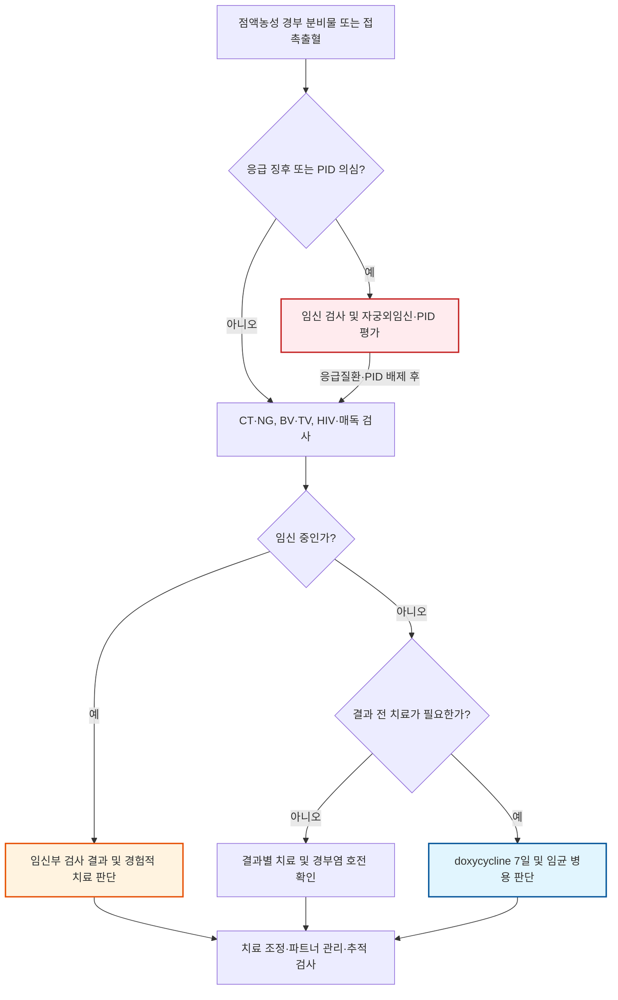

# 자궁경부염 Cervicitis

## <mark style="color:green;">일반 사항</mark>

* 자궁경부의 염증; 클라미디아·임균은 주로 자궁경부관의 원주상피를 침범함. 자궁경부 외번 자체는 정상 변이일 수 있으며 감염성 경부염과 구분
* 정의 (CDC STI Treatment Guidelines, 2021) : 자궁경부 내 점액농성 삼출물 또는 면봉을 자궁경부 입구에 부드럽게 통과시킬 때 쉽게 유발되는 지속적인 자궁경부관 출혈로 특징지어지는 임상 증후군(mucopurulent cervicitis)
* 분류
  * 급성 : C. trachomatis, N. gonorrhoeae 등이 주요 원인
  * 지속성/재발성 : 재노출·치료 실패 외에 M. genitalium, 세균성 질증·질내균총 이상, 잦은 질 세척·화학적 자극, 자궁경부 외번(ectropion) 등이 관여할 수 있음. 자궁경부 이형성·암도 출혈이나 병변이 지속될 때 감별
* 위험군 : 성적 활동 연령, 콘돔 미사용, 복수의 성 파트너, 신규 파트너
* 합병증 : 원인균에 따라 상행성 감염에 의한 골반염(PID)·자궁내막염, 난관 손상·불임 등이 발생할 수 있음. 임신 중 감염은 병원체에 따라 임신·신생아 합병증과 관련되므로 균종별로 평가·치료
* 선별 검사 : 미국 CDC 기준으로 성적으로 활동적인 25세 미만 여성 및 25세 이상 여성 중 새 파트너, 복수 파트너, STI가 있는 파트너 등 위험요인이 있는 경우 매년 Chlamydia·Gonorrhea 검사 권고. 국내에서는 검사 접근성·유병률·개별 위험도를 함께 고려
* 새롭게 발병한 경우 PID 감별이 필요함
* 원인균 확인 시 성 파트너도 평가·치료함. 평가 대상 기간은 병원체·지침별로 다르므로 아래 ‘파트너 관리’ 참조

## <mark style="color:green;">원인</mark>

#### <mark style="color:$primary;">감염성 원인</mark>

* Chlamydia trachomatis, Neisseria gonorrhoeae, Trichomonas vaginalis
* 세균성 질증·질내균총 이상이 동반되거나 경부염 소견과 관련될 수 있음 (☞ [외음질염](122_-vulvovaginal-infections.md))
* Herpes simplex virus (특히 초발 HSV-2) - 수포·궤양성 병변 동반 시 고려
* Mycoplasma genitalium - 지속·재발성 자궁경부염에서 고려되는 원인균. 모든 경부염 환자에게 일률적으로 검사하지는 않으며, 지속 증상이 있고 재노출·복약불이행 등이 배제된 경우 NAAT를 고려
* 특히 STI 위험이 낮은 여성에서는 상당수에서 특정 병원체가 확인되지 않음

#### <mark style="color:$primary;">비감염성 원인</mark>

* 물리적 자극 : 이물(예: pessary, diaphragm, tampon, cervical cap)
* 화학적 자극 : 질 세척(douching), 살정제·질 내 화학제품; 라텍스 과민반응은 주로 외음질 자극의 감별 원인
* 방사선 치료 등. 베체트병과 같은 전신성 염증 질환은 생식기 궤양 등 유사 병변의 감별에 포함

## <mark style="color:green;">임상 양상</mark>

* 보통 무증상 또는 가벼운 증상
* 자궁경부 내 농성·점액농성 분비물 : 자궁경부염의 특징적인 소견이지만 병원체를 특정하지는 못함
* 질 출혈 : 성관계 후 또는 월경 사이 출혈(intermenstrual bleeding); 자극에 쉽게 출혈
* 골반통, 성교통, 자궁경부 홍반. 골반통이나 진찰상 자궁경부 운동통·자궁 압통·부속기 압통은 PID 평가가 필요하며 단순 경부염으로 단정하지 않음
* 방광 자극 증상(빈뇨, 절박뇨, 배뇨통)

### <mark style="color:$danger;">🚩 Red Flags!</mark>

* 심한 하복부 통증, 복막 자극 징후, 심한 전신 증상·구토 또는 난관난소농양 의심  <mark style="color:$danger;">[즉각 조치]</mark>
* 임신 중 또는 임신 가능성이 있는 환자의 복통·질 출혈: 자궁외임신 등 배제  <mark style="color:$danger;">[즉각 조치]</mark>
* 빈맥·저혈압·의식 변화 등 패혈증 징후  <mark style="color:$danger;">[즉각 조치]</mark>
* **(당일)** 골반통·하복통과 자궁경부 운동통·자궁 압통·부속기 압통 중 하나 이상: PID 평가·치료 지연 금지; 발열은 필수 조건이 아님  <mark style="color:$warning;">[당일~수일 내 평가]</mark>
* **(당일)** 임신 중 클라미디아·임균 감염 확인: 치료 시작 및 산과 연계  <mark style="color:$warning;">[당일~수일 내 평가]</mark>
* 자궁경부의 의심스러운 종괴·궤양, 폐경 후 새로운 출혈: 신속한 부인과 평가; 다량 출혈·순환 불안정은 즉각 조치  <mark style="color:$warning;">[당일~수일 내 평가]</mark>
* 적절한 치료 후에도 경부염 소견 지속·재발  <mark style="color:$info;">[조기 평가 및 추적]</mark>
* 지속·반복되는 성관계 후 출혈 또는 월경 사이 출혈  <mark style="color:$info;">[조기 평가 및 추적]</mark>
* 성 파트너 미치료 또는 재노출 의심  <mark style="color:$info;">[조기 평가 및 추적]</mark>

## <mark style="color:green;">진단</mark>

다음 중 하나 또는 둘 다 있으면 자궁경부염을 시사함. 병원체 확인은 별도 검사로 판단함

1. 농성 또는 점액농성 자궁경부 내 삼출물(mucopurulent cervicitis 소견)
2. 면봉을 자궁경부 입구에 부드럽게 통과시킬 때 쉽게 유발되는 지속적인 자궁경부관 출혈

### <mark style="color:orange;">실험실 검사</mark>

* C. trachomatis, N. gonorrhoeae 검사 : NAAT 우선. 여성은 질 면봉 검체(자가 채취 또는 의료진 채취)가 선호되며, 자궁경부 검체 또는 첫 부분 소변(first-catch urine)도 가능. 가능하면 항생제 투여 전 채취하되 필요한 치료를 지연하지 않음\
  ✽국내 의료기관별 NAAT 접근성에 차이가 있을 수 있어, 가능한 경우 시행하고 여건상 어려운 경우 임상적 위험도에 따라 경험적 치료를 고려
* 세균성 질증, trichomoniasis 평가 (☞ [외음질염](122_-vulvovaginal-infections.md))\
  ✽Trichomonas는 wet mount의 민감도가 낮으므로(약 50%), 의심 증상이 있으면서 wet mount가 음성이면 NAAT 또는 배양 등 추가검사를 시행
* 생식기 궤양 등 HSV 감염을 시사하는 병변이 있는 경우 병변 PCR 등으로 평가; 자궁경부염 소견만으로 HSV 검사를 routine하게 시행할 근거는 부족
* 자궁경부염이 의심되는 환자에서 HIV 및 매독 검사 시행
* 지속·재발성 경부염에서는 M. genitalium NAAT를 시행하고, 가능하면 macrolide 내성 검사 병행. 무증상 일반인 선별검사에는 권고하지 않음 <mark style="color:$info;">[CDC 2021; BASHH 2025]</mark>
* 구강·항문 성접촉력에 따라 인두 임균 검사, 직장 임균·클라미디아 검사를 추가 고려. 질·경부 검사 음성으로 다른 노출 부위 감염이 배제되지는 않음
* 경부 검체 그람염색은 임균 진단의 민감도가 낮아 음성으로 감염을 배제할 수 없음. 경부 도말 백혈구 증가만으로 원인균을 확정하지 않으며, Pap 검사·HPV 검사는 STI NAAT를 대신하지 않음
* U. parvum, U. urealyticum, M. hominis 및 GBS의 일상적 검사는 권고하지 않음. 다중 PCR에서 양성이라는 이유만으로 경부염 원인균으로 단정하거나 치료하지 않음 <mark style="color:$info;">[CDC 2021]</mark>
* 가임기 골반통·비정상 출혈이 있으면 임신 검사와 자궁외임신 등 다른 원인 평가. STI 위험이 있는 환자의 골반통·하복통에서 다른 원인이 뚜렷하지 않고 자궁경부 운동통·자궁 압통·부속기 압통 중 하나 이상이면 PID 경험적 치료 문턱을 낮게 유지. 경부 NAAT 음성만으로 상부 생식기 감염을 배제하지 않음

### <mark style="color:orange;">감별 진단</mark>

* 유사한 질 분비물·출혈·골반통을 유발할 수 있는 질환들의 감별

<table><thead><tr><th width="140">질환</th><th width="260">자궁경부염과의 차이점</th><th>핵심 감별 포인트</th></tr></thead><tbody><tr><td>질염 (Vaginitis)</td><td>염증의 주 병소가 질 자체; 경부 접촉 출혈은 드묾</td><td>분비물 성상, 생리식염수·KOH 도말 검경</td></tr><tr><td>골반염 (PID)</td><td>상부 생식기(자궁내막·난관)까지 침범; 발열 없이도 가능</td><td>골반통·하복통과 자궁경부 운동통·자궁 압통·부속기 압통 중 하나 이상이면 의심. 발열·염증수치·초음파 이상은 필수 조건이 아님</td></tr><tr><td>자궁내막염</td><td>자궁 자체의 염증, 비정상 자궁 출혈이 흔함</td><td>자궁 압통, 산욕기·시술 후 병력 등</td></tr><tr><td>자궁경부 상피내종양 (CIN)</td><td>주로 지속성 고위험 HPV 감염과 관련; 무증상인 경우가 많음</td><td>적응증에 따른 자궁경부 세포검사·HPV 검사, 필요 시 질확대경·생검</td></tr><tr><td>자궁경부암</td><td>지속적 접촉출혈, 육안적 병변 동반 가능</td><td>의심 병변은 세포검사 결과만 기다리지 말고 부인과 평가·생검</td></tr><tr><td>자궁경부 폴립</td><td>국소적으로 돌출된 양성 병변</td><td>접촉출혈, 육안 확인</td></tr><tr><td>자궁경부 외번 (ectropion)</td><td>가임기 여성에서 흔한 정상 변이로, 접촉출혈·점액성 분비물을 유발할 수 있음</td><td>염증 소견 없이 원주상피가 노출된 소견</td></tr><tr><td>외상성 경부 병변</td><td>물리적 손상에 의함, 감염 소견 없음</td><td>질 내 기구·성기구 사용력, 최근 시술력</td></tr></tbody></table>

***



✽ CT = C. trachomatis, NG = N. gonorrhoeae, BV = 세균성 질증, TV = T. vaginalis. 결과 전 치료 판단은 STI 고위험·추적 불확실·NAAT 불가 여부에 따름. 비임신 성인에서 임균 병용 요법을 선택하면 이 장의 CDC 기준은 ceftriaxone 500 ㎎ IM 1회(체중 ≥150 ㎏은 1 g); WHO 2024는 1 g IM 1회를 권고하므로 아래 비교 참조. PID 의심 시 경부염의 7일 치료만으로 대체하지 않음. 임신 중에는 doxycycline 대신 임신에 적합한 원인균별 치료를 선택. 검사 음성이고 치료를 보류한 경우에도 경부염 소견의 호전 여부를 확인하며, 3개월 재검·파트너 추정 치료는 확인된 병원체에 따라 결정.

<p align="center"><strong>진단 및 경험적 치료 알고리듬</strong></p>

<p align="center"><em><mark style="color:$info;">Ref. CDC Sexually Transmitted Infections Treatment Guidelines (2021), Cervicitis; WHO 2024 Gonorrhoea</mark></em></p>

***

## <mark style="background-color:$warning;">Management</mark>

### <mark style="color:orange;">치료 방침</mark>

* 경험적 치료 원칙(CDC 2021) : 25세 미만, 새 파트너, 파트너의 다른 성 파트너 또는 STI 등 감염 위험이 높은 경우, 추적관찰이 불확실하거나 NAAT가 불가능한 경우에는 결과 전 Chlamydia 치료를 시작하고 임균 치료 병용 필요성을 평가. 임균 약제 병용은 개별 위험도와 지역 유병률을 고려. 저위험이면서 검사가 가능하고 추적이 확실한 경우에는 결과 확인까지 치료를 보류할 수 있음
* 위험 요인 회피 : 잦은 질 세척(douching) 회피, 성관계 시 콘돔 사용, 화학적 자극(질 세정제, 향료 함유 제품, 살정제 등)을 피함
* 환자와 성 파트너가 치료를 완료하고 증상이 호전될 때까지 성관계를 피함. 클라미디아는 7일 요법 완료 시까지 또는 단회요법 후 7일까지, 임균은 주사 후 7일까지가 최소 기준이며 두 감염이 동반되면 더 늦은 시점 적용
* 치료 후 결과 통보와 임상 호전 확인을 계획. 치료 확인 검사(test-of-cure, TOC)와 재감염 검사는 목적·시점이 다름

### <mark style="color:orange;">치료 후 검사</mark>

<table><thead><tr><th>감염</th><th>치료 확인 검사(TOC)</th><th>재감염 검사</th></tr></thead><tbody><tr><td>클라미디아</td><td>비임신·권장 치료 후 무증상이면 일상적 TOC 불필요. 임신, 복약 불확실, 증상 지속·재감염 의심 시 시행; NAAT는 치료 완료 약 4주 후(CDC 기준)</td><td>치료 약 3개월 후</td></tr><tr><td>임균</td><td>국내 2023: 1주 이내 임상 추적, 증상 지속·재감염 위험 또는 임신 시 TOC. 일반적인 완치판정 NAAT는 종료 3주 이후. 인두 감염은 별도로 7~14일에 TOC; 이른 NAAT 양성은 잔존 핵산 가능성을 고려하고 배양 확인. CDC는 적절히 치료된 단순 비뇨생식기·직장 감염의 일상적 TOC 불필요</td><td>치료 약 3개월 후</td></tr><tr><td>여성 트리코모나스</td><td>지속·재발 시 재평가; 조기 NAAT는 치료 종료 최소 3주 후</td><td>치료 약 3개월 후</td></tr><tr><td>M. genitalium</td><td>국내 2023은 증상과 무관하게 TOC, NAAT는 종료 3주 이후. CDC·BASHH 2025는 권장 치료 후 무증상인 환자에서 일상적 TOC를 권고하지 않음; 대안요법·증상 지속은 별도 평가</td><td>CT·NG·TV의 일률적 3개월 재검 규칙을 그대로 적용하지 않음</td></tr></tbody></table>

✽클라미디아의 국내 2023 NAAT 추적 기준은 종료 3주 이후이나, 이 장에서는 잔존 핵산에 의한 위양성을 줄이기 위해 CDC의 약 4주 기준을 적용. 인두 임균 TOC의 7~14일 권고와 일반 NAAT 3주 기준은 국내 지침에 함께 제시되어 있으므로 검사법·시점을 검사실과 협의. **임균 치료 후 3~5일 내 증상이 호전되지 않고 재노출이 없다면 3주까지 기다리지 말고 배양·감수성검사 및 전문의 협진** <mark style="color:$info;">[국내 STI 2023, pp.64·67·70; CDC 2021]</mark>

### <mark style="color:orange;">파트너 관리</mark>

* 클라미디아·임균: CDC는 증상 시작 또는 진단 전 60일 이내 성 파트너의 평가·검사 및 추정 치료를 권고. 마지막 접촉이 60일보다 오래되었어도 가장 최근 파트너 포함
* 국내 2023은 클라미디아에서 증상 발생 전 8주, 무증상자는 지난 6개월의 파트너 평가와 검사 결과에 관계없는 치료를 제시하므로 국내 적용 시 평가 범위를 보완. 임균은 진단 전 60일 기준을 제시
* 트리코모나스: **현재 성 파트너의 동시 추정 치료**가 핵심이며 60일을 일률적인 제외 기준으로 사용하지 않음
* M. genitalium: 현재 파트너를 검사하고 양성이면 치료; 검사 불가 시 경험적 치료 필요성을 전문의와 판단. CT·NG의 60일 기준을 그대로 적용하지 않음
* 파트너도 직접 의료기관에서 평가·처방받도록 안내 <mark style="color:$info;">[국내 STI 2023; CDC 2021; BASHH 2025]</mark>

## <mark style="color:green;">비-약물 치료 및 예방</mark>

* 감염성 경부염의 치료 기간에는 본인 및 성 파트너가 치료를 완료하고 증상이 호전될 때까지 성관계를 피함
* 콘돔 사용 및 성 파트너 수 제한
* 잦은 질 세척(douching) 회피
* 국소 자극 원인(질 세척제, 향료가 포함된 제품, 살정제 등) 확인 및 제거
* pessary, cervical cap, tampon 등 국소 이물이 원인으로 의심되면 제거 후 재평가
* 기존에 삽입된 자궁 내 기구(IUD)는 단순 자궁경부염 치료를 위해 제거할 필요가 없으나, 활동성 농성 경부염·클라미디아·임균 감염 중 새 IUD 삽입은 연기. PID가 동반되면 별도 PID 관리 원칙 적용
* Doxy-PEP는 자궁경부염이 있는 일반 여성에게 일률적으로 권고하지 않음: CDC 2024는 시스젠더 여성에서 이득·위해를 판단할 근거가 불충분하다고 명시 <mark style="color:$info;">[CDC Doxy-PEP 2024]</mark>

## <mark style="color:green;">약물 치료</mark>

### <mark style="color:orange;">경험적 항생제 치료</mark>

* 원칙 (CDC STI Treatment Guidelines, 2021) : 25세 미만 또는 새 파트너·STI 파트너 등의 감염 위험이 높거나, 추적관찰이 불확실하거나, NAAT가 불가능하면 결과 전 치료를 시작. 저위험이고 검사와 추적이 가능하면 결과 확인까지 보류 가능. 임균 약제 병용은 개별 위험도·지역 유병률에 따라 판단
* doxycycline 100 ㎎ bid ×7일 - 1차 선택제
* ceftriaxone 500 ㎎ IM 1회 병용 <mark style="color:blue;">\[트리악손]</mark> : 임균 감염 위험이 높은 경우(임균 감염 파트너, 최근 임균 노출 등) 또는 지역사회 임균 유병률이 높은 경우. 체중 150 ㎏ 미만 기준이며, 150 ㎏ 이상이면 1 g IM 1회(CDC 기준). 국내 STI 2023은 500 ㎎ IM/IV 또는 1 g IV 1회로 제시함. WHO 2024는 성인·청소년(임신부 포함)의 생식기·직장·인두 임균 감염에 1 g IM 1회를 권고함. 이 장의 처방례는 CDC 체중별 IM 요법으로 통일하며, 국내 내성 자료·기관 지침에 따라 선택 <mark style="color:$info;">[국내 STI 2023; CDC 2021; WHO 2024]</mark>
* azithromycin 1 g 경구 1회 <mark style="color:blue;">\[지스로맥스]</mark> - 비임신 성인 경부염 치료의 대안. doxycycline 복약순응도가 우려되는 경우 고려하되, 동반 직장 클라미디아 감염에서는 치료 효능이 낮을 수 있음. 임균 감염 치료를 대체하지 않음
* 임균 확진 후 클라미디아가 배제되었다면 doxycycline을 일률적으로 병용하지 않음. 중증 cephalosporin 알레르기, 인두 임균 감염의 대체 치료 또는 치료 실패는 전문의와 협의
* ✽트리악손 국내 제품정보의 임질 용법은 250 ㎎ IM 1회로 지침 용량과 다름. **현재 지침보다 낮은 250 ㎎을 허가 문구만 보고 선택하지 않으며**, 처방 시 지침 근거와 실제 품목의 허가·급여 기준을 구분해 확인

#### <mark style="color:$primary;">임신부</mark>

* Chlamydia 확진 또는 결과 전 치료가 필요한 경우 azithromycin 1 g 경구 1회 - 임신 중 권장 요법. doxycycline은 이 장의 임신부 처방에서 사용하지 않음
* azithromycin 사용이 곤란하면 amoxicillin 500 ㎎ tid ×7일이 CDC 대안; 산과와 협의하고 국내 해당 품목의 허가·급여 확인
* 임균 감염 확인 또는 강한 의심 시 ceftriaxone 500 ㎎ IM 1회(체중 ≥150 ㎏은 1 g). Chlamydia가 배제되지 않았다면 azithromycin 1 g 경구 1회도 함께 투여하고 산과 진료와 연계
* 임신 중 Chlamydia 감염이 확인된 경우 치료 4주 후 NAAT로 test-of-cure 시행, 이후 3개월 후 재검. 재감염 위험이 지속되는 경우 임신 3분기에 재검

### <mark style="color:orange;">세균성 질증 동반</mark>

* 세균성 질증이 확인되면 해당 요법으로 치료(☞ [외음질염](122_-vulvovaginal-infections.md)). 모든 경부염에 metronidazole을 일률적으로 추가하지 않으며, PID 동반 시에는 PID 요법 적용

### <mark style="color:orange;">Trichomonas 동반</mark>

* metronidazole 500 ㎎ bid ×7일 <mark style="color:blue;">\[후라시닐정 250 ㎎]</mark> - 여성에서는 단회 2 g 요법보다 치료 성공률이 높아 우선 권고. 후라시닐정은 1정 250 ㎎이므로 1회 2정 복용. ✽국내 STI 2023·CDC 2021 및 WHO 2024의 여성 권고에 부합하며, 국내 해당 제품의 트리코모나스증 허가 용법(250 ㎎ bid ×10일)과 다름
* tinidazole 2 g 경구 1회 - 대안 요법. 임신 중에는 피함; 수유 중 사용 시 단회 투여 후 72시간 수유 중단(CDC). 국내 사용 품목·허가·공급 여부 확인
* ✽후라시닐정 국내 허가는 임신 첫 3개월 이내 금기, 투여 중 및 투여 이후 24시간 이상 수유 중단, 투여 중 및 종료 후 최소 3일 금주를 명시함. 증상이 있는 임신부는 임신 시기와 관계없이 검사·치료한다는 CDC 권고 및 수유·음주 관련 판단과 구분. 임신 초기에는 진료를 미루지 말고 산과와 치료 방법을 협의함 <mark style="color:$info;">[국내 제품 허가사항; CDC 2021]</mark>
* 중증 피부 이상반응(SJS/TEN·급성 전신성 발진성 농포증 등) 경고가 국내 허가사항에 반영됨(2025-01-15 시행). 발진과 수포·점막 병변·발열이 발생하면 즉시 중단·평가; 단순히 ‘항생제를 끝까지 복용’하도록 안내하지 않음 <mark style="color:$info;">[HK이노엔 허가변경 공지]</mark>
* 여성의 TV 치료 후 약 3개월 재검. 지속·재발로 조기 NAAT를 시행할 때에는 치료 종료 후 최소 3주 경과가 필요함(잔존 핵산에 의한 위양성 방지)

### <mark style="color:orange;">Herpes 동반</mark>

* acyclovir, valacyclovir, famciclovir - 세부 용량은 생식기 헤르페스 챕터 참고

### <mark style="color:orange;">재발 및 지속성 자궁경부염</mark>

* 경부염 소견을 재확인하고 재노출·복약불이행·파트너 치료 여부 및 다른 질환을 재평가
* **지속성 자궁경부염의 상당수는 클라미디아·임균의 재감염으로 설명되지 않으나, 이것이 두 균의 감염을 배제한다는 뜻은 아님. 재노출·복약 상태를 먼저 확인하고 객관적 염증·검사 결과에 따라 판단; 원인 불명 상태에서 항생제를 반복·장기 투여할 이득은 불확실함**
* 적절한 치료 후에도 지속되며 재노출·복약불이행·BV 등이 배제된 경우 M. genitalium NAAT를 시행하고, 가능하면 마크로라이드 내성 검사 병행. 다음은 비임신 성인의 NAAT 양성 감염에 적용하는 CDC 2021 순차 요법임
  * macrolide-susceptible 확인 시 : doxycycline 100 ㎎ bid ×7일 선행 후 azithromycin 1 g을 azithromycin 투여 1일차에, 이후 500 ㎎ qd ×3일(azithromycin 총 2.5 g)
  * macrolide resistance testing이 불가능하거나 내성이 확인된 경우 : doxycycline 100 ㎎ bid ×7일 선행 후 moxifloxacin 400 ㎎ qd ×7일 순차 치료 고려
* ✽내성 검사 불가 시 국내 STI 2023은 doxycycline(또는 minocycline) 7일 후 고용량 azithromycin 총 2.5 g 및 종료 21일 이후 TOC를 제시하여 CDC의 doxycycline→moxifloxacin 요법과 차이가 있음. 내성·이전 macrolide 노출·안전성을 고려하여 전문의와 선택하고, azithromycin 1 g 단회요법으로 M. genitalium을 치료하지 않음 <mark style="color:$info;">[국내 STI 2023; CDC 2021]</mark>
* 최신 지침 간 차이: BASHH 2025는 macrolide 감수성 또는 내성 미확인에서 doxycycline 7일 → azithromycin 1 g 1일차 + 500 ㎎ qd ×2일(총 2 g), 내성·azithromycin 실패에서는 doxycycline → moxifloxacin을 제시함. CDC·국내의 azithromycin 총 2.5 g 요법과 혼합하지 않음. WHO 2024도 개인 내성 검사·지역 감시·이전 항생제 사용에 근거한 선택을 강조. 이미 azithromycin 치료에 실패했다면 같은 요법을 단순 반복하지 않음 <mark style="color:$info;">[BASHH 2025; WHO 2024]</mark>
* M. genitalium 치료 후 추적 : 국내 STI 2023에 따라 TOC를 계획하며 NAAT는 종료 3주 이후 시행. BASHH 2025는 증상이 소실되면 일상적 TOC를 권고하지 않아 국내 지침과 차이가 있음. 증상 지속 시 재노출·내성·PID를 재평가함. 현재 파트너는 검사하고 양성이면 치료하며, CT·NG·TV의 60일 기준을 그대로 적용하지 않음 <mark style="color:$info;">[국내 STI 2023; BASHH 2025]</mark>
* moxifloxacin의 M. genitalium 치료는 국내 허가 외 사용임. QT 연장·부정맥, 힘줄 손상, 말초신경병증 및 중대한 정신신경계 이상반응 위험을 평가. 심계항진·실신, 힘줄 통증, 저림·근력저하 또는 심한 불안·기분·행동 변화 시 즉시 중단·평가. 임신 중에는 위 순차 처방을 적용하지 않으며 임신·수유·치료 실패는 전문기관 의뢰 <mark style="color:$info;">[CDC 2021; BASHH 2025; 국내 제품 허가사항]</mark>
* 위 7일 moxifloxacin 요법은 **단순 하부 감염**에 한정. M. genitalium 양성 PID는 CDC·BASHH에서 moxifloxacin 400 ㎎ qd ×14일을 제시하므로 PID 평가·전문 진료로 연결
* 감염 외 다른 원인 고려 : 질내균총 이상, 빈번한 질 세척, 화학적 자극
* 부인과 의뢰: 출혈 지속, 폴립·이형성·암 등 구조적 원인 의심 또는 원인 불명 지속성 경부염

## <mark style="color:green;">시술 및 기타 처치</mark>

* 단순 감염성 자궁경부염에 소작술·냉동치료를 일상적으로 시행하지 않음
* 감염과 악성 병변을 배제한 후에도 외번·폴립에 의한 출혈이 지속되면 부인과에서 필요 시 생검·병변 치료
* 육안적 의심 병변은 세포검사 음성만으로 평가를 종료하지 않음

***

## <mark style="color:purple;">처방례</mark>

> **처방례 1. 비임신 성인, 임균 동반 위험이 낮으나 결과 전 치료가 필요한 자궁경부염 - Doxycycline 단독**
>
> ```
> 독시사이클린 100 ㎎/C  2C #2  ×7d
> ```
>
> _✽감염 위험이 낮고 검사·추적이 가능하면 NAAT 결과 확인까지 치료를 보류할 수 있음. 본 처방례는 추적관찰이 불확실하거나 NAAT 시행이 어려워 결과 전 치료가 필요하지만 임균 동반 위험이 낮은 경우_

> **처방례 2. 비임신 성인, 임균 동반 위험 높음 - 병용 요법**
>
> ```
> 트리악손주사 500 ㎎/V (바이알)  IM  1회
> 독시사이클린 100 ㎎/C  2C #2  ×7d
> ```
>
> _✽CDC 기준 예시. 체중 150 ㎏ 이상인 경우 ceftriaxone 1 g으로 증량. WHO 2024는 체중 구분 없이 1 g IM 1회 권고. IM 가능한 바이알 제형을 사용하고 IV 전용 키트는 사용하지 않음; 리도카인으로 용해한 용액은 정맥 투여 금지. 국내 제품정보의 임질 250 ㎎ IM 용법과 차이가 있음. 임신 중에는 doxycycline을 사용하지 않고 임균·클라미디아 감염 상태에 따라 임신에 적합한 치료를 선택_

> **처방례 3. 임신부 Chlamydia 감염 - Azithromycin**
>
> ```
> 지스로맥스 250 ㎎/T  4T  1회
> ```
>
> _✽doxycycline은 임신 중 권장되지 않음; 치료 4주 후 test-of-cure NAAT 시행, 이후 3개월 후 재검_

> **처방례 4. 비임신 성인 여성 Trichomonas 동반 - 국내·CDC·WHO 지침에 따른 용법**
>
> ```
> 후라시닐정 250 ㎎/T  2T bid  ×7d
> ```
>
> _✽임신 첫 3개월 이내는 후라시닐정 국내 허가상 금기. 여성에서는 단회 2 g 요법보다 7일 요법의 치료 성공률이 높음. 후라시닐정은 250 ㎎/정이며, 국내 제품의 트리코모나스증 허가 용법은 250 ㎎ bid ×10일로 CDC 권고 용법과 다름_

> **처방례 5. 비임신 성인, PID 없는 지속·재발성 경부염, M. genitalium NAAT 양성 + 내성 검사 불가 - CDC 요법**
>
> ```
> 독시사이클린 100 ㎎/C  2C #2  ×7d 선행 후
> 목시플록사신 400 ㎎/T  1T qd  ×7d
> ```
>
> _✽CDC 2021에 따른 비임신 성인의 순차 요법 예시이며 moxifloxacin은 국내 허가 외 사용. 내성 검사 불가 시 국내 STI 2023의 요법과 차이가 있음(본문 참조). QT 연장·힘줄·말초신경·정신신경계 이상반응 위험을 평가하고, 치료 종료 3주 이후 TOC 및 파트너 검사 계획; 부인과·감염내과 협진_

***

### <mark style="color:red;">질병코드</mark>

KCD-9 상병마스터(2025-12-30, 3차 정오 반영) 기준. 원인·침범 부위에 맞는 세분류를 선택하며 N72와 특정 감염 코드를 무조건 중복 부여하지 않음

<table><thead><tr><th>코드</th><th>명칭·적용</th></tr></thead><tbody><tr><td>N72</td><td>자궁경부의 염증성 질환: 원인 미확인·비특이적 경부염 등</td></tr><tr><td>A54.0</td><td>요도주위 또는 부속선에 농양이 없는 하부 비뇨생식관의 임균감염: 단순 임균성 자궁경부염 포함</td></tr><tr><td>A56.0</td><td>하부비뇨생식관의 클라미디아감염</td></tr><tr><td>A59.00 / A59.08</td><td>편모충성 외음질염 / 기타 및 상세불명의 비뇨생식기계 편모충증: 실제 침범 부위에 따라 선택. A59.0은 상위 분류</td></tr><tr><td>A60.04</td><td>여성 비뇨생식기관의 헤르페스바이러스감염(N77.0–N77.1*): 경부 침범 등 실제 병변에 따라 검토. A60.0은 상위 분류; 원인질환·발현증세 이원분류의 해당 여부 확인</td></tr><tr><td>Z20.2</td><td>주로 성행위로 전파되는 감염에 접촉 및 노출: 실제 접촉·노출 평가 상황에 적용하며 확진 감염을 대체하지 않음</td></tr></tbody></table>

✽임신 관련 감염·PID는 별도 분류 원칙을 적용. M. genitalium은 감염 부위 및 원인균 부가코드 적용 가능성을 현행 KCD·청구 기준에 따라 검토하며 임의의 전용 코드를 만들지 않음

***

### <mark style="color:$success;">핵심 복약 지도</mark>

> **항생제 복용 및 금욕 기간**
>
> * doxycycline은 충분한 물과 함께 복용하고 최소 30분간 눕지 않도록 안내(식도 자극·궤양 예방)
> * doxycycline은 제산제·철분제·칼슘제·유제품 등 2가/3가 양이온 함유 제품과 동시 복용 시 흡수가 저하되므로 최소 2시간 이상 간격을 두고 복용
> * 광과민 반응 가능 - 치료 기간 중 직사광선 노출을 최소화하고 자외선 차단제 사용 권고
> * 처방 기간을 지켜 복용하되 심한 알레르기, 수포·점막 병변, 중대한 신경·힘줄 이상반응은 즉시 중단·진료
> * 본인과 파트너가 모두 치료를 완료하고 증상이 호전될 때까지 성관계를 피할 것. 클라미디아는 7일 요법 완료 또는 단회 투여 후 7일, 임균은 주사 후 7일을 최소 기준으로 하며 파트너 치료 시점도 함께 확인. M. genitalium은 BASHH 기준 치료 시작 후 최소 14일과 증상 소실·파트너 관리까지 고려

> **Metronidazole 복용 시**
>
> * 후라시닐정은 투여 중 및 종료 후 최소 3일 금주
> * 임신·수유 여부 확인. 임신 첫 3개월 이내는 국내 허가상 금기이며, 투여 중 및 투여 이후 24시간 이상 수유 중단
> * warfarin 병용 시 INR 상승, 리튬 병용 시 독성 증가에 유의. 최근 2주 이내 disulfiram 복용 여부 및 QT 연장 약제 병용 확인
> * 발진과 수포·입안/눈/생식기 점막 병변 또는 발열이 생기면 즉시 중단·진료

> **파트너 치료의 중요성**
>
> * 클라미디아·임균의 CDC 기본 기준은 증상 시작/진단 전 60일 이내 파트너이며 가장 최근 파트너는 기간이 더 오래되어도 포함. 국내 클라미디아 지침의 무증상자 6개월 평가 범위도 고려
> * 트리코모나스는 현재 파트너를 동시 치료하고, M. genitalium은 현재 파트너 검사 후 양성이면 치료
> * 확인된 클라미디아·임균 및 여성의 트리코모나스 감염은 재감염 확인을 위해 약 3개월 후 재검사가 권고됨을 안내
> * 파트너도 직접 의료기관을 방문해 평가와 적절한 치료를 받도록 안내

> **언제 다시 병원을 방문해야 하나요?**
>
> * 치료 중 또는 치료 후 **발열, 심한 하복부 통증**이 발생하는 경우 - 즉시 내원(골반염 의심)
> * 임신 중인 경우 **복통 또는 질 출혈**이 동반되면 즉시 산과 평가
> * 치료 완료 후에도 분비물·출혈 등이 지속되거나 재발하는 경우 재진료

***

## <mark style="color:green;">주요 참고문헌 및 확인 자료</mark>

### <mark style="color:orange;">임상 근거</mark>

* 질병관리청·대한요로생식기감염학회. 성매개감염 진료지침 2023. 임질·클라미디아·M. genitalium·트리코모나스 진단, 치료 및 추적. [지침 원문](https://stiguide.kr/wp-content/uploads/2023/04/Korean_STI_Guidelines_2023.pdf)
* CDC. Sexually Transmitted Infections Treatment Guidelines, 2021. [Urethritis and Cervicitis](https://www.cdc.gov/std/treatment-guidelines/urethritis-and-cervicitis.htm), [Gonococcal Infections Among Adolescents and Adults](https://www.cdc.gov/std/treatment-guidelines/gonorrhea-adults.htm), [Chlamydial Infections](https://www.cdc.gov/std/treatment-guidelines/chlamydia.htm).
* CDC. Sexually Transmitted Infections Treatment Guidelines, 2021. [Mycoplasma genitalium](https://www.cdc.gov/std/treatment-guidelines/mycoplasmagenitalium.htm), [Trichomoniasis](https://www.cdc.gov/std/treatment-guidelines/trichomoniasis.htm), [Pelvic Inflammatory Disease](https://www.cdc.gov/std/treatment-guidelines/pid.htm).
* BASHH. National guideline for the management of infection with Mycoplasma genitalium, 2025. 내성 기반 치료·fluoroquinolone 안전성·특수 상황. [지침 원문](https://www.bashh.org/_userfiles/pages/files/bashh_mgen_2025.pdf)
* WHO. Updated recommendations for the treatment of Neisseria gonorrhoeae, Chlamydia trachomatis and Treponema pallidum, 2024. [권고 원문](https://www.ncbi.nlm.nih.gov/books/NBK605892/table/webannexa.tab4/)
* WHO. Recommendations for the treatment of Trichomonas vaginalis, Mycoplasma genitalium, Candida albicans, bacterial vaginosis and human papillomavirus, 2024. [지침](https://www.who.int/publications/i/item/9789240096370), [치료 권고](https://www.ncbi.nlm.nih.gov/books/NBK605755/).
* NCI. [Cervical Cancer Causes, Risk Factors, and Prevention](https://www.cancer.gov/types/cervical/causes-risk-prevention). 지속성 고위험 HPV와 전암성 병변의 연관.
* CDC. Clinical Guidelines on Doxycycline Postexposure Prophylaxis, 2024. [원문](https://www.cdc.gov/mmwr/volumes/73/rr/rr7302a1.htm)

### <mark style="color:orange;">국내 제품정보·분류 확인 자료</mark>

* 식품의약품안전처. 의약품안전나라 - 의약품 품목허가정보. 국내 제품별 적응증·제형·용법·금기 및 허가 상태 확인. [의약품안전나라](https://nedrug.mfds.go.kr/index)
* HK이노엔. 후라시닐정 [제품정보](https://www.inno-n.com/business/medicine/view?bpc_cd=P10517&no=167), [허가사항 변경 공지: 2025-01-15 시행](https://www.inno-n.com/pr/notice/notice/view/613?page_no=&sch_text=). 제조사 연결 제품정보 및 [약학정보원 허가정보 전재](https://www.health.kr/drug/A11A0100A0080) 교차 확인.
* 약학정보원. [트리악손주사500mg 제품정보](https://health.kr/drug/A11A2140A0160). 국내 임질 허가 용량·IM/IV 제형 구분 확인; 식약처 원문 재확인 경로와 함께 사용.
* 건강보험심사평가원. KCD-9 상병마스터(2025-12-30, 3차 정오 반영). [대한병원협회 배포 안내·원본 첨부](https://job.kha.or.kr/kha_home/notice_list.do?articleNo=46075&mode=view).
* 신풍제약. 플루오로퀴놀론 계열 제제 허가사항 변경(2026-03-23 시행; 목시플록사신 포함): 정신계 이상반응 보완. [제조사 공지](https://www.shinpoong.co.kr/sub2/2_12.php?b_name=p_news&mode=view&number=696&page=1).

✽검토 기준일: 2026-10-28. 임상 지침 권고·국내 품목 허가·급여 인정은 별개임. 지침과 허가 용법이 다른 처방 및 허가 외 적응증의 급여 여부를 이 장에서 일괄 보장하지 않으며, 실제 처방 시 해당 품목과 현행 심평원 기준을 확인.

***

### <mark style="color:blue;">환자 안내서</mark>


**자궁경부염은 원인을 찾아 적절히 치료하는 것이 중요한 염증성 질환입니다**

자궁경부염은 자궁경부(자궁의 입구)에 생긴 염증입니다. 클라미디아·임질 등 성접촉을 통해 전파되는 감염이 흔한 원인이지만, 다른 감염이나 자극도 원인이 될 수 있습니다. 증상이 없는 경우도 많지만, 감염을 적절히 치료하지 않고 상행성 감염이 발생하면 골반염으로 이어질 수 있으며, 심한 경우 난관 손상과 불임을 초래할 수 있습니다.


#### <mark style="color:$primary;">왜 자궁경부염이 생기나요?</mark>

* 클라미디아·임질 등이 흔한 원인이지만, 트리코모나스, 헤르페스, M. genitalium 등 다른 감염이나 비감염성 자극도 원인이 될 수 있습니다.
* 콘돔을 사용하지 않거나 여러 명의 성 파트너가 있는 경우 위험이 높아집니다.
* 감염이 아니더라도 질 세정제, 탐폰, 질 내 기구(페사리 등)로 인한 자극으로도 생길 수 있습니다.

#### <mark style="color:$primary;">치료는 어떻게 하나요?</mark>

* 감염이 확인되거나 의심되어 항생제를 처방받았다면 **처방된 기간 동안 빠짐없이** 복용하십시오. 검사 결과에 따라 약을 조정할 수 있습니다.
* 독시사이클린은 충분한 물과 함께 복용하고 최소 30분간 눕지 마십시오. 치료 중 강한 햇빛 노출을 줄이고 자외선 차단제를 사용하십시오.
* 메트로니다졸(후라시닐정)을 복용한다면 복용 중 및 마지막 복용 후 최소 3일 동안 술을 피하십시오. 임신 또는 수유 중이면 복용 전에 반드시 알리십시오.
* 목시플록사신을 처방받았다면 힘줄 통증, 저림·근력저하, 심계항진·실신 또는 심한 불안·기분·행동 변화가 생길 때 복용을 중단하고 즉시 진료를 받으십시오.
* 증상이 좋아지더라도 처방 기간을 지키십시오. 다만 심한 발진·수포·입안이나 눈의 헐음, 호흡곤란 등이 생기면 약을 중단하고 즉시 진료를 받으십시오.

#### <mark style="color:$primary;">성 파트너와 관련해 무엇을 해야 하나요?</mark>

* 클라미디아·임균 감염이 확인되면 최근 파트너에게 알리고 검사·치료를 받도록 하십시오. 보통 최근 60일 이내를 살피지만 감염 종류와 증상 유무에 따라 더 이전의 파트너도 대상이 됩니다. 마지막 성관계가 오래되었어도 가장 최근 파트너는 상의해야 합니다.
* 트리코모나스는 현재 파트너도 함께 치료해야 합니다. M. genitalium은 현재 파트너의 검사와 필요한 치료를 의료진이 안내합니다.
* 본인과 파트너가 모두 치료를 마치고 증상이 나을 때까지 성관계를 피하십시오. 클라미디아는 7일 복용을 완료할 때까지 또는 단회 복용 후 7일까지, 임균은 주사 후 7일까지가 최소 기준입니다. 두 치료를 함께 받으면 더 늦은 시점을 따르고 파트너의 치료 시점도 확인하십시오. M. genitalium은 별도의 금욕 기간을 안내받으십시오.
* 임균 감염의 치료 확인 검사는 임신 여부, 감염 부위, 증상과 재노출 위험에 따라 필요성이 달라집니다. 필요한 검사와 시점을 의료진에게 안내받으십시오.
* 클라미디아·임균 또는 트리코모나스 감염이 확인되었다면 약 3개월 후 재감염 검사를 받으십시오. 임신 중 클라미디아 감염은 치료 약 4주 뒤 치료 확인 검사도 필요합니다.

#### <mark style="color:$primary;">이럴 때는 즉시 진료를 받으세요</mark>

* 열이 나거나 아랫배가 심하게 아픈 경우
* 임신 중인데 복통이나 질 출혈이 있는 경우

#### <mark style="color:$primary;">이럴 때는 다시 진료를 받으세요</mark>

* 치료 후에도 분비물·출혈 등이 계속되거나 다시 나타나는 경우
