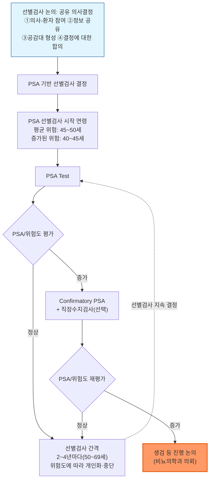
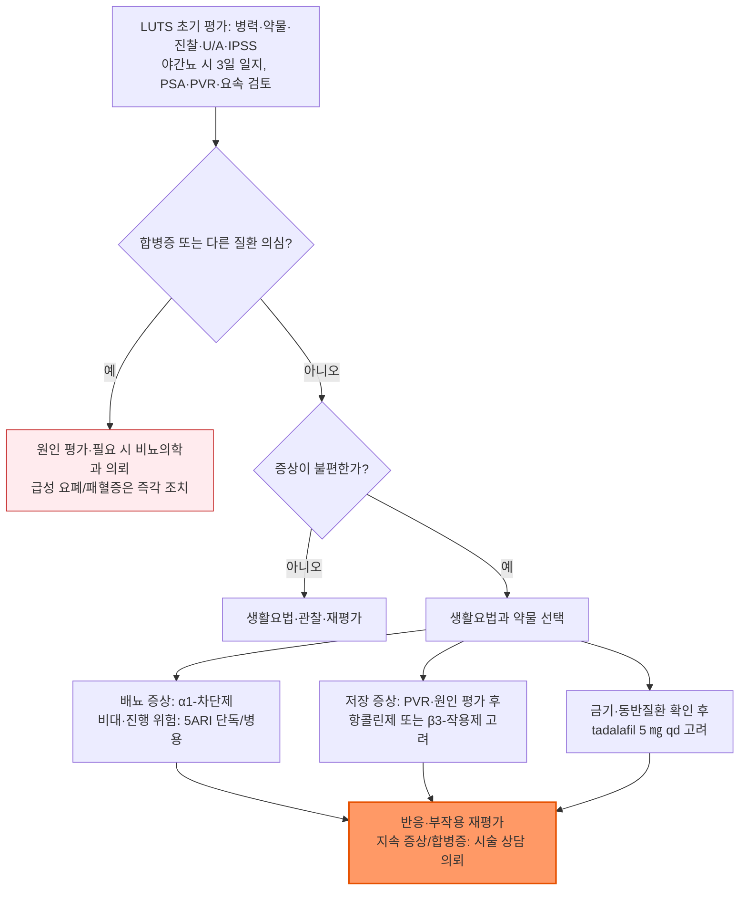

# 전립선비대증 Benign Prostatic Hyperplasia, BPH

## <mark style="color:green;">일반 사항</mark>

* BPH(양성 전립선 증식) : 전립선 이행대의 평활근(smooth muscle), 상피(epithelium), 간질세포(stromal cell)의 양성 증식 - 본래 조직학적 진단명
*   관련 개념 구분 (BPH ≠ BPE ≠ BPO ≠ LUTS)

    * BPE(benign prostatic enlargement) : BPH에 의한 전립선의 해부학적 비대(육안적·영상학적 크기 증가)
    * BPO(benign prostatic obstruction) : 양성 전립선 조직에 기인하는 방광출구폐색; 전립선 크기 증가만으로 확정하지 않으며, 폐색의 확진에는 압력-요류검사를 이용하나 모든 환자에게 검사를 시행하는 것은 아님
    * LUTS(하부요로증상) : 환자가 호소하는 저장·배뇨·배뇨 후 증상 - BPH/BPE/BPO는 남성 LUTS의 흔한 원인이지만 유일한 원인은 아님(☞ 하부 요로 증상과 BPH의 관계)

<table><thead><tr><th width="90">용어</th><th width="150">진단 성격</th><th>핵심 정의</th></tr></thead><tbody><tr><td>BPH</td><td>조직학적 진단</td><td>전립선 이행대의 양성 세포 증식</td></tr><tr><td>BPE</td><td>해부학적 진단</td><td>BPH에 의한 전립선의 육안적·영상학적 크기 증가</td></tr><tr><td>BPO</td><td>기능적 진단</td><td>양성 전립선 조직에 기인하는 방광출구폐색(압력-요류검사로 확인)</td></tr><tr><td>LUTS</td><td>증상 진단</td><td>환자가 호소하는 저장·배뇨·배뇨 후 증상(원인은 BPH 외에도 다양)</td></tr></tbody></table>

* 유병률(조직학적 BPH 기준) : 40대 약 10\~20%, 50대 약 50%, 80대 약 80\~90%(조직학적 연구에 따른 대략적인 값)
* 전립선 크기와 증상의 중증도는 비례하지 않으며, 자각 증상을 호소하는 환자 비율은 조직학적 유병률보다 낮음
* BPH는 전립선암의 전암 병변이 아니지만 두 질환이 함께 있을 수 있음. BPH/BPO 수술 검체에서 우연히 전립선암이 발견되기도 하므로, LUTS의 원인 평가와 연령·위험도에 따른 전립선암 평가를 구분하여 시행

### <mark style="color:green;">하부 요로 증상 (Lower Urinary Tract Symptoms, LUTS)과 BPH의 관계</mark>

* LUTS는 방광 또는 배출로 이상과 관련된 하부 요로의 복합 증상(저장, 배뇨, 배뇨 후 증상)을 통칭하며, BPH/BPO는 남성 LUTS의 흔한 원인이지만 증상만으로 원인을 특정할 수 없음
* BPH 이외의 주요 원인 : 배뇨근 과민, 신경학적 장애, 방광 경부 폐색·구축, 배뇨근 저활동, 요도 협착, 전립선암, 방광암, 요로 감염, 전립선염, 방광 결석
* 약물 유발 : 이뇨제, 항콜린제(TCA, 항히스타민제), sympathomimetics(코 울혈 제거제), opioid
* 심혈관·신장·호흡기 질환도 야간뇨·빈뇨 등 LUTS를 유발할 수 있음
* 젊은 연령에서 새로 발생한 LUTS, 특히 전형적인 BPH 양상과 맞지 않는 경우 → 요도 협착, 전립선염, 신경인성 방광 등 BPH 이외의 원인을 우선 감별하고 필요시 비뇨의학과 의뢰; 표준 치료에 반응하지 않는 LUTS도 마찬가지로 재평가 및 의뢰 고려

***

## <mark style="color:green;">원인 및 위험 인자</mark>

* 원인 : 노화와 안드로겐/DHT 의존성 전립선 성장, 간질·상피세포 상호작용 등이 관여하며 단일 원인으로 설명되지 않음

### <mark style="color:orange;">위험 인자</mark>

* 고령, BPH 가족력
* 비만·운동 부족·제2형 당뇨병 등 대사 요인 및 심혈관질환과 연관성이 보고됨; 관찰연구의 연관성을 직접적인 인과관계나 확립된 예방 효과로 해석하지 않음

***

## <mark style="color:green;">임상 양상</mark>

* 배뇨 증상 : 요주저(hesitancy), 소변 줄기의 힘없음/가늘어짐, 간헐뇨, 복압배뇨(straining)
* 저장 증상 : 절박뇨, 주간 빈뇨, 야간뇨, 절박성 요실금
  * 빈뇨는 환자가 평소보다 자주 배뇨한다고 느끼는 증상이며, ‘배뇨 후 2시간 이내 다시 배뇨’는 IPSS의 문항이지 빈뇨의 보편적 진단 기준은 아님
  * 야간뇨(nocturia)는 주 수면 도중 배뇨를 위해 깨는 증상으로, 수면 중 소변을 지리는 야뇨증(enuresis)과 구별
* 배뇨 후 증상 : 잔뇨감, 배뇨 후 요점적

✽LUTS만으로 BPH/BPO를 확진할 수 없음. 통증 없이 잔뇨가 많거나 소변이 조금씩 새는 경우에도 만성 요폐·범람성 요실금을 고려

### 🚩 Red Flags

<mark style="color:$danger;">**즉각 조치**</mark>

* 급성 요폐(갑자기 소변을 전혀 보지 못함, 치골 상부 팽만·통증) → 즉시 도뇨 등 방광 감압; 통증이 뚜렷하지 않아도 배뇨 불능이면 평가  <mark style="color:$danger;">[즉각 조치]</mark>
* 혈괴를 동반한 요폐, 지속적 다량 출혈 또는 혈역학적 불안정  <mark style="color:$danger;">[즉각 조치]</mark>
* 요로 감염과 함께 저혈압·의식 변화 등 패혈증 의심 소견, 또는 감염을 동반한 요로 폐쇄 의심 → 항균 치료 및 응급 배액 평가  <mark style="color:$danger;">[즉각 조치]</mark>
* 무뇨·급격한 신기능 악화 → 상부 요로 폐쇄 등 급성 신손상 원인 평가  <mark style="color:$danger;">[즉각 조치]</mark>
* 새 배뇨 장애/요폐와 심한 요통·하지 방사통·회음부 감각 저하 또는 새 하지 근력 저하 → 마미증후군 등 신경학적 응급질환 의심  <mark style="color:$danger;">[즉각 조치]</mark>

<mark style="color:$warning;">**당일~수일 내 평가**</mark>

* 새 육안적 혈뇨 → 반복 여부와 관계없이 원인 평가; 혈괴 요폐·다량 출혈이면 즉각 조치  <mark style="color:$warning;">[당일~수일 내 평가]</mark>
* 발열·오한·배뇨통 또는 회음부 통증 → 요로 감염/급성 전립선염 평가 **(당일)**; 전신 상태 악화 시 즉각 조치  <mark style="color:$warning;">[당일~수일 내 평가]</mark>
* 재발성 요로 감염, 방광 결석 의심, 신기능 저하 또는 수신증 → 폐색 및 다른 원인 평가  <mark style="color:$warning;">[당일~수일 내 평가]</mark>

<mark style="color:$info;">**조기 평가 및 추적**</mark>

* DRE상 결절·경화 또는 지속적 PSA 상승 → 비뇨의학과 전립선암 위험 평가; PSA 수치만으로 응급도나 생검 여부를 결정하지 않음  <mark style="color:$info;">[조기 평가 및 추적]</mark>
* 잔뇨량이 반복하여 많거나 증가, 만성 요폐/범람성 요실금 의심 → 배뇨근 저활동·폐색 및 신기능 평가  <mark style="color:$info;">[조기 평가 및 추적]</mark>
* 초기 증상 조절 약제 시작 후 4\~6주에 호전이 없거나, 충분한 약물 치료에도 증상·삶의 질 저하 지속 → 진단·순응도·약제 및 시술 필요성 재평가; 5ARI의 효과는 수개월에 걸쳐 별도 판단  <mark style="color:$info;">[조기 평가 및 추적]</mark>

***

## <mark style="color:green;">진단</mark>

### <mark style="color:orange;">기본 평가</mark>

* 병력 청취 : 비뇨기계 수술력, 외상, 요로 감염, 혈뇨, 요도 협착, 요폐, 신경학적 질환, 당뇨병, 약물 복용력(α-교감신경 작용제, 부교감신경 억제제), 성 기능 장애, 전립선 질환 가족력
* 증상 평가 : 국제 전립선 증상 점수표(IPSS)
* 신체 진찰 : 치골 상부 팽만, 외성기·요도구, 부종 및 필요한 경우 하지/회음부 신경학적 소견 확인
* 직장수지검사(DRE) : 전립선의 대략적 크기·대칭성·경도·압통 평가; 매끈한 비대가 흔하지만 필수 소견은 아니며, 크기 추정에는 한계가 있음. 결절·경화는 전립선암, 뚜렷한 압통·발열은 전립선염 감별
* 소변검사(U/A) : 혈뇨·농뇨·단백뇨·요당 확인; 이상 소견에 따라 추가 검사
*   PSA(전립선 특이 항원) 검사 : BPH·전립선염·요폐 등에서도 상승할 수 있어 PSA 상승 자체가 전립선암 진단을 의미하지 않음

    * 전립선암 위험 평가, 전립선 용적 추정, 5ARI 치료 적합성 판단 등을 위해 임상적 필요성과 공유 의사결정(shared decision-making)에 따라 선택적으로 시행 <mark style="color:$info;">[AUA/SUO 2023; 2026 개정]</mark>
    * 4.0 ng/㎖는 전통적으로 널리 쓰여온 참고치이나 절대적인 암 진단·조직검사 기준은 아니며, 연령·PSA 추세·직장수지검사 등을 함께 고려; 연령별 참고 상한은 40대 2.5, 50대 3.5, 60대 4.5, 70대 6.5 ng/㎖ 정도로 제시됨 <mark style="color:$info;">[AUA/SUO 2023; 2026 개정]</mark>
    * 새로 상승한 PSA는 임상 상황을 고려해 반복 검사로 확인한 뒤 2차 검사(biomarker·영상·생검)를 결정; 감염 증거가 없는 PSA 상승만을 낮추려고 경험적 항생제를 처방하지 않음
    * PSA 재검 시 요로감염·급성 요폐·최근 비뇨기 조작 등의 영향을 고려. 사정에 따른 일시적 상승을 줄이기 위해 검사 전 약 48시간 회피를 안내할 수 있음

### <mark style="color:orange;">추가 검사</mark>

* 배뇨 일지(최소 3일) : 야간뇨·빈뇨·절박뇨가 두드러지거나 수분 섭취·다뇨 양상을 확인할 때 활용
* 요속검사(uroflowmetry) : Qmax·배뇨량·곡선 평가. 가능하면 배뇨량 ≥150 ㎖에서 측정하고, 소량 배뇨나 비대표적 결과는 반복. 낮은 요속은 폐색뿐 아니라 배뇨근 저활동에서도 나타나므로 Qmax만으로 BPO를 확정하지 않음
* 요역동학 검사(urodynamics, pressure-flow study) : 방광내압·배뇨근 압력을 측정하여 방광출구폐색(BOO) 및 배뇨근 저활동을 감별; 비침습 검사로 진단이 불명확하거나 침습적 치료를 고려할 때 선택적으로 시행
* 소변 배양 검사 : 감염 의심 시 시행
* 소변 세포 검사·방광경 등은 혈뇨/요로상피암 위험 평가에 따라 선택; 전립선 조직검사는 전립선암 위험 평가 후 비뇨의학과에서 결정
* free PSA : 혈중 PSA 중 다른 단백질과 결합하지 않은 분획으로, 비율은 개인별로 다름; total PSA 4\~10 ng/㎖(gray zone)이면서 DRE가 정상인 경우 free/total PSA 비율이 낮을수록 전립선암 위험이 높아지는 경향이 있어 생검 여부 결정의 보조 지표로 활용(정확한 위험도는 연령·PSA·DRE·이전 생검력 등에 따라 달라짐)
* PCA3 등 소변/혈액 바이오마커 : 전립선암 생검 여부가 불확실할 때 비뇨의학과에서 MRI·위험도와 함께 선택적으로 고려; 특정 PCA3 절단값만으로 생검을 결정하지 않음
* eGFR, s-Cr : 신기능 저하 의심·수신증·요폐 또는 수술 고려 시 시행
* 전립선 초음파(경복부 또는 경직장) : 5ARI나 시술 선택에 필요한 전립선 용적·형태 평가; 용적만으로 증상 중증도를 판단하지 않음
* 배뇨 후 잔뇨량(PVR) : 방광 스캔/초음파로 측정. 특히 요폐 의심, 항무스카린제 시작 전, 증상 악화·치료 반응 부족 시 중요; EAU는 남성 LUTS 평가에서 측정을 권고. 높은 PVR만으로 폐색을 확정하거나 수술을 결정하지 않고 반복값·증상·신기능과 함께 판단
* 신장·상부요로 영상 : 혈뇨, 수신증/신기능 저하, 결석 등 의심 시 적응증에 맞추어 선택; 단순 LUTS에서 CT를 일괄 시행하지 않음
* 전립선 MRI : PSA 상승 환자에서 조직 검사 시행 여부 결정에 유용
* 방광경 : 혈뇨·요도 협착·방광 병변 의심 또는 결과가 시술 선택을 바꿀 때 선택적으로 시행; 단순 LUTS의 일괄 기본 검사는 아님

**국제 전립선 증상 점수 (International Prostate Symptom Score, IPSS)**

* 지난 한 달 동안에 대하여 아래 7개 문항을 평가\
  배점 : ①\~⑥ - 전혀 없음=0점, 5번 중 1번 미만=1점, 절반 미만=2점, 약 절반=3점, 절반 초과=4점, 거의 항상=5점\
  ⑦ - 없다=0점, 1번=1점, 2번=2점, 3번=3점, 4번=4점, 5번 이상=5점

&#x20;\[증상 문항]\
&#x20;① 배뇨가 끝난 후에도 소변이 남아 있는 것처럼 느끼는 경우가 몇 번 있었습니까?\
&#x20;② 배뇨가 끝난 후 2시간 이내에 다시 소변을 보는 경우가 몇 번 있었습니까?\
&#x20;③ 배뇨 중 소변 줄기가 끊어졌다 다시 나오는 경우가 몇 번 있었습니까?\
&#x20;④ 소변을 참기 어려운 경우가 몇 번 있었습니까?\
&#x20;⑤ 소변 줄기 흐름이 약한 경우가 몇 번 있었습니까?\
&#x20;⑥ 배뇨를 시작하기 위해 힘을 주었던 경우가 몇 번 있었습니까?\
&#x20;⑦ 잠을 자다가 소변을 보기 위해 일어나는 경우가 하룻밤에 몇 번이나 있습니까?

* 판정 : 합계 0점=무증상, 1\~7점=경증, 8\~19점=중등증, 20\~35점=중증. 점수는 증상을 정량화하며 폐색이나 전립선암을 진단하지 않음
* 삶의 질 평가(별도 0\~6점, IPSS 증상 합계에 불포함) : ⑧ 지금 소변을 보는 상태로 평생을 보낸다면 어떻게 느끼겠습니까? (매우 만족=0 / 만족=1 / 대체로 만족=2 / 반반이다=3 / 대체로 불만족=4 / 불행하다=5 / 견딜 수 없다=6)

### <mark style="color:orange;">감별 진단</mark>

* 폐쇄·자극성 배뇨 증상을 일으킬 수 있는 질환·약물의 감별이 필요

<table><thead><tr><th width="150">범주</th><th>질환/원인</th></tr></thead><tbody><tr><td>비뇨기 질환</td><td>요로 감염, 전립선염, 방광 결석, 전립선암, 방광암, 요도 협착</td></tr><tr><td>신경학적 원인</td><td>신경인성 방광, 파킨슨병, 당뇨병성 신경병증</td></tr><tr><td>기능성/기타</td><td>과민성 방광, 심부전, 불면증, 수면무호흡증</td></tr><tr><td>약물 유발</td><td>이뇨제, 항콜린제(TCA·항히스타민제 포함), sympathomimetics(예: ephedrine 등 코 울혈 제거제), opioid</td></tr></tbody></table>

### <mark style="color:orange;">전립선암 선별 검사</mark>

**AUA/SUO (2023; 2026 개정)**

*   검진 일정 : 45\~50세에 baseline PSA 검사 시작 가능; 가족력 등 전립선암 위험이 큰 경우(흑인, germline mutation, 유방암/난소암의 강한 가족력, 전립선암의 강한 가족력) 40\~45세부터 검진 권고

    50\~69세에 2\~4년마다 정기 검진 권고; 환자 선호도, 연령, PSA 수준, 전립선암 위험, 기대 수명, 전반적 건강 상태에 따라 재검사 간격 결정
* 1차 선별 검사 : PSA. 새로 상승한 경우 반복 검사; 필요시 직장수지검사 추가
* 2차 평가 : 위험도 계산·선택적 바이오마커 및 전립선 MRI를 활용하여 생검 필요성 판단; MRI가 음성이어도 임상적으로 유의한 암을 완전히 배제하지 못함. PSA 상승 속도만을 생검의 단독 기준으로 사용하지 않음

✽위 연령·간격은 미국 지침의 무증상 남성 선별검사 일정이며 한국의 국가검진 기준이 아님. 의심되는 DRE·PSA 이상을 평가하는 진단 목적 검사를 선별검사 중단 연령만으로 배제하지 않음. 기대 수명·동반질환·환자 선호도를 함께 고려

***



<p align="center"><strong>전립선암의 initial screening</strong></p>

<p align="center"><em><mark style="color:$info;">Ref. AUA/SUO Early Detection Guideline (2023; 2026 amendment). 선별검사 원칙을 재구성</mark></em></p>

**USPSTF (2018; 2026-10-28 확인 시 현행 최종 권고)**

* 55\~69세 남성 : 선별 검사로 인한 전립선암 사망률 감소 효과는 미약한 반면, 위양성에 의한 추가 검사(예: 조직 검사) 및 치료 합병증(요실금, 발기 부전 등)의 위해가 있어 일률적 선별보다 **개별화된 의사결정**을 권고(Grade C)
* ≥70세 남성 : 선별 검사의 잠재적 이득이 위해를 상회하지 않는다고 판단하여 **정기적 PSA 선별 검사를 권고하지 않음**(Grade D)


**선별(screening) 목적의 전립선 MRI - 아직 표준 진료 아님**\
2026년 PRISM은 전립선암 선별 연구 및 향후 프로그램에서 사용할 MRI 촬영·판독·품질관리의 국제 전문가 합의안이다. 이를 근거로 일반 남성 모두에게 PSA를 대체하는 일률적 MRI 선별검사를 권고하지 않는다. PSA 기반 위험 평가 후 생검 결정에 활용하는 MRI와, 무증상 인구집단에 시행하는 MRI 선별을 구분한다. 이미 MRI 결과를 가져온 환자는 촬영의 질·PI-RADS·PSA·임상 위험도를 함께 평가


***



<p align="center"><strong>LUTS/BPH 약물 치료 선택 개요</strong></p>

<p align="center"><em><mark style="color:$info;">Ref. EAU Male LUTS Guideline (2026), AUA/SUFU OAB Guideline (2024) 및 국내 허가사항을 종합하여 재구성</mark></em></p>

***

## <mark style="background-color:$warning;">Management</mark>

### <mark style="color:orange;">치료 방침</mark>

* 행동 및 생활 방식 중재를 모든 환자에게 우선 적용
* 증상 정도에 따라 치료 :
  * 무증상\~경증(IPSS ≤7점) 또는 증상이 크게 불편하지 않고 합병증이 없는 경우 → 생활요법과 관찰(watchful waiting); 경증이라도 불편이 크면 치료 논의
  * 중등증\~중증 또는 삶의 질 저하가 있는 경우 → 약물 치료 시작, 반응 부족 또는 절대적 수술 적응증 시 시술적 치료 고려
* 추적 : 관찰 시 약 6개월 후, 이후 안정되면 매년. α1-차단제·항무스카린제·β3-작용제·tadalafil은 보통 4\~6주 후, 5ARI는 약 3개월 및 6개월 후 평가; 심한 부작용·배뇨 악화는 즉시 평가 <mark style="color:$info;">[EAU 2026]</mark>
* 재진 시 증상·IPSS/삶의 질·순응도·부작용을 평가하고 PVR·요속을 활용; 검사 접근성과 위험도에 따라 간격을 조정. 안정 후 6\~12개월 간격 추적. PSA·DRE는 암 평가와 5ARI 모니터링 등 목적을 구분하여 계획

***

## <mark style="color:green;">비-약물 치료 및 예방</mark>

* 체중 관리, 규칙적 운동, 변비 관리
* 카페인(커피, 녹차)·알코올의 과다 섭취를 줄임; 인공 감미료 등은 일괄 금지보다 개인별 증상 유발 여부를 확인
* 과도한 수분 섭취를 피하고, 증상이 심한 경우 상황(외출 전 등)에 따라 시간대별로 수분 섭취를 조절 - 획일적으로 총 수분량을 제한하기보다 개인화된 조절을 권장(과도한 제한은 고령자에서 탈수·신기능 저하·변비 위험)
* 야간뇨가 불편한 경우 저녁 이후(취침 전 3\~4시간 이내)에는 수분 섭취를 줄이고, 특히 카페인·알코올 회피; 야간뇨가 두드러지면 nocturnal polyuria 등 다른 원인 감별을 위해 배뇨 일지(bladder diary)를 활용
* 장시간 배뇨할 수 없는 상황(장거리 버스 여행 등)을 피하고, 가능한 한 배뇨가 용이한 교통수단 이용
* 배뇨를 악화시키는 약제 주의 : 이뇨제, 항콜린제, TCA, 감기약(항히스타민제, 코 울혈 제거제), opioid
* 이중 배뇨(double voiding) : 잔뇨가 의심되면 편안하게 배뇨한 뒤 잠시 기다렸다 다시 시도; 과도하게 복압을 주지 않음
* 요도 밀어내기(urethral milking) : 배뇨 후 요점적 시 음낭 뒤 회음부에서 음경 기저부 쪽으로 부드럽게 밀어 요도에 남은 소변을 배출
* 저장 증상이 지속되는 경우 timed voiding, bladder training 등의 행동요법을 고려

***

## <mark style="color:green;">약물 치료</mark>

* 불편한 중등증\~중증 LUTS에서는 생활요법과 함께 약물 치료를 제안; 반드시 일정 기간 관찰 후에만 약물을 시작하는 것은 아님
  * 배뇨 증상이 주되면 α1-차단제를 고려하고, 전립선 비대가 확인되면 진행 위험에 따라 5ARI 단독 또는 α1-차단제와의 초기 병용을 고려
  * 저장 증상이 주되면 원인을 평가한 뒤 항콜린제 또는 β3-작용제를 고려; 발기부전 동반 여부와 환자 선호도에 따라 tadalafil도 선택 가능
* 안정 후에는 6\~12개월 간격으로 재평가; IPSS·PVR·요속검사는 임상적 필요에 따라, PSA는 전립선암 선별 또는 5ARI 모니터링 등 개별 적응증에 따라 시행(☞ 치료 방침의 추적 원칙 참조)

### <mark style="color:orange;">α1-교감신경 차단제 (α1-adrenoceptor antagonist)</mark>

* 혈압 강하·낙상 위험을 고려하여 tamsulosin·silodosin·alfuzosin 등 요로 선택성 제제를 우선 검토. 실제 기립성 저혈압이나 그 병력이 있으면 성분별 금기를 먼저 확인하고 사정 기능도 고려

<table><thead><tr><th width="150">선택성</th><th width="230">성분명 [상품명]</th><th>국내 제품 중심 용법</th></tr></thead><tbody><tr><td>혈관 α1 차단 작용도 큼</td><td>doxazosin XL <mark style="color:blue;">[카두라 엑스엘서방정]</mark></td><td>4 ㎎ qd로 시작, 반응에 따라 8 ㎎ qd까지 증량; 통째로 복용(속방형의 1 ㎎ 시작 용량과 구분)</td></tr><tr><td>혈관 α1 차단 작용도 큼</td><td>terazosin <mark style="color:blue;">[하이트린]</mark></td><td>1 ㎎ qd로 시작, 서서히 증량(통상 1~10 ㎎/일; 제형별 허가사항 확인)</td></tr><tr><td>임상적 요로 선택성</td><td>alfuzosin XL <mark style="color:blue;">[자트랄 엑스엘정]</mark></td><td>10 ㎎ qd, 저녁 식사 직후; 서방정 통째로 복용</td></tr><tr><td>α1A 우세</td><td>tamsulosin <mark style="color:blue;">[하루날 디정]</mark></td><td>하루날디정 0.2 ㎎ qd 식후; 다른 함량·제형과 고령자 증량 제한은 해당 허가사항 확인</td></tr><tr><td>α1A 우세</td><td>silodosin <mark style="color:blue;">[트루패스구강붕해정]</mark></td><td>8 ㎎ qd 식사와 함께 또는 4 ㎎ bid 식후; 신·간기능에 따라 조절</td></tr><tr><td>α1D 우세</td><td>naftopidil <mark style="color:blue;">[플리바스정]</mark></td><td>25 ㎎ qd 식후 시작, 효과 부족 시 1~2주 간격으로 50~75 ㎎ qd까지 증량</td></tr></tbody></table>

✽alfuzosin은 임상적으로 요로 선택성이 있으나 tamsulosin·silodosin처럼 α1A 수용체 아형 선택성이 높은 약제와 동일하게 분류하지 않음. 혈압 영향은 doxazosin·terazosin에서 더 두드러지고, 사정 장애는 tamsulosin·silodosin에서 상대적으로 흔함. 약제 선택은 기립성 증상·동반질환·사정 기능 및 복용법을 고려

✽같은 성분이라도 서방정·구강붕해정 등 제형에 따라 시작 용량과 식사 관련 복용법이 다름. silodosin은 신·간기능 장애 시 저용량 시작을 고려하고, 중증 신장애(CrCl ＜30 ㎖/min)·중증 간장애·강력한 CYP3A4 억제제 병용은 국내 허가상 금기

* 기전 : 하부 요로 평활근의 α1-adrenergic receptor 차단 → 방광 경부 및 전립선 평활근 이완(방광 출구 저항 감소), 요속 개선; **전립선 크기에는 영향 없음** - 증상은 빠르게 개선시키지만 전립선 용적을 줄이거나 급성 요폐·수술 등 장기적 진행 위험을 낮추지는 않음
* 중등증\~중증의 bothersome LUTS(IPSS ≥8점)에서 1차 약물 치료로 고려; 5ARI보다 초기 증상 개선 효과가 빠름
* 전립선 용적에 따른 적응증 제한은 없으며(5ARI와 달리 용적 기준으로 선택을 제한하지 않음), 전립선 용적이 크거나 진행 위험이 높은 경우 5ARI 병용을 고려
* 병용 : 5ARI 또는 항콜린제와 병용 가능
  * 전립선 비대가 확인되고 진행 위험이 높다면 초기부터 5ARI 병용을 고려할 수 있음; α1-차단제 최대 용량 실패를 필수 조건으로 삼지 않음
* 부작용 : 기립성 저혈압, 어지럼, 무기력, 비염, 두통, 소화불량, 사정 장애(비정상 사정 - 역행성 사정보다는 정액량 감소·무정액이 주된 기전으로 알려짐)
  * non-uroselective 제제(doxazosin, terazosin) : 혈압 강하 작용이 뚜렷하여 정상 혈압 환자에서도 사용 가능하나 혈압 모니터링 필요, 저용량부터 점진적 증량
  * 첫 투여/증량 후 어지럼·실신·낙상에 주의. Terazosin의 취침 전 저용량 시작과 doxazosin XL의 고정 시작 용량을 구분하고, 각 제품의 식사·복용 시점 지시를 따름
  * PDE5i와 병용 시 혈압 강하 영향이 증가할 수 있으므로 증상 관찰
* 투여 4\~6주 후 치료 반응 평가(어지럼·저혈압 등은 더 일찍 확인)


**⚠️ 백내장 수술 예정 환자 안내 - Intraoperative Floppy Iris Syndrome(IFIS)**\
α1-차단제(특히 tamsulosin) 복용자는 백내장 수술 중 IFIS 위험이 증가할 수 있습니다. 백내장 수술을 계획 중이거나 예정된 환자는 반드시 안과의사에게 α1-차단제 복용 사실을 알리도록 안내하십시오. 과거 복용력도 알립니다. 중단해도 위험이 남을 수 있으므로 임의 중단하지 않습니다. 백내장 수술이 임박했다면 새 α1-차단제 시작 시점을 안과와 협의합니다.


### <mark style="color:orange;">항콜린제 (항무스카린제)</mark>

* 효과 : 빈뇨·절박뇨 등 저장 증상 개선; 잔뇨량이 증가할 수 있으므로 시작 전 배뇨 증상과 PVR을 확인하고 치료 중 재평가
* 부작용 : 입/눈 마름, 두통, 어지럼, 변비, 빈맥, 시야 흐림, 녹내장 악화, 졸음; 신·간기능과 CYP3A4 억제제 등의 병용 여부를 성분별로 확인
* 회피/주의 : 남성 LUTS에서 PVR＞150 ㎖이면 항무스카린제를 사용하지 않도록 권고(약한 권고). 이는 모든 성인 OAB의 공통 절단값이나 국내 허가상 일률적 금기 기준은 아님 <mark style="color:$info;">[EAU 2026]</mark>
* 금기·주의 : 요폐·위장관 폐색/위정체 및 협우각·폐쇄각녹내장 여부를 확인. 녹내장 금기 범위는 성분별로 다르며, propiverine은 국내 허가상 폐쇄우각녹내장 금기; 조절되는 개방각녹내장은 일률적 금기가 아니며 안과 상담 및 성분별 허가사항에 따라 판단
* 인지기능 : 고령자·인지기능 저하·cholinesterase 억제제 복용 여부와 총 항콜린 부담을 확인. 장기 사용과 치매 위험의 관찰연구상 연관성을 설명하되 인과관계로 단정하지 않음; 인지 위험이 크면 β3-작용제를 우선 검토 <mark style="color:$info;">[AUA/SUFU OAB 2024]</mark>
* oxybutynin(속방형) : 통상 5 ㎎ bid\~tid, 최대 20 ㎎/일; 고령·취약 환자에서는 저용량 시작 또는 대안 약제 고려 <mark style="color:blue;">\[디트로판]</mark>
* propiverine : 20 ㎎ qd 식후, 필요 시 20 ㎎ bid까지. 고령자는 10 ㎎/일 시작을 고려. 부정맥 또는 그 병력·중증 심질환·중등도/중증 간장애 등 국내 금기를 확인 <mark style="color:blue;">\[비유피-4]</mark>
* tolterodine SR : 통상 4 ㎎ qd; 신·간기능 장애 또는 강력한 CYP3A4 억제제 병용 시 국내 용법은 2 ㎎ qd; 이상반응 시에도 2 ㎎ qd로 감량 가능 <mark style="color:blue;">\[디트루시톨 SR]</mark>
* solifenacin : 5 ㎎ qd 시작, 필요 시 최대 10 ㎎ qd <mark style="color:blue;">\[베시케어]</mark>
  * CrCl ≤30 ㎖/min·Child-Pugh B 또는 강력한 CYP3A4 억제제 병용 시 최대 5 ㎎/일; 중증 신장애/중등도 간장애와 강력한 CYP3A4 억제제가 겹치면 병용 금기, 중증 간장애·혈액투석은 투여 금기 <mark style="color:$info;">[국내 허가사항]</mark>
* fesoterodine 서방형 : 4 ㎎ qd 시작, 필요 시 8 ㎎ qd까지; CrCl ＜30 ㎖/min·중등도 간장애·강력한 CYP3A4 억제제 단독 병용 시 최대 4 ㎎/일. 중증 간장애는 금기. 신·간장애와 억제제가 겹치면 회피/금기 조건을 제품표로 확인 <mark style="color:blue;">\[토비애즈]</mark>
* imidafenacin : 0.1 ㎎ bid 아침·저녁 식후 시작, 효과·내약성을 확인한 뒤 0.2 ㎎ bid까지. 처음부터 0.2 ㎎ bid로 시작하지 않으며, 중등도 이상 간장애·중증 신장애는 0.1 ㎎ bid <mark style="color:blue;">\[유리토스]</mark>
* trospium : 20 ㎎ bid <mark style="color:blue;">\[스파스몰리트]</mark>. 국내 적응증은 **하부요로폐쇄에 의하지 않은 방광기능 이상**이며, 요폐 증상을 보이는 배뇨곤란은 금기. BPO가 있는 남성의 저장 증상에 다른 OAB 약과 동일하게 적용하지 않음

### <mark style="color:orange;">5α-환원효소 억제제 (5α-Reductase inhibitor, 5ARI)</mark>

*   기전 : testosterone의 dihydrotestosterone(DHT)로의 전환 효소인 5α-reductase를 억제(isoenzyme type 1은 주로 간·피부, type 2는 주로 전립선에 존재) → DHT↓ → 전립선 세포의 성장·발달 억제 → 전립선 용적 감소, 소변 배출 기능 향상
* 사용 고려 : 불편한 LUTS와 전립선 비대·진행 위험이 있는 경우(예: 전립선 용적＞30 ㎖ 또는 PSA＞1.5 ng/㎖). EAU는 진행 위험이 큰 경우의 예로 용적＞40 ㎖를 제시. DRE상 비대는 참고하되 크기를 정확히 추정하지 못하므로 필요 시 초음파로 확인; 연령만으로 선택하지 않음

    ✽국내 건강보험 급여 기준은 별도로 PSA ≥1.4 ng/㎖ 등을 적용하므로(아래 hint 참조), 국제 가이드라인의 치료 고려 기준(1.5)과 국내 급여 기준(1.4)을 혼동하지 않도록 함
*   효과 : 장기 치료 시 전립선 용적 약 20\~30% 감소; 증상 개선에는 수개월(최대 6\~12개월) 소요. 전립선 비대가 클수록 이득이 큰 경향이며, 급성 요폐·수술 위험을 낮춤
* 부작용 : 성욕 감소, 발기 부전, 사정 장애 등 성 기능 관련 부작용, 유방 팽창/압통(gynecomastia) - 5ARI의 대표적 부작용은 성 기능·유방 관련이며, 기립성 저혈압·어지럼은 주된 부작용이 아님(α1-차단제와 혼동 주의)
* 정신·성 기능 안전성 : finasteride의 자살사고는 EMA 2025에서 확인된 부작용(빈도 불명); dutasteride는 인과관계가 확립되지 않았으나 예방적 경고. MHRA는 2026년 우울증/자살사고 과거력 확인과 치료 중 정신·성 기능 평가를 강조. Finasteride에서는 중단 후에도 성 기능 장애가 지속되었다는 보고가 있음. 새 우울감·자살사고는 신속히 평가 <mark style="color:$info;">[EMA 2025; MHRA 2026]</mark>
*   모니터링

    * 시작 전 PSA와 복용 여부를 기록하고 투여 약 3개월 및 6개월에 치료 반응·부작용을 평가; PSA는 6\~12개월에 약 50% 감소할 수 있으며, 약 6개월째 측정값을 치료 중 새로운 기준값으로 설정
    * 치료 중 확인된 PSA 상승(특히 새 기준값 또는 최저치에서의 상승)은 복약 순응도·감염/염증 등 다른 원인을 함께 확인하고 전립선암 평가를 위한 비뇨의학과 의뢰를 고려

    ✽6개월 이상 안정적으로 복용한 환자의 단일 PSA를 비복용자의 참고치와 비교할 때 약 2배 보정이 참고가 될 수 있으나, 개인별 치료 중 기준값 이후의 상승 추세를 함께 평가(단, free/total PSA 비율은 대체로 변하지 않음)

* finasteride : type 2-5ARI 선택적 억제; 5 ㎎ qd <mark style="color:blue;">\[프로스카]</mark>
* dutasteride : type 1, 2-5ARI 모두 억제; 0.5 ㎎ qd <mark style="color:blue;">\[아보다트]</mark>
* 취급 : 임신부/임신 가능 여성은 부서진 finasteride 정제나 누출되는 dutasteride 캡슐에 접촉하지 않도록 안내. dutasteride 복용 중 및 마지막 복용 후 6개월간 헌혈 금지


**⚠️ 5ARI 치료 선택 기준과 국내 급여 기준**\
5ARI의 임상적 치료 선택 기준(예: 전립선 용적＞30 ㎖ 또는 PSA＞1.5 ng/㎖)과 국내 건강보험 급여 기준(PSA ≥1.4 ng/㎖ 등, 아래)은 **서로 다른 문서에서 유래한 별개의 기준**입니다. 국내 급여는 IPSS 등 아래 조건을 함께 적용합니다.



**5ARI 보험기준 (심평원 편람의 고시 제2019-240호 기준)**\
투여 시작 시 ①IPSS ≥8점과 ②초음파상 전립선 용적 ≥30 ㎖, DRE상 중등도 이상 BPH, PSA ≥1.4 ng/㎖ 중 하나를 함께 충족. 투여 중에는 적어도 12개월마다 PSA 검사·평가·기록을 **권장**함.


### <mark style="color:orange;">β3-작용제 (β3-adrenoceptor agonist)</mark>

* 작용 : detrusor muscle의 선택적 β3-수용체 자극 → smooth muscle 이완, 방광 저장 기능 개선
* antimuscarinics에 비하여 입마름 등 항콜린성 부작용이 적음
* 저장 증상이 주된 경우 항무스카린제의 대안으로 단독 사용하거나, α1-차단제에 추가하여 병용할 수 있음(반드시 "항콜린제 실패 후" 순차적으로만 쓰는 것은 아님)
* mirabegron 부작용/주의 : 혈압 상승, 빈맥, 요로 감염, 요폐 가능성. 시작 전과 치료 중 혈압 확인; **조절되지 않는 중증 고혈압(SBP ≥180 mmHg 또는 DBP ≥110 mmHg) 및 심각한 심장질환은 국내 허가상 금기**. 이 제한을 β3-작용제 전체의 공통 금기로 적용하지 않음. 배뇨 악화나 요폐 의심 시 PVR 재평가
* mirabegron <mark style="color:blue;">\[베타미가]</mark> : 국내 허가사항 기준 성인(노인 포함) 권장 용량 50 ㎎ qd(식사와 무관하게 복용, 씹거나 부수지 않고 물과 함께 복용)

<table><thead><tr><th width="120">구분</th><th width="120">중증도(GFR 단위: ㎖/min/1.73㎡)</th><th width="150">강력한 CYP3A 저해제 병용 없음</th><th>강력한 CYP3A 저해제 병용</th></tr></thead><tbody><tr><td rowspan="3">신장애</td><td>경증(GFR 60~89)</td><td>50 ㎎</td><td>25 ㎎</td></tr><tr><td>중등도(GFR 30~59)</td><td>50 ㎎</td><td>25 ㎎</td></tr><tr><td>중증(GFR 15~29)</td><td>25 ㎎</td><td>권장되지 않음</td></tr><tr><td rowspan="2">간장애</td><td>경증(Child-Pugh A)</td><td>50 ㎎</td><td>25 ㎎</td></tr><tr><td>중등도(Child-Pugh B)</td><td>25 ㎎</td><td>권장되지 않음</td></tr></tbody></table>

✽말기 신장질환(GFR ＜15 ㎖/min/1.73㎡ 또는 투석)·중증 간장애(Child-Pugh C)에서는 mirabegron 투여가 권장되지 않음

* mirabegron 상호작용 : 중등도 CYP2D6 억제제로 flecainide·propafenone·일부 TCA 등 병용약의 노출을 높일 수 있음. digoxin 병용 시작 시 최저용량과 혈중농도 추적을 고려 <mark style="color:$info;">[국내 허가사항]</mark>
* vibegron : 50 ㎎ qd 식후 <mark style="color:blue;">\[베오바정]</mark>; 국내 허가 OAB 적응증 범위에서 급여 인정(2026년 9월 1일 시행). 심각한 심장질환·QT 연장·신장애·간장애·방광출구폐쇄에서는 신중 투여; 항무스카린제 병용 시에도 요폐 징후를 관찰. 해외 75 ㎎ 자료를 국내 50 ㎎ 용법과 혼동하지 않음 <mark style="color:$info;">[HIRA 2026; 국내 허가사항]</mark>

### <mark style="color:orange;">병용 요법</mark>

* α-차단제 + 5ARI 병용은 중등증\~중증 LUTS이면서 전립선 비대(예: 용적＞30 ㎖ 또는 PSA＞1.5 ng/㎖)가 확인된 경우, 특히 진행(요폐·수술) 고위험군에서 단독 요법보다 장기적 증상 진행 억제 효과가 크다는 근거가 있음(MTOPS, CombAT 연구)
* 병용 초기에는 α-차단제가 빠른 증상 조절을, 5ARI가 장기적인 전립선 용적 감소·진행 억제를 담당 - 환자에게 두 약제의 역할 차이를 설명
* 전립선 비대가 있고 tadalafil을 선호하거나 발기부전이 동반되면 5ARI+tadalafil도 선택지. 국내 dutasteride 0.5 ㎎/tadalafil 5 ㎎ 고정복합제는 중등도\~중증 BPH 증상 치료에 허가되어 있으며 1일 1회 1정, 식사와 무관하게 복용 <mark style="color:blue;">\[유레스코 등]</mark>. 두 성분의 금기·PSA 해석을 모두 적용; α1-차단제를 함께 추가하는 표준 삼제 처방으로 해석하지 않음
* 2026년 국내 다기관 3상 연구에서 이 복합제가 각 단독제보다 48주 IPSS를 더 개선했으나, 장기 요폐·수술 예방 효과가 α1-차단제+5ARI보다 우월하다는 근거는 아님 <mark style="color:$info;">[Lee 등, BJU Int 2026; 정정 공지 있음]</mark>

### <mark style="color:orange;">Phosphodiesterase Type 5 억제제 (PDE5i)</mark>

* 발기부전 동반 여부와 관계없이 불편한 LUTS/BPH에서 tadalafil 5 ㎎ qd를 고려할 수 있으며, 발기부전이 동반되면 두 증상에 대한 치료 선택지가 됨
* α1-차단제 병용 : 국제 지침에는 선택적 병용 제안이 있으나, **국내 시알리스정5㎎ 허가사항은 BPH 치료 목적의 α1-차단제 병용을 권장하지 않음**. 일차 진료의 통상 병용 처방으로 제시하지 않고, 비뇨의학과에서 제품별 허가사항·혈압·필요성을 검토. 특히 doxazosin 병용은 권장되지 않음
* 부작용 : 두통·홍조·소화불량·요통/근육통. 전립선 축소나 요폐·수술 예방 효과는 입증되지 않았으며, 야간뇨만을 목표로 선택하지 않음
* 매일 복용 용법은 중증 신장애에서 권장되지 않으며 간장애·강력한 CYP3A4 억제제 병용도 확인. 최근 심근경색/뇌졸중·불안정 심혈관질환·저혈압·NAION 병력 등 국내 금기 확인
* tadalafil : 5 ㎎ qd <mark style="color:blue;">\[시알리스]</mark> (국내 양성 전립선비대증 증상 및 발기부전 동반 BPH에 허가; 시알리스정5㎎은 비급여)


**⚠️ Nitrate·riociguat 병용 금기**\
질산염/NO 공여제(니트로글리세린, isosorbide 등; 필요 시 복용 포함) 및 riociguat와 병용하지 않습니다. Tadalafil 복용 중 흉통이 생기면 질산염을 자가 복용하지 말고 응급 진료 시 마지막 복용 시각을 알립니다. 생명을 위협하는 상황에서 질산염이 꼭 필요하면 마지막 tadalafil 복용 후 최소 48시간이 지난 뒤에만 의료진 감독·혈역학 감시하에 고려합니다.


### <mark style="color:orange;">야간뇨·야간다뇨의 별도 접근</mark>

* 야간뇨가 지속되면 BPH 약을 증량하기 전에 최소 3일 배뇨 일지로 야간뇨량·24시간뇨량·1회 배뇨량을 확인. 야간뇨량에는 첫 아침뇨를 포함하며, 수면무호흡·심부전/부종·당뇨·이뇨제·수면 장애를 평가
* 전일 다뇨(24시간뇨량＞40 ㎖/㎏)와 야간다뇨(야간뇨량 비율 증가; 흔히 젊은 성인＞20%, 65세 초과＞33% 참고)를 구분. 수치만으로 특발성 야간다뇨를 진단하지 않음
* 원인 치료와 생활요법 후 **특발성 야간다뇨로 인한 불편한 야간뇨**에 desmopressin을 선택적으로 고려. 국내 저용량 설하제 <mark style="color:blue;">\[녹더나]</mark>의 남성 용법은 **50 ㎍(0.05 ㎎), 1일 1회 취침 1시간 전 물 없이 설하 투여**; 65세 이상에서 증량은 권장되지 않음. 다른 desmopressin 제형과 용량을 그대로 치환하지 않음
* 녹더나 금기 : 저나트륨혈증, CrCl ＜50 ㎖/min, 심부전/의심 또는 이뇨제 치료가 필요한 수분 과부하, 습관성·심리적 다갈(24시간뇨량＞40 ㎖/㎏), SIADH 등. BPH·폐색이 원인이면 그 치료가 우선이며, 고령자·SSRI·이뇨제·NSAID 등 병용 시 저나트륨혈증 위험을 확인
* 투여 전 Na·신기능 확인, 투여 전 1시간부터 후 8시간까지 수분 제한. EAU는 Na를 시작 전·3일·7일·1개월 및 이후 주기적으로 확인하도록 권고; 국내 허가사항도 65세 이상에서 시작 전·4\~8일·1개월 검사를 명시. 급성 발열/구토·설사, 저나트륨혈증 의심 증상(두통·구역·체중 증가·혼동) 또는 Na가 정상 하한 미만으로 떨어지면 중단하고 평가 <mark style="color:$info;">[국내 허가사항; EAU 2026]</mark>

### <mark style="color:orange;">대체 요법</mark>

* 일반 식품 보조제를 표준 치료 대신 권고할 일관된 근거는 부족함
* urtica dioica(서양쐐기풀) : 유효성을 입증할 증거 부족
* saw palmetto(쏘팔메토) : 일반 보충제의 성분·추출법이 다양하고 위약 대비 효과가 일관되지 않으므로 표준 치료를 대체하지 않음. EAU는 특정 hexane 추출물에 한해 효과가 크지 않음을 설명하고 선택적으로 제안하지만, 이 근거를 국내 모든 제품에 일반화할 수 없음; 항응고·항혈소판제 병용 시 복용 사실 확인

***

## <mark style="color:green;">시술 및 기타 처치</mark>

* 수술 평가가 필요한 합병증 : 반복/불응성 요폐, BPO에 기인한 재발성 요로 감염·방광 결석·지속/재발성 육안적 혈뇨·신기능 악화 등. 혈뇨와 신기능 저하는 다른 원인을 먼저 평가하고, BPO와의 인과관계를 확인; 급성 요폐 자체에는 우선 도뇨 및 이후 배뇨 재시도
* 상대적 적응증(shared decision-making) : 약물 치료에도 bothersome LUTS가 지속되거나 약물 치료를 원하지 않는 경우 - 반드시 일정 기간(예: 12개월) 비수술 치료를 선행해야 하는 것은 아니며, 증상·선호도·약물 부작용·진행 위험을 고려해 환자와 함께 결정
* 수술 : TURP(경요도 전립선 절제술)는 대표적 옵션(전형적으로 30\~80 ㎖). TUIP(경요도 전립선 절개술)는 주로 ＜30 ㎖이고 폐색성 중엽이 없는 경우 고려. HoLEP·ThuLEP 등 레이저 적출술은 전립선 크기에 관계없이 고려할 수 있음. 매우 큰 전립선에서는 개복/로봇 단순전립선절제술(simple prostatectomy)을 고려하며 전립선암의 근치전립선절제술과 구별
* 시술 후에도 저장 증상 등 일부 LUTS가 지속될 수 있으므로 치료 목표, 재치료 가능성, 사정 기능을 포함한 부작용을 시술별로 설명

✽TUNA·TUMT 등 과거 열치료를 현재의 주된 시술 선택지와 동일하게 나열하지 않으며, 술식별 최신 근거와 국내 시행 상황을 확인

### <mark style="color:orange;">최소 침습 시술 (Minimally Invasive Surgical Therapy, MIST)</mark>

* 최소 침습 시술과 로봇 유도 water-jet 수술 등은 전립선 용적·중엽 형태·성 기능 보존 목표에 따라 선택. 아래 시술에 공통된 용적 기준을 일률적으로 적용하지 않음 <mark style="color:$info;">[EAU 2026]</mark>
  * Prostatic urethral lift(PUL, UroLift) : 클립으로 전립선 조직을 견인·고정하여 요도 개방; median lobe가 없는 경우 우선 고려
  * Water vapor thermal therapy(WVTT, Rezum) : 경요도 스팀 주입으로 조직 괴사 유도; median lobe 동반 시에도 적용 가능
  * Aquablation : 로봇 유도 고압 water-jet 조직 절제술; 전신/척추마취로 시행. EAU의 명시적 권고는 30\~80 ㎖이며, 80\~150 ㎖도 장기 코호트 자료는 있으나 같은 수준의 권고로 일반화하지 않음
  * iTind(temporary implantable nitinol device) : 일시적 nitinol 장치를 삽입 후 제거; 장기 비교 근거·국내 허가/시행 가능 여부를 확인
  * 전립선동맥색전술(PAE) : 비뇨의학과·중재영상의학과 협진하에 선택적으로 고려. TURP보다 객관적 배뇨 개선이 작고 재치료가 더 필요할 수 있음을 설명
* 이들 시술의 용적·전립선 중엽·마취·재치료율·성 기능 영향은 술식마다 다름. 1차 진료에서는 시술별 장단점과 국내 시행 가능 여부를 확인할 수 있도록 비뇨의학과에 의뢰

### <mark style="color:orange;">급성 요폐의 초기 처치 및 TWOC</mark>

* 즉시 도뇨하여 방광 감압. 삽입 실패·요도 손상 의심 시 무리한 반복 삽입을 피하고 비뇨의학과에서 대체 배액 평가
* 약물(감기약·항콜린제·opioid), 변비, 감염·전립선염, 신경학적 원인 및 신기능 평가. BPH에 기인하면 도뇨관 유지 중 α1-차단제 시작
* 도뇨관 제거 후 배뇨 시도(TWOC)는 임상 상태·신기능·감염·배뇨량에 맞추어 계획. AUA 2023은 새 α1-차단제 시작 후 **최소 3일** 복용 뒤 시도를 제시(전문가 의견); 모든 요폐에 획일적으로 3일째 제거한다는 뜻은 아님
* 성공 후에도 재요폐 위험을 설명하고 추적. 실패·반복 요폐는 비뇨의학과 수술 평가; 배액 후 다량 이뇨·저혈압·전해질 이상이 우려되면 관찰/입원 평가

***

### <mark style="color:red;">질병코드</mark>

N40 전립선증식증 — 합병증에 맞는 세분류를 선택

<table><thead><tr><th width="100">코드</th><th>상병명</th></tr></thead><tbody><tr><td>N40.0</td><td>합병증을 동반하지 않은 전립선증식증</td></tr><tr><td>N40.1</td><td>요로 폐색을 동반한 전립선증식증</td></tr><tr><td>N40.2</td><td>혈뇨를 동반한 전립선증식증</td></tr><tr><td>N40.3</td><td>요로 폐색 및 혈뇨를 동반한 전립선증식증</td></tr><tr><td>N40.8</td><td>기타 합병증을 동반한 전립선증식증</td></tr></tbody></table>

✽단순 LUTS나 낮은 요속만으로 ‘폐색 동반’ 코드를 자동 적용하지 않음. R39.8 등 증상코드는 확인된 증상·진단과 현행 KCD-9/청구 기준에 맞추어 선택

***

## <mark style="color:purple;">처방례</mark>

> **처방례 1. 중등증 또는 bothersome 배뇨 증상 (전형적 폐쇄 증상)**
>
> ```
> 자트랄 엑스엘정 10 ㎎/T  1T  qd  저녁 식사 직후
> ```
>
> _✽중등증\~중증의 bothersome 폐쇄 증상에서 uroselective α1-차단제 단독 사용. alfuzosin XL 10 ㎎은 고정 용량 제형으로 별도 적정(titration)이 필요하지 않으며, 투여 4\~6주 후 효과를 평가하고 어지럼·저혈압은 조기 확인_

> **처방례 2. 중등증\~중증, 전립선 용적 증가**
>
> ```
> 프로스카 5 ㎎/T   1T  qd
> 트루패스구강붕해정 8 ㎎/T   1T  qd  식사와 함께
> ```
>
> _✽전립선 비대(예: 용적＞30 ㎖ 또는 PSA＞1.5 ng/㎖)가 확인된 중등증\~중증 환자에서 α-차단제+5ARI 병용. 5ARI 효과 발현까지 수개월이 소요되므로 초기 증상 조절은 α-차단제가 담당함을 설명. 국내 급여는 IPSS ≥8점과 비대/PSA 조건 등 본문 기준을 함께 적용_

> **처방례 3. α1-차단제 복용 중 저장 증상 지속**
>
> ```
> 플리바스정 25 ㎎/T  1T  qd  식후
> 베시케어 5 ㎎/T   1T  qd
> ```
>
> _✽기존에 플리바스 25 ㎎을 복용해 배뇨 증상·혈압을 평가한 환자에서 빈뇨·절박뇨가 지속하고 PVR이 150 ㎖ 미만이고 요폐 등 금기가 없을 때 베시케어를 추가하는 예시. 두 약을 처음부터 동시에 시작하는 처방은 아님. 플리바스의 증량이 필요하면 1~2주 간격으로 평가_

> **처방례 4. 발기부전 동반**
>
> ```
> 시알리스 5 ㎎/T  1T  qd
> ```
>
> _✽불편한 LUTS와 발기부전이 동반된 경우 tadalafil로 두 증상 치료를 고려할 수 있음(국내 허가, 시알리스정5㎎ 비급여). 국내 시알리스 허가사항에서 BPH 목적의 α1-차단제 병용은 권장되지 않음; nitrate/NO 공여제·riociguat 병용 금기_

***

### <mark style="color:$success;">핵심 복약 지도</mark>

> **α1-차단제, 이렇게 복용하세요**
>
> 1. Doxazosin·terazosin은 혈압 강하가 뚜렷합니다. Terazosin 등 첫 투여 시 저용량·취침 전 복용 지시를 따르고, doxazosin은 속방형과 XL의 용법을 구분합니다. 야간 기립 시 천천히 일어나고 초기 혈압·낙상 위험을 확인합니다
> 2. Uroselective 제제(tamsulosin, silodosin, alfuzosin)는 전신 혈압 강하 효과가 적어 반드시 취침 시 복용해야 하는 것은 아니며, 국내 허가사항의 복용 시점을 따름
> 3. Tadalafil과의 병용은 국내 제품 허가사항을 확인합니다. 국내 시알리스는 BPH 목적의 α1-차단제 병용을 권장하지 않습니다. Nitrate/NO 공여제·riociguat 병용은 금기입니다
> 4. 백내장 수술 예정 환자는 반드시 안과의사에게 복용 사실을 알리도록 안내(IFIS 위험)
> 5. 보통 투여 4\~6주 후 반응을 평가하고 어지럼·실신·배뇨 악화는 즉시 확인합니다

> **5α-환원효소 억제제, PSA 해석에 주의하세요**
>
> * PSA는 6~12개월에 약 50% 감소할 수 있습니다. 약 6개월째 새 기준값을 정하고 이후 확인된 상승은 담당의와 상의합니다. 비복용자의 참고치와 비교할 때 약 2배 보정이 도움이 될 수 있으나 추세도 함께 봅니다
> * 증상 개선까지 수개월(최대 6\~12개월)이 소요될 수 있음을 미리 설명
> * 성욕 감소, 발기 부전 등 성 기능 관련 부작용 발생 가능성을 처방 전 안내
> * 우울증/자살사고 과거력을 확인하고, 새 우울감·기분 변화·자살사고가 나타나면 신속히 진료받도록 안내
> * 임신 가능 여성은 부서진 정제·누출 캡슐 접촉을 피합니다. Dutasteride는 중단 후에도 6개월간 헌혈하지 않습니다
> * 투여 후 증상·부작용을 재평가하고, PSA가 상승하거나 예상과 다르게 변하면 순응도·감염 등을 확인한 뒤 전립선암 평가를 고려

> **항콜린제(항무스카린제) 처방 전 확인하세요**
>
> * 남성 LUTS에서 PVR＞150 ㎖이면 항무스카린제 사용을 피함(약한 권고); 장폐색·위정체 및 협우각/폐쇄각녹내장 등 성분별 금기 확인 <mark style="color:$info;">[EAU 2026]</mark>
> * 고령자, 인지기능 저하 환자, cholinesterase 억제제 복용자에서는 항콜린 부담과 인지기능 악화 가능성을 고려하여 병용을 피하거나 신중히 사용
> * 입 마름·변비·인지 변화·배뇨 악화를 관찰합니다. 필요 시 β3-작용제로 대체하고, OAB 약끼리의 추가 병용은 효과·요폐 위험을 재평가한 뒤 결정합니다
> * 항무스카린제 투여 후에는 증상 및 PVR을 재평가; β3-작용제에서도 배뇨 증상 악화 등 요폐가 의심되는 경우 PVR 추적을 고려(모든 환자에게 획일적으로 요구되는 것은 아님)

> **언제 다시 병원을 방문해야 하나요?**
>
> * 소변을 전혀 볼 수 없거나 하복부가 팽만하며 심한 통증이 있는 경우 - **즉시 응급실 방문**(급성 요폐)
> * 피 섞인 소변이 눈에 보이면 반복 여부와 관계없이 원인 평가를 받으십시오. 혈괴가 나오면서 소변을 보지 못하면 즉시 응급 진료를 받으십시오
> * 발열·오한과 배뇨통이 함께 생기면 신속히 진료받으십시오(요로 감염/전립선염 평가)
> * α-차단제 등 초기 증상 조절 치료 4\~6주 후에도 호전이 없는 경우; 5ARI 효과는 수개월에 걸쳐 별도로 평가

***

## <mark style="color:green;">주요 참고문헌 및 확인 자료</mark>

확인일 : 2026-10-28. 국제 권고와 국내 제품별 허가·급여를 구분하여 적용

### <mark style="color:orange;">임상 근거</mark>

* American Urological Association. Management of Lower Urinary Tract Symptoms Attributed to Benign Prostatic Hyperplasia: AUA Guideline (2026). [Part I: Presentation and Evaluation](https://doi.org/10.1097/JU.0000000000005097); [Part II: Medical Management](https://doi.org/10.1097/JU.0000000000005098); [Part III: Procedural/Surgical Management](https://doi.org/10.1097/JU.0000000000005099).
* European Association of Urology. Guidelines on the Management of Non-neurogenic Male LUTS. 2026. [진단](https://uroweb.org/guidelines/management-of-non-neurogenic-male-luts/chapter/diagnostic-evaluation), [치료](https://uroweb.org/guidelines/management-of-non-neurogenic-male-luts/chapter/disease-management), [추적](https://uroweb.org/guidelines/management-of-non-neurogenic-male-luts/chapter/followup).
* AUA. [BPH Guideline, amended 2023](https://www.auanet.org/documents/Guidelines/PDF/2023%20Guidelines/BPH%20Unabridged%2002-20-24%20Final.pdf). TWOC 최소 3일 등 이전 지침의 출처.
* Cameron AP, et al. [AUA/SUFU Guideline on Idiopathic Overactive Bladder](https://doi.org/10.1002/nau.25532). 2024.
* Lee SW, et al. [Combined therapy with dutasteride and tadalafil vs monotherapy: randomised phase III trial](https://doi.org/10.1111/bju.70163). BJU Int. 2026;137:698–707. [정정](https://doi.org/10.1111/bju.70417).
* [PRISM: International Consensus Recommendations](https://doi.org/10.1001/jamaoncol.2026.1711). JAMA Oncol. 2026;12:881–889.
* [COURAGE trial](https://pubmed.ncbi.nlm.nih.gov/38708869/). J Urol. 2024;212:256–266. Vibegron 75 ㎎ 연구로 국내 50 ㎎ 용법과 구분.
* NICE. [Suspected neurological conditions, NG127, 1.7.3](https://www.nice.org.uk/guidance/ng127/chapter/recommendations-for-adults-aged-over-16). 마미증후군 응급 의뢰.
* Berry SJ, et al. [The development of human BPH with age](https://pubmed.ncbi.nlm.nih.gov/6206240/). J Urol. 1984;132:474–479. 조직학적 유병률 자료.
* ICS. [Nocturia terminology](https://www.ics.org/committees/standardisation/terminologydiscussions/nocturia).
* NIDDK. [Enlarged Prostate (BPH)](https://www.niddk.nih.gov/health-information/urologic-diseases/prostate-problems/enlarged-prostate-benign-prostatic-hyperplasia).
* AUA/SUO. [Early Detection Part I (2023)](https://doi.org/10.1097/JU.0000000000003491). PSA 선별 연령·간격·해석의 원전.
* AUA/SUO. [Updates to Early Detection of Prostate Cancer: AUA/SUO Guideline](https://doi.org/10.1097/JU.0000000000004995). 2026.
* USPSTF. [Prostate Cancer: Screening](https://www.uspreventiveservicestaskforce.org/uspstf/recommendation/prostate-cancer-screening). 2018.

### <mark style="color:orange;">허가·급여 확인 자료</mark>

* 식품의약품안전처. [의약품안전나라](https://nedrug.mfds.go.kr/index). 주요 직접 확인 품목: [베타미가](https://nedrug.mfds.go.kr/pbp/CCBBB01/getItemDetail?itemSeq=201310988), [베오바](https://nedrug.mfds.go.kr/pbp/CCBBB01/getItemDetail?itemSeq=202203951), [녹더나50㎍](https://nedrug.mfds.go.kr/pbp/CCBBB01/getItemDetail?itemSeq=201707571), [스파스몰리트](https://nedrug.mfds.go.kr/pbp/CCBBB01/getItemDetail?itemSeq=199201630), [비유피-4](https://nedrug.mfds.go.kr/pbp/CCBBB01/getItemDetail?itemSeq=199500420), [유리토스](https://nedrug.mfds.go.kr/pbp/CCBBB01/getItemDetail?itemSeq=200812014), [토비애즈4㎎](https://nedrug.mfds.go.kr/pbp/CCBBB01/getItemDetail?itemSeq=200810113).
* [시알리스정5㎎ 국내 허가정보](https://www.health.kr/drug/A11AKP08G3782), [트루패스구강붕해정8㎎ 허가정보](https://www.health.kr/drug/2015050100116). 약학정보원의 식약처 허가정보 재현본 포함.
* [Dutasteride/tadalafil 복합제 국내 허가사항](https://shinpoong.co.kr/sub2/2_1.php?cate=0067_&mode=view&p_idx=353). 제조사 아보시알 제품정보; 동일 조합의 유레스코 등은 개별 품목정보 확인.
* [베시케어5㎎ 허가정보](https://health.kr/drug/A11APPPPP1278), [디트루시톨SR4㎎ 허가정보](https://www.health.kr/drug/A11AOOOOO3053). 식약처 허가정보 재현본.
* [동화디트로판 국내 제품정보](https://www.dong-wha.co.kr/product/content.asp?b=10&s=17&t_idx=62).
* 건강보험심사평가원. [Vibegron 경구제 급여기준](https://www.hira.or.kr/rc/insu/insuadtcrtr/InsuAdtCrtrPopup.do?mtgHmeDd=20260901&mtgMtrRegSno=0005&sno=2). 고시 제2026-176호; 2026년 9월 1일 시행.
* 건강보험심사평가원. [2025년 8월 약제 급여기준 편람](https://www.hira.or.kr/ebooksc/2025/09/BZ202509122216350.pdf). 5ARI 기준 문구 확인.
* 건강보험심사평가원. [5알파 환원효소 억제제 경구제 급여기준 및 질의응답](https://www.hira.or.kr/bbsDummy.do?brdBltNo=7589&brdScnBltNo=4&pgmid=HIRAA020002000100). 고시 제2019-240호.
* European Medicines Agency. [Measures to minimise risk of suicidal thoughts with finasteride and dutasteride medicines](https://www.ema.europa.eu/en/news/measures-minimise-risk-suicidal-thoughts-finasteride-dutasteride-medicines). 2025.
* MHRA. [Finasteride and dutasteride: psychiatric side effects and sexual dysfunction](https://www.gov.uk/drug-safety-update/finasteride-and-dutasteride-updated-safety-warnings-for-psychiatric-side-effects-and-sexual-dysfunction). 2026-05-11.
* 한국한의약진흥원. [전립선증식증 진료지침의 상병코드 표](https://nikom.or.kr/engnckm/module/practiceGuide/download.do?file_type=pdf&guide_idx=353). N40 세분류 명칭 대조 자료.

***

## <mark style="color:blue;">환자 안내서</mark>


**전립선비대증, 나이가 들며 흔히 생기는 변화입니다**

전립선은 방광 바로 아래에서 요도를 감싸고 있는 남성 생식기관입니다. 나이가 들면서 전립선이 커지면 요도를 눌러 소변 줄기가 약해지거나 자주 화장실에 가게 되는 등의 불편이 생길 수 있습니다. 대부분 심각한 병은 아니지만, 삶의 질에 영향을 줄 수 있어 적절한 관리가 필요합니다.


#### <mark style="color:$primary;">왜 소변 보기가 불편해지나요?</mark>

* 전립선이 커지면서 요도를 압박하여 소변 줄기가 약해지고, 다 본 후에도 시원하지 않은 느낌(잔뇨감)이 들 수 있습니다.
* 동시에 방광이 예민해져 자주(빈뇨), 갑자기(절박뇨) 화장실에 가고 싶어지고, 밤에도 자주 깨어 소변을 보게 됩니다(야간뇨).

#### <mark style="color:$primary;">일상생활에서 어떻게 관리하나요?</mark>

* **카페인·술을 줄이십시오.** 커피, 녹차, 알코올은 이뇨 작용과 방광 자극을 함께 일으켜 증상을 악화시킵니다.
* **저녁 시간 수분 섭취를 조절하십시오.** 잠들기 3\~4시간 전 과도한 음료 섭취를 줄이되 낮 동안은 필요한 수분을 섭취하십시오. 밤에 소변이 많은 원인은 수면무호흡·당뇨·부종 등도 있어 진료 시 확인합니다.
* **규칙적으로 운동하고 체중을 관리하십시오.** 변비도 방광을 자극할 수 있으니 함께 관리합니다.
* **소변을 본 후 몇 분 있다가 한 번 더 시도해 보십시오(이중 배뇨).** 잔뇨를 줄이는 데 도움이 될 수 있습니다. 힘을 과도하게 주지 마십시오.
* 감기약(항히스타민제, 코 막힘약)이나 일부 위장약은 증상을 악화시킬 수 있으니 복용 전 의사·약사와 상의하십시오.

#### <mark style="color:$primary;">약은 어떻게 복용해야 하나요?</mark>

* α-차단제는 약마다 식사와 관련된 복용법이 다릅니다. 처방받은 복용 시각을 지키고, 처음 복용하거나 용량을 늘린 뒤 어지러우면 앉았다가 천천히 일어나십시오.
* 전립선을 실제로 줄여주는 약(5α-환원효소 억제제)은 효과가 나타나기까지 **몇 개월**이 걸릴 수 있습니다. 증상이 바로 좋아지지 않아도 임의로 중단하지 마십시오.
* 약을 임의로 증량하거나 여러 감기약·배뇨약을 겹쳐 복용하지 마십시오. 소변이 더 안 나오거나 심한 어지럼·실신 등 이상이 생기면 바로 진료받으십시오.
* Tadalafil 복용 중에는 니트로글리세린 등 협심증 약과의 상호작용에 주의해야 합니다. 흉통이 생기면 응급 진료 시 마지막 복용 시각을 알리십시오.
* 전립선을 줄이는 약을 복용 중 우울감·기분 변화나 성 기능 문제가 생기면 담당의와 상의하십시오.

#### <mark style="color:$primary;">언제 진료받아야 하나요?</mark>

* 🚨 **소변이 전혀 나오지 않고 아랫배가 심하게 불러오는 경우** 또는 혈괴 때문에 소변을 볼 수 없는 경우 - 즉시 응급 진료를 받으십시오.
* 눈에 보이는 혈뇨가 새로 생기거나 열·오한과 배뇨통이 동반되면 신속히 진료받으십시오.
* 치료를 시작한 뒤 4\~6주가 지나도 증상이 나아지지 않으면 예약 외래에서 치료 효과를 다시 평가받으십시오.
