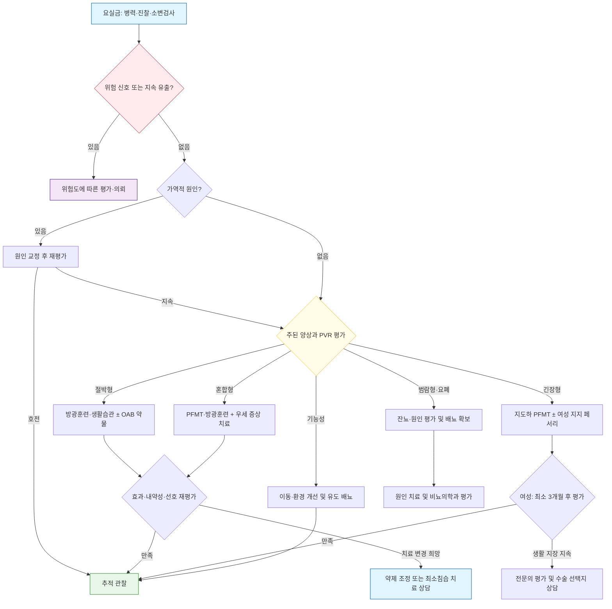

# 요실금 Urinary Incontinence, UI

## <mark style="color:green;">일반 사항</mark>

* 불수의적인 소변 유출을 호소하는 상태 (ICS 정의)
* 관련 상태 : 하부 요로 증상(LUTS). 과민성 방광(OAB)은 요로 감염이나 다른 명백한 병변 없이 **절박뇨**가 있고, 대개 빈뇨·야간뇨가 동반되는 증상 증후군으로 절박 요실금의 동반 여부와 무관함
* 적용 범위 : 성인 요실금의 일차 진료. 소아 야뇨증 및 신경인성 하부요로기능장애는 별도의 평가·치료 경로가 필요함
* 유병률 : 여성에서 흔하고 연령에 따라 증가하며, 남성에서도 고령·전립선 질환·전립선 치료 후 발생할 수 있음. 추정 유병률은 대상 집단과 요실금의 정의에 따라 크게 달라짐
* 분류 : **절박 요실금**, **긴장(복압성) 요실금**, **범람 요실금**, **기능성 요실금**; 절박·긴장 요인이 혼합된 **혼합형 요실금**이 흔함

***

## <mark style="color:green;">원인 및 위험 인자</mark>

### <mark style="color:orange;">유형별 기전 및 원인</mark>

<table><thead><tr><th width="110">요실금 유형</th><th width="190">기전</th><th width="230">원인/관련 인자</th><th>임상 양상</th></tr></thead><tbody><tr><td><strong>절박 요실금</strong><br>(Urge)</td><td>절박감에 뒤이은 불수의적 유출. 과민성 방광은 증상 증후군이며, 배뇨근 과활동은 요역동학 검사 소견으로 서로 동의어가 아님</td><td>특발성 OAB, 노화 관련 변화, 변비; 파킨슨병·다발경화증 등 신경계 질환. 요로 감염도 일시적인 절박뇨·유출을 유발할 수 있으나 감염 중의 증상을 곧바로 특발성 OAB로 진단하지 않음</td><td>갑작스러운 강한 요의 직후 소변 유출; 빈뇨·야뇨 동반 가능</td></tr><tr><td><strong>긴장 요실금</strong><br>(Stress)</td><td>골반저 지지 약화 또는 요도괄약근 기능 저하로 복압 상승 시 요도 폐쇄압이 부족해짐</td><td>임신·질식 분만, 비만, 골반저 지지 손상, 노화; 남성은 전립선 수술 후 요도괄약근 기능 저하</td><td>기침, 재채기, 웃음, 운동, 무거운 물건을 들 때 등 복압 증가 시 발생</td></tr><tr><td><strong>범람 요실금</strong><br>(Overflow)</td><td>방광출구폐쇄 또는 배뇨근 수축력 저하로 소변이 저류되어 방광이 과팽창</td><td>BPH/BOO, 요도 협착, 심한 골반장기탈출증·분변 매복, 당뇨병성/신경인성 배뇨근 저활동; 항콜린제, opioid, α-작용제 등 약물</td><td>약한 소변 줄기, 배뇨 시작 지연, 잔뇨감·지속적 또는 반복적 소량 유출; 빈뇨·야뇨 가능</td></tr><tr><td><strong>기능성 요실금</strong><br>(Functional)</td><td>인지·이동 장애 또는 환경적 장벽으로 제때 화장실에 도착하지 못함</td><td>화장실 접근이 어려운 환경, 인지 장애(치매), 이동 장애(파킨슨병)</td><td>화장실 접근이 늦어질 때 발생하는 유출</td></tr></tbody></table>

### <mark style="color:orange;">급성/일시적 요실금의 원인</mark>

* 증상이 있는 요로 감염, 외음질 자극·위축
* 섬망, 일시적 이동 제한, 분변 매복/심한 변비
* 다뇨 : 과다 수분 섭취, 고혈당, 이뇨제·SGLT2 억제제, 음주 등. 필수 약제를 임의로 중단하지 않고 발생 시점·용량·복용 시간을 검토
* 요폐/배출 장애 유발 약물 : 항콜린성 항히스타민제·항우울제·항정신병제, opioid, α-작용제 등
* 기능성 유출 악화 : 진정제·수면제로 인한 각성·이동 능력 저하
* 요도 저항 감소 : α-차단제(특히 여성의 긴장 요실금 악화 가능)
* 카페인·일부 음료/음식은 개인별 증상 악화 요인일 수 있으나 모든 환자에서 원인으로 단정하거나 일괄 제한하지 않음

### <mark style="color:orange;">지속적 요실금의 원인</mark>

* 노화, 임신, 질식 분만, 자궁절제
* 폐경 비뇨생식기증후군(GSM)/외음질 위축
* BPH에 의한 폐쇄, 전립선 수술/방사선 치료 후 괄약근·방광 기능 이상
* 신경 이상 : 다발경화증, 파킨슨병, 뇌졸중, 뇌종양, 척수 손상

***

## <mark style="color:green;">임상 양상</mark>

* 기침·재채기·운동 때 새는지(긴장형), 갑작스러운 요의를 참지 못해 새는지(절박형), 두 양상이 섞였는지(혼합형) 확인
* 약한 요류·힘주기·배뇨 지연·잔뇨감이 있으면 배출 장애를 함께 평가. 절박감·빈뇨가 있다고 요폐가 배제되는 것은 아님
* 유출 횟수·양, 패드 사용, 수면·외출·성생활·낙상에 미치는 영향과 환자가 가장 개선하고 싶은 증상을 확인
* 발생 시점, 분만·골반/전립선 수술·방사선 치료력, 당뇨병·신경계 질환, 변비, 약물, 인지·보행·손 기능과 돌봄 환경을 확인
* 지속적으로 중단 없이 새는 경우에는 범람 요실금 외에 누공 등 요도 외 유출을 감별

***

### <mark style="color:$danger;">🚩 Red Flags</mark>

* 새로 발생한 요폐/요실금이 **회음부 감각 저하(안장 감각 저하), 하지 위약, 변실금** 등과 동반 → 마미증후군/급성 척수병변 의심, 즉시 응급 평가. 모든 소견이 함께 나타날 때까지 기다리지 않음  <mark style="color:$danger;">[즉각 조치]</mark>
* 급성 완전 요폐 또는 혈괴로 인한 요폐 → 신속한 방광 배출 및 원인 평가. 신경인성·만성 요폐에서는 통증이 없을 수 있음  <mark style="color:$danger;">[즉각 조치]</mark>
* 요로 감염 증상과 저혈압·의식 변화·호흡수 증가 등 장기기능 이상 → 요로 패혈증 의심  <mark style="color:$danger;">[즉각 조치]</mark>
* 새로 발생한 육안적 혈뇨 → 월경 등 오염 여부를 확인하고 비뇨의학과 평가를 계획; 감염 동반 시 치료 후 소실 여부도 확인. 혈괴/요폐·혈역학적 불안정은 즉각 조치  <mark style="color:$warning;">[당일~수일 내 평가]</mark>
* 배뇨 조절과 무관한 지속적 유출, 특히 골반 수술·방사선 치료·요실금 수술 후 발생 → 누공/수술 합병증 의심  <mark style="color:$warning;">[당일~수일 내 평가]</mark>
* 새 신경학적 이상을 동반한 배뇨 증상. 급성 편측 마비·언어장애 또는 급성 척수병변 의심 소견은 즉각 조치  <mark style="color:$warning;">[당일~수일 내 평가]</mark>
* 원인 미상의 급작스러운 발생, 새 복부/골반 통증, 유의한 고잔뇨·신기능 저하·수신증; 발열·오한·옆구리 통증이 있으면 **당일** 평가  <mark style="color:$warning;">[당일~수일 내 평가]</mark>
* 적절한 보존적 치료에도 반응이 불충분하거나 생활 지장이 큰 경우(예: 여성 SUI/MUI의 지도하 PFMT ≥3개월, OAB/UUI의 선택 치료 후 재평가)  <mark style="color:$info;">[조기 평가 및 추적]</mark>
* 반복되는 요로 감염(≥3회/12개월 또는 ≥2회/6개월); 혈뇨·배뇨장애·고잔뇨 동반 여부 확인  <mark style="color:$info;">[조기 평가 및 추적]</mark>
* 유형이 불명확하거나 이전 요실금 수술 실패, 골반장기탈출증 등 복합 요인이 있어 전문 평가가 필요한 경우  <mark style="color:$info;">[조기 평가 및 추적]</mark>

***

## <mark style="color:green;">진단</mark>

* 환자가 먼저 호소하지 않는 경우가 많으므로 정기 진료에서 유출 여부와 생활 지장을 직접 질문. 특히 고령·인지/이동 장애 환자는 돌봄 제공자의 관찰도 함께 확인
* **최소 3일 배뇨일지** : 섭취 시간·종류·양, 배뇨 시간·배뇨량, 절박감, 유출 시점·유발 상황, 취침/기상 시각을 기록. 유형·중증도·다뇨/야간다뇨 평가와 치료 반응 비교에 활용

### <mark style="color:orange;">검사</mark>

* 소변검사 : 혈뇨·농뇨·요당 등을 확인; 감염 의심 시 소변 배양 및 치료 후 증상 재평가. **요실금 개선만을 목적으로 무증상 세균뇨를 치료하지 않음**(임신·점막 손상을 동반하는 비뇨기 시술 전 등 별도 적응증은 해당 지침 적용). 신기능·혈당은 신질환·고잔뇨·다뇨·당뇨병 의심 시 선택
* 복부 진찰 : 팽만된 방광·종괴 확인; 남성은 외성기 및 적응증에 따른 직장수지검사(전립선·항문 긴장도·분변 매복)
* 여성 골반 진찰 : 외음질 위축, 골반장기탈출증(POP), 골반저근 수축력 평가
* **기침 유발검사(cough stress test)** : 긴장 요실금 의심 시 방광이 적절히 찬 상태에서 기침과 동시에 요도로 새는 소변을 관찰. 누운 자세에서 음성이어도 병력이 전형적이면 선 자세에서 반복 고려
* 신경학적 진찰 : 보행·하지 근력/감각을 확인하고, 신경인성 병변 의심 시 회음부 감각·항문 긴장도·반사 등을 추가 평가
* 배뇨 후 잔뇨량(PVR) : 배뇨 직후 초음파로 측정. 배뇨곤란·약한 요류·요폐/범람 의심, BOO·신경계 질환·요폐 유발 약물 복용 시 우선 시행; 고령자·남성 및 항무스카린제 시작 전 요폐 위험 환자에서는 초기 평가에 적극 포함
  * 지침 간 범위 차이 : EAU 여성 LUTS 지침은 초기 PVR 측정을 권고하고, AUA/SUFU OAB 지침은 특히 배출 증상이 동반될 때 선택적으로 측정하도록 함
  * 모든 환자에게 적용할 단일 절단값은 없음. 배뇨량·잔뇨량·증상·추세를 함께 보고, 예상 밖 증가 시 재측정 및 원인 평가. **EAU 남성 LUTS 지침은 PVR >150 ㎖에서 항무스카린제 단독 또는 α-차단제와 항무스카린제 병용을 권고하지 않음(약한 권고)**; 이 수치를 여성 전체의 진단 기준으로 확대하지 않음
* 초음파 : PVR 측정에 유용; 그 외 요로 초음파는 기저 병변이 의심되는 경우 선택적으로 시행
* 추가 검사 : 혈뇨, 통증, 반복 감염, 폐쇄·누공 의심 등 적응증에 따라 요로 영상검사 또는 방광경 검사 선택
* 요역동학 검사 : 합병증 없는 OAB·요실금의 초기 평가에 일률적으로 시행하지 않음. 명확한 병력과 진찰에서 긴장 요실금이 확인되는 단순 여성 SUI는 수술 전에도 생략 가능. 유형 불명확·절박 우세 혼합형·배출 장애·신경인성 병변·이전 수술 실패 등에서 결과가 치료 선택에 영향을 주면 고려. 국내 수술 급여의 검사 요건은 임상 권고와 별도로 확인

### <mark style="color:orange;">문진표</mark>

아래 한국어 문항은 원문 의미를 설명하기 위한 표현이며, 공인된 한국어 검증본을 제시하는 것은 아님. 연구·정량 추적에는 검증된 해당 언어판과 동일 문항·응답 척도를 사용

#### <mark style="color:$primary;">Questionnaire for Urinary Incontinence Diagnosis (QUID)</mark>

아래 각 항목에 대하여 '전혀, 드물게, 가끔, 자주, 대부분, 또는 항상'으로 평가\
① 기침 또는 재채기를 할 때 소변이 조금이라도 새어 나온다.\
② 허리를 앞으로 구부리거나 물건을 들 때 소변이 조금이라도 새어 나온다.\
③ 빠르게 걷거나 가볍게 달릴 때 또는 운동할 때 소변이 조금이라도 새어 나온다.\
④ 배뇨를 위하여 화장실에서 탈의하는 동안 소변이 조금이라도 새어 나온다.\
⑤ 갑작스럽고 참기 힘든 요의 때문에 화장실에 도착하기 전에 소변이 조금이라도 샌다.\
⑥ 갑작스럽고 참기 힘든 요의 때문에 빨리 화장실에 가야 한다.

▶판정 : 각 문항을 0\~5점(전혀=0 \~ 항상=5)으로 채점; Stress score(①+②+③) ≥4점 → 긴장 요실금 의심, Urge score(④+⑤+⑥) ≥6점 → 절박 요실금 의심. 두 기준 모두 충족하면 혼합형 가능성을 평가 <mark style="color:$info;">[Bradley CS, et al. Neurourol Urodyn 2010]</mark>. 여성에서 개발·검증된 도구이며 문진·진찰을 대신하지 않음

#### <mark style="color:$primary;">3 Incontinence Questions (3IQ)</mark>

여성의 요실금 유형을 신속히 가늠하기 위해 개발된 선별 도구. 결과는 병력·진찰과 함께 해석

1. 최근 3개월 동안 조금이라도 소변이 새어 나온 적이 있다? → 있으면 2번 문항, 없으면 종료
2. 최근 3개월 동안 다음 중 해당되는 모든 것에 표시 :\
   □ 신체 활동(예: 기침, 재채기, 운동 또는 물건을 들 때) 중에 소변이 새어 나온 적이 있다.\
   □ 갑작스러운 요의가 생겨 화장실에 도착하기 전에 소변이 새어 나온 적이 있다.\
   □ 신체 활동 없이, 그리고 급하게 소변이 마렵지 않은 상태에서 소변이 새어 나온 적이 있다.
3. 다음 중 최근 3개월 동안 가장 흔히 발생한 내용 한 가지에 표시 :\
   □ 신체 활동 중에 소변이 새어 나왔다 → Stress incontinence\
   □ 갑작스러운 요의가 생겨 화장실에 도착하기 전에 소변이 새어 나왔다 → Urge incontinence\
   □ 신체 활동 없이, 급하게 소변이 마렵지 않은 상태에서 새어 나왔다 → Other\
   □ 신체 활동 때의 유출과 갑작스러운 요의에 따른 유출이 거의 같은 빈도로 발생했다 → Mixed incontinence

#### <mark style="color:$primary;">Bladder Control Self-Assessment Questionnaire (B-SAQ)</mark>

각 증상의 정도와 해당 증상 때문에 느끼는 괴로움 정도를 **별도로** 평가(각각 0\~3점). 아래 4개 증상에 대하여 각 문항의 불편감도 추가로 질문\
① 소변을 보고 싶을 때 참는 것이 어렵습니까?\
② 소변을 자주 봐야 하는 문제가 있습니까?\
③ 밤에 배뇨를 위하여 일어나곤 합니까?\
④ 요실금이 있습니까?

▶증상 점수(4문항, 0\~12점)와 괴로움 점수(4문항, 0\~12점)를 각각 기록. 점수가 높을수록 증상 또는 괴로움이 크며, 점수만으로 요실금 유형이나 경·중·중증을 확정하지 않음

### <mark style="color:orange;">감별 진단</mark>

* 지속적 유출은 요도-질/방광-질 누공 등 요도 외 요실금을 감별. 수면 중 불수의적 유출인 야뇨증(nocturnal enuresis)도 요실금의 양상 중 하나로, 깨어 소변을 보는 야간뇨(nocturia)와 구별. 실제 유출 없이 빈뇨·절박감만 있으면 OAB dry를 고려
* 방광통증증후군/간질성 방광염, 방광 종양·결석 : 빈뇨·절박감·통증/혈뇨가 주증상일 수 있음; OAB로 단정하기 전에 감별
* 배뇨 직후 방울방울 떨어지는 **배뇨 후 요점적(post-micturition dribble)**은 범람 요실금과 구별; 남성에서는 구부요도 잔류 소변의 배출을 돕는 요도 훑기(urethral milking)와 골반저근운동을 안내할 수 있음
* 다뇨·야간다뇨는 방광 저장 기능 이상과 구별. 당뇨병·수면무호흡·하지 부종·심부전·이뇨제 등을 평가하며, 야간뇨만으로 OAB 약제를 추가하지 않음

***



<p align="center"><strong>요실금 평가 및 치료 알고리듬</strong></p>

✽남성 전립선 치료 후 긴장 요실금은 아래 별도 경과·수술 상담 기준을 적용. OAB의 최소침습 치료는 환자 선호에 따라 위 흐름보다 일찍 상담 가능하며 국내 허가·급여 요건을 확인

***

## <mark style="background-color:$warning;">Management</mark>


**치료 선택과 공동 의사결정**\
AUA/SUFU 과민성방광 가이드라인(2024)은 단계적(step) 치료 대신 환자의 선호·내약성을 고려한 **공동 의사결정(shared decision-making)**을 강조함. 행동 치료·물리 치료·약물 치료는 병행할 수 있으며, 최소침습 치료도 환자 선호에 따라 경구약을 모두 시도하기 전에 상담 가능. 국내 약제·시술 허가와 급여 요건은 별도로 적용


### <mark style="color:orange;">치료 방침</mark>

* 가역적 원인과 동반 질환을 치료하고, 유발 가능 약제는 처방 목적·대체 가능성을 검토하여 조정
* 절박·긴장·혼합형 요실금 : 생활 습관 교정 및 적절한 행동/골반저 치료를 우선 고려
* 범람 요실금 : 잔뇨량과 요폐 여부를 먼저 평가하여 방광 배출 확보 및 원인 질환(BPH/BOO 등) 치료를 우선함
* 절박 요실금의 약물 치료는 행동 치료와 병행하거나, 환자 선호·증상 부담에 따라 초기부터 선택 가능
* 고령자 : 다제약물·인지저하 위험을 고려하여 항콜린 부담이 적은 약제(β3-작용제 등)를 우선 고려

***

## <mark style="color:green;">비-약물 치료 및 예방</mark>

### <mark style="color:orange;">생활 습관 중재</mark>

* 금연, 과체중/비만 환자의 체중 감량, 변비 관리; 만성 기침·수면무호흡 등 동반 질환도 평가
* 배뇨일지의 24시간 섭취량·배뇨량을 보고 수분 섭취를 조정; 과음수와 과도한 제한을 모두 피함. 심부전·만성콩팥병 등으로 정해진 수분 처방이 있으면 이를 우선
* 야간뇨가 문제이면 취침 전 과음수를 피하고 필요 시 이뇨제 복용 시간 등을 조정. 탈수를 유도하는 제한은 피함
* 카페인 감량은 절박뇨·빈뇨 감소에 도움을 줄 수 있으나 요실금 자체의 호전을 보장하지 않음. 음주·탄산·산성 음료 등은 증상과의 개인별 관련성을 보며 조정

### <mark style="color:orange;">배뇨 환경 개선</mark>

* 야간 조명·이동 동선·옷 착탈 편의·이동변기 등 화장실 접근 환경 개선 및 낙상 예방
* 적절한 흡수 패드/기저귀를 선택하고 자주 교체하며 회음부 피부 보호. 증상 완화용 보조 수단으로 사용하고 원인 평가·치료도 함께 계획

### <mark style="color:orange;">방광 훈련, 물리 요법</mark>

* 골반저근운동(PFMT)과 방광훈련은 서로 다른 중재임. 절박감이 왔을 때 안전한 범위에서 배뇨를 잠시 미루는 방법은 방광훈련에 해당하며, 요폐·고잔뇨가 의심되면 먼저 배뇨 상태를 평가
* 지지 페서리(continence pessary) : 여성 긴장 요실금에서 비수술적 치료를 원하는 경우 고려. 크기·적합성을 평가하고 세척·제거 방법과 정기 추적을 안내; 출혈·분비물·통증 발생 시 진찰
* 시간제·유도 배뇨 : 인지·이동 능력과 배뇨 패턴에 맞추어 시행
* 바이오피드백·전기자극을 PFMT에 일률적으로 추가하지 않음. 골반저근 수축을 스스로 하지 못하는 환자에서 전문가 평가 후 보조적으로 고려 <mark style="color:$info;">[NICE NG123]</mark>

### <mark style="color:orange;">Kegel exercise (골반저 근육 운동, PFMT)</mark>

* 적용 : 절박, 긴장, 혼합형 요실금
* 정확한 골반저근 수축·이완을 확인하고 전문 인력의 지도하에 시행. **여성 긴장/혼합형은 최소 3개월** 시행하며, 효과가 있으면 유지. 전립선 수술 후 남성도 조기에 PFMT를 시행하되 경과와 수술 후 상태에 맞추어 조정
* 단계별 방법 :
  1. 올바른 근육 확인 : 방귀를 참거나 소변을 참는 느낌으로 항문·질·요도 주변을 안쪽·위쪽으로 조이는 근육을 확인; 처음에는 전문가의 지도하에 정확한 수축 여부를 확인하는 것이 바람직
  2. 수축 : 확인된 골반저근을 조여 10초간 유지(처음에는 3\~5초부터 시작해 점차 늘림); 숨을 참거나 아래로 힘주지 않고, 복부·엉덩이·허벅지에 과도한 힘이 들어가지 않도록 함
  3. 이완 : 10초간 완전히 이완; 수축과 이완 시간을 비슷하게 유지
  4. 반복 : 위 수축-이완을 8\~10회 1세트로, 1일 3회 시행
  5. 지속 : 긴장/혼합 요실금의 PFMT는 최소 3개월 지속; 절박 요실금에서는 방광훈련과 PFMT를 병행할 수 있으며 방광훈련은 최소 6주 시행 - 조기에 효과를 판정하지 않도록 안내
* 기침·재채기·물건 들기 직전에 골반저근을 미리 수축하는 방법(the Knack)을 함께 안내
* 주의 : 배뇨 도중 소변줄기를 끊는 동작을 반복 훈련으로 시행하지 않음. 골반 통증·수축 후 이완 곤란이 있으면 무조건 강화하지 말고 골반저 기능 평가

### <mark style="color:orange;">방광훈련 (bladder training)</mark>

절박 또는 혼합형 요실금에 적용하며, 여성에서는 최소 6주간 시행. 요폐·고잔뇨가 의심되면 먼저 평가

1. 배뇨일지에서 실제로 유지 가능한 낮 시간 배뇨 간격을 정해 규칙적으로 배뇨(예: 1시간 간격); 가장 짧았던 한 번의 간격을 모든 환자의 훈련 기준으로 고정하지 않음
2. 예정 시간 전에 요의가 발생하면 멈추어 서거나 앉아 심호흡·주의 전환, 짧은 골반저근 수축 등으로 조절 → 요의가 가라앉으면 천천히 화장실로 이동
3. 조절이 가능해지면 수일 간격으로 배뇨 간격을 약 15분씩 연장. 중간 유출이 있었다고 훈련 전체를 실패로 판정하지 않고 속도를 조정
4. 배뇨 간격이 3\~4시간이 되거나 일상생활에 지장이 없는 간격이 될 때까지 지속(수 주 이상 소요될 수 있음)

### <mark style="color:orange;">시간제·유도 배뇨 (timed & prompted voiding)</mark>

* 인지·이동 장애로 화장실을 제때 이용하기 어려운 경우, 평소 배뇨 패턴에 맞추어 정해진 시간에 화장실 이용을 돕고 요의·배뇨 여부를 확인
* 배뇨 간격을 의도적으로 늘리는 방광훈련과 구별하여 환자의 이동 능력과 돌봄 환경에 맞게 조정

***

## <mark style="color:green;">약물 치료</mark>

* 약제별 국내 허가 용량과 신·간기능을 확인하고 시작 → 증상 완화, 환자 만족도, 부작용을 관찰하면서 조정 (☞ [전립선비대증](124_-benign-prostatic-hyperplasia-bph.md))
* 항무스카린제는 같은 성분의 속방형보다 서방형에서 입마름 등 부작용이 적어 우선 고려; 서방형도 인지·요폐 위험이 없어지는 것은 아님
* 약물 시작·변경 후 4\~8주에 효과·부작용을 재평가; 충분한 이득이 없거나 부작용이 있으면 용량·계열·치료 방법 조정 <mark style="color:$info;">[AUA/SUFU 2024]</mark>

### <mark style="color:orange;">절박 요실금 (Urge incontinence)</mark>

* 항무스카린제 또는 β3-작용제를 선택 → 효과·부작용·복약 순응도·유형을 재평가하여 용량 조절, 계열 변경 또는 서로 다른 계열의 병용을 고려. 항무스카린제 2종 또는 β3-작용제 2종의 병용은 일반적으로 권장하지 않음; 병용 근거가 가장 축적된 조합은 solifenacin + mirabegron이며 국내 품목 허가·급여를 별도로 확인 <mark style="color:$info;">[AUA/SUFU 2024]</mark>

#### <mark style="color:$primary;">Antimuscarinics</mark>

* 작용 : 불수의적 배뇨근 수축을 억제하여 절박뇨·빈뇨·절박 요실금을 감소시킴; OAB/절박 요실금 및 절박 증상이 동반된 혼합형 요실금에 적용
* 제제 간 평균 효과 차이는 대체로 작지만, 부작용·제형·상호작용·환자별 반응은 달라 개별 선택
* 부작용 : 입마름, 눈 마름, 두통, 변비, 빈맥, 시야 흐림, 졸음, 섬망/인지 변화(특히 고령자). 약제별 CYP 대사·상호작용 확인
* 주의/금기 : 요폐, 위장관 폐색/위정체, 중증근무력증, 녹내장 종류·조절 상태, 심장질환/QT 연장, 신·간기능 및 병용약을 확인. 협우각/폐쇄각녹내장 금기의 범위는 성분별로 다르며, 조절된 개방각녹내장을 일률적 금기로 간주하지 않음
* **인지기능·치매 위험 설명** : 누적 항콜린 노출과 치매의 연관성을 시사하는 관찰연구가 있으나 인과관계는 확정되지 않음. 2024년 연구에서 oxybutynin·solifenacin·tolterodine의 연관성이 두드러졌고, 2025년 덴마크 연구는 mirabegron 사용자와의 비교에서 위험 증가를 확인하지 못함. 특정 항무스카린제를 ‘치매 위험이 없는 약’으로 단정하지 않고 총 항콜린 부담·인지 상태·치료 이득을 정기 재평가 <mark style="color:$info;">[BMJ Med 2024; 2025]</mark>
* 고령·인지저하 위험·다제약물 환자는 β3-작용제를 우선 고려. 특히 **경구 oxybutynin 속방형은 취약 고령자에서 우선 선택을 피함**

<table><thead><tr><th width="150">성분 / 제품 예</th><th width="220">성인 통상 용량</th><th>주요 용량 제한·확인 사항</th></tr></thead><tbody>
<tr><td>fesoterodine<br><mark style="color:blue;">[토비애즈서방정]</mark></td><td>4 ㎎ qd 시작; 최대 8 ㎎ qd</td><td>CrCl &lt;30 ㎖/min 또는 중등도 간장애, 강력한 CYP3A4 억제제 단독 병용 시 최대 4 ㎎/일. 신·간장애에 CYP3A4 억제제가 겹치면 회피/금기가 달라지므로 허가표 확인. Child-Pugh C 금기</td></tr>
<tr><td>imidafenacin<br><mark style="color:blue;">[유리토스정]</mark></td><td>0.1 ㎎ bid 아침·저녁 식후 시작; 내약성 확인 후 최대 0.2 ㎎ bid</td><td>중증 신장애·중등도 간장애는 0.1 ㎎ bid를 초과하지 않음. 중증 간장애·중증 심질환 등은 금기. 0.2 ㎎ bid로 바로 시작하지 않음</td></tr>
<tr><td>oxybutynin 속방형<br><mark style="color:blue;">[동화디트로판정]</mark></td><td>5 ㎎ bid~tid; 최대 20 ㎎/일</td><td>항콜린성 중추신경계 부작용에 특히 유의; 고령·취약 환자는 대안 약제 우선 고려</td></tr>
<tr><td>propiverine<br><mark style="color:blue;">[비유피-4정]</mark></td><td>20 ㎎ qd 식후; 효과 불충분하고 안전성에 문제가 없으면 20 ㎎ bid까지</td><td>국내 허가상 <strong>부정맥 또는 그 병력, 중증 심질환, 중등도/중증 간장애, 폐색우각녹내장, 궤양성 대장염</strong> 등 금기. 단순히 ‘심장·간질환 주의’로 축약하지 않음</td></tr>
<tr><td>solifenacin<br><mark style="color:blue;">[베시케어정]</mark></td><td>5 ㎎ qd 시작; 최대 10 ㎎ qd</td><td>CrCl ≤30 ㎖/min, Child-Pugh B 또는 강력한 CYP3A4 억제제 병용 시 최대 5 ㎎/일. 중증 신장애/중등도 간장애와 강력한 CYP3A4 억제제가 겹치면 병용 금기; 혈액투석·Child-Pugh C 금기. QT 연장 위험 확인</td></tr>
<tr><td>tolterodine SR<br><mark style="color:blue;">[디트루시톨SR캡슐]</mark></td><td>4 ㎎ qd; 필요 시 2 ㎎ qd</td><td>국내 허가상 신기능장애·간기능장애·강력한 CYP3A4 억제제 병용 시 2 ㎎ qd. QT 연장 위험 및 중증 장기기능 장애에서의 사용 가능 여부 확인</td></tr>
<tr><td>trospium<br><mark style="color:blue;">[스파스몰리트당의정]</mark></td><td>국내 허가상 20 ㎎ bid; 연령·증상에 따라 조정</td><td>신장 배설에 따른 축적 위험 확인. 국내 설명서에는 수치별 신기능 감량표가 없어 해외 용량을 국내 허가로 표시하지 않음. 참고로 미국 허가는 CrCl &lt;30 ㎖/min에서 20 ㎎ 취침 전 1회. 부정빈맥·폐쇄각녹내장 등 금기</td></tr>
</tbody></table>

✽위 표는 전체 금기·상호작용의 목록이 아님. 제품별 최신 국내 허가사항을 우선 적용하며, 서방정/서방캡슐은 분쇄·분할 가능 여부를 확인 <mark style="color:$info;">[국내 품목허가·제품설명서; trospium 신기능 참고: 미국 허가사항]</mark>

#### <mark style="color:$primary;">β3-작용제 (β3-adrenoceptor agonist)</mark>

* 작용 : detrusor muscle에 대한 선택적 β3-수용체 자극 → smooth muscle 이완
* 항콜린성 입마름·변비 부담이 적고 중추 항콜린 작용을 피할 수 있어 고령·다제약물 환자에서 우선 고려; 장기 치매 예방 효과가 입증된 것은 아님. 항무스카린제와의 병용은 약제별 근거·허가를 확인 <mark style="color:$info;">[AUA/SUFU 2024]</mark>
* 부작용 : 빈맥·혈압 상승(mirabegron), 요로감염, 잔뇨 증가/요폐 등. vibegron도 변비·입마름·배뇨곤란·QT 연장 등이 보고되어 있음
* mirabegron : 국내 허가사항상 성인(노인 포함) 권장량 50 ㎎ qd. GFR 15~29 ㎖/min/1.73㎡ 또는 Child-Pugh B에서는 25 ㎎ qd; 강력한 CYP3A 억제제가 병용되면 경증/중등도 신장애 또는 Child-Pugh A는 25 ㎎ qd, 중증 신장애 또는 Child-Pugh B는 투여가 권장되지 않음; 효과 평가는 수 주에 걸쳐 시행. 조절되지 않는 중증 고혈압(수축기 ≥180 mmHg 또는 이완기 ≥110 mmHg)에서는 금기이며 심각한 심장질환도 국내 허가상 금기; 말기 신장질환(GFR ＜15 ㎖/min/1.73㎡ 또는 투석)·Child-Pugh C에서는 권장되지 않음. 치료 전·치료 중 혈압 및 방광출구폐쇄/요폐 위험을 확인; 서방정은 씹거나 부수지 않고 복용 <mark style="color:blue;">\[베타미가]</mark>
* vibegron : 50 ㎎ qd 식후 <mark style="color:blue;">\[베오바정]</mark>; 국내 허가 OAB 적응증 범위에서 급여 인정(HIRA 현행 게시 자료 확인). 심각한 심장질환·QT 연장·신장애·간장애·방광출구폐쇄에서는 신중 투여; 항무스카린제 병용 시에도 요폐 징후를 관찰. 해외 75 ㎎ 자료를 국내 50 ㎎ 용법과 혼동하지 않음 <mark style="color:$info;">[HIRA 2026; 국내 허가사항]</mark>
* mirabegron 상호작용 : 중등도 CYP2D6 억제제로 flecainide·propafenone·일부 TCA 등의 노출을 높일 수 있음. digoxin은 최저용량으로 시작하고 혈중농도를 추적하며 조정
* vibegron도 CYP3A4/P-gp 억제제(itraconazole·ritonavir 등)로 노출이 증가하고 유도제(rifampicin·phenytoin·carbamazepine 등)로 감소할 수 있어 병용약 확인 <mark style="color:$info;">[국내 허가사항]</mark>

### <mark style="color:orange;">긴장 요실금 (Stress incontinence)</mark>

* 여성은 지도하 PFMT(최소 3개월)가 1차 치료이며 지지 페서리도 고려. 긴장 요실금에 항무스카린제·β3-작용제를 처방하지 않음(동반 절박 증상에는 사용 가능)
* SNRI : duloxetine - 국내 SUI 적응증 허가 외 사용. 증상 감소 효과는 있으나 완치율이 낮고 오심·어지럼 등 부작용 및 치료 중단률이 높아 1차 치료로 사용하지 않음. 수술을 원하지 않거나 적합하지 않고 약물치료를 원하는 경우에 한해 전문의와 상의; 사용 시 저용량에서 시작하여 서서히 증량·감량하고, 기분 변화·중단 증상 및 다른 세로토닌성 약제와의 상호작용을 확인.

### <mark style="color:orange;">혼합형 요실금 (Mixed incontinence)</mark>

* 주된 증상(절박 vs 긴장)에 따라 우선 치료 방향 결정
* 절박 요소 : antimuscarinics 또는 β3-작용제
* 긴장 요소 : PFMT, 여성에서 지지 페서리
* 수술을 고려할 때 긴장성 유출을 치료해도 절박뇨·절박 요실금은 남거나 악화될 수 있으며 별도 치료가 필요할 수 있음을 설명

### <mark style="color:orange;">범람 요실금 (Overflow incontinence)</mark>

#### <mark style="color:$primary;">원인 질환 치료 - BPH/방광출구폐색(BOO)</mark>

* 방광출구폐쇄가 원인이면 배뇨 확보 후 α-차단제를 고려; 전립선 비대 및 진행 위험이 확인된 경우 5α-reductase 억제제 병용을 고려 (☞ [전립선비대증](124_-benign-prostatic-hyperplasia-bph.md))
* α-차단제 : 전립선/방광경부 평활근 이완; 기립저혈압·어지럼·낙상·사정 장애 및 백내장 수술 시 홍채긴장저하증후군(IFIS) 확인. 괄약근 기능 저하에 의한 긴장 요실금을 치료하는 약은 아님
  * alfuzosin 서방형 : 10 ㎎ qd 저녁 식사 직후, 통째로 복용 <mark style="color:blue;">\[자트랄엑스엘정]</mark>
  * tamsulosin : 0.2 ㎎ qd 식후 (해당 품목 허가에 따라 효과 불충분 시 0.4 ㎎ qd로 증량) <mark style="color:blue;">\[하루날 디]</mark>
  * silodosin : 4 ㎎ bid 아침·저녁 식후 또는 8 ㎎ qd 식사와 함께 <mark style="color:blue;">\[트루패스]</mark>. 신·간장애는 저용량(2 ㎎ bid) 시작 등 감량 고려; CrCl <30 ㎖/min·Child-Pugh 점수 ≥10 또는 강력한 CYP3A4 억제제 병용은 금기
* 5α-reductase 억제제 : 전립선 크기 감소; 부작용 - 성욕 감소, 발기부전, 사정 장애, 여성형 유방/유방 압통
  * finasteride : 5 ㎎ qd <mark style="color:blue;">\[프로스카]</mark>
  * dutasteride : 0.5 ㎎ qd <mark style="color:blue;">\[아보다트]</mark>
  * 효과는 수개월에 걸쳐 나타나며 PSA가 감소하므로 해석·추적 시 복용 사실을 반영. finasteride는 2025년 EMA 평가에서 자살 사고가 이상반응으로 확인되었고, dutasteride는 직접 인과관계가 확인되지는 않았으나 예방적 기분 변화 경고가 추가됨. 우울감·자살 사고 발생 시 즉시 의학적 평가 <mark style="color:$info;">[EMA 2025]</mark>
* 급성 요폐 또는 유의한 고잔뇨 : 신속히 방광 배출을 확보하고 신기능·감염·폐쇄 원인을 평가; 상황에 따라 도뇨 및 비뇨의학과 의뢰. 5α-reductase 억제제는 즉각적인 배뇨 확보를 대신하지 못함

#### <mark style="color:$primary;">콜린 작용제</mark>

* bethanechol 등 parasympathomimetic은 detrusor underactivity(방광 배출 장애)에 대한 임상적 유효성 근거가 부족하고 부작용(저혈압·서맥, 복통·설사, 기관지수축 등) 위험이 있어 routine으로 권장하지 않음; 간헐적 도뇨가 우선 고려됨

***

## <mark style="color:green;">시술 및 기타 처치</mark>

### <mark style="color:orange;">GSM이 동반된 폐경 여성</mark>

* **국소 질 에스트로겐** : 외음질 위축/GSM과 요로 증상이 동반되면 고려; 요실금 단독 치료로 모든 폐경 여성에게 사용하지 않음. 제제별 국내 적응증·금기를 확인하며, 설명되지 않는 질출혈은 먼저 평가하고 유방암 병력(특히 aromatase inhibitor 복용)에서는 관련 전문의와 공동 의사결정 <mark style="color:$info;">[AUA/SUFU/AUGS GSM 2025]</mark>
* 전신 에스트로겐은 요실금 치료 목적으로 사용하지 않음; 일부 제제는 기존 요실금을 악화시킬 수 있음

### <mark style="color:orange;">요폐·배출 장애</mark>

* 방광 배출이 필요하면 간헐적 도뇨를 우선 고려; 시행 능력·돌봄 지원을 평가. 유치 도뇨관은 적응증과 감염·요도손상 위험을 따져 사용하며, 요실금 자체만으로 일률적으로 유치하지 않음

### <mark style="color:orange;">절박 요실금의 최소침습 치료</mark>

* **경피적 경골신경 자극술(PTNS)**, 천수신경조절술(sacral neuromodulation), onabotulinumtoxinA 배뇨근 내 주사 등을 전문의와 상담. 효과·반복 방문/재시술·기기 관리 부담 및 환자 선호를 반영; 모든 경구약 실패를 일률적 선행 조건으로 삼지 않되 국내 허가·급여는 별도 적용
* **보톡스주(onabotulinumtoxinA)** : 국내 OAB 허가는 18세 이상에서 항콜린제 치료가 어렵거나 적절히 조절되지 않는 경우; OAB 권장·최대 추천용량은 **100 U**. 다른 보툴리눔독소 제제에 단위·적응증을 그대로 적용하지 않음
* 주사 전 요로감염·PVR 및 필요 시 간헐적 자가도뇨 가능성을 평가; 활동성 요로감염 등 금기 확인. 주사 후 약 2주에 PVR/배뇨 상태를 확인하고 요폐·감염을 감시. 효과 소실 후 재투여하되 **허가상 최소 12주**와 **국내 급여상 최소 24주**의 구분에 유의 <mark style="color:$info;">[국내 보톡스 허가사항; 급여기준 현행란]</mark>


**급여 업데이트 확인 — 2026.10.28. 검토 기준**2026년 11월 1일 시행 예정인 의견조회 개정안에는 행동치료 및 **mirabegron** 실패 성인 OAB에 보톡스주 최대 100 U, 재투여 최소 24주로 허가초과 급여를 추가하는 내용이 있음. 확인한 자료는 **개정안**이므로 최종 고시·시행 여부를 확인하기 전에는 현행 급여로 적용하지 않으며, vibegron 실패에 자동 확대하지 않음.


### <mark style="color:orange;">긴장 요실금의 수술·기타 치료</mark>

* 여성 : 보존적 치료 후에도 생활 지장이 크면 중부요도 슬링(midurethral sling), 자가근막 슬링, 방광경부/질벽 현수술, 요도주위 충전제 등을 상담. 충전제는 덜 침습적이지만 효과·지속성이 낮고 반복 주사가 필요할 수 있음
* 합성 메쉬 슬링은 노출/미란·만성 통증·배뇨장애/요폐·새 절박 증상·재수술 가능성과 대안 치료를 충분히 설명
* **전립선 치료 후 남성** : 조기 PFMT를 시행. 보존적 치료에도 불편한 긴장 요실금이 호전되지 않으면 6개월부터 수술 상담을 고려하고, 1년에도 지속되면 수술 치료를 제안. 경·중등도는 남성 슬링, 중등도·중증 또는 방사선 치료력 등이 있으면 인공요도괄약근을 포함하여 평가 <mark style="color:$info;">[AUA/GURS/SUFU 2024]</mark>
* **질 레이저·체외 자기장 자극을 여성 SUI의 표준 치료로 권하지 않음**; EAU는 적절히 관리되는 연구 외 사용을 권고하지 않음. PFMT·경골신경 자극·전기자극과 서로 같은 치료로 취급하지 않음 <mark style="color:$info;">[EAU 여성 LUTS 2026]</mark>

***

### <mark style="color:red;">질병코드</mark>

국내 분류를 적용. 미국 ICD-10-CM의 N39.41(절박), N39.46(혼합)과 혼동하지 않음

N39.3 스트레스요실금 Stress incontinence

N39.40 절박요실금 Urge incontinence

N39.41 혼합요실금 Mixed incontinence

N39.48 기타 명시된 요실금 Other specified urinary incontinence (범람 요실금 등)

R32 상세불명의 요실금 Unspecified urinary incontinence

***

## <mark style="color:purple;">처방례</mark>

> **처방례 1. 절박 요실금, 경증\~중등도**
>
> ```
> 베시케어정 5 ㎎/T   1T   qd
> ```
>
> _✽약물 선택지 중 하나; 4\~6주 후 효과 및 입마름·변비 등 부작용 평가 후 필요시 10 ㎎으로 증량; CrCl ≤30 ㎖/min·Child-Pugh B·강력한 CYP3A4 억제제 병용 시 5 ㎎/일 상한 및 병용 금기 확인_

> **처방례 2. 절박 요실금, 고령자 또는 인지저하 위험군**
>
> ```
> 베타미가서방정 50 ㎎/T   1T   qd
> ```
>
> _✽국내 허가상 성인·노인 권장량은 50 ㎎ 1일 1회. 항무스카린제에 비해 항콜린 부담이 적으나 혈압·요폐 위험과 신·간기능·상호작용을 확인; 효과는 수 주에 걸쳐 평가. 중증 신장애·중등도 간장애 등은 허가사항에 따라 25 ㎎ 등으로 조절_

> **처방례 3. 여성 긴장 요실금**
>
> ```
> 지도하 Kegel 운동(PFMT) 1일 3회, 8회 이상/회; 3~5초부터 시작해 최대 10초 수축·충분한 이완, 최소 3개월
> continence pessary 고려 (비수술적 지지 치료를 원하는 경우)
> ```
>
> _✽여성 긴장 요실금은 지도하 PFMT가 1차 치료이며 지지 페서리도 고려; 최소 3개월의 적절한 PFMT에도 증상이 지속되고 치료를 원하는 경우 전문의 의뢰 및 수술적 치료 고려_

> **처방례 4. 범람 요실금(BPH 동반 남성)**
>
> ```
> 요폐·고잔뇨 확인 시 우선 방광 배출 확보 및 원인 평가
> 하루날디정 0.2 ㎎/T   1T   qd 식후 (BPH에 의한 방광출구폐쇄가 원인으로 판단될 때)
> 전립선 비대·진행 위험이 확인되면 아보다트연질캡슐 0.5 ㎎/C   1C   qd 병용 고려
> ```
>
> _✽완전 요폐·방광 팽만/통증에서는 약물 효과를 기다리지 않고 신속히 도뇨 및 의뢰. 두타스테리드는 모든 BPH 동반 요실금에 일률적으로 병용하지 않음_

> **처방례 5. 혼합형 요실금**
>
> ```
> 디트루시톨SR캡슐 4 ㎎/C   1C   qd (절박 요소에 대해 고려)
> 지도하 골반저근운동(PFMT) 및 방광훈련 병행
> ```
>
> _✽주된 증상에 따라 치료 방향을 정하되 약물은 절박 요소를 대상으로 선택. 신·간기능 장애 또는 강력한 CYP3A4 억제제 병용 시 tolterodine SR 2 ㎎ qd 적용; 고령·인지저하 위험에서는 β3-작용제 등 대안을 우선 고려_

***

### <mark style="color:$success;">핵심 복약 지도</mark>

> **Antimuscarinics 복약 지도**
>
> * 약물 시작·변경 후 4\~8주에 효과와 부작용을 평가합니다. 부작용이 있으면 그 전에 상담합니다.
> * 같은 성분에서는 서방형이 속방형보다 입마름 등이 적을 수 있습니다. 서방정·서방캡슐은 임의로 쪼개거나 부수지 마십시오.
> * 고령 환자, 특히 여러 약을 함께 복용 중이거나 인지기능 저하가 있는 경우 항콜린 부담이 누적되어 혼동·기억력 저하로 이어질 수 있어 정기적 재평가가 필요합니다.
> * 소변이 나오지 않거나 심한 복부 팽만·변비, 새 혼동·환각이 생기면 복용을 보류하고 바로 진료받으십시오. 갑작스러운 눈 통증·시력 저하, 얼굴/혀 부종·호흡곤란은 즉시 응급 평가가 필요합니다.
> * 녹내장 종류와 치료 상태, 심장·신장·간 질환, 감기약·수면제 등 함께 쓰는 약을 알려주십시오.

> **β3-작용제 복약 지도**
>
> * mirabegron은 효과를 수 주에 걸쳐 평가합니다. 국내 허가상 성인·노인 권장량은 50 ㎎ 1일 1회이며, 신·간기능 장애 및 병용약에 따라 감량이 필요할 수 있습니다. 고혈압 환자는 치료 전·치료 중 혈압을 확인합니다.
> * vibegron은 국내 50 ㎎ 1일 1회 식후 용법을 따릅니다. mirabegron과 같은 중증 고혈압 금기는 없으나 심장질환·QT 연장·배출 장애가 있으면 신중히 사용합니다.

> **Duloxetine 복약 지도**
>
> * 긴장 요실금에 대한 duloxetine 사용은 국내 **허가 외(off-label) 사용**임을 환자에게 명확히 설명합니다.
> * 오심·어지럼 등 초기 부작용을 줄이기 위해 저용량부터 시작하여 서서히 증량합니다. 중단할 때도 의료진과 상의하여 감량하고 갑자기 끊지 않습니다.

> **행동 치료 순응도**
>
> * 긴장/혼합 요실금의 골반저근운동(PFMT)은 최소 3개월, 절박/혼합 요실금의 방광훈련은 최소 6주간 시행하도록 설명합니다. 필요하면 약물과 병행할 수 있습니다.

> **언제 다시 병원을 방문해야 하나요?**
>
> * 적절한 기간의 치료(SUI/MUI는 지도하 PFMT 최소 3개월, OAB/UUI는 방광훈련 최소 6주 및 선택한 치료의 효과 평가)에도 증상이 호전되지 않는 경우
> * 눈으로 보이는 **혈뇨**가 새로 발생한 경우 - 당일 연락하거나 내원; 혈괴 때문에 소변을 볼 수 없으면 즉시 응급 진료
> * 갑작스런 **배뇨 곤란/요폐**, 하지 위약, 회음부 감각 저하가 동반되는 경우 - 즉시 내원
> * 약물 복용 중 심한 입마름·변비·인지 변화 등 부작용이 발생한 경우

***

## <mark style="color:green;">주요 참고문헌 및 확인 자료</mark>

검토 기준일 : 2026.10.28. EAU 여성 LUTS 2026판은 2025판의 내용 재수록과 경미한 서식 수정판임.

### <mark style="color:orange;">임상 근거</mark>

* American Urological Association/SUFU. [Idiopathic Overactive Bladder Guideline](https://www.auanet.org/guidelines-and-quality/guidelines/idiopathic-overactive-bladder). 2024. [공식 주요 변경 해설](https://www.auanews.net/issues/articles/2024/june-extra-2024/aua-guidelines-highlights-from-the-2024-aua/sufu-guideline-for-overactive-bladder).
* European Association of Urology. [Non-neurogenic Female LUTS — Diagnosis](https://uroweb.org/guidelines/non-neurogenic-female-luts/chapter/diagnosis), [Disease Management](https://uroweb.org/guidelines/non-neurogenic-female-luts/chapter/disease-management), [2026판 변경 안내](https://uroweb.org/guidelines/non-neurogenic-female-luts/summary-of-changes/2026).
* European Association of Urology. [Non-neurogenic Male LUTS — Disease Management](https://uroweb.org/guidelines/management-of-non-neurogenic-male-luts/chapter/disease-management). 2026.
* NICE. [Urinary incontinence and pelvic organ prolapse in women: management (NG123)](https://www.nice.org.uk/guidance/ng123/chapter/recommendations). 2019. [Full guideline](https://www.nice.org.uk/guidance/ng123/evidence/full-guideline-pdf-6725284814).
* American Urological Association/SUFU/AUGS. [Genitourinary Syndrome of Menopause Guideline](https://www.auanet.org/documents/Guidelines/PDF/2025%20Guidelines/GSM%20Unabridged%202025.pdf). 2025.
* American Urological Association/GURS/SUFU. [Incontinence after Prostate Treatment Guideline](https://www.auanet.org/guidelines-and-quality/guidelines/incontinence-after-prostate-treatment). 2019; amended 2024.
* Bradley CS, et al. [QUID: validity and responsiveness to change](https://pmc.ncbi.nlm.nih.gov/articles/PMC2891326/). Neurourol Urodyn. 2010;29:727–734. 원문 부록에 6문항과 채점법 제시.
* Brown JS, et al. [The sensitivity and specificity of a simple test to distinguish between urge and stress urinary incontinence (3IQ)](https://pubmed.ncbi.nlm.nih.gov/16702587/). Ann Intern Med. 2006;144:715–723.
* Basra R, et al. [Design and validation of the bladder control self-assessment questionnaire (B-SAQ)](https://pubmed.ncbi.nlm.nih.gov/17129667/). Eur Urol. 2007;52:230–237.
* [Risk of dementia associated with anticholinergic drugs for overactive bladder in adults aged ≥55 years](https://bmjmedicine.bmj.com/content/3/1/e000799). BMJ Med. 2024;3:e000799.
* [Bladder drugs and risk of dementia: Danish nationwide active comparator study](https://bmjmedicine.bmj.com/content/4/1/e001125). BMJ Med. 2025;4:e001125.

### <mark style="color:orange;">허가·급여·질병분류 확인 자료</mark>

* 식품의약품안전처 품목허가정보 : [토비애즈서방정](https://nedrug.mfds.go.kr/pbp/CCBBB01/getItemDetail?itemSeq=200810113), [유리토스정](https://nedrug.mfds.go.kr/pbp/CCBBB01/getItemDetail?itemSeq=200812014), [비유피-4정](https://nedrug.mfds.go.kr/pbp/CCBBB01/getItemDetail?itemSeq=199500420), [베시케어정](https://nedrug.mfds.go.kr/pbp/CCBBB01/getItemDetail?itemSeq=200703674), [베타미가서방정](https://nedrug.mfds.go.kr/pbp/CCBBB01/getItemDetail?itemSeq=201310988), [베오바정](https://nedrug.mfds.go.kr/pbp/CCBBB01/getItemDetail?itemSeq=202203951), [보톡스주](https://nedrug.mfds.go.kr/pbp/CCBBB01/getItemDetail?itemSeq=200804190).
* 국내 제품설명서 : [동화디트로판정 — 제조사](https://m.dong-wha.co.kr/product/content.asp?t_d=07&t_idx=62&t_page=1), [디트루시톨SR캡슐](https://common.health.kr/shared/images/insert_pdf/IN_A11AOOOOO3053_02.pdf), [스파스몰리트당의정](https://common.health.kr/shared/images/insert_pdf/IN_A11A1310A0221_02.pdf). 설명서의 개정 시점은 처방 전 최신 품목허가와 재대조.
* EMA. [Finasteride/dutasteride 안전성 평가 및 조치](https://www.ema.europa.eu/en/medicines/human/referrals/finasteride-dutasteride-containing-medicinal-products). 2025.
* [실로도신 국내 허가사항](https://nedrug.mfds.go.kr/pbp/CCBBB01/getItemDetail?itemSeq=201401986); mirabegron 상호작용은 [EMA Betmiga 제품정보](https://www.ema.europa.eu/en/documents/product-information/betmiga-epar-product-information_en.pdf)도 교차 확인.
* 미국 [trospium chloride 허가사항](https://dailymed.nlm.nih.gov/dailymed/drugInfo.cfm?setid=7a2fea88-266d-4fc0-a476-66dc6effcff7). 신장애 용량의 참고 자료이며 국내 허가 용량과 구분.
* 건강보험심사평가원. [Vibegron 경구제 급여기준](https://www.hira.or.kr/rc/insu/insuadtcrtr/InsuAdtCrtrPopup.do?mtgHmeDd=20260901&mtgMtrRegSno=0005&sno=2). 허가범위 내 급여 인정 확인. 게시 머리말과 본문의 고시 연도가 불일치하여 최초 시행일·고시번호의 단정 표기는 생략.
* 보건복지부 일부개정고시(안), 대한병원협회 [보험 2026-331 의견조회 및 첨부 개정안](https://job.kha.or.kr/kha_home/notice_list.do?articleNo=47676&mode=view). 현행/개정안 대조표의 보톡스주 OAB 급여 항목 확인; 2026.11.1. 시행 예정안으로 최종 고시 확인 필요.
* [제9차 한국표준질병·사인분류 고시](https://law.go.kr/admRulInfoP.do?admRulSeq=2100000260878&chrClsCd=010202&urlMode=admRulRvsInfoR). 2026.1.1. 시행. [국내 보건소 요실금 지원사업의 코드 안내](https://www.yw.go.kr/health/contents.do?key=1570)도 대조; 청구 시 최신 상병마스터·포함/제외 지침 확인.

***

### <mark style="color:blue;">환자 안내서</mark>


**요실금, 흔하지만 참지 않아도 되는 문제입니다**

요실금은 나이가 들면서 흔히 생기지만 치료로 충분히 좋아질 수 있는 문제입니다. 부끄러워서 숨기기보다는 의료진과 상의하시는 것이 좋습니다.


#### <mark style="color:$primary;">왜 소변이 새나요?</mark>

* 방광이 너무 예민해져서 참지 못하고 소변이 새는 경우(절박 요실금)
* 기침·재채기·운동처럼 배에 힘이 들어갈 때 소변이 새는 경우(긴장/복압성 요실금) — 골반 지지 조직이나 요도 조임근 기능이 약해진 경우
* 방광이 다 비워지지 않고 조금씩 넘쳐 새는 경우(범람 요실금)

#### <mark style="color:$primary;">일상생활에서 어떻게 관리하나요?</mark>

* **물을 과하게 마시거나 지나치게 줄이지 마십시오.** 배뇨일지와 체격·활동량을 보고 의료진과 적당한 양을 정합니다. 심장·신장 질환으로 수분 섭취량을 정해 두었다면 그 지시를 따르십시오. 밤에 자주 소변을 보거나 새면 취침 전 과음수를 피하되 탈수가 생길 정도로 제한하지 마십시오.
* **우선 카페인을 줄여보십시오.** 커피·일부 차는 급한 요의와 잦은 배뇨를 악화시킬 수 있습니다. 탄산음료·술 등은 본인 증상과의 관련성을 보며 조절하십시오.
* **변비를 관리하십시오.** 변비가 방광을 압박해 요실금을 악화시킬 수 있습니다.
* **케겔(골반저 근육) 운동을 꾸준히 하십시오.**
  1. 방귀를 참을 때처럼 골반 근육을 안쪽·위쪽으로 조입니다. 숨을 참거나 아래로 힘주지 말고 아랫배·엉덩이·허벅지에 과도한 힘이 들어가지 않게 합니다.
  2. 그 상태로 10초간 유지합니다(처음에는 3\~5초부터 시작해도 괜찮습니다).
  3. 10초간 완전히 힘을 풀어줍니다.
  4. 이 동작을 8\~10회 반복하는 것을 1세트로, 하루 3번 시행합니다.
  5. 기침이나 힘을 줄 때 새는 유형은 이 운동을 최소 3개월 꾸준히 하고, 도움이 되면 계속 유지하십시오. 기침 직전에 미리 조여보는 것도 도움이 됩니다. 배뇨 도중 소변줄기를 반복해서 끊는 연습은 하지 마십시오. 근육을 찾기 어렵거나 골반이 아프면 의료진의 도움을 받으십시오.
* **참지 못하고 새는 유형이라면 방광훈련을 하십시오.** 의료진과 배뇨 간격을 정하고, 갑자기 요의가 생기면 잠시 호흡을 가다듬어 요의를 조절해 봅니다. 최소 6주간 시행하며, 소변이 잘 나오지 않거나 잔뇨가 많은 경우에는 먼저 진료를 받으십시오.
* **이동하거나 화장실에 가기 어려운 경우**, 돌봄 제공자와 함께 일정한 시간에 화장실에 가도록 도움을 받으십시오.

#### <mark style="color:$primary;">약은 어떻게 써야 하나요?</mark>

* 약물 효과는 몇 주에 걸쳐 평가합니다. 보통 시작·변경 후 4\~8주에 효과와 부작용을 확인하고, 효과가 부족하면 약이나 치료 방법을 조정합니다.
* 입마름·변비·기억력이나 행동의 변화는 의료진에게 알려주십시오. 소변이 갑자기 안 나오면 약을 보류하고 즉시 진료받으십시오.
* 베타미가 같은 약은 혈압을 확인하며 복용합니다. 감기약·수면제·건강기능식품 등 함께 사용하는 것을 알려주십시오.

#### <mark style="color:$primary;">이럴 때는 진료를 받으세요</mark>

* **즉시 응급 평가:** 갑자기 소변을 전혀 볼 수 없는 경우(통증이 없어도 진료); 새로 다리에 힘이 빠지고 엉덩이·회음부 감각이 둔해지거나 대변 조절 장애가 동반되는 경우; 혈괴 때문에 소변이 막힌 경우
* **즉시 응급 평가:** 발열 등 감염 증상과 함께 정신이 흐려지거나 쓰러짐·호흡곤란 등 전신 상태가 나빠지는 경우
* **당일~수일 내 평가:** 눈으로 보이는 혈뇨, 수술 후 계속 새는 소변 등. 발열·오한·옆구리 통증이 동반되면 당일 진료
* **조기 평가 및 추적:** 운동·훈련이나 약물 치료에도 생활 지장이 계속되면 치료를 조정할 수 있으므로 재진
