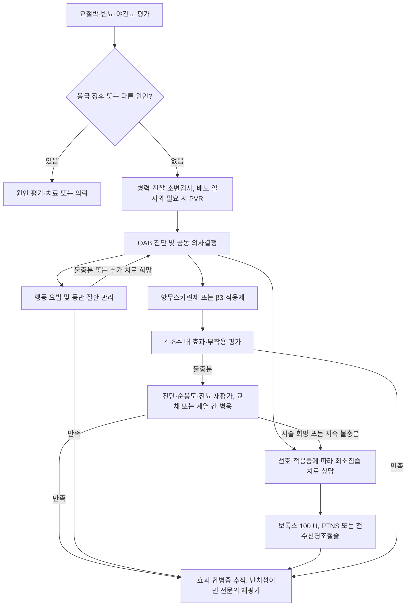

# 과민성 방광 Overactive Bladder, OAB

## <mark style="color:green;">일반 사항</mark>

* 정의 (AUA/SUFU 2024) : 요로감염이나 다른 명백한 병인 없이 요절박을 특징으로 하며, 대개 빈뇨와 야간뇨를 동반하고 절박성 요실금을 동반할 수도 동반하지 않을 수도 있는 증상 증후군
* 분류 : 절박성 요실금 동반 시 OAB wet, 비동반 시 OAB dry(복압성 요실금의 동반 여부로 구분하지 않음)
* 적용 범위 : 성인 특발성 OAB를 중심으로 기술. 신경계 질환에 의한 하부요로기능장애가 의심되면 신경인성 하부요로기능장애의 평가·치료 원칙을 적용
* 유병률 : 인구 기반 연구에서 여성 9\~43%, 남성 7\~27%; 연령 증가에 따라 유병률·중증도 모두 증가하며 상당수 환자에서 수년간 증상 지속 <mark style="color:$info;">[AUA/SUFU 2024]</mark>. 국내 Korean EPIC 연구(2011년 출판, 18세 이상 성인 2,005명 대상)에서는 약 12.2%(남성 약 10%, 여성 14.3%)로 보고됨
* 합병증/영향 : 수면 장애, 낙상 위험(특히 고령자의 야간 배뇨 중 낙상), 우울·불안, 사회적 위축·삶의 질 저하, 요실금 관련 피부염

## <mark style="color:green;">원인</mark>

* 특발성(원인 불명)이 다수
* 기전
  * 근육성 변화 : 일부 환자에서 배뇨근의 불수의적 수축, 배뇨근 과활동(detrusor overactivity, DO)이 관찰됨. DO는 충만기 요역동학 소견이고 OAB는 증상에 근거한 진단으로, 서로 동일하지 않으며 DO가 없어도 OAB를 배제하지 않음
  * 신경학적 변화 : 중추신경계 억제 경로 손상, 방광 구심성 경로의 감작
* 동반 질환·기여 인자(치료로 OAB 증상 호전 가능) <mark style="color:$info;">[AUA/SUFU 2024]</mark>
  * 비만, 변비, 골반저 근육 기능장애
  * 당뇨병(고혈당·당뇨에 따른 다뇨), 폐경 관련 비뇨생식기증후군(여성), 전립선비대증 등 방광출구폐색(남성)
  * 폐쇄성 수면무호흡, 하지 부종·심부전 등 야간다뇨 기여 질환
  * 인지저하·이동 제한, 신경퇴행성 질환
  * 이뇨제·SGLT2 억제제는 요량 증가로 빈뇨를 유발할 수 있고, 항콜린성 약물·오피오이드는 요폐에 기여할 수 있음. 일부 항우울제·항고혈압제의 영향은 성분·기전에 따라 다르므로 증상 발생 시점과 복용력을 대조

## <mark style="color:green;">임상 양상</mark>

* 요절박(urgency) : 갑자기 발생하여 참기 어려운 강한 요의 - OAB의 핵심·필수 증상
* 빈뇨(frequency) : 환자가 지나치게 잦다고 느끼는 주간 배뇨 횟수 증가. 배뇨 횟수만으로 진단하지 않고 수분 섭취량·총 요량·증상 불편도를 함께 평가
* 야간뇨(nocturia) : 주 수면 시간 중 소변을 보기 위해 1회 이상 깸. 첫 배뇨 전에는 수면이 있고, 이후 다시 잠들거나 잠들 의도가 있어야 함; 불면·수면무호흡 때문에 먼저 깬 뒤 배뇨하는 경우도 감별
* 절박성 요실금(urgency incontinence) : 동반 시 OAB wet으로 분류

***

### 🚩Red Flags

**즉각 조치**

* 급성 요폐(하복부 팽만·통증, 배뇨 불능) → 응급 도뇨 및 비뇨의학과 의뢰  <mark style="color:$danger;">[즉각 조치]</mark>
* 급성 하지 위약·회음부 감각저하·새 대변실금 등 → 마미증후군 등 급성 신경병변 의심, 응급 평가  <mark style="color:$danger;">[즉각 조치]</mark>
* 요로감염이 의심되며 저혈압·의식 변화 등 장기기능장애 또는 쇼크 징후 동반 → 요로 패혈증 응급 평가·치료  <mark style="color:$danger;">[즉각 조치]</mark>
* 육안적 혈뇨와 혈괴에 의한 요폐 또는 혈역학적 불안정 동반 → 응급 평가  <mark style="color:$danger;">[즉각 조치]</mark>

**당일~수일 내 평가**

* 새로 발생한 육안적 혈뇨 → **(당일)** 연락·진료 후 원인 평가 및 비뇨의학과 의뢰  <mark style="color:$warning;">[당일~수일 내 평가]</mark>
* 발열·옆구리 통증·전신 증상을 동반한 배뇨통 → 상부요로감염 등 **(당일)** 평가  <mark style="color:$warning;">[당일~수일 내 평가]</mark>
* 새로 발생하거나 악화된 뚜렷한 요배출 장애·잔뇨감 → PVR 측정 등으로 요폐 평가; 배뇨 불능이면 즉각 조치  <mark style="color:$warning;">[당일~수일 내 평가]</mark>
* 새 신경학적 이상이 의심되는 배뇨 증상 → 신경학적 평가; 급성 하지 위약·회음부 감각저하 등은 응급 평가  <mark style="color:$warning;">[당일~수일 내 평가]</mark>

**조기 평가 및 추적**

* 현미경적 혈뇨 → 현미경검사로 확인하고 일시적 원인 평가 후 위험도에 따라 재검·영상검사·방광경 또는 의뢰 결정. 저위험 환자에게 일률적으로 즉시 방광경을 시행하지 않음  <mark style="color:$info;">[조기 평가 및 추적]</mark>
* 반복 요로감염, 지속 배뇨통·방광/골반 통증, 뚜렷한 배출 증상, 이전 요실금 수술·골반 수술·방사선 치료력 → 원인 평가 및 필요 시 의뢰  <mark style="color:$info;">[조기 평가 및 추적]</mark>
* 뇌졸중·파킨슨병·척수질환 등 → 잔뇨·기능 상태를 평가하고 신경인성 하부요로기능장애가 의심되면 의뢰  <mark style="color:$info;">[조기 평가 및 추적]</mark>
* 적절한 치료에도 반응이 불충분하거나 부작용으로 지속하기 어려운 경우, 시술을 원하는 경우, 진단 불확실·예상 밖 치료 반응이 있는 경우 → 재평가 및 전문의 의뢰  <mark style="color:$info;">[조기 평가 및 추적]</mark>

***

## <mark style="color:green;">진단</mark>

* 병력 청취
  1. 하루 중 수분 섭취량과 배뇨 횟수
  2. 주간 및 야간 빈뇨 유무 및 횟수
  3. 요절박 유무, 발생 횟수·강도, 참을 수 있는 시간
  4. 배뇨 간격
  5. 요실금 유무 및 종류(복압성, 절박성, 혼합성)
  6. 요실금 정도 : 속옷 교체 여부, 패드 사용 여부와 개수
  7. 요폐색 증상 유무 : 소변 줄기 정도, 요폐 과거력
  8. 신경계 질환 동반 유무 : 뇌졸중, 척수질환, 파킨슨병
  9. 병력 및 수술력 : 질/요실금/전립선 수술, 하복부·골반강 내 수술 및 방사선 치료
  10. 약물 복용력 : 이뇨제, SGLT2 억제제, 항우울제·항고혈압제, 항콜린제, 오피오이드 등
  11. 방광 충만 시 통증·배뇨 후 완화 여부, 질 건조·작열감, 코골이·무호흡, 갈증·다뇨, 증상의 불편도와 환자 치료 목표
* 신체검사 : 복부(방광 팽창·종괴 등), 하지 부종·보행 및 이동 능력, 관련 신경학적 소견을 확인; 필요에 따라 여성은 골반 진찰(골반장기탈출·위축성 변화·복압성 요실금), 남성은 전립선 진찰을 고려. 새 신경학적 이상이나 요폐가 의심되면 회음부 감각·항문 괄약근 긴장도 등 집중 평가
* U/A(요로감염·혈뇨 확인 목적, 필수)
* 초기 평가에서 선택적으로 고려 <mark style="color:$info;">[AUA/SUFU 2024]</mark>
  * 배뇨 후 잔뇨(PVR) : 배뇨 곤란 등 배출 증상 동반, 요폐 과거력, 전립선비대증, 신경학적 질환, 요실금·전립선 수술력, 오래된 당뇨병이 있는 경우 특히 고려. 배뇨 직후 가능한 한 지체 없이 초음파로 측정; 증가 시 배뇨량·증상·반복 측정값을 함께 해석하고 방광출구폐색·배뇨근 저활동을 평가
    * AUA는 선택적 측정을 허용하나 EAU 여성 LUTS 지침은 초기 PVR 측정을 권고. 약물로 배출이 악화될 위험이 있으면 치료 전 측정하며, 보톡스 전에는 필수
  * 배뇨 일지 : 수분 섭취, 배뇨 시각·회당 배뇨량, 요절박·요실금, 취침·기상 시각을 **가능하면 3일 이상** 기록(EAU 여성 OAB 권고). 야간 요량에는 첫 아침 배뇨량을 포함하고 취침 직전 배뇨량은 제외; 첫 아침 배뇨는 야간뇨 횟수에는 포함하지 않음
  * 증상 점수 설문지 : OABSS(증상·중증도 및 치료 반응 평가), OAB-V8(주로 선별·불편도 평가). 설문지 단독으로 확진하지 않음
  * 혈액검사 : 다뇨·요당·갈증 등은 혈당/HbA1c, 신기능 저하 위험이나 용량 조절이 필요한 약물 처방 시에는 creatinine/eGFR 등을 선택적으로 확인
* 감염이 의심되면 소변 배양을 시행하고 치료 후 증상을 재평가. 농뇨·세균뇨만으로 증상성 UTI를 확정하지 않으며, 무증상 세균뇨에 일률적으로 항생제를 투여하지 않음(임신·점막 손상을 동반하는 비뇨기 시술 전 등 별도 적응증 제외). 요류검사·요역동학검사·영상·방광경은 진단 불확실·혈뇨·반복 감염·배출 장애 등 적응증에 따라 선택. PSA는 OAB 진단검사가 아니며 남성의 전립선암 위험 평가·BPH 치료 선택 등에 필요할 때 고려


합병증이 없는 환자에서 초기 검사로 요역동학 검사, 방광경 검사, 요로 영상검사를 일률적으로 시행하지 않음. 진단이 불확실하거나 혈뇨·반복 감염·배출 장애 등 별도 적응증이 있으면 선택적으로 시행 <mark style="color:$info;">[AUA/SUFU 2024]</mark>


**과민성 방광 증상점수 설문지(Overactive Bladder Symptom Score, OABSS)**

최근 1주일의 평균적인 증상을 기준으로 응답. 아래는 점수 체계의 요약이며 실제 배포 시 검증된 한국어 설문지 원문을 사용

1. 아침에 일어나서 밤에 자기 전까지 소변을 몇 번 보았습니까? ≤7번 0점, 8\~14번 1점, ≥15번 2점
2. 밤에 잠든 후부터 아침에 일어날 때까지 소변을 보기 위해 몇 번이나 일어났습니까? 없음 0점, 1번 1점, 2번 2점, ≥3번 3점
3. 갑자기 소변이 마려워 참기 힘들었던 적이 있었습니까? 없음 0점, ＜1번/주 1점, 주 1회 이상~하루 1회 미만 2점, 하루 약 1회 3점, 하루 2\~4회 4점, 하루 ≥5회 5점
4. 갑자기 소변이 마려워서 참지 못하고 소변을 지린 적이 있었습니까? 없음 0점, ＜1번/주 1점, 주 1회 이상~하루 1회 미만 2점, 하루 약 1회 3점, 하루 2\~4회 4점, 하루 ≥5회 5점

* 판정 : 3번 문항이 ≥2점(주 1회 이상 요절박)이면서 총점 ≥3점이면 설문지상 OAB 기준을 충족; 임상 진단은 병력·진찰·U/A와 원인 감별을 함께 적용
* 중증도 : 진단 기준을 충족할 때 총점 3\~5점 = 경증, 6\~11점 = 중등증, ≥12점 = 중증

### <mark style="color:orange;">감별 진단</mark>

* 유사한 하부요로 증상을 유발할 수 있는 질환들의 감별이 필요

<table><thead><tr><th width="150">질환</th><th width="230">OAB와의 차이점</th><th>핵심 감별 포인트</th></tr></thead><tbody><tr><td>급성 방광염/요로감염</td><td>염증성 병인이 명확</td><td>배뇨통·새 증상과 농뇨·배양 결과 등을 종합; 무증상 세균뇨와 구별하고 치료 후 증상 재평가</td></tr><tr><td>방광 결석·종양</td><td>구조적 병변</td><td>요로감염 없는 혈뇨; 영상검사·방광경으로 확인</td></tr><tr><td>복압성 요실금</td><td>요절박 없이 복압 상승 시(기침, 재채기, 운동) 누출</td><td>병력·cough stress test 등 임상 평가로 대개 감별 가능; 진단이 불확실하거나 혼합성 요실금 의심 시 요역동학 검사 고려</td></tr><tr><td>전립선비대증(남성)</td><td>방광출구 폐색이 동반될 수 있으며 OAB와 공존 가능</td><td>지연뇨, 세뇨, 배뇨 후 점적, 잔뇨량 증가 동반</td></tr><tr><td>다뇨/야간다뇨</td><td>배뇨량 증가가 주요 기전이며 OAB와 공존 가능</td><td>배뇨 일지에서 24시간 총 요량·야간 요량 비율 확인; 당뇨병·요붕증·이뇨제·수분 섭취·수면무호흡·부종 확인</td></tr><tr><td>신경인성 방광</td><td>중추/말초 신경계 질환에 기인</td><td>뇌졸중, 척수손상, 다발경화증, 파킨슨병 등 신경학적 병력·소견 동반</td></tr><tr><td>방광통증증후군/간질성 방광염</td><td>방광 관련 통증·압박감·불편감이 주요 증상</td><td>충만 시 악화·배뇨 후 완화되는 통증과 빈뇨; 감염·다른 병인을 배제. 통증이 주된 증상이 아닌 전형적 OAB와 구별</td></tr><tr><td>불완전 배뇨·범람요실금</td><td>소변이 충분히 배출되지 않아 빈뇨·누출 발생</td><td>PVR 증가, 약한 요줄기·지연뇨; 방광출구폐색·배뇨근 저활동·약물 원인 평가</td></tr><tr><td>폐경 관련 비뇨생식기증후군(GSM)</td><td>저에스트로겐 관련 질·요도 변화; OAB와 공존</td><td>질 건조·작열감·성교통·위축 소견, 감염 없는 배뇨통; 국소 치료 필요성 평가</td></tr><tr><td>기능성 요실금·수면장애</td><td>이동·인지·환경 문제 또는 수면 문제</td><td>화장실 접근성, 보행·인지, 불면·수면무호흡 평가; OAB와 함께 있을 수 있음</td></tr></tbody></table>


**야간뇨를 동반한 OAB에서 야간다뇨(nocturnal polyuria) 감별**

* 배뇨 일지(가능하면 3일 이상)로 24시간 총 요량과 야간 요량(첫 아침 배뇨량 포함)을 확인. 다뇨는 흔히 24시간 요량＞40 ㎖/㎏/일을 참고하며, 야간다뇨는 야간 요량/24시간 요량이 젊은 성인에서＞20%, 65세 초과에서＞33%인 기준 등을 사용하되 연령·수면 시간과 함께 해석. 야간다뇨가 주 원인이면 부종·수면무호흡·이뇨제 투여 시점·저녁 수분 섭취 등 원인을 먼저 교정.
* desmopressin은 야간다뇨로 인한 야간뇨가 확인된 일부 성인에서 제제별 국내 허가사항에 따라 고려하며, OAB 자체의 치료제로 사용하지 않음.
* **미니린정의 야간뇨 용법은 65세 이상에서 치료 시작을 권장하지 않으나, 이를 모든 desmopressin 제형에 적용하지 않음.**
* 저용량 녹더나설하정은 성인 특발성 야간다뇨에 대해 여성 25 μg·남성 50 μg을 취침 1시간 전 물 없이 설하 투여하는 별도 제제이며, 고령자에서는 저나트륨혈증 위험을 특히 평가.
* 제제별 금기(심부전/체액 과부하, CrCl ＜50 ㎖/min, 저나트륨혈증, SIADH 등)를 확인. **미니린정은 이뇨제 복용 중인 환자에게 금기**이며, 녹더나의 이뇨제 관련 금기·신중투여 범위와 구별. SSRI·TCA·NSAID 등 병용 시 저나트륨혈증 위험을 평가.
* 시작 전 혈청 Na가 정상인지 확인. 녹더나를 사용하는 65세 이상 환자는 시작 전·시작 후 4\~8일·1개월에 Na를 측정하고 이후 위험도에 따라 추적; 미니린정을 고령자에게 예외적으로 고려하면 투여 직전·시작 3일 후·증량 시 및 투약 중 필요 시 Na를 확인하는 해당 제제 기준을 적용. 65세 미만이라도 저나트륨혈증 위험이 있으면 조기 Na 재검을 개별화.
* 녹더나는 65세 이상에서 증량하지 않으며, Na가 정상 하한 미만으로 감소하면 중단. 발열·구토·설사 등 수분·전해질 불균형을 일으킬 급성 질환 때에는 중단하고 재평가.
* 투여 1시간 전부터 8시간 후까지 수분 섭취를 제한하며 두통·구역·급격한 체중 증가·혼동·경련이 생기면 중단하고 즉시 평가 <mark style="color:$info;">[국내 desmopressin 제제별 허가사항]</mark>


***



**OAB의 진단과 치료 알고리듬**

약물·시술은 고정된 순서로만 진행하지 않으며 행동 요법은 병행 가능. 국내 보톡스는 항콜린제 치료가 어렵거나 적절히 조절되지 않는 성인 OAB의 허가 범위에서 사용하고, 시술 전 PVR·감염·CIC 가능 여부를 확인

<mark style="color:$info;">[AUA/SUFU 2024 및 국내 보톡스 허가사항을 반영한 진료 흐름]</mark>


**2024 AUA/SUFU 가이드라인의 관점 변화**\
2024년 개정판은 행동 요법 → 약물 요법 → 시술의 고정된 순서를 요구하지 않음. 환자의 목표·선호·치료 부담 감내 정도에 따라 치료 옵션을 설명하고 **공동 의사결정(shared decision-making)**을 통해 선택함. 환자와 논의하여 행동·약물 요법의 선행 시도 없이 최소침습 시술을 선택할 수도 있음 <mark style="color:$info;">[AUA/SUFU 2024, Statement 23\~24]</mark>


***

## <mark style="background-color:$warning;">Management</mark>

### <mark style="color:orange;">치료 방침</mark>

* OAB는 단일 질환이 아니라 증상 복합체로 치료 반응에 개인차가 큼; 증상이 경미하고 환자가 원하지 않으면 치료가 필요하지 않을 수도 있음
* 치료 목표 : 요절박·빈뇨·절박성 요실금 증상 감소, 방광 저장 기능 개선 및 삶의 질 향상
* 치료 방법 : 행동 치료, 약물 치료, 최소침습 시술을 공동 의사결정을 통해 단독 또는 병용으로 선택(반드시 순차적 진행일 필요는 없음)(☞ [요실금](125_-urinary-incontinence.md))
* 공동 의사결정 원칙 : 치료 효과, 부작용, 비용, 순응도를 환자와 함께 논의하여 결정 <mark style="color:$info;">[AUA/SUFU 2024]</mark>

## <mark style="color:green;">비-약물 치료 및 예방</mark>

* Bladder training : 배뇨 일지로 현재 간격을 파악하고 무리하지 않는 범위에서 점진적으로 늘림. 여성 절박성·혼합성 요실금에서는 최소 6주 프로그램을 권고하며, 약물과 함께 시행 가능 <mark style="color:$info;">[NICE NG123]</mark>
* Urge suppression training : 요절박 시 멈추어 천천히 호흡하고 짧은 골반저 근육 수축을 반복하여 절박감이 줄어든 뒤 이동
* Pelvic floor muscle training(골반저 근육 운동) : 올바른 수축·이완을 지도하고 요절박 억제 훈련과 병행. 골반저 과긴장·통증·배출 장애가 있으면 반복 수축만 권하지 말고 이완 훈련·전문 치료를 고려
* 인지·이동 제한이 있으면 보호자 도움을 받는 유도 배뇨(prompted voiding), 계획 배뇨, 화장실 접근성·야간 조명 개선을 개별화
* Fluid management : 섭취량과 요량을 확인하여 과도한 수분을 줄이되 탈수·변비를 유발하는 무리한 제한을 피함. 카페인을 줄이고 알코올·탄산음료 등은 본인에게 증상을 유발하는지 확인하여 조절
* 체중 감량(비만 동반 시), 변비 관리, 금연; 수면무호흡·부종 등 동반 질환을 평가·관리
* 방광 일지 작성을 통한 자기 모니터링
* 절박요실금이 있으면 패드·흡수성 속옷 사용 및 피부 보호법을 함께 안내


방광 훈련은 모든 OAB 환자에게 제안하며, 행동 요법은 약물·시술과 병행할 수 있음. 배뇨가 어렵거나 잔뇨가 많은 환자는 훈련 전에 배출 장애를 평가


## <mark style="color:green;">약물 치료</mark>

* 항무스카린제(antimuscarinics) 또는 β3-아드레날린수용체 작용제를 단독으로 사용하고, 단독 치료 효과가 불충분하면 서로 다른 계열의 병용을 고려
* 항무스카린제 선택 시 속효형보다 서방형을 고려(특히 구강건조를 줄이기 위해); 고령자에서는 인지기능과 전체 항콜린 부담을 함께 고려
* 한 종류의 항무스카린제에 효과가 적거나 사용할 수 없는 경우, 용량 조정 또는 다른 항무스카린제나 β3-작용제로 교체를 시도
* **약물 시작 후 4\~8주 내** 효과·부작용·순응도를 평가. 배뇨 일지/증상 점수와 목표 달성도를 비교하고, 배뇨 곤란·고위험 잔뇨가 있으면 PVR을 재확인; 고령·인지저하 위험 환자는 인지 변화도 점검 <mark style="color:$info;">[AUA/SUFU 2024, Statement 20]</mark>
* 선택은 dry/wet 분류나 OABSS 중증도만으로 정하지 않고 인지기능, 변비·구강건조, 혈압·심장질환, 잔뇨, 신·간기능, 병용약·비용·선호를 종합

### <mark style="color:orange;">항무스카린제 Antimuscarinics</mark>

* tolterodine SR <mark style="color:blue;">\[디트루시톨SR]</mark>, trospium <mark style="color:blue;">\[스파스몰리트]</mark>, solifenacin <mark style="color:blue;">\[베시케어]</mark>, fesoterodine <mark style="color:blue;">\[토비애즈]</mark>, imidafenacin <mark style="color:blue;">\[유리토스]</mark>, oxybutynin <mark style="color:blue;">\[동화디트로판]</mark>, propiverine <mark style="color:blue;">\[비유피-4]</mark> — 성인 용량은 [요실금](125_-urinary-incontinence.md) 챕터의 약물 항목 및 개별 제품 허가사항 참조. 성분·제형별 신·간기능 감량 및 CYP 상호작용 기준이 다르므로 동일하게 적용하지 않음
* 금기·주의 : 요폐·위장관 폐색/위정체, 중증근무력증 및 협우각·폐쇄각녹내장 여부를 확인. 녹내장 금기 범위는 성분별로 다르며, propiverine은 국내 허가상 폐쇄각녹내장 금기; 조절되는 개방각녹내장은 일률적 금기가 아니며 안과 상담 및 성분별 허가사항에 따라 판단
* QT 연장·부정맥 병력 또는 QT 연장 약물 병용 시 성분별 주의사항을 확인(예: solifenacin의 QT 연장/Torsade de pointes 보고)
* 남성 LUTS/BPH 동반 시 PVR＞150 ㎖이면 항무스카린제를 피하도록 권고(약한 권고); 모든 성인 OAB의 공통 절단값은 아니며 증상·PVR과 성분별 허가사항을 함께 평가 <mark style="color:$info;">[EAU 2026]</mark>


**⚠️ 항콜린 부담(anticholinergic burden)과 고령자 인지기능 저하 위험**\
장기간·고용량의 항콜린성 방광 치료제 누적 사용은 인지기능 저하 및 치매 위험 증가와 연관된다는 관찰 연구 결과가 있음; 관찰연구상 연관성이며 인과관계가 확정된 것은 아님. 처방 전 연령과 관계없이 이러한 잠재적 위험을 설명하고 누적 항콜린 부담을 평가 <mark style="color:$info;">[AUA/SUFU 2024]</mark>\
→ 고령, 경도인지장애·치매 병력, 여러 항콜린성 약물 병용 중인 환자에서는 항무스카린제보다 β3-작용제를 우선 고려. 특히 경구 속효형 oxybutynin은 고령자의 인지 부작용에 주의하며, trospium 등 중추 이행이 적은 약물도 장기 치매 위험이 없다고 단정하지 않음

2025년 덴마크 연구에서는 비사용자 대비 치매 연관성은 관찰되었으나 mirabegron을 비교군으로 삼았을 때 증가가 확인되지 않았음. 교란·역인과 가능성을 고려해야 하며, 이 결과만으로 항무스카린제의 장기 인지 안전성 또는 β3-작용제의 치매 예방 효과를 확정할 수 없음 <mark style="color:$info;">[Pourhadi 2025]</mark>


### <mark style="color:orange;">β3-아드레날린수용체 작용제</mark>

* mirabegron <mark style="color:blue;">\[베타미가]</mark> - 국내 허가 용량은 50 ㎎ qd(성인·고령자 공통 표준 용량); 신·간기능 및 강력한 CYP3A 억제제(itraconazole, ketoconazole, ritonavir, clarithromycin 등) 병용 여부에 따라 25 ㎎으로 감량하거나 투여가 권장되지 않을 수 있으므로 처방 전 허가사항의 용량조절표 참조 - 국내에 제네릭(<mark style="color:blue;">\[미라벡]</mark>, <mark style="color:blue;">\[셀레베타]</mark> 등)도 유통 중
  * 주의 : 혈압을 상승시킬 수 있어 정기적 혈압 측정 권고; **중증의 조절되지 않는 고혈압(수축기 ≥180 mmHg 또는 이완기 ≥110 mmHg) 및 심각한 심장질환은 국내 허가상 금기**; 2단계 고혈압(수축기 ≥160 mmHg 또는 이완기 ≥100 mmHg)에서도 자료가 제한적이므로 신중히 사용 <mark style="color:$info;">[국내 허가사항]</mark>
  * 국내 허가에 따른 주요 신·간기능 조절(아래 용량은 1일 1회; 두 조건 이상이면 더 제한적인 기준 적용)

<table><thead><tr><th>상태</th><th>강력한 CYP3A 억제제 없음</th><th>강력한 CYP3A 억제제 병용</th></tr></thead><tbody><tr><td>GFR 30~89 ㎖/min/1.73㎡</td><td>50 ㎎</td><td>25 ㎎</td></tr><tr><td>GFR 15~29 ㎖/min/1.73㎡</td><td>25 ㎎</td><td>권장하지 않음</td></tr><tr><td>Child-Pugh A</td><td>50 ㎎</td><td>25 ㎎</td></tr><tr><td>Child-Pugh B</td><td>25 ㎎</td><td>권장하지 않음</td></tr></tbody></table>

* 신·간기능이 정상인 환자에서 강력한 CYP3A 억제제 병용만으로 일률적으로 25 ㎎으로 감량하는 것은 아님. 말기 신장질환·중증 간장애의 투여 제한은 아래 참조 <mark style="color:$info;">[국내 베타미가 허가사항]</mark>
* mirabegron 상호작용 : 중등도 CYP2D6 억제제로 flecainide·propafenone·일부 TCA 등 병용약의 노출을 높일 수 있음. digoxin 병용 시작 시 최저용량과 혈중농도 추적을 고려 <mark style="color:$info;">[국내 허가사항]</mark>
* 말기 신장질환(GFR ＜15 ㎖/min/1.73㎡ 또는 투석)·중증 간장애(Child-Pugh C)에서는 mirabegron 투여가 권장되지 않음
* mirabegron도 방광출구폐색·항무스카린제 병용 시 요폐에 주의. 임신 중 투여는 권장되지 않으며 수유 중 사용 제한도 국내 허가사항 확인
* vibegron <mark style="color:blue;">\[베오바정]</mark> 50 ㎎ 1일 1회 식후 - 2022년 10월 국내 허가, 2026년 9월 1일부터 급여 기준 신설. EMPOWUR 시험(해외 75 ㎎)에서는 고혈압 이상반응 빈도가 위약군과 같았고, 별도의 활동혈압 시험(해외 75 ㎎)에서 임상적으로 의미 있는 혈압 변화가 확인되지 않았음. 국내 50 ㎎ 처방에 이 결과를 그대로 적용하는 데는 한계가 있음; mirabegron과 같은 중증 고혈압 제한 문구는 없으나 심혈관계 상태를 확인
  * 국내 근거 : 한국인 대상 12주 위약대조 가교시험에서 50 ㎎/일의 유효성·내약성을 확인. 다만 PVR≥100 ㎖ 및 고혈압(160/100 mmHg) 등은 제외되어 고잔뇨·조절되지 않는 고혈압 환자에게 안전성을 일반화하지 않음 <mark style="color:$info;">[국내 가교시험 2023]</mark>
  * 주의 : 국내 허가사항에서는 방광출구폐쇄·심각한 심장질환·QT 연장·신장애·간장애 환자를 신중투여 대상으로 기술. 요폐가 발생할 수 있으며, 방광출구폐쇄 또는 항무스카린제 병용 시 배뇨 상태를 감시. 강력한 CYP3A4/P-gp 억제제 병용 시 노출 증가, rifampicin·phenytoin·carbamazepine 등 유도제 병용 시 노출 감소 가능성을 확인; 해외 처방정보의 신·간기능 기준을 국내 허가 기준과 혼동하지 않도록 주의

### <mark style="color:orange;">병용 요법 및 남성 BPH 동반 OAB</mark>

* 단독 요법(anti-muscarinic 또는 β3-agonist)에 반응이 불충분한 경우, anti-muscarinic + β3-agonist(예: solifenacin + mirabegron) 병용을 고려할 수 있음 <mark style="color:$info;">[AUA/SUFU 2024]</mark>
* mirabegron과 vibegron은 각각 국내 허가 범위 및 현행 급여 인정기준에 따라 사용. vibegron 경구제의 급여 기준은 보건복지부 고시 제2026-176호에 따라 2026년 9월 1일 신설됨. 항무스카린제 + β3-작용제 병용의 급여 인정 여부·기준은 처방 시점의 심평원 고시를 확인
* 병용 근거는 특히 solifenacin + mirabegron에서 축적되어 있음. 두 항무스카린제 또는 mirabegron + vibegron의 중복 병용을 표준 처방으로 사용하지 않음; 계열 간 병용 시에도 구강건조·변비·PVR 증가를 추적
* BPH와 OAB가 함께 있으면 배출 장애를 평가한 뒤 OAB 약제 단독 또는 α-차단제와 항무스카린제/β3-작용제 병용을 선택할 수 있음. BPH 진단만으로 모든 환자에게 α-차단제 병용을 요구하지 않음 <mark style="color:$info;">[AUA/SUFU 2024, Statement 33]</mark>
* 최근 근거 : COURAGE 무작위시험과 2026년 방광기능·안전성 분석에서 BPH 약물 치료 중 OAB가 지속되는 남성의 vibegron 추가 효과가 확인됨. 연구 용량은 **75 ㎎/일**로 국내 베오바 **50 ㎎/일 식후**와 다름; 국내 용량을 임의 증량하거나 중증 폐색·고잔뇨 환자에게 안전성을 일반화하지 않음 <mark style="color:$info;">[COURAGE 2024, 2026]</mark>

### <mark style="color:orange;">GSM 동반 여성의 국소 치료</mark>

* 폐경 관련 질 건조·작열감·위축 소견과 OAB가 함께 있으면 **저용량 질 에스트로겐**을 공동 의사결정으로 고려. 모든 OAB 환자에게 사용하는 약제는 아니며, GSM 치료를 통한 비뇨생식기 증상 개선 목적 <mark style="color:$info;">[AUA/SUFU/AUGS GSM 2025, Statement 12; EAU 여성 LUTS 2026]</mark>
* 국내 제품별 적응증·용법·금기를 확인. 원인 불명의 질 출혈은 먼저 평가하고, 유방암 병력·아로마타제 억제제 치료 중이면 관련 전문의와 상의. 전신 호르몬요법을 요실금/OAB 치료 목적으로 시작하지 않음

### <mark style="color:orange;">OAB 표준 약물치료가 아닌 참고 약제</mark>

* α-차단제 : OAB 자체의 표준 치료제는 아니며, 전립선비대증·방광출구폐색이 동반된 남성 하부요로증상(LUTS) 치료 목적으로 사용(☞ 처방례 5)
* duloxetine : OAB 치료제가 아니며 주로 복압성 요실금(SUI)과 관련하여 언급됨

## <mark style="color:green;">시술 및 기타 처치</mark>

* Intradetrusor onabotulinumtoxinA(100 U) 주입술 : 행동·약물 치료에 반응이 불충분하거나 불내성이 있는 경우, 또는 약물을 사용할 수 없거나 원하지 않아 환자가 시술을 선호하는 경우 공동 의사결정을 통해 고려(반드시 약물 치료 실패가 선행되어야 하는 것은 아님) <mark style="color:$info;">[AUA/SUFU 2024]</mark>
  * 국내 보톡스 OAB 허가는 **18세 이상에서 항콜린제 치료가 어렵거나 적절히 조절되지 않는 경우**에 해당. AUA의 선호 중심 시술 선택 권고가 국내 허가 범위를 확대하는 것은 아님 <mark style="color:$info;">[국내 보톡스 허가사항]</mark>
  * 특발성 OAB에서는 보톡스 100 U를 사용(신경인성 배뇨근 과활동의 200 U와 구별); 다른 보툴리눔독소 제품의 단위·허가 적응증과 상호 대체하지 않음
  * 시술 전 요로감염이 있으면 시행하지 않고 먼저 치료. 급성 요폐가 있으면서 정기적으로 CIC를 하지 않는 환자는 배뇨근내 주사 금기이며, 국내 허가사항은 예방적 항생제(아미노글리코사이드계 제외)를 치료 1\~3일 전부터 치료 후 1\~3일까지 투여하도록 명시; 항생제 선택은 배양·내성·시술 지침에 따라 결정. 반복 주입은 효과 감소·소실 후 평가하며 이전 주입 후 최소 12주 간격을 둠
  * 시행 전 배뇨 후 잔뇨(PVR) 측정 필수; 불완전 배뇨·요폐가 발생할 수 있어 청결 간헐적 자가도뇨(CIC)가 필요할 가능성을 사전에 설명하고 시행 가능 여부 확인 <mark style="color:$info;">[AUA/SUFU 2024, Statement 26]</mark>
  * 효과 지속 기간은 환자에 따라 대략 4\~9개월로 다양하며, 반응이 좋은 경우 그 이상 지속되기도 함; **현재 CIC를 시행하지 않는 환자는 주사 후 2주 이내 PVR을 측정**하고, 이후 의학적 필요에 따라 12주까지 주기적으로 확인(특히 당뇨병 환자). 증상 호전 여부만으로 잔뇨 검사를 생략하지 않음. 배뇨 곤란이 있거나 잔뇨가 증가하면 증상과 PVR을 함께 고려하여 CIC 필요성을 판단; 국내 허가사항은 PVR＞200 ㎖에서 증상에 따라 도뇨 시작을 명시
* Percutaneous tibial nerve stimulation(PTNS, 경피적 경골신경 자극) : 표준 프로토콜은 주 1회 30분씩 총 12주(12회); 이후 반응이 있으면 월 1회 등 환자별 유지 요법으로 전환; 빈번한 외래 방문이 가능해야 함
* Sacral neuromodulation(SNM, 천수신경조절술) : 시험 자극 반응을 확인한 뒤 영구 기기 삽입을 고려. 재프로그래밍·배터리 관리·재수술 가능성과 기기별 MRI 조건을 설명하고 장기 추적
* PTNS의 주 1회×12주 일정은 바늘을 사용하는 경피적 자극의 대표 프로토콜. 피부 표면 전극의 경피부 경골신경 자극(TTNS)과 구별하며, 모든 방식에 동일한 일정·근거를 적용하지 않음. 국내 이용 가능 여부·기기 허가·급여는 별도 확인
* Augmentation cystoplasty, urinary diversion : 다른 치료 옵션에도 반응하지 않고 삶에 심각한 영향을 받는 난치성 환자에서 전문의가 최후 수단으로 고려

***

## <mark style="color:purple;">처방례</mark>

> **처방례 1. 인지저하·요폐 위험이 낮고 항무스카린제를 선택한 성인**
>
> ```
> 디트루시톨SR캡슐 4 ㎎/C  1C  qd
> ```
>
> _✽tolterodine SR의 통상 성인 권장량은 4 ㎎ qd; 이상반응·신/간기능·상호작용에 따른 2 ㎎ 감량 또는 투여 제한은 해당 제품 허가사항 확인. 효과와 구강건조·변비 등을 추적_

> **처방례 2. β3-작용제 단독 치료를 선택한 성인**
>
> ```
> 베타미가 서방정 50 ㎎/T  1T  qd
> ```
>
> _✽β3-작용제는 OAB dry/wet 모두에서 사용 가능. 구강건조·변비·항콜린 부담 회피를 원하는 경우 고려; 투여 전 혈압·심장질환·신/간기능·상호작용 확인_

> **처방례 3. 고령자(인지저하 위험 동반)**
>
> ```
> 베오바정 50 ㎎/T  1T  qd pc
> ```
>
> _✽항콜린 부담을 피해야 하는 고령·경도인지장애 환자에서는 β3-작용제를 우선 고려하되 vibegron을 일률적인 최우선 약제로 정하지 않음. 심장질환·QT 연장·신/간기능·병용약·잔뇨를 점검하고 식후 복용_

> **처방례 4. 단독 요법 반응 부족 - 병용 요법**
>
> ```
> 베시케어 5 ㎎/T  1T  qd
> 베타미가 서방정 50 ㎎/T  1T  qd
> ```
>
> _✽anti-muscarinic 또는 β3-agonist 단독 요법으로 4\~8주 치료 후 반응이 불충분한 경우 병용 고려; 병용 시 급여 기준 사전 확인_

> **처방례 5. 남성, 전립선비대증(BPH) 동반 OAB**
>
> ```
> 하루날디정 0.2 ㎎/T  1T  qd pc
> 베타미가 서방정 50 ㎎/T  1T  qd
> ```
>
> _✽BPH와 OAB가 함께 있는 남성에서 α-blocker(BPH 표준 치료) + β3-agonist 병용은 AUA/SUFU 2024에서도 다루는 치료 옵션; 국내 개별 제품의 적응증·급여 기준은 처방 전 확인 필요; 배뇨 증상·잔뇨가 있는 경우 배뇨 후 잔뇨 검사로 주기적 확인. 탐스로신의 기립성 저혈압·낙상, 백내장 수술 전 복용력 고지를 안내_

***

### <mark style="color:red;">질병코드</mark>

N32.8 방광의 기타 명시된 장애 Other specified disorders of bladder (과민성 방광을 나타내는 코드)

N39.40 절박요실금 Urge incontinence (OAB wet 동반 시)

N39.41 혼합요실금 Mixed incontinence (복압성·절박성 요실금이 함께 있는 경우)

***

### <mark style="color:$success;">핵심 복약 지도</mark>

> **서방형 제제 복용법**
>
> * 서방형 제제(예: 디트루시톨SR, 베타미가 서방정)는 씹거나 쪼개지 말고 그대로 삼킴. 하루날디정은 구강붕해정으로, 씹지 않고 혀 위에서 녹여 복용하거나 물과 함께 삼킬 수 있음
> * 효과 발현까지 통상 2\~4주 이상 소요될 수 있음을 미리 설명하여 임의 중단 방지

> **부작용 모니터링**
>
> * 항무스카린제 : 구강건조, 변비, 시야 흐림, 요폐(특히 BPH 동반 남성) - 발생 시 계열 교체 고려; 치료 중 배뇨 곤란이나 잔뇨감이 새로 생기거나 악화되면 배뇨 후 잔뇨(PVR)를 재측정하고, 유의하게 증가하거나 배뇨 곤란이 동반되면 약물 보류·감량 및 배출 장애 평가. β3-작용제로 변경하더라도 요폐 위험이 완전히 없어지는 것은 아님
> * mirabegron : 혈압 상승·요폐 가능 - 치료 시작 전과 치료 중 혈압 및 배뇨 상태 확인; 중증의 조절되지 않는 고혈압·심각한 심장질환은 국내 허가상 금기
> * vibegron : mirabegron과 같은 중증 고혈압 제한 문구는 없으나, 심장질환·QT 연장·방광출구폐쇄 환자에서 주의; 배뇨 곤란·잔뇨감 악화 시 요폐 평가
> * 고령 환자에서 anti-muscarinic 처방 시 인지기능 변화(건망증, 혼돈) 여부를 보호자와 함께 확인

> **언제 다시 병원을 방문해야 하나요?**
>
> * 4\~8주 치료에도 증상이 호전되지 않는 경우
> * 눈으로 보이는 **혈뇨**가 생긴 경우 - 당일 연락하거나 내원
> * 갑작스러운 **소변을 전혀 볼 수 없는** 요폐 증상 - 즉시 내원
> * 약물 복용 후 심한 변비, 어지럼, 혼돈 등 부작용이 발생하는 경우

***

## <mark style="color:green;">주요 참고문헌 및 확인 자료</mark>

확인 기준일 : 2026년 10월 28일. 지침 권고와 국내 제품 허가·급여 범위를 구별하여 적용

### <mark style="color:orange;">임상 근거</mark>

* Pourhadi N, et al. [Bladder drugs and risk of dementia: Danish nationwide active comparator study](https://doi.org/10.1136/bmjmed-2024-001125). BMJ Med. 2025;4:e001125. 비사용자와 활성 비교약 대조 결과의 차이 및 인과 해석의 한계.
* Cameron AP, et al. [The AUA/SUFU Guideline on the Diagnosis and Treatment of Idiopathic Overactive Bladder](https://doi.org/10.1097/JU.0000000000003985). J Urol. 2024;212:11–20. 초기 평가, 공동 의사결정, 약물 추적 및 시술 선택.
* EAU. [Non-neurogenic Female LUTS — Diagnosis](https://uroweb.org/guidelines/non-neurogenic-female-luts/chapter/diagnosis), [Disease Management](https://uroweb.org/guidelines/non-neurogenic-female-luts/chapter/disease-management). 2026. 2026판은 2025판의 재인쇄이며 일부 서식 수정; 새로운 전면 개정판으로 해석하지 않음.
* EAU. [Management of Non-neurogenic Male LUTS — Disease Management](https://uroweb.org/guidelines/management-of-non-neurogenic-male-luts/chapter/disease-management). 2026. 남성 항무스카린제의 PVR＞150 ㎖ 제한 및 BPH 동반 OAB.
* AUA/SUFU/AUGS. [Genitourinary Syndrome of Menopause Guideline](https://doi.org/10.1097/JU.0000000000004589). 2025. Statement 12: GSM과 OAB가 공존하는 환자의 저용량 질 에스트로겐 고려.
* NICE. [Urinary incontinence and pelvic organ prolapse in women: management, NG123](https://www.nice.org.uk/guidance/ng123/chapter/recommendations). 2019. 최소 6주 방광 훈련 및 폐경 관련 증상 동반 시 질 에스트로겐.
* [한국인 vibegron 50 ㎎ 가교 무작위시험](https://doi.org/10.5213/inj.2346022.011). Int Neurourol J. 2023. 국내 용량의 유효성·안전성과 연구 제외 기준.
* Staskin D, et al. [EMPOWUR trial](https://doi.org/10.1097/JU.0000000000000807). J Urol. 2020. Vibegron 75 ㎎의 유효성·안전성.
* Weber MA, et al. [Vibegron 활동혈압 무작위시험](https://pubmed.ncbi.nlm.nih.gov/34699409/). Blood Press Monit. 2022. Vibegron 75 ㎎, 28일 연구.
* Staskin D, et al. [COURAGE trial](https://doi.org/10.1097/JU.0000000000003999). J Urol. 2024;212:256–266. BPH 약물 치료 중 OAB가 지속되는 남성의 vibegron 75 ㎎ 추가 치료.
* Rovner ES, et al. [Bladder Function and Safety of Vibegron in Men With OAB Receiving Treatment for BPH: COURAGE](https://doi.org/10.1002/nau.70199). Neurourol Urodyn. 2026;45:299–304. 잔뇨·요류 및 요폐 안전성 분석; 국내 50 ㎎과 용량 차이 유의.
* Lee YS, et al. [Results of Korean EPIC study](https://doi.org/10.1007/s00345-009-0490-1). World J Urol. 2011. 국내 유병률 12.2%의 원자료.
* Homma Y, et al. [Overactive bladder symptom score](https://doi.org/10.1016/j.urology.2006.02.042). Urology. 2006;68:318–323. OABSS 개발·검증.

### <mark style="color:orange;">허가·급여·질병코드 확인 자료</mark>

* 식품의약품안전처. [베시케어정5밀리그램](https://nedrug.mfds.go.kr/pbp/CCBBB01/getItemDetail?itemSeq=200703674), [비유피-4정20밀리그램](https://nedrug.mfds.go.kr/pbp/CCBBB01/getItemDetail?itemSeq=199500420). 성분별 금기·신/간기능 조절·상호작용.
* 식품의약품안전처. [베타미가서방정50밀리그램](https://nedrug.mfds.go.kr/pbp/CCBBB01/getItemDetail?itemSeq=201310988). 성인 50 ㎎, 신·간기능/CYP3A 용량표, 심혈관 금기 및 요폐 주의.
* 식품의약품안전처. [베오바정50밀리그램](https://nedrug.mfds.go.kr/pbp/CCBBB01/getItemDetail?itemSeq=202203951). 50 ㎎ 1일 1회 식후, 심장질환·QT·요폐 및 상호작용.
* 식품의약품안전처. [보톡스주](https://nedrug.mfds.go.kr/pbp/CCBBB01/getItemDetail?itemSeq=200804190). 성인 OAB 적응증·100 U 용법·시술 후 2주 이내 PVR 및 필요 시 12주까지 추적.
* 식품의약품안전처. [미니린정](https://nedrug.mfds.go.kr/pbp/CCBBB01/getItemDetail?itemSeq=199504249). 야간뇨 적응증·65세 이상 신규 시작 제한·이뇨제 복용 금기.
* 식품의약품안전처. [녹더나설하정25마이크로그램](https://nedrug.mfds.go.kr/pbp/CCBBB01/getItemDetail?itemSeq=201707570). 성별 용량·65세 이상 증량 제한·Na 검사 및 중단 기준. 미니린정은 별도 제제별 허가사항 적용.
* 건강보험심사평가원. [Vibegron 경구제 급여기준](https://www.hira.or.kr/rc/insu/insuadtcrtr/InsuAdtCrtrPopup.do?mtgHmeDd=20260901&mtgMtrRegSno=0005&sno=2). 게시일·관련근거: 2026년 9월 1일, 고시 제2026-176호. 해당 페이지 본문에 2025년으로 적힌 시행일 문구가 혼재하므로 실제 청구 시 원 고시·최신 기준 확인.
* 건강보험심사평가원. [Mirabegron 경구제 급여기준](https://www.hira.or.kr/rc/insu/insuadtcrtr/InsuAdtCrtrPopup.do?mtgHmeDd=20200601&mtgMtrRegSno=0013&sno=3). 허가 범위 내 급여 인정; 병용 처방은 적용되는 개별·일반 기준 확인.
* 건강보험심사평가원. [2026년 KDRG 분류집](https://www.hira.or.kr/ebooksc/2026/03/BZ202603243124987.pdf), [상병마스터 부가정보 업데이트 안내](https://www.hira.or.kr/rc/drug/insuadtcrtr/bbsView.do?brdBltNo=53117&brdScnBltNo=4&pgmid=HIRAA030069000400). N32.8, N39.40, N39.41 확인; 청구 시 현행 KCD-9 기반 상병마스터 적용.

***

### <mark style="color:blue;">환자 안내서</mark>


**과민성 방광은 갑자기 소변이 마려워 참기 어려운 증상을 중심으로 진단합니다**

소변이 갑자기 마려워 참기 어려운 느낌(요절박)이 핵심 증상입니다. 방광의 저장 기능과 감각 조절에 여러 요인이 영향을 줄 수 있습니다. 세균 감염이 없는데도 소변을 자주 보고, 밤에도 소변 때문에 잠에서 깨며, 경우에 따라 화장실에 가기 전에 소변이 새기도 합니다.


#### <mark style="color:$primary;">왜 과민성 방광이 생기나요?</mark>

* 원인이 뚜렷하지 않은 경우가 많습니다
* 비만, 변비, 폐경 관련 변화, 전립선비대증 등이 증상에 영향을 줄 수 있습니다. 뇌졸중·파킨슨병 등 신경계 질환이 있으면 원인과 잔뇨를 따로 평가합니다
* 이뇨제, 일부 항우울제·항고혈압제 등 복용 중인 약물이 영향을 줄 수 있습니다

#### <mark style="color:$primary;">일상생활에서 어떻게 관리하나요?</mark>

* **카페인을 줄이고, 탄산음료·술은 증상을 악화시키는지 확인하여 조절하십시오.** 물을 지나치게 많이 마시는 습관을 줄이되 탈수가 생길 정도로 제한하지 마십시오
* **소변을 참는 연습(방광 훈련)을 해보십시오.** 배뇨 간격을 조금씩 늘리면 요절박에 대처하는 데 도움이 될 수 있습니다. 다만 배뇨가 원래 어렵거나 잔뇨가 많은 경우에는 의료진과 상의하여 시행하십시오
* **요의가 갑자기 느껴지면 잠시 멈추고 골반 근육에 힘을 주십시오.** 급하게 화장실로 뛰어가기보다 절박감이 가라앉을 때까지 잠시 기다린 뒤 이동하는 것이 도움이 됩니다
* **골반저 근육의 올바른 수축·이완 방법을 배우십시오.** 과민성 방광에서는 요절박 억제 훈련과 함께 도움이 될 수 있습니다. 배뇨 중 소변을 반복해서 끊는 방법으로 운동하지 말고, 골반 통증이나 배뇨 곤란이 있으면 먼저 상담하십시오
* **적정 체중을 유지하고 변비를 관리하십시오.** 복압을 줄여 증상 완화에 도움이 됩니다
* 잠자리에 들기 2\~3시간 전에는 과도한 수분 섭취를 줄이십시오. 야간뇨는 수면무호흡·부종 등 다른 원인으로도 생길 수 있으므로 소변량과 시간을 기록하십시오
* 야간에는 조명을 켜고 통로를 비워 낙상을 예방하십시오. 이뇨제·당뇨약은 임의로 끊지 말고 복용 시점을 의료진과 상의하십시오

#### <mark style="color:$primary;">약은 어떻게 써야 하나요?</mark>

* 처방받은 약은 매일 규칙적으로 복용하고 시작 후 4\~8주 안에 효과와 부작용을 확인하십시오. 베타미가 서방정은 씹거나 부수지 말고 삼키고, 베오바정은 식후에 복용하십시오
* 입이 마르면 무가당 껌·사탕을 이용하고, 변비가 생기면 섬유질 섭취와 활동량을 늘리십시오. 증상이 심하면 병원에 알려주십시오
* 약 복용 중 혈압이 오르거나 어지럼, 심한 변비, 새 혼돈·기억력 저하, 소변을 보기 힘든 증상이 생기면 병원에 문의하십시오
* 방광 보톡스 치료 후에는 증상이 좋아져도 정해진 시기에 잔뇨 검사를 받아야 합니다

#### <mark style="color:$primary;">이럴 때는 진료를 받으세요</mark>

* **즉시 응급 진료:** 소변을 전혀 볼 수 없거나 혈괴 때문에 소변이 막히는 경우, 갑자기 다리에 힘이 빠지거나 회음부 감각이 둔해지는 경우, 감염 증상과 함께 의식이 흐려지거나 실신·심한 기운 저하가 생기는 경우
* **당일 연락 또는 내원:** 눈으로 보이는 혈뇨가 새로 생긴 경우. 열·오한·옆구리 통증이 동반되면 당일 진료

***
