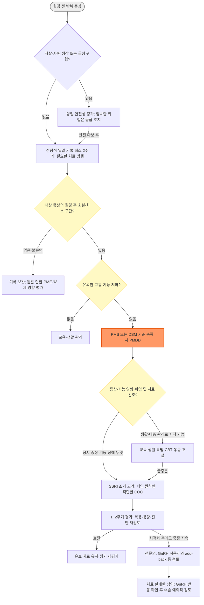

# 월경전증후군 Premenstrual Syndrome, PMS

## <mark style="color:green;">일반 사항</mark>

* 월경 주기 중 luteal phase(황체기)에 반복적으로 발생하는 신체적·정신적 증상군으로, 월경 시작과 함께 호전되기 시작하여 월경 후 수일 이내 현저히 감소하거나 소실됨
* 다른 이름 : premenstrual tension, 월경전긴장증후군
* 정의 (RCOG Green-top Guideline No. 48, 2016/2017) : 주로 배란 주기의 월경 전에 반복되고 월경 시작과 함께 소실 또는 뚜렷이 호전되며, 일상 기능에 지장을 주거나 뚜렷한 고통을 초래하는 신체적·행동적·정서적 증상. 기존 질환이 동반될 수 있으므로 같은 증상이 주기 밖에도 지속되는지 확인하여 월경전악화(PME)와 감별
* 월경전불쾌장애(premenstrual dysphoric disorder, PMDD) : 정서 증상이 주가 되어 기능 장애를 초래하는 중증의 월경전증후군; DSM-5(-TR) 진단 기준 충족 필요 (☞ 진단 참고)
* 많은 여성들이 월경 전에 신체적, 정신적 증상을 보이지만 이들이 모두 PMS에 해당되지는 않음 - 가임기 여성의 최대 90%가 최소 1개 이상의 월경전 증상을 경험  <mark style="color:$info;">[ACOG 2023]</mark>

### <mark style="color:orange;">분류</mark>

* Core(핵심형) PMS : 배란 주기에 의존하는 전형적 PMS로 가장 흔한 형태
* Variant(변이형) 월경전장애  <mark style="color:$info;">[ISPMD Consensus]</mark> - 다음 형태는 core PMS와 감별이 필요
  * PME(premenstrual exacerbation) : 기존 정신 질환(우울증, 불안장애 등) 또는 신체 질환(편두통, 천식, 과민대장증후군 등)이 황체기에 악화되는 경우 - core PMS와의 핵심 차이는 해당 증상이 난포기(follicular phase)에도 남아 뚜렷한 증상 소실 구간(symptom-free interval)이 없다는 점이며, 전향적 일일 증상 일지(DRSP 등) 판독 시 이 구간의 유무를 확인하는 것이 감별의 핵심
  * Progestogen-induced PMS : progestogen 함유 호르몬제(피임제, 호르몬 대체 요법 등) 복용 중 PMS 유사 증상 발생
  * 비배란성 난소 활동과 관련된 월경전장애 : 배란 없이 난소 활동에 따라 유사 증상이 반복되는 드문 형태
  * 무월경 상태의 월경전장애 : 자궁절제 후 난소 보존, 자궁내막소작술 또는 LNG-IUS 사용 등으로 월경 출혈은 없으나 난소의 주기적 활동과 증상은 남아 있는 경우

### <mark style="color:orange;">유병률</mark>

* PMS 진단 기준 충족 : 월경 여성의 20\~30%(자료에 따라 30% 내외 보고)
* PMDD : 전향적 확인 여부와 표본에 따라 차이가 큼. 2024년 메타분석에서 전향적 확진군의 통합 유병률은 3.2%, 잠정 진단군은 7.7%였으며, 지역사회 표본의 전향적 확진군으로 제한하면 1.6%였음. 후향적 설문 유병률을 확진 유병률과 혼용하지 않음  <mark style="color:$info;">[Reilly 2024]</mark>

## <mark style="color:green;">원인 및 위험 인자</mark>

* 명확한 단일 원인은 불명

#### <mark style="color:$primary;">추정 병태생리</mark>

* estrogen 및 progesterone 자체의 절대량 이상이 아니라, 정상 범위의 생리적 호르몬 변동에 대한 중추신경계의 비정상적 반응(민감도 증가)으로 이해됨
* allopregnanolone(progesterone 대사물, GABA-A 수용체 조절물질)에 대한 개인별 민감도 차이가 핵심 기전으로 제시됨
* 신경 전달 물질 이상 : 특히 serotonin 신호 체계의 조절 이상(단순 저하가 아닌 주기적 변동에 대한 반응성 이상) - SSRI가 신속하게 반응하는 근거
* 호르몬·신경스테로이드의 혈중 농도를 한 번 측정하여 진단하거나 치료 반응을 예측할 수 없음. 비타민 결핍이나 체액 저류만으로 전체 증상군을 설명하지 않음

#### <mark style="color:$primary;">위험 요인</mark>

* 배란 주기가 있는 가임기 전반 및 청소년에서 발생 가능; 특정 연령대나 출산력만으로 위험도를 판단하지 않음
* 정신적 스트레스·외상 경험, 기분 장애 병력·가족력, 흡연·비만 등과 연관성이 보고됨. 관찰연구의 연관성이므로 인과관계로 단정하지 않음
* ADHD 등과의 연관성이 보고되었으나 확립된 인과적 위험 인자로 단정하지 않음

## <mark style="color:green;">임상 양상</mark>

* Core PMS에서는 증상이 황체기에 발생하고 월경 시작 후 수일 내 현저히 호전되며 월경 종료 후부터 다음 배란 전까지 뚜렷한 증상 소실 구간이 있는 주기적 패턴이 핵심 - 이 패턴이 불분명하면 기록의 충분성, 동반 질환·PME 및 약제 영향을 재평가(☞ 진단; 변이형 월경전장애는 분류 참고)
* 신체적 변화 : 복부 팽만감/복통, 피로, 구역, 변비, 유방 팽만감/압통, 근육통, 두통, 어지럼, 사지 부종, 체중 증가, 여드름, 두근거림
* 정서적 변화 : 과민, 감정 기복, 우울, 불안, 분노, 흥미 감소, 피로, 집중력 저하, 수면 장애, 식욕 변화, 성욕 변화, 활동 위축

***

### <mark style="color:$danger;">🚩 Red Flags!</mark>

<mark style="color:$danger;">**즉각 조치**</mark>

* 현재 자살 의도·구체적 계획·수단 접근, 최근 자살 시도 또는 안전 확보 불가  <mark style="color:$danger;">[응급]</mark>
* 급성 정신병적 증상 또는 조증과 자해·타해 위험, 심각한 행동 장애 동반  <mark style="color:$danger;">[응급]</mark>
* 심한 출혈과 실신·저혈압, 갑작스러운 심한 골반통 또는 임신 가능성과 골반통·출혈 동반(자궁외임신 등 감별)  <mark style="color:$danger;">[응급]</mark>

<mark style="color:$warning;">**당일~수일 내 평가**</mark>

* 새로 생겼거나 악화된 자살·자해 생각: 임박한 위험이 확인되지 않아도 **당일** 안전성 평가  <mark style="color:$warning;">[당일]</mark>
* 심하거나 빠르게 악화되는 정신 증상·기능 장애, 새로 발생한 조증·경조증 의심 증상  <mark style="color:$warning;">[당일]</mark>
* 비정상 자궁 출혈 또는 반복되는 골반통·성교통: 중증도와 임신 가능성에 따라 평가 시기 결정  <mark style="color:$warning;">[당일~수일]</mark>

<mark style="color:$info;">**조기 평가 및 추적**</mark>

* 월경 전 외에도 지속되거나 월경 후 충분히 완화되지 않는 증상(PME·원발 질환 가능성)  <mark style="color:$info;">[감별]</mark>
* 월경 전으로만 설명하기 어려운 체중 변화·유즙 분비·월경불순 등 새로운 전신 또는 내분비 증상  <mark style="color:$info;">[감별]</mark>
* 초기 치료 후 지속되는 기능 장애 또는 약물 부작용: 1\~2주기 내 반응을 평가하고 악화 시 앞당겨 진료  <mark style="color:$info;">[추적]</mark>

***

## <mark style="color:green;">진단</mark>

* PMS/PMDD는 병력에 근거한 임상 진단이며, 확진을 위한 단일 검사는 없음
* 진단의 핵심은 **전향적(prospective)** 증상 기록 - 환자의 회상에 의존하는 후향적 병력 청취만으로는 과다 진단 또는 과소 진단의 위험이 있음  <mark style="color:$info;">[ACOG 2023]</mark>
* PMS/PMDD 진단 자체를 위한 검사실 검사는 없으며, 병력상 감별진단이 필요한 경우에 한하여 선택적으로 시행
  * CBC/Hb(빈혈 의심), TSH(갑상선 질환 의심), 임신검사(월경 지연·무월경 또는 임신 가능성), prolactin(유즙 분비·무월경 등)
  * estradiol·progesterone·FSH·LH, cortisol 등의 일률적 검사는 PMS/PMDD 진단에 필요하지 않음; 배란 확인 검사도 통상 불필요
  * 25-OH Vit D는 결핍 위험 또는 임상적 의심이 있을 때 고려(월경전증후군 자체와의 관련성은 명확하지 않음)
  * 영상 검사 : 골반 초음파(비정상 출혈·골반통 등 부인과적 동반 소견이 있을 때)

### <mark style="color:orange;">월경전증후군(PMS) 진단</mark>

* 최소 두 번의 연속된 월경 주기에서 **전향적 일일 기록**(예: DRSP)으로 월경전 증상 악화, 월경 후 증상 소실 구간, 반복성 및 일상 기능 저하 또는 뚜렷한 고통을 확인
* 가능하면 치료 전 기초 기록을 확보하되, 안전성 평가·교육·필요한 치료를 일지 완성까지 미루지 않음. 치료 시작일과 용량 변경일을 함께 기록하여 판독
* DRSP 등으로 **주기 전체를 매일** 기록: 월경 시작일, 정서·신체 증상 강도, 직장·학교·대인관계 영향 및 복용 약물을 표시. 월경 전 주간과 월경 후 주간의 변화를 비교
* 두 주기 중 한 주기만 진단에 부합하면 세 번째 주기를 추가하여 3주기 중 2주기의 반복성을 확인할 수 있음  <mark style="color:$info;">[ISPMD Consensus]</mark>
* PME는 **같은 증상**이 난포기에도 남으면서 월경 전에 악화되는 패턴. 별도의 우울·불안장애가 동반되더라도, 그 질환의 단순 악화로 설명되지 않는 독립적인 월경전 증상군이 확인되면 PMDD를 함께 진단할 수 있음
* 후향적 선별 설문(예: PSST)은 진료의 출발점으로 유용하나 전향적 기록을 대체하지 않음

### <mark style="color:orange;">PMDD 진단 기준 [DSM-5(-TR)]</mark>

A. 지난 1년 동안 대부분의 월경 주기에서 다음 증상 중 ≥5개가 월경 시작 1주 전에 발생하여 월경 시작 후 수일 내에 완화되어 월경 1주 후에는 증상이 없거나 거의 없음(B, C 항목을 합하여 총 ≥5개)

B. 다음 중 ≥1개 포함 필수(핵심 정서 증상)

① 현저한 감정의 불안정. 예) 갑자기 슬퍼지거나 눈물이 나거나, 거절에 대해 민감\
② 현저한 과민, 분노 또는 대인 갈등 증가\
③ 현저한 우울, 절망감, 자기 비하\
④ 현저한 불안, 긴장감, 안절부절

C. 총 ≥5개를 채우기 위한 추가 증상

⑤ 일상생활(예 : 직장, 학교, 친구, 취미)에 대한 관심 저하\
⑥ 집중이 어렵다는 느낌\
⑦ 무기력, 쉽게 피로함, 현저한 활력 결핍\
⑧ 식욕의 현저한 변화, 과식, 특정 음식에 대한 갈망\
⑨ 과다 수면 또는 불면\
⑩ 자신을 전혀 조절하지 못하는 것 같은 느낌\
⑪ 유방 압통 또는 부종, 두통, 관절통, 근육통, 복부 팽만감, 체중 증가 같은 신체적 증상

✽⑪의 신체 증상이 여러 개여도 진단 기준의 증상 수는 **1개 항목**으로 계산

D. 이 증상들은 직장, 학교, 일상적인 사회적 활동, 또는 다른 사람들과의 유대 관계에 임상적으로 심한 고통 또는 방해를 야기함. 예) 등교 회피, 직장/학교/가정에서의 능력 저하

E. 주요우울장애, 공황장애, 기분저하장애, 인격장애 같은 다른 질환의 단순한 증상 악화가 아님(동반될 수는 있음)

F. 위의 기준들은 최소 두 증상 주기 동안 **전향적으로 일일 평가**(예 : Daily Record of Severity of Problems)에 의해 확인되어야 함. 확정에 앞서 임시로 진단할 수 있음

G. 이 증상들은 물질(예: 약물, 약물 남용, 다른 치료)의 생리적 효과 또는 다른 의학적 상태(예: 갑상선기능항진증)에 기인한 것이 아님


**청소년에서의 진단 시 주의**\
사춘기 여성에서는 월경전 증상이 이 시기 특유의 정서 변동과 감별하기 어려울 수 있음. 진단을 서두르기보다 전향적 증상 기록을 통한 확인이 특히 중요함  <mark style="color:$info;">[ACOG 2023]</mark>


### <mark style="color:orange;">감별</mark>

<table><thead><tr><th width="150">감별 질환</th><th width="260">PMS/PMDD와의 차이점</th><th>핵심 감별 포인트</th></tr></thead><tbody><tr><td>주요우울장애, 불안장애, 공황장애</td><td>증상이 월경 주기와 무관하게 지속</td><td>전향적 증상 일지에서 황체기 국한 여부 확인; PME 가능성도 함께 고려</td></tr><tr><td>양극성장애</td><td>조증·경조증 삽화, 수면 욕구 감소·활동 증가 등이 단순 월경전 과민과 다름</td><td>과거 삽화와 가족력 확인; 의심 시 항우울제 단독 처방 전 전문 평가</td></tr><tr><td>갑상선 기능 이상(항진증/저하증)</td><td>주기와 무관한 피로, 감정 변화, 체중 변화</td><td>임상적으로 의심되면 TSH ± free T4</td></tr><tr><td>자궁내막증</td><td>골반통·성교통·비정상 출혈 동반</td><td>병력·골반 진찰 ± 초음파; 정상 초음파만으로 자궁내막증을 배제하지 않음</td></tr><tr><td>다낭성난소증후군(PCOS)</td><td>월경불순·고안드로겐혈증 소견 동반</td><td>임상·검사 평가(월경력, androgen 관련 소견); 필요시 초음파</td></tr><tr><td>편두통, 과민대장증후군, 만성피로증후군, 자가면역 질환(PME)</td><td>기존 진단된 질환이 황체기에 악화되나 난포기에도 증상이 남아있음</td><td>대상 증상 자체가 난포기에도 남는지 확인; 단순히 다른 동반 증상이 있다는 이유만으로 core PMS를 배제하지 않음</td></tr><tr><td>고프로락틴혈증</td><td>유즙 분비·무월경·희발월경 등 동반</td><td>해당 소견이 있으면 prolactin 검사; 주기적 유방 압통만으로 일률적 검사 불필요</td></tr><tr><td>약제·물질 영향</td><td>피임제·호르몬 요법 시작 또는 변경, 음주·자극제 등과 시간적으로 관련</td><td>약제 시작·중단일, 휴약 기간, 증상 일지를 함께 검토</td></tr><tr><td>주변폐경기(perimenopause)</td><td>40대 이후, 월경 주기 변화·혈관운동 증상 동반</td><td>연령·월경 주기 변화 양상 등 임상적 판단이 우선; 진단이 불확실한 일부 경우에 한해 선택적으로 FSH 고려</td></tr></tbody></table>

***



<p align="center"><strong>진단 및 단계별 치료 알고리듬</strong></p>

<p align="center"><em><mark style="color:$info;">Ref. [ACOG Clinical Practice Guideline No. 7, 2023]; [RCOG Green-top Guideline No. 48, 2016/2017]</mark></em></p>

***

## <mark style="background-color:$warning;">Management</mark>

### <mark style="color:orange;">치료 방침</mark>

* 신체적, 정신적 증상 완화 및 기능 회복
* 기능 영향이 작으면 생활 요법·대증 치료로 시작 가능. 중등도 이상 기능 장애나 뚜렷한 정서 증상이 있으면 PMDD의 증상 수 기준을 충족하지 않아도 SSRI·CBT 등 적극적 치료를 조기에 고려
* 초기 평가에 치료 목표, 피임·임신 계획, 기존 정신 질환, 자살 위험 및 이전 약물 반응을 포함. PME가 주된 경우 원발 질환의 치료 최적화가 우선
* 단일 치료보다 여러 접근을 병행하는 다면적(multimodal) 치료가 흔히 더 효과적  <mark style="color:$info;">[ACOG 2023]</mark>
* 약물 요법 : SSRI, 적합한 복합 경구 피임제, 증상별 진통제; 난치성 중증에서는 전문의 배란 억제 요법
* 일지를 치료 후에도 유지하여 증상뿐 아니라 직장·학교·대인관계 기능과 부작용을 함께 비교. 4\~6주에 초기 점검하고, 생활 요법·CBT·보조 요법의 충분한 반응 평가는 대개 2\~3주기에 걸쳐 시행

## <mark style="color:green;">비-약물 치료 및 예방</mark>

* 스트레스 관리 : 이완, 심호흡, 마사지, 음악, 따뜻한 목욕
* 규칙적인 운동(걷기·자전거 타기 등 유산소 운동, 요가·필라테스 등) - Conditional recommendation, 근거 수준 낮음  <mark style="color:$info;">[ACOG 2023]</mark>
* 인지행동치료(CBT) - Strong recommendation(근거 수준은 낮음\~중등도)  <mark style="color:$info;">[ACOG 2023]</mark>; 단독 치료 또는 약물과 병용할 수 있으며 선호·접근성을 고려해 선택
* 침(acupuncture) - Conditional recommendation, 근거 수준 낮음  <mark style="color:$info;">[ACOG 2023]</mark>
* 균형 잡힌 건강 식이 : 전곡류, 과일, 채소 중심의 식단
  * 과도한 소금·카페인·알코올·정제당 섭취를 줄이고 충분한 수면을 권장하되, 특정 식이 제한의 PMS 치료 효과는 근거가 제한적임. 개인별 일지에서 악화 요인을 확인하여 조정; 유제품을 일률적으로 제한하지 않음
* 교육 자료 제공 자체도 도움이 될 수 있음(근거는 제한적이나 위해가 없음)  <mark style="color:$info;">[ACOG 2023]</mark>

## <mark style="color:green;">약물 치료</mark>

### <mark style="color:orange;">Serotonergic antidepressant</mark>

* 정서 장애가 주요 증상일 때 SSRI를 1차 선택 - Strong recommendation  <mark style="color:$info;">[ACOG 2023]</mark> (☞ p.1146)
* 국내 PMDD 적응증은 제품·제형별로 다름. fluoxetine·sertraline 및 paroxetine CR의 허가 제품을 선택할 수 있음. 아래 escitalopram·paroxetine 일반정·venlafaxine의 PMS/PMDD 치료 목적 사용은 허가 외임. PMDD 적응증을 PMS 전체 또는 소아·청소년에 그대로 확대 적용하지 않으며, 허가와 급여 인정은 별도로 확인
* 용량 : 최소 유효 용량 유지
  * 이전 치료에서 효과가 있었던 용량을 이후에 적용; 이전 치료에서 반응이 적었던 경우 다음 치료에서는 증량 또는 다른 약제 선택
* 투여 전 조증·경조증 병력을 확인하고 양극성장애가 의심되면 항우울제 단독요법에 앞서 정신건강의학과 평가를 고려
* 투여 기간 : 아래 세 가지 방식 활용 가능
  * 지속 투여 또는 황체기 간헐 투여(대개 월경 예정일 약 14일 전\~월경 시작 시)의 근거가 가장 확립되어 있음. 월경 시작 후 수일까지 연장하는 연구 요법도 있으나 시작·종료 시점과 최대 용량은 약제별 근거와 국내 제품 허가사항에 맞춰 구분
  * 증상 발현 시 투여(symptom-onset dosing) : 매 주기에서 월경전 증상 시작을 비교적 명확하게 인지할 수 있는 환자에서 증상이 시작될 때부터 월경 시작 시까지 투여 - 일부 환자에서 효과적인 선택지가 될 수 있음
  * PMDD에서는 우울증 치료와 달리 SSRI 반응이 비교적 빠르게 나타나는 것이 특징이며, 이 때문에 간헐 투여 방식들이 가능함; 증상 양상·부작용·환자 선호에 따라 방식을 선택
* 2024 Cochrane 검토에서 지속 투여가 황체기 투여보다 전반적 증상 감소에 더 효과적일 가능성이 제시됨. 이는 주로 위약대조 연구의 **하위군 간 비교**로, 모든 환자에서 지속 투여가 우월하다고 확정하는 직접 비교 결과는 아님. 간헐요법도 유효하며, 주기가 불규칙하거나 동반 우울·불안이 주기 밖에도 지속되면 원발 질환을 평가하고 지속 투여를 고려  <mark style="color:$info;">[Cochrane 2024]</mark>
* 치료 초기 수주 내 부작용·자살 위험을 점검하고 1\~2주기에 증상·기능 변화를 평가. 반응 불충분 시 순응도·투여 시점·동반 질환을 확인하고 증량, 지속 투여로 변경 또는 다른 SSRI를 고려; 적절히 조정한 2\~3주기 후에도 중증 기능 장애가 남으면 전문의 의뢰
* 효과가 있으면 주기적으로 필요성을 재평가하며 유지. **지속 투여를 중단할 때는 점진적으로 감량**하고, 특히 paroxetine·venlafaxine의 갑작스러운 중단에 주의. 계획된 황체기 간헐요법의 주기별 종료와 장기간 지속 복용의 중단을 구분  <mark style="color:$info;">[RCOG GTG48]</mark>
* 청소년·젊은 성인(24세 이하)에서는 항우울제 전반에 적용되는 FDA Black Box Warning(자살 사고·행동 위험 증가 경고)에 따라 치료 초기 자살 사고·행동 악화 여부를 면밀히 모니터링. 새로 발생하거나 악화된 자살 사고가 있으면 즉시 안전성 평가 및 정신건강의학과 협진/의뢰하고, 약물 유발 악화가 의심되면 처방의가 즉시 중단 필요성 등을 판단. 환자에게는 임의 증감보다 당일 연락·평가를 우선하도록 안내  <mark style="color:$info;">[ACOG 2023]</mark>
* 부작용 : 구역·설사 등 위장관 증상, 두통, 불면 또는 졸림, 어지럼, 성 기능 저하 등
  * 구역 등은 치료 초기에 나타나 점차 감소할 수 있으나, 성 기능 저하 등은 지속될 수 있음
  * 대처 : 내약성에 따라 감량·투여 방식 조정 또는 약물 교체
  * 병용 주의 : MAO 억제제·linezolid, tramadol·St. John's wort 등 세로토닌성 약물, NSAID·항응고제 등 출혈 위험 약물을 확인. 고열·초조·진전·근간대경련 등 세로토닌증후군 의심 시 즉시 평가
* 아래 용량은 문헌상 대표적인 권장 범위이며, 교과서·연구에 따라 다소 차이가 있을 수 있어 참고치로 활용
* fluoxetine : 20 ㎎/d  <mark style="color:blue;">\[푸록틴확산정20㎎]</mark> - 국내 해당 제품 허가 용법은 1일 20 ㎎, 6개월 후 치료 필요성 재평가. 황체기 간헐 투여는 문헌상 근거가 있으나 해당 제품 허가 용법에는 명시되어 있지 않음
* escitalopram : 10\~20 ㎎/d(허가 외)  <mark style="color:blue;">\[렉사프로]</mark>
* sertraline : PMDD에 50 ㎎/d로 시작; 지속 투여 시 다음 주기부터 필요에 따라 50 ㎎씩 증량, 최대 150 ㎎/d. 황체기 투여 시 최대 100 ㎎/d이며, 100 ㎎ 투여 주기의 첫 3일은 50 ㎎, 4일째부터 월경 시작까지 100 ㎎  <mark style="color:blue;">\[졸로푸트]</mark>
* paroxetine : 일반정 10\~20 ㎎/d  <mark style="color:blue;">\[세로자트]</mark>(허가 외); CR 12.5 ㎎/d로 시작, 12.5\~25 ㎎/d  <mark style="color:blue;">\[파로자트씨알]</mark>(국내 PMDD 허가 제품 예; 지속 또는 황체기 투여, 용량 변경은 최소 1주 간격)
  * ✽임신 계획이 있으면 paroxetine의 생식 안전성·중단 증상을 고려하여 다른 약제를 우선 검토. 임신 확인 시 임의 중단하지 말고 PMS/PMDD 단독인지 동반 정신 질환 치료도 필요한지 구분하여 재평가
* venlafaxine : SNRI; SSRI 불내약·반응 불충분 시 대안으로 37.5\~75 ㎎/d에서 시작하여 반응에 따라 조정(문헌상 연구 범위 50\~200 ㎎/d; 통상 75\~150 ㎎/d, 허가 외)  <mark style="color:blue;">\[이팩사 XR]</mark>
* 2026년 네트워크 메타분석은 지속 paroxetine과 drospirenone/EE 24+4의 유효성을 뒷받침하였으나, 네트워크 분석 포함 연구가 5편에 불과하고 직접 비교 근거가 제한적임. 순위만으로 특정 SSRI를 일률적으로 우선하지 않으며 생식 계획·내약성·이전 반응을 함께 고려  <mark style="color:$info;">[Berni 2026]</mark>

### <mark style="color:orange;">피임제</mark>

(☞ [피임](131_-contraception.md))

* 복합 경구 피임제는 전반적 월경전 증상에 Strong recommendation, 근거 수준 낮음. **우울 등 개별 정서 증상의 개선은 일관되지 않음**; progesterone/progestogen 단독 요법은 표준 PMS/PMDD 치료로 권장하지 않음  <mark style="color:$info;">[ACOG 2023]</mark>
* 정서 증상이 주된 PMDD에서는 SSRI를 우선 고려하고, 피임이 필요하거나 배란 억제를 선호하는 경우 또는 SSRI 효과가 불충분한 경우에 복합 경구 피임제를 고려하는 것이 실용적
* 처방 전 혈압, 흡연(특히 35세 이상), 조짐편두통, 혈전증·혈전성향, 임신 가능성, 신·간·부신 질환, 병용 약물을 확인. drospirenone 함유 제제는 개인별 혈전 위험을 평가하고, 칼륨을 올리는 약물(예: spironolactone)을 병용하면 첫 주기의 혈중 칼륨 확인이 필요함

#### <mark style="color:$primary;">경구제</mark>

* 근거는 제제·투여법별로 다르며 모든 복합 피임제의 효과가 같다고 단정하지 않음. 휴약 기간을 짧게 하거나 없애는 방법을 고려할 수 있으나 우월성 근거는 제한적이며, 일부 환자에서는 기분 증상이 악화될 수 있음
  * <mark style="color:blue;">\[야즈]</mark> (28T; 활성정 1정당 drospirenone 3 ㎎/ethinyl estradiol 0.02 ㎎) : 24일간 연분홍색 → 4일간 흰색(위약) 복용 - drospirenone/EE 24+4 요법으로 PMDD에 대한 근거가 가장 확립된 조합. 국내 PMDD 허가는 **피임법으로 경구피임약을 사용하고자 하는 여성**의 증상 치료에 해당
  * 위약 기간을 생략하고 복합 경구 피임제를 연속 복용하는 방법을 고려할 수 있으나, 해당 제품의 허가된 24+4 복용법과 구분하고 부정출혈·내약성 등을 상담
* 치료 시작 후 약 3주기에 증상·기능 변화를 평가. drospirenone/EE의 다른 복합 피임제 대비 우월성과 장기 PMDD 효과는 충분히 확립되지 않음
* ✽Progestogen 단독 요법은 PMS 치료 근거가 부족하며 일부 환자에서 PMS 유사 증상을 유발하거나 악화시킬 수 있어 표준 치료로 권장하지 않음  <mark style="color:$info;">[RCOG GTG48]</mark>

#### <mark style="color:$primary;">비경구제</mark>

* DMPA는 배란을 억제하지만 기분 증상이 지속·악화될 수 있어 PMS/PMDD의 1차 치료로 권장되지 않음  <mark style="color:$info;">[RCOG GTG48]</mark>
* etonogestrel 피하 이식제  <mark style="color:blue;">\[임플라논 엔엑스티 이식제]</mark> 및 LNG-IUS 단독은 PMS/PMDD 치료 효과가 확립되지 않음. **LNG-IUS로 무월경이 되어도 난소 활동·월경전 증상이 지속될 수 있음**; 피임 목적의 선택과 PMS/PMDD 치료 목적을 구분

### <mark style="color:orange;">GnRH 작용제 및 경피 호르몬 요법</mark>

* 대상 : 다른 적절한 치료로 조절되지 않는 **성인의 중증 난치성** 증상. GnRH 작용제와 호르몬 add-back 병행은 Conditional recommendation, 중등도 근거 수준  <mark style="color:$info;">[ACOG 2023]</mark>. 청소년에서는 효과 자료 부족과 골량 획득에 대한 우려로 통상 사용하지 않음
* 산부인과 전문의 치료 영역. 아래 국내 GnRH 작용제의 **PMS/PMDD 치료 목적은 허가 외 사용**; 임신을 배제하고 개별 허가·급여 기준 확인
* 뇌하수체-난소축 억제로 배란과 난소 호르몬 변동을 억제. 초기 일시적 자극(flare)이 나타날 수 있음
* **치료 시작 시부터 저에스트로겐 부작용·골소실을 줄이기 위한 호르몬 add-back 병행을 원칙적으로 고려**. 자궁이 있으면 자궁내막 보호가 가능한 요법이 필요하며, 지속 저용량 estrogen-progestogen 병합 또는 tibolone 등은 전문의가 개별 선택. Add-back 초기에 증상이 재발할 수 있어 증상 일지와 함께 조정  <mark style="color:$info;">[ACOG 2023; RCOG GTG48]</mark>
  * Add-back 없는 단독요법을 통상 6개월 이상 지속하지 않음. 이 기간 제한을 ‘처음 6개월은 add-back이 불필요하다’는 의미로 해석하지 않음
  * 치료 전 골절·골다공증 위험, 호르몬 요법 금기 및 골밀도 평가 필요성을 확인. 장기 치료 시 DXA 등 골건강을 추적하며 유의한 골밀도 감소 시 재평가; RCOG는 장기 사용 시 연례 골밀도 측정을 제시
  * GnRH 작용제 및 add-back 자체를 신뢰할 수 있는 피임법으로 간주하지 않으며, 필요 시 비호르몬 피임을 병행
* **2025 Cochrane 검토** : 11개 RCT, 265명. Add-back 없는 GnRH 작용제의 전반적 PMS 증상 감소는 높은 확실성의 근거이나 저에스트로겐 부작용·부작용에 따른 중단이 증가. Add-back 병행 대 위약의 유효성 근거는 낮은 확실성이며, 최적 보충 용법·용량과 장기 안전성은 불확실함. 해당 검토에는 GnRH 길항제 RCT가 없어 작용제 결과를 길항제로 확대하지 않음  <mark style="color:$info;">[Cochrane 2025]</mark>
* leuprolide(leuprorelin) acetate : 문헌상 3.75 ㎎ depot, **4주 간격**; 해당 국내 제품은 피하 투여 제제  <mark style="color:blue;">\[루피어데포주3.75㎎]</mark>
* goserelin : 3.6 ㎎ depot, **28일 간격** 전복벽 피하 투여  <mark style="color:blue;">\[졸라덱스데포주]</mark>. 4주·28일을 달력상 매월과 혼용하지 않음
* 경피 estradiol에 의한 배란 억제도 전문의 대안이나 용량·장기 안전성 자료가 제한적임. 자궁이 있으면 적절한 기간·용량의 progesterone/progestogen 또는 **52 ㎎ LNG-IUS** 등으로 자궁내막 보호가 필요; PMS 유사 증상을 줄이기 위해 보충 호르몬을 임의로 부족하게 투여하지 않음. LNG-IUS도 초기 기분 증상을 유발할 수 있음  <mark style="color:$info;">[RCOG GTG48]</mark>. **경피 estradiol 자체는 피임제가 아니며**, 국내 제품의 허가·가용성 확인 (☞ [폐경기증후군](../226_/108_-menopause-syndrome.md))

### <mark style="color:orange;">진통제</mark>

* 통증에 대한 대증 치료. 정서 증상 치료를 목적으로 NSAID를 사용하지 않으며, 필요한 기간에 최소 유효 용량 사용. SSRI 병용 시 위장관 출혈 위험을 함께 고려
* naproxen sodium : 초회 550 ㎎ → 이후 필요 시 275 ㎎ q6\~8h  <mark style="color:blue;">\[아나프록스]</mark>
  * 제조사 공개 제품정보의 1일 상한은 1,375 ㎎이나, 식약처 DUR 성분별 용량주의 기준은 1,350 ㎎으로 자료 간 차이가 있음. 실제 처방 시 최신 해당 품목 허가와 DUR을 함께 확인하며, 아래 단기 처방례는 총 1,100 ㎎/d 이내로 제시
* ibuprofen : 필요 시 400 ㎎ tid  <mark style="color:blue;">\[부루펜]</mark>
* 위궤양·출혈 병력, 신장병·탈수, 항응고제 병용, NSAID 과민·유발 천식 및 임신 여부를 확인. 다른 NSAID와 중복하지 않음; NSAID를 쓸 수 없으면 acetaminophen 등 대안을 고려

### <mark style="color:orange;">진경제</mark>

* 진경제는 PMS/PMDD 또는 원발성 월경통의 표준 1차 치료가 아님. 다른 경련성 복통이 동반되면 원인을 평가한 후 해당 약제의 적응증에 따라 선택적으로 고려 (☞ p.371)
* PMS 처방례에 진경제를 일률적으로 추가하지 않음. 지속·국소화되는 복통은 원인 질환 평가가 우선

### <mark style="color:orange;">기타</mark>

* Ca : ACOG는 성인의 PMS에 **원소칼슘 보충 1,000\~1,200 ㎎/d**를 조건부 제안하나 근거 수준은 낮음. 이는 ‘식이+보충제 총량 1,000\~1,200 ㎎’을 시험한 권고와 동일하지 않음. 실제 추가량은 식이 섭취·연령·신장병·결석 병력을 고려하여 결정하고 모든 섭취원을 합산; 무조건 고용량을 더하지 않음  <mark style="color:$info;">[ACOG 2023]</mark> (☞ [골다공증](../228_/149_-osteoporosis.md#ca-vit-d))
* Vit B6는 효과 근거가 불확실하므로 일률적인 고용량 보충을 권장하지 않음. 과거 PMS 연구에는 50\~100 ㎎/d가 사용되었으나 이 범위도 장기 복용 시 안전하다고 단정할 수 없음
  * ✽말초신경병증이 50 ㎎/d 미만에서도 보고되었고, EFSA(2023)의 성인 장기 섭취 상한은 12 ㎎/d임. 여러 영양제에 포함된 B6를 합산하고, 손발 저림·화끈거림이 생기면 중단 후 평가. 이 상한은 일반인의 장기 섭취 기준으로, 개별 의학적 치료 용량과 동일한 개념은 아님
* chasteberry(Vitex agnus-castus) : 효과는 **추출물별**로 해석. ACOG(2023)는 일률적 권고에 추가 연구가 필요하다고 평가하나, EMA는 특정 건조 추출물의 PMS 사용을 인정하며 국내에도 PMS 허가 일반의약품이 있음
  * 표준화 건조 추출물 20 ㎎(콜로이드성이산화규소 혼합물로서 40 ㎎) 1일 1회 1정  <mark style="color:blue;">\[프리페민]</mark>; 제조사 허가 안내는 적어도 3개월 지속 복용. 일반 chasteberry 보충제와 용량·효과를 동일시하지 않음
  * PMDD의 중증 정서 증상·자살 위험에 대한 표준 치료를 대체하지 않음. 임신·수유 중 사용은 피하고, 도파민계 약물·호르몬제 병용 또는 뇌하수체 질환 등이 있으면 사전 상담
* omega-3 fatty acids : 일부 연구에서 증상 개선이 보고되었으나 근거가 제한적이어서 표준 치료로 권고하기에는 불충분 - 처방용 omega-3-acid ethyl esters(고중성지방혈증 치료제)를 PMS 목적으로 상품명까지 특정하여 처방하는 것은 적응증 외 사용에 해당하므로 주의
* alprazolam  <mark style="color:blue;">\[자낙스]</mark> : 일부 효과 보고는 있으나 의존·내성·인지기능 영향 위험 때문에 PMS/PMDD의 통상 치료로 권장하지 않음. 예외적 사용은 위험·유익성과 사용 기간을 개별 평가
* spironolactone  <mark style="color:blue;">\[알닥톤]</mark> : 부종·복부 팽만 등 체액 저류 증상이 현저한 일부 환자에서 고려할 수 있으나 PMS 치료 근거가 제한적인 허가 외 사용. 신기능·혈중 칼륨 및 병용 약물을 확인하고 drospirenone 함유 피임제와 병용 시 고칼륨혈증 위험에 주의
* Mg, Vit D, Vit E, Mn, St. John's wort, soy isoflavone, ginkgo, saffron 등은 연구의 질·제제·결과가 일정하지 않아 표준 치료로 일률적 권고하기 어려움. 확인된 영양 결핍은 별도 적응증에 따라 교정
  * St. John's wort는 SSRI/SNRI와 세로토닌성 독성 위험이 있고 피임제 효과를 낮출 수 있어 자가 병용하지 않음. Ginkgo는 출혈 위험 약물과의 병용에 주의

***

## <mark style="color:green;">시술 및 기타 처치</mark>

* 양측 난소절제술(±자궁절제술) : 다른 모든 치료에 반응하지 않는 성인의 극심한 난치성 PMS/PMDD에서 최후 수단으로 고려 - Good Practice Point(RCT 근거 없음, 배란 억제가 치료적이라는 간접 근거에 기반)  <mark style="color:$info;">[ACOG 2023]</mark>
  * 수술 전 GnRH 작용제 시험 투여로 배란 억제가 실제로 증상을 완화시키는지, 수술 후 사용할 호르몬 요법을 견딜 수 있는지 확인한 후 결정
  * 조기 폐경에 준하는 장기적 영향(골밀도, 심혈관계 등)에 대한 상담 및 호르몬 대체 요법 계획이 필수적이므로 산부인과 전문의 의뢰
* **난소를 보존한 자궁절제술 또는 자궁내막소작술만으로는 치료되지 않음**. 자궁을 남긴 양측 난소절제술 후에는 자궁내막 보호를 위한 progestogen이 필요하여 PMS 유사 증상이 다시 유발될 수 있음; 불가역적 불임과 수술 후 호르몬 요법을 포함한 다학제 상담 필수

***

### <mark style="color:red;">질병코드</mark>

N94.3 월경전긴장증후군 Premenstrual tension syndrome

✽2026년 1월 1일부터 **KCD-9** 적용. PMDD의 세부 상병코드는 현행 KCD 분류표·색인과 청구 기준을 확인하며, 미국 ICD-10-CM의 **F32.81을 국내 코드로 그대로 옮기지 않음**. PMDD의 정서 증상이나 DSM-5(-TR) 진단 기준 충족만으로 우울장애(F32) 또는 불안장애(F41)를 부여하지 않으며, 해당 질환이 별도로 진단된 경우에만 동반 진단을 검토

***

## <mark style="color:purple;">처방례</mark>

> **처방례 1.** 정서 증상이 뚜렷한 중등도 PMS/PMDD
>
> ```
> 졸로푸트 50 ㎎/T  1T  qd
> ```
>
> _✽성인 처방 예. PMDD 또는 정서 증상이 뚜렷한 PMS에서 SSRI 고려(PMS 자체의 치료 목적은 허가 외). 졸로푸트는 50 ㎎/d로 시작하여 지속 투여 또는 황체기 투여 가능; 이후 증량 한도는 각 용법별 허가사항에 따름. 통증 동반 시 NSAID는 필요한 기간에만 사용하고 위장관 출혈 위험을 확인_

> **처방례 2.** 피임을 원하며 복합 경구 피임제에 적합한 PMDD
>
> ```
> 야즈 28T  1T  qd
> ```
>
> _✽피임법으로 경구피임약을 사용하고자 하는 PMDD 환자에서 고려. 처방 전 혈압·흡연·조짐편두통·혈전 병력·신기능·병용 약물 등 금기와 위험 요인을 확인; drospirenone/EE 24+4 요법_

> **처방례 3.** 신체 증상(경련성 통증) 동반
>
> ```
> 아나프록스 275 ㎎/T  초회 2T, 이후 필요시 6\~8시간마다 1T
>                         초회량 포함 1일 총 4T(1,100 ㎎) 이내
> ```
>
> _✽통증에 대한 단기 대증 처방. 지속하거나 기능 장애가 큰 정서 증상이 있으면 PMS/PMDD 평가 및 CBT·SSRI 등 근거에 기반한 치료를 고려. NSAID 금기와 출혈 위험 확인_

***

### <mark style="color:$success;">핵심 복약 지도</mark>

> **SSRI, 어떻게 복용하나요**
>
> * 지속 투여(매일)와 황체기 간헐 투여(대개 월경 예정일 약 14일 전부터 월경 시작까지) 중 약제별 근거와 허가 용법, 증상 양상·부작용·순응도를 고려해 환자와 함께 결정. 간헐 투여의 종료 시점과 최대 용량은 제품에 따라 다름
> * PMDD에서는 우울증과 달리 반응이 비교적 빠르게 나타날 수 있음을 설명하되, 용량·투여 방식 조정이나 약제 변경 여부는 1\~2주기에 걸쳐 판단한다고 안내
> * 모든 연령에서 관찰하되, 특히 청소년·24세 이하 젊은 성인은 치료 초기 및 용량 변경 시 자살 사고·행동 악화 여부를 면밀히 관찰하고, 새로 발생하거나 악화되면 임의로 중단하지 말고 즉시 내원하여 안전성을 평가받도록 안내

> **복합 경구 피임제, 어떻게 선택하나요**
>
> * 피임 필요성·선호를 확인하고 혈압, 흡연, 조짐편두통, 혈전 병력 및 기타 금기를 검토. drospirenone 함유 제품과 칼륨 상승 약물을 함께 쓰는 경우 신기능·칼륨 확인
> * 휴약 기간이 짧거나 없는 방식이 일부 환자에서 증상 조절에 유리할 수 있으나, 제품별 허가 용법과 구분하고 부정출혈·기분 변화 여부를 관찰
> * 한쪽 다리의 통증·부종, 갑작스러운 흉통·호흡곤란, 새 신경학적 증상은 혈전색전증 가능성이 있어 즉시 응급 평가
> * progestogen 단독 제제(고용량 progestin 경구, DMPA 등)는 근거가 약하고 일부 환자에서 증상을 악화시킬 수 있음을 처방 전 인지

> **Vit B6, Ca, 오메가-3, chasteberry - 근거 수준을 정확히 설명하세요**
>
> * Ca의 연구상 보충 용량과 실제 총 섭취량을 구분하여 식이 섭취를 확인한 뒤 보충량을 결정. Vit B6는 고용량 장기 복용을 권장하지 않으며, 여러 영양제의 함량을 합산. 손발 저림·화끈거림이 생기면 중단하고 평가
> * Chasteberry는 국내 PMS 허가 표준화 추출물과 일반 보충제를 구분. 오메가-3는 표준 PMS 치료로 권고할 근거가 부족함
> * 지속 복용 중인 SSRI/SNRI는 처방의와 감량 계획을 정하며, 황체기 간헐 투여와 임의 중단을 구분

> **언제 다시 병원을 방문해야 하나요?**
>
> * SSRI는 초기 수주 내 안전성 점검, 1\~2주기에 효과 평가. 생활 요법은 4\~6주 초기 점검 후 2\~3주기 추적; 악화하거나 기능 장애가 크면 앞당겨 재평가
> * 증상이 황체기에 국한되지 않고 한 달 내내 지속되는 경우 - 원발 질환 또는 월경전악화 감별을 위한 재평가
> * **새로운 자살·자해 생각**은 당일 안전성 평가가 필요. 의도·계획이 있거나 안전을 확보할 수 없으면 119 또는 응급실로 즉시 연결; 자살예방상담전화 [109](tel:+82109?oai_link_source=model_response_hotline) 안내

***

## <mark style="color:green;">주요 참고문헌 및 확인 자료</mark>

### <mark style="color:orange;">임상 근거</mark>

* ACOG. [Management of Premenstrual Disorders. Clinical Practice Guideline No. 7](https://www.acog.org/clinical/clinical-guidance/clinical-practice-guideline/articles/2023/12/management-of-premenstrual-disorders). 2023.
* RCOG. [Management of Premenstrual Syndrome. Green-top Guideline No. 48](https://www.rcog.org.uk/guidance/browse-all-guidance/green-top-guidelines/premenstrual-syndrome-management-green-top-guideline-no-48/). 2016/2017.
* ISPMD. [Towards a consensus on diagnostic criteria, measurement and trial design of the premenstrual disorders](https://pmc.ncbi.nlm.nih.gov/articles/PMC4134928/). 2011.
* Jespersen C, et al. [Selective serotonin reuptake inhibitors for premenstrual syndrome and premenstrual dysphoric disorder](https://pubmed.ncbi.nlm.nih.gov/39140320/). Cochrane Database Syst Rev. 2024;8:CD001396.
* Reilly TJ, et al. [The prevalence of premenstrual dysphoric disorder: Systematic review and meta-analysis](https://pubmed.ncbi.nlm.nih.gov/38199397/). J Affect Disord. 2024;349:534–540.
* Naheed B, et al. [Gonadotropin-releasing hormone (GnRH) analogues for premenstrual syndrome (PMS)](https://pubmed.ncbi.nlm.nih.gov/40492482/). Cochrane Database Syst Rev. 2025;6:CD011330.
* Berni LC, et al. [Comparison of premenstrual dysphoric disorder treatment with antidepressants and combined oral contraceptives: a systematic review with network meta-analysis](https://pubmed.ncbi.nlm.nih.gov/41468627/). J Psychiatr Res. 2026;194:99–115.
* Freeman EW, et al. [Venlafaxine in the treatment of premenstrual dysphoric disorder](https://pubmed.ncbi.nlm.nih.gov/11704162/). Obstet Gynecol. 2001;98:737–744.
* Ma S, Song SJ. [Oral contraceptives containing drospirenone for premenstrual syndrome](https://doi.org/10.1002/14651858.CD006586.pub5). Cochrane Database Syst Rev. 2023;6:CD006586.
* CDC. [U.S. Medical Eligibility Criteria for Contraceptive Use, 2024](https://www.cdc.gov/contraception/hcp/usmec/index.html).
* EFSA NDA Panel. [Scientific opinion on the tolerable upper intake level for vitamin B6](https://doi.org/10.2903/j.efsa.2023.8006). EFSA J. 2023;21:e08006. 성인 상한 12 ㎎/d.
* TGA. [Medicines containing vitamin B6 can cause peripheral neuropathy](https://www.tga.gov.au/news/safety-updates/medicines-containing-vitamin-b6-pyridoxine-pyridoxal-or-pyridoxamine).

### <mark style="color:orange;">허가·급여 확인 자료</mark>

* 식품의약품안전처. [의약품안전나라 — 의약품 품목허가정보](https://nedrug.mfds.go.kr/index). 국내 제품별 적응증·용법·금기 및 허가 상태 확인.
* 식품의약품안전처. [푸록틴확산정20㎎](https://nedrug.mfds.go.kr/pbp/CCBBB01/getItemDetail?itemSeq=200611019), [영진설트랄린정50㎎](https://nedrug.mfds.go.kr/pbp/CCBBB01/getItemDetail?itemSeq=201902446), [파로자트씨알정12.5㎎](https://nedrug.mfds.go.kr/pbp/CCBBB01/getItemDetail?itemSeq=202104810), [야즈정](https://nedrug.mfds.go.kr/pbp/CCBBB01/getItemDetail?itemSeq=200807400). 제품별 PMDD 적응증·용법·주의사항 확인 자료; 성분이 같아도 실제 처방 품목의 허가사항 확인.
* 식품의약품안전처. [나프록센나트륨 DUR 용량주의 정보](https://nedrug.mfds.go.kr/pbp/CCBAJ01/getInfo?durSeq=2909&typeCode=D). 1일 1,350 ㎎ 기준; 제조사 아나프록스 제품정보의 1,375 ㎎과 차이 있음.
* 종근당. [아나프록스정 제품정보](https://www.ckdpharm.com/product/productView.do?prodCode=CKD0000045), [프리페민정 제품정보](https://www.ckdpharm.com/product/productView.do?prodCode=CKD0000283).
* 비아트리스코리아. [졸로푸트정 50/100㎎ 제품정보 및 첨부문서](https://www.viatris.co.kr/ko-kr/products/product-details/zoloft-tablets-50mg-100mg). PMDD 용법과 증량 방식 확인.
* 식품의약품안전처. [루피어데포주3.75㎎](https://nedrug.mfds.go.kr/pbp/CCBBB01/getItemDetail?itemSeq=200400458). 국내 허가 적응증·피하 투여·4주 간격 확인.
* NCCIH. [St. John's Wort and Depression: In Depth](https://www.nccih.nih.gov/health/st-johns-wort-and-depression-in-depth). 항우울제·피임제와의 상호작용 확인.
* EMA. [Agni casti fructus](https://www.ema.europa.eu/en/medicines/herbal/agni-casti-fructus). 특정 추출물의 PMS 사용 근거·제제별 차이 확인.
* 국가데이터처(고시 당시 통계청). [제9차 한국표준질병·사인분류 개정고시](https://www.mods.go.kr/board.es?act=view&bid=246&list_no=437418&mid=a10301150000). 2026-01-01 시행. PMDD 세부 코드 및 실제 약제 급여 인정은 처방 시 현행 분류표·색인·심사평가원 기준으로 최종 확인.

✽검토 기준일: 2026-10-28. RCOG GTG48은 2016년 발행/2017년 학술지 수록, 2023년 검토 후 개정 진행 중인 지침으로 확인됨. 약제 허가가 곧 급여 인정을 뜻하지 않음.

***

## <mark style="color:blue;">환자 안내서</mark>


**월경전증후군, 일상생활에 지장을 준다면 치료할 수 있습니다**

월경 전 1\~2주 동안 몸이 붓고 예민해지거나 우울해지는 느낌은 많은 여성이 겪는 흔한 현상입니다. 다만 일상생활이 크게 힘들어질 정도라면 치료가 도움이 될 수 있습니다.


### <mark style="color:orange;">왜 이런 증상이 생기나요?</mark>

* 월경 주기에 따라 자연스럽게 변하는 호르몬 자체보다, 그 변화에 몸과 뇌가 **민감하게 반응**하는 것이 주된 원인으로 알려져 있습니다.
* 증상은 배란 이후(월경 시작 약 1\~2주 전)부터 시작되어 월경이 시작되면 며칠 안에 좋아집니다. 이 패턴이 반복되는지가 중요한 진단 단서입니다.

### <mark style="color:orange;">일상생활에서 어떻게 관리하나요?</mark>

* **증상 일기를 2번의 월경 주기 동안 매일 기록해 보세요.** 정확한 진단과 치료 방향 결정에 큰 도움이 됩니다.
* **규칙적으로 유산소 운동을 하세요.** 걷기, 요가 등 가벼운 운동도 도움이 될 수 있습니다.
* **과도한 소금·카페인·술·단 음식을 줄이고 균형 있게 드세요.** 특정 음식을 제한하는 효과는 사람마다 다르므로 일기에서 자신에게 영향을 주는 요인을 살펴보세요.
* **스트레스 관리 방법을 마련하세요.** 이완 호흡, 따뜻한 목욕, 충분한 수면 등이 도움이 됩니다.

### <mark style="color:orange;">약은 어떻게 써야 하나요?</mark>

* 정서 증상이 심한 경우 SSRI(항우울제 계열)를 사용하며, 매일 복용하거나 월경 전에만 복용하는 방법을 약에 따라 선택할 수 있습니다. 비교적 빠르게 효과가 나타날 수 있지만 용량 조정이나 약 변경 여부는 1\~2번의 주기에 걸쳐 담당 의사와 함께 판단합니다. 복용 중 새로운 자살·자해 생각이 들면 **그날 바로 안전성 평가**를 받으십시오.
* 피임을 원하거나 다른 치료만으로 조절이 안 되는 경우 복합 경구 피임제를 고려할 수 있습니다. 처방 전 혈압·흡연·편두통·혈전 병력 등을 확인해야 합니다.
* 칼슘 섭취를 늘리는 것이 도움이 될 수 있습니다. **비타민 B6는 하루 100 ㎎ 이하라도 오래 복용하면 손발 저림 등 신경 부작용이 생길 수 있습니다.** 복합 영양제에 든 양도 확인하고 임의로 고용량을 복용하지 마십시오.

### <mark style="color:orange;">이럴 때는 도움을 받으세요</mark>

* **자해하거나 죽고 싶다는 생각**이 새로 들거나 심해지면 당일 의료진의 평가를 받으세요. 실행할 계획이 있거나 스스로 안전을 지키기 어렵다면 **즉시 119 또는 응급실**에 도움을 요청하고 혼자 있지 마세요. 자살예방상담전화 [109](tel:+82109?oai_link_source=model_response_hotline)도 이용할 수 있습니다.
* 치료를 시작한 뒤 4\~6주에 경과를 점검하고, 증상 일기를 보며 2\~3번의 주기에 걸쳐 효과를 살펴보세요. 증상이 더 심해지거나 일상생활이 어렵다면 예약을 앞당기세요. 월경 전뿐 아니라 한 달 내내 계속되는 증상도 다시 평가해야 합니다.
