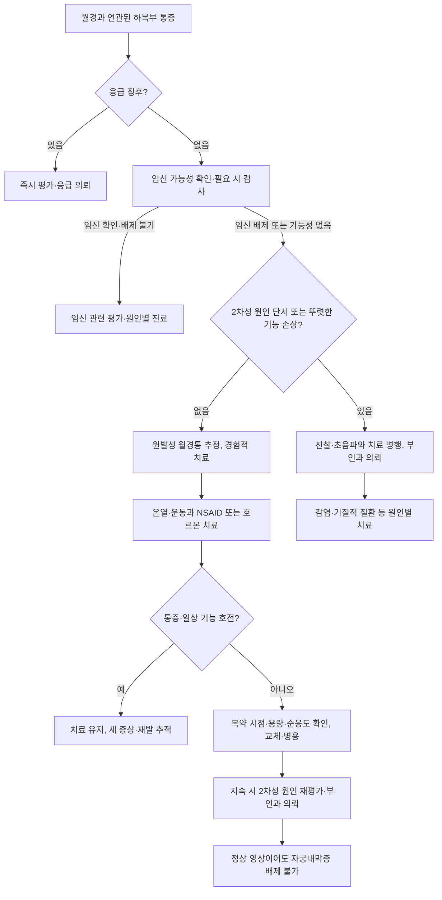

# 월경통 (月經痛) Dysmenorrhea

## <mark style="color:green;">일반 사항</mark>

* 월경통(dysmenorrhea) : 월경과 관련하여 발생하는 통증
* 원발성 월경통 (SOGC Guideline No. 345, 2025) : 골반의 기질적 병변 없이 월경과 연관되어 발생하는 경련성 하복부 통증으로, 대개 월경 시작 무렵 시작하여 2\~3일 지속
* 여성 골반통의 흔한 원인. 유병률과 중증 비율은 연구 대상·정의에 따라 크게 다르며, 청소년·젊은 여성에서 흔함; 나이가 들면서 감소하는 경향이 있으나 통증의 중증도와 학업·직장·수면 등 일상 기능 손상 정도를 함께 평가
* 분류
  * 원발성 : 기질적 질환 없이 대개 초경 후 배란 주기가 자리 잡으면서 시작(보통 6\~12개월 이후); 나이가 들면서 완화되기도 하나 개인차가 있음
  * 2차성 : 기저 골반 병리에 의해 발생. 자궁내막증은 청소년에서도 중요하며 초경 후 이른 시기부터 증상이 나타날 수 있음; 발병 연령만으로 원발성·2차성을 구분하지 않음


**진료 범위**\
본 챕터는 원발성 월경통의 1차 의료 관리에 초점을 둠. 자궁내막증에 의한 2차성 월경통·만성 골반통의 상세 진단·치료는 부인과 전문 영역이므로, 본 챕터에서는 감별과 의뢰 시점만 다룸(SOGC Guideline No. 345, 2025).


## <mark style="color:green;">원인</mark>

#### <mark style="color:$primary;">원발성 월경통</mark>

* 배란 주기 말 progesterone 감소 → 자궁내막의 arachidonic acid 대사 및 prostaglandin(PGF₂α, PGE₂) 생성 증가 → 자궁근 과수축·혈관수축 및 자궁 허혈 → 통증

#### <mark style="color:$primary;">2차성 월경통</mark>

* 기저 골반 병리로 발생 : 자궁내막증, 자궁선근증(adenomyosis), 자궁근종, 골반염(PID), 폐쇄성 생식관 기형·자궁경부 협착 등. 골반 유착은 만성 골반통의 감별에 포함하되 통증과의 인과관계를 단정하지 않음
* 구리 자궁내장치(Cu-IUD)는 특히 삽입 초기 월경량·월경통을 증가시킬 수 있음; 새로 발생한 심한 통증은 단순한 장치 부작용으로 판단하기 전에 위치 이상·임신·감염 등을 평가
  * ※ levonorgestrel 방출 자궁내시스템(LNG-IUS)은 월경통 및 자궁내막증 관련 통증을 감소시킬 수 있음

### <mark style="color:orange;">위험 인자</mark>

※ 관련성이 보고된 요인이며 개별 환자에서 인과관계를 뜻하지 않음

#### <mark style="color:$primary;">원발성</mark>

* 불규칙 월경, 과다 월경
* 빠른 초경(＜12세)
* 젊은 연령(＜30세)
* 우울, 불안, 스트레스
* 흡연, 음주
* 출산력 없음
* 가족력

#### <mark style="color:$primary;">2차성</mark>

* 골반 감염
* 구리 자궁 내 장치(특히 삽입 초기)
* 골반 기형
* 자궁내막증 가족력

## <mark style="color:green;">임상 양상</mark>

※ 원발성과 2차성 월경통의 증상은 상당 부분 중첩되지만, 발병 시기·진행 양상·동반 증상(성교통, 배변통, 비월경성 골반통)·치료 반응이 감별에 중요함

* 하복부/치골 상부의 경련 또는 통증; 간혹 허리, 대퇴부로 방사통
  * 통증은 월경 출혈 직전 또는 시작과 함께 발생, 경증\~중증 강도로 간헐적으로 발생; 1\~3일에 걸쳐 점차 감소(출혈 전후로 오래 지속되거나 월경 사이에도 아프면 2차성 원인 재평가)
* 구역, 설사, 복부 팽만감/복통
* 불안, 피로감, 두통, 어지럼, 몸살

### 🚩Red Flags

<mark style="color:$danger;">**즉각 조치**</mark>

* 임신 가능성과 급성 골반통, 특히 편측 통증·질출혈·실신·저혈압 동반(자궁외임신 가능성)  <mark style="color:$danger;">[응급]</mark>
* 갑작스러운 심한 편측 하복부 통증과 구역·구토 ± 부속기 압통(난소·부속기 염전 가능성; 초음파 때문에 응급 의뢰를 지연하지 않음)  <mark style="color:$danger;">[응급]</mark>
* 고열·오한, 심한 골반통과 복막 자극 징후 또는 전신 상태 불량(골반농양·복막염·패혈증 가능성)  <mark style="color:$danger;">[응급]</mark>
* 다량 질출혈과 실신·저혈압·빈맥 등 혈역학적 불안정 동반  <mark style="color:$danger;">[응급]</mark>

<mark style="color:$warning;">**당일~수일 내 평가**</mark>

* 골반통과 자궁경부 운동통·자궁 압통·부속기 압통 ± 발열·비정상 질분비물(PID 가능성; **당일** 평가·치료)  <mark style="color:$warning;">[신속 평가]</mark>
* 초경 무렵부터 심한 주기적 통증, 특히 원발성 무월경·월경혈 배출 장애 동반(유출로 폐쇄 가능성; 급성 요폐·심한 통증 동반 시 **당일** 평가)  <mark style="color:$warning;">[신속 평가]</mark>
* IUD 삽입 후 새로 발생한 심한 통증(위치 이상·천공·PID·임신 가능성; **당일** 평가, 불안정하면 즉각 조치)  <mark style="color:$warning;">[신속 평가]</mark>

<mark style="color:$info;">**조기 평가 및 추적**</mark>

* NSAID·호르몬제의 적절한 사용에도 지속되는 통증, 또는 약물 금기·불내성으로 치료가 어려움  <mark style="color:$info;">[재평가]</mark>
* 수년간 무증상이다가 새로 발생하거나 진행성으로 악화되는 월경통  <mark style="color:$info;">[재평가]</mark>
* 성교통·배변통·비월경성 골반통, 주기적 배뇨통·혈뇨, 난임 또는 자궁내막증 가족력 동반  <mark style="color:$info;">[재평가]</mark>
* 결석·결근 등 일상 기능 저하, 월경과다·월경 사이 출혈 또는 골반 종괴 동반  <mark style="color:$info;">[재평가]</mark>

## <mark style="color:green;">진단</mark>

### <mark style="color:orange;">병력·진찰 및 검사</mark>

* 전형적인 주기성 통증이고 2차성 원인을 시사하는 소견이 없으면 임상적으로 원발성 월경통을 추정하여 경험적 치료 시작 가능. 모든 환자에게 골반 내진·초음파를 일률적으로 요구하지 않음; 기본적인 활력징후·복부 진찰은 시행 <mark style="color:$info;">[SOGC 2025]</mark>
* 초진 문진 : 초경·월경 주기/출혈량, 통증 시작·지속·진행, 월경 사이 통증, 성교통·배변통·배뇨통, 성생활·임신 가능성, STI 위험, 자궁내막증 가족력, 기존 약제의 실제 용량·시점·반응 및 일상 기능 영향을 확인. 통증 점수와 증상·월경 일기를 추적에 활용
* 비전형적 경과, 2차성 원인 의심 또는 경험적 치료 반응 부족 시 골반 진찰·초음파 등 추가 평가. 청소년의 문진은 사생활을 보장하고, 내진과 질식 초음파는 필요성·수용 가능성·동의를 고려하여 시행

<table><thead><tr><th width="180">검사</th><th>대상·해석</th></tr></thead><tbody><tr><td>소변/혈청 임신 검사</td><td>임신 가능성이 있거나 급성·비전형적 골반통이면 우선 시행. 너무 이른 시기의 소변검사 음성만으로 임신을 완전히 배제하지 않으며 임상적으로 의심되면 혈청 hCG·초음파 등으로 평가</td></tr><tr><td>임질·클라미디아 NAAT 등</td><td>STI 위험·자궁경부염·PID 의심 시. 골반 진찰과 함께 판단하며, 결과를 기다리느라 PID 치료를 늦추지 않음</td></tr><tr><td>CBC ± ferritin</td><td>월경과다, 창백·피로 등 빈혈 의심 시 선택적으로 시행</td></tr><tr><td>골반 초음파</td><td>2차성 원인 의심·비정상 진찰 소견·치료 반응 부족 시 시행. 자궁내막증이 의심되면 진찰이 정상이더라도 초음파를 시행하며, 적절하고 환자가 동의하면 질식 검사, 부적절하거나 원하지 않으면 경복부 검사 등을 선택</td></tr><tr><td>전문 초음파·골반 MRI</td><td>심부 자궁내막증·자궁선근증·해부학적 이상 의심 또는 기본 초음파로 불명확한 경우 선택. 전문 초음파와 MRI 중 임상 질문·검사자 전문성·접근성을 고려</td></tr></tbody></table>

* **초음파·MRI 음성으로 표재성 자궁내막증을 배제할 수 없음.** CA-125 등 생체표지자를 자궁내막증의 진단·배제 목적으로 일상적으로 검사하지 않음 <mark style="color:$info;">[ESHRE 2022, NICE NG73]</mark>
* ACOG 2026은 병력·증상·진찰에 따른 자궁내막증의 임상적 추정 진단으로 경험적 약물치료를 시작하면서 영상 평가를 병행할 수 있음을 명시. 수술적 확진을 모든 환자의 치료 전제로 요구하지 않으며, 영상 음성·치료 실패·수술 선호 등에 따라 전문의가 복강경의 이득과 위험을 함께 논의 <mark style="color:$info;">[ACOG CPG No. 11, 2026; ESHRE 2022]</mark>
* 약물에 반응한다고 해서 자궁내막증을 배제하거나 원발성 월경통으로 확정하지 않음
* STI 위험 환자의 골반통에서 다른 원인이 확인되지 않고 자궁경부 운동통·자궁 압통·부속기 압통 중 하나 이상이면 PID 경험적 치료를 시작; 발열이 없어도 배제할 수 없음 <mark style="color:$info;">[CDC STI Treatment Guidelines]</mark>

#### <mark style="color:$primary;">재평가·부인과 의뢰</mark>

* 초경 무렵부터 매우 심한 통증, 진행성·비월경성 통증, 비정상 출혈·종괴, 성교통·배변통·주기적 배뇨 증상 등 2차성 원인의 단서가 있으면 초기부터 평가·의뢰
* 통증으로 일상 기능이 손상되거나 치료 금기·불내성, 지속·재발 증상이 있으면 검사와 치료를 진행하면서 의뢰; 초음파가 정상이어도 해당
* 본 장의 실무적 추적 기준 : 치료 시작 후 **2\~3주기 내** 통증·결석/결근·이상반응·실제 복약을 재평가. 호르몬 치료의 효과는 대개 약 3개월의 경과를 보되, 악화·경고 증상·기능 손상이 있으면 일찍 추가 평가하며 정해진 기간을 채우도록 기다리지 않음
* 자궁내막종·장/방광/요관 침범 등 심부 자궁내막증 의심, 청소년의 난치성 통증은 관련 경험이 있는 부인과로 의뢰 <mark style="color:$info;">[NICE NG73, ESHRE 2022]</mark>

### <mark style="color:orange;">감별 진단</mark>

* 증상이 상당 부분 중첩되는 원발성 월경통과, 기저 병리가 있는 2차성 월경통의 감별이 핵심

<table><thead><tr><th width="140">질환</th><th width="230">핵심 감별 포인트</th><th>확인 검사</th></tr></thead><tbody><tr><td>자궁내막증</td><td>진행성 통증, 성교통·배변통·주기적 배뇨 증상; 청소년에서도 발생</td><td>골반 초음파 ± MRI; 영상검사 음성이라도 배제 안 됨(상세 원칙은 위 "검사" 참조)</td></tr><tr><td>자궁선근증(adenomyosis)</td><td>월경과다·압통성 자궁 비대; 젊은 연령에서도 가능</td><td>골반 초음파/MRI</td></tr><tr><td>자궁근종</td><td>월경과다, 골반 압박감, 촉진되는 종괴</td><td>골반 초음파</td></tr><tr><td>골반염(PID)</td><td>발열, 비정상 질분비물, 부속기 압통</td><td>골반 진찰, 임신 검사·임질/클라미디아 NAAT; 초음파는 농양·다른 원인 의심 시</td></tr><tr><td>골반 유착</td><td>골반 수술·감염 병력, 만성 골반통 양상</td><td>병력·진찰과 다른 원인 배제; 유착 확인만을 위한 복강경·유착박리술을 일률적으로 권하지 않음</td></tr><tr><td>Cu-IUD 또는 IUD malposition 관련</td><td>삽입 후 새로 발생하거나 악화된 통증</td><td>병력, 초음파로 위치 확인</td></tr><tr><td>뮐러관 기형(폐쇄성)</td><td>초경 직후부터 심한 주기적 통증, 원발성 무월경 또는 월경혈 배출 장애</td><td>골반 초음파/MRI</td></tr></tbody></table>

* 비부인과적 감별 : 과민성 장증후군, 염증성 장질환, 방광통증증후군, 복벽·골반저 근육통 등. 급성 비전형적 통증은 충수염·요로결석 등도 평가

***



<p align="center"><strong>1차 진료 원발성 월경통 진단·치료 알고리듬</strong></p>

<p align="center"><em><mark style="color:$info;">Ref. SOGC 2025, ACOG 2026, NICE NG73를 바탕으로 1차의료 진료 흐름에 맞게 재구성; 초기 치료는 2~3주기 내 재평가하며 악화 시 앞당김</mark></em></p>

***

## <mark style="background-color:$warning;">Management</mark>


**단계별 치료 전략 (Step-wise Approach)**


<table><thead><tr><th>단계</th><th>핵심 치료·평가</th><th>대상</th></tr></thead><tbody><tr><td>초기</td><td>운동·국소 온열 및 NSAID/호르몬 치료 선택(피임 희망·금기·선호 고려)</td><td>전형적 원발성 월경통</td></tr><tr><td>반응 부족</td><td>NSAID 시점·용량·순응도 확인 후 교체·호르몬 치료 병용; 지속 시 2차성 원인 평가</td><td>초기 치료 효과 부족</td></tr><tr><td>재평가</td><td>2차성 원인 재평가, 골반 초음파 ± 추가 검사, 필요 시 부인과 의뢰</td><td>초기부터 2차성 단서·기능 손상, 또는 적절한 치료에도 지속·재발</td></tr></tbody></table>

* NSAID와 호르몬 치료는 금기·피임 필요·임신 계획·선호에 따라 선택하며 병용 가능. 병용을 위해 반드시 2~3개월의 단독요법을 먼저 마칠 필요는 없음
* 치료 목표는 통증 완화와 일상 기능 회복; 임신을 시도 중이면 피임·월경 억제 치료와 목표가 달라 별도 상담

## <mark style="color:green;">비-약물 치료 및 예방</mark>

* 국소 온열 치료(온찜질) : 통증 완화에 도움이 되며 NSAID와 함께 사용 가능. 2026년 체계적 문헌고찰에서도 효과를 지지하나 연구의 이질성·편향 위험을 고려하여 NSAID보다 우월하다고 일반화하지 않음; 피부에 직접 고온을 오래 적용하지 말고 수면 중 사용을 피하여 저온화상 예방 <mark style="color:$info;">[Yuan et al. 2026]</mark>
* 규칙적 운동 : 증상 개선에 권고됨 <mark style="color:$info;">[SOGC 2025, conditional recommendation, low-certainty evidence]</mark>
* 경피적 전기신경자극(TENS) : 보조 요법으로 고려 가능. 2024년 Cochrane 리뷰에서 고주파·저주파 모두 통증 감소 가능성을 보였으나 근거 확실성은 제한적 <mark style="color:$info;">[Cochrane 2024]</mark>
* 침·경혈 자극, 생강 보충 : 환자가 원할 때 보조적으로 고려할 수 있으나 근거 확실성은 낮음 <mark style="color:$info;">[SOGC 2025, conditional, low-certainty]</mark>
  * 생강 보충제는 연구별 제형·용량이 달라 표준 처방 용량을 제시하기 어려움. 상호작용과 임신 가능성을 확인
* 요가·마사지 : 도움이 될 수 있으나 표준 약물치료를 대체하도록 권할 만큼 확실한 근거는 부족
* 예방
  * 건강한 식습관을 권장할 수 있으나 특정 식이요법을 월경통 예방 목적으로 권고할 충분한 근거는 제한적
  * 금연, 수면·스트레스 관리, 증상 일기 활용을 권장; 통증을 심리적 문제만으로 돌리지 않음
  * 2차성 : 성매개감염 예방(☞ 골반염 관련 챕터 참조)

## <mark style="color:green;">약물 치료</mark>

### <mark style="color:orange;">NSAID</mark>

* 작용 : prostaglandin 합성을 억제시켜 통증 및 월경량을 줄임
* 주기가 예측 가능하면 월경 예정일 1\~2일 전, 예측하기 어렵다면 통증 또는 출혈 시작 즉시 투여; 통증이 심한 첫 2\~3일간 규칙적으로 복용
* 개별 NSAID 간 임상적 우월성은 명확하지 않으므로 효과·부작용·복용 편의성을 고려하여 선택(Cochrane 리뷰상 COX-2 선택적 억제제가 기존 NSAID보다 더 효과적이라는 근거는 없음)
* 적절히 투여해도 효과가 적으면 다른 NSAID로 교체할 수 있으나 두 종류의 전신 NSAID를 동시에 복용하지 않음
* acetaminophen도 사용할 수 있으나 NSAID보다 효과가 낮을 가능성이 있음(직접 비교 근거의 확실성은 낮음); NSAID 금기·불내성 시 대안. 간질환·음주 및 복합제의 성분 중복을 확인 <mark style="color:$info;">[Cochrane 2015]</mark>
* 임신 가능성, 소화성 궤양·위장관 출혈, 신기능 저하, 심혈관질환, 항응고제 복용, NSAID 과민반응·천식을 확인. 최저 유효 용량을 필요한 기간만 사용하고 여러 NSAID의 중복 복용을 피함

#### <mark style="color:$primary;">대표 약제</mark>

* ibuprofen : 성인 400 ㎎ q6\~8h(이 용법에서는 1,200\~1,600 ㎎/일). 국내 경증·중등도 통증 허가 용량은 1회 200\~400 ㎎, 1일 3\~4회 <mark style="color:blue;">\[부루펜정 200 ㎎]</mark>
* naproxen sodium : 성인 550 ㎎ 초회 → 275 ㎎ q6\~8h; 1일 최대 1,375 ㎎(월경곤란증 국내 허가 용법) <mark style="color:blue;">\[아나프록스정 275 ㎎]</mark>

※ 위 용량·처방례는 성인 기준. 청소년·저체중 환자는 연령·체중 및 제품 허가사항에 따라 개별 조정. naproxen sodium과 naproxen의 함량 표기를 혼동하지 않음

### <mark style="color:orange;">호르몬 치료</mark>

* 복합호르몬 피임제(CHC; estrogen + progestin)는 원발성 월경통의 초기 치료 선택지. 피임을 원하는 환자에서 특히 유용하며, NSAID 금기·불내성 또는 반응 부족 시에도 고려
* 자궁내막증에 의한 월경통에서는 CHC 또는 progestin 제제를 1차 약물 치료로 고려할 수 있으며, LNG-IUS도 효과적
* 첫 주기부터 효과가 나타날 수 있으나 통증·출혈 양상과 이상반응을 약 3개월에 걸쳐 평가
* **SOGC 2025는 CHC의 연속·연장 주기를 권고**(strong, high). Cochrane 2023에서도 연속요법이 주기요법보다 통증을 더 줄일 가능성을 보였으나 직접 비교 근거는 제한적. 초기 점상출혈을 설명하고 환자 선호·내약성 및 국내 제품별 허가 용법에 맞추어 선택; 24/4 요법은 짧은 휴약 주기요법이며 무휴약 연속요법과 구분 <mark style="color:$info;">[SOGC 2025, Cochrane 2023]</mark>
* 복용 중 간헐적 출혈 발생 가능(특히 치료 시작 2\~3개월간)
* 중단 시 금단 출혈 및 월경통 발생 가능
* CHC 처방 전 혈압 측정 및 흡연·VTE/혈전성향증·전조(aura) 편두통·유방암·간질환·산후 상태·병용약을 확인. 전조 편두통·중증 고혈압(수축기 ≥160 또는 이완기 ≥100 mmHg) 등은 금기; 조절된 고혈압이나 수축기 140\~159 또는 이완기 90\~99 mmHg도 일반적으로 피함. 야즈·야스민 국내 허가는 **35세 이상 흡연자 금기** <mark style="color:$info;">[CDC U.S. MEC 2024, 국내 허가사항]</mark>
* estrogen 금기·불내성 시 LNG-IUS 또는 적절한 progestin 단독 제제를 검토하되, 현재 유방암 등에서는 progestin도 부적절할 수 있어 제제별 적합성을 확인
* 자궁내막증 치료용 dienogest 단독제는 원발성 월경통의 일반적인 피임약과 구분하며 **피임 효과를 전제로 사용하지 않음**. 해당 치료는 부인과와 상의(☞ 피임·자궁내막증 관련 챕터)

#### <mark style="color:$primary;">대표 제제</mark>

* <mark style="color:blue;">\[야즈]</mark> (28T)(비급여) : 활성정 1정에 drospirenone 3 ㎎ + ethinyl estradiol 0.02 ㎎. 경구피임약 사용을 원하는 여성의 월경곤란증 치료 적응증 보유; 연분홍색 활성정 24일 → 흰색 위약 4일, **28정 복용 후 다음 날 새 포장 시작**
  * 월경 1일째 시작이 기본 선택. 국내 허가상 월경 1일 이후 시작하는 경우 첫 7일간 비호르몬적 추가 피임 필요; 복용 누락·구토 시 해당 제품 지침 적용
* <mark style="color:blue;">\[야스민]</mark> (21T)(비급여) : 1정에 drospirenone 3 ㎎ + ethinyl estradiol 0.03 ㎎. 국내 적응증은 피임; 월경통 단독 적응증 없음. 기본 용법은 21일간 복용 → 7일간 휴약 → 새 포장; 연장 주기는 제품 허가의 별도 지시 확인
* <mark style="color:blue;">\[미레나]</mark> 자궁 내 시스템 : levonorgestrel 52 ㎎ LNG-IUS; 국내 허가상 월경과다·월경곤란증 치료에는 삽입 후 5년, 피임에는 8년간 유효. 삽입·교체는 숙련된 의료진이 시행. 공개 확인한 급여기준상 월경과다 확진 또는 월경주기당 1\~2일 일상생활이 불가능한 월경곤란증 등이 급여 대상이며 피임 목적은 비급여. 기준 밖 치료 사용의 약값 전액 본인부담과 구분하고 실제 청구 시 현행 고시 확인

* drospirenone 함유 CHC의 주의 : levonorgestrel 함유 CHC보다 VTE 위험이 높을 수 있음. 고칼륨혈증 소인·신기능 장애·부신부전 및 ACE 억제제/ARB·칼륨보존 이뇨제 등의 병용을 확인. 칼륨을 높이는 약물(장기 NSAID 포함)을 계속 복용하는 환자는 첫 주기 혈청 칼륨 검사 등 허가사항에 따라 관리

### <mark style="color:orange;">보조 요법</mark>

* 진경제는 원발성 월경통의 표준 1차 치료가 아니며, NSAID·호르몬 치료를 대체하지 않음. 다른 경련성 복통이 동반될 때 해당 원인을 평가한 후 개별적으로 고려
* omega-3 fatty acid, magnesium, vitamin B1, zinc 등은 일부 연구에서 효과가 보고되었으나 근거의 질과 일관성이 부족하여 일상적으로 권고하기 어려움

## <mark style="color:green;">시술 및 기타 처치</mark>

* 원발성 월경통 자체에 수술을 일상적으로 시행하지 않음. 최적화된 약물 치료에도 통증이 지속되거나 2차성 원인이 강하게 의심되면 전문의가 진단·치료 목적 복강경 등의 필요성을 개별 판단 <mark style="color:$info;">[SOGC 2025, strong recommendation, moderate-certainty evidence]</mark>
* 수술 여부 결정 전 2차성 원인 및 비부인과적 골반통 원인을 포함한 충분한 재평가 필요
* GnRH 작용제·길항제 등은 원발성 월경통의 통상적 1차 치료가 아님. 자궁내막증 관련 난치성 통증에서 전문의가 저에스트로겐 부작용·골건강·add-back 요법 및 국내 허가·급여를 검토하여 선택

***

### 질병코드

N94.4 원발성 월경통

N94.5 이차성 월경통

N94.6 상세불명의 월경통

※ 원발성·2차성 여부가 아직 확인되지 않았다면 상세불명 코드를 고려하고, 평가 후 진단에 맞게 갱신

***

## <mark style="color:purple;">처방례</mark>

> **처방례 1. 급성 통증**
>
> ```
> 부루펜 200 ㎎/T  2T tid(통증이 심한 첫 2~3일)
> ```
>
> _✽ 월경 주기가 예측되면 시작 1\~2일 전, 예측하기 어려우면 통증·출혈이 시작될 때 복용. 다른 NSAID와 중복하지 않음_

> **처방례 2. 반복되는 원발성 월경통(피임 원함)**
>
> ```
> 야즈 28정/포장  1T qd (활성정 24일 + 위약 4일, 다음 날 새 포장)
> ```
>
> _✽ 피임을 원하고 복합호르몬제 금기가 없는 환자에서 선택; 충분한 효과 발현까지 수개월 소요될 수 있음을 설명_

> **처방례 3. NSAID 단독 반응 부족 시 병용**
>
> ```
> 이부프로펜 400 ㎎/T  1T tid (주기 예측 시 월경 시작 1~2일 전부터, 첫 2~3일)
> 야즈 28정/포장  1T qd (활성정 24일 + 위약 4일, 다음 날 새 포장)
> ```
>
> _✽ NSAID 복약 시점·용량을 먼저 확인하고 병용을 고려. 피임 희망·CHC 금기를 확인하며, 지속 통증·기능 손상이 있으면 치료와 함께 2차성 원인을 평가_

***

### <mark style="color:$success;">핵심 복약 지도</mark>

> **NSAID 복용 원칙**
>
> * **월경이 규칙적이면 예정일 1\~2일 전부터, 불규칙하면 출혈이나 통증이 시작될 때 복용하세요.** 통증이 심해질 때까지 기다리지 마세요.
> * 통증이 심한 첫 2\~3일간 처방대로 복용; 위장 장애가 우려되면 식후 복용. 다른 소염진통제와 중복 복용하지 않음
> * 적정 용량을 올바른 시점부터 규칙적으로 사용해도 반응이 부족하면, 자가로 증량하지 말고 재진하여 다른 NSAID 또는 호르몬 치료를 고려

> **호르몬 피임제 복용 원칙**
>
> * 첫 복용 주기부터 효과가 나타날 수 있으나 충분한 효과 발현까지 수개월 소요될 수 있음을 미리 설명
> * 복용 초기(2\~3개월) 간헐적 부정출혈이 나타날 수 있음 - 임의로 중단하지 않도록 안내
> * 매일 정해진 순서로 복용하고 제품별 위약·휴약 일정을 지킬 것. 복용 누락·복용 직후 구토 시 제품별 추가 피임 지침을 확인
> * 갑작스러운 호흡곤란·흉통·한쪽 다리 부종 또는 새 신경학적 증상이 생기면 즉시 복용을 중단하고 응급 평가

> **언제 다시 병원을 방문해야 하나요?**
>
> * 초기 치료 후 2\~3주기 내 재진하여 반응을 확인; 올바르게 복용해도 호전이 없거나 부작용으로 사용이 어려운 경우에는 더 일찍 방문
> * 통증이 점차 심해지거나 성교통·배변통이 새로 동반되는 경우
> * 골반통과 발열·비정상 질분비물이 동반되면 당일 진료; 성교 후 출혈·월경 사이 출혈이 반복되면 조기 평가
> * **갑작스런 심한 편측 하복부 통증** 또는 **실신·어지럼**이 동반되는 경우 - 즉시 응급실 방문

***

## <mark style="color:green;">주요 참고문헌 및 확인 자료</mark>

※ 임상·허가 자료 확인일 : 2026-10-28. 해외 지침의 권고와 국내 제품 허가·급여를 구분하여 적용

### <mark style="color:orange;">임상 근거</mark>

* Burnett M. [SOGC Guideline No. 345: Primary Dysmenorrhea](https://doi.org/10.1016/j.jogc.2025.102840). J Obstet Gynaecol Can. 2025;47(5):102840.
* ACOG. [Diagnosis of Endometriosis. Clinical Practice Guideline No. 11](https://doi.org/10.1097/AOG.0000000000006181). Obstet Gynecol. 2026;147(3):432–448.
* ESHRE. [Guideline: endometriosis](https://doi.org/10.1093/hropen/hoac009). Hum Reprod Open. 2022;2022(2):hoac009.
* NICE. [Endometriosis: diagnosis and management, NG73](https://www.nice.org.uk/guidance/ng73/chapter/Recommendations). 진단·의뢰 권고 2024 개정; 2025 관련 기술평가 링크 추가.
* Marjoribanks J, et al. [Nonsteroidal anti-inflammatory drugs for dysmenorrhoea](https://doi.org/10.1002/14651858.CD001751.pub3). Cochrane Database Syst Rev. 2015;CD001751.
* Schroll JB, et al. [Combined oral contraceptive pill for primary dysmenorrhoea](https://doi.org/10.1002/14651858.CD002120.pub4). Cochrane Database Syst Rev. 2023;CD002120.
* Han S, et al. [TENS for pain control in women with primary dysmenorrhoea](https://doi.org/10.1002/14651858.CD013331.pub2). Cochrane Database Syst Rev. 2024;CD013331.
* Yuan D, et al. [Heat therapy for primary dysmenorrhea: a systematic review and meta-analysis](https://doi.org/10.3389/fmed.2025.1730505). Front Med (Lausanne). 2026년 1월 온라인 출판(2025년 권호).
* CDC. [U.S. MEC 2024: Combined Hormonal Contraceptives](https://www.cdc.gov/contraception/hcp/usmec/combined-hormonal-contraceptives.html); [PID: STI Treatment Guidelines](https://www.cdc.gov/std/treatment-guidelines/pid.htm).
* Royal Children's Hospital Melbourne. [Dysmenorrhoea](https://www.rch.org.au/clinicalguide/guideline_index/Dysmenorrhoea/) (2025년 10월 개정); [Adolescent gynaecology – lower abdominal pain](https://www.rch.org.au/clinicalguide/guideline_index/Adolescent_gynaecology_lower_abdominal_pain/).
* ACOG. [Chronic Pelvic Pain, Practice Bulletin No. 218](https://www.acog.org/clinical/clinical-guidance/practice-bulletin/articles/2020/03/chronic-pelvic-pain). 2020; 2026 재확인.
* Royal Children's Hospital Melbourne. [Adolescent gynaecology – heavy menstrual bleeding](https://www.rch.org.au/clinicalguide/guideline_index/Adolescent_Gynaecology_Menorrhagia/). 2025년 6월 개정.

### <mark style="color:orange;">허가·급여 확인 자료</mark>

* 식품의약품안전처 의약품안전나라 : [부루펜정 200 ㎎](https://nedrug.mfds.go.kr/pbp/CCBBB01/getItemDetail?itemSeq=197700120), [야즈](https://nedrug.mfds.go.kr/pbp/CCBBB01/getItemDetail?itemSeq=200807400), [야스민](https://nedrug.mfds.go.kr/pbp/CCBBB01/getItemDetail?itemSeq=200801550), [미레나](https://nedrug.mfds.go.kr/pbp/CCBBB01/getItemDetail?itemSeq=200801711).
* 종근당. [아나프록스정 제품정보·국내 허가 용법](https://www.ckdpharm.com/product/productView.do?prodCode=CKD0000045).
* 바이엘. [비잔정 제품설명서 — 자궁내막증 적응증 및 피임 주의](https://www.bayer.com/sites/default/files/2020-11/244-5.pdf).
* 건강보험심사평가원. [요양급여의 적용기준 및 방법에 관한 세부사항(약제), 2024년 7월판](https://www.hira.or.kr/ebooksc/2024/10/BZ202410100629690.pdf), Levonorgestrel 제제(고시 제2013-127호). 실제 적용 시 현행 고시 확인.

***

## <mark style="color:blue;">환자 안내서</mark>


**월경통, 대부분은 치료로 충분히 조절됩니다**

월경통은 월경 전후 아랫배에 생기는 통증으로, 매우 흔한 증상입니다. 많은 경우 약물과 생활 관리로 조절할 수 있습니다. 일상생활을 방해하는 통증을 당연한 것으로 참고 지낼 필요는 없습니다.


#### <mark style="color:$primary;">왜 월경통이 생기나요?</mark>

* 월경이 시작되면 자궁 내막에서 prostaglandin이라는 물질이 많이 나와 자궁근육을 강하게 수축시킵니다. 이 과정에서 하복부 경련과 통증이 생깁니다.
* 원발성 월경통은 특별한 골반 질환 없이 발생하지만, 일상생활을 방해할 정도의 통증은 적극적으로 치료할 필요가 있습니다.
* 일부는 자궁내막증 등 기저 질환에 의한 것(2차성 월경통)일 수 있습니다.
* 초음파 등 영상검사에서 특별한 이상이 없다고 나오더라도 자궁내막증 등 초기 병변은 영상에서 잘 보이지 않을 수 있어, 통증이 지속된다면 재평가가 필요할 수 있습니다.

#### <mark style="color:$primary;">일상생활에서 어떻게 관리하나요?</mark>

* **아랫배를 따뜻하게 해주세요.** 🌡️ 온찜질이 통증 완화에 도움이 됩니다. 피부에 직접 고온을 오래 대거나 찜질기·핫팩을 붙인 채 잠들지 마세요.
* **규칙적으로 운동하세요.** 꾸준한 운동은 월경통 증상을 줄이는 데 도움이 됩니다.
* 일부 환자에서는 카페인·알코올 등이 증상을 악화시킬 수 있으므로, 개인적으로 연관성이 뚜렷하면 줄여볼 수 있습니다.
* 온찜질·운동 외에 생강, 침 치료 등을 보조적으로 시도해볼 수 있으나, 아직 근거가 충분하지 않아 효과에 개인차가 있을 수 있습니다.

#### <mark style="color:$primary;">약은 어떻게 써야 하나요?</mark>

* **소염진통제는 월경 주기가 규칙적이면 예정일 1\~2일 전, 불규칙하면 출혈이나 통증이 시작될 때 복용하세요.** 다른 소염진통제를 함께 먹지 말고 임신 가능성이 있으면 먼저 의료진과 상의하세요.
* 피임약(호르몬제)은 매일 정해진 순서와 일정대로 복용하세요. 효과가 충분히 나타나기까지 몇 달이 걸리거나 초기 소량 출혈이 있을 수 있습니다. 출혈이 많거나 지속되면 진료받고, 약을 빼먹거나 복용 직후 토했을 때는 제품별 대처법과 추가 피임 여부를 확인하세요.
* 호르몬제를 복용하다 갑자기 숨이 차거나 가슴이 아프고, 한쪽 다리가 붓거나 갑자기 말이 어눌해지거나 한쪽 팔다리의 힘이 빠지면 복용을 중단하고 즉시 응급 진료를 받으세요.

#### <mark style="color:$primary;">다시 진료받아야 할 때</mark>

* 치료 시작 후 2\~3번의 월경 주기 안에 다시 진료받아 효과를 확인하세요. 통증이 계속되거나 학교·직장생활에 지장이 크면 더 일찍 방문하세요.
* 통증이 점점 심해지거나 성관계 시 아픈 증상이 새로 생긴 경우
* 열이 나거나 냄새 나는 질 분비물이 동반되면 당일 진료받으세요.
* **갑자기 아랫배가 심하게 아프거나, 임신 가능성이 있으면서 통증·출혈·어지럼/실신이 있으면 즉시 응급실로 가세요.**
