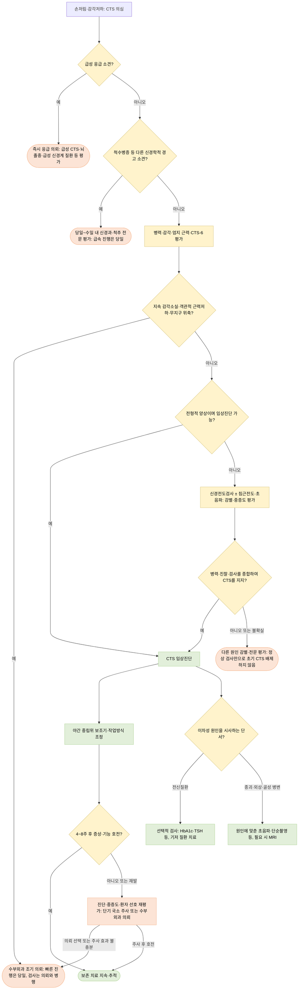
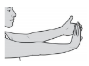
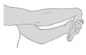
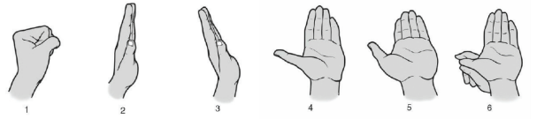
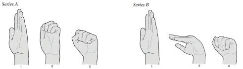

# 수근관증후군(손목터널증후군) Carpal Tunnel Syndrome, CTS

## <mark style="color:green;">일반 사항</mark>

* 손목 안쪽의 carpal bone들과 transverse carpal lig.로 둘러싸인 좁은 통로(carpal tunnel) 내 압력 상승으로 median nerve가 압박되어 발생하는, 상지에서 가장 흔한 압박성 신경병증(entrapment neuropathy)
* 다른 이름 : 손목터널증후군(KCD 공식 병명), median neuropathy at the wrist
* 양측성인 경우가 흔하며, 좌우 증상 정도가 다를 수 있음
* 유병률 : 일반 성인의 약 3\~5%; 진단 기준·대상 인구에 따라 차이가 있으며, 여성에서 남성 대비 2\~5배 높음

## <mark style="color:green;">원인</mark>

* 대부분 특정 단일 원인을 확인하기 어려운 특발성(idiopathic) CTS
* 아래 위험 인자는 발생과의 연관성을 뜻하며 개인별 원인이나 인과관계를 확정하는 기준은 아님; AAOS 2016의 근거 등급을 최신 2024·2026 지침의 등급으로 해석하지 않음

### <mark style="color:orange;">위험 인자</mark>

* 연령 : 중년에서 흔함; 연령과 위험의 관계가 일률적으로 증가하는 것은 아님 <mark style="color:$info;">[APTA/JOSPT 2026]</mark>
* 성별 : 여성(남성의 2\~5배)
* 비만/높은 BMI, 높은 손·손목 반복 동작 노출 <mark style="color:$info;">[AAOS 2016 Strong evidence]</mark>
* 폐경 주변기, wrist ratio/index 증가, 류마티스 관절염, 정신사회적 요인, 원예, 원위부 상지 건병증, 조립라인 작업, 일부 컴퓨터 관련 작업, 진동 노출, 건염, 작업장에서의 강한 악력/힘 사용 <mark style="color:$info;">[AAOS 2016 Moderate evidence]</mark>
  * ✽ 위 위험 인자의 근거 수준은 AAOS **2016** 지침의 분류임. AAOS 2024 지침은 단순한 키보드 사용량(high keyboard use) 자체와 CTS 발생 간 연관성을 뒷받침할 신뢰할 만한 근거가 없다는 실무진 합의 의견(committee opinion)을 제시함; 직업적 요인 중 반복·힘 사용·진동과 단순 키보드 사용은 구분하여 평가
* 투석, 섬유근통, 정맥류, 원위 요골 골절 <mark style="color:$info;">[AAOS 2016 Limited evidence]</mark>
* 신체 활동/운동과 발생 위험 감소의 연관성이 보고됨 <mark style="color:$info;">[AAOS 2016 Moderate evidence]</mark>; 후속 근거 평가에서는 보호 효과의 근거가 제한적이므로 개인의 운동이 CTS를 예방한다고 단정하지 않음
* 경구 피임약, 호르몬 대체요법 : AAOS 2016은 발생 위험 증가·감소와 연관성이 없다고 평가했으나(Moderate evidence), 후속 근거는 상충함 <mark style="color:$info;">[APTA/JOSPT 2026]</mark>; 위험 여부를 확정적으로 단정하지 않음
* 전신 연관 질환 : 당뇨병, RA, 갑상선저하증, 신부전
  * 고령자의 양측 CTS에 원인 불명 심부전/심실벽 비후, 요추관협착증 등 다른 단서가 동반되면 ATTR 아밀로이드증 감별을 고려; 양측 CTS만으로 일률적 선별 검사를 시행하지는 않음. 수술 환자에서 아밀로이드증 위험 인자가 여러 개인 경우 건활막 병리검사는 개별적으로 고려 가능 <mark style="color:$info;">[AAOS 2024 Consensus]</mark>
* 체액/호르몬 변화 : 임신, 비만, CHF
  * 임신 관련 CTS는 출산 후 호전되는 경우가 많으나 수주~수개월 이상 지속될 수 있음; 지속적 감각저하·근력저하가 있으면 재평가

### <mark style="color:orange;">국소적/구조적 이차성 원인</mark>

* 공간점유 병변(Space-occupying lesions) : 건막염(tenosynovitis), 통풍 결절(gout), 결절종(ganglion), 종양
* 국소 염증 또는 허혈성 손상
* 외상 : 원위 요골 골절(distal radius fracture)의 부정유합, perilunate \& lunate 탈구

### <mark style="color:orange;">CTS와 감별해야 할 polyneuropathy 원인</mark>

* 알코올 남용, Vit 결핍, 독성 노출 등은 generalized polyneuropathy를 유발하여 CTS와 유사한 증상을 보이거나 CTS와 동반될 수 있음

## <mark style="color:green;">임상 양상</mark>

* 정중신경 지배 손가락(제1\~3수지 및 제4수지 radial portion)의 야간 통증, 감각 저하, 따끔거림; 주간에는 손목이 굴곡·신전된 상태를 오래 유지할 때 발생(예: 운전, 휴대폰 사용, 타이핑, 독서); 흔히 환자는 손 전체의 증상으로 표현함
* 손의 미세 동작 어려움, 악력 약화(예: 병을 열 때 손에 힘이 없음); 진행 시 단무지외전근(abductor pollicis brevis) 약화·무지구(thenar) 위축이 발생할 수 있음
* 손바닥 전체가 아닌 무지구 피부의 객관적 감각은 대개 보존됨(palmar cutaneous branch는 수근관 밖으로 주행); 이 부위까지 감각저하가 있으면 근위부 정중신경병증 등을 감별
* 간혹 정중신경을 따라 근위부(팔꿈치, 간혹 어깨)로 방사되는 통증과 이상 감각
* 손을 흔들거나 문지르면 완화(환자가 손목의 통증을 줄이기 위해서 손과 손목을 터는 행동 "Flick sign")
* 양측 발생(보통 한쪽 손의 증상이 보다 심함)

### <mark style="color:orange;">임상 경과 및 증상 변이</mark>

* 일부 CTS 환자에서는 불안·우울 등 정신사회적 요인이 동반되며, 증상·기능 장애와 연관될 수 있으나 인과관계에 대한 근거는 일관되지 않음 <mark style="color:$info;">[APTA/JOSPT 2026]</mark>
* 정중신경 영역을 벗어난 extramedian symptom spread는 central sensitization과 관련될 가능성이 제시되었으나 이를 확진하는 표준화된 방법은 없으며 근거도 제한적임. 척골신경병증·경추 신경근병증·다발신경병증 등 다른 원인을 먼저 감별함 <mark style="color:$info;">[APTA/JOSPT 2026]</mark>

### <mark style="color:$danger;">🚩Red Flags</mark>

<mark style="color:$danger;">**즉각 조치**</mark>

* 외상(원위 요골 골절·탈구·압궤 손상 등), 급성 출혈·감염 등의 상황에서 급격히 발생·악화되는 정중신경 분포 저림·감각 저하와 심한 통증, 손목 부종·긴장감  `급성 수근관증후군 의심`
* 갑자기 발생한 편측 손·팔의 감각저하 또는 근력 저하, 특히 얼굴 마비·언어장애 동반  `뇌졸중·TIA 의심`
* 수시간~수일 내 빠르게 진행하는 양측 감각저하·근력 저하 또는 균형장애  `급성 척수·말초신경 질환 의심`

<mark style="color:$warning;">**당일~수일 내 평가**</mark>

* 무지구 위축, 객관적인 엄지 벌림·맞섬 근력 저하 또는 지속적 감각소실; 빠른 진행 시 **(당일)**  `진행된 정중신경 손상 의심`
* 임신 중 지속적 감각소실, 객관적 무지구 근력 저하·위축 등 신경손상 소견의 새로운 발생 또는 진행; 빠른 진행 시 **(당일)**  `임신 관련 CTS의 신경손상 의심`
* 정중신경 분포를 뚜렷하게 벗어난 지속적 감각이상에 목 통증·상지 방사통 또는 다른 신경학적 이상 동반  `경추 신경근병증 등 감별`
* 손의 서투름·감각이상과 함께 보행장애·심부건반사 항진 또는 새로운 배뇨·배변 장애 동반; 급속 진행이나 급성 배뇨·배변 장애는 **(당일)**  `경추 척수병증 등 감별`

<mark style="color:$info;">**조기 평가 및 추적**</mark>

* 야간 중립위 부목을 중심으로 한 4~8주 보존 치료에도 호전이 없는 경우  `진단·중증도 재평가`
* 양측성 증상이면서 갑상선기능저하증·당뇨병·RA 등 전신 질환이 의심되는 경우  `전신 질환 감별`

#### <mark style="color:$primary;">평가·추적 원칙</mark>

* 급성 CTS는 비가역적 신경 손상을 예방하기 위해 응급 감압술이 필요할 수 있으므로 즉시 정형외과·수부외과에 의뢰함
* 지속 감각소실·객관적 근력 저하·무지구 위축이 있으면 수부외과 조기 평가를 연결함. 필요 시 신경전도·침근전도검사로 중증도·감별을 평가하되 검사나 steroid 치료 때문에 의뢰를 지연하지 않음
* 4~8주는 진행성 신경손상이 없는 환자의 실무상 재평가 시점이며, 모든 환자에게 적용되는 수술 전환의 절대 기한은 아님

## <mark style="color:green;">진단</mark>

### <mark style="color:orange;">이학적 검사</mark>

* [Carpal(or Durkan) compression test](https://www.youtube.com/watch?v=4Xb0uc53qCs) : 엄지손가락으로 환자의 손목 터널 위(손목 안쪽 중앙부)를 30초간 압박; 30초 내 정중신경 지배 손가락에 저림 등 평소의 증상이 재현되면 양성(압박 부위의 국소 통증만으로 양성 판정하지 않음). 진단 정확도는 연구별 차이가 커 단독으로 확진하거나 배제하지 않음
* [Tinel test](https://www.youtube.com/watch?v=0KXRcnQqGUc) : 손목 정중신경 주행 부위를 가볍게 tapping하여 정중신경 지배 손가락으로 방사되는 저림·이상감각이 재현되면 양성
* Phalen test : 1분간 손목 완전 굴곡 시(양 손등을 붙이고 있음) 증상 유발
* reverse Phalen test : 양 손바닥을 붙인 채 손목 신전을 약 1분 유지하여 정중신경 지배 손가락의 증상 재현을 확인; 심한 통증·저림이 생기면 조기에 중단
* two-point discrimination 저하 : 정중신경 지배 손가락에서 5 ㎜ 간격의 두 점을 구별하지 못하는 경우(정적 두 점 식별 역치 ＞5 ㎜); 검사 조건·연령의 영향을 고려하고 반대쪽 및 척골신경 영역과 비교
* thenar 위축 : 오랜 기간 지속된 환자들에서 thumb abduction \& opposition의 약화; CTS를 rule-in하는 데는 강한 연관성이 있으나, 위축이 없다고 CTS를 배제할 수는 없음 <mark style="color:$info;">[AAOS 2016 Strong evidence]</mark>
* 감각검사 : 좌우·척골신경 영역과 비교하고, Semmes-Weinstein monofilament로 감각 역치를, 정적 두 점 식별로 감각 식별 능력을 평가 <mark style="color:$info;">[APTA/JOSPT 2026 should use]</mark>
* ✽ Phalen test, Tinel test, Flick sign은 단독 소견만으로는 CTS를 rule-in/out하는 근거가 약함 <mark style="color:$info;">[AAOS 2016 Strong evidence]</mark> - CTS-6 등 여러 소견을 종합한 도구 사용을 권장; APTA/JOSPT 2026도 Phalen test, Tinel sign, Durkan(carpal compression) test를 CTS 의심 환자 진단에 함께 사용하도록(should use) 권고

### <mark style="color:orange;">보조 검사</mark>

* 신경전도/근전도 검사 : 검사 방법과 기준에 따라 진단 정확도가 달라지며, 일반적으로 특이도는 높은 편이나 민감도는 검사법에 따라 차이가 큼. 진단이 불확실하거나 다른 신경병증과의 감별이 필요한 경우, 또는 중증도·예후 평가 결과가 치료 결정에 영향을 줄 것으로 판단되는 경우 시행; 전형적 임상 양상에서는 CTS-6를 이용한 임상진단이 가능 <mark style="color:$info;">[AAOS 2024 Strong evidence]</mark>. 초기·경증 CTS에서는 정상 결과가 나올 수 있으므로 정상 검사만으로 배제하지 않음; 침근전도는 탈신경 또는 다른 신경병증의 감별이 필요한 경우 추가하며 모든 환자에서 필수는 아님
* 초음파 검사 : carpal tunnel inlet에서 정중신경 cross-sectional area(CSA) 증가가 진단을 지지함. 측정 위치·방법과 연구에 따라 diagnostic cutoff가 달라 단일 CSA 수치를 절대 진단 기준으로 사용하지 않음
* MRI, upper limb neurodynamic test(ULNT) : CTS를 진단하기 위한 일상적 사용은 권장되지 않음 <mark style="color:$info;">[AAOS 2024 Moderate evidence]</mark>. MRI는 종괴·외상 후 구조적 병변 등 다른 원인이 의심될 때 선택적으로 시행; ULNT는 다른 신경학적 질환의 평가에 선택적으로 활용할 수 있으나 CTS 확진 검사를 대신하지 않음
* 실험실 검사 : routine panel로 시행하지 않으며, 병력·진찰상 이차성 원인이 의심될 때 선택적으로 시행(예: glucose/HbA1c, TSH, pregnancy test, RA 관련 검사 등)

### <mark style="color:orange;">CTS-6</mark>

1. 주로 정중신경 지배 손가락(제1\~3수지, 제4수지 radial aspect)의 저림·감각저하(3.5점)
2. nocturnal numbness(4점)
3. thenar atrophy 및/또는 객관적 단무지외전근 약화(5점; 단순한 주관적 악력 저하와 구분)
4. Phalen test 양성(5점)
5. Tinel sign 양성(4점)
6. 정중신경 지배 손가락에서 5 ㎜ 간격의 두 점을 구별하지 못함(정적 두 점 식별 역치 ＞5 ㎜; 4.5점)

▶ 판정 : ≥12점이면 CTS 가능성이 높음(기존 개발·검증 집단에서 약 80% 확률에 해당); 환자군·진료 환경에 따라 실제 확률은 달라질 수 있음

✽ CTS-6는 AAOS 2024에서 routine 초음파 또는 신경전도검사/근전도를 대체하여 사용할 수 있는 1차 진단 도구로 권고되며(Strong evidence), APTA/JOSPT 2026에서도 CTS 의심 환자의 진단에 사용하도록(should use) 재확인됨

* 점수가 낮아도 초기 CTS를 배제하지 않으며, 비전형적 양상·감별 필요·중증도 평가 필요 시 보조 검사를 선택함

**증상 분포/선별 도구**

* Katz-Stirrat Hand Symptom Diagram(HSD) : CTS 의심 환자에서 증상의 위치와 양상을 파악하기 위해 사용 <mark style="color:$info;">[APTA/JOSPT 2026 should use]</mark>
* 직업 관련 CTS 선별 : Katz-Stirrat HSD 또는 Kamath-Stothard questionnaire를 초기 선별 도구로 고려할 수 있음 <mark style="color:$info;">[APTA/JOSPT 2026 may use]</mark>

### <mark style="color:orange;">치료 반응 평가</mark>

* 초기와 추적 시 야간 각성, 저림 빈도, 지속적 감각저하, 엄지 근력 및 일상 기능을 비교함
* Boston Carpal Tunnel Questionnaire의 Symptom Severity Scale(BCTQ-SSS)로 증상, DASH 또는 QuickDASH로 상지 기능을 초진과 추적 시 평가하는 것을 권장 <mark style="color:$info;">[APTA/JOSPT 2026 should use]</mark>; CTS-6는 진단 도구이므로 치료 반응 평가 도구와 구분
* 수술 후 첫 3개월의 회복을 악력만으로 판정하지 않음; 일시적 수술 후 통증의 영향을 받을 수 있으며 증상·기능척도를 함께 평가 <mark style="color:$info;">[APTA/JOSPT 2026]</mark>

### <mark style="color:orange;">감별 진단</mark>

* 손저림·감각이상을 유발하는 다른 질환과의 감별이 필요

<table><thead><tr><th width="150">질환</th><th width="230">CTS와의 차이점</th><th>핵심 감별 포인트</th></tr></thead><tbody><tr><td>경추 척수병증</td><td>양손의 서투름·저림에 보행장애, 하지 증상 또는 심부건반사 항진 동반</td><td>상·하지 신경학적 진찰; 의심 시 경추 MRI 및 전문 평가. 급속 진행·새 배뇨/배변 장애는 당일 평가</td></tr><tr><td>경추 신경근병증(C6-7)</td><td>목 통증·상지 방사통 동반, 정중신경 영역을 벗어난 감각 분포</td><td>목 통증/상지 방사통, dermatomal sensory loss, reflex·근력 변화, Spurling test 양성; 임상적으로 필요할 때 경추 영상검사</td></tr><tr><td>회내근증후군(Pronator teres syndrome)</td><td>전완부에서 정중신경 압박; palmar cutaneous branch 분포(무지구 피부)의 감각도 저하될 수 있음(CTS에서는 대개 보존됨), 야간 증상 드묾</td><td>전완부 압통, 저림이 손목이 아닌 전완에서 유발</td></tr><tr><td>드퀘르벵건초염(De Quervain's tenosynovitis)</td><td>요측 손목 통증이 중심이며, 정중신경 분포의 저림은 전형적이지 않음</td><td>Finkelstein test 양성</td></tr><tr><td>당뇨병성 다발신경병증</td><td>대개 발에서 시작하는 원위부 대칭성 감각저하; 진행 시 손에도 장갑-양말(glove-stocking) 분포</td><td>당뇨병력, 하지 감각·반사 확인; 필요 시 상·하지 신경전도검사(CTS 동반 가능)</td></tr><tr><td>주관증후군(Cubital tunnel syndrome, 척골신경병증)</td><td>제4\~5수지 및 손등 척측의 감각저하(정중신경이 아닌 척골신경 분포), 팔꿈치 부위 통증·저림</td><td>팔꿈치부 Tinel test, elbow flexion test</td></tr><tr><td>흉곽출구증후군</td><td>정중신경 분포에 국한되지 않는 상지 전체 감각증상, overhead activity와 관련된 악화</td><td>Neurogenic TOS : 상지 전체 저림·이상감각; Vascular TOS : 색조·맥박·부종 등 혈관 소견 동반</td></tr></tbody></table>

***



<p align="center"><strong>수근관 증후군 관리 알고리듬</strong></p>

<p align="center"><em><mark style="color:$info;">Ref. Based on AAOS Clinical Practice Guideline for the Management of Carpal Tunnel Syndrome (2024) and APTA/JOSPT Hand Pain and Sensory Deficits: Carpal Tunnel Syndrome CPG (2026); modified for primary care</mark></em></p>

***

## <mark style="background-color:$warning;">Management</mark>


**진료 요약(AAOS 2024·APTA/JOSPT 2026 근거 반영)**\
경증\~중등도이면서 진행성 신경손상 소견이 없는 CTS는 야간 neutral wrist splint와 생활습관 조정이 보존 치료의 중심임. 국소 corticosteroid 주사는 단기 증상 완화에 사용할 수 있으나 장기적 patient-reported outcome 개선은 없으며, PRP 주사 역시 장기적 이득이 입증되지 않음. 보존 치료에 반응이 없거나 지속적 감각저하, thenar weakness/atrophy 등 진행성 신경손상 소견이 있으면 수술적 감압술을 고려함; 진행 소견이 있는 경우 steroid 치료를 거치느라 의뢰를 지연하지 않음.


### <mark style="color:orange;">치료 방침</mark>

* 경증\~중등증, 진행성 신경손상 없음 : 생활습관/작업방식 조정, 야간 neutral wrist splint를 우선; NSAID는 CTS 증상에 대한 일관된 임상적 이득이 확립되지 않아 routine treatment로는 권장하지 않으며, 동반된 비특이적 손목·근골격계 통증의 단기 진통 목적으로만 제한적으로 사용; 필요 시 국소 steroid 주사 고려
* 4\~8주 보존 치료에도 증상이 지속되거나 재발하는 경우 : 진단 및 중증도 재평가 후 국소 주사 또는 수부외과 의뢰/수술적 감압술을 환자와 상의; 4\~8주는 실무상 재평가 시점이며, 지침에서 검증된 수술 전환의 절대 기한은 아님. 중증도·기능 제한·이전 치료 반응·환자 선호를 함께 판단
* 지속적 감각저하, thenar weakness/atrophy 또는 중증 electrodiagnostic abnormality 등 진행되었거나 진행성인 신경손상 의심 : steroid 단계를 거치지 않고 수부외과 조기 의뢰 및 수술적 감압술 고려
* 증상 악화 요인 조절 : 반복적인 극단적 wrist flexion/extension, 강한 gripping, 진동 노출 등 증상을 유발하는 활동을 줄이거나 작업방식 조정; 인체 공학적 생활 도구(예: 책상, 키보드) 활용, 규칙적 휴식

* 최신 비교 근거 : DISTRICTS 공개표지 무작위시험은 6주 이상 증상이 있고 전기진단 또는 초음파로 확인된 CTS 환자 934명에서 수술로 시작하는 전략과 스테로이드 주사로 시작하는 전략을 비교함. 추가 치료를 허용한 18개월 추적에서 평가자료가 있는 환자의 회복률은 61%(243/401) 대 45%(180/404), RR 1.36(95% CI 1.19~1.56)이었음. 수술 초기의 손바닥 통증·회복 부담도 함께 설명하고 지속적 증상·기능장애와 환자 선호에 따라 선택함. 이 결과를 모든 초기 경증 환자에게 즉시 수술을 권하는 근거로 일반화하지 않음. 시험에서 사용한 6문항 증상척도는 위의 진단용 CTS-6와 다른 도구임 <mark style="color:$info;">[DISTRICTS, Lancet 2025]</mark>

## <mark style="color:green;">비-약물 치료 및 예방</mark>

* neutral wrist splint : 수면 중 중립위에 가까운 자세(대략 0도)로 손목을 유지하는 전완 기반 보조기 적용; 4\~8주 꾸준히 착용 후 재평가; 야간 착용만으로 불충분하면 맞춤 상태를 확인하고 주간 착용 확대 등을 고려함 <mark style="color:$info;">[APTA/JOSPT 2026]</mark>
* 주간 보조기 : 야간 착용으로 증상 조절이 불충분하면 증상 유발 활동 중 착용을 고려; 피부 압박·불편감·기능 제한을 확인하고, 손목을 과도하게 굴곡·신전시키는 각도 조정은 피함
* 냉찜질 : 단독 효과에 대한 근거는 제한적
* 보조기+스트레칭 : 무지구 위축이 없고 two-point discrimination이 정상인 경증\~중등도 환자에서 병용을 고려할 수 있음 <mark style="color:$info;">[APTA/JOSPT 2026 C]</mark>; 운동 중 저림·통증이 증가하면 중단
* Neuromobilization(신경 활주 운동) : 연구 결과가 상충하여 단독 효과에 대한 명확한 권고를 내리기 어려움 <mark style="color:$info;">[APTA/JOSPT 2026]</mark>
* Manual therapy(경추부·상지) : 경증\~중등도 CTS에서 단기 통증 및 기능 개선 목적으로 시행을 고려할 수 있음 <mark style="color:$info;">[APTA/JOSPT 2026 may perform]</mark>
* 치료용 초음파 : AAOS 2024는 장기적인 개선이 없다고 제시함. APTA/JOSPT 2026은 열성(연속파)·비열성(펄스파) 모두 근거가 상충하여 권고를 제시하지 않음; 열성 초음파를 사용하지 말라는 문구는 2019년 권고임. 진단용 정중신경 초음파와 구분함 <mark style="color:$info;">[AAOS 2024 Limited option (downgraded); APTA/JOSPT 2026]</mark>
* 지압, 인슐린 주입, 영양보충제 : 대조군/위약 대비 우월성이 입증되지 않아 일상적으로 권장하지 않음 <mark style="color:$info;">[AAOS 2024 Limited option (downgraded)]</mark>
* 레이저 치료(저출력/고강도), 키네시오 테이핑(경증 CTS), 간섭파, 표재열, 심부열(diathermy) : 단기 증상·통증 개선 목적의 사용을 고려할 수 있으나(may use/may recommend) <mark style="color:$info;">[APTA/JOSPT 2026]</mark>, 레이저·키네시오 테이핑의 장기적 환자보고결과 개선은 확인되지 않음 <mark style="color:$info;">[AAOS 2024 Limited option (downgraded)]</mark>
* 체외충격파치료(ESWT) : 경증\~중등도 CTS에서 단기·중기(＜6개월) 증상 및 기능 개선 목적으로 고려할 수 있으며, radial ESWT를 focused ESWT보다 우선 고려할 수 있음 <mark style="color:$info;">[APTA/JOSPT 2026]</mark>; 다만 ESWT의 장기적 환자보고결과 개선은 확인되지 않음 <mark style="color:$info;">[AAOS 2024 Limited option (downgraded)]</mark>
* 이온영동/포노포레시스(스테로이드 병용), 자기 치료 : 사용하지 않을 것을 권고 <mark style="color:$info;">[APTA/JOSPT 2026]</mark>
* 증상 악화 요인 조절 : 반복적인 극단적 wrist flexion/extension, 강한 gripping, 진동 노출 등 증상을 유발하는 활동을 줄이거나 작업방식 조정; 인체 공학적 도구(책상, 키보드) 활용, 규칙적 휴식; 운동은 증상을 유발하지 않는 범위에서 시행

## <mark style="color:green;">약물 치료</mark>

### <mark style="color:orange;">동반 통증의 진통제</mark>

* CTS 증상에 대한 일관된 임상적 이득은 확립되지 않았고, 위약 대조 근거도 이득을 지지하지 않음 <mark style="color:$info;">[AAOS 2024 Limited option (downgraded)]</mark> - routine treatment로 권장하지 않으며, 동반된 비특이적 손목·근골격계 통증의 단기 진통 목적으로만 제한적으로 사용
* ibuprofen : 동반 통증에 200\~400 ㎎ 1일 3회 필요 시(이 예에서는 최대 1,200 ㎎/일), 최소 유효용량·최단기간 사용 <mark style="color:blue;">\[부루펜정]</mark>; 고용량을 CTS의 표준 처방으로 사용하지 않음
* naproxen : 동반 골격근장애 통증의 국내 허가 용법은 초회 500 ㎎ 후 250 ㎎을 6\~8시간 간격으로 필요 시 투여(최대 1,250 ㎎/일) <mark style="color:blue;">\[낙센정 250 ㎎]</mark>; CTS 자체의 치료 용법과 구분
* NSAID 안전성 : 국내 부루펜 허가상 위장관 궤양·출혈 및 그 병력, 기관지천식 및 그 병력, 아스피린/NSAID 과민반응 병력, 중증 신·간·심장기능 장애, 심한 고혈압·혈액이상, 관상동맥우회로술 전후 통증, 임신 말기 3개월 등은 금기. 수유 중에는 약물 투여 또는 수유 중단 여부를 판단함. PPI 병용으로 금기를 해소할 수 없음. 심혈관 위험과 항응고·항혈소판제 병용도 평가하며, 탈수·이뇨제+ACE 억제제/ARB 병용 시 급성 콩팥손상에 주의함. 다른 경구 NSAID와 중복하지 않으며 저용량 아스피린 복용자는 이부프로펜의 항혈소판 효과 간섭도 고려함 <mark style="color:$info;">[국내 허가사항]</mark>
* Acetaminophen을 동반 통증에 선택하는 경우 : 국내 타이레놀 허가상 과민증, 소화성궤양, 심한 혈액이상, 중증 간·신장·심장기능 장애, 아스피린/NSAID 유발 천식 또는 그 병력, 바르비탈계 약물·삼환계 항우울제 복용 등은 금기. NSAID 금기 환자에게도 자동으로 안전한 대안은 아니며, 복용 중 음주를 피함. 복합제 함량을 합산하고 고령·저체중·간질환 등에서는 상한을 개별 적용함 <mark style="color:$info;">[국내 허가사항]</mark>

### <mark style="color:orange;">Gabapentinoid·기타 경구약</mark>

* gabapentin/pregabalin은 CTS의 저림·통증에 일상적으로 권장하지 않음. 2025년 위약 대조시험 메타분석에서 임상적으로 의미 있는 증상 개선은 없었고 피로·어지럼 위험이 문제됨; 별도의 신경병성 통증 질환이 동반된 경우 그 질환의 적응증에 따라 판단
* 2026년 단일기관 무작위시험(179명)에서는 ibuprofen-arginine·gabapentin·수기 신경가동술이 대기군보다 4주 증상·기능을 개선했으나, 위약 대조와 장기 추적이 없어 CTS의 표준 약물요법으로 채택하거나 감압 치료를 대체할 근거로 삼기 어려움 <mark style="color:$info;">[Raatikainen et al. 2025; Unda-Solano et al. 2026]</mark>
* 결핍이 확인되지 않은 비타민 B₆ 등 영양보충제를 CTS 치료 목적으로 일률적으로 처방하지 않음

### <mark style="color:orange;">Steroid 터널 내 주사</mark>

* landmark technique에서는 proximal wrist crease의 palmaris longus tendon ulnar side 접근이 사용됨. Palmaris longus가 선천적으로 없을 수 있고 median nerve 또는 tendon 내 주입 위험이 있으므로 해부학적 landmark를 정확히 확인하며, 숙련도가 낮거나 해부학이 불명확하면 초음파 유도하 주사를 고려
* 단기(수 주\~수개월) 증상 완화 목적으로 사용하며, 장기적인 patient-reported outcome 개선 효과는 입증되지 않음 <mark style="color:$info;">[AAOS 2024 Strong evidence]</mark> - 반복 주사보다는 반응 평가 후 수술적 치료 여부를 조기에 결정하는 데 활용하고, 반응이 없으면 수술적 치료를 미루지 않음
* 주의/금기 : 주사 부위 감염이나 전신 감염이 있으면 시행하지 않음; 터널 내 종괴가 의심되면 원인 평가를 우선. 항응고제·항혈소판제 복용 또는 출혈 위험은 일률적 절대 금기로 취급하지 않고 약제·응고 상태·시술 위험을 개별 평가
* 연구·임상 사용 예 : triamcinolone acetonide 20\~40 ㎎ 또는 methylprednisolone acetate 20\~40 ㎎ 1회; 최적 약제·용량은 확립되지 않았으며 고용량의 우월성도 일관되지 않음. CTS의 신경 주위 국소 주사에 적합한 제형인지 확인 <mark style="color:$info;">[Karimzadeh et al. 2019]</mark>
* 국내 허가 범위 : <mark style="color:blue;">[트리암주 40 ㎎/㎖]</mark>의 관절강·점액낭·건초 주사 허가를 CTS의 수근관 내 정중신경 주위 주사에 그대로 적용할 수 없음; 이 목적의 사용은 **허가 외 사용**으로 설명함. 국소마취제 혼합은 필수가 아니며, 혼합할 경우 제품별 적합성과 총 주입량을 확인
* 무균적으로 시행하고 신경·혈관·건 내 주입을 피함. 주삿바늘 삽입 또는 주입 중 전기 오는 듯한 통증·손가락으로 뻗치는 저림, 비정상적인 저항이 생기면 즉시 중단하고 위치를 재평가
* 이상반응 : 일시적 통증 악화, 피부 탈색·피하 지방 위축, 감염, 드문 정중신경 손상·건 손상; 당뇨병 환자는 주사 후 수일간 일시적 혈당 상승 가능성을 설명하고 혈당 확인

### <mark style="color:orange;">Platelet-rich plasma (PRP) Injections</mark>

* 통증 감소와 신경전도 향상 효과가 있다는 예비 연구 수준의 보고가 있었으나, AAOS 2024 지침에서는 leukocyte-rich/leukocyte-poor PRP 모두 비수술 치료로서 장기적 이득에 대한 근거가 없다고 명시함 <mark style="color:$info;">[Strong evidence]</mark> - 일상적 사용은 권장하지 않음

### <mark style="color:orange;">경구 Steroid</mark>

* 단기 효과(2\~4주); 국소 주사보다 효과 적음; AAOS 2024 비수술 치료 목록에서는 장기적 patient-reported outcome 개선 근거가 부족한 것으로 분류됨
* 진행성 신경손상 소견이 없는 경증\~중등증에서 국소 주사가 어렵거나 단기 증상 완화가 필요한 경우 제한적으로 고려; thenar weakness/atrophy, 지속 감각저하 등 진행 소견이 있으면 경구 steroid로 의뢰를 지연하지 않음
* 감염, 당뇨병·혈당, 소화성궤양·출혈 위험, 불면·기분 변화 및 다른 약물(특히 NSAID) 병용을 확인하며, 짧은 요법이라도 이상반응에 유의
* prednisolone : 20 ㎎ qd ×7d → 10 ㎎ qd ×7d (단기 사용 예; CTS 치료는 **허가 외 사용**) <mark style="color:blue;">\[소론도]</mark> (5 ㎎/정 기준 4정 → 2정)

## <mark style="color:green;">시술 및 기타 처치</mark>

* 적응증 : 다른 치료에 반응이 없는 경우, thenar 위축/근력저하·지속 감각저하 등 진행된 신경 손상 소견, 중증 신경전도검사 이상
* Decompression : transverse carpal ligament를 dividing; open, mini-open, endoscopic technique이 사용되며, AAOS 2024는 mini-open과 endoscopic release 간 patient-reported outcome에 유의한 차이가 없음을 Strong evidence로 제시함
* 국소마취만으로 시행 가능 <mark style="color:$info;">[AAOS 2024 Strong evidence]</mark>; 외래/진료실 환경에서도 안전하게 시행 가능하다는 보고가 있음(제한적 근거)
* 수술 후 관리
  * 통상적인 부목 고정/보조기는 권장되지 않음 <mark style="color:$info;">[AAOS 2024 Moderate evidence]</mark>
  * 통상적인 감독하 재활 치료는 필요하지 않으나, 환자 교육 차원의 간단한 손목·손가락 운동은 고려할 수 있음 <mark style="color:$info;">[AAOS 2024 Moderate evidence]</mark>
  * 통증 관리는 NSAID/acetaminophen 사용 <mark style="color:$info;">[AAOS 2024 Strong evidence]</mark>
  * 예방적 항생제는 통상적으로 필요하지 않음
* 수술 후 야간 증상은 비교적 빨리 호전될 수 있으나 감각·근력 회복에는 수개월 이상 걸릴 수 있음. 오래된 중증 감각소실·무지구 위축은 완전히 회복되지 않을 수 있음을 설명; 일부에서는 증상 지속·재발로 재평가 또는 재수술이 필요함

***

### <mark style="color:red;">질병코드</mark>

G56.0 손목터널증후군 Carpal tunnel syndrome

* KCD-9 원자료의 저장 형식은 G560이며, 완전코드로 확인됨. 우측·좌측·양측은 진료기록에 별도로 기재; ICD-10-CM의 측별 세부코드를 혼용하지 않음

***

## <mark style="color:purple;">처방례</mark>

> **처방례 1. 경증(전형적 초기 사례)**
>
> ```
> neutral wrist splint  야간 착용, 4~8주
> ※ 동반 통증이 있는 경우 단기간 analgesic 병용 가능
> ```
>
> _✽야간 neutral wrist splint가 초기 보존 치료의 중심이며, NSAID는 CTS 증상에 대한 일관된 임상적 이득이 확립되지 않아 routine treatment로 권장하지 않음(동반 통증에 대한 단기 진통 목적으로만 제한적으로 병용 가능); 4\~8주 후 재평가하여 호전 없으면 진단·중증도 재평가 및 다음 단계 고려_

> **처방례 2. 경증~중등도(보존 치료 반응 불충분, 진행성 신경손상 없음)**
>
> ```
> triamcinolone acetonide 20 ㎎  수근관 내 정중신경 주위 국소 주사 (1회, 허가 외)
>   예: 트리암주 40 ㎎/㎖ 0.5 ㎖
>   ※ 숙련된 시술자가 시행; 초음파 유도 고려
>   ※ 국소마취제 혼합은 필요 시 제품 적합성·총량 확인 후 결정
> neutral wrist splint  야간 착용 지속
> ```
>
> _✽단기 증상 완화 목적; 반복 주사보다는 반응 평가 후 수술적 치료 여부를 조기에 결정하는 데 활용(AAOS 2024)_

> **처방례 3. 임신 관련 CTS**
>
> ```
> neutral wrist splint  야간 착용
> 타이레놀정500㎎  1정  통증 시, 필요하면 6시간 간격
>   ※ 최소 유효용량·최단기간; 이 예에서는 최대 2,000 ㎎/일
>   ※ 다른 아세트아미노펜 함유 약과 중복하지 않음
> ```
>
> _✽임신 관련 CTS에서는 splint 등 비약물적 치료를 우선하며, 진통이 필요하면 acetaminophen을 산과 진료진과 상의하여 최소 유효용량·최단기간 우선 고려함(저림 자체를 치료하는 약은 아님; ACOG 2025). NSAID는 임신 20주 이후에는 원칙적으로 회피하며, 불가피한 20\~30주 사용은 태아 신장기능 저하·양수과소 위험 때문에 최소 유효용량·최단기간으로 제한하고 48시간을 초과하면 양수량 초음파 감시를 고려; 30주 이후에는 fetal ductus arteriosus 조기 폐쇄 위험 때문에 사용을 회피함(FDA). 이와 별도로 국내 부루펜 허가상 임신 말기 3개월은 금기임. 출산 후 호전되는 경우가 많지만 수개월 이상 지속될 수 있으므로, 감각저하·근력저하가 남거나 악화하면 재평가함._

> **처방례 4. Thenar 위축/지속적 감각저하 등 진행성 신경손상 의심**
>
> ```
> neutral wrist splint  야간 착용
> 수부외과 조기 의뢰  ± 신경전도/근전도 검사
> ```
>
> _✽진행성 신경손상 소견이 있으면 steroid 단계를 거치지 않고 수부외과 의뢰 및 수술적 감압술을 고려함. 신경전도/근전도 검사는 중증도·감별 평가에 도움이 되지만 검사 때문에 의뢰를 지연하지 않음._

***

### <mark style="color:$success;">핵심 복약 지도</mark>

> **스플린트 사용법**
>
> * 야간(수면 중) 착용을 기본으로 하며, 손목을 중립위에 가깝게(neutral, 대략 0도) 유지하도록 지도; 너무 조이지 않게 착용하고 피부 눌림·부종·저림 증가가 있으면 맞춤 상태를 확인
> * 4\~8주 꾸준히 착용한 후에도 증상이 지속되면 재평가

> **국소 스테로이드 주사**
>
> * 단기 증상 완화 목적이며, 장기적 효과는 제한적임을 설명
> * 감염 소견이 있으면 주사하지 않으며, 종괴가 의심되면 원인을 먼저 평가. 항응고제·항혈소판제 복용 등 출혈 위험은 개별 평가
> * 주사 부위 발적·열감·통증이 계속 심해지거나 새로운 감각소실·근력저하가 생기면 즉시 재평가; 당뇨병 환자는 수일간 혈당 확인
> * 반복 주사보다는 반응이 없으면 수술적 치료를 미루지 않도록 안내

> **경구 스테로이드/NSAID**
>
> * NSAID는 CTS 자체에 대한 치료 효과가 입증되지 않았으므로 routine 사용은 권장하지 않으며, 동반된 비특이적 손목·근골격계 통증에 대해서만 단기간 제한적으로 사용; CTS의 장기 경과를 개선하는 치료는 아님
> * 경구 steroid는 진행성 신경손상 소견이 없는 환자에서 제한적으로 단기간 고려; thenar weakness/atrophy 또는 지속 감각저하가 있으면 약물 치료로 수부외과 의뢰를 지연하지 않음

> **언제 다시 병원을 방문해야 하나요?**
>
> * 4\~8주 보존 치료 후에도 호전이 없는 경우
> * thenar 위축, 객관적인 엄지 벌림/맞섬 근력 저하(thumb abduction/opposition weakness)가 새로 발생한 경우
> * 외상 후 손저림·부종이 급격히 악화되는 경우 - 즉시 내원

***

## <mark style="color:green;">주요 참고문헌 및 확인 자료</mark>

### <mark style="color:orange;">임상 근거</mark>

* [AAOS. Management of Carpal Tunnel Syndrome: Evidence-Based Clinical Practice Guideline (2024)](https://www.aaos.org/globalassets/quality-and-practice-resources/carpal-tunnel/carpal-tunnel-2024/cts-cpg.pdf).
* [AAOS. Management of Carpal Tunnel Syndrome: Evidence-Based Clinical Practice Guideline (2016)](https://www.aaos.org/globalassets/quality-and-practice-resources/carpal-tunnel/cts_cpg_4-25-19.pdf). 위험 인자의 당시 근거 수준과 개별 진찰 소견을 인용.
* Erickson M, et al. Hand Pain and Sensory Deficits: Carpal Tunnel Syndrome: Revision 2026. J Orthop Sports Phys Ther. 2026;56(4):CPG1-CPG79. [doi:10.2519/jospt.2026.0301](https://doi.org/10.2519/jospt.2026.0301)
* Raatikainen S, et al. Efficacy and Safety of Gabapentinoids in the Treatment of Carpal Tunnel Syndrome: A Systematic Review and Meta-Analysis. J Hand Surg Asian Pac Vol. 2025. [doi:10.1142/S2424835525500328](https://doi.org/10.1142/S2424835525500328).
* Unda-Solano FH, et al. Pharmacologic and Neurodynamic Interventions for Carpal Tunnel Syndrome: A Randomized Clinical Trial. Arch Phys Med Rehabil. 2026;107(9):2372-2380. [doi:10.1016/j.apmr.2026.04.012](https://doi.org/10.1016/j.apmr.2026.04.012). 단기·대기군 비교시험의 한계를 고려하여 해석.
* [NICE NG127. Suspected neurological conditions: recognition and referral — recommendations 1.10.1–1.10.11](https://www.nice.org.uk/guidance/ng127/chapter/Recommendations-for-adults-aged-over-16).
* [ACOG. Acetaminophen Use in Pregnancy and Neurodevelopmental Outcomes (2025)](https://www.acog.org/clinical/clinical-guidance/practice-advisory/articles/2025/09/acetaminophen-use-in-pregnancy-and-neurodevelopmental-outcomes).
* [AAOS OrthoInfo. Carpal Tunnel Syndrome](https://www.orthoinfo.org/diseases--conditions/carpal-tunnel-syndrome/). 수술 후 회복·예후 설명; 수술 후 고정 여부는 AAOS 2024 CPG를 우선 적용.
* Palmbergen WAC, et al. Surgery versus corticosteroid injection for carpal tunnel syndrome (DISTRICTS): an open-label, multicentre, randomised controlled trial. Lancet. 2025;405(10495):2153-2163. [doi:10.1016/S0140-6736(25)00368-X](https://doi.org/10.1016/S0140-6736(25)00368-X)
* [Padua L, et al. Long term follow-up of carpal tunnel syndrome during pregnancy: a cohort study (2007)](https://pubmed.ncbi.nlm.nih.gov/17918501/).
* [Malige A, Matullo KS. Hand Corticosteroid Injections in Patients on “Blood Thinners” (2020)](https://pubmed.ncbi.nlm.nih.gov/30880479/).
* [Karimzadeh A, et al. The comparison of the effectiveness between different doses of local methylprednisolone injection versus triamcinolone in Carpal Tunnel Syndrome: a double-blind clinical trial. J Pain Res. 2019;12:579–584](https://pmc.ncbi.nlm.nih.gov/articles/PMC6368124/). 주사 용량의 연구 예시; 최적 용량의 확정 근거와 구분.
* [Werner RA, et al. Reverse Phalen's maneuver as an aid in diagnosing carpal tunnel syndrome. Arch Phys Med Rehabil. 1994](https://pubmed.ncbi.nlm.nih.gov/8024425/).
* [AAOS OrthoInfo. Therapeutic Exercise Program for Carpal Tunnel Syndrome](https://www.orthoinfo.org/globalassets/pdfs/a00789_therapeutic-exercise-program-for-carpal-tunnel_final.pdf). 운동은 증상 없는 범위로 조정하여 안내.
* [FDA. NSAIDs in pregnancy: avoid use at 20 weeks or later](https://www.fda.gov/drugs/drug-safety-and-availability/fda-recommends-avoiding-use-nsaids-pregnancy-20-weeks-or-later-because-they-can-result-low-amniotic).

### <mark style="color:orange;">허가·급여 확인 자료</mark>

* 식품의약품안전처. [의약품안전나라](https://nedrug.mfds.go.kr/) — 부루펜정, 낙센정, 타이레놀정500㎎, 트리암주, 소론도정의 국내 허가 용법·금기·투여경로 확인 자료. 낙센정·트리암주는 제조사 공개 제품정보도 함께 대조함. CTS의 트리암주 정중신경 주위 주사 및 소론도정 경구 치료는 허가 외 사용으로 구분함.
* 사용자 제공 KCD9_251216.xlsx — 「상병분류기호(전체)」·「상병분류기호(완전코드)」의 G560, 손목터널증후군 대조(2026-10-29).

***

## <mark style="color:blue;">환자 안내서</mark>


**수근관증후군(손목터널증후군), 손목의 신경이 눌려서 생기는 병입니다**

손목 안쪽의 좁은 통로(수근관)를 지나는 신경이 눌리면서 손가락 저림, 감각 저하, 통증이 나타나는 질환입니다. 대부분 치료로 호전되지만, 방치하면 손의 힘이 약해질 수 있습니다.


### <mark style="color:$primary;">왜 손저림이 생기나요?</mark>

* 손목 안쪽의 좁은 통로를 지나는 신경이 눌리면서 생깁니다. 손목 부기, 임신, 당뇨병·갑상선 질환 등과 관련될 수 있으며, 강하게 쥐는 동작·반복 작업·진동 노출이 위험을 높일 수 있습니다. 단순한 키보드 사용량 자체가 원인이라는 근거는 명확하지 않습니다.

### <mark style="color:$primary;">일상생활에서 어떻게 관리하나요?</mark>

* **밤에 손목 보조기(스플린트)를 착용하십시오.** 자는 동안 손목이 구부러지지 않게 하여 신경 압박을 줄여줍니다.
* **손목을 심하게 구부리거나 반복적으로 사용하는 동작을 줄이십시오.** 운전, 스마트폰 사용, 타이핑 시 자주 쉬어 주세요.
* **의사나 치료사의 안내에 따라 손목 스트레칭이나 신경 활주 운동을 시행할 수 있습니다.** 일부 환자에서 증상 조절에 도움이 될 수 있으나, 야간 스플린트를 대체하는 핵심 치료는 아닙니다. (아래 운동법 참고)

### <mark style="color:$primary;">약은 어떻게 써야 하나요?</mark>

* 소염진통제는 동반된 통증을 줄이는 데 도움이 될 수 있으나, 수근관증후군 자체의 경과를 바꾸지는 않습니다.
* 국소 주사는 일시적으로 증상을 크게 줄여줄 수 있지만 효과가 오래가지 않을 수 있습니다.

### <mark style="color:$primary;">언제 진료를 받아야 하나요?</mark>

* **즉시 응급 평가:** 외상 이후 손이 갑자기 심하게 붓고 저림·감각저하가 빠르게 악화되는 경우. 외상 없이도 갑자기 한쪽 손·팔의 감각이나 힘이 떨어지거나 말이 어눌해지는 경우, 양손·발의 저림과 힘 빠짐이 빠르게 진행하는 경우
* **당일~수일 내 진료(빠르게 악화하면 당일):** 엄지손가락 아래 근육이 줄거나 힘이 약해지는 경우, 감각이 계속 둔한 경우. 손의 서투름과 함께 걷기 어려움·새로운 소변이나 대변 조절 문제가 생기면 당일 진료
* **외래 재평가:** 4\~8주간 보조기를 착용하는 등 치료했으나 호전되지 않거나 재발하는 경우

### <mark style="color:$primary;">손목 스트레칭·신경 활주 운동은 어떻게 하나요?</mark>

의사나 치료사의 안내를 받아 자신에게 맞는 운동을 선택하십시오. 운동 중 통증이 심해지거나 저림이 지속적으로 악화하면 중지하고 상담하십시오. 엄지손가락 아래 근육이 줄거나 힘이 약해지고, 감각이 계속 둔해져 있으면 운동보다 조기 진료를 우선하십시오. 특히 손목 굽힘 스트레칭은 손가락 저림을 일시적으로 늘릴 수 있으므로, 불편한 저림이 생기면 중단하십시오. 3\~4주간 시행해도 호전되지 않으면 재평가하고, 호전되면 유지 운동으로 지속할 수 있습니다.

* ☞ [Therapeutic Exercise Program for Carpal Tunnel Syndrome](https://www.orthoinfo.org/globalassets/pdfs/a00789_therapeutic-exercise-program-for-carpal-tunnel_final.pdf)

**Wrist Extension Stretch**

* 팔을 뻗되 팔꿈치를 잠그지 않고 손목을 dorsiflexion → 반대쪽 손으로 손바닥을 잡고 팔 안쪽이 쭉 펴진 느낌이 들도록 부드럽게 당김 → 15초간 유지
* 팔을 바꾸어 가며 각 5회 반복(1 set), 1일 4 set(특히 활동 전), 주 5\~7일 시행

<div align="left"><figure><figcaption></figcaption></figure></div>

**Wrist Flexion Stretch**

* 손바닥이 아래를 향하도록 팔을 뻗되 팔꿈치를 잠그지 않고 손목을 palmar flexion → 반대쪽 손으로 손등을 잡고 팔 바깥쪽이 쭉 펴진 느낌이 들도록 부드럽게 당김 → 15초간 유지
* 팔을 바꾸어 가며 각 5회 반복, 1일 4 set(특히 활동 전), 주 5\~7일 시행

<div align="left"><figure><figcaption></figcaption></figure></div>

**Median Nerve Glides**

* ① 엄지를 손가락 밖에 둔 채 주먹을 쥠 → ② 엄지를 손 옆에 둔 채 손가락을 폄 → ③ 손가락을 편 상태에서 손목을 신전 → ④ 엄지손가락을 폄 → ⑤ 손바닥이 위를 향하도록 전완을 돌림 → ⑥ 다른 손으로 엄지손가락을 부드럽게 당겨 스트레칭(엄지를 세게 당기지 않음)
* 각 자세를 3\~7초간 유지, 10\~15회 반복(1 set), 1일 1 set, 주 6\~7일 시행
* AAOS 운동 자료의 보조 안내 : 시행 전 온찜질 15분·시행 후 냉찜질 20분을 제시하나 필수 절차는 아님. 감각이 둔하면 자가 찜질을 피하고 의료진과 상의; 시행할 때는 천을 사이에 두고 피부 상태와 온도를 확인하며 통증·피부색 변화가 생기면 즉시 중단

<div align="left"><figure><figcaption></figcaption></figure></div>

**Tendon Glides**

* Series A : ① 손목과 손가락을 똑바로 세움 → ② MCP 관절은 편 채 PIP·DIP 관절을 굽혀 'hook' 모양을 만듦 → ③ 엄지를 다른 손가락 바깥에 둔 채 통증 없는 범위에서 부드럽게 주먹을 쥠(강한 악력 운동이 아님)
* Series B : ① 손목과 손가락을 똑바로 세움 → ② PIP \& DIP 관절을 곧게 유지한 채 MCP 관절을 굴곡하여 'tabletop'을 만듦 → ③ DIP 관절은 가능한 한 편 상태를 유지하면서 PIP 관절을 굴곡하여 손가락 끝이 손바닥에 닿는 straight fist를 만듦
* 각 자세를 3초간 유지, 5\~10회 반복(1 set), 1일 2\~3 set, 견딜 수 있으면 횟수 증가
* AAOS 운동 자료의 보조 안내 : 온·냉찜질은 필수 절차가 아니며, 감각이 둔하면 자가 찜질을 피함. 위 신경 활주 운동의 피부 보호 안내를 동일하게 적용

<div align="left"><figure><figcaption></figcaption></figure></div>
