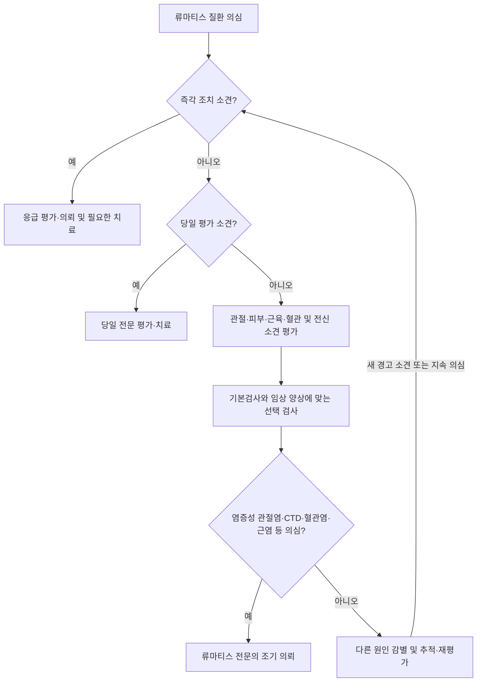

# 류마티스 질환 Rheumatic Diseases

## <mark style="color:green;">일반 사항</mark>

* 류마티스 질환은 관절·근육·결합조직 및 혈관 등을 침범하는 다양한 염증성·자가면역성 질환군으로, 피부·폐·신장·신경계 등 여러 장기에 전신 증상이 나타날 수 있음
* 주요 범주 : 염증성 관절염(류마티스관절염, 척추관절염 등), 전신 결합조직질환(SLE, Sjögren disease, systemic sclerosis, inflammatory myopathy 등), 혈관염, 자가염증질환 등
  * 이 챕터는 위와 같은 면역매개 염증성 류마티스 질환을 중심으로 다루며, 골관절염·결정유발관절염 등 다른 근골격계·관절질환은 별도 챕터에서 다룸
* 한 환자에서 둘 이상의 결합조직질환 특징이 함께 나타날 수 있음(overlap syndrome)
* 류마티스 질환 전체를 확진하는 단일 검사는 없으며, 임상 양상과 혈액검사·자가항체·영상검사 및 필요 시 조직검사를 종합하여 진단
* 자가항체는 건강인이나 다른 질환에서도 양성일 수 있으므로 **검사 결과 자체가 아니라 임상적 사전확률(pretest probability)에 따라 해석**
* 감염, 악성 종양, 내분비·대사 질환, 퇴행성·기계적 근골격계 질환, 약물, 만성 통증질환 등이 류마티스 질환과 유사하게 나타날 수 있음
* 류마티스관절염의 진단·치료는 별도 챕터 참조 (☞ [류마티스관절염](151_-rheumatoid-arthritis.md))

## <mark style="color:green;">원인</mark>

* 질환별 원인은 다양하며 유전적 소인, 면역 조절 이상, 환경·감염 노출 등이 복합적으로 관여; 자가항체가 검출되지 않는 자가염증질환도 포함함
* 감염성·약물유발 질환은 감별이 필요하며, 자가항체 양성만으로 자가면역질환의 원인을 확정하지 않음

## <mark style="color:green;">임상 양상</mark>

* 관절통·관절 부종, 조조강직, 피로, 발열, 발진, 근력저하, Raynaud 현상, 안구·구강 건조 등으로 나타남
* 관절 증상 없이 폐·신장·피부·혈관 등 관절 외 침범이 먼저 나타날 수 있으며, 질환별 주요 단서는 아래 증상·징후 기반 감별표 참조

***

### <mark style="color:$danger;">🚩 Red Flags!</mark>

<mark style="color:$danger;">**즉각 조치**</mark>

* ≥50세에서 GCA가 의심되는 새 시력저하·복시·일과성 흑암시(두통·두피 압통·턱 파행이 모두 동반되지 않아도 해당)  `GCA·시력소실 위험`
* 급성 호흡곤란·저산소증·폐출혈 의심 + 혈뇨·단백뇨 또는 급성 신기능 악화; 객혈 없이 급격한 Hb 감소·새로운 양측 폐음영도 가능  `폐-신장 증후군·폐포출혈`
* 알려진 또는 의심되는 전신 자가면역질환에서 경련·의식 변화·급성 신기능 악화·심한 흉통/호흡곤란  `장기 위협 침범`
* Systemic sclerosis 환자에서 새 혈압 상승 또는 급성 신기능 악화 ± 미세혈관병성 용혈·혈소판 감소; 중증 고혈압이 없거나 정상 혈압이어도 가능  `전신경화증 신위기`
* 면역억제 치료 중 고열·저혈압·의식 변화·호흡곤란 등  `중증 감염·패혈증`
* 갑자기 심하게 붓고 뜨거운 관절(단일 또는 여러 관절), 발열·오한 유무와 무관; 면역억제 중에는 발열·염증반응이 약할 수 있음  `화농성 관절염`
* 빠르게 진행하는 자반/출혈성 발진 + 발열·전신 상태 불량  `중증 감염·전신 혈관염`
* 빠르게 진행하는 근력저하 + 연하곤란·흡인 또는 호흡근 약화/호흡곤란  `중증 근염·신경근육질환`
* 급성 국소 신경학적 결손, 폐색전증·급성 사지 허혈 등 급성 혈전 의심 소견  `혈전증·APS 가능`
* Still disease 등에서 지속 고열 + ferritin 급상승, 혈구수 감소, 간기능 이상·응고장애  `MAS·HLH`
* Methotrexate(MTX)를 실수로 매일 복용하거나 예정량보다 과량 복용(무증상도 해당)  `MTX 중독`

<mark style="color:$warning;">**당일~수일 내 평가**</mark>

* ≥50세에서 새 두통·두피 압통·턱 파행 등 GCA 의심 소견, 시각증상 없음 **(당일)**  `GCA`
* 객관적인 관절 종창/활막염과 염증성 관절염 의심 소견; RF/anti-CCP 음성 또는 ESR/CRP 정상도 해당  `초기 염증성 관절염`
* 염증성 요통, 지속성 부착부염·dactylitis 또는 건선·손발톱 변화·포도막염·염증성 장질환과 연관된 관절 증상  `척추관절염·건선관절염`
* 광과민 발진·뺨 발진, 반복 구강궤양, Raynaud 현상 + 피부경화, Gottron papule, 객관적 근위부 근력저하 등 특징적 전신 소견  `결합조직질환·근염`
* 설명되지 않는 cytopenia, 지속적 단백뇨/혈뇨, 반복 장막염  `전신 자가면역질환·장기 침범`
* ≥50세에서 양측 어깨/골반대 통증과 현저한 조조강직  `류마티스성 다발근통·GCA 동반 가능`
* 반복 혈전 또는 특징적인 임신 합병증 병력  `APS 의심`
* 반복 구강궤양 + 생식기 궤양·안구염·혈관 또는 신경계 증상  `베체트병`
* Sjögren disease에서 새로 생기거나 지속·진행하는 침샘 종창, 림프절 종대·야간 발한·설명되지 않는 체중 감소  `림프종 등 감별`
* 충혈·안구통·눈부심 등 포도막염 의심 증상 **(당일 안과 평가)**  `포도막염·시력 위협`
* 잠에서 깰 정도의 지속적 심한 골·관절통 + 혈소판 감소, 백혈구 감소 또는 현저한 증가  `혈액·종양 질환`
* 소아의 지속되는 객관적 관절염, 근력저하 + 특징적 발진, 원인불명 지속 발열  `JIA·JDM·자가염증질환`

<mark style="color:$info;">**조기 평가 및 추적**</mark>

* 관련 임상 증상·징후 없이 우연히 확인된 ANA 등 자가항체 양성  `임상 경과 관찰`
* 객관적 염증 소견 없이 섬유근육통 등 nociplastic pain syndrome 의심 (☞ [섬유근육통](153_-fibromyalgia.md))  `비염증성 통증`
* 갑상선 질환, patellofemoral pain syndrome, 퇴행성·과사용 질환 등 류마티스 유사 질환 의심  `다른 원인 감별`

*Still disease에서 IL-1/IL-6 억제제 치료 중에는 MAS의 발열·ferritin 상승이 약하거나 늦게 나타날 수 있으므로, 혈구수·간기능·응고검사의 변화와 전신 악화를 함께 판단함.*

*관찰 중 시각증상·급성 신경계/혈관 증상·급성 신기능 악화·저산소증 등 상위 단계 소견이 발생하면 즉각 조치로 격상함. 객관적 활막염은 6주를 기다리지 않고 조기 의뢰함. GCA가 강하게 의심되면 확진 검사 때문에 glucocorticoid 첫 투여를 지연하지 않으며, 급성 혈전 치료도 APS 항체 재검을 기다리지 않음. MTX 과량 복용 시 추가 복용을 중단하고 즉시 응급 평가함.*

***

## <mark style="color:green;">진단</mark>

### <mark style="color:orange;">일차진료 접근</mark>

* **Inflammatory pattern** : 객관적 관절 종창·열감, 장시간의 조조강직 또는 휴식 후 강직, 전신 염증 증상 동반 → 염증성 관절염·결합조직질환 우선 고려
* **Mechanical/non-inflammatory pattern** : 사용 시 악화, 휴식 시 호전, 국소 압통이나 특정 동작에서 통증, 객관적 염증 소견 없음 → 퇴행성·과사용·연부조직 질환 고려
* 염증성/비염증성 양상은 진단 단서이며 이분법적 배제 기준이 아님; CTD·혈관염은 뚜렷한 관절염이나 높은 ESR/CRP 없이도 나타날 수 있으므로 관절 외 특징적 소견도 함께 평가
* 관절 증상은 monoarthritis / oligoarthritis / polyarthritis, 급성 / 만성, 대칭 / 비대칭, 소관절 / 대관절 분포를 함께 평가
* 관절 외 증상(피부·점막, 눈·입 건조, Raynaud 현상, 근력저하, 폐·신장·신경계 증상, 혈전·임신력)이 진단 방향을 결정하는 중요한 단서
* 급성 단관절염에서는 **화농성 관절염을 신속히 평가하고 결정유발관절염을 감별**; 관절액의 세포수/분획, Gram stain·배양, 결정 검사를 시행하며 결정이 검출되어도 동반 감염을 배제하지 못함
  * 패혈증이 없으면 가능하면 항생제 전에 관절액·필요한 혈액배양 검체를 확보하되, 패혈증/쇼크에서는 천자 때문에 항생제 투여를 지연하지 않음 <mark style="color:$info;">(SANJO 2023)</mark>

### <mark style="color:orange;">증상·징후 기반 초고속 감별</mark>

<table><thead><tr><th width="190">임상 단서</th><th width="220">우선 고려</th><th>확인할 추가 소견 / 주요 감별</th></tr></thead><tbody><tr><td>대칭적 소관절 종창 + 조조강직</td><td>류마티스관절염(RA)</td><td>RF, anti-CCP; 감염후 관절염, PsA 등 감별 (☞ <a href="151_-rheumatoid-arthritis.md">류마티스관절염</a>)</td></tr><tr><td>염증성 요통(젊은 연령에서 시작, 휴식보다 운동 시 호전·야간통) ± 부착부염·dactylitis</td><td>척추관절염(SpA)</td><td>건선·손발톱 변화, 포도막염, 염증성 장질환, 가족력 확인; 필요 시 HLA-B27·천장관절 영상</td></tr><tr><td>건선/손발톱 변화 + 관절염·dactylitis·부착부염</td><td>건선관절염(PsA)</td><td>건선보다 관절 증상이 먼저 나타날 수 있음; RF 음성 여부만으로 진단하지 않음</td></tr><tr><td>광과민 발진·뺨 발진 + 구강궤양 ± cytopenia·단백뇨</td><td>전신홍반루푸스(SLE)</td><td>ANA, anti-dsDNA, C3/C4, CBC, Cr, UA/단백뇨 평가</td></tr><tr><td>안구·구강 건조 ± 이하선 종창·관절통</td><td>Sjögren disease</td><td>객관적 건조 평가, anti-SSA/Ro 등; 약물·갑상선질환·탈수 감별</td></tr><tr><td>Raynaud 현상 + 손가락 부종·피부경화·digital ulcer</td><td>Systemic sclerosis</td><td>폐·심장·신장·위장관 침범 확인; 새 혈압 상승 또는 AKI는 응급; 중증 고혈압이 없어도 신위기 가능</td></tr><tr><td>객관적 근위부 근력저하 ± Gottron papule/heliotrope rash</td><td>Inflammatory myopathy / dermatomyositis</td><td>CK, AST/ALT, LDH 등; 약물·갑상선·신경근육질환 감별</td></tr><tr><td>Palpable purpura ± 혈뇨·신기능저하·폐/신경 증상</td><td>전신 혈관염, IgA vasculitis 등</td><td>CBC, Cr, UA, 염증표지자; 임상 phenotype에 따라 ANCA 등 선택</td></tr><tr><td>새로운 두통 + 턱 파행·두피 압통 ± 시각증상, ≥50세</td><td>거대세포동맥염(GCA)</td><td>ESR/CRP, CBC; 의심되면 당일 평가, 시각증상은 즉각 조치; 혈관 초음파/생검 등 확진 검사를 계획하되 강하게 의심되는 경우 치료를 지연하지 않음</td></tr><tr><td>양측 어깨/골반대 통증 + 현저한 조조강직, ≥50세</td><td>Polymyalgia rheumatica(PMR)</td><td>ESR/CRP; GCA 동반 증상 반드시 확인; 통증에 따른 움직임 제한과 객관적 근력저하를 구분하고, steroid 반응만으로 확진하지 않음</td></tr><tr><td>반복 혈전 또는 특징적 임신 합병증</td><td>Antiphospholipid syndrome(APS)</td><td>임상 기준 + 지속적인 antiphospholipid antibodies 평가</td></tr><tr><td>반복 구강궤양 + 생식기 궤양 ± 안구염</td><td>Behçet disease</td><td>피부·혈관·신경·위장관 침범 확인; HSV 등 감별</td></tr><tr><td>고열(spiking fever) + 관절통/관절염 + 일과성 연어색 발진 ± 현저한 ferritin 상승</td><td>성인스틸병(Adult-onset Still disease, AOSD)</td><td>감염·혈액종양 우선 배제; ferritin은 보조 소견으로 단독 진단 기준으로 사용하지 않음</td></tr><tr><td>수면 장애·광범위 통증·피로, 객관적 염증 소견 없음</td><td>Pain syndrome(예: 섬유근육통)</td><td>증상·진찰 및 적절한 선별검사로 임상 진단; 필요한 감별을 하되 모든 질환의 배제가 전제는 아니며, 염증성 류마티스 질환과 공존 가능</td></tr></tbody></table>

_✽원인불명의 다장기 종대·종괴성 병변(췌장, 침샘·눈물샘, 후복막, 신장 등)이 있으면 IgG4-related disease도 감별에 포함할 수 있음; 혈청 IgG4는 정상일 수도 있고 상승도 비특이적이므로 단독으로 확진·배제하지 않으며, 악성종양 등과 감별하면서 필요 시 조직검사_

### <mark style="color:orange;">류마티스 유사 질환 감별</mark>

* 피부 건조, 탈모, 피로, 성장 장애, 추위 불내성 → 갑상선 질환 (☞ [갑상선저하증](../226_/105_-hypothyroidism.md), [항진증](../226_/106_-hyperthyroidism.md))
* 잠에서 깰 정도의 지속적 심한 통증, Plt↓, WBC↓ 또는 현저한↑ → 혈액·종양 질환
* 계단 오르기·쪼그려 앉기 등으로 악화되는 전방 무릎 통증 → patellofemoral pain syndrome
* 바이러스 감염 전후 발생한 급성 다발관절통/관절염 → viral arthritis 고려
* 선행 group A streptococcal infection 후 발열과 **이동성 대관절염(migratory polyarthritis)** ± 심염 등 → 급성 류마티스열 고려
* 야외 활동 + 발열·근육통·관절통 ± 발진, 혈소판/백혈구 감소 → SFTS 등 진드기 매개 감염병 및 쯔쯔가무시병(털진드기 유충 매개) 고려; 노출 시기·지역·가피 등 추가 단서 확인
* 심한 피로가 만성적으로 지속되면서 객관적 염증성 질환 근거가 부족한 경우 → [만성피로증후군](../230_/194_-cfs.md), [섬유근육통](153_-fibromyalgia.md) 등 감별

### <mark style="color:orange;">소아에서 놓치지 말아야 할 류마티스/유사 질환</mark>

<table><thead><tr><th width="180">단서</th><th width="210">우선 고려</th><th>주의 사항</th></tr></thead><tbody><tr><td>지속되는 객관적 관절염</td><td>JIA</td><td>감염·외상·악성 종양 등을 배제하면서 조기 전문 평가; 특정 기간을 기다렸다가 의뢰하지 않음; 진단 후 위험도에 따른 무증상 포도막염 선별을 위해 정기 세극등 검사 계획</td></tr><tr><td>근위부 근력저하 + Gottron papule/heliotrope rash</td><td>Juvenile dermatomyositis(JDM)</td><td>CK 등 근육효소, 연하·호흡근 침범 평가</td></tr><tr><td>하지 중심 palpable purpura + 복통·관절통 ± 신장소견</td><td>IgA vasculitis(IgAV; 구 HSP)</td><td>초기 혈압·UA·신기능 평가; 요검사가 정상이어도 적어도 6개월간 매월 요검사·혈압 추적. 신염이 있으면 소아신장 전문의와 장기 추적; 심한 복통은 장중첩증도 감별하고 위장관 출혈·급성 신기능 악화는 긴급 평가</td></tr><tr><td>발열 지속 + 결막충혈·구강 변화·발진·손발 변화 등</td><td>가와사키병</td><td>관상동맥 합병증 예방을 위해 신속한 소아 평가; 전형적 소견이 충분하거나 심하게 아픈 경우 발열 5일을 기다리지 않음; 불완전 가와사키병도 고려</td></tr><tr><td>심한 야간 골·관절통 + 혈구수 이상·전신 증상</td><td>백혈병 등 악성 종양</td><td>류마티스 질환으로 오인하지 않도록 CBC/말초혈액 등 신속 평가</td></tr><tr><td>주기적 발열 + 아프타성 구내염·인두염·경부 림프절염</td><td>PFAPA syndrome</td><td>감염 및 다른 주기성 발열질환과 감별</td></tr></tbody></table>

<mark style="color:$info;">소아 IgA 혈관염의 신장 추적: IPNA 권고(2024년 온라인/2025년 권호 출판), KDIGO 2025.</mark>

_JDM=juvenile dermatomyositis; JIA=juvenile idiopathic arthritis; PFAPA=periodic fever, aphthous stomatitis, pharyngitis and adenitis_

### <mark style="color:orange;">질환별 추가 평가와 놓치기 쉬운 장기 침범</mark>

* **GCA** : 숙련된 검사자가 신속히 시행할 수 있으면 측두동맥과 액와동맥 초음파가 우선 영상검사임(EULAR 2023 update). 검사 접근성과 전문성에 따라 측두동맥 생검·MRI/FDG-PET 등을 선택하며, ACR/VF 2021은 미국의 검사 여건을 반영하여 생검을 조건부 우선 권고함. 검사 예약 때문에 glucocorticoid 시작을 늦추지 않음
* **전신경화증·염증성 근병증 등 ILD 고위험군** : 기침·호흡곤란이 없어도 전문의와 폐기능검사(DLCO 포함) 및 흉부 HRCT 선별을 검토함(조건부 권고). 흉부 X-ray가 정상이라고 ILD를 배제하지 않으며, 모든 비특이적 관절통 환자에게 CT를 일괄 시행하지 않음 <mark style="color:$info;">(ACR/CHEST 2023 guideline; 2024년 출판)</mark>
* **성인 새 발병 염증성 근병증** : 일반적인 연령·성별 암검진 외에 근염 아형, 항체(예: anti-TIF1γ), 발병 연령·연하곤란 등으로 암 위험을 층화하여 추가 검진을 계획함. 고위험군은 진단 시 확대 평가 및 이후 3년간 매년 기본 평가를 권고하나, 검사 범위·간격은 주로 전문가 합의 근거임; 소아 근염에 동일한 암검진을 일괄 적용하지 않음 <mark style="color:$info;">(IMACS 2023)</mark>
* **Sjögren disease** : 새 침샘 종창·림프절 종대 또는 림프종 의심 증상은 건조증의 일부로 넘기지 않고 조기에 평가함 <mark style="color:$info;">(BSR 2024)</mark>

### <mark style="color:orange;">실험실 검사</mark>

#### <mark style="color:$primary;">기본 검사</mark>

* **CBC** : 빈혈, leukopenia/lymphopenia, thrombocytopenia, 감염·악성 종양 단서 및 치료 전 baseline 확인
* **ESR, CRP** : 전신 염증의 보조 지표. 정상이라고 류마티스 질환을 배제할 수 없으며 질환별 disease activity와의 상관성이 다름
  * 특히 SLE에서는 CRP가 순수 disease flare와 반드시 비례하지 않으며, 현저한 상승 시 감염이나 장막염 등 동반 상황도 고려
* **Cr/eGFR, AST/ALT** : 장기 침범 및 향후 약물치료 baseline 평가
* **혈압, urinalysis ± urine protein quantification** : 혈뇨·단백뇨·원주 등 신장 침범 선별에 중요; 의심 소견이 있으면 요침사와 spot urine protein/creatinine ratio 등으로 평가
* 특징적인 호흡기·신경계·근육·혈관 소견이 있으면 정상 기본검사만으로 추적 종료하지 않고, 해당 장기 평가와 전문 의뢰를 진행
* 확진된 SLE에서는 신장 침범 병력이 없어도 적어도 6~12개월마다, 또는 신장 외 flare 발생 시 단백뇨를 선별함. UPCR ＞0.5 g/g 또는 다른 원인으로 설명되지 않는 신기능 저하가 있으면 신장내과·류마티스내과에서 신장생검을 검토함(조건부 권고); 이 수치 미만이어도 활동성 요침사·진행성 이상이 있으면 의뢰를 미루지 않음. 급성 신기능 악화는 응급 평가 대상임 <mark style="color:$info;">(ACR 2024 lupus nephritis guideline; 2025년 출판)</mark>

#### <mark style="color:$primary;">임상적으로 의심되는 질환에 따라 선택</mark>

<table><thead><tr><th width="210">임상 상황</th><th width="230">주요 선택 검사</th><th>해석 원칙</th></tr></thead><tbody><tr><td>SLE/결합조직질환 의심</td><td>ANA</td><td>임상적 의심이 있을 때 우선 검사; 역가·염색 양상·검사법을 고려하고 양성만으로 질환을 진단하지 않음; 음성은 SLE 가능성을 낮추지만 모든 CTD를 배제하지 못함</td></tr><tr><td>ANA 양성 + SLE 임상소견</td><td>anti-dsDNA, anti-Sm, C3/C4</td><td>임상소견·소변검사·장기 침범과 함께 해석</td></tr><tr><td>염증성 다발관절염/RA 의심</td><td>RF, anti-CCP</td><td>음성도 초기 RA를 배제하지 않음; 상세 해석은 RA 챕터 참조</td></tr><tr><td>Sicca/특정 CTD 의심</td><td>anti-SSA/Ro ± 관련 항체</td><td>자가항체만으로 Sjögren disease를 확진하지 않음; 임상적으로 강하게 의심되면 ANA 음성이어도 anti-SSA/Ro·객관적 건조검사 등을 선택</td></tr><tr><td>근위부 근력저하/근염 의심</td><td>CK ± myositis-specific/associated antibodies</td><td>우선 객관적 근력과 근육효소 평가; 정상 CK만으로 모든 inflammatory myopathy를 배제하지 않음; 특징적 발진·ILD·연하곤란이 있으면 전문 평가</td></tr><tr><td>전신 혈관염 phenotype</td><td>PR3-ANCA, MPO-ANCA 등</td><td>무증상 screening이 아니라 compatible clinical phenotype에서 시행; 양성만으로 확진하거나 음성만으로 혈관염을 배제하지 않음</td></tr><tr><td>반복 혈전/특징적 임신 합병증</td><td>lupus anticoagulant, anticardiolipin Ab, anti-β2GPI Ab</td><td>임상 소견과 함께 양성 항체를 ≥12주 간격으로 재검하여 지속성 확인; 항응고제가 lupus anticoagulant 검사에 영향을 줄 수 있어 검사 시점을 협의; 급성 혈전 치료는 재검을 기다리지 않음</td></tr><tr><td>염증성 요통/SpA 의심</td><td>HLA-B27 ± 천장관절 X-ray/MRI</td><td>임상적 의심이 있을 때 선택; 양성만으로 확진하지 않으며 음성 또는 정상 ESR/CRP도 SpA를 배제하지 못함</td></tr></tbody></table>


**일차진료에서 흔한 함정**

* 자가항체 panel을 증상 없이 일괄 screening하지 않음 - ANA, RF 등은 건강인·감염·다른 질환에서도 양성일 수 있으므로(예: ANA 양성만으로 SLE를 진단하지 않음) 임상 phenotype에 맞추어 선택하고 결과를 해석함
* 정상 ESR/CRP가 류마티스 질환을 배제하지 않음
* ANA 역가를 질환 활성도 추적 목적으로 반복 측정하지 않음; 새로운 임상 소견 등 재검을 정당화할 변화가 있을 때 선택적으로 시행
* Classification criteria(분류기준)는 연구·분류 목적으로 검증된 것으로 개별 환자의 진단기준과 동일하지 않음 (예: 2023 ACR/EULAR APS classification criteria, 2022 ACR/EULAR GCA classification criteria)
* 객관적인 활막염이 확인되면 6주가 될 때까지 기다리지 말고 조기 의뢰함
* 원인이 불명확한 발열이나 급성 단관절염에서는 감염을 충분히 배제하기 전에 glucocorticoid부터 투여하지 않음
* GCA가 강하게 의심되면 시각증상 유무와 무관하게 검사 결과를 기다리며 치료를 지연하지 않음; 시력소실 위험이 있으면 즉각 조치 (☞ Management 참조)


***

* 즉각 조치·당일 평가 항목은 위 Red Flags 목록 전체를 적용함. GCA 의심 시 치료, 급성 혈전 치료, 패혈증 치료를 확진 검사·항체 재검 때문에 지연하지 않음
* 기본검사와 항체·영상검사는 위 임상 양상별 표에 따라 선택함. 정상 염증표지자·음성 자가항체만으로 의뢰를 미루지 않으며, 객관적 활막염은 6주를 기다리지 않음

<strong>류마티스 질환 일차진료 Triage 알고리듬</strong>

<em><mark style="color:$info;">확진이 아닌 진입 경로(phenotype) 결정을 위한 알고리듬이며, 세부 질환 감별은 위 증상·징후 기반 표를 참고</mark></em>

***

## <mark style="background-color:$warning;">Management</mark>

### <mark style="color:orange;">치료 방침</mark>

* 류마티스 질환의 치료는 **질환 종류, disease activity, 장기 침범 여부와 중증도**에 따라 크게 다름
* 일차진료의 핵심은 장기 위협·감염을 신속히 구분하고, 지속성 염증성 질환이 의심되면 조기에 류마티스 전문의와 협진하는 것
* 원인 질환이 확정되지 않은 상태에서 일률적으로 DMARD나 면역억제제를 시작하지 않음
* 급성 단관절염이나 원인불명 발열에서 **감염이 충분히 배제되지 않은 상태의 경험적 steroid 투여는 화농성 관절염·감염을 가릴 수 있으므로 주의**; 다만 강하게 의심되는 GCA 등 치료 지연으로 장기 손상이 우려되는 경우에는 긴급 평가와 치료를 병행
* NSAID는 일부 염증성 관절·근골격계 증상의 단기 완화에 사용할 수 있으나 disease-modifying effect는 없으며 원인 질환의 평가·치료를 지연시켜서는 안 됨; 확립된 심혈관질환·심부전에서는 경구 NSAID 회피를 우선하며, 고령·위험인자 보유 환자에서도 GI·신장·CV 위험과 제품별 금기를 평가한 뒤 불가피한 경우 최소 유효 용량·최단 기간 사용 (☞ [진통제](../220_/001_-pain.md#nsaid))
  * 국내 쎄레브렉스는 확립된 허혈성 심장질환·말초동맥질환·뇌혈관질환 및 NYHA II–IV 울혈성 심부전에서 투여 금기임. 부루펜정의 위장관 궤양/출혈 병력·기관지천식 병력 등 제품별 금기는 PPI로 해소하지 않음
  * SLE·혈관염 등에서 신장 침범이 의심되거나 확인된 경우 NSAID를 회피하고 신기능·요검사 및 원인 질환의 평가·치료를 우선함. NSAID 자체가 신기능을 악화시켜 질환 활동성에 따른 변화와의 구분을 어렵게 할 수 있음
  * MTX 복용 환자는 일반약 NSAID를 임의로 추가하지 않음. 저용량 주 1회 MTX와의 병용도 제품별 허가·DUR 및 CBC·간·신기능 감시 계획을 확인함(151 참조)

### <mark style="color:orange;">비-약물 치료 및 예방</mark>

* 질환 활성도와 장기 침범에 맞는 운동·재활로 근력과 관절 기능을 유지하고 금연, 적정 체중, 수면 및 심혈관 위험인자 관리를 병행함
* SLE·광과민성 발진에서는 자외선 차단과 햇빛 노출 조절을 교육함. Raynaud 현상은 보온·금연을 권고하고, 허혈성 통증·궤양이 있으면 조기 평가함
* Sjögren disease에서는 안구·구강 건조 관리와 정기 안과·치과 진료를 병행함
* 감염 예방, 예방접종, 골절 예방 및 계획임신은 약물치료와 함께 관리함(아래 항목 참조)

### <mark style="color:orange;">약물 치료</mark>

#### <mark style="color:$primary;">DMARD / 면역조절 치료</mark>

* csDMARD, bDMARD, tsDMARD 및 기타 면역억제제는 **질환별 적응증과 장기 침범에 따라 선택**
* RA에서는 조기 DMARD 치료가 중요하며 상세 내용은 별도 챕터 참조 (☞ [류마티스관절염](151_-rheumatoid-arthritis.md))
* SLE, systemic vasculitis, inflammatory myopathy, systemic sclerosis 등에서는 치료 목표와 약제 선택이 서로 다르므로 전문의 협진 하에 시행
* **SLE에서는 금기가 없으면 hydroxychloroquine(HCQ)을 기본 치료로 권고**하며, 장기 평균 용량 목표는 실제 체중 기준 ≤5 ㎎/㎏/day로 개별 조정함. 증상이 안정되어도 임의 중단하지 않으며, 면역억제제의 조기 도입으로 glucocorticoid 노출을 줄임 <mark style="color:$info;">(ACR 2025; BSR 2026)</mark>
  * HCQ 시작 후 조기에 안저·OCT·FAF를 포함한 기초 안과검사를 계획하고, 원칙적으로 매년 OCT·FAF 선별을 시행함. 유의한 위험인자가 없으면 첫 5년간 연례 선별을 유예할 수 있으나, 신장질환·tamoxifen 병용·고령 시작 등에서는 조기 추적을 검토함. 동아시아인에서 흔한 중심주변부(pericentral) 독성도 검사 범위에 포함함 <mark style="color:$info;">(AAO 2025 revision; 2026년 권호 출판)</mark>
* **혈전성 APS**의 항응고제 선택은 정맥/동맥 혈전, aPL 위험도, 임신 여부에 따라 전문의와 결정함. 특히 triple-positive APS에서 rivaroxaban을 사용하지 않으며, aPL 양성만으로 모든 환자에게 항응고제를 시작하지 않음 <mark style="color:$info;">(EULAR 2019)</mark>
* 치료 전후 감염 위험, CBC/LFT/신기능 등 약제별 모니터링을 시행
  * bDMARD/tsDMARD 시작 전에는 잠복결핵 screening을 시행; csDMARD·glucocorticoid·기타 면역억제제에서는 치료 강도와 위험인자에 따라 평가
  * 면역억제 치료 전 HBsAg, anti-HBc, anti-HBs로 B형간염 상태를 확인하고 필요 시 HBV DNA 평가·간 전문의 협진; anti-HBc 양성 환자는 HBsAg 음성이어도 특히 rituximab 등에서 재활성화 위험이 있어 항바이러스 예방/감시 계획을 수립 <mark style="color:$info;">(EULAR 2022)</mark>

#### <mark style="color:$primary;">Glucocorticoid</mark>

* 적응증과 용량은 질환과 장기 침범 중증도에 따라 크게 다름
  * PMR 등에서는 비교적 저~중용량 경구 치료가 사용될 수 있음
  * 장기 위협 SLE, ANCA-associated vasculitis, 중증 inflammatory myopathy 등에서는 고용량 치료가 필요할 수 있음
  * 일부 생명·장기 위협 상황에서는 IV pulse therapy가 고려됨
* 총론에서 하나의 ㎎/㎏ 용량을 모든 류마티스 질환에 적용하지 않으며, **질환별 권고와 전문의 판단에 따라 용량·감량 계획을 결정**
* 가능한 최소 유효 용량과 기간을 사용하고 장기 투여 시 당뇨, 고혈압, 감염, 백내장/녹내장, 부신억제 등 합병증을 예방·모니터링
* 장기간 사용한 steroid는 임의로 갑자기 중단하지 않음
* 안정적으로 조절되는 SLE에서 prednisone ＞5 ㎎/day를 사용 중이면 6개월 이내 ≤5 ㎎/day로 감량하고 가능하면 중단하는 것을 목표로 함. 감량이 불가능하면 면역억제 치료의 도입·강화를 검토하며, 이 감량 목표를 활동성 장기 위협 질환이나 다른 류마티스 질환에 일률 적용하지 않음 <mark style="color:$info;">(ACR 2025)</mark>
* **GCA가 임상적으로 강하게 의심되면 시각증상이 없어도 고용량 glucocorticoid를 즉시 시작**하고 당일 전문 평가를 진행; 혈관 초음파/생검 등 확진 검사를 계획하되 결과를 기다리며 치료를 지연하지 않음 <mark style="color:$info;">(BSR 2020)</mark>
  * 시력소실 위험이 있으면 IV methylprednisolone pulse를 우선 고려하는 것은 ACR/VF의 **조건부 권고**이며, 즉시 안과·류마티스 전문 평가를 시행; IV 치료 준비나 전원 때문에 glucocorticoid 첫 투여를 지연하지 않음
  * 두개 허혈 증상이 없는 GCA에서는 고용량 경구 glucocorticoid가 일반적인 초기 치료 <mark style="color:$info;">(ACR/VF 2021)</mark>
* **성인 systemic sclerosis에서는 glucocorticoid가 신위기 위험과 연관되므로 가능한 최소화**; 특히 prednisolone equivalent ＞10 ㎎/day 사용에 주의하고, 필요한 경우 전문의와 협의하며 혈압·신기능을 면밀히 감시 <mark style="color:$info;">(BSR 2024)</mark>
* **전신경화증 신위기는 glucocorticoid 증량으로 치료하는 상태가 아님.** 의심 시 즉시 입원·전문 평가하며, 진단되면 ACE 억제제를 신속히 시작·조절하는 것이 치료의 핵심임; 정상 혈압 신위기는 저혈압을 피하도록 전문의 감독하에 조절함 <mark style="color:$info;">(BSR 2024)</mark>

#### <mark style="color:$primary;">Glucocorticoid-induced osteoporosis(GIOP) 예방</mark>

* 장기간 glucocorticoid(대략 prednisolone equivalent ≥2.5 ㎎/day를 3개월 초과) 사용이 예상되거나 지속되는 성인에서는 초기 골절 위험을 평가
* calcium/vitamin D 섭취, 체중부하 운동, 금연 등 기본 예방을 시행
* 성인에서는 골절력·임상 위험인자와 BMD ± 척추골절평가(VFA)/척추 X-ray를 평가하고, ≥40세에서는 FRAX도 활용; 필요 시 glucocorticoid 용량을 보정
* **중등도·고위험·매우 높은 골절 위험군에는 골다공증 약물치료가 권고**됨; bisphosphonate, denosumab, 골형성 촉진제 등은 위험도·신기능·임신 가능성 등에 따라 선택 <mark style="color:$info;">(ACR 2022 GIOP guideline; 2023년 출판)</mark>

#### <mark style="color:$primary;">Pneumocystis jirovecii pneumonia(PJP) 예방</mark>

* 중등도–고용량 glucocorticoid를 수 주 이상 사용하는 경우, 특히 다른 면역억제제 병용·림프구감소·고령·기저 폐질환 등 추가 위험인자가 있으면 PJP 예방(TMP-SMX 등)을 고려
  * 대략 prednisolone equivalent ＞15\~30 ㎎/day를 ＞2\~4주 사용하는 환자에서 PJP prophylaxis가 유익할 수 있다는 근거가 있으며 <mark style="color:$info;">(EULAR 2022)</mark>, 절대적인 시작 cutoff가 아니라 개별 위험도 판단의 참고 범위로 활용
  * 위 범위보다 낮은 용량이라도 고령, 병용 면역억제제, 기저 폐질환 등 위험인자가 여러 개 겹치면 예방을 고려할 수 있음
  * TMP-SMX 선택 시 신기능·K·CBC 및 약물 상호작용을 확인; **methotrexate와 병용하면 혈구감소/골수억제 위험이 증가할 수 있어**, 예방 용량이라도 전문의와 병용 필요성·대체약·검사 계획을 검토

#### <mark style="color:$primary;">예방접종</mark>

* 면역억제 치료 전 가능한 예방접종 상태를 확인하고, 비생백신(불활성화·재조합 백신 등)은 질환 상태와 치료약제에 따라 적절한 시기에 시행
* 인플루엔자, 폐렴구균, 재조합 대상포진 백신 등의 필요성을 확인하고 국내 허가·접종 권고와 연령·위험도에 맞추어 계획; 고용량 glucocorticoid/rituximab 치료 중이라도 인플루엔자 접종은 권장되며, 다른 비생백신은 면역반응을 고려해 투여 시점을 조정 <mark style="color:$info;">(ACR 2022 vaccination guideline)</mark>
* **생백신은 면역억제 치료 중 일반적으로 피하며**, 불가피한 경우 약제 종류·용량·투여 간격과 질환 활성도에 따라 중단 시기가 다르므로 전문의와 접종 계획을 조정
* 모든 DMARD에 동일하게 “접종 2주 전\~6주 후 중단”하는 식의 획일적 규칙을 적용하지 않음

#### <mark style="color:$primary;">임신 계획</mark>

* 임신을 계획하는 환자는 임신 전 질환 활성도와 항류마티스 약물을 검토하고 안정적인 질환 상태에서 계획임신을 권장; 여성의 임신 중 노출과 남성의 부계 노출은 약제별 권고가 다르므로 구분
* methotrexate, mycophenolate 등 임신 중 금기/부적합 약물은 계획임신 전에 중단·전환; hydroxychloroquine 등 임신 중 유지가 권장되는 약물은 임의로 중단하지 않음
* Sulfasalazine은 국제 지침에서는 임신 적합 약제이나 **국내 조피린장용정 허가사항에는 임신·수유 금기**가 기재되어 있어 구분함; 근거·허가 차이를 설명하고 산과·류마티스내과에서 약제·폴산 보충을 함께 결정함 (☞ [류마티스관절염](151_-rheumatoid-arthritis.md))
* SLE, APS 등 임신 합병증 위험이 높은 질환은 임신 전 류마티스내과·산부인과 협진을 권장; anti-SSA/Ro·anti-SSB/La 양성에서는 태아·신생아 루푸스 위험과 임신 중 감시 계획을 상담 <mark style="color:$info;">(EULAR 2024 update; 2025년 출판)</mark>

***

### <mark style="color:orange;">시술 및 기타 처치</mark>

* 관절천자, 피부·근육·신장·측두동맥 생검 등은 의심 질환과 장기 침범에 따라 전문의와 선택함
* 급성 열성·종창 관절에서는 감염 평가와 관절액 검사가 우선이며, 감염이 의심되는 관절에 steroid를 주사하지 않음
* 생명·장기 위협 질환은 입원과 다학제 치료가 필요할 수 있으며, 외래 정밀검사 완료를 기다리지 않음

***

### <mark style="color:red;">질병코드</mark>

* 저장된 **KCD9_251216(6).xlsx**의 「상병분류기호(전체)」 및 「상병분류기호(완전코드)」와 대조함. 아래 상위 분류는 임상 개요용이며, 청구 시 진단·장기·부위에 맞는 완전코드를 선택함

<table><thead><tr><th>코드</th><th>공식 한글명</th><th>공식 영문명</th><th>구분 / 적용 시 주의</th></tr></thead><tbody>
<tr><td>M05</td><td>혈청검사양성 류마티스관절염</td><td>Seropositive rheumatoid arthritis</td><td>상위 분류·불완전코드</td></tr>
<tr><td>M06</td><td>기타 류마티스관절염</td><td>Other rheumatoid arthritis</td><td>상위 분류·불완전코드</td></tr>
<tr><td>M08</td><td>연소성 관절염</td><td>Juvenile arthritis</td><td>상위 분류·불완전코드; 임상 JIA 분류와 코드 명칭·기간 정의는 구분; 의뢰를 지연하지 않음</td></tr>
<tr><td>M32</td><td>전신홍반루푸스</td><td>Systemic lupus erythematosus</td><td>상위 분류·불완전코드</td></tr>
<tr><td>M33</td><td>피부다발근염</td><td>Dermatopolymyositis</td><td>상위 분류·불완전코드; 근염 아형에 맞는 세부 코드 선택</td></tr>
<tr><td>M34</td><td>전신경화증</td><td>Systemic sclerosis</td><td>상위 분류·불완전코드</td></tr>
<tr><td>M35.0</td><td>건조증후군[쉐그렌]</td><td>Sicca syndrome[Sjogren]</td><td>완전코드; 임상 명칭 Sjögren disease</td></tr>
<tr><td>M35.1</td><td>기타 중복증후군</td><td>Other overlap syndromes</td><td>완전코드; 혼합결합조직병 포함</td></tr>
<tr><td>M35.2</td><td>베체트병</td><td>Behcet’s disease</td><td>완전코드</td></tr>
<tr><td>M35.3</td><td>류마티스성 다발근통</td><td>Polymyalgia rheumatica</td><td>완전코드</td></tr>
<tr><td>M30</td><td>결절성 다발동맥염 및 관련 병태</td><td>Polyarteritis nodosa and related conditions</td><td>상위 분류·불완전코드</td></tr>
<tr><td>M31</td><td>기타 괴사성 혈관병증</td><td>Other necrotizing vasculopathies</td><td>상위 분류·불완전코드</td></tr>
<tr><td>M31.5</td><td>류마티스다발근통을 동반한 거대세포동맥염</td><td>Giant cell arteritis with polymyalgia rheumatica</td><td>완전코드; GCA와 PMR 동반 시</td></tr>
<tr><td>M31.6</td><td>기타 거대세포동맥염</td><td>Other giant cell arteritis</td><td>완전코드; PMR 동반 여부 등으로 구분</td></tr>
<tr><td>D69.0</td><td>알레르기자반증</td><td>Allergic purpura</td><td>완전코드; 면역글로불린A 혈관염 포함</td></tr>
<tr><td>D68.6</td><td>기타 혈전성향</td><td>Other thrombophilia</td><td>완전코드; 항인지질증후군 포함; 항체 양성만으로 임상 APS를 확진하지 않음</td></tr>
<tr><td>M06.1</td><td>성인발병 스틸병</td><td>Adult-onset Still’s disease</td><td>상위 분류·불완전코드; 성인발병 스틸병의 부위별 세부 코드 선택</td></tr>
<tr><td>M06.19</td><td>성인발병 스틸병, 상세불명 부분</td><td>Adult-onset Still’s disease, site unspecified</td><td>완전코드; 부위 상세불명인 경우의 예시</td></tr>
<tr><td>M45</td><td>강직척추염</td><td>Ankylosing spondylitis</td><td>상위 분류·불완전코드; 모든 척추관절염을 일괄 코딩하지 않음</td></tr>
</tbody></table>

***

### <mark style="color:$success;">핵심 복약 지도</mark>

> **면역조절제·DMARD 복용 시 안전 관리**
>
> * 처방된 면역조절제는 임의로 중단하거나 용량을 변경하지 않도록 안내
> * methotrexate를 복용하는 환자에서는 **주 1회 복용**임을 반드시 확인하고, 복용 요일을 정해 매일 복용하는 투약 오류를 예방
> * MTX를 매일 또는 과량 복용했다면 증상이 없어도 추가 복용을 중단하고 즉시 응급 평가
> * methotrexate 복용 중 새 항생제를 처방받을 때 복용 사실을 알리고, 특히 TMP-SMX는 병용 위험을 확인
> * HCQ 복용 환자는 시력에 이상이 없어도 계획된 안과검사를 받도록 안내
> * 약제에 따라 CBC, LFT, 신기능 등의 정기 모니터링이 필요하므로 검사 일정을 지키도록 안내
> * 새로운 약·건강기능식품을 시작하거나 수술·시술·예방접종 예정이 있으면 담당 의료진과 상의

> **NSAID·Steroid 복용 시 주의사항**
>
> * NSAID 복용 중 심한 복통, 흑색변·토혈, 부종·소변 감소 등 부작용이 의심되면 진료
> * Steroid는 임의로 갑자기 중단하지 말고 의사의 감량 계획에 따름
> * 장기간 steroid 사용 시 골다공증·고혈당·고혈압·감염 위험 등에 대한 예방과 모니터링 필요

> **면역억제 치료 중 감염 경고**
>
> * 면역억제제·생물학적 제제·고용량 steroid 치료 중에는 감염 위험이 증가할 수 있음
> * 발열, 오한, 지속적인 기침·호흡곤란, 배뇨통, 피부 감염 등 새로운 감염 징후가 나타나면 조기에 의료진에게 알림
> * 중증 감염이 의심되면 단순한 류마티스 질환 flare로 판단하지 말고 신속히 평가

> **즉시 평가가 필요한 증상**
>
> * 갑작스러운 시력저하·복시·일과성 흑암시; ≥50세에서 새 두통·턱 파행 등 GCA 의심은 시각증상이 없어도 당일 평가
> * 객혈·심한 호흡곤란, 흉통
> * 소변량 감소·혈뇨와 함께 전신 상태가 급격히 악화되는 경우
> * 관절 하나가 갑자기 매우 붓고 뜨거우며 움직이기 어려운 경우
> * 고열·저혈압·의식 변화 등 중증 감염이 의심되는 경우

***

## <mark style="color:orange;">주요 참고문헌 및 확인 자료</mark>

### <mark style="color:orange;">임상 근거</mark>

* BSR. [British Society for Rheumatology guideline on diagnosis and treatment of giant cell arteritis](https://doi.org/10.1093/rheumatology/kez672). 2020 — GCA 의심 시 치료 지연 방지.
* ACR/VF. [2021 American College of Rheumatology/Vasculitis Foundation Guideline for the Management of Giant Cell Arteritis and Takayasu Arteritis](https://doi.org/10.1002/acr.24632). 2021 — 시력소실 위험에 따른 초기 glucocorticoid 치료.
* BSR. [The 2024 British Society for Rheumatology guideline for management of systemic sclerosis](https://doi.org/10.1093/rheumatology/keae394). 2024 — 신위기·glucocorticoid 안전성.
* Helfrich DJ, et al. [Normotensive renal failure in systemic sclerosis](https://pubmed.ncbi.nlm.nih.gov/2775321/). 1989 — 정상 혈압 신위기의 임상 근거.
* BSR. [The 2026 British Society for Rheumatology guideline for the management of children, young people and adults with systemic lupus erythematosus](https://doi.org/10.1093/rheumatology/keag223). 2026 — SLE 의심 환자의 임상·혈청·신장 평가 및 aPL 지속성 확인.
* NICE. [Spondyloarthritis in over 16s: diagnosis and management (NG65)](https://www.nice.org.uk/guidance/ng65/chapter/recommendations). 2017 — SpA 인지·의뢰 및 HLA-B27/염증표지자의 한계.
* EBJIS. [Guideline for management of septic arthritis in native joints (SANJO)](https://doi.org/10.5194/jbji-8-29-2023). 2023 — 신속한 관절천자·배양 및 결정 동반 시 감염 배제의 한계.
* EULAR. [EULAR recommendations for the management of ANCA-associated vasculitis: 2022 update](https://doi.org/10.1136/ard-2022-223764). 2023년 온라인/2024년 권호 출판 — PR3/MPO-ANCA 검사 및 음성 결과의 한계.
* EULAR/PReS. [EULAR/PReS recommendations for the diagnosis and management of Still’s disease, comprising systemic juvenile idiopathic arthritis and adult-onset Still’s disease](https://doi.org/10.1136/ard-2024-225851). 2024 — Still disease 및 MAS 경고 소견.
* ACR. [2022 American College of Rheumatology Guideline for the Prevention and Treatment of Glucocorticoid-Induced Osteoporosis](https://doi.org/10.1002/acr.25240). 2023년 출판 — 골절 위험 평가 및 위험군별 약물치료.
* EULAR. [2022 EULAR recommendations for screening and prophylaxis of chronic and opportunistic infections in adults with autoimmune inflammatory rheumatic diseases](https://doi.org/10.1136/ard-2022-223335). 2023년 권호 출판 — TB/HBV 선별·PJP 예방 및 TMP-SMX/MTX 병용 위험.
* ACR. [2022 American College of Rheumatology Guideline for Vaccinations in Patients With Rheumatic and Musculoskeletal Diseases](https://doi.org/10.1002/acr.25045). 2023년 출판 — 백신별 접종 및 약제별 시기 조정.
* EULAR. [EULAR recommendations for use of antirheumatic drugs in reproduction, pregnancy, and lactation: 2024 update](https://doi.org/10.1016/j.ard.2025.02.023). 2025년 출판 — 계획임신·약제 전환 및 부계 노출의 구분.
* Soontrapa P, et al. [Disease spectrum of myopathies with elevated aldolase and normal creatine kinase](https://doi.org/10.1111/ene.16117). 2024 — 정상 CK를 보이는 근염의 임상 근거.
* AHA. [Update on Diagnosis and Management of Kawasaki Disease: A Scientific Statement From the American Heart Association](https://doi.org/10.1161/CIR.0000000000001295). 2024 — 의심 환자의 조기 소아 평가.
* Croatian Society of Medical Biochemistry and Laboratory Medicine. [Assessment of antinuclear antibodies (ANA): National recommendations](https://pmc.ncbi.nlm.nih.gov/articles/PMC8047791/). 2021 — ANA 검사 선택·해석 및 반복검사의 한계.
* ACR. [2024 American College of Rheumatology Guideline for the Screening, Treatment, and Management of Lupus Nephritis](https://doi.org/10.1002/acr.25528). 2025년 출판 — SLE 단백뇨 선별 및 신장생검 검토 기준.

* KDIGO. [2024 Clinical Practice Guideline for the Management of Lupus Nephritis.](https://kdigo.org/wp-content/uploads/2024/01/KDIGO-2024-Lupus-Nephritis-Guideline.pdf) — 신장 침범에서 신독성 노출 및 급성 신손상 예방 원칙.

* ACR. [2025 Guideline for the Treatment of Systemic Lupus Erythematosus — official summary](https://rheumatology.org/api/asset/bltec93920aad624e33). 2025 — HCQ 기본 치료, 평균 용량 목표 및 안정기 glucocorticoid 감량.
* AAO. [Recommendations on Screening for Hydroxychloroquine Retinopathy (2025 Revision)](https://pubmed.ncbi.nlm.nih.gov/41232611/). 2025년 온라인/2026년 권호 출판. doi:10.1016/j.ophtha.2025.11.001 — OCT·FAF, 위험도별 선별 시기 및 동아시아인 독성 양상.
* EULAR. [Recommendations for the use of imaging in large vessel vasculitis: 2023 update](https://doi.org/10.1136/ard-2023-224543). 2023년 온라인/2024년 권호 출판 — GCA에서 측두·액와동맥 초음파 및 검사 여건에 따른 선택.
* ACR/CHEST. [2023 Guideline for the Screening and Monitoring of Interstitial Lung Disease in People with Systemic Autoimmune Rheumatic Diseases](https://doi.org/10.1002/art.42860). 2024 — ILD 고위험군에서 PFT·HRCT 선별.
* IMACS. [International Guideline for Idiopathic Inflammatory Myopathy-Associated Cancer Screening](https://doi.org/10.1038/s41584-023-01045-w). 2023 — 성인 근염의 위험도별 암 평가.
* BSR. [Guideline on management of adult and juvenile onset Sjögren disease](https://pmc.ncbi.nlm.nih.gov/articles/PMC12013823/). 2024년 온라인/2025년 권호 출판 — 새 침샘 종창·림프종 의심 소견의 조기 평가.
* IPNA. [Clinical practice recommendations for children with IgA nephropathy and IgA vasculitis nephritis](https://pmc.ncbi.nlm.nih.gov/articles/PMC11666671/). 2024년 온라인/2025년 권호 출판 — 소아 IgA 혈관염의 초기·추적 신장 평가.
* KDIGO. [2025 Clinical Practice Guideline for IgAN and IgAV](https://doi.org/10.1016/j.kint.2025.04.004). 2025 — 소아 IgA 혈관염의 요검사 추적.
* EULAR. [Recommendations for the management of antiphospholipid syndrome in adults](https://doi.org/10.1136/annrheumdis-2019-215213). 2019 — 혈전성 APS의 항응고 치료와 triple-positive 환자의 rivaroxaban 회피.

### <mark style="color:orange;">허가·급여 확인 자료</mark>

* 식품의약품안전처. [의약품안전나라](https://nedrug.mfds.go.kr/searchDrug) — 항류마티스 약제의 국내 적응증·용법·금기 확인.
* 건강보험심사평가원. 저장된 **KCD9_251216(6).xlsx** — 전체·완전코드·삭제코드·신설코드 시트 대조(2026-10-29). 질병코드의 공식 명칭·완전코드 여부는 이 파일을 우선 근거로 확인함.

***

## <mark style="color:blue;">환자 안내서</mark>


**류마티스 질환은 관절뿐 아니라 여러 장기에 영향을 줄 수 있습니다**

류마티스 질환은 면역계 이상과 염증으로 관절·근육·피부·혈관뿐 아니라 폐, 신장, 눈, 신경계 등 여러 장기에 문제가 생길 수 있는 다양한 질환군입니다. 질환에 따라 증상과 치료법이 다르며, 조기에 정확한 진단을 받고 필요한 경우 꾸준히 추적 관찰하는 것이 중요합니다.


### <mark style="color:$primary;">어떤 증상이 나타날 수 있나요?</mark>

* 관절이 붓고 아프거나 아침에 오래 뻣뻣할 수 있습니다.
* 피부 발진, 반복되는 입안 궤양, 손가락이 추울 때 하얗거나 파랗게 변하는 현상, 눈·입의 심한 건조, 근력저하 등이 나타날 수 있습니다.
* 일부 질환은 폐·신장·혈관 등 내부 장기를 침범할 수 있으므로 관절 증상만으로 판단하지 않습니다.

### <mark style="color:$primary;">검사에서 자가항체가 양성이면 류마티스 질환인가요?</mark>

* 아닙니다. ANA, RF 같은 자가항체는 류마티스 질환이 없는 사람에서도 양성으로 나올 수 있습니다.
* 검사 결과는 증상, 진찰 소견, 다른 혈액·소변검사와 함께 해석해야 합니다.
* 증상이 없는데 여러 자가항체 검사를 반복하는 것은 도움이 되지 않을 수 있습니다.

### <mark style="color:$primary;">약은 어떻게 써야 하나요?</mark>

* 류마티스 질환마다 사용하는 약과 용량이 다르므로 처방된 약을 임의로 중단하거나 다른 사람의 약을 복용하지 마십시오.
* 특히 steroid를 장기간 복용한 경우 갑자기 끊으면 위험할 수 있으므로 반드시 의료진의 감량 계획을 따르십시오.
* 면역을 억제하는 약을 사용하는 동안에는 감염에 더 취약할 수 있으므로 발열이나 몸 상태 변화가 생기면 의료진에게 알려 주십시오.
* 예방접종이 필요한 경우 현재 복용하는 면역억제제에 따라 접종 시기를 조정할 수 있으므로 미리 상의하십시오.
* 하이드록시클로로퀸(HCQ)을 복용하는 경우 눈에 증상이 없어도 정해진 안과검사를 받으십시오.

### <mark style="color:$primary;">일상생활에서 어떻게 관리하나요?</mark>

* 질환 상태에 맞게 규칙적으로 움직이고 근력과 관절 기능을 유지하십시오.
* 흡연은 일부 류마티스 질환과 심혈관·폐 합병증 위험을 높일 수 있으므로 금연하십시오.
* 충분한 수면과 균형 잡힌 식사를 유지하고, 처방약과 정기 검사 일정을 지키십시오.
* 루푸스 등 햇빛에 민감한 질환에서는 자외선 차단제를 사용하고 햇빛 노출을 조절하십시오.
* 손가락이 추위에 하얗거나 파랗게 변한다면 몸과 손을 따뜻하게 유지하고, 지속적인 통증·상처가 생기면 진료를 받으십시오.
* 손 씻기 등 기본 감염 예방수칙을 지키고 필요한 예방접종은 의료진과 상의하십시오.

### <mark style="color:$primary;">이럴 때는 즉시 병원을 방문하세요</mark>

* 갑자기 시력이 떨어지거나 물체가 둘로 보이고, 잠깐 눈앞이 캄캄해지는 경우
* 특히 50세 이후 새 두통·두피 통증·씹을 때 턱 통증이 생기면 시력 변화가 없어도 당일 진료를 받으십시오.
* 숨이 매우 차거나 객혈·심한 흉통이 생긴 경우
* 관절 하나가 갑자기 매우 붓고 뜨거우며 움직이기 어려운 경우
* 혈뇨·소변량 감소, 심한 부종과 함께 몸 상태가 급격히 나빠지는 경우
* 전신경화증이 있고 혈압이 갑자기 오르거나 소변량이 줄어드는 경우
* 근력이 급격히 떨어지면서 삼키기 어렵거나 숨쉬기가 힘든 경우
* 면역억제 치료 중 고열·오한·의식 변화 등 심한 감염이 의심되는 경우
* 메토트렉세이트(MTX)를 실수로 매일 또는 과량 복용한 경우: 증상이 없어도 추가 복용을 중단하고 즉시 응급 진료를 받으십시오.
* 자반이나 피부 발진이 빠르게 넓어지면서 발열·전신 상태 불량이 동반되는 경우
