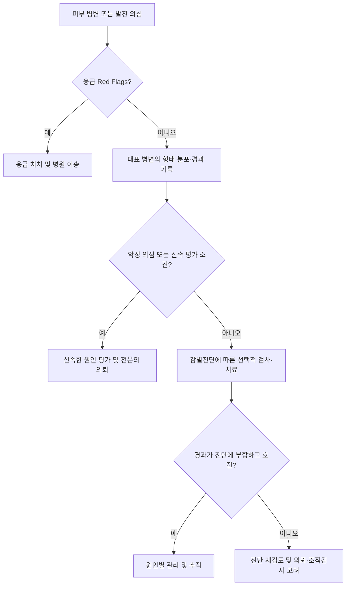

# 피부 병변의 기술

## <mark style="color:green;">일반 사항</mark>

일차 병변은 질환에서 직접 나타나는 기본 형태를, 이차 병변은 경과·손상·긁기·치유 등으로 생긴 변화를 기술하는 용어임. 실제 병변에서는 두 형태가 함께 관찰될 수 있으며, 이 구분이 반드시 시간 순서를 뜻하지는 않음. 형태학적 용어는 진찰 소견을 기술하는 도구이며, 병명이나 원인을 확정하는 기준은 아님. 이 장은 개별 피부질환의 치료 지침이 아니라 병변의 관찰·기록과 초기 평가를 위한 공통 원칙을 다룸.

## <mark style="color:green;">피부 병변의 기술</mark>

### <mark style="color:orange;">일차 병변 (Primary lesions)</mark>

<table>
<thead><tr><th width="150">영어 용어</th><th width="100">한글 용어</th><th>정의</th></tr></thead>
<tbody>
<tr><td><strong>Macule</strong></td><td>반점</td><td>융기나 함몰 없이 평평하고 촉지되지 않는 국한된 색조 변화 (≤1 ㎝)</td></tr>
<tr><td><strong>Patch</strong></td><td>반</td><td>＞1 ㎝의 평평한 색조 변화</td></tr>
<tr><td><strong>Papule</strong></td><td>구진</td><td>고형의 융기 병소 (≤1 ㎝)</td></tr>
<tr><td><strong>Plaque</strong></td><td>판</td><td>＞1 ㎝의 국한된 촉지 가능한 병변; 대개 넓고 융기되어 있으며 구진의 융합으로 형성될 수 있음. 뚜렷한 융기 없이 촉지되는 판도 있음</td></tr>
<tr><td><strong>Nodule</strong></td><td>결절</td><td>주로 진피 또는 피하조직에 위치하는 고형의 촉지 가능한 병변 (보통 ＞1 ㎝); 표면보다 피부 아래에 더 큰 부분이 위치할 수 있음</td></tr>
<tr><td><strong>Wheal</strong></td><td>팽진</td><td>진피 부종으로 생기는 일과성 융기 병변; 개별 팽진은 보통 30분~24시간 이내 소실하며 비늘·딱지 같은 표면 변화는 없음</td></tr>
<tr><td><strong>Pustule</strong></td><td>농포</td><td>고름이 채워진 국한된 병변; 세균 감염 없이도 발생할 수 있음</td></tr>
<tr><td><strong>Vesicle</strong></td><td>소수포</td><td>맑은 액체·장액 또는 혈액으로 채워진 융기 병소 (≤1 ㎝)</td></tr>
<tr><td><strong>Bulla</strong></td><td>대수포 (큰 물집)</td><td>＞1 ㎝의 맑은 액체·장액 또는 혈액으로 채워진 융기 병소</td></tr>
<tr><td><strong>Cyst</strong></td><td>낭종</td><td>액체 또는 반고형 물질을 포함하는 공간성 병변; 진성 낭종은 상피성 벽으로 둘러싸임</td></tr>
</tbody>
</table>

### <mark style="color:orange;">이차 병변 (Secondary lesions)</mark>

<table>
<thead><tr><th width="150">영어 용어</th><th width="100">한글 용어</th><th>정의</th></tr></thead>
<tbody>
<tr><td><strong>Scale</strong></td><td>비늘 (인설)</td><td>각질이 피부 표면에 판상 또는 조각 형태로 눈에 보이게 축적된 상태</td></tr>
<tr><td><strong>Crust</strong></td><td>딱지</td><td>피부 표면에서 혈청·혈액·고름이 말라붙은 것</td></tr>
<tr><td><strong>Erosion</strong></td><td>미란</td><td>표피 일부 또는 전층의 결손으로 진피 결손은 없음; 일반적으로 흉터 없이 치유됨</td></tr>
<tr><td><strong>Ulcer</strong></td><td>궤양</td><td>표피 전층과 진피 일부 이상의 결손; 피하조직까지 깊어질 수 있으며 흉터를 남길 수 있음</td></tr>
<tr><td><strong>Fissure</strong></td><td>균열 (열구)</td><td>피부가 선 모양으로 갈라진 틈; 각질층에서 시작하여 진피까지 깊어질 수 있음</td></tr>
<tr><td><strong>Atrophy</strong></td><td>위축</td><td>표피·진피·피하조직의 감소; 얇고 주름진 피부로 보이거나 함몰이 나타날 수 있음</td></tr>
<tr><td><strong>Excoriation</strong></td><td>찰상</td><td>긁거나 외부의 기계적 손상으로 생긴 선상·점상의 표피 결손; 진피 일부까지 손상될 수 있음</td></tr>
<tr><td><strong>Lichenification</strong></td><td>태선화</td><td>만성적인 긁기·문지르기로 피부가 두꺼워지고 피부선이 뚜렷해진 상태</td></tr>
<tr><td><strong>Scar</strong></td><td>흉터 (반흔)</td><td>손상 후 정상 피부조직을 대체한 섬유성 조직; 단순한 염증 후 색소 변화와 구분함</td></tr>
<tr><td><strong>Eschar</strong></td><td>가피</td><td>괴사한 조직이 피부나 상처 표면에 붙어 있는 것; 흔히 검고 건조하며, 혈액·삼출액이 마른 딱지(crust)와 구분함</td></tr>
</tbody>
</table>

_✽크기 경계는 출처에 따라 5 ㎜ 또는 1 ㎝ 등으로 다르게 제시됨. 이 챕터에서는 macule/papule/vesicle은 ≤1 ㎝, patch/plaque/bulla는 ＞1 ㎝로 통일함. ILDS 2016은 papule/vesicle과 plaque/bulla에 이 경계를 제시하며, macule은 본래 크기 제한 없이 정의하되 북미에서 사용하는 macule(≤1 ㎝)/patch(＞1 ㎝) 구분을 함께 소개함. 결절은 크기와 함께 깊이·촉진 소견을 평가해야 함._\
_✽'반(patch)'은 일부 국내 문헌에서 '반점'과 혼용되기도 하나, 본문에서는 macule(반점)과 구분되는 1 ㎝ 초과의 평평한 색조 변화 병변을 지칭함._

### <mark style="color:orange;">혈관·출혈성 병변 및 기타 용어</mark>

* 모세혈관확장(telangiectasia) : 지속적으로 확장되어 보이는 표재성 소혈관
* 자반(purpura) : 피부 또는 점막 내 출혈로 생겨 압박해도 색이 사라지지 않는 병변을 포괄하는 용어; 붉은색·자색·갈색 등으로 보일 수 있음
* 점상출혈(petechiae) : 작은 점상의 자반
* 반상출혈(ecchymosis) : 비교적 넓은 반상의 자반
* 촉지자반(촉지자색반, palpable purpura) : 촉지되는 자반으로 피부 소혈관염을 시사하나, 이 소견만으로 확진하지 않음
* 혈관부종(angioedema) : 하부 진피·피하조직 또는 점막의 깊은 부종; 팽진보다 오래 지속되어 소실에 최대 72시간이 걸릴 수 있음. 팽진의 24시간 기준을 그대로 적용하지 않음
* 경결(induration) : 촉진 시 주변 피부보다 단단해진 상태; 병변의 기본 형태와 별도로 기록함
* 종양(tumor) : 비교적 큰 고형 종괴를 기술하는 비특이적 용어로, 가능하면 nodule/plaque 등 보다 구체적인 형태학적 용어를 사용

_✽Petechiae/purpura/ecchymosis의 크기 경계는 문헌에 따라 다르므로 크기만으로 엄격히 구분하지 않고 실제 크기·촉지 여부·압박 시 색 변화를 함께 기록함._

### <mark style="color:orange;">피부 병변 기술 순서</mark>

피부 병변은 다음 항목을 일정한 순서로 기록하면 진찰 소견을 일관되게 전달하는 데 도움이 됨.

1. **일차 병변 (Primary lesion)** : macule, papule, plaque, nodule, wheal, vesicle, bulla, pustule 등
2. **색(Color)** : erythematous, violaceous, hyperpigmented, hypopigmented(저색소성), depigmented(탈색소성) 등
3. **크기(Size)** : ㎜ 또는 ㎝ 단위로 최대 직경을 실측; 필요하면 장경 × 단경을 함께 기록
4. **모양(Shape)** : round, oval, annular, targetoid 등
5. **경계(Border)** : well-defined / ill-defined
6. **배열(Configuration)** : discrete, confluent, grouped, linear, annular, reticular, serpiginous 등
7. **이차 변화 (Secondary change)** : scale, crust, erosion, ulcer, fissure, excoriation, lichenification 등
8. **분포(Distribution)** : 국한성/전신성, 대칭성/비대칭성, 편측/양측; localized/generalized, flexural/extensor, acral, palm/sole, dermatomal, photodistributed, intertriginous 등
9. **동반 부위** : 점막, 두피·모발, 손발톱 이환 여부


**병변 기술 예**\
몸통과 상지에 대칭적으로 분포하는, 경계가 비교적 명확한 5\~15 ㎜ 크기의 홍반성 원형·타원형 구진·판(papule/plaque)에 가장자리를 따라 고리 모양의 얇은 비늘(collarette scale)이 동반됨.


### <mark style="color:orange;">진찰·기록 시 보완 사항</mark>

* **촉진** : 깊이·경결·압통·열감·이동성·파동감(fluctuation)을 확인함. 사진만으로는 이러한 소견을 충분히 평가하기 어려움
* **압박 시 색 변화** : 홍반·표재성 혈관확장은 대개 압박 시 옅어지지만, 자반은 색이 사라지지 않음. 필요하면 투명한 판으로 눌러 확인하는 유리압박검사(압시법, diascopy)를 활용함
* **표면·형태** : 수포는 긴장성/이완성 및 내용물(장액성/출혈성), 비늘은 색·두께·부착 정도·위치, 궤양은 깊이·바닥·변연·주변 피부 상태를 추가 기록함
* **시간 경과·증상** : 시작 부위와 시점, 개별 병변의 지속시간, 새 병변 발생·확산·재발, 가려움·통증·출혈을 기록함. 필요하면 최근 약물·접촉물질·감염·외상·일광 노출을 함께 확인함
* **개별 병변과 전체 발진의 기간 구분** : 두드러기는 발진 전체가 수일 이상 지속되어도 개별 팽진은 대개 24시간 이내 소실함. 같은 자리의 병변이 24시간을 초과하여 지속되거나 통증·자반·잔여 색소침착을 보이면 두드러기혈관염 등 다른 원인을 감별함
* **피부색 고려** : 피부색이 짙으면 홍반이 선명한 붉은색보다 자색·갈색으로 보이거나 덜 뚜렷할 수 있어 촉진 소견과 주변 정상 피부를 함께 비교함
* **형태와 병명 구분** : 고리 모양 병변을 곧바로 백선으로, 농포를 곧바로 세균 감염으로, 촉지자반을 곧바로 혈관염으로 단정하지 않음. 병력·분포·검사를 종합함
* **경과 사진** : 환자 동의를 얻고 크기 비교용 자를 함께 두어 같은 부위·조명·거리에서 기록하면 경과 비교에 도움이 됨

### 🚩Red Flags

* 팽진 또는 입술·혀 부종과 함께 호흡곤란·목소리 변화·실신/저혈압 등이 나타남 → 아나필락시스·기도 폐쇄 가능성으로 응급 처치 및 이송  <mark style="color:$danger;">[즉각 조치]</mark>
* 새로 발생한 자반·점상출혈이 빠르게 퍼지거나, 발열·의식 변화·쇼크 등 전신 상태 악화를 동반함 → 수막구균 감염·패혈증 등 응급 평가. 발진이 없거나 아직 압박 시 옅어진다는 이유만으로 중증 감염을 배제하지 않음  <mark style="color:$danger;">[즉각 조치]</mark>
* 최근 약물 사용 후 통증성 발진, 물집·피부 박리, 입·눈·생식기 점막 미란이 나타남 → SJS/TEN 등 중증 피부약물이상반응 의심, 원인 의심 약물 중단 및 즉시 병원 평가  <mark style="color:$danger;">[즉각 조치]</mark>
* 겉으로 보이는 피부 소견에 비해 심한 통증, 급속히 진행하는 부기·홍반, 출혈성 수포·괴사 또는 전신 독성이 나타남 → 괴사성 연조직감염 가능성으로 즉시 병원 평가  <mark style="color:$danger;">[즉각 조치]</mark>
* 흑색종 의심 소견, 빠르게 커지는 단단한 결절, 원인 불명의 지속성 궤양·반복 출혈, 새로 생기거나 넓어지는 한 손발톱의 색소띠 → 신속히 피부과 의뢰를 진행하고 장기 관찰로 미루지 않음  <mark style="color:$warning;">[당일~수일 내 평가]</mark>
* 원인 불명의 새 자반·점상출혈, 점막 출혈 또는 촉지자반 → 혈소판감소·응고장애·혈관염 감별. 혈뇨·복통 등 장기 침범이 의심되면 **당일** 평가  <mark style="color:$warning;">[당일~수일 내 평가]</mark>
* 같은 자리의 두드러기 모양 병변이 24시간을 초과하여 지속되거나 통증·자반·잔여 색소침착이 동반됨 → 두드러기혈관염 등 감별. 호흡곤란·혈뇨 등 전신 소견이 있으면 평가 시급도를 높임  <mark style="color:$info;">[조기 평가 및 추적]</mark>
* 원인이 불명확한 병변이 지속·재발하거나 적절한 초기 치료에도 호전되지 않음 → 진단을 재검토하고 필요 시 피부과 의뢰·조직검사  <mark style="color:$info;">[조기 평가 및 추적]</mark>

_✽흑색종 의심 병변의 ‘당일~수일 내 평가’는 일차진료에서 평가·의뢰를 시작하는 시급도를 뜻하며, 모든 환자에게 당일 조직검사를 요구하는 기준은 아님._

## <mark style="color:green;">색소성 병변에서 흑색종을 의심하는 ABCDE</mark>

* **A - Asymmetry** : 비대칭
* **B - Border irregularity** : 불규칙하거나 불명확한 경계
* **C - Color variation** : 하나의 병소 안에 여러 색조가 섞이거나 색이 불균일
* **D - Diameter** : 진단 당시 ＞6 ㎜인 경우가 많으나, ≤6 ㎜인 흑색종도 있으므로 크기만으로 배제하지 않음
* **E - Evolving** : 크기·모양·색·표면 또는 증상이 시간에 따라 변화
* **Ugly duckling sign** : 환자의 다른 모반들과 형태·색조가 뚜렷이 달라 "튀어 보이는" 병소 - 개별 병소가 ABCDE 기준을 뚜렷이 충족하지 않아도 악성 감별을 위한 조직검사·전문의 의뢰를 고려할 근거가 됨


**ABCDE의 한계와 추가 의심 소견**

* ABCDE는 흑색종을 의심하는 단서이며, 모든 항목을 충족해야 의심하는 것은 아님. 양성 병변도 일부 소견을 보일 수 있어 진찰·피부경검사(dermoscopy)·필요 시 조직검사로 평가함
* 결절성·무색소성 흑색종은 대칭적이거나 단색일 수 있으며, 피부색·분홍색·붉은색 병변으로도 나타날 수 있음. 빠르게 커지는 단단한 융기 병변이나 원인 불명의 지속적인 궤양·출혈을 주의함
* 손바닥·발바닥 및 손발톱도 확인함. 특히 성인에서 한 손발톱에 새로 생기거나 넓어지는 세로 색소띠, 불규칙한 색조·경계, 손발톱 주위 피부로 이어지는 색소침착(Hutchinson sign), 손발톱 변형·출혈은 전문 평가가 필요한 소견임. Hutchinson sign 자체가 흑색종의 확진 소견은 아니며, 이 소견이 없다고 손발톱 흑색종을 배제할 수 없음
* 의심 병변은 장기적인 단순 관찰로 평가를 미루지 않고 신속히 피부과에 의뢰하여 피부경검사와 적절한 조직검사 여부를 결정함


## <mark style="color:green;">초기 평가 및 의뢰</mark>

* 활력징후·전신 상태와 Red Flags를 먼저 확인하고, 가능한 한 긁히거나 딱지가 생기기 전의 대표 병변을 관찰함
* 형태·분포·경과에 따라 감별진단을 세운 뒤 검사를 선택함. 모든 비특이적 발진에 혈액검사·배양검사·조직검사를 일률적으로 시행하지 않음
* 의심 색소성 병변은 숙련된 의료진의 피부경검사로 평가함. 흑색종 확진에는 조직검사가 필요하며, 피부경검사나 경과 사진만으로 확진하지 않음
* 자반·출혈 소견에서는 병력에 따라 CBC/혈소판·응고검사를, 촉지자반이나 전신 증상이 있으면 요검사·신장기능 등 장기 침범 평가를 고려함. 피부 소혈관염은 임상 소견과 조직학적 평가를 종합하며, 면역복합체성 혈관염이 의심되면 직접면역형광검사(DIF)를 위한 초기 병변의 추가 생검이 필요할 수 있어 피부과와 검사 시점·채취 부위를 상의함

***

***

## <mark style="color:green;">Management</mark>


피부 병변의 형태만으로 항생제·항진균제·스테로이드의 적응증이 결정되지는 않음. 치료는 원인 질환에 따름. 흑색종 등 악성이 의심되는 병변은 진단 전에 레이저·냉동치료 등으로 파괴하지 말고, 조직학적 평가가 가능한 방식으로 전문 평가를 진행함.


* 비응급 병변도 재평가 시점과 조기 재진 사유(확산·통증 증가·발열·물집·점막 병변·출혈 등)를 안내함
* 의심 피부암의 조직검사 방법은 병변의 크기·위치·깊이와 손발톱 이환 여부를 고려하여 결정함

## 질병코드

이 장의 형태학적 분류만으로 원인 질환의 진단코드를 결정할 수 없음. 원인 질환이 확인되면 해당 질환코드를 사용하고, 원인 미확정 단계에서는 실제로 확인한 증상·징후에 맞는 코드를 선택함. **흑색종이 의심된다는 이유만으로 악성 흑색종 확진코드를 적용하지 않음.**

<table>
<thead><tr><th width="115">KCD-9</th><th>명칭</th><th>적용 시 유의점</th></tr></thead>
<tbody>
<tr><td>R21</td><td>발진 및 기타 비특이성 피부발진</td><td>원인이 아직 특정되지 않은 비특이적 발진</td></tr>
<tr><td>R22.0</td><td>머리의 국소적 부기, 종괴 및 덩이</td><td rowspan="7">원인 미확정 피부·피하조직의 국소적 부기·종괴·덩이는 부위에 맞는 완전코드를 선택함. R22 자체는 불완전코드임</td></tr>
<tr><td>R22.1</td><td>목의 국소적 부기, 종괴 및 덩이</td></tr>
<tr><td>R22.2</td><td>몸통의 국소적 부기, 종괴 및 덩이</td></tr>
<tr><td>R22.3</td><td>팔의 국소적 부기, 종괴 및 덩이</td></tr>
<tr><td>R22.4</td><td>다리의 국소적 부기, 종괴 및 덩이</td></tr>
<tr><td>R22.7</td><td>여러 부위의 국소적 부기, 종괴 및 덩이</td></tr>
<tr><td>R22.9</td><td>상세불명의 국소적 부기, 종괴 및 덩이</td></tr>
<tr><td>R23.3</td><td>자발반출혈</td><td>엑셀에서 ‘점출혈’도 같은 코드로 수록됨. 모든 자반을 일률적으로 이 코드에 대응시키지 않고 원인 질환·외상 여부를 구분함</td></tr>
<tr><td>R23.4</td><td>피부조직의 변화</td><td>피부의 탈락·경화·벗겨짐이 같은 코드에 수록됨. 원인 질환이 특정되면 해당 코드 사용</td></tr>
<tr><td>R23.8</td><td>기타 및 상세불명의 피부변화</td><td>다른 구체적인 증상·징후로 분류되지 않는 피부변화</td></tr>
</tbody>
</table>

_✽저장된 「KCD9_251216(6).xlsx」의 ‘상병분류기호(전체)’ 및 ‘상병분류기호(완전코드)’ 시트와 대조함. 엑셀에는 R233처럼 소수점 없이 저장되어 있으며, 본문에는 R23.3 형식으로 표기함._

## 주요 참고문헌 및 확인 자료

### <mark style="color:orange;">임상 근거</mark>

1. Nast A, Griffiths CE, Hay R, Sterry W, Bolognia JL. The 2016 International League of Dermatological Societies' revised glossary for the description of cutaneous lesions. *Br J Dermatol.* 2016;174(6):1351–1358. [doi:10.1111/bjd.14419](https://doi.org/10.1111/bjd.14419); [ILDS 공개 원문](https://ilds.contentfiles.net/media/documents/ILDS-Glossary-Cutaneous-Lesions.pdf). 기본 병변 정의와 크기·깊이·분포의 기술 기준.
2. Zuberbier T, et al. The International Guideline for the Definition, Classification, Diagnosis and Management of Urticaria. *Allergy.* 2026;81:2582–2632. [doi:10.1111/all.70210](https://doi.org/10.1111/all.70210). 팽진과 혈관부종의 정의·지속시간 및 감별.
3. American Academy of Dermatology. [ABCDEs of melanoma](https://www.aad.org/public/diseases/skin-cancer/abcdes-melanoma); [How to check your nails for melanoma](https://www.aad.org/public/diseases/skin-cancer/types/common/melanoma/nail-melanoma); [Melanoma: diagnosis and treatment](https://www.aad.org/public/diseases/skin-cancer/types/common/melanoma/diagnose-treat).
4. NICE. [NG240: Meningitis (bacterial) and meningococcal disease — Recommendations](https://www.nice.org.uk/guidance/ng240/chapter/Recommendations). 급속히 진행하는 비창백성 발진 및 응급 이송 기준.
5. NHS. [Stevens-Johnson syndrome](https://www.nhs.uk/conditions/stevens-johnson-syndrome/). 통증성 발진·수포·피부 박리·점막 침범의 응급 평가.
6. CDC. [Clinical Guidance for Type II Necrotizing Fasciitis](https://www.cdc.gov/group-a-strep/hcp/clinical-guidance/necrotizing-fasciitis.html). 2025-08-05. 피부 소견에 비해 심한 통증과 급속한 진행.
7. NICE. [NG12: Suspected cancer — Skin cancers, recommendations 1.7.1–1.7.4](https://www.nice.org.uk/guidance/ng12/chapter/recommendations-organised-by-site-of-cancer#skin-cancers). 지침 전체 최종 업데이트 2026-04-15; 해당 피부암 의뢰 권고는 2015 권고 유지.
8. NICE. [NG14: Melanoma — Assessment, recommendations 1.3.1–1.3.3](https://www.nice.org.uk/guidance/ng14/chapter/recommendations#assessing-melanoma). 숙련된 의료진의 피부경검사 및 선택적 사진 추적.
9. Alpsoy E, et al. Recommendations for the diagnostic work-up of cutaneous small vessel vasculitis — Position Statement of the European Academy of Dermatology and Venereology Vasculitis and Vasculopathy Task Force. *J Eur Acad Dermatol Venereol.* 2026;40:946–962. 2025-12-16 온라인 선공개. [doi:10.1111/jdv.70249](https://doi.org/10.1111/jdv.70249); [PubMed 공개 초록](https://pubmed.ncbi.nlm.nih.gov/41399325/). 임상·조직학적 평가와 초기 병변의 DIF 검사 원칙 확인.
10. ASCIA. [Guidelines — Acute Management of Anaphylaxis](https://allergy.org.au/hp/anaphylaxis/acute-management-guidelines). 2026 개정. 기도·호흡·순환 이상을 동반한 급성 알레르기 반응의 응급 평가.

### <mark style="color:orange;">허가·급여 확인 자료</mark>

* 이 장에는 개별 약제·용량 또는 약제 급여기준을 제시하지 않음.
* 질병코드 확인 자료: 「KCD9_251216(6).xlsx」, ‘상병분류기호(전체)’·‘상병분류기호(완전코드)’ 시트. 2026-10-30 대조.

## 환자 안내서

* 발진이나 피부 병변이 생기면 시작 시점, 가려움·통증, 최근 새로 사용한 약·화장품 등을 기록해 진료 시 알려 주세요. 약의 이름을 확인할 수 있도록 처방전이나 약 목록을 준비하면 도움이 됩니다.
* 점이 작아도 새로 생기거나 크기·모양·색이 바뀌고, 다른 점과 유난히 다르거나 반복해서 피가 나면 진료를 받으세요. 손바닥·발바닥과 손발톱의 새로운 변화도 알려 주세요.
* 숨이 차거나 혀·목이 붓는 경우, 심하게 아픈 발진과 물집·입안 헐음이 함께 생기는 경우, 눌러도 사라지지 않는 붉거나 자주색 반점이 빠르게 퍼지면서 몸 상태가 나빠지는 경우에는 즉시 응급 진료를 받으세요.
* 병변 사진은 날짜를 남기고 가능하면 자를 함께 두어 찍으세요. 사진이 있어도 빠르게 악화되는 병변의 진료를 미루지 마세요.
