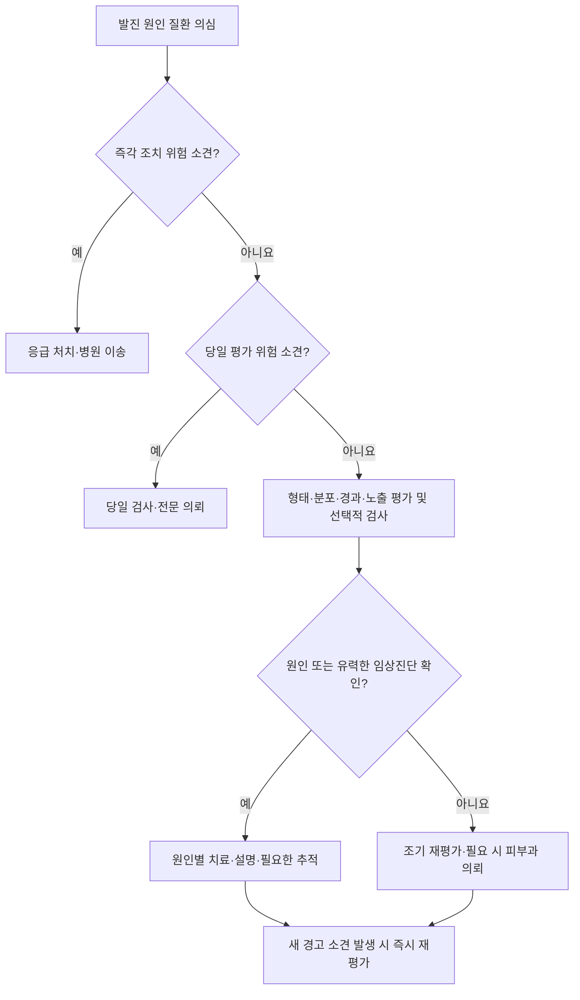

# 발진 Rash

## <mark style="color:green;">일반 사항</mark>

발진은 여러 질환에서 나타나는 피부 증상임. 병변의 형태·분포·시간 경과와 전신 증상을 함께 평가하여 원인 질환과 응급도를 판단함. 가려움이 주증상이어도 피부 통증·점막 병변·출혈성 변화·장기침범 소견을 먼저 확인함.

## <mark style="color:green;">원인</mark>

* 감염: 바이러스성 발진, 세균·진균·기생충 감염; 접촉·여행·성접촉·매개체 노출과 면역 상태에 따라 감별함.
* 염증·면역 반응: 습진, 건선, 두드러기, 다형홍반, 혈관염, 자가면역 수포성 질환 등.
* 약물·외부 자극: 처방약·일반의약품·한약·건강기능식품, 접촉 알레르겐·자극 물질·광노출 등.
* 기타: 혈소판·응고 이상, 전신 질환, 종양 관련 피부 병변 등. 모든 발진을 알레르기나 바이러스 감염으로 설명하지 않음.

## <mark style="color:green;">임상 양상</mark>

반점·구진·판·팽진·수포·농포·자반 등 다양한 형태로 나타남. 국소/전신 분포, 대칭성, 손발바닥·점막 침범, 비늘·미란·가피, 개별 병변의 지속시간을 조합하여 평가함. 발열의 유무나 높이만으로 감염성과 비감염성, 경증과 중증을 구분할 수 없음.

### <mark style="color:$danger;">🚩 Red Flags!</mark>


**즉각 조치**

* 급성 감염을 의심할 압박 시 사라지지 않는 출혈성 자반(특히 2 ㎜ 초과), 급속히 퍼지는 점상출혈·자반, 또는 비창백성 점상출혈·자반에 발열·전신 상태 불량·수막자극 징후 동반  `수막구균 감염증·패혈증`
* 피부 통증을 동반한 광범위 홍반성·자반성 발진, 점막 미란, 수포 또는 표피 박리; 모든 소견이 함께 나타날 필요는 없음  `SJS/TEN`
* 급성 두드러기·혈관부종과 쉰 목소리·협착음·호흡곤란·실신·저혈압 또는 지속적이고 심한 복통·반복 구토 동반; 피부 증상이나 명확한 노출력이 없어도 아나필락시스가 의심되는 급성 기도·호흡·순환 이상  `아나필락시스`
* 빠르게 진행하는 피부·연조직 병변에 겉으로 보이는 병변보다 불균형적으로 심한 통증, 부종, 자반·수포·괴사 또는 전신 독성 소견; 초기에는 발열·뚜렷한 피부 변화가 없을 수 있음  `괴사성 근막염`
* 약물 노출 후 광범위 발진·발열·안면부종·림프절종대와 함께 황달·소변량 감소·호흡곤란·흉통 등 장기침범 의심 소견  `DRESS 등 중증 약물반응`
* 저혈압·의식 변화 등 전신 독성 소견을 동반한 광범위 홍반, 또는 소아의 피부 압통·얕은 수포·광범위 박리(점막은 대개 보존)  `독성쇼크증후군` `SSSS`
* 발열성 발진과 의식 변화·경련·수막자극 징후·쇼크, 또는 수족구병에서 반복 구토·신경학적 이상·심폐 이상  `중추신경계 감염·중증 전신 질환`
* 생후 3개월 미만 영아에서 체온 ≥38℃; 신생아의 새 군집 수포·미란은 발열이 없어도 중증 감염 가능  `어린 영아 발열` `신생아 HSV 감염`



**당일~수일 내 평가**

* **(당일)** 지속 발열을 동반하는 원인 불명의 광범위 발진, 새로운 점막 병변 또는 빠르게 악화하는 발진  `전신 질환·감염`
* **(당일)** 약물 복용 후 광범위 발진과 발열·안면부종·림프절종대, 또는 새로 발생한 다발성 비모낭성 농포  `초기 DRESS` `AGEP·전신 농포건선`
* **(당일)** 면역저하자의 새로운 수포성·괴사성 발진  `파종성 감염`
* **(당일)** 습진 부위의 급속한 통증성 악화와 비슷한 모양의 군집 수포·도려낸 듯한 미란; 발열은 없을 수 있음  `포진상 습진`
* **(당일)** 지속 발열과 양측 비삼출성 결막충혈·입술/구강 변화·손발 홍반/부종·다형성 발진·경부 림프절종대 중 일부; 소견이 적은 영아도 포함  `가와사키병·불완전 가와사키병`
* **(당일)** 새로 발생한 원인 불명 점상출혈·자반 또는 촉지자반  `혈소판감소증·혈관염`
* **(당일)** 체표면적 약 90% 이상을 침범하는 광범위 홍반·비늘; 저체온·탈수·빈맥·저혈압·전신 상태 불량이 있으면 즉각 병원 평가  `홍피증`
* 같은 자리에 24시간을 초과하여 지속되거나 통증·잔여 자반을 동반하는 팽진; 발열·복통·혈뇨 등 전신 소견이 있으면 **(당일)** 평가  `두드러기혈관염`
* **(당일)** 임신부의 새 발진 또는 풍진·수두·parvovirus B19 감염 의심/노출; 무증상 노출도 포함  `모체·태아 위험`
* **(당일)** 홍역·풍진을 의심할 역학·임상 소견, 또는 엠폭스를 의심할 임상·역학 소견  `감염관리·신고 대상 감별`



**조기 평가 및 추적**

* 전신 상태가 양호하고 응급 소견이 없는 발진  `비응급 발진`
* 원인이 불명확하거나 치료 반응이 불량하고 반복 재발하는 발진  `진단 불명·재발`
* 전신 증상·점막 병변·피부 통증·수포가 없는 경미한 약물 연관 발진  `경미한 약물 발진`


여러 위험 소견이 겹치면 더 높은 응급도를 적용함. 면역저하자의 광범위 수포성·괴사성 발진과 발열·전신 상태 불량, 또는 자반과 심한 복통·위장관 출혈·신장기능 악화는 즉각 병원 평가함. 응급 원인이 의심되면 검사 결과나 표피 박리·Nikolsky 징후가 나타날 때까지 기다리지 않음. 패혈증은 발열·발진이 없거나 초기 발진이 압박 시 옅어져도 가능함. 아나필락시스는 epinephrine 근육주사와 응급 이송을 즉시 시행함. 중증 약물반응은 의심 원인 약물을 즉시 중단하고 병원 평가함. DRESS가 의심되면 장기침범 검사 결과를 기다리지 않고 당일 병원 평가하며, 특히 소아는 EAACI 2025 권고에 따라 입원 평가·감시를 원칙으로 함. 포진상 습진은 전신 항바이러스 치료를 지체하지 않고 당일 피부과 평가하며, 눈 주위 병변·안구 증상은 당일 안과 평가를 병행함. 의심 전염성 발진은 대기실에서 다른 환자와 분리하고 질환별 감염관리를 시작함.


**Blanching 여부(유리판 압박 검사, diascopy)**\
병소를 눌렀을 때 색이 사라지면 주로 혈관 확장에 의한 홍반, 사라지지 않으면 피부 내 출혈(점상출혈·자반) 등을 시사함. 압박 반응만으로 중증도를 판단하지 않으며, 피부색·병변 깊이 등에 따라 판독이 어려울 수 있음. 수막구균 감염증은 초기에는 blanching 발진이거나 발진이 없을 수 있어, 압박 시 색이 사라지더라도 배제하지 않음.


_<mark style="color:$info;">Ref. [NICE NG240: Meningitis and meningococcal disease](https://www.nice.org.uk/guidance/ng240/chapter/Recommendations); [NICE CG183: Drug allergy](https://www.nice.org.uk/guidance/cg183/chapter/recommendations); [ASCIA 아나필락시스 급성 관리 2026](https://allergy.org.au/hp/anaphylaxis/acute-management-guidelines); [IDSA: Skin and soft tissue infections](https://www.idsociety.org/practice-guideline/skin-and-soft-tissue-infections/); [AHA Kawasaki disease statement 2024](https://doi.org/10.1161/CIR.0000000000001295); [DRESS international consensus 2024](https://doi.org/10.1001/jamadermatol.2023.4450); [EAACI 소아 DRESS position paper 2025](https://doi.org/10.1111/pai.70103); [NICE NG143: Fever in under 5s](https://www.nice.org.uk/guidance/ng143/chapter/recommendations); [무발열 영아의 수포·농포 평가 연구, Pediatrics 2024](https://pubmed.ncbi.nlm.nih.gov/38910522/); [NICE CG57: Eczema herpeticum](https://www.nice.org.uk/guidance/cg57/chapter/recommendations); [PCDS 홍피증](https://www.pcds.org.uk/clinical-guidance/erythroderma).</mark>_

***

## <mark style="color:green;">진단</mark>

### <mark style="color:orange;">피부 특징에 따른 질환들</mark>

형태·색·분포·증상에 따른 진단 단서의 목록이며, 각 행은 서로 배타적인 분류가 아님. Pruritus는 병변 형태가 아닌 증상임. 기본 형태의 정의와 크기 경계는 「피부 병변의 기술」 챕터와 동일하게 적용함.

<table><thead><tr><th width="172">피부 특징</th><th>대표 질환</th></tr></thead><tbody><tr><td><strong>Pigmented</strong></td><td>freckle, lentigo, seborrheic keratosis, nevus, halo nevus, atypical nevus, melanoma</td></tr><tr><td><strong>Vesicular</strong></td><td>herpes simplex, varicella, herpes zoster, pompholyx, vesicular tinea, autoeczematization, dermatitis herpetiformis, miliaria, scabies, photosensitivity, acute contact allergic dermatitis, drug eruption, hand-foot-and-mouth disease; 역학에 따라 mpox</td></tr><tr><td><strong>Weepy or encrusted</strong></td><td>impetigo, acute contact allergic dermatitis, any vesicular dermatitis</td></tr><tr><td><strong>Pustular</strong></td><td>acne vulgaris, rosacea, folliculitis, candidiasis, miliaria pustulosa, pustular psoriasis, acute generalized exanthematous pustulosis(AGEP); 수포의 이차 감염</td></tr><tr><td><strong>Figurate / annular</strong></td><td>tinea corporis, pityriasis rosea, granuloma annulare, subacute cutaneous lupus erythematosus, urticaria, erythema migrans; targetoid: erythema multiforme</td></tr><tr><td><strong>Bullous</strong></td><td>impetigo, blistering dactylitis, pemphigus, pemphigoid, porphyria cutanea tarda, drug eruptions, erythema multiforme, Stevens-Johnson syndrome/toxic epidermal necrolysis</td></tr><tr><td><strong>Papular</strong></td><td>Hyperkeratotic: warts, corns, seborrheic keratosis Purple-violet: lichen planus, 일부 drug eruption, Kaposi sarcoma, lymphoma cutis Flesh-colored, umbilicated: molluscum contagiosum Pearly: basal cell carcinoma, intradermal nevi Small, red, inflammatory: acne, rosacea, miliaria rubra, candidiasis, scabies, folliculitis 급성 압통성 홍반성·자색 구진/판 + 발열: Sweet syndrome 등</td></tr><tr><td><strong>Pruritus</strong></td><td>xerosis, scabies, pediculosis, lichen planus, lichen simplex chronicus, bites, systemic causes, anogenital pruritus</td></tr><tr><td><strong>Nodular, cystic</strong></td><td>erythema nodosum, furuncle, cystic acne, epidermoid cyst, metastatic tumor to skin</td></tr><tr><td><strong>Photodermatitis</strong></td><td>drug eruption, polymorphic light eruption, lupus erythematosus</td></tr><tr><td><strong>Morbilliform</strong></td><td>drug eruption, viral infection, secondary syphilis</td></tr><tr><td><strong>Erosive</strong></td><td>any vesicular dermatitis, impetigo, aphthae, lichen planus, erythema multiforme, intertrigo</td></tr><tr><td><strong>Ulcerated</strong></td><td>decubiti, herpes simplex, skin cancers, parasitic infections, syphilis(chancre), chancroid, vasculitis, stasis, arterial disease, pyoderma gangrenosum</td></tr></tbody></table>

_<mark style="color:$info;">Ref. Lange 2020 Current Medical Diagnosis & Treatment, 59th ed., Table 6-1을 바탕으로 보완함.</mark>_

### <mark style="color:orange;">발진 평가의 기본 틀</mark>

발진은 단일 특징보다 **primary lesion + secondary change + color + configuration + distribution + 전신 증상**의 조합으로 평가함.

<table><thead><tr><th width="170">평가 항목</th><th>주요 확인 내용</th></tr></thead><tbody><tr><td><strong>Primary lesion</strong></td><td>macule, papule, plaque, nodule, wheal, vesicle, bulla, pustule 등</td></tr><tr><td><strong>Color</strong></td><td>erythematous, violaceous, hyperpigmented, hypopigmented, purpuric 등</td></tr><tr><td><strong>Configuration</strong></td><td>annular, linear, grouped, discrete/confluent, reticular, targetoid, serpiginous 등</td></tr><tr><td><strong>Distribution</strong></td><td>generalized/localized, flexural/extensor, acral, palm/sole, dermatomal, photodistributed, intertriginous, mucosal</td></tr><tr><td><strong>Secondary change</strong></td><td>scale, crust, erosion, ulcer, fissure, excoriation, lichenification 등</td></tr><tr><td><strong>동반 소견</strong></td><td>발열, 독성 외관, 점막 이환, 관절통, 림프절병, 약물 복용력, 최근 감염·여행·접촉력</td></tr></tbody></table>

### <mark style="color:orange;">병력·진찰과 선택적 검사</mark>

* 발생일, 처음 발생한 부위, 퍼지는 순서, 발열과 발진의 선후 관계, 가려움/통증, 개별 병변의 지속시간을 확인함. 이전 사진이 있으면 비교함.
* 최근 최소 8주간의 처방약·일반의약품·한약·건강기능식품과 시작·중단·재투여 날짜를 확인함. 단순 반구진성 약물 발진은 첫 노출 후 약 4~14일에 흔하지만, 중증 반응은 수일~수주 후 또는 중단 후에도 나타날 수 있음. 약물별 잠복기가 달라 기간만으로 배제하지 않으며, 의심 약물과 경과에 따라 그 이전 노출도 확인함.
* 예방접종력, 환자 접촉·집단 발생, 해외여행, 야외활동, 성접촉, 새로운 화장품·직업성 노출, 가족/동거인의 가려움을 확인함. 동물·진드기/모기 노출과 밀접한 피부 접촉도 확인하되, 접촉력만으로 특정 감염을 확정하지 않음.
* 활력징후·전신 상태를 먼저 확인하고, 전신 피부와 손발바닥·손발가락 사이·두피·점막을 검사함. 림프절, 관절, 간비장비대, 탈수 여부도 확인함. 피부색이 짙으면 홍반이 덜 뚜렷할 수 있어 촉진과 통증·열감·부종을 함께 평가함.
* 전형적이고 경미한 발진에서 혈액검사나 바이러스 검사를 일괄 시행하지 않으며, 의심 질환·전신 증상에 따라 선택함.

<table><thead><tr><th width="190">임상 상황</th><th>선택적 검사·조치</th></tr></thead><tbody><tr><td>발열·전신 상태 불량, 출혈성 발진</td><td>CBC·감별계수·혈소판, 간·신장기능, 염증표지자 등을 고려함. 패혈증 의심 시 혈액배양 등 응급 검사를 시행하되, 검사·결과 확인 때문에 이송·치료를 지연하지 않음.</td></tr><tr><td>광범위 약물 발진, DRESS 의심</td><td>CBC·감별계수(호산구), AST/ALT·bilirubin, creatinine/eGFR, 요검사 등으로 장기침범을 평가함. 초기 호산구 수·간/신장기능이 정상이어도 진행성 반응을 배제하지 않으며 경과에 따라 재검함. 성인 DRESS 국제 합의와 소아 EAACI 권고를 연령에 맞게 적용함.</td></tr><tr><td>비늘성 고리 모양 병변</td><td>몸백선 의심 시 활동성 경계에서 KOH 검사를 시행함. 이전 steroid 사용과 비전형적 형태를 확인함.</td></tr><tr><td>옴 의심</td><td>피부경검사 또는 피부 긁음검사를 고려함. 긁음검사가 음성이어도 민감도가 낮아 옴을 배제하지 않으며, 형태·접촉력·집단 발생을 함께 판단함.</td></tr><tr><td>광범위·치료 불응 백선</td><td>복약·도포 순응도, 진단 오류·steroid 사용·내성균 가능성을 재평가하고 배양/균종 확인 및 전문 의뢰를 고려함.</td></tr><tr><td>손발바닥을 포함한 발진·성접촉 위험</td><td>2기 매독 등을 감별하고 비트레포네마·트레포네마 검사를 시행함. 손발바닥 침범이나 명확한 성접촉 위험 진술이 없다는 이유만으로 매독·급성 HIV 감염을 배제하지 않음. 발열·인두통·림프절종대·발진의 원인이 불명확하면 HIV 검사 필요성을 평가함. 급성 HIV 감염이 의심되면 검사실 항원/항체 복합검사와 HIV RNA 검사를 시행하고, 초기 항원/항체 음성만으로 배제하지 않음.</td></tr><tr><td>촉지성 자반, 복통·관절통</td><td>혈소판, 혈압, 요검사(혈뇨·단백뇨), creatinine/eGFR로 IgA 혈관염 등을 평가함. 단백뇨가 있으면 요단백/크레아티닌비 등으로 정량함. 피부 호전·초기 요검사 정상 후에도 지연성 신장침범이 가능함. 소아는 최소 6개월 신장침범을 추적하고 이상이 있으면 연장함. 성인 발병 IgA 혈관염은 2026 지침의 전문가 합의 제안에 따라 발병 후 첫 1년은 1~3개월마다, 이후 6~12개월마다 신장 평가를 포함하여 추적하되 중증도·재발·검사 이상에 따라 조정함. 성인 간격을 소아에 일률 적용하지 않음.</td></tr><tr><td>홍역·풍진 의심</td><td>의심 단계에서 분리·격리하고 보건소와 검사·신고를 협의함. PCR·혈청검사를 적절한 검체와 시점에 시행하며 임상 모습만으로 확정하지 않음.</td></tr><tr><td>인두염 + 성홍열 의심</td><td>A군 연쇄구균 신속항원검사 또는 배양/NAAT로 확인함. 인두염이 있는 3세 이상 소아·청소년은 신속항원검사 음성이면 인두배양으로 보완함. 3세 미만은 전형적 발진·가족 내 감염 등 의심이 높을 때 선택적으로 검사함. 성인의 음성 신속항원검사 후 배양은 통상 필요하지 않음. NAAT는 신속항원검사와 구분함.</td></tr><tr><td>해외여행 후 발열·발진 / 야외활동 후 발열·가피</td><td>방문 지역·시기·매개체 노출에 따라 뎅기열·쯔쯔가무시증 등 감별함. CBC·혈소판·간기능 및 질환별 검사를 선택하고, 뎅기열 의심 시 해열 전후의 경고 소견을 반복 평가함. 쯔쯔가무시증 임상 의심이 높으면 확진검사 때문에 치료를 지연하지 않음.</td></tr><tr><td>통증성 수포·농포/중앙 함몰 병변, 생식기·항문 주위 병변</td><td>엠폭스·HSV·수두 등을 감별함. 엠폭스는 병변이 적거나 발열이 없을 수 있으며, 의심 시 병변 검체 PCR 및 보건소와 신고·감염관리 절차를 협의함.</td></tr><tr><td>포진상 습진·신생아 HSV 의심</td><td>가능하면 새 수포·미란에서 HSV PCR 검체를 채취하되, 검사 때문에 전신 항바이러스 치료와 당일 의뢰를 늦추지 않음. 신생아는 전신 감염·중추신경계 침범을 포함한 병원 평가가 필요함.</td></tr><tr><td>진단 불명, 지속·재발, 수포·혈관염 의심</td><td>피부과 의뢰 및 피부생검을 고려함. 자가면역 수포성 질환·혈관염에서는 직접면역형광검사가 필요할 수 있음.</td></tr></tbody></table>

_<mark style="color:$info;">Ref. [The Generalized Rash: Part II. Diagnostic Approach. AFP 2010;81(6):735–739](https://www.aafp.org/pubs/afp/issues/2010/0315/p735.html); [DRESS international consensus 2024](https://doi.org/10.1001/jamadermatol.2023.4450); [CDC: Clinical guidance for scarlet fever](https://www.cdc.gov/group-a-strep/hcp/clinical-guidance/scarlet-fever.html); [NIDDK: IgA vasculitis](https://www.niddk.nih.gov/health-information/kidney-disease/iga-vasculitis); [EAACI 소아 DRESS 2025](https://doi.org/10.1111/pai.70103); [CDC 연쇄구균 인두염](https://www.cdc.gov/group-a-strep/hcp/clinical-guidance/strep-throat.html); [질병관리청 엠폭스 관리지침 제3-1판(2026)](https://www.kdca.go.kr/bbs/kdca/55/307418/download.do); [CDC 뎅기열 임상 관리(2026)](https://www.cdc.gov/dengue/hcp/clinical-care/index.html); [CDC Yellow Book: Rickettsial diseases](https://www.cdc.gov/yellow-book/hcp/travel-associated-infections-diseases/rickettsial-diseases.html); [UKHSA 옴 관리 2026](https://www.gov.uk/government/publications/scabies-management-advice-for-health-professionals/ukhsa-guidance-on-the-management-of-scabies-cases-and-outbreaks-in-long-term-care-facilities-and-other-closed-settings); [CDC 백선 임상 개요 2026](https://www.cdc.gov/ringworm/hcp/clinical-overview/index.html); [CDC HIV 검사 지침](https://www.cdc.gov/std/treatment-guidelines/hiv.htm); [성인 IgA 혈관염 지침 2026, Statement 14](https://doi.org/10.1038/s41584-026-01420-3).</mark>_

### <mark style="color:orange;">약물 발진의 발생 시기와 중증 반응 감별</mark>

<table><thead><tr><th width="190">반응 양상</th><th width="180">투약 시작 후 대표 발생 시기</th><th>해석·주의</th></tr></thead><tbody><tr><td>반구진성 약물 발진</td><td>약 4~14일</td><td>재노출 시 보통 1~4일로 짧아질 수 있음. 발열·안면부종·점막 미란·피부 통증·수포·자반이 있으면 단순 발진으로 분류하지 않음.</td></tr><tr><td>급성 전신성 발진성 농포증 AGEP</td><td>약 1~12일</td><td>항생제에서는 흔히 1~2일, 다른 약물은 7~12일에 나타남. 급성 다발성 비모낭성 농포·발열은 당일 평가하며 전신 농포건선 등과 감별함.</td></tr><tr><td>SJS/TEN</td><td>약 4~28일</td><td>Allopurinol 등에서는 더 늦게 나타날 수 있음. 피부 통증·점막 미란·수포/박리 등이 있으면 즉각 병원 평가함.</td></tr><tr><td>DRESS</td><td>약 2~8주</td><td>발열·안면부종·림프절종대·장기침범이 단서. 초기 정상 호산구·장기기능 검사만으로 배제하지 않으며 중단 후에도 진행·재발할 수 있음.</td></tr></tbody></table>

* 위 범위는 첫 반응에서의 대표적 시기이며 확진·배제 기준이 아님. 재노출·약물·연령에 따라 달라질 수 있으므로 약물 시간표와 임상 양상을 함께 판단함.

_<mark style="color:$info;">Ref. [DGAKI/DDG 약물 과민반응 진단 S2k 지침 2023, Table 3](https://doi.org/10.5414/ALX02422E); [성인 DRESS 국제 합의 2024](https://doi.org/10.1001/jamadermatol.2023.4450); [EAACI 소아 DRESS 2025](https://doi.org/10.1111/pai.70103).</mark>_

### <mark style="color:orange;">흔한 발진의 감별</mark>

<table><thead><tr><th width="206">질환명</th><th>주요 임상 특징</th></tr></thead><tbody><tr><td>아토피 피부염 Atopic dermatitis</td><td>건조·가려움·반복되는 습진성 병변; 찰상·비늘·태선화. 영아는 뺨·신측부, 연장아·성인은 굴측부에 흔함. 개인/가족의 아토피 병력이 도움이 되나 필수 진단조건은 아님.</td></tr><tr><td>접촉피부염 Contact dermatitis</td><td>접촉 부위에 홍반·부종·소수포·진물, 선상/기하학적 분포. 알레르기성 접촉피부염은 접촉 부위를 넘어 퍼질 수 있음; 노출 물질과 시간 관계를 확인함.</td></tr><tr><td>약물 발진 Drug eruption</td><td>몸통에서 시작하여 대칭적으로 퍼지는 반구진성 발진이 흔하며 형태는 다양함. 새 약물·재투여·중단 날짜를 확인함. 발열·안면부종·점막 미란·피부 통증·수포·자반이 있으면 단순 약물 발진으로 판단하지 않음.</td></tr><tr><td>고정약진 Fixed drug eruption</td><td>원인 약물 재노출 시 같은 부위에 반복되는 경계 명확한 홍반성·자색 반점/판. 수포·미란이 생기거나 회복 후 색소침착이 남을 수 있으며 입술·생식기도 침범함. 광범위 수포형은 SJS/TEN과 감별하고 즉각 병원 평가함. 원인 약물 확인을 위해 임의로 재복용하지 않음.</td></tr><tr><td>다형홍반 Erythema multiforme</td><td>경계가 뚜렷한 융기성 과녁 병변(전형적으로 3개 동심원 영역); 손발등·사지 신측부에 대칭적 분포, 손발바닥·점막 침범 가능. 개별 병변은 수일 이상 고정되어 두드러기와 구별됨. HSV 감염과 연관되는 경우가 흔함.</td></tr><tr><td>모낭염 Folliculitis</td><td>모낭 중심의 구진·농포. 세균·Malassezia 등 감염성 원인뿐 아니라 자극·마찰·폐쇄 등 비감염성 원인도 가능함</td></tr><tr><td>물방울건선 Guttate psoriasis</td><td>몸통·사지에 다수의 작은 비늘성 구진/판; 선행 연쇄구균 인두염 후 약 1~3주에 발생하는 경우가 흔함.</td></tr><tr><td>곤충 물림 Insect bites</td><td>가려운 구진/판과 노출 부위·군집/선상 배열이 단서. 중앙에 물린 흔적이 있을 수 있으나 필수 소견은 아님. 여행·야외활동·실내 곤충 노출을 함께 확인함</td></tr><tr><td>모공각화증 Keratosis pilaris</td><td>상지 후외측, 뺨, 대퇴 전부, 엉덩이; 모낭 중심의 작은 각화성 구진</td></tr><tr><td>편평태선 Lichen planus</td><td>경계가 명확하고 편평한 보라색 구진(보통 1\~10 ㎜); 서로 융합하여 더 큰 판을 형성할 수 있음. Wickham striae; Koebner phenomenon</td></tr><tr><td>적색 땀띠 Miliaria rubra</td><td>홍반성 비모낭성 구진; 열 노출/더위 관련; 등·몸통·목·폐쇄 부위</td></tr><tr><td>동전습진 Nummular eczema</td><td>동전 모양의 가려운 홍반성 습진 판; 비늘·작은 수포/구진·진물·가피가 동반될 수 있음. 대개 수 ㎝이나 크기는 다양함. 활동성 비늘 경계가 뚜렷하거나 치료 반응이 불량하면 몸백선과 감별함</td></tr><tr><td>장미색 잔비늘증 Pityriasis rosea</td><td>대개 수 ㎝ 크기의 선행반(herald patch) 후 약 1~2주에 더 작은 타원형 비늘성 병변이 몸통의 피부긴장선을 따라 나타남(등의 Christmas tree 분포). 가장자리 안쪽의 테두리 비늘(collarette scale)이 단서. 비전형적 분포·손발바닥 침범·성접촉 위험이 있으면 2기 매독 등 감별함.</td></tr><tr><td>판형건선 Plaque psoriasis</td><td>은색 비늘 덮인 홍반성 구진/판; 손톱 소와; 팔꿈치·무릎·두피·손톱</td></tr><tr><td>옴 Scabies</td><td>굴(burrow)·구진·소수포와 야간에 심한 가려움; 손가락 사이·손목·겨드랑이·허리·사타구니·생식기. 동거인의 가려움이 단서이며, 영아는 두피·얼굴·손발바닥도 침범 가능함. 고령자·면역저하자의 과각화·가피성 병변에서는 가피옴을 고려하며, 가려움이 약하거나 없어도 배제하지 않음.</td></tr><tr><td>지루피부염 Seborrheic dermatitis</td><td>황갈색 기름진 비늘, 홍반, 구진; 두피·눈썹·코 주변·외이도; 만성, 겨울철 악화; 영아기에는 두피의 cradle cap 형태로 흔함</td></tr><tr><td>몸백선 Tinea corporis</td><td>점차 커지는 고리 모양의 비늘성 판; 활동성 비늘성 경계와 중심부 호전(central clearing)이 단서이나 항상 뚜렷하지는 않음. Steroid 사용 후 전형적 경계·비늘이 흐려지고 넓게 퍼지는 잠행백선(tinea incognito)을 고려함</td></tr><tr><td>두드러기 Urticaria</td><td>가려운 팽진이 이동·반복하며 개별 병변은 보통 24시간 이내 흔적 없이 소실함. 24시간을 초과하여 같은 자리에 지속되거나 통증·멍/자반이 남으면 두드러기혈관염 등을 감별함.</td></tr><tr><td>2기 매독 Secondary syphilis</td><td>형태가 다양한 전신 반점·구진·비늘성 발진; 손발바닥 병변, 점막반, 편평콘딜로마, 전신 림프절종대가 단서. 가려움이 없거나 약할 수 있으나 일정하지 않음. 장미색 잔비늘증·약물 발진 등을 모방하며, 손발바닥 병변이 없다고 배제하지 않음.</td></tr><tr><td>IgA 혈관염 IgA vasculitis</td><td>주로 하지·엉덩이의 촉지자반과 관절통·복통·혈뇨/단백뇨; 소아에서 흔하지만 성인도 발생함. 혈소판감소성 자반·감염·다른 혈관염을 감별함. 신장침범은 피부 병변이 좋아진 뒤에도 나타날 수 있음.</td></tr><tr><td>바이러스성 발진 Viral exanthem</td><td>홍역·풍진·돌발진·감염성 홍반 등 특정 질환 또는 비특이적 바이러스 감염에서 발생하는 발진의 총칭. 흔히 반구진성 홍반이며 발열·호흡기/위장관 증상이 동반될 수 있음. 전형적 소견이 없으면 다른 감염·약물 발진 등을 함께 감별함.</td></tr></tbody></table>

_<mark style="color:$info;">Ref. [The Generalized Rash: Part I. Differential Diagnosis. AFP 2010;81(6):726–734](https://www.aafp.org/pubs/afp/issues/2010/0315/p726.html), Table 1을 바탕으로 보완함.\
[Pityriasis Rosea: Diagnosis and Treatment. AFP 2018;97(1):38–44](https://www.aafp.org/pubs/afp/issues/2018/0101/p38.html); [Erythema Multiforme: Recognition and Management. AFP 2019;100(2):82–88](https://www.aafp.org/pubs/afp/issues/2019/0715/p82.html); [PCDS 약물 발진·고정약진](https://www.pcds.org.uk/clinical-guidance/adverse-cutaneous-drug-reactions-mild-to-moderate); [CDC 매독](https://www.cdc.gov/syphilis/about/index.html); [NIDDK IgA 혈관염](https://www.niddk.nih.gov/health-information/kidney-disease/iga-vasculitis); [CDC 백선](https://www.cdc.gov/ringworm/hcp/clinical-overview/index.html); [UKHSA 옴 관리](https://www.gov.uk/government/publications/scabies-management-advice-for-health-professionals/ukhsa-guidance-on-the-management-of-scabies-cases-and-outbreaks-in-long-term-care-facilities-and-other-closed-settings).</mark>_

### <mark style="color:orange;">발진 크기가 감별에 도움이 되는 경우</mark>


병소 크기는 morphology·분포·배열(configuration)과 함께 해석하며, 단독 감별 기준으로 사용하지 않음. 아래 범위는 대표적 크기의 예시이며 진단의 상·하한이 아님.


* Pinpoint : 적색 땀띠, 모공각화증, 성홍열, 일부 모낭염; 점상출혈이면 출혈성 원인을 별도로 평가함
* 1 ㎜\~1 ㎝ : 물방울건선, 곤충 물림, 편평태선, 적색 땀띠, 돌발진, 풍진, 옴, 수두
* 1 ㎝ 이상 : 동전습진, 몸백선, 두드러기; 융합·확대에 따라 크기는 다양함
* 다양 : 아토피 피부염, 접촉피부염, 약물 발진, 다형홍반, 감염성 홍반, 가와사키병, 수막구균혈증, 장미색 잔비늘증, 판형건선, 지루피부염, 비특이적 바이러스성 발진

_<mark style="color:$info;">Ref. [The Generalized Rash: Part II. Diagnostic Approach. AFP 2010;81(6):735–739](https://www.aafp.org/pubs/afp/issues/2010/0315/p735.html).</mark>_

### <mark style="color:orange;">발열을 동반하거나 감염 후 나타나는 발진</mark>

발열의 정도·기간과 발진 발생 시점은 감별에 도움이 되지만 일정하지 않음. 감염성 홍반·돌발진은 해열 후 발진이 나타날 수 있으며, 다형홍반·결절홍반은 발열이 없는 경우도 있음.

<table><thead><tr><th width="190">질환명</th><th>주요 특징</th></tr></thead><tbody><tr><td>홍역 Measles (Rubeola)</td><td>고열·기침·콧물·결막염의 전구기 후 귀 뒤/얼굴에서 시작하여 몸통·사지로 내려가는 반구진성 발진. Koplik 반점은 진단에 도움이 되나 없거나 관찰 시점을 놓쳤다고 배제할 수 없음. 접종력·노출·해외여행력을 확인하고 의심 단계부터 공기주의를 적용함.</td></tr><tr><td>풍진 Rubella</td><td>얼굴에서 시작하여 약 24시간 내 전신으로 퍼지는 옅은 반구진성 발진, 대개 약 3일 지속. 귀 뒤·후두부·경부 림프절종대가 단서이며 미열 또는 무증상도 가능함. 연구개 점상출혈(Forchheimer spots)은 비특이적임. 면역이 없는 모든 연령에서 가능하며, 임신부 노출·감염은 특히 주의함. 임상 소견만으로 확진하지 않음.</td></tr><tr><td>감염성 홍반 Erythema infectiosum</td><td>Parvovirus B19: 뺨의 선홍색 홍반(slapped cheek) 후 몸통·사지의 그물형 발진. 발진기에는 전신 상태가 호전된 경우가 흔하며 열·햇빛·운동으로 수주간 재출현 가능함. 성인은 관절통이 두드러질 수 있음. 임신부는 태아 빈혈·태아수종, 만성 용혈성 질환자는 무형성 위기, 면역저하자는 지속 감염·빈혈 위험을 평가함.</td></tr><tr><td>돌발진 Roseola</td><td>주로 HHV-6B/HHV-7; 영유아(대개 6개월~2세)의 3~5일 고열 후 해열과 함께 몸통 중심의 분홍색 반구진성 발진. 목·사지·얼굴로 퍼질 수 있음. 발열기에는 열성경련 가능. 해열·발진 시점과 전신 상태를 함께 평가하며, 발진만으로 진단하지 않음.</td></tr><tr><td>다형홍반 Erythema multiforme</td><td>사지 신측부의 대칭적 전형적 과녁 병변, 손발바닥 침범 가능. 중심부에 수포가 있을 수 있으나 필수 소견은 아님. Minor는 점막 침범이 없거나 경미, major는 유의한 점막 침범. SJS/TEN과 별개의 질환이며, 심한 점막염·안구 침범·섭취 불량이면 신속히 의뢰함.</td></tr><tr><td>성홍열 Scarlet fever</td><td>A군 연쇄구균의 발열외독소 관련 질환으로 주로 인두염 동반; 피부/상처 감염에서도 가능함. 사포 같은 미세 구진성 홍반, 몸통에서 사지로 확산, 피부주름의 Pastia 선(Pastia lines), 입 주위 창백, 딸기혀. 발진은 대개 약 1주 지속 후 낙설 가능. 딸기혀·발진 확산 속도만으로 확진하지 않으며, 인두염 연관 성홍열은 A군 연쇄구균 검사로 확인함. 임상적 의심에 따른 국내 신고는 검사 확정까지 기다리지 않음.</td></tr><tr><td>가와사키병 Kawasaki disease</td><td>대부분 5세 미만. 지속 발열과 비삼출성 결막충혈·입술/구강 홍반·손발 홍반/부종·다형성 발진·경부 림프절종대. 관상동맥 합병증 위험. 전형적 기준은 발열 ≥5일과 주요 소견 ≥4개이나, ≥4개가 뚜렷하면 발열 4일째에도 진단할 수 있음. 숙련된 임상의는 드물게 3일째에도 진단 가능함. 불완전형은 소견이 적어도 가능하며, 특히 어린 영아의 원인 불명 지속 발열에서는 검사·심초음파 평가를 고려함. 전형적 소견이 충분하면 5일까지 기다리지 않음. 쇼크·심장기능 이상 의심은 즉각 의뢰함. 최근 SARS-CoV-2 감염 후 발열·위장관 증상·쇼크/심장 이상이 있으면 소아 다기관염증증후군(MIS-C)도 감별함. 수포·뚜렷한 구강 궤양·삼출성 인두염은 전형적 소견이 아님.</td></tr><tr><td>수두 Varicella (Chickenpox)</td><td>가려운 반점 → 구진 → 수포 → 가피; 새 병변이 연속 발생하여 서로 다른 단계가 공존함. 두피·얼굴·몸통에 시작하고 몸통에 밀집하는 구심성 분포가 흔함. 구강 점막 병변도 가능. 성인에서는 전구 발열·권태가 뚜렷할 수 있고, 접종 후 돌파감염은 수포가 적거나 없는 경미한 반구진성 발진도 가능함.</td></tr><tr><td>수족구병 Hand, foot, and mouth disease</td><td>주로 영유아에서 발열·섭취 감소·통증성 구강 미란과 손발바닥의 반점/구진·수포; 엉덩이에도 발생 가능. Coxsackievirus A6 등은 얼굴·몸통·사지의 광범위 비전형적 발진을 유발할 수 있음. 탈수, 의식 변화·경련·반복 구토·심폐 이상은 중증 평가 대상임. 신생아의 수포·미란은 수족구병으로 단정하지 않고 HSV 감염 등 중증 감염을 우선 감별함.</td></tr><tr><td>쯔쯔가무시증 Scrub typhus</td><td>국내에서는 가을철 야외활동·농작업력이 단서. 발열·두통·근육통, 몸통에서 시작하는 반점/반구진성 발진, 털진드기 유충에 물린 부위의 가피(eschar). 가피는 광범위 발진의 개별 병변이 아니라 물린 부위의 국소 병변이며, 겨드랑이·사타구니·허리 등 가려진 곳을 확인함. 가피가 확인되지 않아도 배제하지 않음.</td></tr><tr><td>엠폭스 Mpox</td><td>단단하고 경계가 뚜렷한 통증성 수포·농포 또는 중앙이 함몰된 병변. 생식기·항문 주위·구강에 국한되거나 병변이 한두 개뿐일 수 있으며, 발열·림프절종대가 없을 수도 있음. 병변 위치·밀접 접촉력과 함께 판단하고 PCR로 확인함. 수두·HSV·매독과 감별하며 중복 감염도 가능함.</td></tr><tr><td>뎅기열 Dengue</td><td>유행지역 방문 후 발열·두통·안와후부 통증·근육통/관절통과 반점/반구진성 발진 또는 점상출혈. 해열 무렵에도 심한 복통·지속 구토·점막 출혈·기면·호흡곤란 등 경고 소견이 생길 수 있으며, 이 경우 즉시 병원 평가함.</td></tr><tr><td>급성 HIV 감염 Acute HIV infection</td><td>발열·인두통·림프절종대·근육통과 전신 반구진성 발진; 구강/생식기 궤양이 동반될 수 있음. 비특이적 바이러스 감염·EBV 감염·약물 발진·매독과 감별함. 최근 성접촉·주사 노출을 확인하되, 노출력 진술이나 전형적 소견이 없더라도 임상적으로 의심되면 검사함.</td></tr><tr><td>결절홍반 Erythema nodosum</td><td>양측 경골 전면의 압통성 홍반성 피하 결절/판; 보통 궤양 없이 회복함. 연쇄구균 감염, 결핵, 사르코이드증, 염증성 장질환, 약물 등과 연관. 발열·권태·관절통이 동반될 수 있으나 비특이적 감염성 발진과 구별되는 지방층염임.</td></tr><tr><td>반응성 감염성 점막피부 발진 RIME</td><td>감염 전구기 후 구강·안구·생식기 등 다부위의 심한 점막염이 단서이며, Mycoplasma pneumoniae 연관 MIRM을 포함함. 2026-10-12 PeDRA의 초기 발병 기준 개정 제안은 2곳 이상 점막염, 고위험 약물에 의한 표피괴사를 시사하는 약물력 부재, 현재/최근 감염 근거를 강조함. 피부 침범이 적은 것이 전형적이지만 필수 조건은 아니며 광범위 피부 병변도 가능함. 이 개정 제안은 최종 국제 합의 지침이 아닌 전문가 의견임. SJS/TEN 등과 감별하고 안구 침범·수분/영양 섭취를 평가하여 신속히 전문 의뢰함.</td></tr></tbody></table>

_<mark style="color:$info;">Ref. 기존 AFP 2000;62(4):804–816의 열성 발진 감별표를 최신 질환별 자료로 보완함: [CDC 홍역](https://www.cdc.gov/measles/hcp/clinical-overview/index.html), [풍진](https://www.cdc.gov/rubella/hcp/clinical-overview/index.html), [수두](https://www.cdc.gov/chickenpox/hcp/clinical-overview/index.html), [parvovirus B19](https://www.cdc.gov/han/2024/han00514.html), [수족구병](https://www.cdc.gov/hand-foot-mouth/signs-symptoms/index.html); [AAP 돌발진](https://www.healthychildren.org/English/health-issues/conditions/skin/Pages/Roseola-Infantum.aspx); [질병관리청 성홍열](https://health.kdca.go.kr/healthinfo/biz/health/gnrlzHealthInfo/gnrlzHealthInfo/gnrlzHealthInfoView.do?cntnts_sn=5317), [쯔쯔가무시증](https://health.kdca.go.kr/healthinfo/biz/health/gnrlzHealthInfo/gnrlzHealthInfo/gnrlzHealthInfoView.do?cntnts_sn=5261); [AHA 2024 가와사키병](https://doi.org/10.1161/CIR.0000000000001295); [RIME 소아 임상 기준 제안 2021](https://doi.org/10.1111/bjd.20063), [PeDRA RIME 중간 업데이트 2026](https://doi.org/10.1111/pde.70367); [질병관리청 엠폭스 관리지침 제3-1판(2026)](https://www.kdca.go.kr/bbs/kdca/55/307418/download.do); [CDC 뎅기열 임상 특징](https://www.cdc.gov/dengue/hcp/clinical-signs/index.html); [NYSDOH 급성 HIV 감염 진료지침 2024](https://www.hivguidelines.org/guideline/hiv-acute/).</mark>_

### <mark style="color:orange;">흔한 소아 발진의 감별 단서</mark>


아래는 흔한 소아 발진의 감별을 돕는 임상 의사결정표임. 각 분기는 서로 배타적이지 않으며, 위에서 한 질환이 의심되더라도 다른 분기의 위험 소견을 함께 확인함. **감기 증상·점막 침범·Koplik 반점의 유무만으로 특정 질환을 확정하거나 배제하지 않음.** 응급 소견을 먼저 확인하고 발진 형태·분포·발열 경과·노출·접종력을 함께 평가함. 여러 단서가 겹치거나 전형적이지 않으면 추가 평가함.


<table><thead><tr><th width="230">임상 분기</th><th>우선 고려 및 다음 조치</th></tr></thead><tbody><tr><td>1. Red Flags에 해당?</td><td>즉각 조치 또는 당일 평가 기준에 따라 대응함. 출혈성 발진·쇼크·피부 통증·점막 미란·신경학적 이상은 흔한 바이러스성 발진으로 처리하지 않음. 홍역·풍진·수두 의심은 진단 확정 전부터 감염관리를 시작함.</td></tr><tr><td>2. 수포성 발진?</td><td>몸통 중심, 심한 가려움, 서로 다른 단계의 병변 공존 → 수두 고려. 손발바닥·구강·엉덩이 중심 → 수족구병 고려. 구강 병변은 수두에서도 가능하며, 접종 후 수두·비전형적 수족구병에서는 분포·형태가 달라질 수 있음.</td></tr><tr><td>3. 고열이 떨어지면서 몸통 중심 발진?</td><td>영유아에서 전신 상태가 호전되며 발진이 생기면 돌발진 고려. 고열이 계속되거나 전신 상태가 나쁘면 감염·가와사키병 등을 다시 평가함.</td></tr><tr><td>4. 뺨의 선홍색 홍반 + 그물형 발진?</td><td>감염성 홍반 고려. 임신부 접촉·만성 용혈성 질환·면역저하 여부를 확인함.</td></tr><tr><td>5. 얼굴에서 내려오는 반구진성 발진?</td><td>고열·기침·콧물·결막염, 미접종/접촉·여행력 → 홍역 고려(Koplik 반점 없어도 가능). 미열·귀 뒤/후두부 림프절종대 → 풍진 고려. 분포가 겹치므로 역학과 검사를 함께 판단함.</td></tr><tr><td>6. 인두통 + 사포 같은 발진?</td><td>성홍열 고려; Pastia 선·딸기혀가 단서. A군 연쇄구균 검사로 확인하고, 지속 발열·결막충혈·사지 변화가 있으면 가와사키병도 평가함.</td></tr><tr><td>7. 위 양상에 맞지 않거나 병변이 지속·악화?</td><td>약물 발진·두드러기·습진·옴·IgA 혈관염·가와사키병·기타 감염 등을 포함하여 감별을 넓힘. 다부위 점막염이 심하면 RIME도 고려함. 피부 병변이 적은 것이 전형적이지만 광범위 피부 침범만으로 배제하지 않음.</td></tr></tbody></table>

_위 의사결정표는 질환별 임상 특징을 종합하여 구성한 교육용 감별 도구이며, 검증된 진단 점수나 확진 규칙이 아님._

### <mark style="color:orange;">주요 감염성 발진의 잠복기와 감염관리</mark>

<table><thead><tr><th width="160">질환</th><th>잠복기·격리 / 등원 원칙</th></tr></thead><tbody><tr><td>홍역</td><td>노출 → 전구 증상 평균 약 10~12일, 노출 → 발진 평균 약 14일(대개 7~21일 범위). 의심 시 즉시 공기주의, 발진 시작일을 day 0으로 하여 day 4까지 격리함. 면역저하자는 기간 연장이 필요할 수 있음.</td></tr><tr><td>풍진</td><td>잠복기 12~23일. 의심 단계부터 비말주의, 발진 시작 후 7일까지 격리함. 임신부와의 접촉을 차단함.</td></tr><tr><td>수두</td><td>잠복기 10~21일(평균 14~16일). 모든 병변에 가피가 형성될 때까지 공기·접촉주의. 가피가 생기지 않는 돌파감염은 최소 24시간 동안 새 병변이 없을 때까지 격리함.</td></tr><tr><td>성홍열</td><td>잠복기 대개 2~5일(국내 안내 범위 1~7일). 국내 기준: 적절한 항생제 치료 시작 후 최소 24시간까지 격리. 해열되고 전신 상태가 회복된 뒤 기관 기준에 따라 등원/등교함.</td></tr><tr><td>수족구병</td><td>잠복기 대개 3~6일. 질병관리청 2026년 안내에 따라 완전히 나을 때까지 등원·등교 및 다중이용시설 이용을 자제함. 입안 수포·손발 물집 등 증상 회복을 확인하며, 발병 후 1주 경과만으로 복귀를 결정하지 않음. 배설물·침·물집·오염물 접촉을 통한 전파를 줄이도록 손씻기·표면 소독을 지속함; 해열만으로 바로 등원 가능하다고 안내하지 않음.</td></tr><tr><td>감염성 홍반</td><td>잠복기 대개 4~14일(최대 21일). 면역정상자의 전형적 발진기에는 대개 전염력이 낮음; 발열·전신 상태 불량 시 등원하지 않음. 무형성 위기·지속 감염에서는 전염기간이 달라질 수 있음.</td></tr></tbody></table>

* 홍역·풍진·수두·성홍열은 국내 제2급 법정감염병으로 신고 대상 기준에 해당하면 24시간 이내 신고함. 의심 단계의 분리·격리와 검사·접촉자 관리를 보건소와 협의하며, 신고를 위해 검사 확정까지 기다리지 않음.
* 엠폭스는 국내 제3급 법정감염병으로 해당 신고 기준에 따라 24시간 이내 신고함. 표준·접촉·비말주의 등 감염관리 수칙을 적용하고, 확진 환자는 모든 피부 병변의 가피가 탈락하여 새 피부가 형성될 때까지, 의사환자는 검사 결과 확인 시까지 자택 격리를 권고함. 2026년 제3-1판 지침에서 법적 강제 격리입원 조치는 삭제되었으나, 격리 권고와 감염관리까지 없어진 것은 아님. 중증·합병증 위험에 따른 입원 필요성은 별도로 판단함.
* 홍역·수두 노출 후 비면역 접촉자는 증상이 나타날 때까지 기다리지 않고 예방접종·면역글로불린 등 노출 후 예방 필요성을 당일 평가함. 특히 임신부·면역저하자·영아는 보건소/전문기관과 신속히 협의함. 임신부에게 MMR·수두 생백신을 투여하지 않음.

_<mark style="color:$info;">Ref. [질병관리청 2026년도 예방접종 대상 감염병 관리 지침](https://www.kdca.go.kr/bbs/kdca/55/311032/artclView.do); [질병관리청 성홍열 관리](https://www.kdca.go.kr/KDCAtemp/5005/subview.do); [질병관리청 수족구병 안내](https://www.kdca.go.kr/bbs/kdca/42/312083/artclView.do); [CDC 홍역](https://www.cdc.gov/measles/hcp/clinical-overview/index.html), [풍진](https://www.cdc.gov/rubella/hcp/clinical-overview/index.html), [수두](https://www.cdc.gov/chickenpox/hcp/clinical-overview/index.html), [parvovirus B19 감염관리](https://www.cdc.gov/infection-control/hcp/healthcare-personnel-epidemiology-control/parvovirus.html); [질병관리청 엠폭스 관리지침 제3-1판(2026)](https://www.kdca.go.kr/bbs/kdca/55/307418/download.do); [질병관리청 2026년 법정감염병 진단·신고기준 지침](https://www.kdca.go.kr/bbs/kdca/55/311073/artclView.do).</mark>_

### <mark style="color:orange;">발진의 초기 평가 알고리듬</mark>

***

***

_위험 소견은 Red Flags의 즉각 조치·당일 평가 항목을 적용함. 의심 원인 약물 중단과 필요한 감염관리를 병행하고, 홍역·풍진·수두·엠폭스 등을 의심하면 어느 단계에서든 확진 전 감염관리를 시작함. 상기 지침과 본문의 임상 단서를 종합한 진료 보조 흐름도이며, 검증된 진단 규칙이 아님._

## <mark style="color:$warning;">Management</mark>

### <mark style="color:orange;">초기 대응</mark>

* 응급 원인을 먼저 배제하고 원인 질환에 따라 치료함. 피부 압박 반응·가려움·해열 여부만으로 중증 질환을 배제하지 않음.
* 아나필락시스는 epinephrine 근육주사와 응급 이송을 즉시 시행함. 항히스타민제·corticosteroid 때문에 epinephrine 투여가 늦어지지 않도록 함.
* 포진상 습진은 전신 항바이러스 치료를 지체하지 않고 당일 피부과 평가함. 신생아 HSV, SJS/TEN, DRESS, 괴사성 연조직 감염 등은 외래 대증치료로 관찰하지 않음.

### <mark style="color:orange;">비-약물 치료 및 예방</mark>

* 단순한 바이러스성 발진은 수분 공급·휴식·증상 완화가 중심임. 가려움에는 보습·자극 회피를 기본으로 하되, 수포·진물·감염 의심 병변은 원인에 맞게 관리함.
* 손씻기, 환부 접촉·공용 수건 회피, 원인별 감염관리를 시행함. 수족구병은 흐르는 물과 비누로 손을 씻고, 일반 알코올 손소독제만으로 충분하다고 안내하지 않음.
* 발진 사진과 약물·증상 시간표를 기록하고, 악화 시 재방문 기준을 안내함. 감염성 발진의 예방접종·노출 후 예방은 해당 질환의 국내 지침에 따름.

### <mark style="color:orange;">약물 치료</mark>

* 비특이적 바이러스성 발진에 항생제를 일률적으로 사용하지 않음. 성홍열·쯔쯔가무시증·포진상 습진 등은 원인에 맞는 항균/항바이러스 치료가 필요함.
* 항히스타민제는 두드러기 등 원인에 따라 선택하며, 두드러기에는 연령별 허가 범위에 맞는 2세대 H1 항히스타민제를 우선 고려함. 습진성 가려움 전반에 효과적인 것으로 일반화하지 않음. 연령·진정·항콜린 부작용 등을 고려함. 원인 불명 발진에 전신 corticosteroid를 관행적으로 투여하지 않음.
* 백선이 의심되는 병변에 steroid 단독 또는 임의의 steroid·항진균제 복합제를 사용하지 않음. 진단을 재확인하고 적절한 항진균 치료를 선택함.
* 뎅기열이 의심되면 aspirin·ibuprofen 등 NSAID를 피하고, 해열·진통은 간기능·금기 및 다른 복합제와의 중복을 확인하여 acetaminophen을 고려함. 해열이 회복을 보장하지 않으므로 복통·구토·출혈·의식/호흡 변화와 수분 섭취·소변량을 반복 확인하고, 경고 소견이 있으면 즉시 병원 평가함.
* 의심 약물은 중증도와 필수 치료 여부를 평가하여 중단·대체를 결정함. 중증 약물반응이 의심되면 즉시 중단하고 병원 평가함. 의심 원인 약물을 임의로 재투여하거나 외래에서 진단 목적의 시험 투여를 하지 않음. 약물명·투여 날짜·반응 양상을 기록함.

### <mark style="color:orange;">시술 및 기타 처치</mark>

* 진단 불명·지속·재발 또는 수포성 질환·혈관염 의심 시 피부과 의뢰 및 피부생검을 고려함. 직접면역형광검사 필요 여부와 검체 채취 위치는 의심 질환에 맞게 결정함.
* 초기 단순 약물 발진으로 보이더라도 전신 증상·점막 병변·피부 통증이 새로 나타나는지 추적함. 항히스타민제로 가려움이 줄었다고 중증 약물반응이 배제되는 것은 아님. 중증도·진행 속도에 따라 조기 재평가 시점을 정하고, 경고 소견이 생기면 예정일까지 기다리지 않음.
* DRESS 회복 후에도 재발·장기기능 이상·갑상선기능 이상 등 지연 합병증을 추적함. 성인은 발병 후 첫 6개월 정기 추적 후 상태에 따라 연장하고, 소아는 EAACI 권고에 따라 최소 6개월부터 수년간 개별화하여 추적함. 원인 약물 확인·대체약 선정은 전문기관에서 시행함.

_<mark style="color:$info;">Ref. [NICE CG57: Atopic eczema](https://www.nice.org.uk/guidance/cg57/chapter/recommendations); [NICE CG183: Drug allergy](https://www.nice.org.uk/guidance/cg183/chapter/recommendations); [ASCIA 아나필락시스 급성 관리 2026](https://allergy.org.au/hp/anaphylaxis/acute-management-guidelines); [CDC 뎅기열 임상 관리 2026](https://www.cdc.gov/dengue/hcp/clinical-care/index.html); [CDC 백선 2026](https://www.cdc.gov/ringworm/hcp/clinical-overview/index.html); [질병관리청 수족구병 안내 2026](https://www.kdca.go.kr/bbs/kdca/42/312083/artclView.do); [성인 DRESS 국제 합의 2024](https://doi.org/10.1001/jamadermatol.2023.4450); [EAACI 소아 DRESS 2025](https://doi.org/10.1111/pai.70103); [국제 두드러기 지침 2026](https://doi.org/10.1111/all.70210).</mark>_

## 질병코드

* <mark style="color:$danger;">R21</mark> 발진 및 기타 비특이성 피부발진 Rash and other nonspecific skin eruption
  * 원인 질환이 아직 확인되지 않은 비특이적 발진에 사용함. 원인이 확인되면 해당 질환의 코드를 적용함.

_<mark style="color:$info;">확인 자료: 저장된 KCD9_251216(6).xlsx의 「상병분류기호(전체)」 및 「상병분류기호(완전코드)」 시트와 대조함. R21의 코드·한글명·영문명 및 완전코드 수록을 확인함.</mark>_

## <mark style="color:orange;">핵심 복약 지도</mark>


* 새 약을 복용한 뒤 발진이 생기면 처방 의료진에게 신속히 연락하여 중단·대체 여부를 확인하십시오. 발열·얼굴 부종·점막 헐음·피부 통증·물집·호흡곤란 등 중증 약물반응이 의심되면 의심 약물을 더 복용하지 말고 즉시 진료를 받으십시오.
* 원인 약물로 의심된 약을 임의로 다시 복용하지 마십시오. 다른 의료기관을 방문할 때에도 약물명과 이전 반응을 알려 주십시오.
* 남은 항생제나 먹는 스테로이드를 발진 치료 목적으로 임의로 복용하지 마십시오.


## 주요 참고문헌 및 확인 자료

### <mark style="color:orange;">임상 근거</mark>

1. 질병관리청. [2026년도 예방접종 대상 감염병 관리 지침](https://www.kdca.go.kr/bbs/kdca/55/311032/artclView.do); [2026년 법정감염병 진단·신고기준 지침](https://www.kdca.go.kr/bbs/kdca/55/311073/artclView.do).
2. 질병관리청. [수족구병 유행 지속, 아프면 어린이집·유치원 등원하지 마세요! 2026](https://www.kdca.go.kr/bbs/kdca/42/312083/artclView.do); [성홍열](https://www.kdca.go.kr/KDCAtemp/5005/subview.do).
3. 질병관리청. [엠폭스 관리지침 제3-1판. 2026](https://www.kdca.go.kr/bbs/kdca/55/307418/download.do).
4. CDC. [Clinical Guidance for Scarlet Fever. 2026](https://www.cdc.gov/group-a-strep/hcp/clinical-guidance/scarlet-fever.html); [Clinical Guidance for Group A Streptococcal Pharyngitis](https://www.cdc.gov/group-a-strep/hcp/clinical-guidance/strep-throat.html).
5. CDC. [Clinical Overview of Measles. 2026](https://www.cdc.gov/measles/hcp/clinical-overview/index.html); [Rubella](https://www.cdc.gov/rubella/hcp/clinical-overview/index.html); [Varicella](https://www.cdc.gov/chickenpox/hcp/clinical-overview/index.html); [Parvovirus B19 infection control](https://www.cdc.gov/infection-control/hcp/healthcare-personnel-epidemiology-control/parvovirus.html).
6. CDC. [Clinical Care of Dengue. 2026](https://www.cdc.gov/dengue/hcp/clinical-care/index.html); [Yellow Book: Rickettsial Diseases](https://www.cdc.gov/yellow-book/hcp/travel-associated-infections-diseases/rickettsial-diseases.html).
7. NICE. [NG240: Meningitis and meningococcal disease](https://www.nice.org.uk/guidance/ng240/chapter/Recommendations); [NG143: Fever in under 5s](https://www.nice.org.uk/guidance/ng143/chapter/recommendations); [CG183: Drug allergy](https://www.nice.org.uk/guidance/cg183/chapter/recommendations); [CG57: Atopic eczema in under 12s](https://www.nice.org.uk/guidance/cg57/chapter/recommendations).
8. Jone PN, et al. Update on Diagnosis and Management of Kawasaki Disease: A Scientific Statement From the American Heart Association. *Circulation.* 2024;150(23):e481–e500. [doi:10.1161/CIR.0000000000001295](https://doi.org/10.1161/CIR.0000000000001295).
9. Brüggen MC, et al. Management of Adult Patients With Drug Reaction With Eosinophilia and Systemic Symptoms: A Delphi-Based International Consensus. *JAMA Dermatol.* 2024;160(1):37–44. [doi:10.1001/jamadermatol.2023.4450](https://doi.org/10.1001/jamadermatol.2023.4450).
10. Kuyucu S, et al. Clinical diagnosis and management of drug reaction with eosinophilia and systemic symptoms (DRESS) in children: An EAACI position paper. *Pediatr Allergy Immunol.* 2025;36(7):e70103. [doi:10.1111/pai.70103](https://doi.org/10.1111/pai.70103).
11. Ramien ML, et al. Blistering severe cutaneous adverse reactions in children: proposal for paediatric-focused clinical criteria. *Br J Dermatol.* 2021;185(2):447–449. [doi:10.1111/bjd.20063](https://doi.org/10.1111/bjd.20063).
12. Ely JW, Stone MS. The Generalized Rash: [Part I. Differential Diagnosis](https://www.aafp.org/pubs/afp/issues/2010/0315/p726.html). *Am Fam Physician.* 2010;81(6):726–734; [Part II. Diagnostic Approach](https://www.aafp.org/pubs/afp/issues/2010/0315/p735.html). 2010;81(6):735–739.
13. [Pityriasis Rosea: Diagnosis and Treatment](https://www.aafp.org/pubs/afp/issues/2018/0101/p38.html). *Am Fam Physician.* 2018;97(1):38–44; [Erythema Multiforme: Recognition and Management](https://www.aafp.org/pubs/afp/issues/2019/0715/p82.html). 2019;100(2):82–88.
14. [Management of Pustules and Vesicles in Afebrile Infants ≤60 Days Evaluated by Dermatology](https://pubmed.ncbi.nlm.nih.gov/38910522/). *Pediatrics.* 2024;154(1):e2023064364.
15. IDSA. [Skin and Soft Tissue Infections. 2014](https://www.idsociety.org/practice-guideline/skin-and-soft-tissue-infections/); ASCIA. [Guidelines: Acute Management of Anaphylaxis. 2026](https://allergy.org.au/hp/anaphylaxis/acute-management-guidelines).
16. UKHSA. [Management of scabies cases and outbreaks in communal residential settings. 2026](https://www.gov.uk/government/publications/scabies-management-advice-for-health-professionals/ukhsa-guidance-on-the-management-of-scabies-cases-and-outbreaks-in-long-term-care-facilities-and-other-closed-settings).
17. CDC. [Clinical Overview of Ringworm. 2026-10-20](https://www.cdc.gov/ringworm/hcp/clinical-overview/index.html); [About Syphilis](https://www.cdc.gov/syphilis/about/index.html); [HIV Infection: Detection, Counseling, and Referral](https://www.cdc.gov/std/treatment-guidelines/hiv.htm).
18. NYSDOH AIDS Institute. [Diagnosis and Management of Acute HIV Infection. 2024](https://www.hivguidelines.org/guideline/hiv-acute/).
19. NIDDK. [IgA Vasculitis](https://www.niddk.nih.gov/health-information/kidney-disease/iga-vasculitis).
20. Primary Care Dermatology Society. [Erythroderma](https://www.pcds.org.uk/clinical-guidance/erythroderma).

21. Brockow K, et al. Guideline for allergological diagnosis of drug hypersensitivity reactions: S2k guideline. *Allergol Select.* 2023;7:122–139. [doi:10.5414/ALX02422E](https://doi.org/10.5414/ALX02422E).
22. Ramien M, et al. Interim Update on Reactive Infectious Mucocutaneous Eruption (RIME). *Pediatr Dermatol.* Published online 2026-10-12. [doi:10.1111/pde.70367](https://doi.org/10.1111/pde.70367). PeDRA 전문가 의견·초기 발병 진단기준 개정 제안.
23. Audemard-Verger A, et al. Evidence-based guidelines for the diagnosis and management of adult-onset IgA vasculitis. *Nat Rev Rheumatol.* 2026;22:643–662. [doi:10.1038/s41584-026-01420-3](https://doi.org/10.1038/s41584-026-01420-3). 성인 추적 간격은 Statement 14의 전문가 합의 제안.
24. Zuberbier T, et al. The International Guideline for the Definition, Classification, Diagnosis and Management of Urticaria. *Allergy.* 2026;81:2582–2632. [doi:10.1111/all.70210](https://doi.org/10.1111/all.70210).
25. Primary Care Dermatology Society. [Drug rashes: mild to moderate — fixed drug eruption](https://www.pcds.org.uk/clinical-guidance/adverse-cutaneous-drug-reactions-mild-to-moderate).
26. Engelman D, et al. The 2020 International Alliance for the Control of Scabies Consensus Criteria for the Diagnosis of Scabies. *Br J Dermatol.* 2020;183:808–820. [doi:10.1111/bjd.18943](https://doi.org/10.1111/bjd.18943).

### <mark style="color:orange;">허가·급여 확인 자료</mark>

* [식품의약품안전처 의약품안전나라](https://nedrug.mfds.go.kr/) — 약제별 품목정보 확인 자료.

* 저장된 KCD9_251216(6).xlsx — R21의 공식 코드·명칭 및 완전코드 수록 여부를 직접 대조함.

## <mark style="color:blue;">환자 안내서</mark>

* 발진이 시작된 날짜·부위, 열과 발진의 선후 관계, 최근 복용한 약·한약·영양제, 환자 접촉·여행을 의료진에게 알려 주십시오. 시간별 사진이 진단에 도움이 될 수 있습니다.
* 숨쉬기 어렵거나 목소리가 갑자기 변함, 실신, 빠르게 퍼지는 보라색 반점, 피부의 심한 통증·물집·벗겨짐, 눈·입·생식기의 헐음, 의식 변화가 있으면 즉시 응급 진료를 받으십시오.
* 생후 3개월 미만 아기가 38℃ 이상 열이 나거나, 신생아에게 물집·헐은 피부가 새로 생기면 곧바로 진료를 받으십시오.
* 아이가 계속 열이 나면서 눈이 빨갛고 입술·손발이 붓거나, 잘 마시지 못하고 소변이 줄면 당일 진료를 받으십시오. 발진이 생겼다고 열이 나는 원인이 확인된 것은 아닙니다.
* 임신 중 새 발진이 생기거나 풍진·수두·감염성 홍반 환자와 접촉했다면 증상이 가벼워도 진료기관에 먼저 연락하십시오.
* 원인이 불분명한 발진에 남은 먹는 스테로이드나 복합 연고를 임의로 사용하지 마십시오. 사용한 약·연고의 이름도 의료진에게 알려 주십시오.
* 전염성 발진이 의심되면 방문 전 의료기관에 알리고 등원·등교·직장 복귀 시점은 해당 질환의 안내를 따르십시오.
