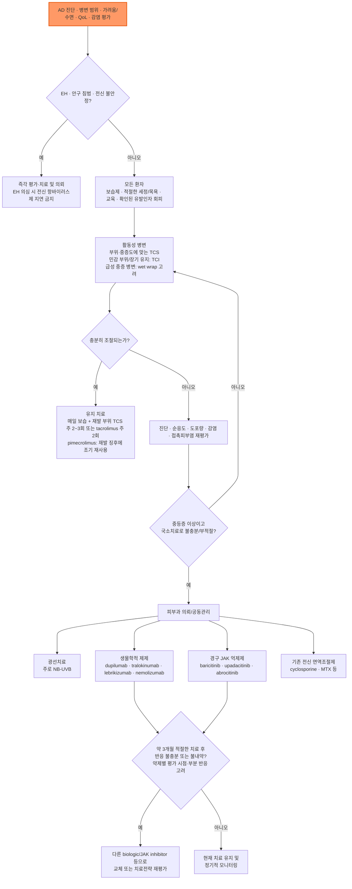

# 아토피 피부염 Atopic Dermatitis, AD

## <mark style="color:green;">일반 사항</mark>

* 만성·재발성 염증성 피부질환으로 **가려움증**, 연령에 따른 특징적인 병변 분포, 피부건조와 피부장벽 기능 이상이 핵심임.
* 소아기에 시작하는 경우가 흔하지만 성인에서 새로 발생하거나 지속될 수 있음.
* 천식, 알레르기비염, 식품알레르기 등 다른 제2형(type 2) 염증성 질환이 동반될 수 있음.
* 임상 경과는 다양하며, 소아기 발병 환자가 모두 사춘기 전에 자연 소실되는 것은 아님. 성인기까지 지속하거나 재발할 수 있음.

### <mark style="color:orange;">용어</mark>

* **급성 악화(acute flare)** : 치료 개입이 필요할 정도로 증상·징후가 유의하게 악화된 상태
* **반응 치료(reactive treatment)** : 눈에 보이는 활동성 병변에 시행하는 항염증 치료
* **유지/선제 치료(proactive treatment)** : 병변이 호전된 뒤 재발이 잦았던 부위에 TCS 주 2\~3회 또는 tacrolimus 주 2회 등 약제별 간헐 도포로 재발을 예방하는 치료(pimecrolimus는 재발 징후에 조기 재사용)
* **질환 조절(control)** : 피부 병변, 가려움, 수면 및 삶의 질이 환자가 받아들일 수 있는 수준으로 안정된 상태

## <mark style="color:green;">원인</mark>

### <mark style="color:orange;">기전</mark>

* 피부장벽 기능 이상과 면역 조절 이상이 상호작용하여 발생함.
* filaggrin 등 피부장벽 관련 유전적 요인과 환경 요인이 관여할 수 있음.
* 제2형 염증 반응에서 IL-4, IL-13 등이 중요한 역할을 하며, 가려움에는 IL-31 등 여러 신경면역 경로가 관여함.
* 피부장벽 손상은 수분 손실과 자극·알레르겐·미생물의 침투를 증가시키며, 긁음은 다시 장벽 손상과 염증을 악화시킴.

> **Itch-scratch cycle** : 가려움 → 긁음 → 피부장벽 손상 및 염증 증가 → 가려움 악화

### <mark style="color:orange;">악화 요인</mark>

* 건조한 환경, 과도한 열과 발한, 급격한 온도 변화
* 비누·세제·향료·거친 의복 등 개인별 자극물
* 세균·바이러스·진균 감염
* 수면 부족과 정신적 스트레스
* **확인된 경우에 한하여** 식품 또는 흡입 알레르겐


**알레르겐 감작(sensitization)만으로 원인이라고 판단하지 않음.** 피부단자검사 또는 특이 IgE 양성은 임상적으로 해당 알레르겐 노출 후 반복적으로 증상이 악화되는 병력과 함께 해석함.


### <mark style="color:orange;">난치성 또는 치료 불응 시 재평가</mark>

* 진단 오류 또는 접촉피부염·건선·옴·피부 T세포 림프종 등 다른 질환
* 충분하지 않은 TCS/TCI 용량·도포 기간, steroid phobia, 낮은 순응도
* 지속적인 자극물·알레르겐 노출
* 세균 감염, eczema herpeticum, Malassezia 연관 두경부 피부염
* 국소제 성분에 대한 알레르기 접촉피부염

## <mark style="color:green;">임상 양상</mark>

### <mark style="color:orange;">진행 양상</mark>

① **급성** : 홍반, 구진, 수포/삼출, 심한 가려움

② **아급성** : 홍반, 인설, 찰과상

③ **만성** : 태선화, 피부 비후, 색소 변화

* 실제 환자에서는 급성·아급성·만성 병변이 함께 존재할 수 있음.

### <mark style="color:orange;">연령별 주요 분포</mark>

* **영아** : 얼굴(특히 뺨), 두피, 몸통, 사지 신측부; 기저귀 부위는 상대적으로 보존되는 경우가 많음
* **소아** : 목, 팔오금·오금 등 굴측부
* **청소년/성인** : 굴측부, 얼굴·목, 손·발; 만성 손습진 또는 두경부 피부염으로 나타날 수 있음

### <mark style="color:orange;">중증도 평가</mark>

* 객관적 피부 병변뿐 아니라 **가려움, 수면 장애, 일상생활 및 삶의 질**을 함께 평가함.
* 일차진료에서는 병변 범위(BSA), 가려움 NRS, 수면 장애와 일상생활 지장을 간단히 기록하는 것이 실용적임.
* 전문적 치료 또는 전신치료를 고려할 때 EASI, SCORAD, DLQI 등을 활용할 수 있음.

#### <mark style="color:$primary;">SCORAD</mark>

* 계산식 : (A÷5) + (B×3.5) + C
* A : 병변 범위(%), B : 홍반·부종/구진·삼출/가피·찰과상·태선화·건조를 각각 0\~3점으로 평가하여 합산(최대 18점), C : 주관적 증상 - 가려움과 수면 장애를 각각 0\~10점 VAS로 평가하여 합산(최대 20점; 지난 3일/3박 기준)
* 전통적 분류 : **＜25 경증, 25\~50 중등증, ＞50 중증**


**SCORAD 단일 절단값만으로 전신치료 여부를 결정하지 않음.** 병변 범위, 가려움·수면, 삶의 질, 국소치료 반응, 치료 부담과 환자 선호를 함께 평가함.


### <mark style="color:$danger;">🚩 Red Flags!</mark>

<mark style="color:$danger;">**즉각 조치**</mark>

* 갑자기 발생한 통증성·단형성(monomorphic) 수포/미란 또는 punched-out erosion(발열·전신증상 유무와 무관)  `헤르페스성 습진 의심`
* 눈 주위 herpes 병변, 안통·시력저하·광과민  `안구 침범 의심`
* 광범위한 홍피증에 저체온·탈수·전신 쇠약 동반, 또는 저혈압·의식 변화 등 전신 불안정  `피부장벽 기능부전` `중증 감염·패혈증 의심`

<mark style="color:$warning;">**당일 평가**</mark>

* 빠르게 퍼지는 농가진/봉와직염, 발열·오한을 동반한 세균 감염  `확산성 감염`
* 적절한 국소치료에도 급격히 악화하는 광범위 병변  `급속 악화`

<mark style="color:$info;">**조기 평가 및 추적**</mark>

* 충분한 국소치료에도 조절이 불충분한 중등증\~중증 AD, 가려움·수면장애·삶의 질 저하  `질환 조절 불충분`
* 반복적 감염·성장 장애가 있거나 면역결핍이 의심되는 소아  `기저 질환 의심`
* 진단 불확실, 반복되는 두경부 피부염, 국소제 사용 부위 악화  `접촉피부염·다른 질환 감별`


헤르페스성 습진은 **발열이 없어도 전신 항바이러스 치료를 즉시 시작하고 당일 피부과 평가**를 연결함. 눈 주위 병변·안구 증상은 당일 안과 평가도 필요함. 전신 불안정·심한 전신증상·급속 확산은 응급실 평가 대상으로 판단함. 면역결핍 의심 소아에게 급성 중증 감염이 동반되면 즉각 또는 당일 평가로 상향함. <mark style="color:$info;">[NICE CG57; 감염 관리 참조]</mark>


## <mark style="color:green;">진단</mark>

* 임상 진단이 원칙이며 AD 자체를 확진하는 특이 혈액검사는 없음.
* 혈청 총 IgE나 호산구 증가는 흔할 수 있으나 진단에 필수적이지 않고, 수치만으로 중증도 또는 원인 알레르겐을 결정하지 않음.

### <mark style="color:orange;">알레르기 검사</mark>

* **일률적인 광범위 알레르기 검사는 권장하지 않음.**
* 즉시형 식품알레르기 또는 흡입 알레르겐과의 임상적 연관성이 뚜렷한 경우 선택적으로 skin-prick test 또는 특이 IgE를 고려함.
* 반복적으로 특정 국소제·화장품·금속 등에 노출되는 부위가 악화되거나 표준치료에 반응하지 않으면 **patch test**를 고려함.

### <mark style="color:orange;">한국인 아토피 피부염 진단 기준</mark>

* 최신 한국인 진단 기준은 과거의 “주 진단 기준 ≥2 + 보조 진단 기준 ≥4” 점수식을 사용하지 않고, 아래 **3가지 필수 임상 특징을 모두 만족**하는 것을 기본으로 함. <mark style="color:$info;">[KADA 2023 Consensus; Ann Dermatol. 2025]</mark>

**필수 임상 특징**

① **소양증(pruritus)**

② **연령에 맞는 전형적 습진 양상** : 영아에서는 얼굴·목·사지 신측부가 흔하고, 모든 연령에서 현재 또는 과거의 굴측부 병변을 중요하게 평가함.

③ **만성 또는 재발성 경과(chronic or relapsing history)**

**진단을 보조하는 특징(diagnostic aids)**

* 피부건조증(xerosis)
* IgE 반응성/아토피 소인
* 손·발 습진
* 눈 주위·귀 주위·입 주위 변화
* 유두 습진
* 모공 주위 피부 변화(perifollicular accentuation)
* 아토피 질환의 개인력 또는 가족력 등


**보조 소견은 진단을 뒷받침하지만 단독으로 AD를 확진하지 않음.** 특히 총 IgE 증가나 알레르겐 감작은 임상 양상과 함께 해석함.


### <mark style="color:orange;">감별 진단</mark>

* 홍반, 가려움, 인설·삼출 등 습진성 병변을 보이는 질환과 감별함.

<table><thead><tr><th width="140">감별질환</th><th width="230">AD와의 차이점</th><th>핵심 감별 포인트</th></tr></thead><tbody><tr><td>알레르기 접촉피부염</td><td>특정 부위에 국한, 노출력과 연관</td><td>노출 부위와 병변 분포의 일치, 임상적으로 관련된 patch test 양성</td></tr><tr><td>지루피부염</td><td>피지 분비 부위(두피·비순구·눈썹) 호발</td><td>기름진 노란 인설, 가려움 상대적으로 약함</td></tr><tr><td>건선</td><td>경계가 뚜렷한 은백색 인설 판</td><td>신전측 호발, Auspitz sign, 손발톱 변화</td></tr><tr><td>옴</td><td>가족·집단 내 전파, 야간 심화 소양증</td><td>지간·손목·생식기의 굴서(burrow), 피부경검사</td></tr><tr><td>건조증·어린선</td><td>염증성 병변(홍반·삼출)이 상대적으로 적음</td><td>비늘 양상, 어린선의 가족력</td></tr><tr><td>만성 단순태선</td><td>국한된 소수 부위의 태선화</td><td>반복 긁음 병력, 넓은 굴측부 분포는 아님</td></tr><tr><td>피부 T세포 림프종</td><td>중년 이후 새로 발생, 표준치료 불응</td><td>비전형적 분포·경과 → 조직검사로 확인</td></tr></tbody></table>

***



<p align="center"><strong>진단 및 치료 알고리듬</strong></p>

<p align="center"><em><mark style="color:$info;">Ref. KADA 2025 Consensus Guideline Part I·II; AAD 2026 소아 지침 및 국내 허가자료 보완; nemolizumab은 국내 허가사항 전재본 기준</mark></em></p>

***

## <mark style="background-color:$warning;">Management</mark>


**치료 원칙** 모든 중증도에서 보습, 적절한 세정·목욕, 환자 교육을 시행함. 활동성 병변에는 TCS/TCI를 중심으로 충분한 국소 항염증 치료를 하고, 재발이 잦은 부위는 proactive therapy를 고려함. 중등증 이상이면서 충분한 국소치료로 조절되지 않거나 국소치료가 권장되지 않는 경우 피부과 의뢰를 통해 광선치료 또는 전신치료를 고려함.


## <mark style="color:green;">비-약물 치료 및 예방</mark>

### <mark style="color:orange;">보습제</mark>

* **모든 환자에서 기본치료**이며 급성 악화 예방과 국소 corticosteroid 사용량 감소에 도움이 됨.
* 하루 **최소 2회**를 기본으로 하되 피부가 건조하면 더 자주 도포함.
* 전신 사용량은 성인에서 대략 **주 250 g 이상**이 필요한 경우가 흔하며, 충분한 양을 사용하도록 교육함.
* 향료·자극성 성분이 적고 환자가 지속적으로 사용할 수 있는 제품을 선택함.
* 급성 염증 자체를 보습제만으로 치료하지 말고 필요한 항염증제를 병용함.
* **영아의 AD 1차 예방** : 국내 KADA 2025 지침은 연구 결과의 불일치를 지적함. 이후 AAD 2026 소아 지침은 보습 피부관리를 **조건부 권고**함. 예방 효과의 불확실성과 제품·사용 부담을 설명하고 보호자와 결정하며, 모든 영아에서 예방 효과가 확립되었다고 설명하지 않음. 이미 발생한 AD에서의 보습 치료 권고와 구분함. <mark style="color:$info;">[KADA 2025 Part I; AAD 2026 소아 예방 지침]</mark>

### <mark style="color:orange;">세정과 목욕</mark>

* 뜨겁지 않은 미지근한 물로 **5\~10분 정도** 목욕 또는 샤워하고, 이후 즉시 보습제를 도포함.
* 수건으로 문지르지 말고 가볍게 두드려 말림.
* 비누 사용은 제한하고 필요하면 **중성\~약산성, 무향, 저자극 세정제**를 사용함.
* 목욕 빈도는 피부 상태와 생활습관에 따라 조정함. 잦은 세척 후 보습을 하지 않으면 피부장벽이 악화될 수 있음.

#### <mark style="color:$primary;">희석 표백제 목욕</mark>

* 반복되는 세균 감염 또는 중등증\~중증 AD에서 보조적으로 고려할 수 있으나, 일반 물목욕보다 우월한지에 대한 연구 결과는 일관되지 않음.
* 농도 오류는 화학 화상을 일으킬 수 있으므로 **정확한 희석법을 교육할 수 있을 때만** 사용함.
* 소금·식초·베이킹소다·oil 등 다양한 목욕 첨가제는 근거가 제한적이므로 일상적 치료로 권하지 않음.

### <mark style="color:orange;">알레르겐 및 자극 회피</mark>

* **확인된 알레르겐만 회피**함. 단순한 검사 양성만으로 광범위한 회피를 시행하지 않음.
* 집먼지진드기 : **감작이 확인되고 노출 후 피부염 악화 병력이 있는 환자**에서 회피 전략을 고려함.
* 아토피피부염 예방만을 목적으로 모든 가정에서 집먼지진드기 제거 전략을 시행하는 것은 권장하지 않음.
* 동물털 알레르기가 확인되고 노출 시 악화되는 경우 노출 회피를 권고함. **AD라는 이유만으로 애완동물을 일률적으로 없앨 필요는 없음.**
* 비누, 세제, 향료, 모직·거친 의복, 심한 열·발한 등은 환자별 악화 여부를 확인하여 조절함.

### <mark style="color:orange;">음식</mark>

* 전문가가 진단한 식품알레르기가 있는 경우 해당 식품을 회피함.
* 식품알레르기가 확인되지 않은 환자에서 우유·계란·밀·글루텐 등을 **일률적으로 제한하지 않음.** 성장기 소아에서는 영양결핍 위험을 특히 고려함.
* AD 예방을 목적으로 임신·수유 중 산모에게 일률적인 알레르겐 제한식을 권하지 않음.

## <mark style="color:green;">약물 치료</mark>

### <mark style="color:orange;">국소 corticosteroid (TCS)</mark>

* 활동성 AD의 **1차 항염증 치료**임.
* 병변의 중증도, 부위, 환자 연령과 피부 두께에 맞추어 적절한 역가와 제형을 선택함.
* 대부분 **1일 1\~2회** 도포로 충분하나 제품별 허가 횟수를 따른다(에로콤 크림은 **1일 1회**). 충분한 양을 바르도록 FTU(fingertip unit)를 교육함.
* **1 FTU ≈0.5 g** : 지름 5 mm 노즐에서 성인 검지 끝마디 길이만큼 짠 양으로, 성인 손바닥 약 2개 면적에 바를 수 있음. 소아는 연령·부위별 필요량을 조정함.
* 얼굴·눈꺼풀·목·굴곡부·서혜부 등 피부가 얇은 부위는 저역가를 짧게 사용하거나 TCI로 전환함.
* 두껍고 태선화된 병변에는 중등도\~고역가 제제를 제한된 기간 사용할 수 있음.
* 급성 악화가 호전되면 도포 빈도를 줄이거나 낮은 역가로 전환할 수 있음. 재발이 잦은 부위는 proactive therapy를 고려함.
* 대표 제제 : 중등도 역가 hydrocortisone butyrate 0.1% <mark style="color:blue;">\[로코이드 연고]</mark>, 중등도\~강한 역가 mometasone furoate 0.1% <mark style="color:blue;">\[에로콤 크림]</mark>, 매우 강한 역가 clobetasol propionate <mark style="color:blue;">\[더모베이트 연고]</mark> (TCS 역가 분류는 국가·분류체계에 따라 다소 차이가 있을 수 있으며, 실제 처방 시 국내 제품 허가사항과 적용 부위를 함께 확인)


**TCS 부작용은 '역가 × 부위 × 사용량 × 기간'에 좌우됨.** 피부 위축, 모세혈관확장, striae, 여드름양 병변 등이 문제이며, 강한 제제를 눈꺼풀/안구 주위에 장기간 사용하는 것은 피함. 반대로 과도한 steroid phobia로 필요한 치료를 지나치게 줄이면 질환 조절 실패가 흔함.


### <mark style="color:orange;">국소 칼시뉴린 억제제 (TCI)</mark>

* tacrolimus ointment <mark style="color:blue;">\[프로토픽 연고]</mark>, pimecrolimus cream <mark style="color:blue;">\[엘리델 크림]</mark>
* 얼굴·눈꺼풀·목·굴곡부·서혜부 등 **민감 부위**, TCS 부작용이 우려되는 경우, 장기 steroid-sparing 치료에 유용함.
* 급성 염증이 심해 작열감이 큰 경우 먼저 TCS로 염증을 가라앉힌 뒤 TCI로 전환할 수 있음. 제품별 보관조건을 준수함.
* **Tacrolimus 급성기** : 16세 이상은 0.1%를 1일 2회로 시작하고 호전 시 0.03% 또는 도포 횟수 감소를 고려함. 2\~15세는 0.03%를 1일 2회 **최대 3주**, 이후 병변 소실 시까지 1일 1회로 줄임. 2주 후 개선이 없으면 진단·치료를 재평가함.
* **Tacrolimus 유지요법** : 초기 치료에 반응한 환자에서 재발 부위에 **주 2회, 도포일마다 1회(도포일 사이 2\~3일 간격)** 사용함. 2\~15세는 0.03%, 16세 이상은 0.1%의 유지요법을 기준으로 하며, 12개월 후 지속 필요성을 재평가함.
* **Pimecrolimus** : 활동성 병변에 1일 2회 도포하고 증상 소실 시 중단함. 재발 첫 징후에 다시 시작하며, 6주 내 호전이 없거나 악화되면 진단을 재평가함. 모든 TCI에 동일한 주 2\~3회 유지 용법을 일률적으로 적용하지 않음. <mark style="color:$info;">[프로토픽·엘리델 국내 허가사항]</mark>
* 감염이 있는 부위는 먼저 평가·치료하고, 점막·안구 내 도포 및 TCI의 밀폐·wet wrap 병용은 피함. 자외선 노출을 줄이고 필요 시 자외선 차단제를 사용함.
* tacrolimus 0.03% 및 pimecrolimus 1%는 국내에서 2세 이상에 사용하며, tacrolimus 0.1%는 16세 이상 허가를 기준으로 함.

### <mark style="color:orange;">기타 국소 항염증제</mark>

* **crisaborole 2% ointment (PDE-4 inhibitor)** : KADA 2025 합의지침에서는 국내 AD 적응증 미승인으로 기술함. 해외 허가 내용을 국내 처방으로 직접 적용하지 않음.
* **Delgocitinib 20 mg/g cream** <mark style="color:blue;">[앤줍고]</mark> : 국내 허가 적응증은 국소 TCS에 반응하지 않거나 TCS가 적절하지 않은 **성인의 중등증\~중증 만성 손습진**임. 전신 AD 또는 다른 부위 AD의 표준 국소제로 일반화하지 않음(습진 챕터 참조). 일본 등의 AD용 delgocitinib 제형·농도와도 구분함.
* **해외 치료 동향** : AAD 2025 성인 집중 개정과 2026 소아 지침은 tapinarof(AhR agonist)·roflumilast(PDE-4 inhibitor) 크림을 권고 목록에 포함함. 국소 ruxolitinib도 해외 AD 치료 옵션임. 해외 권고를 소개하는 내용으로, 이 챕터에서는 이들을 국내 표준 처방제로 제시하지 않음. <mark style="color:$info;">[AAD AD 지침 2025·2026]</mark>

### <mark style="color:orange;">전신 corticosteroid</mark>


**장기간 경구 corticosteroid는 권고하지 않음.** 빠른 호전 뒤 rebound가 흔하고 장기 독성이 큼.


* 성인의 심한 급성 악화에서 다른 치료로 넘어가기 위한 **rescue/bridge**가 필요한 예외적인 상황에 단기간(대개 1\~2주 이내) 선택적으로 고려함.
* KADA 가이드라인에서 예시 용량은 prednisolone 약 **0.5 mg/kg/day**임.
* 사용 시 동시에 적절한 국소치료 및 장기 조절 전략을 마련함.

### <mark style="color:orange;">기존 전신 면역조절제</mark>

#### <mark style="color:$primary;">Cyclosporine</mark>

* 국소치료로 적절히 조절되지 않거나 권장되지 않는 중등증 이상의 AD에서 사용을 권고함.
* **2.5\~5 mg/kg/day**, 보통 2회 분할. 빠른 조절이 필요하면 상대적으로 높은 용량으로 시작 후 최소 유효용량으로 감량할 수 있음.
* 혈압과 신기능을 중심으로 CBC, 간기능, 지질 등을 모니터링함.
* 시작 또는 증량 후 초기 수개월은 대략 **2\~4주 간격**, 안정된 유지기에는 최소 **3개월 간격** 검사하는 접근이 권장됨.
* 장기 사용은 신독성·고혈압 등 누적 독성을 고려하며 피부과 전문의 관리가 필요함.
* 광선치료와의 병용은 피함.

#### <mark style="color:$primary;">Methotrexate</mark>

* cyclosporine 또는 표적 전신치료가 적합하지 않은 환자에서 선택적으로 고려할 수 있음.
* 성인 초기 **5\~15 mg/week**, 필요 시 최대 **25 mg/week** 범위가 제시됨. **아토피피부염에 대한 국내 허가 외 사용**임.
* **주 1회 투여하며 매일 복용하지 않음.** 엽산을 병용하고 투여 요일·용량을 명확히 교육함.
* 간기능, CBC, 신기능 및 약물상호작용을 모니터링함.
* 효과 발현이 cyclosporine이나 JAK inhibitor보다 느리므로 급성 조절 목적보다는 장기 조절 옵션임.

#### <mark style="color:$primary;">Azathioprine / Mycophenolate mofetil / Alitretinoin</mark>

* 현재는 표적 치료제를 우선 고려할 수 있어 일반적인 1차 선택지는 아니며, 특정 환자에서 피부과 전문의가 선택적으로 고려함.
* azathioprine과 mycophenolate mofetil의 AD 치료는 **국내 허가 외 사용**임. 감염·골수억제·간독성 및 임신 관련 위험을 고려함. azathioprine은 시작 전 TPMT 및 NUDT15 평가를 고려하고 CBC·간기능을 추적함.
* alitretinoin은 강력한 TCS에 반응하지 않는 성인의 **중증 만성 손습진**에 사용하는 약제로, 일반 AD의 표준 전신치료제로 제시하지 않음. 강한 기형유발 위험 때문에 임신 예방 프로그램과 엄격한 피임이 필요함.

### <mark style="color:orange;">표적 전신 치료</mark>

#### <mark style="color:$primary;">생물학적 제제/생물의약품</mark>


임상에서는 흔히 **생물학적 제제(biologics)**라고 부르지만, 식품의약품안전처의 의약품 분류상 dupilumab, tralokinumab, lebrikizumab, nemolizumab은 유전자재조합 **생물의약품**에 해당함.


| 약제                                                                              | 표적                     | 국내 사용 대상                                         | 대표 용법                                                                          | 주요 주의점                                    |
| ------------------------------------------------------------------------------- | ---------------------- | ------------------------------------------------ | ------------------------------------------------------------------------------ | ----------------------------------------- |
| <p><strong>Dupilumab</strong><br><mark style="color:blue;">[듀피젠트]</mark></p>    | IL-4Rα → IL-4/IL-13 억제 | 6개월 이상 소아\~성인, 국소치료로 충분히 조절되지 않는 중등증 이상 AD     | 성인 : 600 mg loading → 300 mg SC q2wk. 소아·청소년은 체중별 용량                           | 결막염, 안구 건조, 두경부 홍반. 장기 안전성 자료가 가장 풍부      |
| <p><strong>Tralokinumab</strong><br><mark style="color:blue;">[아트랄자]</mark></p> | IL-13 | 12세 이상 청소년·성인 | 600 mg loading → 300 mg SC q2wk; 16주 후 피부가 깨끗하거나 거의 깨끗한 경우 q4wk 고려 | 상기도 감염, 결막염, 주사부위 반응 |
| <p><strong>Lebrikizumab</strong><br><mark style="color:blue;">[엡글리스]</mark></p> | IL-13 | 성인 및 12세 이상 청소년(청소년 체중 ≥40 kg) | 0·2주차 500 mg → 16주까지 250 mg SC q2wk; 반응 달성 후 250 mg q4wk 또는 q8wk(국내 허가) | 결막염, 안구 건조, 주사부위 반응 |
| <p><strong>Nemolizumab</strong><br><mark style="color:blue;">[넴루비오]</mark></p> | IL-31Rα | 전신요법 대상 12세 이상·체중 ≥30 kg 청소년 및 성인; 국소치료 불충분/부적절한 중등증\~중증 AD | 초회 60 mg → 4주부터 30 mg SC q4wk; 16주 후 임상반응을 보이면 30 mg q8wk 권고(국내 허가사항 전재본 기준) | 과민반응·두드러기 등; 결절성 양진의 체중별 용법과 구분 |

* **IL-4/IL-13 계열 biologic에서는 JAK inhibitor와 달리 일률적인 CBC·간기능·결핵/간염 정기 screening이 필수는 아님.** 다만 감염 위험인자와 병력에 따라 치료 전 선별검사를 고려함.
* dupilumab, tralokinumab, lebrikizumab 등 사용 중 결막염이 지속되면 안과 평가를 시행함. **안구통·광과민·시력저하는 당일 안과 평가**가 필요함.
* 생물학적 제제 시작 전 예방접종력을 확인하고, **생백신·약독화 생백신의 동시 접종은 피함.** 불활화·비생백신은 약제별 허가사항에 따라 접종함.
* **Nemolizumab** : 국내 허가사항 전재본에서 AD의 체중 ≥30 kg 조건과 위 용법을 확인함. 단독 또는 TCS 병용이 가능하며, TCI는 얼굴·목·접힘부위·생식기 등 문제 부위에 제한함. 16주 무반응이면 중단을 고려하되 부분 반응자는 연장 치료 후 재평가할 수 있음. <mark style="color:$info;">[넴루비오 국내 허가사항 전재본]</mark>
* 넴루비오의 2026년 7월 약제급여평가위원회 **평가금액 이하 수용 시 급여 적정성 인정**은 최종 급여 등재·시행과 다름. 심의 결과만으로 현재 급여 적용을 단정하지 않음.

**Dupilumab 체중별 용량 요약**

| 연령/체중                  | 첫 투여 용량 | 유지 용량 |
| ---------------------- | ------ | ----------- |
| 성인                     | 600 mg | 300 mg q2wk |
| 6\~17세 ≥60 kg        | 600 mg | 300 mg q2wk |
| 6\~17세 30\~＜60 kg  | 400 mg | 200 mg q2wk |
| 6\~17세 15\~＜30 kg  | 600 mg | 300 mg q4wk |
| 6개월\~5세 15\~＜30 kg | 300 mg | 300 mg q4wk |
| 6개월\~5세 5\~＜15 kg  | 200 mg | 200 mg q4wk |

※ 모두 피하 투여함. **6개월\~5세에는 별도의 증량 부하용량 없이 첫 투여부터 유지 용량과 같은 용량**을 사용함. **프리필드주는 6개월 이상, 프리필드펜은 2세 이상**이므로 영아에게 펜 제제를 적용하지 않음. 제품별 국내 허가사항을 확인함.

#### <mark style="color:$primary;">경구 JAK inhibitor</mark>

* 효과 발현이 빠르고 특히 가려움 개선이 빠른 장점이 있음.
* 반면 감염, 대상포진, 혈구·간기능·지질 변화, CPK 증가 및 고위험군에서 MACE/VTE/악성종양 위험을 고려해야 함.
* **65세 이상, 심혈관계 고위험군(현재 또는 과거 장기 흡연자 포함), 악성종양 위험이 높은 환자에서는 다른 치료에 반응하지 않거나 내약성이 없는 경우에 제한하여 신중히 선택**함.

| 약제                                                                              | 표적     | 국내 사용 대상                                            | 대표 용량                                                                |
| ------------------------------------------------------------------------------- | ------ | ----------------------------------------------------------------- | -------------------------------------------------------------------- |
| <p><strong>Baricitinib</strong><br><mark style="color:blue;">[올루미언트]</mark></p> | JAK1/2 | 전신요법 대상 만 2세 이상 소아·청소년·성인 | 성인 및 ≥30 kg 소아: 4 mg qd; ≥65세/고위험군: 2 mg qd; 10\~＜30 kg 소아: 2 mg qd. 조절되면 감량 고려 |
| <p><strong>Upadacitinib</strong><br><mark style="color:blue;">[린버크]</mark></p>  | JAK1   | 12세 이상 청소년(≥40 kg) 및 성인                                           | 성인 및 ≥40 kg 청소년: 15 mg qd; 질병 부담이 높거나 15 mg 반응이 불충분하면 30 mg qd 고려. ≥65세/고위험군: 15 mg qd |
| <p><strong>Abrocitinib</strong><br><mark style="color:blue;">[시빈코]</mark></p> | JAK1 | 전신요법 대상 만 12세 이상 청소년·성인(국내 적응증에 일률적인 ≥40 kg 조건 없음) | 환자 특성에 따라 100 또는 200 mg qd; 고위험/내약성 낮으면 100 mg 시작. 대부분 200 mg 시작 후 조절되면 100 mg으로 감량. 신장애·상호작용에 따라 추가 감량 |

**JAK inhibitor 시작 전/후 확인**

* 치료 전 : CBC, 간·신기능, lipid profile, CPK, B형·C형 간염, 결핵 선별(필요 시 흉부 X-ray), 임신 가능성 확인
* 예방접종력 확인 : 특히 대상포진 백신 등 필요한 백신은 가능하면 치료 전에 완료
* 치료 후 : 약제별 허가사항에 따름. **Abrocitinib은 시작 4주 후 혈소판 포함 CBC와 지질을 검사**하며 첫 검사를 12주까지 미루지 않음. 이후 혈구·간기능·신기능·지질 등은 위험도와 약제에 따라 정기 추적함.
* 활동성 중증 감염이 있으면 치료 시작을 미룸.
* 임신·수유 중에는 사용하지 않음.
* **신기능에 따른 조절** : baricitinib은 CrCl 30\~60 mL/min에서 성인 2 mg qd로 감량하며, 소아는 ≥30 kg이면 2 mg qd, 10\~＜30 kg이면 1 mg qd; CrCl ＜30 mL/min이면 투여하지 않음. abrocitinib은 eGFR 30\~＜60 mL/min에서 용량을 절반으로 줄이며, ＜30에서는 50 mg qd로 시작하고 최대 100 mg qd; 신대체요법 환자는 연구되지 않음. upadacitinib은 AD의 중증 신장애에서 15 mg qd를 권고함. <mark style="color:$info;">[국내 약제별 허가사항]</mark>
* 상호작용을 확인함. abrocitinib은 강한 CYP2C19 억제제(예: fluconazole, fluvoxamine) 병용 시 시작용량을 절반으로 줄이며, baricitinib은 probenecid 등 강한 OAT3 억제제 병용 시 감량함. upadacitinib은 강한 CYP3A4 억제제 병용 시 AD에서 15 mg qd를 권고하고, 강한 CYP3A4 유도제 병용 시 효과가 감소할 수 있으므로 대체약을 우선 고려하고 병용이 불가피하면 질병 활성도를 면밀히 추적함.
* 다른 JAK 억제제·생물학적 면역조절제 또는 강한 전신 면역억제제와의 일상적 병용은 피하고 약제별 허가 제한을 따름.

### <mark style="color:orange;">표적 치료의 반응 평가 및 교체</mark>

* KADA 알고리즘은 약 **3개월** 적절한 치료 후 EASI 50 미달, itch NRS ≥4 또는 DLQI ≥6을 반응 불충분의 예로 제시함.
* 불충분 반응 또는 부작용으로 지속할 수 없는 경우 다른 biologic 또는 oral JAK inhibitor로 변경을 고려할 수 있음. 위 기준은 **자동 중단 기준이 아니며**, 약제별 평가 시점과 부분 반응·환자 목표를 함께 판단함.
* 예: baricitinib은 8주 후 유익성이 없으면 중단 고려; tralokinumab/lebrikizumab은 16주 평가(부분 반응자는 연장 치료 고려); abrocitinib은 24주 후 효과가 없으면 중단 고려. 엡글리스의 부분 반응자는 24주까지 q2wk를 지속할 수 있음.
* 보험·산정특례 기준은 시기별로 바뀔 수 있으므로 실제 처방 시 최신 급여 기준을 확인함.

### <mark style="color:orange;">항히스타민제</mark>

* AD 가려움의 주된 기전은 histamine만으로 설명되지 않으므로 **항히스타민제는 항염증 치료를 대체하지 못함.**
* 경구 H1 항히스타민제를 국소치료의 **추가요법으로 선택적으로** 고려할 수 있음.
* 심한 야간 가려움 때문에 단기간 수면 보조가 필요한 경우 진정성 1세대를 제한적으로 사용할 수 있으나, 주간 졸림·인지저하·낙상·항콜린성 부작용을 고려함.
* 두드러기·알레르기비염 등 histamine-mediated 동반질환이 있으면 2세대 항히스타민제(예: cetirizine <mark style="color:blue;">\[지르텍]</mark>)가 더 적절함.
* **국소 항히스타민제는 접촉감작 위험 때문에 권장하지 않음.**

### <mark style="color:orange;">감염 관리</mark>

* AD 피부의 S. aureus 집락화 자체를 치료하기 위해 예방적으로 항생제를 사용하지 않음.
* **항생제는 감염의 정도·범위·전신상태를 판단하여 선택**함. 진물·가피만으로 세균 감염을 확정하지 않으며, 전신상태가 양호한 경한 감염성 악화에는 보습·항염증 치료를 우선하고 항생제를 일률적으로 추가하지 않음.
* 반복 감염이나 치료 실패에서는 배양검사와 MRSA 가능성을 고려함.

#### <mark style="color:$primary;">세균 감염</mark>

* 황색 가피, 농포, 진물 증가, 압통, 급격한 악화가 있으면 impetiginization을 의심함.
* 항생제가 필요한 명확한 국소 농가진은 단기간 국소 항생제를 고려함. 광범위한 감염·봉와직염 또는 전신증상이 있으면 경구 항생제를 고려하며, 전신 불안정 시 입원 평가가 필요함.
* 항생제 투여 여부와 관계없이 기저 습진의 보습·항염증 치료를 지속함. 감염 부위의 국소제 선택은 제품별 금기·주의사항을 확인하며, 감염 부위에 TCS/TCI만 단독 사용하지 않음.
* 항생제 선택은 농가진/피부연조직감염 원칙과 지역 내성, 배양 결과에 따름.
* 장기간 또는 반복적인 국소·경구 항생제 사용은 내성 때문에 피함.

#### <mark style="color:$primary;">Eczema herpeticum</mark>


**임상적으로 의심되면 검사 결과를 기다리지 말고 전신 acyclovir 또는 valacyclovir 치료를 신속히 시작함.** 눈 주위 병변 또는 안구 증상이 있으면 **당일 안과 협진**이 필요함. 발열이 없더라도 배제하지 않음.


* 전형적으로 통증성의 단형성 수포·미란 또는 punched-out erosion이 갑자기 다발성으로 발생함.
* 고열, 전신상태 불량, 영아, 광범위 병변에서는 입원 및 정주치료를 고려함. 신기능에 따른 항바이러스제 감량 및 수분 상태를 확인함.

#### <mark style="color:$primary;">진균/Malassezia 관련 두경부 피부염</mark>

* 기존 치료로 조절되지 않는 두경부 AD 또는 Malassezia 감작이 의심되는 일부 환자에서 **경구 azole 항진균제의 선택적 사용**을 고려할 수 있음.
* 일반 AD 환자에게 항진균제를 일률적으로 투여하지 않음.

### <mark style="color:orange;">알레르겐 특이 면역요법 (ASIT) 및 보조요법</mark>

* 흡입 알레르겐, 특히 집먼지진드기에 감작된 **중등증 이상 AD**에서 임상적으로 관련성이 뚜렷한 경우 선택적으로 고려할 수 있음.
* AD만을 이유로 보편적으로 시행하는 치료는 아니며, 알레르기비염/천식 등 동반 적응증과 함께 판단함.
* **Probiotics/prebiotics, 달맞이꽃 종자유, vitamin D 보충제** : AD 치료 효과의 근거가 불충분하거나 일관되지 않아 일상적으로 권고하지 않음. 표준 항염증 치료를 대체하지 않음.
* vitamin D 결핍이 확인된 경우 결핍 교정은 일반적인 건강 관리 차원에서 적절함.
* Chinese herbal medicine, 다양한 식물추출물, 아로마요법 등은 효능 근거와 품질·안전성 자료가 부족하여 표준치료로 권하지 않음.

## <mark style="color:green;">시술 및 기타 처치</mark>

### <mark style="color:orange;">Wet wrap therapy (습포요법)</mark>

* **적응증** : 급성으로 심한 flare, 광범위한 악화, 충분한 국소치료에도 반응이 불충분한 난치성 병변에서 **단기간** 고려함.
* **효과** : 피부를 재수화·냉각하고, 보습제/TCS의 피부 침투를 증가시키며, 긁기에 대한 물리적 장벽을 제공하여 itch-scratch cycle을 줄이는 데 도움이 됨.
* **방법** : 목욕 후 보습제 또는 의료진이 선택한 저\~중등도 역가 TCS를 도포한 뒤, 미지근한 물에 적신 면·거즈·tubular bandage를 안쪽 층으로 적용하고 그 위를 마른 층으로 덮음. 넓은 부위에는 wet pajamas 또는 면 의복을 이용할 수 있음.
* **적용 시간** : 한 번의 wet wrap은 수시간에서 최대 약 24시간까지 시행할 수 있음. 필요하면 급성기 동안 며칠간 반복할 수 있으나, **장기간·반복 시행, 특히 소아에서 TCS를 함께 사용하는 경우에는 피부과 전문의 감독하에 시행함.**
* **주의** : TCS 종류·도포량·희석 여부는 의료진이 정하며 환자가 임의로 희석하지 않음. 제품이 밀봉붕대법을 제한하는 경우 해당 제한을 따른다(에로콤 크림 등). 감염이 의심되면 먼저 평가·치료함. TCS를 wet wrap 또는 밀폐 상태로 사용할 경우 경피 흡수가 증가하므로 넓은 면적에 중·고역가 TCS를 장기간 사용하지 않음.


**밀폐 요법(occlusive therapy)**은 plastic wrap 등으로 국소제를 밀폐하여 침투를 증가시키는 방법이지만, steroid 흡수 증가, 피부 자극·모낭염 및 감염 위험 때문에 일상적 자가요법으로 권하지 않음. 필요한 경우 피부과 전문의의 지시에 따라 제한적으로 시행함.


### <mark style="color:orange;">광선 치료</mark>

* **NB-UVB(약 311 nm)**가 가장 흔히 고려되며, 중등증\~중증 AD에서 국소치료가 충분하지 않을 때 선택할 수 있음.
* UVA1도 선택적으로 사용할 수 있으나 국내 일차의료에서 보편적이지 않음.
* 장점 : 비약물 전신치료 옵션, 가려움·염증 개선 가능.
* 단점 : 주 2\~3회 내원 부담, 홍반/화상, 색소침착, 장기 누적 자외선 노출에 따른 광노화·피부암 위험 고려.
* 피부암 병력 또는 고위험군, 광과민 약물 사용 여부를 확인함.
* **cyclosporine 등 일부 면역억제제와 자외선치료 병용은 피부암 위험 때문에 피함.**


**일차진료에서의 역할** : NB-UVB를 직접 시행하기보다는, 충분한 국소치료에도 넓은 범위의 병변·가려움·수면장애가 지속하고 전신치료를 원치 않거나 적합하지 않은 환자에게 장단점을 설명하고 피부과 의뢰를 고려함.


## <mark style="color:green;">특수 환자군</mark>

### <mark style="color:orange;">소아·청소년</mark>

* 충분한 국소치료에도 조절되지 않는 중등증 이상에서는 전신치료를 고려함.
* **소아의 전신 corticosteroid는 사용하지 않는 것을 원칙으로 함.** AAD 2026 소아 지침은 강하게 반대하며, 예외적인 구제치료 필요성은 전문의가 판단함. <mark style="color:$info;">[AAD 2026 소아 치료 지침]</mark>
* 사용 가능 연령은 약제별로 다르므로 최신 국내 허가사항을 확인함.
* 국내 사용 연령: dupilumab ≥6개월(주사 제형 구분), baricitinib ≥2세, tralokinumab ≥12세, lebrikizumab ≥12세(청소년 ≥40 kg), upadacitinib ≥12세(청소년 ≥40 kg), abrocitinib ≥12세. nemolizumab은 ≥12세·체중 ≥30 kg(국내 허가사항 전재본 기준).

### <mark style="color:orange;">고령자</mark>

* 새로 발생한 만성 가려움과 습진에서는 약물, 신장·간질환, 혈액질환, 악성종양 등 다른 원인을 먼저 평가함.
* 생물학적 제제는 비교적 유리한 선택지가 될 수 있음.
* JAK inhibitor는 감염, MACE, VTE, 악성종양 위험을 고려하여 **저용량/최소 유효용량** 및 엄격한 환자 선택이 필요함.

### <mark style="color:orange;">임신/수유부</mark>

* **1차** : 보습제 + 필요한 경우 저\~중등도 역가 TCS. 민감 부위에서는 TCI를 선택적으로 고려할 수 있음.
* 광선치료가 필요하면 **NB-UVB**를 우선 고려할 수 있으며 PUVA는 피함.
* 조절되지 않는 중증 AD에서는 benefit-risk를 평가하여 cyclosporine을 제한적으로 고려할 수 있음.
* systemic corticosteroid는 필요한 경우에만 단기간 사용함.
* 임신 전부터 azathioprine으로 안정적으로 조절되던 환자는 전문의 판단으로 지속을 고려할 수 있으나 새로 시작하는 것은 신중함.
* **methotrexate, mycophenolate mofetil 및 alitretinoin은 임신에 금기**임. 임신 계획 시 약제별 피임·중단 기간을 확인함.
* 생물학적 제제의 임신·수유 판단은 약제별로 구분함. dupilumab은 축적 중인 임신 자료와 치료의 필요성을 고려하여 전문의와 결정함. lebrikizumab은 국내 허가사항에서 임신 중 사용 회피를 권고하며, 수유 지속 또는 약물 중단 여부를 개별 평가함.
* **경구 JAK inhibitor는 임신·수유 중 사용하지 않음.**

***

### <mark style="color:red;">질병코드</mark>

L20 아토피성 피부염

L20.8 기타 아토피성 피부염

L20.9 상세불명의 아토피성 피부염

***

## <mark style="color:purple;">처방례</mark>

> **처방례 1. 경증\~중등증 (몸통·사지 병변)**
>
> ```
> 세라마이드 함유 보습제　　전신　1일 2회 이상
> 로코이드 연고(hydrocortisone butyrate 0.1%)　병변부　1일 2회
> ```
>
> ※ 로코이드는 단순 hydrocortisone보다 역가가 높은 중등도 제제임; 활동성 병변이 조절되면 감량·중단 또는 재발 부위 유지 치료로 전환; 보습제는 지속\
> ※ 1\~2주 후 반응·도포법 재평가; 충분한 치료에도 2\~4주 내 조절되지 않으면 진단·감염·접촉피부염 재검토 및 의뢰 고려

> **처방례 2. 성인 중등증 급성 악화 (몸통·사지)**
>
> ```
> 에로콤 크림(mometasone furoate 0.1%)　병변부　1일 1회, 1~2주 후 재평가
> 프로토픽 연고 0.1%(tacrolimus)　호전 후 재발 부위　주 2회 (proactive; 16세 이상)
> ```
>
> ※ 급성기 TCS로 조절 후 TCI로 전환하여 유지; TCI 초기 며칠 작열감 가능함을 미리 설명\
> ※ FTU 기준 충분량 도포 교육

> **처방례 3. 소아(2\~15세) 안면·눈꺼풀 등 민감 부위**
>
> ```
> 프로토픽 연고 0.03%(tacrolimus)　안면·눈꺼풀 피부 병변　급성기 1일 2회
> ```
>
> ※ 강한 역가 TCS의 안면·눈꺼풀 장기 사용은 피하고 TCI를 우선 고려\
> ※ 0.03%를 1일 2회 최대 3주 사용한 뒤 병변 소실 시까지 1일 1회로 줄임; 2주 내 호전이 없으면 재평가; 16세 이상은 0.1%로 시작하고 호전 시 감량·0.03% 전환을 고려함; 안구·결막·점막에 들어가지 않게 도포

> **처방례 4. 항생제가 필요한 명확한 세균 감염 동반 (성인·신기능 정상)**
>
> ```
> 무피로신 2% 연고　감염부　1일 3회, 5~7일 (국소 소수 농가진)
> 또는 세팔렉신 500 mg　1일 4회, 5~7일 (광범위 감염/전신증상 시)
> 보습제 및 부위에 맞는 항염증 국소제　기저 습진에 병행
> ```
>
> ※ 감염 조절과 항염증 치료를 동시에 진행; 장기·반복 항생제 사용은 내성 위험으로 피함\
> ※ 48\~72시간 내 호전 없거나 악화 시 재평가; 반복 감염·치료 실패 시 배양검사 및 MRSA 위험 평가; 약물알레르기·신기능 확인

> **처방례 5. 성인 국소치료 불충분 반응 (피부과 의뢰 전 설명용)**
>
> ```
> 듀피젠트 300 mg SC　q2wk (초회 600 mg loading)
> ```
>
> ※ 충분한 국소치료(TCS/TCI)로 조절되지 않거나 국소치료가 적절하지 않은 중등증 이상 AD에서 피부과 의뢰 후 표적 전신치료를 고려\
> ※ 약 3개월에 EASI 50 미달, itch NRS ≥4 또는 DLQI ≥6이면 치료전략 재평가; 약제별 허가 평가 시점·부분 반응을 함께 고려하며 자동 교체하지 않음\
> ※ 생물학적 제제·JAK 억제제는 AD 전신치료 경험이 있는 전문의의 관리와 약제별 급여기준 확인이 필요하며, 1차 의료에서는 의뢰 시점 판단과 환자 설명에 활용

***

### <mark style="color:$success;">핵심 복약 지도</mark>

> **보습제**
>
> * 증상이 없는 날에도 매일 충분량을 도포함.
> * 목욕·샤워 후 가능한 한 바로(피부가 아직 약간 촉촉할 때) 보습제를 바름.

> **국소 corticosteroid(TCS)**
>
> * 처방된 역가·부위·기간을 지키고, 임의로 조기 중단하거나 양을 지나치게 줄이지 않음 - 치료 실패의 흔한 원인임.
> * FTU(fingertip unit) 기준으로 충분량을 도포하도록 교육함.
> * 얼굴·눈꺼풀·굴곡부에는 강한 역가 제제를 장기간 바르지 않음.

> **국소 칼시뉴린 억제제(TCI)**
>
> * 처음 며칠은 작열감·화끈거림이 있을 수 있으나 대개 감소함. 자극이 심하면 진료를 통해 급성 염증을 먼저 TCS로 조절하는 방법 등을 상의함.
> * tacrolimus는 호전 후 재발 부위에 주 2회, 해당일 1회 도포하며 연령별 농도를 지킴. pimecrolimus는 증상이 없어지면 중단하고 재발 첫 징후에 재사용함.

> **표적 전신치료(생물학적 제제·JAK 억제제)**
>
> * biologic 사용 중 지속되는 결막염·안구통·시력 변화는 진료가 필요함.
> * JAK inhibitor 복용 중 발열, 대상포진 의심 수포, 흉통·호흡곤란, 한쪽 다리 부종 등 이상 증상이 발생하면 즉시 의료진과 상의함.
> * 활동성 중증 감염이 있으면 치료 시작 여부를 재평가함. JAK 억제제는 감염이 조절될 때까지 시작을 미룸. 예방접종 계획과 생백신 제한을 미리 확인함.

> **언제 다시 병원을 방문해야 하나요?**
>
> * 통증성 수포·미란이 갑자기 넓게 번지거나 발열이 동반되는 경우 - 즉시 내원
> * 눈 주위 병변과 함께 안통·시력저하가 있는 경우 - 즉시 내원
> * 치료 시작 1\~2주 후 예정된 재평가에 방문하고, 충분히 치료해도 2\~4주 내 조절되지 않으면 다시 진료
> * 반복적인 세균 감염이나 넓은 부위로 급격히 악화되는 경우

***

### <mark style="color:blue;">환자 안내서</mark>


**아토피피부염, 피부장벽과 염증을 함께 관리해야 하는 만성 질환입니다**

단순히 피부가 건조한 것이 아니라, 피부의 보호막(장벽) 기능이 약해지고 그 틈으로 염증이 반복되는 질환입니다. 꾸준한 보습과 조기의 항염증 치료가 증상 조절의 핵심입니다.


#### <mark style="color:$primary;">왜 아토피피부염이 생기나요?</mark>

* 피부 장벽이 약해져 수분이 쉽게 빠져나가고 자극·알레르겐이 쉽게 침투합니다.
* 여기에 몸의 면역 반응이 더해져 가려움과 염증이 반복됩니다.
* **긁을수록 장벽이 더 손상되고 가려움이 심해지는 악순환(itch-scratch cycle)**이 생기므로, 가려움 조절 자체가 치료의 일부입니다.

#### <mark style="color:$primary;">일상생활에서 어떻게 관리하나요?</mark>

* **보습제를 매일, 충분히 바르십시오.** 증상이 없는 날에도 꾸준히 발라야 재발을 줄일 수 있습니다.
* **목욕·샤워 후 가능한 한 바로(피부가 아직 약간 촉촉할 때) 보습제를 바르십시오.**
* **미지근한 물로 짧게 씻으십시오.** 뜨거운 물과 때수건 사용은 피부장벽을 더 손상시킵니다.
* 검사에서 특정 음식이나 집먼지진드기에 양성이 나왔다고 해서 무조건 피할 필요는 없습니다. **실제로 노출 후 반복해서 증상이 나빠지는지**를 확인하는 것이 중요합니다.
* 검증되지 않은 제한식은 특히 자라나는 아이에게 영양 문제를 일으킬 수 있으므로 임의로 시작하지 마십시오.

#### <mark style="color:$primary;">약은 어떻게 써야 하나요?</mark>

* 붉고 가려운 병변은 **처방받은 항염증 연고로 조기에** 치료하는 것이 가장 중요합니다. 스테로이드가 무섭다고 너무 적게 바르면 오히려 치료 기간이 길어집니다.
* 처방받은 기간·부위를 지켜 사용하고, 호전 후 중단 또는 감량 방법은 처방 지시에 따르십시오.
* 국소치료만으로 충분히 조절되지 않는 중등증\~중증 아토피피부염에는 광선치료, 생물학적 제제, 먹는 JAK 억제제 등 효과적인 전신치료가 있습니다. 피부과 전문의와 상담해 보십시오.

#### <mark style="color:$primary;">이럴 때는 즉시 병원을 방문하세요</mark>

* 작은 물집과 동그랗게 파인 상처가 갑자기 넓게 번지면서 아프거나 열이 나는 경우 - **eczema herpeticum**일 수 있습니다.
* 눈 주위에 물집이 생기거나 눈이 아프고 시야가 흐려지는 경우
* 피부의 붉은 부위·열감·부기가 빠르게 퍼지거나 고름·통증이 심해지는 경우 - 열이 없어도 당일 진료를 받으십시오

#### <mark style="color:$primary;">치료 후 재평가</mark>

* 국소치료 시작 1\~2주 후 예정된 재평가에 방문하십시오. 충분히 치료해도 2\~4주 내 조절되지 않으면 추가 평가를 받으십시오(급격한 악화는 즉시 방문).


***

## <mark style="color:blue;">주요 참고문헌 및 확인 자료</mark>

### <mark style="color:orange;">임상 근거</mark>

* [2023 Consensus Korean Diagnostic Criteria for Atopic Dermatitis](https://doi.org/10.5021/ad.24.049). Ann Dermatol. 2025;37:12–21.
* [KADA 치료 합의지침 Part I: Basic Therapy, Topical Therapy, and Conventional Systemic Therapy](https://doi.org/10.5021/ad.24.153). Ann Dermatol. 2025;37:201–215.
* [KADA 치료 합의지침 Part II: Biologics and JAK inhibitors](https://doi.org/10.5021/ad.24.154). Ann Dermatol. 2025;37:216–227.
* [대한 소아알레르기 호흡기학회 소아청소년 아토피피부염 진료지침: 피부관리 및 국소치료](https://doi.org/10.4168/aard.2024.12.4.170). 2024.
* [AAD. Atopic dermatitis clinical guidelines: 2025 focused update; 2026 pediatric treatment and prevention guidelines](https://www.aad.org/member/clinical-quality/guidelines/atopic-dermatitis). 소아 치료 지침: J Am Acad Dermatol. 2026;95(1):121.e1–121.e26; 소아 예방·동반질환 지침: 2026;95(1):124.e1–124.e19.
* [NICE CG57: Atopic eczema in under 12s — recommendations](https://www.nice.org.uk/guidance/cg57/chapter/recommendations). 헤르페스성 습진의 즉시 항바이러스 치료·당일 전문 평가.
* [NICE NG190: Secondary bacterial infection of eczema — antimicrobial prescribing](https://www.nice.org.uk/guidance/ng190/chapter/Recommendations). 2021.
* [IDSA 피부연조직감염 진료지침](https://www.idsociety.org/practice-guideline/skin-and-soft-tissue-infections/). 2014. 성인 농가진·봉와직염의 항생제 용량·기간 참고.

### <mark style="color:orange;">허가·급여 확인 자료</mark>

* [식품의약품안전처 의약품안전나라](https://nedrug.mfds.go.kr/). 국소제 및 전신제의 적응증·연령·용법·주의사항 확인 자료.
* [한국애브비 주요제품·린버크 제품허가정보](https://www.abbvie.co.kr/products/product.html). 2026년 2월 개정 제품정보에서 청소년의 30 mg 선택 가능 범위 및 신장애·병용약물에 따른 용량 확인.
* [약학정보원](https://www.health.kr/). 듀피젠트 제형·연령·체중별 국내 허가 용법 및 엘리델 연령·용법 확인.
* [ConnectDI 국내 의약품정보](https://www.connectdi.com/). 넴루비오(품목기준코드 202600210)의 국내 허가사항 전재본 확인; 식약처 품목 상세 원문은 직접 열람하지 못함.
* [DOCCENT 국내 의약품 허가정보](https://doccent.com/). 프로토픽의 국내 허가사항 전재 본문(연령별 급성기·유지 용법) 확인.
* [한국오가논 국내 제품정보](https://www.organon.com/korea/home/). 에로콤 크림 설명서.
* [HIRA 2026년 제7차 약제급여평가위원회 심의결과](https://www.hira.or.kr/bbsDummy.do?brdBltNo=11844&brdScnBltNo=4&pgmid=HIRAA020041000100). 넴루비오의 평가금액 이하 수용 시 급여 적정성 인정 자료; 최종 등재 고시와 구분함.
