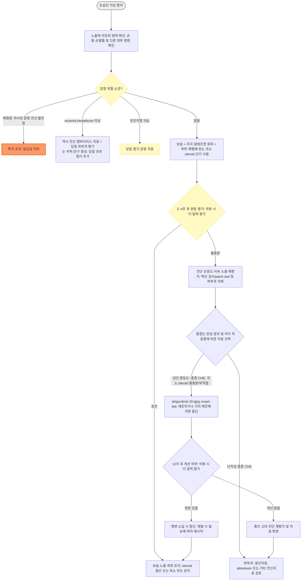

# 습진 Eczema

## <mark style="color:green;">일반 사항</mark>

* 홍반, 가려움, 진물, 딱지 등을 특징으로 하는 비전염성 염증성 피부 질환
* 습진(eczema)은 여러 염증성 피부질환을 포괄하는 임상적 표현으로, 아토피피부염(☞ p.862), 접촉피부염(☞ p.881), 건조습진, 지루피부염(☞ p.886) 등을 포함
* 아토피피부염, 접촉피부염, 지루피부염은 각각 해당 챕터 참조
* 증상
  * 원발 병소 : 홍반성 반점, 구진, 소수포; 병변이 융합하여 판을 형성할 수 있음
  * 2차성 병소 : 수포 파열·긁음에 의한 미란, 진물, 딱지, 인설, 균열; 딱지는 감염 없이도 발생할 수 있음
  * 만성 습진 : 반복적인 긁음에 의해 태선화
* 항생제 치료 : 임상적 세균감염의 증거가 없는 경우 항생제를 사용하지 않음
  * 단순한 진물·딱지만으로 세균감염을 진단하지 않으며, 농포·화농성 분비물, 빠르게 증가하는 홍반·열감·통증 등 감염 소견이 있을 때 감염의 범위·중증도에 따라 치료를 결정함 (☞ p.904)
  * 전신증상 없는 경미한 이차감염에서는 항생제를 일률적으로 추가하지 않음; 국한된 명확한 감염은 국소 항생제 단기 사용, 광범위·중증 감염이나 전신증상이 있으면 경구/정맥 항생제 및 의뢰를 고려함
  * 세균 배양은 초기 경증 병변에서 일률적으로 시행하지 않으며, 감염 치료에 반응하지 않거나 감염이 반복되는 경우 고려함

<table><thead><tr><th width="110">아형</th><th width="180">호발 부위/특징</th><th width="200">주요 악화 인자</th><th>1차 치료</th></tr></thead><tbody><tr><td>손습진</td><td>손, 손가락, 손목</td><td>wet work, 세제·화학물질, 아토피 소인</td><td>보습 + 자극 회피; 급성 악화 시 국소 steroid</td></tr><tr><td>손톱습진<br>(조갑주위 피부염·조갑 변화)</td><td>조갑 및 조갑 주위</td><td>반복적 손톱 손질·외상, 손습진 동반</td><td>보습·자극 회피; 조갑주위 피부에는 중역가 국소 steroid 단기 사용을 고려</td></tr><tr><td>건조습진</td><td>고령자 하지 신측, 겨울철</td><td>저습도, 잦은 비누 사용, 뜨거운 샤워</td><td>보습제, 자극 회피; 필요시 저\~중역가 국소 steroid</td></tr></tbody></table>

***

## ￭ 손습진 Hand eczema

## <mark style="color:green;">일반 사항</mark>

* 자극성·알레르기성 접촉피부염, 아토피 소인 등이 단독 또는 복합적으로 관여하는 다인성 염증성 피부질환
* 물, 세제, 화학물질 등에 대한 반복 노출은 흔한 유발·악화 인자 (☞ p.881)
* 정의 : 국내 델고시티닙 허가자료에서는 손습진이 **3개월 이상 지속**되거나 12개월 내 2회 이상 재발하면 만성 손습진(Chronic Hand Eczema, CHE)으로 정의함. 국내 합의지침(2020; 2021년 출판) 본문은 지속기간을 ‘3개월 초과’로 기술함; 임상적으로 지속·재발하거나 치료 반응이 불충분하면 기간 경계 때문에 평가를 늦추지 않음
* 분류 : 원인 기전에 따라 자극성, 알레르기성, 아토피성 손습진 등으로 분류; 실제로는 여러 아형이 복합적으로 나타나는 경우가 흔함

## <mark style="color:green;">원인 및 위험 인자</mark>

* 다른 피부 질환 : 아토피피부염
* 직업/생활환경 : 주부, 요식업, 의료업, 미용업 등 반복적인 wet work 또는 세제·소독제·화학물질 노출
* 보호장갑의 장시간 착용, 땀·마찰 등도 악화 요인이 될 수 있음

## <mark style="color:green;">임상 양상</mark>

* 가려움, 통증
* 급성 : 손의 홍반, 부종, 진물, 수포
* 만성 : 각질, 갈라짐, 태선화
* 임상 phenotype : 수포성(vesicular; 흔히 한포진/pompholyx로 불림), 과각화성, 손끝(pulp) 습진 등 다양한 형태로 나타날 수 있음
  * 한포진이라는 명칭과 달리 땀샘 폐쇄를 원인으로 단정하지 않음; 수포성 손습진에서도 접촉알레르기·자극 및 발의 진균감염 등을 함께 평가함
* 중증도 평가 : 병변 범위뿐 아니라 균열·통증·가려움, 수면, 손 기능과 직업 수행의 제한을 기록함; 필요시 HECSI, IGA-CHE, DLQI 등을 이용하여 추적함

### <mark style="color:$danger;">🚩 Red Flags!</mark>

<mark style="color:$danger;">**즉각 조치**</mark>

* 저혈압·의식 변화, 또는 빠르게 진행하는 병변에 비례하지 않는 극심한 통증·괴사  `패혈증·괴사성 연조직감염 의심`
* 갑자기 발생한 통증성·단형성 소수포 또는 punched-out erosion(발열 유무와 무관)  `헤르페스성 습진 의심`
* 눈 주위 herpes 병변 또는 안통·시력저하·광과민  `안구 침범 의심`

<mark style="color:$warning;">**당일~수일 내 평가**</mark>

* **(당일)** 퍼지는 홍반·열감·압통(발열 유무와 무관)  `연조직염 의심`

<mark style="color:$info;">**조기 평가 및 추적**</mark>

* 적절한 국소치료에도 2\~4주 내 뚜렷한 호전이 없거나 반복 재발  `치료 반응 불충분·진단 재평가`
* 중등증\~중증 만성 손습진, 직업성 또는 알레르기 접촉피부염 의심  `질환 조절 불충분·접촉알레르기 의심`


헤르페스성 습진은 **전신 항바이러스 치료를 즉시 시작하고 당일 피부과 평가**를 연결함. 확진검사 결과를 기다리며 치료를 지연하지 않음. 눈 주위 병변·안구 증상은 당일 안과 평가도 필요함. 패혈증·괴사성 감염·심한 전신증상·급속 확산은 응급실 의뢰 대상으로 판단함. <mark style="color:$info;">[NICE CG57; 아토피피부염 챕터 참조]</mark>


## <mark style="color:green;">진단 및 감별진단</mark>

* 병력 : 직업, wet work, 세제·소독제·고무장갑, 화장품·접착제, 취미 및 반복 노출 여부 확인
* 알레르기 접촉피부염이 의심되거나 3개월 이상 지속되는 손습진, 표준 치료에 불충분하게 반응하는 경우 patch test(첩포검사)를 권고/피부과 의뢰
  * 기본 항원군과 직업·생활 노출에 맞는 추가 항원군을 선택하며, 양성 반응과 실제 노출의 임상적 관련성을 확인함; 음성 결과만으로 알레르기 접촉피부염을 완전히 배제하지 않음
  * 피부단자검사·특이 IgE 검사는 첩포검사를 대체하지 않음; 식품·단백질 접촉 직후 두드러기성 반응이 있으면 즉시형 알레르기를 별도로 평가함
* 한쪽 손에만 각질성 병변이 지속되거나 경계가 뚜렷한 경우 tinea manuum 감별; 필요시 KOH 검사
* 치료 저항성 병변은 외용제 성분(보존제·향료·고무 첨가제·국소 steroid 자체 포함)에 대한 접촉알레르기도 확인함; 비전형적·지속성 병변은 필요시 피부생검으로 건선 등 다른 질환을 감별함

### <mark style="color:orange;">감별 진단</mark>

<table><thead><tr><th width="220">질환</th><th>감별 포인트</th></tr></thead><tbody><tr><td>tinea manuum</td><td>대개 편측성, 경계가 뚜렷한 인설성 병변; 양측 tinea pedis와 한쪽 손 병변이 함께 나타나는 two feet–one hand pattern에 유의하여 발·발톱도 확인; 필요시 KOH 검사</td></tr><tr><td>psoriasis / palmoplantar psoriasis</td><td>경계가 뚜렷한 인설성·과각화성 판, 손톱 pitting 동반 가능, 팔꿈치·무릎 등 전형적 부위 동반 병변</td></tr><tr><td>scabies</td><td>야간 소양감 심화, 손가락 사이·손목 굴측 등 호발 부위의 burrow 병변, 동거인 유사 증상</td></tr><tr><td>keratolysis exfoliativa</td><td>손바닥·손가락의 반복적인 표재성 박리와 collarette scale; 소양감·염증이 비교적 경미</td></tr><tr><td>palmoplantar pustulosis</td><td>손바닥·발바닥의 무균성 농포와 홍반·인설; 반복 재발</td></tr></tbody></table>

***



<p align="center"><strong>손습진 진단 및 치료 알고리듬</strong></p>

<p align="center"><em><mark style="color:$info;">Ref. 국내 만성 손습진 합의지침(2020; Ann Dermatol. 2021), Bauer A, et al. S2k guideline. JDDG. 2023 및 delgocitinib 허가자료를 반영하여 재구성; delgocitinib 실패가 광선치료·alitretinoin 시작의 필수 조건은 아님</mark></em></p>

***

## <mark style="background-color:$warning;">Management</mark>

### <mark style="color:orange;">비-약물 치료 및 예방</mark>

* 자극 및 알레르겐 회피, wet work 최소화; 손 씻기·감염관리 자체를 중단하지 않으며 필요한 위생수칙을 지킴
* 미지근한 물·순한 무향 세정제를 사용하고 부드럽게 말림; 비누 세척과 알코올 손소독을 불필요하게 연속 반복하지 않음
* 피부 보호 : 작업에 맞는 보호장갑 사용; 고무 첨가제 알레르기가 확인되면 해당 첨가제가 없는 장갑을 선택함; 장시간 밀폐 장갑 착용을 피하고 필요시 보호장갑 안에 면장갑 착용
* 세척 후 즉시 보습제를 충분히 도포하고 하루 여러 차례 반복
* 백선 등 감염성 질환은 확인 후 치료 (☞ p.899, p.923)

### <mark style="color:orange;">약물 치료</mark>

#### 1차 치료

* 피부 보습제 : 1일 수회 도포; glycerol, petrolatum <mark style="color:blue;">\[바셀린]</mark>, urea <mark style="color:blue;">\[유리아]</mark> (☞ p.867)
* 국소 steroid : 손바닥의 두꺼운 병변은 중\~고역가, 손등·손가락 사이의 얇은 피부는 더 낮은 역가를 고려함; 제품별 허가 용법에 따라 qd\~bid 단기 사용하고 2\~4주 내 재평가 (☞ p.1139)
  * mometasone furoate 0.1% **크림** <mark style="color:blue;">\[모리코트크림]</mark> : **1일 1회** 얇게 도포; KADA 2025 기준 크림은 Class III\~IV(중간 역가), 같은 농도의 연고는 Class II(고역가)로 구분함. **2세 이하 영아는 금기**, 소아는 3주 이상 연용하지 않으며 밀봉붕대법을 삼감. <mark style="color:$info;">[KADA 2025 Table 2; 모리코트크림 국내 허가사항]</mark>
  * 두껍고 심한 손바닥 병변은 진찰 후 적절한 고역가 제제·제형을 선택함; 같은 성분·농도라도 크림과 연고의 역가가 다를 수 있으므로 제형을 명시함
  * 호전되면 중단하거나 사용 빈도를 줄임; 반복 재발하는 일부 환자는 진료 하에 간헐적 유지치료를 고려함
  * 소아·임신부는 부위·연령·병변 면적을 고려하여 최소 유효 역가·용량·기간을 선택함
  * 밀폐요법은 국소 steroid 흡수·부작용을 증가시키므로 의료진 지시 아래 제한적으로 시행하며, **모리코트크림처럼 밀봉붕대법을 제한하는 제품에는 적용하지 않음**
  * 감염이 의심되는 병변에는 밀폐요법을 피함
* 급성 fissure·미란·진물 부위에서는 urea가 따가움·자극을 유발할 수 있으므로 petrolatum 등 자극이 적은 보습제를 우선 사용
* 보습제와 항염증 외용제는 역할이 다름; 보습만으로 염증이 지속되면 적절한 항염증 치료를 병행함. 델고시티닙의 도포 간격은 아래 별도 지침을 따름

#### Steroid-sparing / 국소 steroid 반응 불충분 시

* Calcineurin inhibitor : steroid-sparing 또는 유지치료로 고려; tacrolimus <mark style="color:blue;">\[프로토픽]</mark>, pimecrolimus <mark style="color:blue;">\[엘리델]</mark> (☞ p.1143)
  * 아토피피부염 적응증·연령·농도별 허가범위를 확인함; **비아토피성 손습진에 사용하면 허가 외 사용**
  * 손등 병변에서 더 유용할 수 있으며 두꺼운 손바닥 병변에서는 침투·효과가 제한적임; pimecrolimus의 손습진 치료 근거는 일관되지 않음
* delgocitinib 20 ㎎/g cream(국소 pan-JAK 억제제) <mark style="color:blue;">\[앤줍고]</mark> : 국소 steroid 치료에 반응하지 않거나 국소 steroid가 적절하지 않은 성인의 중등도\~중증 만성 손습진에서 고려; 손·손목의 병변에 얇게 bid(약 12시간 간격) 도포
  * 피부가 깨끗하거나 거의 깨끗해질 때까지 사용하고, 호전 후 중단하였다가 재발 시 필요에 따라 재시작함; 12주 치료 후 개선이 관찰되지 않으면 중단을 고려하고 진단·치료를 재평가함
  * 손·손목에만 사용하고 눈·입·점막 접촉을 피함; 동일 부위에 다른 국소 제제를 병용하는 것은 평가되지 않아 권장되지 않음. 도포 직전·직후 보습제 사용은 피함 (국내 허가사항: 도포 전후 2시간 이내 보습제 병용은 연구되지 않음)
  * **국내 허가 대상은 성인**임. 해외 허가자료의 청소년 연령 확대를 국내에 그대로 적용하지 않음. 임신 중에는 사용을 피하는 것이 바람직하며, 수유 중에는 이익이 영아의 잠재적 위험을 상회할 때 사용함; 도포한 손·손목이 유두·주변부 또는 영아 피부에 직접 닿지 않도록 함 (임신·수유 주의: 국내 허가사항)
  * 도포 부위의 새로운 결절·치유되지 않는 병변 등을 확인하고 정기적으로 피부 상태를 평가함 (국내 허가사항)
  * 적용 부위 통증·따가움·가려움·홍반 등의 반응이 나타날 수 있음; 허가자료에서 적용 부위 반응은 1.0%였고 대부분 경증이었음. 자극이 지속되거나 병변이 악화하면 진단·치료를 재평가함
  * 동결을 피하여 실온(1\~30℃) 보관하고 **개봉 후 12개월 이내 사용**함; 도포를 누락하면 가능한 한 빠르게 도포한 뒤 정규 일정으로 복귀함
  * 국내 급여: 2026년 9월 3일 약제급여평가위원회에서 급여 적정성이 인정됨. **심의 통과와 실제 급여 등재·시행은 별개**이며, 본 확인에서는 최종 등재·시행 고시까지 확인되지 않음. <mark style="color:$info;">[HIRA 2026년 제9차 심의결과]</mark>
* **최신 비교 근거** : DELTA FORCE 3상 무작위 직접 비교시험(성인 중증 CHE, 513명)에서 12주 HECSI의 보정 평균 감소는 delgocitinib 크림 67.6점, alitretinoin 51.5점으로 delgocitinib이 우월했음(군 간 차이 −16.1점, 95% CI −23.3\~−8.9). 특정 중증 환자군의 연구 결과로 해석하며, 경증·소아·모든 습진으로 확대하지 않음. delgocitinib 실패를 alitretinoin 또는 광선치료의 필수 선행조건으로 삼지 않음. <mark style="color:$info;">[DELTA FORCE. Lancet. 2025;405:1676–1688]</mark>
* **2026년 전문가 합의** : 국소 steroid만으로 조절이 불충분하거나 사용이 부적절한 만성 손습진에서 델고시티닙 등 허가된 비스테로이드 국소치료를 적시에 고려함. 이는 전문가 합의이며 모든 환자에서 전신치료보다 우월하다는 뜻은 아님. <mark style="color:$info;">[J Drugs Dermatol. 2026;25:228–233]</mark>
* 2\~4주 후 초기 치료 반응 평가
  * 호전 : 국소 steroid 사용 빈도·역가를 줄이고 보습·자극 회피 중심의 유지치료
  * 불충분 : 진단, 순응도, 지속 노출을 재평가하고 patch test/피부과 의뢰 또는 치료 단계 상향 고려

### <mark style="color:orange;">난치성·중증 만성 손습진</mark>

* 대상 : 충분한 회피요법과 적절한 국소 치료에도 반응하지 않는 중등도\~중증 만성 병변
* phototherapy : NB-UVB, 308-nm excimer 등; 가능한 기관으로 의뢰하여 고려. 국외 지침에는 PUVA·UVA1도 포함되지만 국내에서는 장비·광감작제 이용 가능성을 확인함
* alitretinoin(경구 retinoid) : 최소 4주간의 강력한 국소 steroid 치료에도 반응하지 않는 성인의 재발성 만성 중증 손습진에서 고려; 보통 30 ㎎ qd <mark style="color:blue;">\[알리톡]</mark>, 식사와 함께 또는 식사 직후 복용; 이상반응에 따라 10 ㎎ qd로 감량
  * **당뇨병·비만·심혈관 위험인자·이상지질혈증이 있으면 10 ㎎ qd로 시작**하고 내약성·효과에 따라 30 ㎎까지 증량함; 공복 지질 및 필요시 혈당을 더 자주 확인함
  * 가임 여성은 강한 최기형성 위험 때문에 임신 예방 프로그램을 준수함; **치료 시작 1개월 전부터 치료 중 및 종료 후 1개월까지** 상보적인 두 가지 피임법을 유지하고, 치료 전·매 처방 전 매월·종료 5주 후 임신검사를 시행함; 1회 처방은 1개월분을 넘기지 않음 (국내 알리톡 임신 예방 프로그램)
  * 시작 전 및 치료 중 공복 지질·간기능을 확인하고, 갑상선기능(TSH·free T4)은 기저 상태·증상·위험에 따라 추적함. 고중성지방혈증이 조절되지 않거나 췌장염 증상이 생기면 중단함
  * 깨끗하거나 거의 깨끗해지면 바로 중단함. **12주 후에도 중증이면 중단하며, 24주까지 치료 목표에 도달하지 못한 경우에도 중단**함; 목표에 도달한 뒤 24주까지 일률적으로 지속하지 않음
  * 임신·수유, 간장애·중증 신장애/말기 신질환, 조절되지 않는 고지혈증·갑상선기능저하증, 비타민 A 과다증, 대두·땅콩 과민증 등 금기사항 확인; tetracycline계 항생제와 병용하지 않으며 비타민 A 보충제·다른 retinoid 병용을 피함
  * 치료 중 및 종료 후 1개월간 헌혈 금지; 두통·오심·시력장애가 함께 발생하면 두개내압 상승 가능성을 고려하여 중단 후 즉시 평가함
  * 시작 전 및 치료 중 우울증·기분 변화 등을 확인함; 새로운 정신 증상이 발생하면 중단 후 평가함. 시력저하·야간시력 감소, 심한 설사·직장출혈도 중단 및 신속한 평가가 필요함
  * 강력한 CYP3A4·CYP2C9·CYP2C8 억제제 병용 시 10 ㎎ 감량을 고려하고, amiodarone 병용은 권장되지 않음
  * 과도한 햇빛·인공 UV 노출을 피하고 필요시 자외선 차단제 사용; 광선치료 병용 여부는 전문의가 별도로 판단함
* 경구 steroid : 성인의 급성 중증 flare에서 예외적으로 단기간(국내 합의지침의 단기 기준: 약 2주) rescue therapy로 고려; 반복·장기 투여는 피하고 재발 방지 치료를 함께 계획함
* 아토피피부염이 동반된 환자는 해당 질환의 중증도·허가 적응증을 충족하면 dupilumab 등 아토피피부염 표적치료를 별도 고려할 수 있음; 이를 비아토피성 손습진의 일반적인 국내 허가 치료로 제시하지 않음 (☞ 아토피피부염 챕터)
* 면역억제제 : methotrexate <mark style="color:blue;">\[메토트렉세이트]</mark>, azathioprine, cyclosporine 등은 난치성 중증 환자에서 피부과 전문의 평가 후 제한적으로 고려 (☞ p.820)
  * methotrexate·azathioprine의 손습진 치료는 허가 외 사용; cyclosporine도 아토피피부염 등 별도 허가 적응증에 해당하지 않는 손습진에서는 허가 외 사용임. 감염·혈압·신기능·간기능·혈구 수 등 약제별 모니터링이 필요함
* 다한증이 주요 악화 인자인 일부 환자에서는 iontophoresis 등을 제한적으로 고려; botulinum toxin은 손바닥 다한증/손습진에 대한 허가 외 사용 및 제한적인 근거를 설명한 뒤 전문의가 판단함

***

## <mark style="color:purple;">처방례</mark>

> **처방례 1. 경증 자극성 손습진**
>
> ```
> 바셀린  1일 수회 도포
> ```
>
> _✽경증 자극·마찰성 손습진은 보습제만으로 호전되는 경우가 많음; wet work 최소화 및 보호장갑 병행 안내_

> **처방례 2. 중등도 급성 악화**
>
> ```
> 모리코트크림 0.1%  1일 1회  병변에 얇게 도포 (1~2주 후 재평가)
> 바셀린  1일 수회 도포
> ```
>
> _✽성인의 중등도 손습진에 중간 역가 크림을 단기간 사용하는 예임. 두껍고 심한 손바닥 병변에 고역가 연고를 쓰는 처방과는 구분함; 불충분하면 진단·노출·순응도와 제형을 재평가하고 적절한 고역가 제제를 별도 선택. 손가락 사이의 얇은 피부에는 더 낮은 역가를 고려하며, 밀봉붕대법은 삼감_

> **처방례 3. 성인 중등도\~중증 만성 손습진 / 국소 steroid 불충분·부적절**
>
> ```
> 앤줍고 크림 20 ㎎/g (2%)  손·손목 병변에 얇게  bid (약 12시간 간격)
> ```
>
> _✽국소 steroid에 반응하지 않거나 적절하지 않은 성인 중등도\~중증 만성 손습진에서 고려; 깨끗하거나 거의 깨끗해지면 중단하고 재발 시 필요에 따라 재시작; 12주 후 개선이 없으면 중단 고려_

> **처방례 4. 중증 난치성 손습진**
>
> ```
> 알리톡 30 ㎎/캡슐  1캡슐 qd, 식사와 함께 또는 식사 직후 복용
> 당뇨병·비만·심혈관 위험인자·이상지질혈증: 알리톡 10 ㎎/캡슐  1캡슐 qd로 시작
> ```
>
> _✽충분한 국소 steroid 치료(최소 4주)에도 반응 없는 중증 만성 손습진에서 고려; 가임 여성은 치료 시작 1개월 전부터 치료 중 및 종료 후 1개월까지 피임·임신 예방 프로그램 준수. 12주에도 중증이거나 24주까지 목표에 도달하지 못하면 중단_

***

## ￭ 손톱습진 Nail eczema

## <mark style="color:green;">원인</mark>

* 손톱습진은 독립적인 원인 분류라기보다 습진에 동반된 조갑주위 피부염과 조갑 변화를 뜻함; 자극·알레르기 노출로 인한 만성 조갑주위염과 겹칠 수 있음
* 만성 조갑주위염은 6주를 초과하여 지속하는 조갑주위 염증으로, 큐티클 장벽 손상·반복 자극이 주요 기전임; Candida는 이차적으로 집락화할 수 있어 검출 자체가 원인임을 뜻하지 않음
* 손습진과 같은 자극·알레르기 요인이 관여하며, 반복적인 손톱 손질·큐티클 제거·젤/인조손톱 제품과 외상도 악화 요인

## <mark style="color:green;">임상 양상</mark>

* nail fold 염증성 변화가 흔함
* transverse ridge, 색조 변화, 조갑 박리증
* 많이 사용하는 손에 심할 수 있음
* 피부 염증이 호전되어도 기존 조갑 변화가 새 손톱 성장으로 회복되기까지 수개월이 걸릴 수 있음

### <mark style="color:$danger;">🚩 Red Flags!</mark>

<mark style="color:$danger;">**즉각 조치**</mark>

* 급속 확산·심한 전신증상·괴사 또는 병변에 비례하지 않는 심한 통증  `패혈증·괴사성 연조직감염 의심`

<mark style="color:$warning;">**당일~수일 내 평가**</mark>

* **(당일)** 조갑 주위 급성 화농·농양, 확산하는 홍반·압통  `급성 조갑주위염·연조직염 의심`
* **(당일)** 손끝의 군집성 수포와 통증  `헤르페스성 손끝염 의심`

<mark style="color:$info;">**조기 평가 및 추적**</mark>

* 진균검사 음성이지만 지속하는 병변, 진단 불확실, 조갑 건선 등과 감별 곤란  `다른 조갑 질환 감별`
* 한 손가락의 지속적인 비대칭 조갑주위 병변·궤양·출혈·결절 또는 새로운 색소띠  `조갑 종양 감별`
* 수 주간 조갑주위 염증이 호전되지 않거나 반복 재발  `진단·노출·치료 반응 재평가`

## <mark style="color:green;">진단 및 감별진단</mark>

* 조갑진균증, nail psoriasis, 만성 조갑주위염, 반복 외상에 의한 조갑 변화를 감별
* 조갑박리, 과각화, 변색 등 조갑진균증이 의심되는 경우 KOH·배양 또는 손발톱 검체 PAS 염색 등 진균검사를 고려함; 전신 항진균제 투여 전 진균감염을 확인함
* 젤·인조손톱 노출과 연관되거나 지속하는 조갑주위 피부염은 acrylate 등 관련 항원의 첩포검사를 고려함; 제품을 피부에 직접 발라 자가 검사하지 않음

## <mark style="background-color:$warning;">Management</mark>

* 손습진의 원인 회피 및 피부보호 원칙을 동일하게 적용
* 손톱 손질, 손톱에 대한 충격 및 반복 자극을 피함
* 점도가 높은 보습제 사용 <mark style="color:blue;">\[바셀린]</mark>
* 조갑주위 피부 염증은 중역가 국소 steroid를 단기간 사용하고 2\~4주 내 재평가함 (☞ p.1139)
* clobetasol propionate 0.05% <mark style="color:blue;">\[베타베이트크림]</mark>은 **초고역가**로, 두꺼운 난치 병변 등에 제한하여 짧게 사용함; 얇은 조갑주위 피부에 기본 치료로 일률적으로 적용하지 않으며 피부 위축에 주의함. 베타베이트크림은 2주 이상 연속 치료·주 50 g 초과 사용을 피함
* 조갑주위 감염은 임상적으로 감염이 확인되거나 의심될 때 적절히 치료; 만성 조갑주위염의 Candida 검출만으로 전신 항진균제를 일률적으로 사용하지 않음
* 급성 세균성 농양은 배농을 고려하고 연조직염·전신증상·면역저하 여부에 따라 항생제를 결정함. **헤르페스성 손끝염은 절개·배농하지 않음.**
* 수 주 후에는 조갑주위 피부 염증의 호전을 평가하며, 손톱 모양이 정상화되기까지 수개월이 걸릴 수 있음을 설명함

***

## ￭ 건조습진 Asteatotic eczema, Xerotic eczema

## <mark style="color:green;">일반 사항</mark>

* 피부건조와 장벽 손상에 동반되는 염증성 피부염; 경증이 흔하지만 광범위하거나 심한 염증으로 진행할 수도 있음
* 주로 겨울철, 고령자의 정강이에 흔함; 팔·몸통에도 발생할 수 있음. 동계 소양증(winter itch)은 겨울철 가려움의 표현으로 건조습진과 완전히 같은 뜻은 아님

## <mark style="color:green;">원인</mark>

* 낮은 습도, 잦은 목욕·비누 세척, 뜨거운 물·직접 난방열, 노화에 따른 피부 장벽 손상
* 약물(retinoid, 이뇨제 등)과 갑상선기능저하증·영양결핍 등 기저 질환을 병력에 따라 확인함

## <mark style="color:green;">임상 양상</mark>

* 증상 : 가려움, 건조, 갈라짐, 각질
* 특징적 소견 : eczema craquelé - 건조한 피부에 얕은 균열이 그물망 또는 마른 논바닥처럼 나타남

### <mark style="color:$danger;">🚩 Red Flags!</mark>

<mark style="color:$danger;">**즉각 조치**</mark>

* 저혈압·의식 변화·급속한 전신 악화, 괴사 또는 병변에 비례하지 않는 심한 통증  `패혈증·괴사성 연조직감염 의심`

<mark style="color:$warning;">**당일~수일 내 평가**</mark>

* **(당일)** 확산하는 홍반·열감·압통 또는 화농  `연조직염·이차감염 의심`

<mark style="color:$info;">**조기 평가 및 추적**</mark>

* 적절한 국소 steroid·보습에도 수 주간 호전 없는 광범위 병변  `진단 재평가`
* 갑상선기능저하증·신부전·영양결핍을 시사하는 병력·전신 소견  `기저 질환 의심`
* 새로 생긴 광범위 인설에 체중감소·전신증상 동반  `후천성 어린선·전신 질환 감별`

## <mark style="color:green;">진단 및 감별진단</mark>

* 전형적 임상 소견으로 진단하며 대부분 일률적인 혈액검사는 필요하지 않음
* 하지 부종·정맥류·색소침착이 동반되면 정체피부염, 동전 모양 판은 화폐상습진, 환상 병변은 체부백선, 야간 가려움·동거인 증상은 옴을 감별함
* 새로 생긴 광범위한 피부건조·인설에 체중감소·전신증상이 동반되거나 후천성 어린선이 의심되면 기저 질환을 평가함

## <mark style="background-color:$warning;">Management</mark>

### <mark style="color:orange;">비-약물 치료 및 예방</mark>

* 피부 자극 및 환부에 대한 비누·강한 세정제 사용을 피함
* 미지근한 물로 짧게 샤워
* 목욕/샤워 후 가능한 한 즉시 충분한 피부 보습제 도포 (☞ p.867)
* 과도한 실내 건조와 직접 난방열을 피함; 실내 습도 40\~50%는 관리 예시이며 고정된 치료 목표는 아님
* 매우 건조한 피부는 크림·연고형 보습제를 하루 여러 차례 사용함; 염증이 가라앉은 뒤에도 지속하여 재발을 예방함

### <mark style="color:orange;">약물 치료</mark>

* 홍반·염증·소양이 뚜렷한 경우 저\~중역가 국소 steroid를 단기간 사용; hydrocortisone 1% <mark style="color:blue;">\[락티케어 HC 로션 1%]</mark>; **락티케어에취씨로션1%는 사용 전 잘 흔들어 1일 1\~3회 도포하고 치료기간은 7일 이내로 제한**함; 이 기간에도 호전되지 않거나 악화하면 중단 후 재평가하며, 일반적인 1\~2주 재평가 원칙을 이 제품의 연용기간으로 적용하지 않음
  * 밀폐요법은 routine으로 시행하지 않으며, 필요한 경우 부작용과 감염 여부를 고려하여 제한적으로 사용
* 필요시 가려움증 치료 (☞ p.857)
  * 건조습진 가려움은 주로 피부건조·장벽 손상·염증과 관련되므로 보습·적절한 항염증 치료가 우선이며, 경구 항히스타민제를 일상적으로 추가하지 않음. 특히 고령자에서는 1세대의 항콜린성 부작용·섬망·낙상 위험 때문에 원칙적으로 피함. 동반 두드러기·알레르기비염 등 히스타민성 증상이 있으면 해당 적응증에 따라 2세대를 고려함(☞ 212 항히스타민제)

***

## <mark style="color:red;">질병코드</mark>

<table><thead><tr><th>코드</th><th>KCD-9 분류명</th><th>적용 참고</th></tr></thead><tbody><tr><td>L30.8</td><td>기타 명시된 피부염<br>Other specified dermatitis</td><td>다른 특정 원인·형태 코드로 분류되지 않는 명시된 피부염</td></tr><tr><td>L30.9</td><td>상세불명의 피부염<br>Dermatitis, unspecified</td><td>습진 NOS 포함; 원인·유형을 특정할 수 없을 때</td></tr><tr><td>L30.1</td><td>발한이상[한포(汗疱)]<br>Dyshidrosis [pompholyx]</td><td>한포진으로 진단한 수포성 병변; 모든 손습진에 적용하지 않음</td></tr><tr><td>L24.0</td><td>세제에 의한 자극물접촉피부염</td><td>세제에 의한 자극성 손습진</td></tr><tr><td>L24.9</td><td>상세불명 원인의 자극물접촉피부염</td><td>자극성 기전은 확인되나 원인 물질이 불명확한 경우</td></tr><tr><td>L23.9</td><td>상세불명 원인의 알레르기성 접촉피부염</td><td>알레르기성 기전은 확인되나 원인 물질이 불명확한 경우</td></tr><tr><td>L20.9</td><td>상세불명의 아토피성 피부염</td><td>아토피피부염에 해당할 때; 더 구체적인 코드가 있으면 우선 선택</td></tr><tr><td>L60.8</td><td>기타 손발톱장애<br>Other nail disorders</td><td>동반된 손발톱장애; 조갑주위 피부염 자체와 구분</td></tr><tr><td>L85.3</td><td>피부건조증<br>Xerosis cutis</td><td><strong>건성 습진(Xerotic eczema)·건조피부피부염(Dry skin dermatitis) 포함</strong></td></tr></tbody></table>

* 손습진이라는 부위명만으로 코드를 정하지 않으며, 원인·유형이 확인되면 해당 세부 코드를 선택함. L23.9·L24.9는 원인 물질까지 확인된 경우의 기본 코드가 아님.
* 임상적으로 피부건조만 있는 상태와 염증을 동반한 건조습진을 구분하되, **KCD-9의 L85.3에는 ‘건성 습진’도 포함**됨. 건조습진을 일률적으로 L30.8로만 분류하거나 L85.3 적용을 배제하지 않음.
* 위 코드는 저장된 **KCD9_251216(6).xlsx**의 「상병분류기호(전체)」와 「상병분류기호(완전코드)」 시트에서 코드·한글명·포함 용어를 대조함(2026-10-30).

***

## <mark style="color:$success;">핵심 복약 지도</mark>

> **국소 스테로이드, 얼마나 오래 쓰나요?**
>
> * 급성 악화 시 부위와 제형에 맞는 스테로이드를 정해진 횟수로 단기간 사용합니다. 모리코트크림은 하루 1회입니다. 이 처방례는 1\~2주 후 효과와 부작용을 재평가하며, 제품별 더 짧은 사용 제한을 우선합니다. 밀봉붕대법은 사용하지 않습니다.
> * 건조습진에 쓰는 락티케어에취씨로션 1%는 사용 전 잘 흔들며, 하루 1\~3회·7일 이내로 사용합니다. 7일 내 호전이 없거나 악화하면 중단하고 다시 진료를 받습니다.
> * 장기간 임의로 연장 사용 시 피부 위축, 모세혈관 확장이 발생할 수 있습니다.
> * 증상이 가라앉으면 보습제 중심 유지치료로 전환하고 스테로이드는 최소 빈도로 줄입니다.

> **delgocitinib 크림(앤줍고), 이렇게 사용하세요**
>
> * 손과 손목의 깨끗하고 건조한 병변 부위에 얇게 도포하며, 하루 2회(약 12시간 간격)를 넘지 않습니다.
> * 병변이 깨끗하거나 거의 깨끗해지면 중단하고, 재발 시 의사의 안내에 따라 다시 사용합니다.
> * 같은 부위에 다른 치료용 연고를 임의로 병용하지 않습니다. 보습제를 바르는 시간은 처방 지시를 따릅니다(이 약 도포 전후 2시간 이내 병용은 연구되지 않았습니다).
> * 눈·입·점막에 닿지 않게 하며, 수유 중에는 도포한 손이 유두나 아기 피부에 직접 닿지 않도록 합니다.
> * 냉동하지 말고 실온에 보관하며, 개봉일을 적어 두고 개봉 후 12개월 이내 사용합니다. 점막에 닿으면 물로 충분히 씻어 냅니다.

> **alitretinoin 복용 시 임신 예방**
>
> * 식사와 함께 또는 식사 직후 하루 1회 복용합니다. 용량은 위험인자에 따라 다르므로 임의로 늘리지 않습니다.
> * 태아 기형을 일으킬 위험이 높으므로, 임신 가능한 여성은 치료 시작 **1개월 전부터 복용 중 및 중단 후 1개월까지** 서로 보완하는 두 가지 피임법을 유지해야 합니다. 치료 전과 복용 중 매월, 복용 중단 5주 후에 임신검사를 받습니다.
> * 임신이 의심되면 즉시 복용을 중단하고 의료진에게 알립니다. 임신 중·수유 중에는 복용하지 않습니다.
> * 복용 중 및 중단 후 1개월간 헌혈하지 않으며, 다른 사람에게 약을 주지 않습니다.
> * 정기적으로 공복 지질·간기능을 확인하고, 갑상선기능과 혈당은 상태에 따라 추적합니다.
> * 과도한 햇빛이나 인공 자외선 노출을 피하고 필요시 자외선 차단제를 사용합니다.
> * 시력이 나빠지거나 심한 두통·구토, 심한 복통·설사·혈변, 우울감·기분 변화가 새로 생기면 복용을 중단하고 신속히 진료를 받습니다.

> **언제 다시 병원을 방문해야 하나요?**
>
> * 적절한 치료에도 2\~4주 이내에 호전이 없거나 반복 재발하는 경우
> * 급속히 퍼지는 홍반·열감과 심한 통증, 발열 등이 동반되는 경우 - 즉시 내원
> * 광범위한 수포·미란과 통증이 동반되는 경우 - 즉시 내원

***

## <mark style="color:blue;">주요 참고문헌 및 확인 자료</mark>

### <mark style="color:orange;">임상 근거</mark>

* Ko HC, et al. [KADA 치료 합의지침 Part I](https://doi.org/10.5021/ad.24.153). Ann Dermatol. 2025;37(4):201–215. 제형별 국소 스테로이드 역가(Table 2).

* [2020 Korean Consensus Guidelines for Diagnosis and Treatment of Chronic Hand Eczema](https://doi.org/10.5021/ad.2021.33.4.351). Ann Dermatol. 2021;33:351–360.
* [Bauer A, et al. S2k guideline diagnosis, prevention, and therapy of hand eczema](https://doi.org/10.1111/ddg.15179). JDDG. 2023;21:1054–1074.
* [Giménez-Arnau AM, et al. DELTA FORCE: delgocitinib cream versus oral alitretinoin in adults with severe chronic hand eczema](https://doi.org/10.1016/S0140-6736(25)00001-7). Lancet. 2025;405(10490):1676–1688.
* [Expert Consensus on Advanced Topical Nonsteroidal Therapies for Chronic Hand Eczema](https://doi.org/10.36849/JDD.9807). J Drugs Dermatol. 2026;25(3):228–233. 전문가 합의 수준의 근거.
* [NICE NG190. Secondary bacterial infection of eczema: antimicrobial prescribing](https://www.nice.org.uk/guidance/ng190/chapter/Recommendations).
* [NICE CG57. Atopic eczema in under 12s: diagnosis and management](https://www.nice.org.uk/guidance/cg57/chapter/recommendations). 헤르페스성 습진의 즉시 치료·당일 전문 평가.
* [British Association of Dermatologists. Chronic paronychia](https://www.bad.org.uk/pils/chronic-paronychia); [DermNet. Herpetic whitlow](https://dermnetnz.org/topics/herpetic-whitlow); [DermNet. Asteatotic eczema](https://dermnetnz.org/topics/asteatotic-eczema); [DermNet. Dyshidrotic eczema](https://dermnetnz.org/topics/dyshidrotic-eczema).

### <mark style="color:orange;">허가·급여 확인 자료</mark>

* [식품의약품안전처 의약품안전나라](https://nedrug.mfds.go.kr/). 모리코트크림(200300107), 앤줍고크림(202502369), 알리톡연질캡슐30㎎(201306905), 락티케어에취씨로션1%(201201043) 등. 앤줍고 품목허가 보고서(2025-09-08 허가; 사용자 제공 PDF 재대조)와 알리톡 안전성·유효성 공개자료를 확인하고 국내 허가사항 전재본을 교차 확인함(2026-10-30).
* [EMA. Anzupgo: Product information](https://www.ema.europa.eu/en/documents/product-information/anzupgo-epar-product-information_en.pdf). 보습제 도포 간격·임신·수유·피부검사 등 국외 안전성 자료; 국내 연령 적응증과 구분함.
* [HIRA. 2026년 제9차 약제급여평가위원회 심의결과](https://www.hira.or.kr/bbsDummy.do?brdBltNo=11898&brdScnBltNo=4&pgmid=HIRAA020041000100). 급여 적정성 인정과 최종 등재·시행은 구별함.
* [알리톡 임신 방지 프로그램: 환자 가이드](https://www.toctino.com/assets/pdf/Korea/Patient%20Guide%20for%20PPP_v2.0.pdf); [Toctino SmPC](https://www.medicines.org.uk/emc/product/7543/smpc). 국내 임신 예방 교육자료 및 국외 안전성 자료.
* KCD9_251216(6).xlsx. 「상병분류기호(전체)」·「상병분류기호(완전코드)」; 질병코드·포함 용어 대조 자료.

***

## <mark style="color:blue;">환자 안내서</mark>


**손습진, 반복되는 원인을 피하는 것이 치료의 시작입니다**

손습진은 물·세제 등에 의한 자극, 특정 물질에 대한 알레르기, 아토피 소인 등이 함께 작용할 수 있는 염증성 피부 질환입니다. 보습과 자극 회피만으로도 상당 부분 호전될 수 있습니다.


#### <mark style="color:$primary;">왜 손습진이 생기나요?</mark>

* 물, 세제, 소독제 등에 자주 노출되는 직업(주부, 요식업, 의료업, 미용업 등)에서 흔히 발생합니다.
* 원래 아토피 피부를 가진 분들은 손습진이 더 잘 생기고 잘 낫지 않을 수 있습니다.

#### <mark style="color:$primary;">일상생활에서 어떻게 관리하나요?</mark>

* **물, 세제와의 접촉을 줄이십시오.** 설거지·청소 시 필요하면 면장갑 위에 보호장갑을 착용하고, 장시간 연속 착용하거나 장갑 안에 땀이 차는 것을 피하십시오.
* **손을 씻은 직후 보습제를 충분히 바르십시오.** 하루 여러 차례, 특히 물일을 한 뒤에는 반드시 발라주세요.
* 손 세정·소독을 자주 해야 하는 경우 무향 제품을 선택하고, 손이 마른 뒤 보습제를 충분히 사용하십시오. 비누 세척과 알코올 손소독을 불필요하게 연속해서 반복하지 마십시오.
* **반지는 물일을 할 때 빼두십시오.** 반지 밑에 세제·물이 고여 자극을 악화시킬 수 있습니다.

#### <mark style="color:$primary;">약은 어떻게 써야 하나요?</mark>

* 스테로이드는 정해진 부위·횟수·기간대로 사용합니다. 보통 1\~2주 후 반응을 확인하며, 락티케어에취씨로션 1%처럼 7일 이내로 사용해야 하는 제품도 있습니다. 임의로 장갑·랩으로 덮지 마십시오. 증상이 좋아지면 처방 지시에 따라 줄이거나 중단하고 보습은 계속합니다.
* 새로운 치료제(델고시티닙 크림 등)를 처방받은 경우, 정해진 부위에만 얇게 바르고 사용법을 지켜주세요.

#### <mark style="color:$primary;">이럴 때는 즉시 병원을 방문하세요</mark>

* 손이 갑자기 붉어지고 뜨거워지며 심하게 아픈 경우
* 통증이 있는 비슷한 모양의 물집이나 피부가 움푹 패인 상처가 갑자기 늘어나는 경우; 눈 주위 병변·눈 통증·시력저하가 있으면 즉시 진료를 받으십시오.
* 열이 나면서 증상이 빠르게 나빠지는 경우

#### <mark style="color:$primary;">손톱 주변 습진은 어떻게 관리하나요?</mark>

* 큐티클을 자르거나 밀어내지 말고, 젤·인조손톱과 반복적인 손톱 손질을 피하십시오.
* 손톱 주변 피부에 보습제를 바르고 물·세제 노출을 줄이십시오. 손톱 모양이 회복되기까지는 수개월이 걸릴 수 있습니다.
* 고름·심한 통증·붉은 기운이 퍼지면 당일 진료를 받으십시오. 아픈 물집을 바늘로 터뜨리거나 짜지 마십시오.

#### <mark style="color:$primary;">다리의 건조습진은 어떻게 관리하나요?</mark>

* 미지근한 물로 짧게 씻고 때를 밀지 마십시오. 씻은 뒤 바로 크림·연고형 보습제를 바르십시오.
* 보습은 피부가 좋아진 뒤에도 계속하고, 전기난로나 뜨거운 바람을 피부에 직접 쐬지 마십시오.
* 피부가 갑자기 넓게 벗겨지면서 체중감소·발열 등이 동반되거나 치료해도 낫지 않으면 다시 진료를 받으십시오.

