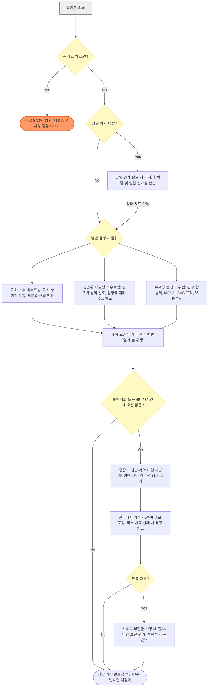

# 농가진 Impetigo

## <mark style="color:green;">일반 사항</mark>

* 세균에 의한 표재성 피부감염(pyoderma)
* 주 원인균 : **Staphylococcus aureus**, **Streptococcus pyogenes (GAS)**
* 잠복기 : GAS 농가진은 약 10일
* 경과 : 치료하지 않아도 수 주 내 자연 호전될 수 있으나, 병변의 치유를 촉진하고 전파를 줄이기 위해 항균 치료 권장. 항생제 치료가 PSGN을 확실히 예방하는 것은 아님
* 전파 : 병변과의 **직접 피부 접촉** 또는 수건·의류·침구 등 오염 물품을 통한 간접 접촉
* 피부 장벽 손상(긁힘, 벌레 물림, 찰과상, 습진, 옴 등)이 있으면 발생 위험 증가
* **농창(ecthyma)** : 표피를 넘어 진피까지 침범하는 깊은 궤양성 pyoderma. 농가진보다 깊고 흉터를 남길 수 있으며 **경구 항생제 치료가 필요**

## <mark style="color:green;">원인</mark>

* **S. aureus** : 비수포성 농가진의 주요 원인 중 하나이며, 수포성 농가진은 toxin-producing S. aureus에 의해 발생
* **S. pyogenes (GAS)** : 비수포성 농가진의 원인이 될 수 있으며 S. aureus와 혼합 감염도 가능
* 임상 병변의 형태만으로 원인 균주를 신뢰성 있게 구분하기는 어려움

### <mark style="color:orange;">위험 인자</mark>

* 2\~5세 소아
* 덥고 습한 환경, 여름\~가을
* 상처, 긁힘, 벌레 물림, 화상, 찰과상
* 위생 불량 및 밀집 환경(보육시설, 학교 등)
* 아토피피부염, 습진, 접촉피부염, 옴, 이(pediculosis), 피부사상균증, 수두, 단순포진 등 피부 장벽 손상 질환
* 면역저하 상태(전신 스테로이드, 항암치료, 당뇨병, HIV, 투석 등)
* 최근 항생제 사용
* 피부 접촉이 많은 운동 또는 활동

## <mark style="color:green;">임상 양상</mark>

### <mark style="color:orange;">비수포성 농가진 (Non-bullous impetigo)</mark>

* 전체 농가진의 약 70%를 차지
* 호발 연령 : 학령기 이전 소아
* 형태 : 작은 홍반성 구진/수포 또는 농포 → 파열 → 진물 → 특징적인 **노란 꿀색 가피(honey-colored crust)**
* 부위 : 얼굴(특히 코·입 주변), 사지 등 노출 부위 및 손상 피부
* 전파 : 손, 손톱, 옷, 수건 등을 통해 자가접종 또는 타인에게 전파
* 임상 양상 : 가려움이 있을 수 있으며 국소 림프절병증이 동반될 수 있음. 대개 통증과 전신 증상은 경미하거나 없음
* 경과 : 보통 흉터 없이 치유되나, 염증 후 과색소침착 또는 저색소침착이 일시적으로 남을 수 있음
* 합병증 : 연조직염, 림프관염, 화농성 림프절염, 드물게 **post-streptococcal glomerulonephritis (PSGN)**
  * PSGN은 사슬알균 피부감염 후 약 3주까지의 잠복기를 거쳐 발생할 수 있음(인두염 후의 약 10일과 구분). 눈두덩·하지 부종, 고혈압, 콜라색 소변 또는 소변량 감소 → **당일 소변검사·혈압·신기능 평가 및 필요 시 소아청소년과/신장내과 의뢰**
  * 현미경혈뇨만 보이는 무증상 PSGN도 가능. 혈뇨·단백뇨를 단순한 일과성 변화로 단정하지 않고 평가함. 합병증 증상이 없는 전형적 농가진에서 일률적인 소변검사는 필요하지 않음


**GAS 감염 후 비화농성 합병증**

GAS 농가진의 항생제 치료는 감염 치료와 전파 감소에 중요하지만, **PSGN 발생을 확실히 예방한다는 근거는 불충분**함. CDC 2025는 최근 근거에 따라 **농가진을 포함한 GAS 피부감염 뒤에도 급성 류마티스열이 발생할 수 있음**을 명시함. 이를 국내 농가진에서 흔한 합병증으로 일반화하지 않으며, 합병증 소견이 없는 환자에게 일률적인 소변검사·심장검사를 시행하는 근거로 해석하지 않음

<mark style="color:$info;">Ref. CDC. Clinical Guidance for Group A Streptococcal Impetigo; Clinical Guidelines for Post-Streptococcal Glomerulonephritis, 2025.</mark>


### <mark style="color:orange;">수포성 농가진 (Bullous impetigo)</mark>

* 주로 영유아에서 발생하며, 비수포성과 달리 **손상되지 않은 피부에도 발생**
* exfoliative toxin을 생성하는 **S. aureus**가 표피의 desmoglein 1을 분해하여 발생. 수포성도 접촉 전파가 가능하므로 동일한 위생·접촉 관리가 필요
* 형태 : 얇은 지붕의 이완성 수포(flaccid bullae) → 쉽게 파열 → 두꺼운 가피 없이 얕고 습한 미란과 얇은 갈색/황색 가피, 가장자리의 **인설 테(collarette of scale)**
* 부위 : 몸통, 겨드랑이, 사타구니·기저귀 부위, 사지 등
* 국소 홍반은 심하지 않을 수 있으며, 병변이 빠르게 퍼질 수 있음
* **구강·안구 점막 침범은 전형적이지 않음**. 점막 미란·궤양이 뚜렷하면 HSV, SJS/TEN 또는 면역수포질환 등 다른 진단을 평가. 국소 림프절병증은 드묾
* 영아의 광범위 병변은 발열·처짐 등 전신 증상을 동반할 수 있음. **신생아는 병변이 적더라도 당일 소아청소년과 평가**를 통해 침습성 감염과 입원 필요성을 판단함
* 영아에서 광범위한 수포·피부 압통·박리가 있으면 **staphylococcal scalded skin syndrome (SSSS)** 감별 필요

### <mark style="color:$danger;">🚩 Red Flags!</mark>


<mark style="color:$danger;">**즉각 조치**</mark>

응급실 이송 및 입원·전문과 평가를 즉시 시행함

* 빠르게 진행하는 광범위 홍반·부종과 병변에 비해 심한 통증, 피부 괴사·자색 변화 또는 심부 감염 소견  `괴사성 감염`
* 저혈압·의식 변화·말초 관류 저하 등 전신독성 소견(고열이 없어도 배제하지 않음)  `패혈증`
* 광범위 수포·피부 압통·박리, 특히 영아  `SSSS 의심`
* 영아의 광범위 표피 박리와 수유 감소·소변량 감소·처짐  `탈수`
* PSGN 의심 환자의 호흡곤란·폐부종, 심한 고혈압에 동반된 두통·의식 변화 또는 현저한 핍뇨  `중증 신염 합병증`



<mark style="color:$warning;">**당일~수일 내 평가**</mark>

아래 항목은 **당일** 평가 후 소아청소년과 등 전문진료·입원 필요성을 판단함. 전신독성·괴사성 감염 소견이면 즉각 조치함

* 신생아의 농가진 또는 영아(1세 미만)의 수포성 농가진  `영아 감염`
* 면역저하자의 광범위 농가진  `면역저하`
* 전신 상태 불량, 발열·활동 저하 또는 광범위 수포성 병변  `중증 감염`
* 병변 주변으로 퍼지는 홍반·열감·압통  `연조직염`
* 적절한 치료 중에도 빠르게 악화하는 병변  `치료 중 악화`
* 농가진 이후 수 주 내 부종, 고혈압, 육안적 혈뇨(콜라색 소변) 또는 소변량 감소  `PSGN 의심`



<mark style="color:$info;">**조기 평가 및 추적**</mark>

진단·복약 이행·내성 및 재발 요인을 평가함. 농창은 경구 항생제로 치료하고 반응을 확인하며, 악화·심부 진행·전신 증상은 즉각 조치 또는 당일 평가 기준에 따라 평가함

* 전신 상태가 안정적인 농창(ecthyma)  `심부 농피증`
* 치료 시작 후 48–72시간 내 호전이 없거나 치료 종료 후에도 지속되는 안정적 병변  `반응 지연`
* 잦은 재발  `반복 감염`
* MRSA 또는 집단 발생 의심  `내성균·집단 발생`
* 반복적인 피부 장벽 손상 질환(아토피피부염, 옴 등) 동반  `재발 위험`


## <mark style="color:green;">진단</mark>

* 전형적인 경우는 임상적으로 진단하며 검사 없이 치료 가능
* 전신 증상이나 합병증 단서가 없는 국소 농가진에서 혈액검사·혈액배양·영상검사를 일률적으로 시행하지 않음. 패혈증·SSSS·심부 감염이 의심되면 해당 질환에 맞추어 검사하며 의뢰·치료를 지연하지 않음
* 다음의 경우 병변의 농/삼출물에서 **배양 및 감수성 검사** 고려
  * 치료 실패 또는 악화
  * 반복 재발
  * MRSA 의심
  * 집단 발생
  * 중증·광범위 또는 비전형적 병변
* 재발이 반복되면 **병변 배양을 시행**하고, 임상 상황에 따라 **S. aureus 비강 보균 평가**를 고려. 정상 피부·비강의 보균 결과만으로 병변의 원인균을 단정하지 않음
* 반복 재발 또는 가정 내 반복 전파가 의심되면 **가족·동거인 내 동시/반복 피부감염 여부를 확인**하고, routine 검사는 아니지만 필요 시 접촉자의 보균 가능성 평가 및 decolonization 전략을 개별적으로 고려

### <mark style="color:orange;">감별</mark>

* 병변 형태만으로 S. aureus와 GAS를 구분하지 않음

<table><thead><tr><th width="170">질환</th><th>농가진과의 핵심 감별 포인트</th></tr></thead><tbody><tr><td>접촉피부염/아토피피부염</td><td>소양감과 습진성 병변이 우세. 진물·가피 또는 S. aureus 보균만으로 항생제가 필요한 감염으로 단정하지 않음</td></tr><tr><td>단순포진(HSV)/포진상 습진</td><td>통증성 군집 수포 또는 균일한 둥근 파인 미란(punched-out erosion). 아토피피부염 환자에서 급속 확산·발열이 있으면 포진상 습진을 의심하여 당일 평가; 세균감염 동반도 가능</td></tr><tr><td>수두/대상포진</td><td>다양한 단계의 수포 또는 피부절 분포</td></tr><tr><td>tinea</td><td>환상형 병변, 인설</td></tr><tr><td>SSSS</td><td>영유아, 광범위 압통성 홍반·표피 박리</td></tr><tr><td>cellulitis/erysipelas</td><td>더 깊은 홍반·열감·압통, 전신 증상 가능</td></tr></tbody></table>

***



<p align="center"><strong>농가진 진료 알고리듬</strong></p>

<p align="center"><em><mark style="color:$info;">Ref. NICE NG153 (2020); CDC Clinical Guidance for Group A Streptococcal Impetigo (2025); ACE SSTI ACG (2026)</mark></em></p>


**알고리듬 해설**

* NICE NG153의 핵심 분기(국소 비수포성 / 광범위 비수포성 / 수포성·고위험)는 유지하되, hydrogen peroxide 1% cream은 국내 실무의 주 치료 흐름에서 제외함.
* 실제 외래 진료에서 중요한 **즉각 조치/당일 평가, ecthyma, 치료 실패 시 배양, MRSA, 재발 시 제균요법 평가**를 반영함.
* 경구 항생제를 선택한 경우 국소 항생제를 일상적으로 병용하지 않음.


***

## <mark style="background-color:$warning;">Management</mark>

### <mark style="color:orange;">치료 원칙</mark>

* 병변 범위와 수포성 여부, 환자의 전신 상태에 따라 **국소 또는 경구 항생제 중 하나를 선택**
* **경구 항생제와 국소 항생제를 일상적으로 병용하지 않음**
* 국소·소수 병변의 비수포성 농가진 → 국소 항생제
* 국소/광범위의 구분은 병변 개수 하나로 고정하지 않고 전체 면적·분포·도포 가능성·전신 증상·주변 연조직염을 함께 판단함
* 광범위·다발성 비수포성 농가진 → 경구 항생제 또는 경우에 따라 국소 항생제
* 수포성 농가진, 농창, 전신 상태 불량 또는 합병증 고위험 → **경구 항생제 우선**. 중증·신생아·SSSS 의심에서는 입원 및 정주 치료 필요성을 먼저 평가
* 수포성의 국소 치료도 허용하는 IDSA와 달리 NICE는 모든 수포성 농가진에서 경구 치료를 권고. 본 챕터는 NICE에 따라 경구 치료를 우선 제시함
* 감염 부위는 청결하게 유지하고 노출 병변은 덮어 전파를 줄임
* **습진의 이차 감염과 구분** : 진물·가피가 있는 습진도 단순 악화 또는 보균일 수 있음. 전신 상태가 양호한 경미한 습진 악화에 항생제를 일률적으로 추가하지 않으며, 보습·적절한 국소 항염증 치료를 지속함. 뚜렷한 농가진 병변, 광범위 감염·연조직염 또는 전신 증상이 있으면 감염의 범위와 중증도에 따라 항균 치료함
* **치료 시작 후 48\~72시간 내 호전 경향**을 확인함. 빠른 악화는 즉시 재평가하고, 호전이 없으면 진단·복약 이행·내성을 검토함. 처방 기간을 마친 뒤에도 활성 병변이 지속되면 배양·감수성 검사와 MRSA 여부 확인
* 국소 항생제 치료 실패 시 동일 연고를 반복·연장하기보다 병변 배양을 고려하고 경구 항생제로 전환함

<mark style="color:$info;">Ref. NICE NG153, 2020; NICE NG190, 2021; ACE SSTI ACG, 2026.</mark>

## <mark style="color:green;">비-약물 치료 및 예방</mark>

* 병변을 미지근한 물과 순한 비누로 부드럽게 세척
* 세척 시 분비물과 느슨한 가피는 부드럽게 제거할 수 있으나, **가피를 억지로 제거할 필요는 없음**
* 병변을 긁지 않도록 손톱을 짧게 유지
* 보습과 기저 피부질환 조절로 긁기를 줄임. 항히스타민제를 농가진에 일률적으로 사용하지 않으며, 심한 소양감의 원인과 소아의 진정 등 부작용을 고려하여 개별 결정함
* 수건·의류·침구는 공유하지 않고 세척
* 일반적인 농가진에서 **전 가족의 표백제 목욕을 일률적으로 시행하지 않음**
* 반복성 S. aureus 피부감염에서 decolonization을 고려할 때 chlorhexidine 세정 또는 희석 표백제 목욕이 사용될 수 있으나, **근거는 제한적이며 routine으로 권고하지 않고** 개별적으로 결정
* 경구 rifampin 단독 제균요법은 일반적인 재발성 농가진에서 권고하지 않음

### <mark style="color:orange;">사회 복귀 및 접촉자 관리</mark>

(☞ [피부감염](165_-skin-soft-tissue-infection.md))

* 적절한 항생제 치료 시작 후 **필요한 제외 기간이 지나고**, 전신 상태가 양호하며 노출 병변을 덮을 수 있으면 학교·직장 복귀를 판단함
* 미국 CDC의 GAS 농가진 안내(AAP 기준 인용)는 **최소 12시간**을 제시하며, 집단 발생이나 의료종사자에서는 **최소 24시간**을 고려. 국내 공통 법정 복귀 기준으로 단정하지 않음
* 국내 학교·보육시설의 별도 규정이 있으면 해당 규정을 따름
* 무증상 접촉자에게 일률적인 항생제 치료는 필요하지 않음
* 접촉자도 수건, 의류, 침구 등의 공용 사용을 피함
* 가족/집단 내 다수 발생 시 위생 관리 강화 및 집단 발생 평가 고려
* **신생아 농가진**에서는 가족뿐 아니라 신생아실·산후조리원 종사자의 피부감염 또는 보균 가능성을 고려하고, 집단 발생이 의심되면 해당 기관 및 보건소와 공유
* 반복 재발 시 병변 배양 및 필요 시 비강 보균 평가 후 **선택적 decolonization** 고려

## <mark style="color:green;">약물 치료</mark>

### <mark style="color:orange;">국소 항생제</mark>

* **mupirocin 2%** <mark style="color:blue;">\[에스로반]</mark> : 국소·소수 비수포성 농가진의 대표적 선택
  * **지침 요법** : IDSA는 bid ×5일, NICE는 tid ×5일. 임상 반응에 따라 치료 기간을 판단하되, 반복·장기간 사용은 피함
  * **국내 허가 용법** : 에스로반은 1일 2\~3회, 10일간 소량 도포. 본문과 처방례의 **5일 요법은 지침에 따른 단기 요법이며 국내 허가 기간과 다름**
  * 피부용 연고를 눈·구강·비강 점막에 사용하지 않음. 제균 목적의 비강 투여는 별도 비강용 제형·허가사항을 확인함
  * 에스로반 국내 첨부문서상 **임부·임신하고 있을 가능성이 있는 여성·수유부 및 신질환 환자는 투여금기**. 신질환 금기는 PEG 연고기제의 손상 피부 흡수·신장 배설과 관련됨. 임신·수유에서도 외국 지침만 근거로 국내 금기를 무시하지 않음
* **fusidic acid 계열 2%** <mark style="color:blue;">\[후시딘연고: sodium fusidate 20 ㎎/g]</mark> : 반복적 경험 사용은 피함. 국내 단일 대학병원 피부감염 유래 S. aureus 965주(2010\~2013년)의 내성률이 **44.0%**, mupirocin은 **8.4%**였음([Baek 등, 2016](https://pubmed.ncbi.nlm.nih.gov/26892888/)). **현재 전국 또는 지역사회 농가진만의 내성률로 일반화할 수 없음**. 과거 사용력·지역 감수성·배양 결과를 반영하여 선택함
  * **후시딘연고 국내 용법** : 1일 1~2회 얇게 도포하며 보통 1주 정도로 제한. 겔·크림은 성분의 염 형태와 도포 횟수가 다르므로 제형을 구분함
  * 단순 농가진의 항균 치료에 스테로이드 복합제를 일률적으로 사용하지 않음. 동반 습진의 항염증 치료 필요성은 별도로 판단함
* **ozenoxacin 1%** <mark style="color:blue;">\[오자넥스크림]</mark> : 농가진의 단기 국소 치료로 국내 허가된 **비불소화 quinolone계** 항생제
  * **bid ×5일**, 성인 및 **생후 2개월 이상** 소아
  * 적용 부위 **100 cm² 이내**이며, **12세 이하에서는 체표면적 2%도 초과하지 않음**. 다만 **50 cm² 이상 병변의 유효성 자료는 매우 제한적**이므로, 허용 면적 안에서도 병변 범위·중증도에 따라 경구 치료 필요성을 판단함
  * **3일 이내 임상 반응이 없으면 재평가하고 대체요법 고려**. 반응이 없다고 임의로 7일 이상 연장하지 않음
  * 눈·점막에 사용하지 않으며, 개봉 후 **45일 이내** 사용. 임신·수유 중 안전성은 확립되지 않아 개별 평가 필요. 수유 중 사용 시 영아가 도포 부위를 입으로 접촉하지 않도록 함
  * **동일 부위에 다른 국소 제제를 함께 사용하는 것은 권장되지 않음**
  * MRSA·다른 국소 항생제 내성균에 대한 활성 자료가 있으나, **광범위·전신성 MRSA 감염의 경구/정주 치료를 대체하지 않음**
* mupirocin도 내성이 발생할 수 있으므로, 장기간 예방 도포나 잦은 재사용을 피하고 치료 실패·반복 재발 시 배양을 고려함
* **hydrogen peroxide 1% cream** : NICE가 국소 비수포성 농가진의 선택지로 권고하는 제형. 국내 실무에서는 국소 항생제를 주로 제시하며, **일반 소독용 과산화수소수(예: 3%)로 임의 대체하지 않음**


**국소치료의 실제 적용**

소수의 국소 비수포성 병변은 국소 항생제를 단기간 사용함. 가피는 억지로 떼지 않으며, 오자넥스 허가사항에서도 제거할 필요가 없다고 명시함. 신생아·신질환·임신·수유 등에서는 제품별 국내 금기/주의와 의뢰 필요성을 먼저 확인함.


### <mark style="color:orange;">전신 항생제</mark>

**대상**

* 광범위 또는 다발성 병변
* 수포성 농가진
* 농창(ecthyma)
* 전신 상태 불량 또는 합병증 고위험
* 집단 발생 등에서 전파 감소를 위해 전신 치료가 필요한 경우
* 국소 치료 실패 후 경구 치료가 필요한 경우

**기간**

* NICE는 일반적으로 **5일**, 병변의 범위·중증도에 따라 **7일**까지 고려
* **IDSA는 농가진·농창의 경구 7일 요법**을 제시하며, ACE 2026은 대개 5~7일을 제시함. 본 처방례는 IDSA의 7일 요법을 기본으로 하되 원인균·반응에 따라 개별화함. 국내 2017 지침은 약제 선택과 경구 치료 적응증의 근거로 사용함
* 보령듀리세프건조시럽125 ㎎/5 mL의 소아 **피부 및 피부조직 감염증** 허가 용량은 **1일 30 ㎎/㎏을 2회 분할**임. 최소 10일이라는 β-용혈성연쇄구균 감염 문구는 소아 **인두염·편도염** 용법 항목에 있으며, 피부감염 항목에는 별도 치료 기간이 명시되어 있지 않음. 농가진의 7일은 IDSA 지침 요법으로 구분하고 모든 농가진에 10일을 일률적으로 적용하지 않음. GAS 확인 시에는 해당 허가 문구와 감염 부위·임상 반응을 함께 고려하여 기간을 결정함
* 농가진·농창의 경구 7일 요법과 165 챕터의 비복잡성 연조직염 5일 요법은 대상 질환이 다름

<mark style="color:$info;">Ref. NICE NG153, 2020; IDSA SSTI guideline, 2014; ACE SSTI ACG, 2026; 국내 cefadroxil 품목정보.</mark>

**경험적 선택**

* MSSA + GAS를 함께 고려
* **1세대 cephalosporin 우선 고려** : cephalexin <mark style="color:blue;">\[팔렉신]</mark>, 소아 액제 사용이 필요하면 cefadroxil <mark style="color:blue;">\[보령듀리세프 건조시럽]</mark> 등. 정상 신기능 기준 용량을 사용하고 신장애에서는 조절함
* **amoxicillin/clavulanate**도 국내 지침의 선택지이나, 단순 MSSA/GAS 농가진에 광범위 약제를 일률적으로 우선 사용하지 않음
* amoxicillin 또는 penicillin 단독은 경험적 MSSA 치료에 부적절. **배양에서 GAS만 확인되면** 좁은 범위 penicillin계로 조정 가능
* MRSA 의심/확인 시 **clindamycin, doxycycline, TMP/SMX** 등을 배양 결과와 지역 내성률에 따라 선택
  * **clindamycin** : 배양 감수성과 **C. difficile 대장염 위험**을 확인. erythromycin 내성·clindamycin 감수성 S. aureus는 **D-test**로 유도성 내성을 확인하고 양성이면 피함
  * **doxycycline** : 국내 독시정 등에는 농가진이 명시 적응증에 없어 **허가 외 사용**임. 임부·임신하고 있을 가능성이 있는 여성·수유부 및 12세 미만은 원칙적으로 금기이며, 농가진에는 대체약을 우선함. Retinoid 계열과 병용하지 않음. **독시정의 국내 금기에는 신부전·중증 간기능 이상·중증 근육무력증도 포함**됨. 충분한 물로 복용하고 복용 직후 눕지 않으며, 철분·칼슘·제산제와 복용 간격을 둠. GAS에 대한 경험적 보장이 불확실하므로 연조직염 등 GAS 감염이 중요하면 적절한 β-lactam 병용 또는 다른 약제 선택
  * **TMP/SMX** : 셉트린정의 국내 명시 적응증에 농가진이 없어 **허가 외 사용**이며, **생후 2개월 미만·임부·임신하고 있을 가능성이 있는 여성·수유부·G6PD 결핍은 금기**임. **Methotrexate와 병용금기**임. IDSA는 MRSA 농가진의 선택지로 제시하나, **주변 비화농성 연조직염이 동반되어 GAS 치료 보장이 필요하면** β-lactam 병용 또는 두 균을 치료하는 다른 약제를 고려. 모든 MRSA 농가진에 β-lactam을 자동으로 추가하지 않음. 신기능·고칼륨혈증 위험과 병용약(특히 ACE 억제제/ARB·spironolactone·warfarin)을 확인. 새 발진·점막 미란·발열은 중증 약물반응 가능성이 있어 즉시 중단·평가함
  * 국소 치료에 반응이 없다는 이유만으로 MRSA를 확진하지 않으며, 가능하면 약제를 바꾸기 전 병변 배양을 채취함
  * **소아 MRSA 치료는 실제 확보 가능한 제형과 국내 허가 용량을 확인**하여 결정. 국내에서 확인되지 않은 경구액 농도나 캡슐 분할량을 가정한 처방을 피함
* β-lactam allergy에서는 과거 반응의 시점·형태·중증도를 확인하고 지역 내성률에 따라 대체약을 선택. 즉시형 과민반응 또는 SJS/TEN·DRESS 등 중증 지연형 반응 병력이 있으면 cephalexin·cefadroxil을 관행적으로 대체 처방하지 않고 안전한 대체약을 검토함
* macrolide(erythromycin, clarithromycin, azithromycin)는 S. aureus와 GAS의 내성률이 높아 **경험적 1차 약으로 권하지 않음**

***

## <mark style="color:green;">시술 및 기타 처치</mark>

* 일반적인 농가진은 절개·배농 대상이 아니며, 수포를 일률적으로 터뜨리거나 가피를 강제로 제거하지 않음
* 파동이 만져지는 종창·농양이 있으면 농가진만으로 설명하지 않고 농양/종기 여부를 재평가하여 배농 필요성을 판단함(☞ [피부감염](165_-skin-soft-tissue-infection.md))
* SSSS·패혈증·심부 감염 의심, 수분 섭취 불량 또는 외래 치료가 어려운 경우 입원·정주 항생제·수액 등 전문 처치를 평가함

***

## <mark style="color:red;">질병코드</mark>

<table><thead><tr><th>코드</th><th>KCD-9 명칭</th><th>적용</th></tr></thead><tbody>
<tr><td>L01.00</td><td>비수포성 농가진</td><td>비수포성으로 진단한 경우</td></tr>
<tr><td>L01.02</td><td>수포성 농가진</td><td>수포성으로 진단한 경우</td></tr>
<tr><td>L01.08</td><td>기타 농가진</td><td>기타 명시된 농가진</td></tr>
<tr><td>L01.09</td><td>상세불명의 농가진</td><td>유형이 확인되지 않은 경우</td></tr>
<tr><td>L01.1</td><td>기타 피부병의 농가진화</td><td>기존 피부질환의 농가진화를 임상적으로 진단한 경우. 단순 보균만으로 적용하지 않음</td></tr>
<tr><td>L08.0</td><td>농피증</td><td>농피증으로 진단·기록한 경우. 농창의 세부 적용은 분류색인을 함께 확인</td></tr>
<tr><td>P39.4</td><td>신생아피부감염</td><td>신생아피부감염·신생아농피증으로 분류되는 경우 별도 검토</td></tr>
</tbody></table>

✽**L01.0은 불완전코드**이므로 임상 유형에 맞는 위 세부 완전코드를 사용함. 저장된 **KCD9_251216(6).xlsx**의 「상병분류기호(전체)」·「상병분류기호(완전코드)」와 대조함. 일반 농창(ecthyma)과 괴저성 농창(ecthyma gangrenosum)은 임상적으로 구분함.

***

## <mark style="color:purple;">처방례</mark>

> **처방례 1. 국소·소수 비수포성 농가진**
>
> ```
> 에스로반 연고 2% 10 g/tube　병변에 소량 bid ×5일
> ```
>
> _✽IDSA 단기 요법; 국내 허가 용법은 1일 2~3회 10일간으로 기간이 다름. 임부·임신하고 있을 가능성이 있는 여성·수유부·신질환 환자는 에스로반 투여금기_

> **처방례 2. 성인, 광범위·다발성 비수포성 농가진**
>
> ```
> 팔렉신캡슐 500 ㎎　1C qid ×7일
> ```
>
> _✽Cephalexin 2 g/day, 정상 신기능 기준. 국내 허가 용량은 성인 1일 1–4 g, 통상 500 ㎎ bid–tid이며 위 qid는 지침 용법임. 국소 항생제는 일상적으로 병용하지 않음. β-lactam 알레르기, MRSA 위험, 배양 결과에 따라 조정_

> **처방례 3. 20 ㎏ 소아, 다발성 농가진**
>
> ```
> 보령듀리세프 건조시럽 125 ㎎/5 mL　1회 12 mL bid ×7일 (지침상 기간)
> ```
>
> _✽Cefadroxil 30 ㎎/㎏/day를 2회 분할: 20 ㎏ ×30 ㎎=600 ㎎/day, 1회 300 ㎎=12 mL(조제 후 25 ㎎/mL). 250 ㎎/5 mL 제품을 사용할 경우에는 1회 6 mL이므로 농도를 반드시 확인. 정상 신기능 기준; 조제 후 잘 흔들고 계량용 주사기로 투여. 7일은 농가진 지침 요법이며, 소아 인두염·편도염 항목의 β-용혈성연쇄구균 최소 10일 문구와 구분함. GAS 확인 시 허가 문구·감염 부위·반응을 함께 고려하여 기간 결정. 국소 항생제는 일상적으로 병용하지 않음_

> **처방례 4. 국소·소수 비수포성 농가진의 다른 국소 선택지**
>
> ```
> 오자넥스크림 1% 10 g/tube　병변에 얇게 bid ×5일
> ```
>
> _✽성인 및 생후 2개월 이상 소아. 적용 부위 100 cm² 이내, 12세 이하에서는 체표면적 2% 이내 조건도 충족해야 함. 3일 내 호전이 없으면 재평가; 광범위/전신성 MRSA 감염에는 이 처방을 적용하지 않음_


***

### <mark style="color:$success;">핵심 복약 지도</mark>

> **국소 항생제(mupirocin/fusidic acid/ozenoxacin) 사용법**
>
> * 병변을 미지근한 물로 부드럽게 씻고 얇게 도포. 느슨한 가피만 제거하며 억지로 떼지 않음; 오자넥스는 가피 제거가 필요하지 않음
> * 약제별 처방 횟수와 기간을 따름. 후시딘연고는 하루 1~2회로 보통 1주 정도, 오자넥스는 하루 2회 5일; mupirocin 단기 5일 요법과 국내 허가 기간은 구분함
> * mupirocin은 반복·장기간 사용 시 내성이 유발될 수 있으므로 단기간만 사용
> * 도포 전후 손 위생을 철저히 함. 눈·입·코 안에 바르지 않으며, 심한 자극·발진이 생기면 중단하고 상담함. 에스로반은 치료 후 남은 약을 폐기하고 반복 예방 도포에 사용하지 않음

> **경구 항생제 완료의 중요성**
>
> * 증상이 먼저 좋아져도 처방된 기간을 따르고 임의로 중단·연장하지 않도록 안내. 심한 설사·혈변·복통이 있으면 신속히 평가(특히 clindamycin)
> * 국소 항생제와 일상적으로 병용하지 않음
> * MRSA 확인/의심으로 clindamycin·doxycycline·TMP/SMX 등을 사용하는 경우 지역 내성률과 배양 결과를 반영해 선택했음을 설명

> **전파 차단 및 격리**
>
> * 노출 병변은 거즈 등으로 덮고, 수건·의류·침구는 다른 가족과 공유하지 않으며 매일 세탁
> * CDC/AAP 안내는 치료 시작 후 최소 12시간과 전신 상태 양호·병변 덮기를 제시함. 집단 발생·의료종사자는 최소 24시간 고려; 국내 기관별 규정 확인

> **언제 다시 병원을 방문해야 하나요?**
>
> * 치료 중에도 병변이 빠르게 넓어지거나 발열·전신 증상이 동반되는 경우 - 즉시 내원
> * 영아에서 넓은 범위의 수포·피부 압통·박리가 나타나는 경우 - 즉시 내원(SSSS 감별)
> * 치료 시작 후 수일 내 임상적 호전이 없거나, 처방 기간을 마친 뒤에도 병변이 지속되거나 악화되는 경우 - 재평가 및 필요 시 배양·감수성 검사
> * 농가진 후 수 주 내 눈두덩·다리 부종, 콜라색 소변 또는 소변량 감소 - 당일 소변검사·혈압·신기능 평가(PSGN 감별)

***

## <mark style="color:green;">주요 참고문헌 및 확인 자료</mark>

### <mark style="color:orange;">임상 근거</mark>

* NICE. [**Impetigo: antimicrobial prescribing (NG153)**](https://www.nice.org.uk/guidance/ng153/chapter/Recommendations). 2020.
* NICE. [**Secondary bacterial infection of eczema and other common skin conditions: antimicrobial prescribing (NG190)**](https://www.nice.org.uk/guidance/ng190/chapter/Recommendations). 2021. 습진 악화·보균과 항생제가 필요한 감염의 구분.
* IDSA. [**Practice Guidelines for the Diagnosis and Management of Skin and Soft Tissue Infections: 2014 Update**](https://www.idsociety.org/practice-guideline/skin-and-soft-tissue-infections/). 2014.
* 대한감염학회 등. [**Clinical Guidelines for the Antibiotic Treatment for Community-Acquired Skin and Soft Tissue Infection**](https://doi.org/10.3947/ic.2017.49.4.301). 2017. 성인(16세 이상) 대상 지침으로 소아 용량의 직접 근거로 사용하지 않음.
* CDC. [**Clinical Guidance for Group A Streptococcal Impetigo**](https://www.cdc.gov/group-a-strep/hcp/clinical-guidance/impetigo.html). 2025.
* CDC. [**Clinical Guidelines for Post-Streptococcal Glomerulonephritis**](https://www.cdc.gov/group-a-strep/hcp/clinical-guidance/post-streptococcal-glomerulonephritis.html). 2025.
* Baek YS, et al. [**Antimicrobial resistance of Staphylococcus aureus isolated from skin infections and its implications in various clinical conditions in Korea**](https://pubmed.ncbi.nlm.nih.gov/26892888/). Int J Dermatol. 2016;55:e191–e197. 2010~2013년 단일기관 피부감염 분리주 연구.
* [ACE. Bacterial skin and soft tissue infections—diagnosis and antibiotic prescribing. 2026](https://www.ace-hta.gov.sg/healthcare-professionals/ace-repository-for-clinical-guidelines/bacterial-skin-and-soft-tissue-infections----diagnosis-and-antibiotic-prescribing/) — 국소 경증의 외용 단독치료, 중증의 경구 단독치료 및 불필요한 병합 회피 원칙

### <mark style="color:orange;">허가·급여 확인 자료</mark>

* [식품의약품안전처 의약품안전나라](https://nedrug.mfds.go.kr/) — 에스로반연고·후시딘연고·오자넥스크림·팔렉신캡슐·보령듀리세프건조시럽·셉트린정·독시정의 국내 적응증·제형·용법·기간·금기 확인 자료. 제조사 공개 제품정보도 함께 검토함. 오자넥스크림·보령듀리세프건조시럽125 ㎎/5 mL는 사용자가 제공한 약학정보원의 식약처 출처 상세 허가정보를 추가 대조함(2026-10-30). 확인 경로는 별도 검증 내역에 기재함
* 질병코드: 저장된 **KCD9_251216(6).xlsx** — 전체·완전코드 시트 대조(2026-10-30).

***

## <mark style="color:blue;">환자 안내서</mark>


**농가진, 전염성이 강하지만 대부분 잘 낫는 피부 감염입니다**

농가진은 세균에 의한 얕은 피부 감염으로, 어린아이에서 특히 흔합니다. 노란 꿀색 딱지나 물집으로 나타나며, 항생제 치료로 대개 잘 낫고 **일반적인 농가진은 흉터를 거의 남기지 않습니다.** 다만 피부 깊숙이 침범한 **농창(ecthyma)은 흉터를 남길 수 있습니다.** 딱지가 떨어진 자리에 일시적으로 색이 진하거나 옅어질 수 있으나, 대개 시간이 지나면서 서서히 옅어집니다.


#### <mark style="color:$primary;">왜 생기나요?</mark>

* 포도알균 또는 사슬알균이라는 세균이 상처, 벌레 물린 곳, 습진 등으로 손상된 피부를 통해 들어가 감염을 일으킵니다.
* 다른 사람의 병변에 직접 닿거나, 수건·옷·이불 등을 함께 써서 전염될 수 있습니다.

#### <mark style="color:$primary;">일상생활에서 어떻게 관리하나요?</mark>

* **병변을 미지근한 물과 순한 비누로 부드럽게 씻어 주세요.** 딱지는 억지로 떼지 말고, 쉽게 떨어지는 것만 부드럽게 제거하십시오.
* **긁지 않도록 손톱을 짧게 유지하십시오.** 긁으면 세균이 다른 부위나 다른 사람에게 옮겨갈 수 있습니다.
* **수건, 옷, 이불을 다른 가족과 함께 쓰지 마시고 매일 세탁하십시오.**
* **노출된 병변은 거즈 등으로 가볍게 덮어 주세요.** 다른 사람과의 접촉 전파를 줄일 수 있습니다.

#### <mark style="color:$primary;">약은 어떻게 써야 하나요?</mark>

* 연고나 크림은 의사가 지정한 횟수와 기간대로 바르십시오. 약마다 바르는 횟수가 다르며, 오자넥스는 하루 2번 5일 사용합니다. 눈·입·코 안에는 바르지 마십시오.
* 먹는 항생제는 증상이 먼저 좋아져도 처방된 기간(보통 5\~7일)대로 복용하십시오. 심한 설사·혈변·복통, 호흡곤란 또는 입술·얼굴 부종이 생기면 바로 진료를 받으십시오.
* 연고와 먹는 약을 함께 사용하도록 처방받지 않은 이상, 임의로 둘 다 사용하지 마십시오.

#### <mark style="color:$primary;">이럴 때는 다시 진료받으세요</mark>

* 병변이 빠르게 넓어지거나, 열이 나거나, 전신 상태가 나빠지는 경우
* (특히 영아) 넓은 범위에 물집이 잡히고 피부가 벗겨지거나 만지면 아파하는 경우
* 치료 중 병변이 빠르게 악화하면 바로 진료받으십시오. 2~3일 내 호전이 없거나 항생제를 다 사용한 뒤에도 병변이 지속되면 재진하십시오.
* 농가진이 나은 뒤 몇 주 안에 눈 주위나 다리가 붓거나, 소변 색이 콜라처럼 진해지거나 소변량이 줄어드는 경우 → 당일 진료

#### <mark style="color:$primary;">등원·등교는 언제부터 가능한가요?</mark>

* 미국 CDC 안내에서는 적절한 항생제 치료 후 최소 12시간이 지나고 아이가 전반적으로 괜찮으며 병변을 덮을 수 있을 때 복귀할 수 있다고 합니다. 집단 발생에서는 최소 24시간을 고려하며, 실제 등원·등교는 해당 기관의 규정을 확인하십시오.
* 어린이집이나 학교에 별도 규정이 있다면 그 규정을 따르십시오. 필요한 경우 **보육교사·보건교사 또는 해당 기관에 복귀 기준을 확인**하십시오.
