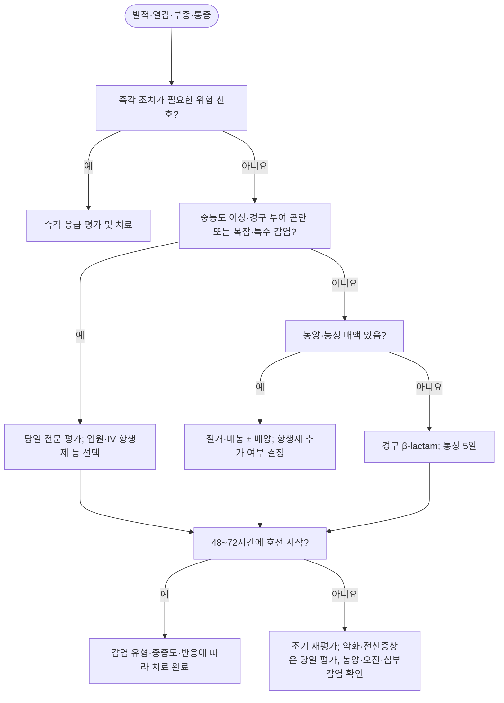

# 연조직염(봉와직염) Cellulitis

## <mark style="color:green;">일반 사항</mark>

* 진피 심부와 피하조직에 발생하는 급성 세균 감염
* 피부농양·종기·감염된 표피낭종 등의 **화농성 피부·연조직감염(purulent SSTI)**과 구분
* 성인에서는 하지에 가장 흔하며 대개 편측으로 발생
  * 양측 하지의 대칭적 발적은 정체피부염, 림프부종 등 비감염성 질환을 우선 고려
* 발가락 사이의 짓무름·균열, 발백선은 하지 연조직염의 흔한 침입 경로이자 재발 위험인자
* 병변의 크기와 전신증상의 정도가 항상 비례하지는 않으므로 활력징후와 전신상태를 별도로 평가


**용어 주의**\
Soft tissue infection은 농양, 괴사근막염, 근육염 등을 포함하는 상위 개념임. Phlegmon도 연조직염의 정확한 동의어가 아니므로 혼용하지 않음.


## <mark style="color:green;">원인 및 위험 인자</mark>

### <mark style="color:orange;">원인균</mark>

* **전형적인 비화농성 연조직염:** β-용혈성 사슬알균이 가장 흔함
* **S. aureus:** 개방성 창상, 관통상, 주사 약물 사용, 농성 병변이 있을 때 가능성 증가
* **특수 상황**
  * 담수 노출: *Aeromonas* spp.
  * 해수·어패류 노출: *Vibrio vulnificus* 등
    * 간질환 환자에서 빠르게 진행하는 통증·부종·출혈성 수포가 나타나면 즉시 응급 평가
  * 개·고양이 물림: *Pasteurella multocida*, *Capnocytophaga canimorsus* 및 혼합균
  * 사람 물림: *Eikenella corrodens* 및 혼합균
  * 귓바퀴 연골막염: *Pseudomonas aeruginosa* 고려
  * 심한 면역저하·호중구감소증: 그람음성균, 진균 등 비전형적 병원체 가능
* Hib 백신 도입 후 *Haemophilus influenzae*에 의한 협부 연조직염은 드묾


당뇨병이나 면역저하가 있다는 이유만으로 *P. aeruginosa*를 일률적으로 원인균으로 간주하지 않음.


### <mark style="color:orange;">유발·위험인자</mark>

* 피부 장벽 손상: 외상, 찰과상, 수술창, 주사, 피어싱, 문신, 벌레 물림
* 피부질환: 발백선, 습진, 피부균열, 궤양
* 만성 부종: 림프부종, 만성 정맥부전, 수술·방사선치료 후 림프손상
* 비만, 고령, 과거 연조직염
* 당뇨병, 말초동맥질환
* 면역억제 치료, 악성종양, 호중구감소증
* 동물·사람 물림, 담수·해수 노출

## <mark style="color:green;">임상 양상</mark>

* 경계가 명확하지 않은 편평한 홍반, 열감, 부종, 압통
* 림프관을 따라 근위부로 이어지는 선상 홍반(림프관염), 국소 림프절병증
* 중등도 이상에서는 발열, 오한, 권태감 동반 가능
* 물집이 생길 수 있으나, 파동·농성 배액·뚜렷한 고름집은 피부농양 등 화농성 SSTI를 시사
* 병변 가장자리를 펜으로 표시하거나 사진으로 기록하면 진행 여부 평가에 도움

### <mark style="color:orange;">단독(Erysipelas)과의 구분</mark>

* 단독은 표재성 진피와 표재 림프관을 침범하여 병변이 융기되고 경계가 비교적 명확함
* 연조직염은 진피 심부와 피하조직을 침범하여 경계가 불명확함
* 안면 감염에서 귓바퀴 침범은 단독을 지지하는 Milian's ear sign
  * 다만 외이 연조직염이나 귓바퀴 연골막염도 발생할 수 있으므로 "귓바퀴에는 연조직염이 발생하지 않는다"라고 절대적으로 표현하지 않음

### <mark style="color:$danger;">🚩 Red Flags!</mark>


**Tier 1 - 즉각 조치**

응급실 이송 및 관련 전문과 평가를 즉시 시행함. 괴사성 감염은 낮은 LRINEC 점수나 비확정적 영상만으로 배제하지 않으며 영상검사 때문에 외과 평가·수술을 지연하지 않음

* 피부 소견에 비해 현저히 심한 통증 또는 시간 단위의 빠른 진행  `괴사성 감염`
* 자색·회색 변색, 출혈성 수포, 피부괴사, 염발음, 조직 내 가스, 피부 감각저하  `조직 괴사`
* 저혈압, 의식 변화, 호흡곤란, 청색증, 핍뇨 등 전신독성·장기기능장애  `패혈증`
* 괴사성 근막염, 근괴사, 구획증후군 또는 Fournier gangrene 의심  `심부 응급질환`
* 안구운동통, 복시, 시력저하, 안구돌출  `안와 감염`
* 호중구감소증에서 발열 동반  `호중구감소성 발열`



**Tier 2 - 당일 평가**

당일 중증도·특수 병원체·정주 치료·입원 필요성을 평가함. 악화 시 응급 위험 신호가 있으면 Tier 1을 적용함

* 뚜렷한 발열·오한·빈맥·빈호흡 또는 전신상태 불량  `전신 감염`
* 광범위한 병변 또는 치료 중 병변 확대·통증 악화  `진행성 감염`
* 심한 면역저하, 호중구감소증, 조절되지 않는 중증 기저질환  `고위험 숙주`
* 동물·사람 물림, 담수·해수 노출  `비전형 병원체`
* 얼굴(특히 눈·코 주변)·손·귓바퀴·생식기·관절 또는 인공관절 주변 감염  `주요 부위 감염`
* 감염된 당뇨발 궤양, 괴사, 중증 하지허혈  `복잡성 하지 감염`
* 경구 복용 불가, 흡수 장애 또는 외래 추적·복약 이행 곤란  `외래 치료 곤란`



**Tier 3 - 조기 평가 및 추적**

안정적인 외래 환자는 48–72시간 이내 재평가함. 발열 지속·병변 확대·통증 악화는 당일 재평가하며, 빠른 악화·전신독성은 Tier 1을 적용함

* 치료 후 48–72시간 내 호전이 시작되지 않으나 전신상태·병변 범위는 안정적임  `반응 지연`
* 반복되는 연조직염  `반복 감염`
* 조절되지 않는 만성 부종·림프부종, 정맥부전, 발백선·습진·피부균열  `재발 위험`


## <mark style="color:green;">진단</mark>

### <mark style="color:orange;">기본 평가</mark>

* 대부분 임상소견으로 진단하며 전형적인 경증에서는 영상검사나 배양검사가 필요하지 않음
* 병력에서 다음을 확인
  * 발생 속도, 외상·수술·주사·물림·수중 노출
  * 과거 MRSA 감염·보균, 최근 항생제·입원
  * 당뇨병, 부종·정맥질환, 면역저하, 간질환
* 진찰에서 병변 범위, 열감·압통, 파동, 농성 배액, 감각, 말초 맥박, 관절운동을 확인
* 농양 여부가 불확실하면 초음파를 고려
* 골수염이 의심되면 단순촬영을 시작으로 임상 상황에 따라 MRI 등 추가 영상검사 고려


**ALT-70 - 성인 하지 연조직염 진단 보조**\
급성 하지 발적에서 pseudocellulitis 감별을 위한 참고용 보조 도구로 활용할 수 있으나 국내 인구에서 별도 검증되지 않았음(Asymmetry 3점, Leukocytosis ≥10,000/µL 1점, Tachycardia ≥90/min 1점, Age ≥70세 2점). 0\~2점이면 다른 진단을 적극 재평가하고, 3\~4점이면 진단이 불확실하므로 전문의 협의 또는 조기 재평가를 고려함. 5\~7점도 연조직염을 확진하지 않으며(전문가 판정 기준 위양성 상당수 보고), 경증 외래 환자에게 점수 계산만을 목적으로 CBC를 일률적으로 시행할 근거는 부족함. 2024년 검증연구는 교상, 최근 5일 이내 외상, 4주 이내 수술 부위 및 인공물 부위 등의 복잡창상을 제외하였으므로 이들에 적용하는 근거는 부족함. 발가락에만 국한된 병변도 영상 획득 문제로 제외되었음.
<mark style="color:$info;">Ref. Pulia MS, et al. JAMA Dermatol. 2024;160(5):511–517.</mark>


### <mark style="color:orange;">배양 및 혈액검사</mark>

* 전형적인 경증 비화농성 연조직염: 배양검사 불필요
* 농양·농성 배액: 고름의 그람염색·배양 고려
* 혈액배양 고려
  * 저혈압·고열 등 중증 전신소견
  * 항암치료 중인 악성종양, 호중구감소증, 심한 세포매개 면역저하
  * 동물 물림, 담수·해수 노출 등 비전형적 병원체가 의심되는 경우
* CBC, Cr/eGFR, 전해질, CRP 등은 중등도·중증 환자의 장기기능과 중증도 평가에 선택적으로 시행
* CK는 근괴사·괴사성 감염이 의심될 때 고려
* 비전형적 노출·면역저하에서는 개방성 병변의 배양 또는 흡인·조직검사를 고려하고, 진균·항산균 검사는 역학적·면역학적 위험에 따라 선택
* 피부가 온전한 전형적 비화농성 연조직염에서 표면 면봉배양은 원인균 확인에 유용하지 않음

### <mark style="color:orange;">감별진단</mark>

<table><thead><tr><th width="180">질환</th><th>핵심 감별 포인트</th></tr></thead><tbody><tr><td>괴사성 근막염</td><td>불균형적으로 심한 통증, 빠른 진행, 독성 양상, 수포·괴사·감각저하·염발음</td></tr><tr><td>피부농양</td><td>국소 파동, 중심 농포 또는 농성 배액</td></tr><tr><td>정체피부염</td><td>흔히 양측성, 가려움·인설·만성 부종, 압통이 적음</td></tr><tr><td>급성 지방피부경화증(acute lipodermatosclerosis)</td><td>내측 하퇴의 압통성 홍반과 경결</td></tr><tr><td>표재성 혈전정맥염</td><td>정맥 주행을 따르는 압통성 줄 모양 경결</td></tr><tr><td>심부정맥혈전증</td><td>편측 부종·통증; 임상확률에 따라 D-dimer·초음파 평가</td></tr><tr><td>접촉피부염</td><td>가려움이 두드러지고 노출 부위에 경계가 비교적 뚜렷한 홍반·수포</td></tr><tr><td>곤충교상</td><td>중심 물림 자국, 가려움 우세</td></tr><tr><td>통풍·가성통풍, 화농성 관절염</td><td>관절 중심의 통증과 관절운동 제한</td></tr><tr><td>화농성 윤활낭염</td><td>윤활낭 부위의 국소 부종·파동</td></tr><tr><td>대상포진 초기</td><td>피부분절을 따르는 작열통 후 군집 수포</td></tr><tr><td>림프부종</td><td>만성 부종과 피부 변화, 급성 열감·전신증상이 없음</td></tr></tbody></table>

***



<p align="center"><strong>연조직염 진단·치료 흐름</strong></p>

<p align="center"><em>복잡·특수 감염: 물림·수중 노출, 감염된 당뇨발 궤양·괴사·중증 허혈, 심한 면역저하, 얼굴·손·귓바퀴·생식기·관절 또는 인공관절 주변 감염 등. 경과 중 응급 위험 신호가 생기면 즉각 조치함. 비화농성 연조직염의 5일 요법을 농양·심부감염에 일률적으로 적용하지 않음.</em></p>

***

## <mark style="background-color:$warning;">Management</mark>

* 경증 비화농성 연조직염은 streptococci를 표적으로 하는 경구 β-lactam을 우선 선택
* 합병증이 없는 비화농성 연조직염은 **5일까지 임상적 호전이 있으면 총 5일 치료**를 기본으로 함
  * 5일까지 호전이 불충분하면 진단·농양·원인조절 여부를 재평가한 후 임상반응에 따라 통상 총 7\~10일까지 연장 가능
  * 광범위·중증 또는 특수 감염은 총 14일까지 필요할 수 있으며, 균혈증·골수염·괴사성 감염은 별도 지침에 따라 치료 기간을 결정
  * NICE는 일반적으로 5\~7일을 제시하므로, 5일을 모든 환자의 고정 종료일로 해석하지 않음
  * 피부색과 부종이 5\~7일 이내 완전히 정상화되지 않을 수 있음을 설명
* 치료 시작 후 처음 24\~48시간에는 염증 소견이 일시적으로 확대될 수 있음
  * 전신상태·통증이 안정적이거나 호전되는 경미한 확대만으로 항생제를 자동 변경하지 않음
  * 빠른 확대, 통증 악화 또는 전신상태 악화는 초기 염증 반응으로 간주하지 말고 즉시 재평가
* 호전이 없으면 농양, 오진, 복약 불이행, 내성균, 특수 노출, 허혈, 골수염·괴사성 감염을 재검토
* IV 항생제는 중증도와 경구 복용 가능 여부에 따라 결정하고 48시간 전후에 재평가
  * 안정되고 호전되면 경구제로 전환하며 **유효한 IV 치료 일수와 경구 치료 일수를 합산하여 총 치료 기간을 계산**
  * 경구제로 바꾼 날부터 치료 기간을 새로 시작하지 않음
* 약제별 허가사항·지침에 근거하지 않은 일률적인 "경구 항생제 초회 2배 용량"은 사용하지 않음
  * Minocycline처럼 허가된 초회 용량이 있는 약제는 해당 용법을 따름
* 항생제 용량은 신기능, 간기능, 체중, 임신 여부와 약물상호작용에 따라 조정

## <mark style="color:green;">비-약물 치료 및 예방</mark>

* 환부를 거상하여 부종을 줄임
* 통증 범위 내에서 활동을 조절하되 불필요한 장기 고정은 피함
* 발백선, 습진, 피부균열, 궤양 등 침입 경로와 유발질환을 함께 치료
* 개방성 창상이나 삼출이 있을 때만 생리식염수 세척·적절한 드레싱 시행
* 온전한 피부의 연조직염에서 국소 항생제는 전신 항생제를 대체하지 않으며 통상 병용할 필요가 없음
* 파상풍 위험이 있는 창상은 예방접종력을 확인하고 지침에 따라 추가 접종
* 이뇨제는 연조직염이나 림프부종 자체의 치료가 아니며, 심부전 등 별도의 체액과다 적응증이 있을 때만 사용
* 압박요법은 만성 부종의 관리와 재발 예방에 유용함
  * 급성 통증·염증이 심하면 일시적으로 조절하고, 항생제 치료 중 임상적으로 안정되고 견딜 수 있으면 재개함; 비보상성 심부전 등 압박 금기를 함께 평가함
  * 압박요법 전 말초맥박, 허혈 증상 및 말초동맥질환 위험을 평가
  * 말초동맥질환이 의심되면 ABI 등으로 동맥 관류를 확인하고, 당뇨병·만성콩팥병에서는 혈관 석회화로 ABI가 거짓으로 높을 수 있으므로 필요시 toe-brachial index 또는 혈관검사를 고려

* 2025년 하지 연조직염 입원 성인 34명 무작위시험에서 항생제 시작 24시간 후 적용한 조절식 압박 랩은 증상을 줄였고 감염 악화가 관찰되지 않았음. 소규모 단일기관 연구이므로 모든 급성 감염에 즉시 압박하는 근거로 확대하지 않음
* 만성 하지 부종·재발성 연조직염의 압박요법 무작위시험에 대한 2026년 연장 추적에서도 재발 예방 효과가 지속됨. 대조군의 압박요법 교차가 포함된 연장 추적 자료라는 한계가 있음

<mark style="color:$info;">Ref. Dräger S, et al. J Dtsch Dermatol Ges. 2025;23(10):1274–1280; Webb E, et al. EClinicalMedicine. 2026;98:104127.</mark>

## <mark style="color:green;">약물 치료</mark>

### <mark style="color:orange;">비화농성 연조직염 - 성인, 정상 신기능</mark>

#### <mark style="color:$primary;">경증 경구 치료</mark>

* Cephalexin 500 mg qid <mark style="color:blue;">\[팔렉신]</mark> - 1차 선택
* Cefadroxil 500 mg bid <mark style="color:blue;">\[듀리세프]</mark> - 1차 선택
* Cephradine 500 mg qid <mark style="color:blue;">\[세프라딘]</mark> - 1차 선택(동급 대안)
* Clindamycin 300\~450 mg qid <mark style="color:blue;">\[훌그램]</mark> - 대체 선택(150 mg 캡슐 1회 2\~3개)
  * 즉시형 β-lactam 과민반응 등 대체제가 필요한 경우 고려
  * 설사·C. difficile 감염 위험 및 지역 내 감수성 고려 - 배양균이 erythromycin 내성·clindamycin 감수성으로 보고되면 inducible resistance 확인을 위한 D-test 결과를 확인

> Cephalexin, cefadroxil, cephradine은 병용하지 않고 환자 상태와 복약 편의, 신기능을 고려하여 하나를 선택함. 해외 지침의 약제명보다 국내 사용 가능한 제제와 지역 감수성을 우선함.


**국내 허가와 지침 용법의 구분**

* Cephalexin 500 ㎎ qid는 국내 지침 용법임. 팔렉신의 허가 성인 용량은 1일 1–4 g, 통상 500 ㎎ bid–tid로 기재되어 있어 기본 투여 횟수와 구분함
* Cefadroxil 500 ㎎ bid는 국내 피부·피부조직 감염 허가 기본량 1일 1 g에 맞춘 용량임. 질병관리청 2026 표의 1,000 ㎎ bid는 더 높은 지침 용량이므로 같은 용량으로 혼동하지 않음
* 비복잡성 연조직염의 지침상 5일 요법과 달리, 국내 훌그램 허가사항에는 β-용혈성 사슬알균 감염에 최소 10일 투여가 바람직하다는 문구가 있음. 5일을 모든 약제의 허가 기간으로 일반화하지 않음

<mark style="color:$info;">Ref. 질병관리청 SSTI 실무지침, 2026; 팔렉신·cefadroxil·훌그램 국내 품목정보.</mark>


#### <mark style="color:$primary;">중등도·중증 또는 경구 투여 곤란</mark>

* Cefazolin 1\~2 g IV q8h
* Clindamycin 600\~900 mg IV q8h - β-lactam 사용이 곤란하고 감수성이 적절한 경우 대체
* 중증 전신감염 또는 MRSA 위험이 높으면 사슬알균과 MRSA를 함께 치료할 수 있는 vancomycin 기반 치료와 입원 평가
* 심한 면역저하 또는 괴사성·다균성 감염이 의심되면 vancomycin에 piperacillin/tazobactam 또는 carbapenem 등을 병용하는 광범위 경험 치료를 입원·전문의 영역에서 고려
  * 괴사성 감염은 긴급 외과 평가·수술적 원인조절이 필수; 배양 결과에 따라 신속히 치료 범위를 좁힘

### <mark style="color:orange;">MRSA 치료를 고려할 상황</mark>

* 농성 배액 또는 농양
* 관통상, 특히 주사 약물 사용
* 과거 MRSA 감염·보균 또는 다른 부위의 동시 MRSA 감염
* 중증 전신감염
* 오진·농양·배농 불충분·복약 불이행 등을 재평가한 뒤에도 적절한 치료에 실패


전형적인 비화농성 연조직염에서 MRSA는 흔한 원인이 아니므로 치료반응이 늦다는 이유만으로 자동으로 MRSA 약제로 변경하지 않음.


### <mark style="color:orange;">피부농양 및 화농성 피부·연조직감염</mark>

* 핵심 치료는 **절개·배농(I&D)**
* 가능하면 고름을 배양하고 배양·감수성 결과에 따라 항생제를 조정
* 다음 상황에서 배농 후 **전신 항생제 병용**을 고려
  * 발열·빈맥 등 전신증상
  * 광범위한 주변 연조직염
  * 심한 면역저하, 다발성 병변, 치료하기 어려운 부위
  * 배농 후에도 악화하거나 재발
* **항생제 필요성과 MRSA 치료 필요성은 구분함.** 질병관리청 2026은 항생제가 필요한 화농성 감염에서 1세대 cephalosporin 등 MSSA 활성 약제를 우선 고려할 수 있다고 제시함. 과거 MRSA 감염·집락, 중증 면역저하·전신감염, 적절한 배농·1차 치료에도 실패한 경우 등에 MRSA 활성 약제를 선택함
* 단순 농양도 배농 후 항-MRSA 항생제를 추가하면 치유율이 다소 개선될 수 있으므로, 이득·이상반응·국내 역학을 함께 고려하여 결정
* 항생제를 추가하면 통상 5\~10일 범위에서 반응과 배양 결과에 따라 결정하며, 주요 단순 농양 임상시험은 7일 또는 10일 요법을 사용함

#### <mark style="color:$primary;">경구 항-MRSA 선택지 - 성인, 정상 신기능</mark>

* TMP/SMX **160/800 mg bid** <mark style="color:blue;">\[셉트린]</mark> - 셉트린정(TMP/SMX 80/400 mg/정) **1회 2정, 1일 2회**
  * 해외 지침의 범위는 1회 TMP/SMX 160/800\~320/1,600 mg bid(국내 셉트린정 2\~4정/회에 해당)
  * 국내 허가상 중증 감염의 최대용량은 1회 3정임. **1회 4정 bid는 국내 허가용량 밖**이므로 통상 처방례로 제시하지 않음
  * 셉트린정의 피부농양·연조직염 치료는 **국내 허가 외 사용**
* Doxycycline 100 mg bid <mark style="color:blue;">\[신일모노독시엠]</mark> - 국내 해당 품목의 피부농양·연조직염 치료는 **허가 외 사용**
* Minocycline 초회 200 mg, 이후 100 mg q12h <mark style="color:blue;">\[미노씬]</mark> - 대체 선택
  * 50 mg 캡슐로 초회 4개, 이후 1회 2개; 피부농양·연조직염 치료는 **국내 허가 외 사용**
* Clindamycin 300\~450 mg qid <mark style="color:blue;">\[훌그램]</mark> - 대체 선택(감수성 확인 시; 150 mg 캡슐 1회 2\~3개)


TMP/SMX와 doxycycline·minocycline의 β-용혈성 사슬알균 치료 신뢰도는 충분하지 않음. MRSA와 streptococci를 모두 치료해야 하면 clindamycin 단독(감수성 확인 시) 또는 TMP/SMX·doxycycline 중 하나에 cephalexin·amoxicillin 등 β-lactam을 병용함. Linezolid 등은 중증 β-lactam 알레르기, 다제내성 또는 전문의 치료 영역으로 국한함. Clindamycin은 지역 감수성, 유도성 내성(D-test), C. difficile 감염 위험을 고려하여 선택함.


#### <mark style="color:$primary;">경구 항-MRSA 약제의 주요 주의사항</mark>

* TMP/SMX: 국내 허가상 임부·임신하고 있을 가능성이 있는 여성·수유부·G6PD 결핍 및 생후 2개월 미만에 금기임. **Methotrexate와 병용금기**임. 신기능·혈청 K를 확인하고 ACEi/ARB·spironolactone 등과의 고칼륨혈증, warfarin 병용 시 INR 상승을 추적함. 허가상 CrCl 15–30 ㎖/min은 통상 용량의 1/2, 15 ㎖/min 이하는 투여가 권장되지 않음; 혈중 농도를 모니터할 수 없는 중증 신부전은 금기임
* Doxycycline·minocycline: 이 챕터의 통상적 피부감염 치료에서 임부·수유부 및 12세 미만 소아에게 사용하지 않음. 국내 신일모노독시엠·미노씬에는 신부전·중증 간기능 이상과 레티노이드 병용도 금기로 명시되어 있으며 미노씬은 SLE 환자도 금기임. Doxycycline 100 ㎎ bid는 SSTI 지침 용법으로, 국내 통상 유지량 1일 100 ㎎ 및 중증 감염의 100 ㎎ q12h 용법과 구분함. 철·칼슘·마그네슘·제산제 등과 복용 간격을 둠
  * 충분한 물과 함께 앉거나 선 자세로 복용하고 취침 직전 복용을 피함; minocycline은 어지럼·전정계 이상반응에 주의
* Clindamycin: 치료 중 또는 종료 후 지속적·심한 설사나 혈변이 있으면 C. difficile 감염 평가

#### <mark style="color:$primary;">중증 MRSA 감염</mark>

* Vancomycin IV: 실제 체중과 신기능을 반영하여 투여
  * 중증 침습성 MRSA 감염에서는 MIC 1 mg/L를 가정하여 **AUC24 400\~600 mg·h/L**(AUC/MIC 400\~600)를 목표로 모니터링
  * 이 목표는 주로 중증 침습성 감염 근거이며 경증 연조직염에 그대로 외삽하지 않음
* Teicoplanin, linezolid 등 대체 약제는 전문의가 국내 허가·사용 가능 여부, 감염 부위, 균혈증 여부, 신기능 및 약물상호작용에 따라 선택
  * Linezolid는 혈구감소 및 serotonergic 약제와의 상호작용을 확인
* Tigecycline은 일반적인 연조직염의 통상적 경험 치료제로 사용하지 않음

### <mark style="color:orange;">특수 상황</mark>

* **당뇨병:** 당뇨병만으로 그람음성균·혐기성균을 모두 포함하는 광범위 항생제를 선택하지 않음
  * 감염된 당뇨발 궤양, 괴사·허혈, 심부농양 또는 골수염 의심 시 당뇨발 감염 지침에 따라 별도 평가
* **동물·사람 물림:** 일반적인 cephalexin 단독은 부적절할 수 있음
  * 창상 세척·탐색, 파상풍 및 광견병 위험 평가, amoxicillin/clavulanate 등 혼합균 치료 고려
* **담수·해수 노출:** 병변 배양과 당일 전문평가; 일반적인 1세대 cephalosporin 단독에 의존하지 않음
  * *V. vulnificus* 의심 창상감염은 배양 결과를 기다리지 않고 조기 항생제와 외과 평가를 시행함. 전문치료 예: doxycycline 100 mg bid + ceftazidime 1\~2 g IV q8h
  * 빠른 진행·출혈성 수포·전신 독성 소견은 간질환 유무와 관계없이 즉각 응급 평가
* **얼굴·안와 주변, 손, 귓바퀴, 생식기:** 당일 전문평가; 안구운동통·복시·시력저하·안구돌출 또는 괴사성 감염 소견은 즉각 조치

### <mark style="color:orange;">해열·진통제</mark>

* Acetaminophen을 우선 고려하고, NSAID는 환자별 위험에 따라 필요시 단기간 사용함
* 부루펜 국내 허가상 **위장관 궤양·출혈 또는 그 병력, 기관지천식 또는 그 병력, NSAID 과민반응, 중증 신·간·심장 기능장애 등은 금기**임. 임신 말기 3개월은 금기이며 임신 20주 이후에는 원칙적으로 피함
* 탈수·고령·항응고제 병용 등 위장관·신장·심혈관 위험을 평가하고, ibuprofen·dexibuprofen 등 NSAID 2종을 함께 사용하지 않음
* 진통제로 통증이 가려지더라도 병변이 빠르게 진행하거나 불균형적으로 심한 통증이 있으면 괴사성 감염을 재평가

### <mark style="color:orange;">보조 전신 스테로이드</mark>

* 일상적으로 사용하지 않음. IDSA 2014의 일부 비당뇨 성인에 대한 약한 권고와 ACE 2026의 근거 불충분 판단을 구분함. 고려 시에도 괴사성 감염을 충분히 배제하고 혈당·면역상태·감염 진행 위험을 평가함
* <mark style="color:$info;">Ref. IDSA SSTI guideline, 2014; ACE SSTI guideline, 2026.</mark>

## <mark style="color:green;">치료반응 평가</mark>

* 48–72시간: 발열·통증·병변 확대 여부와 복약 이행을 확인함. 호전이 시작되지 않으나 안정적이면 조기 재평가하고, 발열 지속·병변 확대·통증 악화는 당일 재평가함
* 농양 배농 후에는 드레싱·재배농 필요성에 따라 24\~48시간 이내 창상 확인을 계획
* 악화 또는 응급 위험 신호 발생 시 예정된 재평가일까지 기다리지 않음
* 5일: 뚜렷한 임상적 호전 여부를 평가하여 종료 또는 연장 결정
* 반응 불량 시 다음을 확인
  * 농양 또는 배농 불충분
  * 정체피부염, DVT, 통풍 등 오진
  * 복약 불이행, 흡수 장애, 부적절한 용량
  * MRSA 또는 물림·수중 노출 관련 병원체
  * 말초허혈, 이물, 골수염, 화농성 관절염
  * 괴사성 연조직감염

## <mark style="color:green;">재발 예방</mark>

* 발가락 사이를 포함한 피부를 정기적으로 관찰하고 발백선·습진·균열을 치료
* 만성 부종·림프부종과 정맥부전을 관리하고 적절한 압박요법 적용
* 피부 보습, 상처 예방, 체중 및 혈당 관리
* 위험인자를 충분히 교정했는데도 연 3\~4회 재발하면 감염내과·피부과 등 전문의와 예방적 항생제 고려
  * 해외 주요 근거: Penicillin V 250 mg bid PO
    * 국내 경구 제형 수급이 어려움
  * 국내 지침상 경구 대안: Amoxicillin 고려
    * 예방 목적의 최적 용량과 기간은 확립되지 않았으므로 전문의와 개별 결정
  * Benzathine penicillin G 120만 단위 IM every 2\~4 weeks
    * 국내 수급과 사용 가능 여부를 확인하고 전문의와 결정
  * 국내에서 예방적 항생제의 사용 경험은 제한적이며, 투여 기간은 재발 양상과 위험인자 지속 여부에 따라 개별화함. 예방요법 중단 후 재발할 수 있음
* 연 3–4회는 IDSA·국내 지침의 고려 기준임. NICE NG141은 최근 12개월에 병원 치료 또는 전문의 관리하에 별개의 감염이 2회 이상 있었던 성인에서도 전문의가 예방요법을 고려할 수 있다고 함. 시작하면 적어도 6개월마다 효과·이상반응·내성 위험과 지속 필요성을 재평가함
* <mark style="color:$info;">Ref. IDSA SSTI guideline, 2014; 국내 SSTI 지침, 2017; NICE NG141.</mark>

***

### <mark style="color:red;">질병코드</mark>

L03 연조직염(봉와직염) 및 급성 림프관염 - 병변 부위에 따라 가장 구체적인 하위 코드를 선택

H60.1 외이의 연조직염

N48.21 음경의 연조직염

N73.0 급성 자궁주위조직염 및 골반연조직염

***

## <mark style="color:purple;">처방례</mark>

> **처방례 1. 경증 비화농성 연조직염, 정상 신기능**
>
> ```
> 팔렉신 500 mg/C 4C  #4 × 5일
> 부루펜 200 mg/T 6T  #3 × 필요시 단기간
> ```
>
> _✽Cephalexin 500 mg qid, ibuprofen 400 mg tid PRN(위장관·신장·심혈관 위험 확인). 48\~72시간 후 재평가하고 5일까지 호전이 불충분하면 진단과 치료 기간을 재검토함._

> **처방례 2. 경증 비화농성 연조직염, 복약 횟수 단순화**
>
> ```
> 듀리세프 500 mg/C 2C  #2 × 5일
> 애니펜 300 mg/T 3T  #3 × 필요시 단기간
> ```
>
> _✽Cefadroxil 500 mg bid, dexibuprofen 300 mg tid PRN(위장관·신장·심혈관 위험 확인). β-lactam 즉시형 과민반응과 신기능을 확인하고 48\~72시간 후 재평가함._


**⚠️ 처방례 적용 제외**\
농양, 물림, 담수·해수 노출, 감염된 당뇨발 궤양, 안와·손·귓바퀴·생식기 감염, 심한 면역저하 또는 중증 전신감염에는 위 단순 처방례를 그대로 적용하지 않음.


***

### <mark style="color:$success;">핵심 복약 지도</mark>

> **항생제 복용**
>
> * 항생제는 정해진 횟수와 기간에 맞추어 복용합니다.
> * 피부색과 부종은 항생제를 시작한 뒤에도 며칠간 남을 수 있습니다.

> **재발 예방**
>
> * 발가락 사이의 무좀·균열과 만성 부종을 함께 관리해야 재발을 줄일 수 있습니다.

> **언제 다시 병원을 방문해야 하나요?**
>
> * **즉시 응급실:** 빠른 확산, 매우 심한 통증, 출혈성 물집·검붉거나 검은 피부색, 의식 변화·실신·호흡곤란
> * **당일 재진:** 새 발열·오한, 병변 확대·통증 악화
> * **조기 재진:** 2–3일 후에도 호전이 시작되지 않으나 안정적인 경우 재평가 일정을 조기에 잡도록 안내합니다.

***

### <mark style="color:blue;">환자 안내서</mark>


**연조직염, 피부 밑 조직에 생긴 세균 감염입니다**

연조직염은 피부 깊은 층과 그 아래 조직에 세균이 들어가 생기는 감염입니다. 주로 다리에 잘 생기며, 빨갛게 붓고 만지면 아프고 뜨거운 느낌이 드는 것이 특징입니다. 대부분 항생제로 잘 낫지만, 증상이 빠르게 나빠지면 즉시 병원을 다시 찾아야 합니다.


#### <mark style="color:$primary;">왜 생기나요?</mark>

* 작은 상처, 무좀으로 갈라진 발가락 사이, 습진 등 피부의 작은 틈으로 세균이 들어가 감염을 일으킵니다.
* 다리가 자주 붓거나(림프부종·정맥부전), 당뇨병·비만이 있으면 더 잘 생기고 재발하기 쉽습니다.
* 한 번 걸렸던 부위는 다시 걸릴 위험이 높습니다.

#### <mark style="color:$primary;">일상생활에서 어떻게 관리하나요?</mark>

* **아픈 부위를 심장보다 높게 올려두십시오.** 부기를 줄이는 데 도움이 됩니다.
* **발가락 사이를 깨끗하고 건조하게 유지하십시오.** 무좀이 있으면 함께 치료해야 재발을 막을 수 있습니다.
* **무리한 활동은 피하되, 다리를 아예 움직이지 않는 것도 좋지 않습니다.** 통증이 허락하는 범위에서 평소처럼 움직이십시오.
* 상처가 있으면 깨끗한 물로 씻고 청결하게 드레싱하십시오.

#### <mark style="color:$primary;">항생제는 어떻게 써야 하나요?</mark>

* 처방받은 항생제는 증상이 좋아진 것 같아도 정해진 기간까지 빠짐없이 복용하십시오.
* 피부의 붉은기와 부종은 치료가 효과적이어도 수일에서 1\~2주 정도 남을 수 있습니다. 다만 병변이 계속 확대되거나 통증·발열이 호전되지 않으면 다시 진료받으십시오.

#### <mark style="color:$primary;">이럴 때는 즉시 응급실로 가세요</mark>

* 표시해 둔 경계 밖으로 빠르게 번지거나 통증이 매우 심해지는 경우
* 피가 섞인 물집이 생기거나 피부색이 검붉거나 검게 변하는 경우
* 의식이 흐려지거나 쓰러짐, 숨참이 생기는 경우

#### <mark style="color:$primary;">이럴 때는 다시 진료받으세요</mark>

* 열이나 오한이 새로 생기는 경우
* 항생제를 복용한 지 2–3일이 지나도 호전이 시작되지 않으면 조기에 재진하십시오. 계속 퍼지거나 통증·발열이 악화하면 당일 진료를 받으십시오.
* 항생제 복용 중 심한 설사·혈변 또는 새로운 전신 발진이 생기는 경우
  * 입술·혀가 붓거나 숨이 차면 복용을 중단하고 즉시 응급실로 가십시오.

***

## <mark style="color:green;">주요 참고문헌 및 확인 자료</mark>

### <mark style="color:orange;">임상 근거</mark>

* [질병관리청. 2026 피부·연조직 감염 항생제 적정사용을 위한 실무지침](https://www.kdca.go.kr/bbs/kdca/55/306857/download.do) — 공식 게시 제목은 2026 실무지침이며 PDF 표지에는 2025가 표기되어 있음
* [대한감염학회·대한항균요법학회 등. 지역사회획득 피부 및 연조직 감염 항생제 사용지침, 2017](https://pmc.ncbi.nlm.nih.gov/articles/PMC5754343/)
* [IDSA. Skin and Soft Tissue Infections Guideline, 2014](https://www.idsociety.org/practice-guideline/skin-and-soft-tissue-infections/)
* [NICE NG141. Cellulitis and erysipelas: antimicrobial prescribing, 2019](https://www.nice.org.uk/guidance/ng141) - 치료 기간, IV에서 경구 전환 및 재평가
* [ALT-70 진단 보조도구 검증 연구. JAMA Dermatology, 2024](https://doi.org/10.1001/jamadermatol.2024.0091)
* [Talan 등. 단순 피부농양 배농 후 TMP/SMX 무작위시험. NEJM, 2016](https://doi.org/10.1056/NEJMoa1507476)
* [Daum 등. 작은 피부농양 배농 후 항생제 무작위시험. NEJM, 2017](https://doi.org/10.1056/NEJMoa1607033)
* [ASHP/IDSA/PIDS/SIDP. Vancomycin 치료약물 모니터링 합의지침, 2020](https://www.idsociety.org/practice-guideline/vancomycin/)
* [CDC. Clinical Overview of Vibriosis](https://www.cdc.gov/vibrio/hcp/clinical-overview/)
* [Dräger S, et al. Treating cellulitis promptly with compression therapy reduces C-reactive protein-levels and symptoms—a randomized-controlled trial. J Dtsch Dermatol Ges. 2025;23(10):1274–1280](https://doi.org/10.1111/ddg.15829)
* [Webb E, et al. Sustained benefit of compression therapy for preventing recurrent leg cellulitis: extended follow-up of a randomised controlled trial. EClinicalMedicine. 2026;98:104127](https://pubmed.ncbi.nlm.nih.gov/42597865/)
* [ACE. Bacterial skin and soft tissue infections—diagnosis and antibiotic prescribing. 2026](https://www.ace-hta.gov.sg/healthcare-professionals/ace-repository-for-clinical-guidelines/bacterial-skin-and-soft-tissue-infections----diagnosis-and-antibiotic-prescribing/)

### <mark style="color:orange;">허가·급여 확인 자료</mark>

* [식품의약품안전처 의약품안전나라](https://nedrug.mfds.go.kr/) — 팔렉신·cefadroxil·훌그램·셉트린·신일모노독시엠·미노씬·부루펜 등 국내 적응증·제형·용법·기간·금기
