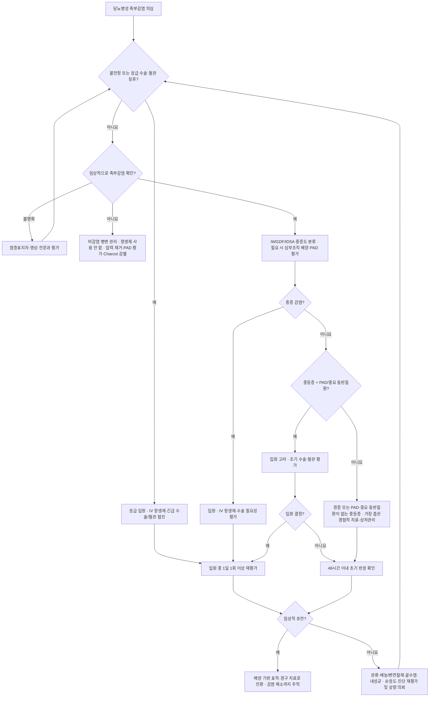

# 당뇨병성 족부감염 Diabetic Foot Infection, DFI

> **핵심 원칙**  당뇨병성 족부궤양은 모두 세균이 집락화되어 있으나, **감염은 배양 결과가 아니라 임상 소견으로 진단함**. 감염 치료만으로는 충분하지 않으며, 배농·변연절제, 압력 제거(off-loading), 말초동맥질환 평가와 필요 시 재혈관화, 혈당 및 전신 상태 관리가 함께 이루어져야 함.

## <mark style="color:green;">일반 사항</mark>

* 당뇨병 환자에서 입원과 하지 절단의 주요 원인이며, 말초신경병증과 반복적 외상으로 발생한 궤양에 감염이 동반되어 심부 연부조직 감염 및 골수염으로 진행할 수 있음.
* 당뇨병성 족부궤양의 평생 발생률은 19\~34%, 연간 발생률은 약 2%이며, 궤양에 감염이 동반되면 입원·절단·사망 위험이 크게 증가함. <mark style="color:$info;">Ref. IWGDF 2023</mark>
* 감염된 당뇨병성 족부궤양 환자를 추적한 한 전향적 연구에서 1년 내 15%가 사망하고 17%가 하지 절단을 받았음. 이는 특정 코호트의 결과로, 모든 DFI 환자의 일반적 예후로 단정하지 않음 <mark style="color:$info;">Ref. IWGDF/IDSA Infection Guideline, 2023.</mark>.
* 합병증 : 골수염, 화농성 관절염, 괴사성 연조직감염, 하지 절단, 패혈증

## <mark style="color:green;">원인 및 위험 인자</mark>

### <mark style="color:orange;">미생물</mark>

* 경증의 급성 감염에서는 **β-용혈성 사슬알균**과 *Staphylococcus aureus*가 가장 흔함.
* 만성·심부 감염, 최근 항생제 사용, 반복 입원 또는 괴사·허혈이 있으면 그람음성균과 혐기성균을 포함한 다균성 감염 가능성이 증가함.
* 창상 배양에서 균이 검출되었다는 사실만으로 감염으로 진단하거나 치료하지 않음.

### <mark style="color:orange;">위험 인자</mark>

* 혈당 조절 불량, 말초신경병증, 말초동맥질환(PAD)
* 발 변형·굳은살(callus)·티눈(corn), 발 궤양 또는 하지 절단 과거력
* 만성콩팥병(특히 투석), 시력 저하, 보호감각 소실, 부적절한 신발, 흡연

***

## <mark style="color:green;">임상 양상</mark>

* 국소 : 홍반, 통증, 압통, 온감, 경화, 농성 분비물
* 전신 : 식욕 저하, 오심/구토, 발열, 오한, 정신 상태 변화

#### <mark style="color:$primary;">IWGDF/IDSA 감염 진단 및 중증도 분류 (2023)</mark>

감염은 궤양 유무와 관계없이 복사뼈 아래의 족부 병변에서 다른 비감염성 원인(외상, 골절, 통풍, 급성 Charcot 신경골관절병증, 혈전증, 정맥울혈 등)을 배제한 뒤, 다음 국소 소견 중 **2개 이상**이 있을 때 임상적으로 진단함.

1. 국소 부종 또는 경결
2. 병변 주위 **＞0.5 ㎝**의 홍반
3. 국소 통증 또는 압통
4. 국소 열감
5. 농성 분비물

<table><thead><tr><th width="150">IWGDF/IDSA 등급</th><th>기준</th></tr></thead><tbody><tr><td>1 (비감염)</td><td>감염의 국소 또는 전신 증상·징후가 없음</td></tr><tr><td>2 (경증)</td><td>위 국소 소견 ≥2개로 감염이 확인되고, 전신 반응이 없으며 피부·피하조직에 국한됨. <strong>홍반이 있으면 창상 가장자리에서 ＜2 ㎝</strong>; ＞0.5 ㎝의 홍반은 진단 소견 중 하나이며 필수 조건은 아님</td></tr><tr><td>3 (중등증)</td><td>전신 증상이 없으나 홍반이 병변 주위 <strong>≥2 ㎝</strong>로 확장되거나, 피부·피하조직보다 깊은 구조(건, 근육, 관절, 뼈 등)를 침범</td></tr><tr><td>4 (중증)</td><td>족부감염과 관련된 SIRS 소견이 ≥2개: ① 체온 ＞38℃ 또는 ＜36℃ ② 맥박 ＞90회/분 ③ 호흡수 ＞20회/분 또는 PaCO₂ ＜32 ㎜Hg ④ WBC ＞12,000/㎣ 또는 ＜4,000/㎣ 또는 band form ＞10%</td></tr><tr><td>(O) 골수염</td><td>3(O), 4(O)처럼 해당 감염 등급 뒤에 골수염을 뜻하는 <strong>(O)</strong>를 덧붙임. 국소 감염 소견이 2개 미만이어도 골수염이 입증되면 SIRS 기준 ＜2개는 3(O), ≥2개는 4(O)로 분류함. 골수염 자체만으로 입원이 필수인 것은 아님</td></tr></tbody></table>

> 홍반의 범위는 창상 가장자리에서 가장 멀리 확장된 방향으로 측정함. SIRS는 감염 중증도 분류에 사용하며, 패혈증·장기기능장애 여부는 별도로 평가함. <mark style="color:$info;">Ref. IWGDF/IDSA Infection Guideline, 2023.</mark>

> **주의**  당뇨병성 신경병증, 말초동맥질환(PAD), 면역기능 저하가 있으면 통증·열감·홍반·발열이 미약할 수 있음. 정상 체온이나 정상 WBC만으로 중증 감염 또는 골수염을 배제하지 않음.

### <mark style="color:$danger;">🚩 Red Flags</mark>


**즉각 조치**

응급 안정화와 즉시 응급 이송·수술/혈관 협진을 시행함. 괴사성 감염·심부 농양·구획증후군 또는 급성 하지허혈이 의심되면 검사 때문에 이송·감염원 조절을 지연하지 않음

* 저혈압, 의식 변화, 저산소증, 핍뇨 등 장기기능장애 또는 혈역학적 불안정  `패혈증`
* 빠른 진행, 진찰 소견에 비해 심한 통증, 자색 피부·반상출혈, 괴사, 출혈성 수포, 염발음 또는 연조직 가스  `괴사성 감염`
* 광범위 습성 괴저, 근막 아래 심부 농양 또는 구획증후군  `사지 위협 감염`
* 갑자기 차가워지거나 창백·청색으로 변한 발, 새 맥박 소실, 감각·운동 저하 등 급성 관류 악화  `급성 하지허혈`



**당일 평가**

당일 병원·다학제 족부 평가로 입원·배농·변연절제·정주 항생제 필요성을 결정함. 감염과 PAD가 함께 있으면 수술·혈관 전문과에 긴급 협진하며, 급성 관류 악화·빠른 진행·장기기능장애가 있으면 즉각 조치 단계를 적용함

* 모든 중증 감염 또는 PAD·중요 동반질환을 동반한 중등증 감염  `중증도·동반질환`
* 심부 조직 침범, 골수염·화농성 관절염 의심, 노출된 뼈 또는 probe-to-bone 양성  `심부 감염`
* 감염과 PAD가 함께 있는 궤양·괴저  `허혈성 감염`
* ABI ＜0.4, 발목압 ＜50 ㎜Hg, 족지압 ＜30 ㎜Hg, TcPO₂ ＜30 ㎜Hg 또는 단상성·소실된 족부 Doppler 파형  `중증 허혈`
* 외래에서 필요한 처치·복약·압력 제거·조기 추적을 안전하게 수행하기 어려운 상태  `외래 치료 곤란`
* 적절한 치료에도 병변 확대·새 전신증상 또는 치료 실패  `치료 중 악화`
* 신경병증 환자의 따뜻하고 붓고 붉은 발, 특히 피부가 온전하고 통증이 미약한 경우  `활동성 Charcot 의심`



**조기 평가 및 추적**

안정된 경증 감염은 당일 치료를 시작하고 48시간 이내 초기 반응을 확인함. 1–2일 내 호전이 시작되지 않으면 조기에 재평가하고, 병변 확대·새 전신증상은 당일 평가하며 급격한 악화·장기기능장애는 즉각 조치 단계를 적용함

* 전신상태와 병변 범위가 안정적인 경증 감염의 초기 치료 경과  `초기 반응 확인`
* 안정적이나 1–2일 내 호전이 시작되지 않는 상태  `반응 지연`
* 압력 제거·창상관리·복약 이행 또는 관류 상태의 추가 확인 필요  `치유 방해 요인`

<mark style="color:$info;">Ref. NICE NG19; IWGDF/IDSA Infection 및 IWGDF PAD Guideline, 2023.</mark>


***

## <mark style="color:green;">진단</mark>

### <mark style="color:orange;">초기 평가</mark>

* 양측 발을 노출하고 궤양의 위치·크기·깊이, 홍반 범위, 농·괴사·악취, 파동감, 뼈 노출, 발 변형, 보호감각을 평가함.
* 감염 중증도를 IWGDF/IDSA 분류로 기록함.
* 족배·후경골동맥 맥박을 확인하되, 맥박 촉지만으로 PAD를 배제하지 않음. 족부 Doppler 파형과 ABI를 평가하고 가능하면 TBI/족지압을 함께 측정함. 당뇨병의 동맥 석회화로 ABI가 거짓으로 높을 수 있으므로, 정상 또는 높은 ABI만으로 PAD를 배제하지 않음.
* 궤양·괴저 환자에서 맥박 소실, 발목압 ＜100 ㎜Hg 또는 족지압 ＜60 ㎜Hg 등 허혈 소견이 있으면 중증 허혈 기준에 못 미치더라도 혈관 전문과와 재혈관화 필요성을 상의함. 감염이 함께 있으면 긴급 수술·혈관 협진 대상으로 평가함. <mark style="color:$info;">Ref. IWGDF PAD Guideline, 2023, 권고 12–14.</mark>
* 감염+PAD에서는 WIfI(Wound, Ischaemia, foot Infection) 분류를 이용해 절단 위험과 혈관중재 필요성을 평가함.
* 적절한 감염 치료·압력 제거·창상관리에도 궤양이 악화하거나 4주에 면적이 약 50% 이상 줄지 않으면 혈관 상태와 재혈관화 필요성을 다시 평가함. 이는 창상 치유의 재평가 기준이며, 급성 감염·허혈의 의뢰를 4주까지 기다린다는 뜻은 아님 <mark style="color:$info;">Ref. IWGDF PAD Guideline, 2023.</mark>
* 전신상태, 혈당, 신기능·간기능, 최근 항생제·입원력, 과거 MRSA/녹농균 배양, 약물 알레르기를 확인함.

### <mark style="color:orange;">검사</mark>

* **혈액검사**: CBC, CRP/ESR, 신·간기능, 혈당을 임상 상황에 따라 시행함. CRP·ESR·PCT는 진찰만으로 감염 여부가 불명확하거나 해석이 어려울 때 보조적으로 사용하며, 단독으로 감염을 확진·배제하지 않음.
* **배양검사**: 가능하면 항생제 투여 전에 창상을 세척하고 변연절제한 뒤, 무균적으로 **심부 조직 검체(curettage 또는 biopsy)**를 채취함. 표재성 면봉 배양은 오염·집락균 검출 위험 때문에 피함.
  * 최근 항생제 노출이 없고 비전형·내성균 위험이 없는 급성 경증 감염은 배양 없이 경험적 치료를 시작할 수 있음.
  * 중등증·중증, 만성·재발성 감염, 최근 항생제 노출 또는 치료 실패에서는 배양을 적극 시행함.
  * 패혈증 또는 중증 전신 소견이 있으면 혈액배양을 고려하되 항생제 시작을 지연하지 않음.
  * 원인균의 일차 확인에는 통상적인 배양·감수성검사를 사용함. 분자검사에서 검출되는 집락균·사균의 의미가 불명확하므로 이를 통상 배양의 일률적 대체검사로 사용하지 않음.
* **골수염 초기검사**: probe-to-bone(PTB) 검사 + 단순 X선 + ESR 또는 CRP/PCT를 함께 평가함.
  * PTB 양성은 깊고 오래된 궤양, 뼈 노출 등 골수염의 사전확률이 높은 환자에서 진단 가능성을 높이고, PTB 음성은 사전확률이 낮은 환자에서 골수염 배제에 도움이 됨. PTB 결과 하나만으로 확진하거나 배제하지 않으며, 검사자가 숙련되지 않았다면 결과에 의존하지 않음.
  * 초기 X선이 정상이어도 의심이 높으면 2\~3주 뒤 반복할 수 있음. 다만 반복 촬영 시점까지 기다리며 MRI·전문과 평가를 지연하지 않음.
* **MRI**: 임상 소견·단순 X선·검사실 결과 후에도 골수염 진단이 불확실할 때 우선 시행함. Charcot 신경골관절병증, 외상·최근 수술에 따른 반응성 골수부종은 특이도를 낮출 수 있으므로 임상 소견과 함께 해석함.
* MRI가 불가능하거나 해석이 어려우면 FDG-PET/CT, 백혈구 신티그래피 또는 SPECT를 대안으로 고려함.
* 골수염이 의심될 때 IWGDF/IDSA 2023은 원인균 확인을 위해 수술 중 또는 경피적으로 무균 채취한 **골 검체 배양을 조건부로 권고**함. 진단의 불확실성, 치료 실패·내성균 가능성 및 채취 가능성을 반영하여 결정하며, 모든 환자에서 항생제 시작 전에 골생검이 필수라는 뜻은 아님. 불안정·진행성 감염에서는 검체 채취를 기다리며 치료를 지연하지 않음


**2026년 골수염 배양검체 연구**

보존적 치료를 받은 성인 84명의 다기관 무작위시험에서 골생검 배양에 따른 항생제 선택은 궤양저 조직생검 배양에 따른 선택보다 12개월 관해율을 개선하지 못함. 두 군에서 선택한 항생제가 상대 검체의 균도 표적한 비율이 높았으며, 소규모 시험에서 우월성이 입증되지 않았다는 결과를 두 검체의 동등성이나 모든 골생검의 불필요성으로 해석하지 않음. 비교 검체는 **궤양저 조직생검**으로, 표재성 면봉 배양의 대체 가능성을 입증한 연구가 아님

<mark style="color:$info;">Ref. Lagrand RS, et al. Clin Infect Dis. 2026;82(3):436–442. doi:10.1093/cid/ciaf684.</mark>


> 발 온도 측정이나 정량적 미생물 분석은 연조직 족부감염의 진단검사로 권고하지 않음. 발 온도는 Charcot 평가·추적 또는 궤양 예방의 별도 목적과 구분함.

### <mark style="color:orange;">활동성 Charcot 신경골관절병증과의 감별</mark>

* 신경병증이 있는 환자의 편측 발이 붓고 따뜻하며 붉지만 피부가 온전한 경우에는 활동성 Charcot을 함께 고려함. 통증이 적어도 배제하지 않으며 감염과 동반될 수도 있음
* 의심되면 당일 전문과 평가와 함께 무릎 높이 고정·압력 제거를 신속히 시작하고 발·발목 단순촬영을 시행함. X선이 정상이더라도 의심이 지속되면 MRI로 평가함. 확진을 기다리며 평소 보행을 지속하지 않도록 함
* <mark style="color:$info;">Ref. IWGDF Charcot Guideline, 2023; ADA Standards of Care, 2026, Section 12.</mark>

***



> 진단이 불명확하면 비감염으로 단정하지 말고 염증표지자·영상·전문과 평가로 확인함. 국소 소견이 미약해도 족부감염과 관련된 전신 반응 또는 입증된 골수염을 반영함. 임상적으로 불안정하면 검사 완료를 기다리지 않고 응급 치료·이송을 시행함. 외래 치료에는 조기 추적과 악화 시 즉시 병원 평가가 가능한 여건이 필요함.

<p align="center"><strong>당뇨병성 족부감염 진료 알고리듬</strong></p>

<p align="center"><em><mark style="color:$info;">Ref. IWGDF/IDSA Guidelines on Diabetes-related Foot Infections (2023)</mark></em></p>

***

## <mark style="background-color:$warning;">Management</mark>

### <mark style="color:orange;">감염원 조절과 전신 관리</mark>

* 농양 배농, 감염·괴사 조직의 변연절제, 이물 제거를 시행함. 허혈이 심하면 무리한 외래 변연절제 전에 혈관·수술 전문과와 상의함.
* 압력 제거는 필수임. 감염·허혈·삼출 정도와 궤양 위치에 따라 장치 및 보행 보조수단을 개별화함.
  * 신경병성 족저 전족부·중족부 궤양에서 경증 감염만 있거나 경증 허혈만 있으면 비탈착식 무릎 높이 장치를 고려할 수 있으나, 최소 매주 창상 확인이 가능한 전문 진료 환경에서 시행함.
  * 경증 감염과 경증 허혈이 함께 있거나 중등증 감염 또는 중등증 허혈이 있으면 탈착식 장치를 고려함. 심한 삼출로 자주 드레싱해야 할 때도 비탈착식 장치를 피함.
  * 중등증 감염과 중등증 허혈이 함께 있거나 중증 감염 또는 중증 허혈이 있으면 감염·허혈 치료를 우선하면서 탈착식 압력 제거 방법을 선택함. 탈착식 장치는 체중을 싣는 활동 때마다 사용하도록 교육함. <mark style="color:$info;">Ref. IWGDF Offloading 2023</mark>
* 생리식염수 또는 안전한 창상세정제로 세척하고, 삼출량과 창상 상태에 맞는 드레싱으로 습윤 균형을 유지함.
* 혈당, 수분·전해질, 영양, 신기능을 교정하고 금연을 권고함.
* 중증 감염, 혈역학적 불안정, 탈수, 케톤혈증·케톤뇨, 섭취 불량·장기 금식 또는 수술이 필요한 경우에는 SGLT2 억제제를 일시 중단함. 응급수술에서는 즉시 중단하고 정상혈당 당뇨병성 케톤산증(eDKA)을 포함한 케톤산증을 감시함. 선택수술 전에는 일반적으로 3일 전(ertugliflozin은 4일 전) 중단하며, 급성 위험이 해소되고 순환상태와 경구 섭취가 안정된 뒤 재개함 <mark style="color:$info;">Ref. ADA Standards of Care, 2026, Section 16.</mark>.
* 부종에 이뇨제를 일률적으로 사용하지 않음. 심부전·신장질환 등 별도 적응증이 있을 때만 사용함.
* 통각성 통증에는 아세트아미노펜을 우선 고려하되 간질환·과음 여부를 확인함. NSAID는 신기능 저하, 탈수, PAD, 위장관 출혈 및 심혈관 위험을 평가한 뒤 필요한 경우에만 단기간 사용함. 새로 발생하거나 빠르게 악화되는 심한 통증은 진통제를 증량하기 전에 허혈, 심부 감염 또는 괴사성 감염을 재평가함.
* povidone-iodine packing, 은제제, 꿀, 국소 항생제, 음압창상치료를 **감염 치료 목적의 보조요법**으로 일률적으로 사용하지 않음. 고압산소·국소 산소 치료 역시 감염 치료만을 목적으로 사용하지 않음. 음압창상치료 등 창상치유 목적의 별도 적응증은 구분함.

## <mark style="color:green;">비-약물 치료 및 예방</mark>

* 모든 당뇨병 환자에게 족부 궤양과 절단의 위험 인자를 확인하기 위해 매년 포괄적인 발 평가를 하고, 발 관리를 교육함. 국내 대한당뇨병학회 2025 지침도 연 1회 포괄적 평가·발 관리 교육 및 족부궤양의 다학제 치료를 권고함. <mark style="color:$info;">Ref. 대한당뇨병학회 2025 당뇨병 진료지침.</mark>
  * 10-g monofilament 검사 또는 Ipswich touch test에 다른 신경학적 검사(pinprick, 온도 감각, 128 Hz 진동 감각 등)를 하나 이상 병행함. Monofilament 감각 소실과 다른 검사 이상이 함께 있으면 LOPS(loss of protective sensation)를 확인함. 정상 monofilament 단독으로 초기 말초신경병증을 배제하지 않음 <mark style="color:$info;">Ref. ADA Standards of Care, 2026, Section 12.</mark>
* 상처가 없는 발은 매일 미지근한 물 + 중성 비누로 짧게 세족(오래 담그지 않음); 활동성 궤양·감염은 별도 창상관리 지침에 따름; 발가락 사이 완전히 건조하고 보습제는 바르지 않음; 건조한 피부에는 보습제 도포(발뒤꿈치 중점); 통풍되는 신발과 땀 배출이 잘되는 양말 사용; 지속적인 발가락 사이 짓무름이나 백선은 평가·치료; 굳은살·티눈 자가 제거 금지
* 발톱은 일자로 깎기; 맨발 금지(실내에서도 양말·실내화 착용)
* 꽉 끼거나 솔기가 있는 양말, 굽 높은/앞 좁은 신발 회피; 새 신발은 하루 1시간 이내로 시작
* 매일 발 자가 점검; 발 손상·발적·부종·감각 이상 시 즉시 주치의 연락
* PAD가 의심되면 족부 Doppler 파형, ABI와 TBI/족지압으로 우선 평가하고 혈관 전문과 의뢰를 고려함. 재혈관화 적응증이 있거나 해부학적 평가가 필요한 경우 duplex ultrasound, CTA, MRA 또는 혈관조영술을 선택함.
* 당뇨병 족부 궤양은 다학제 접근 치료 시행

#### <mark style="color:$primary;">발 관리 추적 주기</mark>

아래 주기는 활동성 궤양·감염이 없는 상태의 예방 평가 주기임. 활동성 병변은 훨씬 짧은 간격으로 추적함. Charcot 과거력 행은 IWGDF 위험분류의 독립 항목이 아니라 별도의 전문과 추적 사항임.

<table><thead><tr><th width="357">위험 분류</th><th>추적 주기</th></tr></thead><tbody><tr><td>LOPS 또는 궤양·절단 과거력이 있는 환자 - 발 관찰</td><td>매 방문</td></tr><tr><td>LOPS(-) &#x26; PAD(-)</td><td>매년</td></tr><tr><td>LOPS(+) or PAD(+)</td><td>6\~12개월</td></tr><tr><td>LOPS+PAD, LOPS+발 변형, PAD+발 변형</td><td>3\~6개월</td></tr><tr><td>LOPS 또는 PAD + 궤양 과거력/절단/말기 신부전</td><td>1\~3개월</td></tr><tr><td>Charcot 신경관절병증 과거력</td><td>급성기 해소 후 전문과와 개별화; IWGDF 위험군과 재발 위험에 따라 추적</td></tr></tbody></table>


**WIfI 분류와 예방 모니터링** <mark style="color:$info;">Ref. ADA 2026; IWGDF 2023</mark>

* WIfI 병기 분류(Wound, Ischemia, foot Infection) : 상처·허혈·발 감염을 각각 0\~3등급으로 평가하여 병기를 결정하는 분류 체계. 절단 위험과 궤양 치유 가능성을 예측하고 혈관재건술(revascularization)의 필요성·우선순위를 결정하는 데 활용
* 자가 발 온도 모니터링 : IWGDF risk 2\~3 환자에서 족저궤양 예방을 위해 고려할 수 있음. 좌우 대응 부위 온도 차가 2일 연속 ＞2.2℃이면 보행 활동을 줄이고 의료진에게 상담하도록 교육함. 이는 **궤양 예방 목적**이며, 이미 발생한 족부감염의 진단검사는 아니다. <mark style="color:$info;">Ref. IWGDF 2023, 조건부 권고</mark>


## <mark style="color:green;">약물 치료</mark>

### <mark style="color:orange;">선택 원칙</mark>

* 임상적으로 감염되지 않은 궤양에는 예방 또는 상처치유 촉진 목적으로 전신·국소 항생제를 사용하지 않음.
* 감염 중증도, 과거 배양, 최근 항생제·입원력, MRSA/내성 그람음성균 위험, 신·간기능, 알레르기, 약물상호작용, 지역 감수성 자료를 반영함.
* 가능한 가장 좁은 범위로 시작하고, 배양 결과와 임상 반응에 따라 **표적 치료 및 가능한 경구제로 단계 낮춤**을 시행함. 경증에서 그람양성균만을 표적하는 IWGDF/IDSA 권고의 명시적 대상은 최근 항생제 노출이 없는 북미·서유럽 환자이므로, 국내에서는 병변 특성·최근 배양·지역 역학을 확인하여 적용함.
* 경증 감염은 대부분 경구 치료가 가능함. 중증 감염은 신속한 비경구 치료와 감염원 조절이 필요함.
* 녹농균은 온대 지역에서 일률적으로 경험적 표적으로 삼지 않음. 다만 IWGDF/IDSA는 아시아·북아프리카 거주자의 중등증·중증 감염에서 최근 수주 이내 해당 병변에 녹농균이 배양되었다면 경험적 표적 치료를 권고함. 국내에서도 이 조건, 침수·현저한 창상 짓무름, 지역 감수성 자료와 병원 역학을 함께 판단함.
* tigecycline은 임상시험에서 ertapenem보다 성적이 나빴으므로 권고 선택지에서 제외함.

### <mark style="color:orange;">성인 경험적 치료 예</mark>

> 아래 용량은 정상 신·간기능 성인의 예임. 신기능·간기능, 체중, 투석 여부, 약물상호작용에 따라 조절하고 중등증 이상은 병원 프로토콜 및 감염 전문의 자문을 우선함. **처방 시 최신 품목정보/급여기준 조회**. 지침상 권고와 국내 허가·급여 인정은 구분함.

<table><thead><tr><th width="170">임상 상황</th><th width="180">주요 표적</th><th>예시</th></tr></thead><tbody><tr><td>경증, 최근 항생제·내성균 위험 없음</td><td>MSSA, 사슬알균</td><td>cephalexin 500 ㎎ po qid <mark style="color:blue;">\[팔렉신]</mark> 또는 amoxicillin/clavulanate 500/125 ㎎ po tid <mark style="color:blue;">\[오구멘틴]</mark></td></tr><tr><td>경증, 즉시형 β-lactam 알레르기</td><td>MSSA, 사슬알균</td><td>clindamycin 300\~450 ㎎ po q6h (qid; 150 ㎎ 캡슐 2\~3개/회) <mark style="color:blue;">\[훌그램]</mark>. 지역 내 내성률과 <em>C. difficile</em> 위험 확인</td></tr><tr><td>경증 + MRSA 위험</td><td>MRSA + 사슬알균</td><td>doxycycline 100 ㎎ po bid <mark style="color:blue;">\[신일모노독시엠]</mark> <strong>+ cephalexin 500 ㎎ po qid</strong>, 또는 TMP/SMX 160/800 ㎎ po bid (국내 <mark style="color:blue;">\[셉트린정]</mark> 80/400 ㎎ 2T/회; <strong>피부·연조직 감염은 국내 허가 외 사용</strong>) <strong>+ cephalexin 500 ㎎ po qid</strong>. 즉시형 β-lactam 알레르기에서는 감수성 자료와 환자 위험에 따라 대체 약제를 선택</td></tr><tr><td>중등증·중증, 녹농균·ESBL 위험 낮음</td><td>G(+), G(-), 필요 시 혐기성균</td><td>ampicillin/sulbactam 3 g IV q6h <mark style="color:blue;">\[유나신 주]</mark>, 또는 ceftriaxone 2 g IV q24h <mark style="color:blue;">\[트리악손 주]</mark> + metronidazole 500 ㎎ IV/po q8h, 또는 대체 요법으로 ertapenem 1 g IV q24h <mark style="color:blue;">\[인반즈 주]</mark> 등</td></tr><tr><td>중증·괴사/허혈 또는 녹농균 위험</td><td>광범위 G(+), G(-), 혐기성균 ± 녹농균</td><td>piperacillin/tazobactam 4.5 g IV q6h 등의 병원 요법; 국내 타조신 허가 통상 용법은 4.5 g q8h이고 감염 정도·부위에 따라 1일 18 g까지 증량 가능. 연장주입은 병원 프로토콜에 따름. ESBL 위험이 높으면 배양·지역 역학에 따라 carbapenem 고려</td></tr><tr><td>MRSA 위험 추가</td><td>위 요법 + MRSA</td><td>vancomycin(AUC 기반 TDM 및 신기능 조절) <mark style="color:blue;">\[반코마이신 주]</mark>, linezolid 600 ㎎ IV/po q12h <mark style="color:blue;">\[자이복스]</mark> 또는 daptomycin 4 ㎎/㎏ IV q24h (복합성 피부·연조직 감염 허가 용량; 황색포도구균 균혈증은 6 ㎎/㎏ q24h) 중 하나를 상황에 맞게 추가·대체</td></tr></tbody></table>

중등증에서 모든 환자에게 광범위 그람음성균·혐기성균 표적이 필요한 것은 아님. 최근 항생제·내성균 위험이 없고 괴사·허혈이 없는 경우에는 더 좁은 요법을 선택할 수 있음. 혐기성균 표적은 특히 허혈·괴사·가스 형성 병변에서 필요함. Ertapenem은 녹농균·장알균을 표적하지 않으며, 위 β-lactam 요법은 MRSA를 표적하지 않음. Ertapenem은 더 좁은 약제가 적절한 경우의 일률적인 우선 선택제가 아님.

MRSA 위험은 특히 과거 MRSA 감염·집락 및 해당 병변의 배양 결과를 중시하며, 최근 입원·항생제 노출과 지역 역학을 함께 평가함. 최근 입원력 하나만으로 모든 경증 감염에 MRSA 약제를 자동 추가하지 않음. doxycycline과 TMP/SMX의 사슬알균 치료 신뢰도는 제한적이므로, 경증 감염에서 이를 MRSA 표적으로 선택하면서 사슬알균도 함께 표적해야 하면 cephalexin 등 β-lactam을 병용함.

#### <mark style="color:$primary;">국내 허가 용법과 주요 약물 안전성</mark>

* Cephalexin 500 ㎎ qid는 지침 용법임. 국내 팔렉신 허가 성인 용량은 1일 1–4 g, 통상 500 ㎎ bid–tid이며 신기능에 따라 조절함. Amoxicillin/clavulanate는 경증에서도 복합균 가능성 등을 판단하여 선택하고, 단순 MSSA·연쇄구균 감염에는 더 좁은 약제를 우선 고려함. 페니실린 알레르기는 원인 약물·반응 유형과 중증도를 확인하며, 확인된 aminopenicillin 알레르기나 중증 지연형 반응에서 관련 β-lactam을 임의로 투여하지 않음
* Clindamycin: 150 ㎎ 캡슐 2–3개 q6h가 300–450 ㎎ qid에 해당함. Erythromycin 내성·clindamycin 감수성 균주에서는 D-test를 확인하고 양성이면 사용하지 않음. 국내 훌그램 허가사항은 β-용혈성 사슬알균 감염에 최소 10일 이상 투여가 바람직하다고 기재하므로, 지침의 1–2주 범위와 함께 원인균·반응을 고려함. 지속적·심한 설사나 혈변은 C. difficile 감염 평가 대상임
* Doxycycline: 신일모노독시엠의 **족부 연조직 감염 치료는 국내 허가 외 사용**임. 100 ㎎ bid는 지침 용법이며 국내 통상 유지량 1일 100 ㎎ 및 중증 감염 시 100 ㎎ q12h 용법과 구분함. 해당 품목은 신부전·중증 간기능 이상·중증 근무력증·레티노이드 병용, 임부·수유부 및 통상적 치료에서 12세 미만 소아에 금기임. 신부전 환자에게 국외의 ‘신기능 용량조절 불필요’ 문구만으로 처방하지 않음. 충분한 물과 함께 복용하고 바로 눕지 않으며 철·칼슘·마그네슘·제산제와 간격을 둠
* TMP/SMX: 셉트린 1정은 TMP/SMX 80/400 ㎎이고 160/800 ㎎ bid는 1회 2정, 1일 총 4정임. 국내 족부 연조직 감염 치료는 허가 외 사용임. CrCl 15–30 ㎖/min은 통상 용량의 1/2로 감량하는 범위이나, **≤15 ㎖/min에서는 투여가 권장되지 않음**; 혈중 농도를 모니터할 수 없는 중증 신부전은 금기임. 임부·임신하고 있을 가능성이 있는 여성·수유부·G6PD 결핍·현저한 간세포 손상·중증 혈액질환·포르피린증 및 생후 2개월 미만에 금기이며 **methotrexate와 병용하지 않음**. 신기능·혈청 K를 확인하고 ACEi/ARB·spironolactone의 고칼륨혈증, sulfonylurea의 저혈당, warfarin의 INR 상승을 추적함
* Piperacillin/tazobactam: 신기능에 따라 용량·간격을 조정함. Vancomycin 병용 시 급성 신손상 위험 증가가 보고되어 신기능을 면밀히 추적함. 국내 허가 점적주입 시간은 30분이며, 연장주입 요법은 별도의 병원 프로토콜로 관리함
* Ertapenem: 국내 인반즈의 DFI 적응증은 **성인에서 골수염을 동반하지 않은 경우**임. 허가사항의 성인 CrCl ≤30 ㎖/min/1.73㎡에서는 500 ㎎ q24h로 감량하고 투석 시 별도 보충 용량을 확인함. Valproate/divalproex 병용은 혈중 농도 저하·돌발 발작 위험 때문에 권장되지 않으며, 단순 valproate 증량으로 상호작용이 해소되지 않을 수 있음
* Linezolid: 국내 자이복스의 DFI 적응증은 **골수염이 동반되지 않은 경우**임. 골수염의 장기 치료를 이 적응증과 동일하게 설명하지 않음. CBC(특히 혈소판)를 매주 확인하고, MAO 억제제·세로토닌성 약물의 병용금기·상호작용과 인슐린·혈당강하제 병용 시 저혈당을 평가함. 국내 최대 투여기간은 28일이며 초과 투여의 안전성·유효성은 확립되지 않음
* Daptomycin: CK를 최소 주 1회 확인하며(신기능 저하·statin 병용 등은 더 자주), 근육 증상·신기능을 모니터링하고 statin의 일시 중단 여부를 검토함. 골수염에서의 약제·용량은 감염 전문의가 별도로 결정함

<mark style="color:$info;">Ref. 팔렉신·훌그램·신일모노독시엠·셉트린·타조신·인반즈·자이복스 국내 품목정보; 답토마이신 약제 평가 자료.</mark>

### <mark style="color:orange;">치료 기간</mark>

<table><thead><tr><th width="230">상황</th><th>권장 기간</th></tr></thead><tbody><tr><td>연조직 감염</td><td>대부분 1\~2주</td></tr><tr><td>광범위 감염이 호전 중이나 예상보다 느리게 해소되거나 중증 PAD 동반</td><td>필요 시 3\~4주까지 연장 고려</td></tr><tr><td>중등증·중증 연조직 감염의 수술적 변연절제 후</td><td>약 10일을 <strong>조건부로 고려</strong>. 근거 확실성은 낮으며, 비뚤림 위험이 높은 소규모 예비 연구 1건에 근거</td></tr><tr><td>감염된 골 완전 절제 후 잔존 골감염·연조직 감염이 없음</td><td>2\~5일</td></tr><tr><td>골 절제·소절단 후 골 절제면 배양 또는 조직검사 양성</td><td>최대 3주 고려</td></tr><tr><td>골 절제·절단 없이 치료하거나 감염된 괴사골이 남은 골수염</td><td>6주</td></tr></tbody></table>

* DFI의 치료 기간은 일반적인 비화농성 연조직염의 5일 요법과 구분함. 정주·경구 전환 시 유효한 정주 치료 일수를 합산하며, 경구 전환일부터 기간을 새로 계산하지 않음
* 연조직 감염의 항생제는 권장 기간과 임상 반응을 함께 평가하여 종료함. 궤양이 아직 닫히지 않았다는 이유만으로 연장하지 않음. 골 완전 절제 후에도 연조직 감염이 남아 있으면 그 감염에 맞는 치료 기간을 적용함.
* 적절한 치료 4주 후에도 감염 소견이 해소되지 않으면 단순히 항생제를 연장하지 말고 관류, 감염원 조절, 심부 농양·골수염, 내성균, 순응도와 진단 자체를 재평가함.
* 골수염의 관해는 항생제 종료 후 최소 6개월 추적으로 판단함. 안정된 선택 환자에서는 감수성·경구 흡수·순응도가 확보된 경구 항생제 치료가 가능하며, 골수염이라는 이유만으로 6주 내내 정주 치료가 필수인 것은 아님
* <mark style="color:$info;">Ref. IWGDF/IDSA Infection Guideline, 2023.</mark>

## <mark style="color:green;">시술 및 기타 처치</mark>

### <mark style="color:orange;">입원 및 수술</mark>

* 모든 중증 감염과, PAD 등 중요한 동반질환이 있는 중등증 감염은 입원을 고려함.
* 중증 감염 또는 광범위 괴저, 괴사성 감염, 근막 아래 농양, 구획증후군, 중증 하지허혈이 동반된 중등증 감염은 **긴급 수술 협진** 대상임.
* 중등증·중증 감염에서는 감염·괴사 조직 제거를 위한 조기 수술(대개 24\~48시간 이내)을 항생제와 함께 고려함.
* 감염과 PAD가 동반되면 배농/절제와 재혈관화의 순서를 결정하기 위해 수술 및 혈관 전문과가 함께 평가함.

### <mark style="color:orange;">골수염의 수술 여부</mark>

* 감염된 골의 수술적 절제와 전신 항생제 병용을 고려함.
* 다음을 **모두** 만족하는 선택된 환자는 항생제 단독 치료를 고려할 수 있음.
  1. 전족부(forefoot) 골수염
  2. 감염 조절을 위한 즉각적인 절개·배농이 필요하지 않음
  3. PAD가 없음
  4. 노출된 뼈가 없음

***

## <mark style="color:red;">질병코드</mark>

<table><thead><tr><th>코드</th><th>한글 명칭</th><th>영문 명칭</th></tr></thead><tbody><tr><td>E10.70</td><td>당뇨병성 족부궤양을 동반한 1형 당뇨병</td><td>Type 1 diabetes mellitus, with diabetic foot ulcer</td></tr><tr><td>E10.71</td><td>당뇨병성 족부궤양 및 괴저를 동반한 1형 당뇨병</td><td>Type 1 diabetes mellitus, with diabetic foot ulcer and gangrene</td></tr><tr><td>E10.72</td><td>기타 및 상세불명의 당뇨병성 족부합병증을 동반한 1형 당뇨병</td><td>Type 1 diabetes mellitus, with other and unspecified diabetic foot complications</td></tr><tr><td>E11.70</td><td>당뇨병성 족부궤양을 동반한 2형 당뇨병</td><td>Type 2 diabetes mellitus, with diabetic foot ulcer</td></tr><tr><td>E11.71</td><td>당뇨병성 족부궤양 및 괴저를 동반한 2형 당뇨병</td><td>Type 2 diabetes mellitus, with diabetic foot ulcer and gangrene</td></tr><tr><td>E11.72</td><td>기타 및 상세불명의 당뇨병성 족부합병증을 동반한 2형 당뇨병</td><td>Type 2 diabetes mellitus, with other and unspecified diabetic foot complications</td></tr></tbody></table>

* KCD-9(2026-01-01 시행), 사용자 제공 `KCD9_251216(6).xlsx`의 ‘상병분류기호(완전코드)’와 대조함. 위 6개 코드 및 한글 명칭은 원문과 일치함.
* 당뇨병 유형과 실제 족부합병증을 기록하여 선택함. 궤양이 없는 족부감염에 ‘족부궤양’ 코드를 일률적으로 적용하지 않으며, 감염 중증도와 궤양의 위치·깊이는 진료기록에 별도로 명시함.
* 동반 질환이 확인되면 병변에 맞는 추가 코드를 검토함: L03.01 발가락의 연조직염, L03.11 다리의 연조직염; 골수염은 급·만성 및 부위에 따라 M86.-의 완전코드 선택(예: M86.17 기타 급성 골수염, 발목 및 발 / M86.97 상세불명의 골수염, 발목 및 발). 모두 위 엑셀과 대조함. 이 예시를 모든 환자에게 자동 병기하지 않음.
* KCD-9의 L97은 ‘달리 분류되지 않은 다리의 궤양’이며, 미국 ICD-10-CM의 L97 부위·깊이 세분코드를 그대로 옮기지 않음. 추가코드 적용은 KCD 분류지침과 실제 진단에 따름.

***

## <mark style="color:purple;">처방례</mark>

> **처방례 1. 안정된 경증 감염 - MRSA 위험 없음**
>
> ```
> 팔렉신캡슐 500 ㎎  1C  qid  7일
> ```
>
> _✽정상 신기능 성인의 cephalexin 500 ㎎ qid 지침 용법임. 최근 항생제·내성균 위험이 없고 급성·표재성인 경우의 예로, 국내 역학·배양에 따라 조정함. 복합균 가능성이 있으면 amoxicillin/clavulanate 500/125 ㎎ tid 등을 선택할 수 있음. 48시간 이내 초기 반응을 확인하고 호전하지 않거나 악화하면 재평가함. 7일을 고정 종료일로 삼지 않고 통상 1–2주 범위에서 반응에 따라 결정함._

> **처방례 2. 안정된 경증 감염 - MRSA 위험 있음**
>
> ```
> 신일모노독시엠캡슐 100 ㎎  1C  bid  7일
> 팔렉신캡슐 500 ㎎  1C  qid  7일
> ```
>
> _✽MRSA와 사슬알균을 함께 표적하는 예임. Doxycycline의 족부 연조직 감염 치료는 국내 허가 외 사용이며 신부전 등 위 금기를 적용함. 48시간 이내 초기 반응을 확인하고 배양 결과·임상 반응·알레르기·지역 감수성에 따라 약제와 기간을 조정함._

> **처방례 3. 중등증 감염 - 그람음성균·혐기성균 표적이 필요한 경우**
>
> ```
> Ceftriaxone(트리악손 주) 2 g  IV  q24h
> Metronidazole 500 ㎎  IV/po  q8h
> ```
>
> _✽심부 침범 또는 홍반 ≥2 ㎝인 중등증 감염 중 허혈·괴사 등으로 그람음성균·혐기성균 표적이 필요한 경우의 병원 치료 예임. 모든 중등증 감염에 metronidazole을 추가하지 않음. 배양 검체 채취, 배농·변연절제와 혈관 평가 및 입원 필요성 평가를 우선함. 항생제 투여 때문에 응급 이송이나 감염원 조절을 지연하지 않으며, 배양 결과에 따라 표적 치료로 전환함. 녹농균 위험 요인이 있으면 항균범위 확대를 고려함._

> 위 처방례는 연조직 감염의 예이며, 골수염·중증 감염에는 그대로 적용하지 않음.

***

## <mark style="color:$success;">핵심 복약 지도</mark>

* 처방된 항생제는 정해진 간격과 기간을 지키되, 발적이 번지거나 고름·악취가 증가하고 피부가 검거나 보라색으로 변하면 다음 예약일까지 기다리지 마십시오.
* 처방된 압력 제거 장치와 체중 부하 범위, 드레싱 방법을 지키십시오. 감각이 둔해 통증이 없어도 감염이 악화될 수 있습니다.
* 발을 매일 직접 또는 거울로 확인하십시오. 임의로 굳은살을 깎거나 물집을 터뜨리지 마십시오.
* 심한 설사·혈변은 당일 의료진에게 알리십시오. 새 전신 발진·물집·입안 헐음이 생기면 약을 중단하고 즉시 진료받으십시오. 호흡곤란·입술/혀 부종·실신이 동반되면 즉시 119 또는 응급실의 도움을 받으십시오.

> **언제 다시 병원을 방문해야 하나요?**
>
> * 항생제 치료 후 1\~2일 내 호전이 시작되지 않는 경우 - 재평가; 어느 때라도 발적·부종·통증이 번지거나 악화하면 즉시 내원
> * 새 발열·오한은 당일 병원 평가; 의식 변화·실신·호흡곤란 또는 빠른 악화는 즉시 응급실
> * 상처에서 악취가 나거나 피부색이 검게 변하는 경우 - 즉시 내원

***

## <mark style="color:green;">주요 참고문헌 및 확인 자료</mark>

확인 기준일: 2026-10-30. IWGDF의 현행 정식 지침은 2023판이며 차기 개정은 2027년 예정임. 2026년 골수염 배양검체 연구는 별도 최신 근거로 제시함.

### <mark style="color:orange;">＜임상 근거＞</mark>

* [대한당뇨병학회. 2025 당뇨병 진료지침 제9판](https://www.diabetes.or.kr/bbs/?code=guide&mode=view&number=2078) — 연 1회 포괄적 발 평가·교육, 신경병증 검사, 다학제 치료; [영문 근거 문서](https://doi.org/10.4093/dmj.2025.0469)
* [IWGDF/IDSA. Guidelines on the Diagnosis and Treatment of Diabetes-Related Foot Infections, 2023](https://www.idsociety.org/practice-guideline/diabetic-foot-infections/) — 감염 분류, 배양·영상, 항생제 기간 및 수술 권고
* [IWGDF Offloading Guideline, 2023](https://iwgdfguidelines.org/wp-content/uploads/2023/07/IWGDF-2023-06-Offloading-Guideline.pdf) — 감염·허혈 동반 시 압력 제거 장치 선택
* [Intersocietal IWGDF/ESVS/SVS PAD Guideline, 2023](https://iwgdfguidelines.org/wp-content/uploads/2023/07/IWGDF-2023-05-PAD-Guideline.pdf) — 관류 평가·재혈관화와 창상 치유 지연
* [IWGDF Prevention Guideline, 2023](https://iwgdfguidelines.org/wp-content/uploads/2023/07/IWGDF-2023-02-Prevention-Guideline.pdf) — 위험군별 예방·자가 관리
* [IWGDF Charcot Guideline, 2023](https://iwgdfguidelines.org/wp-content/uploads/2023/07/IWGDF-2023-08-Charcot-Guideline.pdf) — 활동성 Charcot 감별·초기 고정 및 압력 제거
* [ADA. Retinopathy, Neuropathy, and Foot Care: Standards of Care in Diabetes—2026. Diabetes Care. 2026;49(Suppl 1):S261–S276](https://doi.org/10.2337/dc26-s012)
* [ADA. Diabetes Care in the Hospital: Standards of Care in Diabetes—2026](https://doi.org/10.2337/dc26-s016) — SGLT2 억제제와 수술·급성기 관리
* [NICE NG19. Diabetic foot problems: prevention and management](https://www.nice.org.uk/guidance/ng19/chapter/Recommendations) — 초기 재평가와 의뢰
* [Lagrand RS, et al. Bone Biopsy not Superior to Ulcer Bed Biopsy-guided Antibacterial Therapy on Remission of Diabetic Foot Osteomyelitis: A Randomized Controlled Trial. Clin Infect Dis. 2026;82(3):436–442](https://doi.org/10.1093/cid/ciaf684) — 보존적 골수염 치료에서 배양검체에 따른 결과 비교

### <mark style="color:orange;">＜허가·급여 확인 자료＞</mark>

* [식품의약품안전처 의약품안전나라](https://nedrug.mfds.go.kr/) — 팔렉신·오구멘틴·훌그램·신일모노독시엠·셉트린·타조신·인반즈·자이복스 등 국내 품목의 적응증·제형·용법·기간·금기
* 사용자 제공 `KCD9_251216(6).xlsx` — 상병분류기호(완전코드) 시트에서 코드·한영 명칭 대조
* [심평원 답토마이신 약제 평가 자료](https://common.health.kr/shared/docs/healthkr/boh_result/%ED%9A%8C%EC%9D%98%EC%9E%90%EB%A3%8C_%EB%8B%B5%ED%86%A0%EB%A7%88%EC%9D%B4%EC%8B%A0.pdf) — 복합성 연조직 감염과 황색포도구균 균혈증의 용량 구분

***

## <mark style="color:blue;">환자 안내서</mark>


**당뇨발 감염, 조기 발견과 압력 제거가 가장 중요합니다**

당뇨병으로 발의 감각이 둔해지면 상처가 생겨도 잘 느끼지 못하고, 혈당이 높으면 상처가 쉽게 곪고 잘 낫지 않습니다. 매일 발을 살피고 상처를 조기에 발견하고 신속히 치료받는 것이 절단 예방에 중요합니다.


#### <mark style="color:$primary;">왜 발에 감염이 잘 생기나요?</mark>

신경이 손상되면 상처가 나도 아픔을 느끼지 못해 늦게 발견하게 됩니다. 혈액순환이 나쁘면 상처에 산소와 영양이 충분히 공급되지 않아 치유가 늦어지고, 고혈당은 면역기능과 상처 치유를 저하시켜 감염 위험을 높입니다.

#### <mark style="color:$primary;">매일 발을 어떻게 점검하나요?</mark>

거울로 발바닥까지 확인하고, 혼자 보기 어려우면 가족에게 부탁하십시오. **상처·물집·발적·부종·감각 변화가 있으면 즉시 담당 의사에게 알리십시오.**

상처가 없는 발은 미지근한 물(37℃ 미만)로 매일 짧게 씻되 오래 담그지 말고, 발 감각이 둔하면 온도계나 보호자의 도움으로 수온을 확인하십시오. 감염된 궤양·상처는 담당 의료진의 세척·드레싱 지시에 따르고 비눗물에 담그지 마십시오. 발가락 사이를 꼼꼼히 건조시키십시오. 피부가 건조하면 보습제를 바르되 발가락 사이에는 바르지 마십시오. 발톱은 일자로 깎고, 굳은살·티눈을 직접 자르거나 화학 물질로 제거하지 마십시오.

#### <mark style="color:$primary;">일상생활에서 어떻게 관리하나요?</mark>

**맨발로 다니지 마십시오.** 감각이 둔해 상처를 못 느낄 수 있습니다. 여름철 뜨거운 아스팔트나 백사장을 맨발로 걸으면 화상을 입어도 알아차리지 못할 수 있으니 특히 주의하십시오. 집 안에서도 항상 양말과 실내화를 신으십시오.

신발은 발가락이 눌리지 않도록 앞코가 넉넉하고, 뒤꿈치를 안정적으로 잡아주며, 미끄럽지 않은 밑창을 고르십시오. 신기 전에는 안쪽에 거친 봉제선이나 이물질이 없는지 손으로 확인하고, 발이 붓기 쉬운 오후 시간에 신어보고 구매하는 것이 좋습니다. 얇은 슬리퍼·샌들이나 굽이 높고 코가 뾰족한 신발은 피하십시오. 새 신발은 처음에는 하루 1시간 이내로 착용하고 서서히 늘리십시오.

발에 전기방석·핫팩 등 열을 직접 가하지 마십시오. 화상의 위험이 있습니다.

혈당 조절과 함께 매일 발 점검, 적절한 신발 착용, 압력 감소와 조기 진료가 중요합니다. 지시된 약을 빠짐없이 복용하고, 금연하며 과음을 피하십시오.

#### <mark style="color:$primary;">이럴 때는 즉시 병원을 방문하세요</mark>

* 상처 주위가 붉게 번지거나 붓고, 열감·통증이 심해지는 경우
* 고름이 나오거나 냄새가 나는 경우
* 피부가 검게 또는 보라색으로 변하는 경우
* 새 발열·오한은 당일 병원 진료를 받으십시오. 정신이 흐려지거나 쓰러짐·숨참·빠른 악화가 있으면 즉시 응급실로 가십시오.
