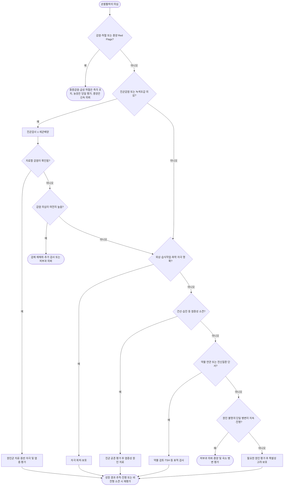

# 손발톱박리증 Onycholysis

## <mark style="color:green;">일반 사항</mark>

* 손발톱판(nail plate)이 손발톱바닥(nail bed)에서 분리되는 임상 소견
* 다른 이름 : 조갑박리증
* 대개 원위부에서 시작하여 근위부로 진행하며, 한 개 또는 여러 손발톱을 침범할 수 있음
* 손발톱 자체의 독립된 질환이라기보다 외상, 피부질환, 감염, 전신질환, 약물 또는 종양 등에 의해 발생하는 임상 징후인 경우가 많음
* 분류 : 원발성(특발성) — 성인 여성과 손톱에서 보다 흔함 / 속발성 — 명확한 원인 질환·자극·약물이 확인되는 경우
* 이미 분리된 손발톱판은 다시 붙지 않으며, 새로 자라는 손발톱이 손발톱바닥에 부착된 상태로 유지되어야 회복됨

***

## <mark style="color:green;">원인</mark>

#### <mark style="color:$primary;">외상·외부 자극</mark>

* 반복적 미세외상, 손발톱 밑을 기구로 파거나 청소하는 습관
* 잦은 매니큐어, 젤네일·인조손톱, 손발톱 연장술 및 제거 과정
* 꽉 끼는 신발, 반복적으로 발끝이 부딪히는 운동
* 물, 비누, 세제, 알칼리, 표백제, 용제 및 산업용 세정제에 대한 반복 노출

#### <mark style="color:$primary;">피부질환</mark>

* 건선(손발톱 건선), 손습진·접촉피부염, 편평태선

#### <mark style="color:$primary;">감염</mark>

* 피부사상균 조갑백선, Candida 감염
* 박리된 공간은 Candida 또는 *Pseudomonas aeruginosa*의 이차 집락화·감염에 취약함
  * 녹색 또는 녹흑색 변색은 Pseudomonas 이차감염(green nail syndrome)을 시사
  * 균이 검출되더라도 원발 질환인지 이차 집락화인지 임상 소견과 함께 판단

#### <mark style="color:$primary;">전신질환</mark>

* 갑상선기능항진증(Plummer nails) 등 갑상선질환과 연관될 수 있음
* 당뇨병·임신 등에서도 동반될 수 있으나, 손발톱박리만으로 특정 전신질환이나 직접적인 인과관계를 판단하지 않음
* 모든 환자에게 일률적인 전신검사를 시행하기보다 병력·진찰 소견에 따라 선별적으로 평가

#### <mark style="color:$primary;">약물·광독성</mark>

* 광손발톱박리 유발 약물: tetracycline계(특히 doxycycline), fluoroquinolone계, 일부 NSAID, psoralen 등
* 광독성과 무관하게도 손발톱 변화를 유발할 수 있는 약물: 경구 retinoid, taxane계 항암제(docetaxel, paclitaxel) 등. 약물성 박리를 모두 광손발톱박리증으로 분류하지 않음
* 약물 복용 후 햇빛에 노출된 손발톱에서 통증성 박리 또는 색소 변화가 동반되면 광손발톱박리증(photo-onycholysis)을 고려

#### <mark style="color:$primary;">종양</mark>

* 손발톱 단위 흑색종, 손발톱 단위 편평세포암 등
* 원인 불명의 단일 손발톱 병변이 지속되면 양성 질환으로 단정하지 않음

#### <mark style="color:$primary;">원발성</mark>

* 병력·진찰 및 필요한 검사에서 원인이 확인되지 않는 특발성 손발톱박리증

### <mark style="color:orange;">기전</mark>

* 손발톱판–손발톱바닥의 부착 구조와 원위 장벽(onychodermal/onychocorneal band, hyponychium)이 외상·염증·감염 등에 의해 손상되면 손발톱판이 분리됨
* 박리가 오래 지속되면 노출된 손발톱바닥이 각질화되어 새 손발톱이 다시 부착되지 못하는 disappearing nail bed로 진행할 수 있음

***

## <mark style="color:green;">임상 양상</mark>

* 분리된 부위는 공기가 들어가 흰색 또는 불투명하게 보이며, 부착 경계가 비교적 뚜렷함
* 대개 무증상이지만 급성 외상, 염증, 출혈 또는 이차감염이 있으면 통증·압통이 발생할 수 있음
* 손발톱 표면은 정상일 수도 있으나 원인에 따라 함몰점(pitting), 부스러짐, 변형, 조갑하 과각화 또는 출혈이 동반됨
* 건선에서는 oil-drop/salmon patch, 함몰점, 조갑하 과각화 및 박리 경계의 홍반을 확인
* 녹색·녹흑색 변색은 Pseudomonas 감염을, 황백색 변색·비후·조갑하 각질 부스러기는 조갑백선을 시사하지만 임상 소견만으로 확진하지 않음
* 광손발톱박리증은 광과민 유발 약물 복용과 자외선 노출 후 여러 손톱에 비교적 동시에 발생하며, 통증·홍반·색소 변화, 조갑하 출혈 또는 선상출혈을 동반할 수 있음. 박리 경계는 반달 모양, 원형 notch 또는 중앙형 등 다양하므로 형태만으로 진단하지 않음


**진단 pearl — 박리 경계의 피부경 소견**\
매끈하고 직선에 가까우며 홍반이 없는 근위 경계는 외상성 박리를, 불규칙한 톱니 모양 경계와 근위부를 향하는 spike·세로줄은 조갑백선을 시사함. 박리 경계의 홍반, salmon patch, 함몰점은 손발톱 건선을 지지함. 다만 조갑백선에서도 직선형 경계가 나타날 수 있으므로 피부경 소견은 보조 단서로만 활용하고, 조갑백선은 KOH·배양·PAS 등으로 확인함.


### <mark style="color:orange;">문진·진찰</mark>

* 발생 시점과 진행 속도, 단일 또는 다발성 침범, 통증·출혈·삼출 여부 확인
* 직업성 습식 작업, 세제·용제 노출, 손발톱 미용(매니큐어·젤네일), 반복 외상, 신발 및 운동력 확인
* 최근 시작하거나 증량한 약물, 항암치료 및 햇빛 노출과의 시간적 연관성 확인
* 모든 손발톱과 손·발 피부를 관찰하고, 건선이 의심되면 두피·피부 병변과 관절 증상도 확인
* 갑상선질환·당뇨병 등을 시사하는 전신 증상을 확인

***

### <mark style="color:$danger;">🚩 Red Flags!</mark>

<mark style="color:$danger;">**즉각 조치**</mark>

* 빠르게 확산하는 홍반·부종에 전신독성·저혈압, 겉으로 보이는 병변에 비해 심한 통증, 수포 또는 조직 괴사가 동반된 경우  `패혈증·괴사성 감염 의심`
* 손발가락이 갑자기 창백하거나 검게 변하고 차가워지며 감각 저하·심한 통증이 동반된 경우  `급성 허혈·괴저 의심`

<mark style="color:$warning;">**당일 평가**</mark>

* 손발톱주위 농양, 빠르게 번지는 국소 홍반·열감·부종, 심한 통증 또는 발열  `세균감염·농양`
* 당뇨병·말초혈관질환·중증 면역저하 환자에서 새로 발생한 감염 소견, 심부궤양 또는 골 침범 의심 소견  `고위험군 감염·심부 병변`

<mark style="color:$info;">**조기 평가 및 추적**</mark>

* 새로 생기거나 넓어지는 불규칙한 갈색·흑색 세로띠, 근위부·측면 손발톱주름으로 번지는 색소(Hutchinson sign)  `손발톱 단위 흑색종 의심`
* 손발톱 밑 종괴, 사마귀 모양 병변, 궤양, 반복 출혈, 진행성 손발톱 파괴 또는 지속적 통증(갈색·흑색 색소가 없어도 해당)  `손발톱 단위 종양 의심`
* 뚜렷한 원인 없이 한 손발톱에만 지속·진행하거나 적절한 자극 회피·원인 치료에도 진행하는 박리  `국소 병변·치료 실패`
* 여러 손발톱이 동시에 침범되거나 전신질환을 시사하는 증상이 동반된 경우  `전신질환·약물 원인 평가`

중증 감염·급성 허혈은 즉각 응급 평가를 연결함. 농양·심부감염은 당일 배농·영상검사·전신 항균치료 필요성을 판단함. 종양 의심 병변은 항진균제 반응을 기다리지 않고 신속히 피부과에 의뢰하여 피부경검사·조직검사를 평가함.

***

## <mark style="color:green;">진단</mark>

* 손발톱박리는 임상적으로 진단하되, 병력과 진찰로 원인을 확인하는 것이 진단의 핵심
* 조갑백선이 의심되면 가능한 한 항진균제 치료 전에 박리 경계의 근위부에서 검체를 채취하여 KOH 직접검사 시행(박리된 손발톱판을 정리한 뒤 활동성 병변의 가장 근위부 조갑하 각질을 채취)
  * KOH 음성만으로 조갑백선을 배제하지 않음. 검체 위치·양과 선행 항진균제 사용을 확인하고, 의심이 높으면 검체 재채취·진균배양·손발톱판 PAS 염색 또는 PCR을 고려
  * 배양에서 Candida·비피부사상균성 곰팡이만 검출되면 오염·이차 집락화 가능성을 함께 평가하고, 필요 시 반복 검체 및 직접검사·조직 소견으로 원인성을 판단
  * 특히 장기간 경구 항진균제 투여 전에는 진균 감염 확인이 원칙
* 녹색 변색과 함께 통증, 홍반, 삼출 또는 악취가 있거나 치료 반응이 불량하면 세균배양 고려. 녹색 변색만으로 침습성 세균감염을 진단하거나 전신 항생제를 시작하지 않음
* 녹색 변색에서도 진균감염이 공존할 수 있으므로 황백색 비후·조갑하 각질 등 조갑백선 소견이 있으면 진균검사를 함께 시행
* 원인이 불분명한 다발성 병변 또는 관련 증상이 있으면 TSH 등 표적 혈액검사 고려; 모든 환자에게 광범위 검사를 일률적으로 시행하지 않음
* 단일 손발톱의 비전형적 색소성 병변, 종괴, 궤양 또는 지속적 손발톱 파괴는 피부과 의뢰 후 피부경검사·조직검사 고려

### <mark style="color:orange;">감별 진단</mark>

* 흰색으로 보이는 손발톱이라고 모두 박리는 아님. 손발톱판 자체의 백색 변화(true leukonychia), 손발톱바닥 변화에 의한 겉보기 백색 변화(apparent leukonychia), 손발톱바탕질 성장 정지에 의한 근위부 분리(onychomadesis)를 구분

<table><thead><tr><th width="140">질환/소견</th><th width="230">손발톱박리와의 차이</th><th>핵심 감별 포인트</th></tr></thead><tbody><tr><td>True / apparent leukonychia</td><td>백색 변화가 있어도 손발톱판–바닥의 물리적 분리가 없음</td><td>True leukonychia는 손발톱판 자체의 변화, apparent leukonychia는 손발톱바닥 변화. 백색 변화의 위치와 실제 박리 여부를 구분</td></tr><tr><td>Onychomadesis</td><td>손발톱바탕질의 일시적 성장 정지로 기존 손발톱판이 근위부에서 전층으로 분리되고, 새 손발톱이 자라면서 원위부로 밀려나 때로 탈락</td><td>발열성 질환·수족구병 등 후 발생; 주로 원위부 손발톱판–바닥이 분리되는 onycholysis와 달리 바탕질 수준의 근위부 전층 분리</td></tr><tr><td>외상성 손발톱박리</td><td>반복적인 물리적 자극에 의한 속발성 박리</td><td>한두 손발톱 중심, 반복 외상 병력, 비교적 매끈하고 직선형이며 홍반이 없는 근위 경계</td></tr><tr><td>광손발톱박리증</td><td>광과민 유발 약물과 자외선의 상호작용에 의한 박리</td><td>약물·광노출의 시간적 연관, 여러 광노출 손톱의 동시 침범, 통증·색소 변화·조갑하 출혈 가능</td></tr><tr><td>조갑하 혈종</td><td>외상 후 급성 발생, 압통 동반</td><td>보라\~흑색 변색, 손발톱판 아래 혈액 저류</td></tr><tr><td>Pseudomonas green nail syndrome</td><td>이차감염으로 박리와 동반 가능</td><td>녹색·녹흑색 변색, 습한 환경 노출력</td></tr><tr><td>손발톱 단위 흑색종/편평세포암</td><td>박리가 종양의 이차 소견으로 동반될 수 있음</td><td>단일 손발톱의 지속·진행, 종괴·궤양·반복 출혈·불규칙 색소. 색소나 Hutchinson sign이 없어도 종양을 배제하지 못함</td></tr></tbody></table>

***



<p align="center"><strong>손발톱박리증 원인 감별 및 치료 알고리듬</strong></p>

<p align="center"><em><mark style="color:$info;">Ref. DermNet Onycholysis; Rigopoulos et al. J Am Acad Dermatol. 2019;81:228–240; Bae et al. Ann Dermatol. 2014;26:514–516 (녹색조갑증후군 증례)</mark></em></p>

***

## <mark style="background-color:$warning;">Management</mark>


**손발톱박리증 치료의 핵심 원칙**\
손발톱박리 자체에 일률적으로 사용하는 표준 약물치료는 없음. 원인을 확인하고 그 원인을 교정·치료하는 것이 우선이며, 공통적으로 자극 회피와 손발톱 보호를 시행함.

**처방 시 최신 품목정보/급여기준 조회.** 아래 용법은 원인 질환에 대한 성인 치료 예시이며, 손발톱박리 자체의 공통 처방이 아님. 적응증 외 사용은 해당 항목에서 구분함.


### <mark style="color:orange;">치료 방침</mark>

* 박리된 부분을 부착 경계 가까이까지 무리하지 않게 자르고 손발톱을 짧게 유지
* 손발톱 밑을 기구로 파거나 청소하지 않으며, 붙어 있는 손발톱판까지 과도하게 제거하지 않음
* 원인 질환을 확인하여 치료하고, 의심 약물은 환자가 임의로 중단하지 말고 처방 의료진과 대체·중단 가능성을 검토

> 광손발톱박리증에서는 햇빛 노출을 줄이고 손발톱을 물리적으로 보호함. 일반적으로 손발톱 화장품은 피하지만, 자외선 차단 목적으로 불투명 네일 에나멜을 제한적으로 고려할 수 있음. 젤네일·인조손톱은 피하고 화장품 알레르기·자극이 있으면 사용하지 않음.

***

## <mark style="color:green;">비-약물 치료 및 예방</mark>

* 반복 외상과 물, 비누, 세제, 알칼리, 표백제, 용제 노출을 최소화
* 물일을 할 때는 면장갑 위에 방수 장갑을 착용하고 작업 후 충분히 건조. 장갑 안에 땀이 차면 벗어 말리고 젖은 면장갑은 교체
* 매니큐어, 젤네일·인조손톱 및 리무버 사용을 피함(광손발톱박리증에서의 제한적 예외는 위 참조)
* 꽉 끼는 신발을 피하고, 발끝에 반복 충격이 가는 운동은 보호 장구 착용 또는 빈도 조절
* 손발톱은 짧고 일직선에 가깝게 다듬어 추가 손상을 줄임

***

## <mark style="color:green;">약물 치료</mark>

### <mark style="color:orange;">염증성 손발톱질환</mark>

* 손발톱 건선 등 염증성 원인이 확인된 경우 국소 corticosteroid를 고려할 수 있음
* Clobetasol 등 고역가 제제와 밀봉요법을 원인 미확인 손발톱박리증의 일반 치료로 사용하지 않음
* 소수 손발톱(≤3개)에 국한된 손발톱바닥 건선은 국소 corticosteroid 단독 또는 비타민 D 유사체 병용을 고려. 손발톱바탕질만 침범한 경우에는 전문기관에서 병변 내 corticosteroid 주사 필요성을 평가함 <mark style="color:$info;">[Rigopoulos et al. 2019]</mark>
* 국소치료를 선택한 경우 손발톱바탕질 병변은 근위 손발톱주름에, 손발톱바닥 병변은 박리부를 짧게 정리한 뒤 hyponychium에 도포
* 초강력 국소 corticosteroid는 얇게 qd 도포하는 단기 요법을 우선 고려하고, 지속·재발성 손발톱 건선은 피부과에서 장기 치료 계획을 정함
* 1\~2주 재평가는 국소 자극·위축·감염 등 안전성과 초기 염증 반응을 확인하는 시점임. 손발톱 외관 회복에는 수개월이 필요하므로 이 시점의 박리 잔존만으로 치료 실패를 판정하지 않음
* 밀봉요법의 추가 효과는 불확실하여 일상적으로 시행하지 않음. 밀봉하면 약물 흡수·피부 위축·침연·이차감염 위험이 증가하므로 전문의가 필요성을 판단한 경우에만 개별 계획을 정함. 밀봉 여부와 무관하게 제품의 연속 사용기간 제한을 적용함

#### <mark style="color:$primary;">국소 항염증 치료</mark>

* clobetasol propionate 0.05% 연고를 병변 위치에 따라 근위 손발톱주름 또는 hyponychium에 얇게 qd <mark style="color:blue;">\[도모호론연고]</mark>
  * 국내 허가용법은 1일 1\~2회이나 위 예시는 qd 요법임. **2주 이상의 연속 치료 및 주 50 g 이상 사용을 하지 않으며**, 1\~2주 내 반응·피부 위축 등을 재평가함. 감염성 피부병변·24개월 미만 영아에는 금기임 <mark style="color:$info;">[식약처 clobetasol 허가사항]</mark>
* tacrolimus 0.1% 연고는 손발톱바닥 또는 손발톱바탕질 건선의 대안으로 고려할 수 있음(국내 적응증 외 사용, 근거 제한적) <mark style="color:blue;">\[프로토픽]</mark>
  * 21명 대상 12주 무작위 공개 연구에서 개선이 보고되었으나 대규모 이중눈가림 근거는 부족함. 국내 0.1% 제제의 허가 적응증은 만 16세 이상 중등증\~중증 아토피피부염의 2차 치료 및 유지요법이며, 손발톱 건선의 허가 용법으로 옮기지 않음
  * 장기간 연속 사용·밀봉을 피하며, 면역저하·감염 병변, 임신 가능성, 미란·궤양 및 중증 신장애 등 금기·주의사항을 확인. 확인한 HIRA 허가 외 급여 예외는 얼굴·접합부 건선 등이며 손발톱 건선으로 확대 적용하지 않음
* 손발톱바닥 건선에서는 calcipotriol–betamethasone dipropionate 복합제를 국소치료의 대안으로 고려할 수 있음(손발톱 건선에 대한 국내 적응증 외 사용, 근거 제한적) <mark style="color:blue;">\[다이보베트연고/자미올겔]</mark>
  * 제형별 피부건선 허가용법을 구분: 다이보베트연고는 판상형 건선에 qd, 권장 4주; 자미올겔은 12세 이상에서 두피건선 및 두피 외 판상형 건선에 qd, 각각 권장 4주·8주. 이 기간을 손발톱 건선의 허가 치료기간으로 제시하지 않음
  * 칼슘대사 장애·중증 신장애/간질환·감염 또는 상처 부위 등 제품별 금기·주의와 밀봉 제한을 확인. 피부건선의 허가와 손발톱의 적응증 외 사용을 구분하고 급여를 자동 전제하지 않음

### <mark style="color:orange;">감염성 원인</mark>

* 조갑백선은 진균검사로 확인한 뒤 침범 범위와 환자 상태에 따라 국소 또는 경구 항진균제를 선택
* Pseudomonas 등 세균성 이차감염은 건조 유지와 자극 회피가 기본이며, 염증·삼출·통증 또는 광범위 병변이 있으면 배양 결과와 임상 중증도에 따라 국소 또는 전신 항균치료

#### <mark style="color:$primary;">항진균제</mark>

* 손발톱바탕질 침범이 없고 침범 범위와 손발톱 수가 제한된 조갑백선에서는 국소 항진균제를 1차 치료로 고려. 간질환·약물 상호작용 등으로 경구치료가 곤란한 경우에도 대안이 될 수 있으나, 광범위하거나 바탕질을 침범한 병변에서는 단독치료 효과가 낮음을 설명
* efinaconazole 10% 외용액을 감염된 손발톱 전체와 손발톱–피부 경계에 qd(국내 적응증은 피부사상균성 손발톱진균증) <mark style="color:blue;">\[주블리아]</mark>
  * 국내 허가 대상은 **성인 및 6세 이상 소아**. 같은 성분 제네릭에 소아 허가가 자동 적용되는 것은 아니므로 품목별로 확인
  * 씻거나 샤워·목욕 후 적어도 10분간 건조한 뒤 도포하고 완전히 말림. 사포질은 필수가 아님. **48주 초과 사용 시 유효성과 안전성이 확립되지 않았으므로** 불응 시 진단·복약·치료 전략을 재평가하고 관행적으로 연장하지 않음. 임신·수유 시에는 별도 이득–위험 평가가 필요함
* amorolfine 5% 네일라카를 감염된 손발톱에 주 1\~2회 <mark style="color:blue;">\[로세릴]</mark>
  * 로세릴의 국내 적응증은 감염부위가 손발톱 표면의 ≤80%인 조갑진균증이나, 이 허가범위를 국소제 단독치료의 권장 기준과 동일시하지 않음
  * 도포 전 감염 조갑을 줄로 정리하고 기존 라카를 패드로 제거. 감염 조갑에 쓴 줄을 정상 조갑에 사용하지 않음. 통상 손톱 약 6개월, 발톱 9\~12개월 치료
  * 국내 허가사항상 손발톱주위 염증·혈액순환장애, 영양실조·알코올중독, 영유아·소아, 임부·임신 가능성이 있는 여성·수유부 및 성분 과민증 환자에는 사용하지 않음. 해당 환자에게 경구제의 안전한 대안으로 자동 선택하지 않음
  * 국소제도 가능한 한 진균 감염을 확인한 뒤 사용하고, 제품별 허가사항과 도포 전 손발톱 정리 방법 및 치료 기간을 확인. 건강한 손발톱이 자라 대체될 때까지 장기간 치료가 필요하며, 광범위·바탕질 침범 또는 치료 반응 불량 시 경구제나 병합치료 필요성을 재평가
* itraconazole 200 ㎎ bid ×7일 후 21일 휴약(pulse) — 손톱 2회(1·5주), 발톱 3회(1·5·9주; 손톱 감염 동반 여부와 무관, 국내 허가 주기요법) <mark style="color:blue;">\[스포라녹스]</mark>
* terbinafine 250 ㎎ qd(125 ㎎ 2정) — 손톱 6주, 발톱 12주의 대표 임상 요법 <mark style="color:blue;">\[라미실정125㎎]</mark>
  * 국내 허가사항은 손발톱진균증에 통상 6주\~3개월로 제시. 손발톱 성장·중증도·치료 반응에 따라 평가하며 외관 회복이 늦다는 이유만으로 자동 연장하지 않음
  * CrCl ＜50 ㎖/min에서는 국내 용법에 1일량 1/2 감량이 제시되어 있으나, 주의사항에는 근거 부족으로 사용이 권장되지 않는다고 병기됨. 단순 감량 처방보다 국소치료 적합성·전문의뢰를 우선 검토. 중증 신부전, 만성/활동성 간질환, 호중구감소·범혈구감소·무과립구증·혈소판감소 등 혈액질환 및 수유부에는 금기
  * 건선 또는 홍반루푸스 악화 가능성에 주의. 손발톱 건선과 진균감염이 공존하면 치료 중 건선 악화도 함께 평가
  * 경구치료가 필요한 피부사상균 감염에서는 terbinafine을 우선 고려하며, Candida 등 비피부사상균이 의심되면 배양 결과와 균종에 따라 약제 선택
  * 두 약제 모두 치료 전 간질환·병용약물과 간기능(AST/ALT 등)을 확인하고, 신장애·고령에서는 제품별 사용 제한도 확인함. 치료 중 제품 허가사항과 위험요인에 따라 간기능을 추적함. Terbinafine은 치료 시작 후 첫 2개월간 매월(4\~6주 평가 포함), 이후에도 정기적으로 간기능을 확인하며 혈액검사도 허가사항에 따라 계획함. Terbinafine은 만성 또는 활동성 간질환에서 사용하지 않으며 CYP2D6 상호작용도 확인
  * Itraconazole은 심부전·심실기능장애 또는 그 병력이 있는 환자의 손발톱진균증에 사용하지 않음. CYP3A4 금기 병용약물(일부 약제는 itraconazole 중단 후 2주까지 병용 제한), 임신·수유(국내 허가상 금기) 및 산분비억제제에 의한 흡수 저하를 확인; 캡슐은 식사 직후 복용하며 경구액과 임의로 대체하지 않음
  * Itraconazole을 사용하는 가임 여성은 치료 중 효과적인 피임을 시행하고, **투여 종료 후 다음 생리기간까지** 매우 효과적인 방법으로 피임하도록 안내
  * 지속적 구역·식욕부진·피로, 황달·갈색뇨 등 간손상 의심 증상이 발생하면 복용을 중단하고 즉시 평가
  * 상세 용법과 허가·주의사항은 [손발톱진균증 챕터](173_-onychomycosis.md) 참조

#### <mark style="color:$primary;">항균 치료(Pseudomonas)</mark>

* 경증은 박리부를 짧게 유지하고 완전히 건조하며, 물·세제·인조손발톱 등 유발 요인을 회피하는 것이 기본
* 초산 습포·침지는 보조적으로 사용된 사례가 있으나 효과를 확립한 근거가 부족하고 피부 자극을 일으킬 수 있음. 가정용 식초는 제품마다 농도가 다르므로 환자가 임의로 희석·사용하지 않도록 안내
* 국소 항균제가 필요한 경우 tobramycin 등 항녹농균 항생제 단일 성분 점안액을 박리된 손발톱판 아래에 도포하는 방법이 보고됨(적응증 외 사용, 표준 용법이 확립되지 않은 증례 보고 수준) <mark style="color:$info;">[Bae et al. 2014]</mark>
  * 국내 단일 성분 제품 예: tobramycin 0.3%(3 ㎎/㎖) <mark style="color:blue;">\[오큐라신점안액]</mark>. 국내 허가 적응증은 안과 감염이며 손발톱 도포는 허가 외 사용임. 항생제–스테로이드 복합 점안액으로 임의 대체하지 않음
  * 최신 중증 녹색조갑 보고에서도 무작위 비교시험의 부족을 지적하므로, 증례의 용법을 표준 치료 횟수·기간으로 일반화하지 않음 <mark style="color:$info;">[Suh et al. 2026]</mark>
* 경구 fluoroquinolone은 일률적으로 사용하지 않으며, 광범위·중증 감염, 면역저하, 국소치료 실패 등에서 배양·감수성 결과와 약물 위해성을 고려하여 제한적으로 사용

### <mark style="color:orange;">치료 경과</mark>

* 분리된 손발톱판이 즉시 다시 붙지 않는다는 점을 설명하고 새 손발톱의 성장 경과를 관찰
* 손톱은 완전히 자라는 데 약 4\~6개월, 발톱은 약 12\~18개월 걸릴 수 있으며 연령·혈류·손상 정도에 따라 달라짐
* 같은 각도·조명에서 자를 함께 대고 사진을 기록하며, 근위부에서 새로 자라는 부착 손발톱의 길이와 박리 범위가 줄어드는지 추적
* 초기에는 4\~6주 간격으로 자극 회피·염증·감염 및 진행 여부를 확인하고 이후 경과에 따라 조절. 이 기간에 외관이 정상화되지 않았다는 이유만으로 치료 실패를 판정하거나 항진균제를 무조건 연장하지 않음
* 장기간 지속될수록 손발톱바닥이 영구적으로 각질화되어 재부착 가능성이 낮아질 수 있으므로(disappearing nail bed) 원인을 조기에 제거하는 것이 중요

***

## <mark style="color:green;">시술 및 기타 처치</mark>

* 박리된 손발톱판과 과도한 조갑하 각질은 통증·출혈이 생기지 않는 범위에서 정리할 수 있으나, 붙어 있는 손발톱판을 억지로 떼거나 손발톱바닥을 긁어내지 않음
* 당뇨병·말초혈관질환·감각저하 또는 면역저하가 있으면 자가로 깊게 자르거나 제거하지 말고 의료진이 손상·감염 위험을 평가
* 손발톱박리만으로 손발톱판 전체 제거(발조술)를 일률적으로 시행하지 않음. 통증·농양·심한 변형·치료저항성 감염 등에서는 피부과에서 처치 필요성을 개별 판단
  * 2026년 보고된 국내 중증 녹색조갑 후향적 증례군에서는 손발톱판의 부분/전체 제거 후 호전을 보고함. 중증·불응성 변형 병변에서 전문 시술을 고려하는 근거이나, 비교군 없는 소규모 연구이므로 경증에 일률적으로 발조술을 권하지 않음 <mark style="color:$info;">[Suh et al. 2026]</mark>
* 손발톱주위 농양은 배농 필요성을 평가. 국소 항균제나 경구 항생제만으로 배농을 지연하지 않음
* 지속·진행하는 단일 병변 또는 종양 의심 소견은 피부과에서 병변 위치에 맞는 조직검사를 계획
* 여러 손발톱의 중증 건선, 기능장애·심한 통증, 국소치료 실패 또는 건선관절염 의심 시 피부과·관련 전문과에 의뢰하여 병변 내 주사나 전신치료 필요성을 평가
  * 2026년 국내 건선 전문가 합의는 손발톱 같은 특수부위의 부담과 치료 반응을 별도로 평가하도록 강조함. 피부 병변의 면적·PASI가 낮다는 이유만으로 손발톱의 기능·삶의 질 영향을 가볍게 판단하지 않음 <mark style="color:$info;">[Bang et al. 2026]</mark>

***

## <mark style="color:red;">질병코드</mark>

L60.1 손발톱박리 Onycholysis

원인 질환이 확인되면 임상적으로 해당되는 원인 질환 코드를 함께 검토함.

***

## <mark style="color:purple;">처방례</mark>

> **처방례 1. 손발톱 건선에 의한 손발톱박리**
>
> ```
> 도모호론연고 0.05%  박리부를 짧게 정리한 뒤 hyponychium에 얇게 qd 도포
> 1~2주 내 재평가, 2주 이상 연속 사용하지 않음
> ```
>
> _✽손발톱 건선에 의한 손발톱바닥 병변이 확인되고 진균·세균 감염을 배제한 경우의 예시. qd 단기 요법의 예시이며, 국내 허가사항의 연속 사용기간·주간 용량 제한을 적용함. 밀봉요법은 일상적으로 시행하지 않으며, 지속성 병변은 피부과에서 간헐요법·대체치료 필요성을 판단함_

> **처방례 2. 조갑백선 동반 손발톱박리(손톱)**
>
> ```
> 스포라녹스 100 ㎎/cap  2cap bid 식사 직후  1주(7일) 복용 후 3주 휴약, 5주째 7일 복용(총 2회 pulse)
> ```
>
> _✽KOH·배양·PAS 등으로 진균 감염을 확인하고 균종·침범 범위에 따라 선택. 손톱에만 감염된 경우의 예시이며, 심부전·심실기능장애 병력, 간질환·임신 가능성·금기 병용약물 및 흡수에 영향을 주는 약물을 확인_

> **처방례 3. Pseudomonas 이차감염(green nail syndrome)**
>
> ```
> 손발톱을 짧게 유지하고 완전히 건조
> ± 항녹농균 항생제 단일 성분 점안액(예: tobramycin)
>    손발톱바닥에 도포(임상 소견·필요 시 배양 결과에 따라 선택)
> ```
>
> _✽국소 점안액 도포는 적응증 외 사용이며 근거는 주로 증례 보고 수준. 초산 습포·침지는 효과가 확립되지 않은 선택적 보조요법이고 피부 자극 위험이 있으므로 가정용 식초를 임의 희석하여 사용하지 않도록 안내. 광범위·중증 감염, 면역저하 또는 국소치료 실패 시 배양 후 전신 항균제 필요성을 판단_

> **처방례 4. 광손발톱박리증**
>
> ```
> 원인 약물 처방의와 대체 여부 상담
> 자외선 차단(불투명 네일 에나멜 또는 장갑) + 직사광선 회피
> ```
>
> _✽원인 약물(tetracycline계, fluoroquinolone계 등) 중단은 반드시 처방 의료진과 상의 후 결정_

***

## <mark style="color:$success;">핵심 복약 지도</mark>

> **국소 스테로이드(clobetasol 등) 사용 원칙**
>
> * 손발톱 건선 등 염증성 원인이 확인된 경우에 한해 사용하며, 원인 불명의 손발톱박리에 예방적으로 사용하지 않습니다.
> * 이 처방례의 clobetasol은 1일 1회 얇게 바릅니다. 1\~2주 내 재평가하며, 2주 이상 연속 사용하거나 주 50 g 이상 사용하지 않습니다. 더 오래 치료해야 한다면 피부과에서 치료 계획을 조정합니다.
> * 임의로 비닐·밀폐 드레싱으로 덮지 마십시오. 밀봉은 약물 흡수와 피부 위축·침연·이차감염 위험을 높일 수 있습니다.
> * 진균·세균 감염이 배제되지 않은 상태에서 고역가 스테로이드를 사용하면 증상이 악화되거나 진단이 지연될 수 있습니다.

> **국소 항진균제 사용 원칙**
>
> * 외용액·네일라카는 제품에 따라 도포 횟수, 도포 전 손발톱 정리 방법 및 치료 기간이 다르므로 각 제품의 허가사항을 확인하십시오.
> * 초기에는 외관 변화가 더딜 수 있어 규칙적인 장기 도포가 필요합니다. 다만 제품별 사용기간 제한을 지키며, 주블리아는 48주를 초과한 사용의 유효성·안전성이 확립되지 않았으므로 반응이 부족하면 재평가합니다. 모든 국소제를 완전히 나을 때까지 무제한 연장하지 않습니다.
> * 광범위하거나 손발톱바탕질을 침범한 병변, 또는 충분히 사용해도 반응이 불량한 경우에는 경구제나 병합치료 필요성을 재평가하십시오.

> **항진균제 복용 순응도**
>
> * Pulse 요법은 복용 주기가 불규칙해 보이지만(1주 복용-3주 휴약) 처방된 횟수와 일정을 정확히 지키도록 안내하십시오.
> * 경구 항진균제는 정해진 투여 기간만 복용합니다. 약 복용이 끝난 뒤에도 건강한 손발톱이 자라면서 외관이 좋아지는 데 손톱은 수개월, 발톱은 1년 이상 걸릴 수 있으며, 완전히 자랄 때까지 경구약을 계속 복용하는 것은 아닙니다.
> * 치료 시작 전과 치료 중 간기능검사 일정을 안내하고, 병용 약물(itraconazole의 CYP3A4 및 terbinafine의 CYP2D6 상호작용)을 확인하십시오.
> * 지속적 구역·식욕부진·피로, 황달·갈색뇨가 생기면 복용을 중단하고 즉시 진료받도록 안내하십시오. Itraconazole 캡슐은 식사 직후 복용하며, 호흡곤란·다리 부종 등 심부전 의심 증상도 즉시 평가하십시오.
> * Itraconazole을 복용하는 가임 여성은 치료 중과 투여 종료 후 다음 생리기간까지 효과적인 피임을 유지하도록 안내하십시오.

> **언제 다시 병원을 방문해야 하나요?**
>
> * 손발톱 주위 발적·부종·통증이 빠르게 진행하거나 발열이 동반되는 경우 — 즉시 내원
> * 갈색·흑색 세로줄이 새로 생기거나 넓어지는 경우, 손발톱주름까지 색소가 번지는 경우 — 조기에 피부과 평가
> * 손발톱 밑 종괴, 궤양, 반복 출혈이 있는 경우 — 조기에 피부과 평가
> * 4\~6주간 자극 회피와 원인 치료를 시행해도 박리 범위가 계속 넓어지거나 새로운 통증·출혈·색소 변화가 나타나는 경우. 이 기간에 외관이 완전히 정상화되어야 한다는 의미는 아님

***

## <mark style="color:green;">주요 참고문헌 및 확인 자료</mark>

### <mark style="color:orange;">임상 근거</mark>

* DermNet. Onycholysis. [임상 자료](https://dermnetnz.org/topics/onycholysis)
* Rigopoulos D, et al. Recommendations for the definition, evaluation, and treatment of nail psoriasis in adult patients with no or mild skin psoriasis: A dermatologist and nail expert group consensus. J Am Acad Dermatol. 2019;81(1):228–240. [서지](https://pubmed.ncbi.nlm.nih.gov/30731172/)
* Bae Y, et al. Green nail syndrome treated with the application of tobramycin eye drop. Ann Dermatol. 2014;26(4):514–516. [원문](https://pmc.ncbi.nlm.nih.gov/articles/PMC4135110/) — 단일 증례로 효과·기간의 일반화에 한계가 있음
* De Simone C, et al. Tacrolimus 0.1% ointment in nail psoriasis: a randomized controlled open-label study. J Eur Acad Dermatol Venereol. 2013;27(8):1003–1006. [서지·초록](https://pubmed.ncbi.nlm.nih.gov/22788697/) — 소규모 공개 연구
* Bang CH, et al. The Definition of Psoriasis Severity and Treatment Target of Psoriasis: Korean Expert Consensus Using the Modified Delphi Method. Ann Dermatol. 2026;38(4):304–312. [원문](https://doi.org/10.5021/ad.26.008)
* Suh JH, et al. Surgical management of green nail syndrome. JAAD Int. 2026;24:346–348. Published online 2025-12-19. [원문](https://pmc.ncbi.nlm.nih.gov/articles/PMC12828590/) — 중증 환자 후향적 증례군, 비교시험 아님
* 손발톱진균증의 검사·항진균제 치료 근거는 [손발톱진균증 챕터](173_-onychomycosis.md) 참고문헌 참조
* 173장 최신 보관본 `173_-onychomycosis(3).md`의 국소제·경구제 용법 및 신장애·간기능검사 문구와 대조함(2026-10-31).

### <mark style="color:orange;">허가·급여 확인 자료</mark>

* [식품의약품안전처. 의약품안전나라 — 의약품 품목허가정보.](https://nedrug.mfds.go.kr/) — 도모호론연고, 프로토픽, 다이보베트/자미올, 주블리아, 로세릴, 라미실, 스포라녹스 등의 적응증·용법·금기 및 허가 상태 확인 경로. **처방 시 최신 품목정보/급여기준 조회.**
* 2026-10-31 재대조: 식약처 품목 상세정보와 식약처 자료를 재현한 약학정보원의 품목별 허가정보를 확인함. 도모호론연고·프로토픽·로세릴·스포라녹스·오큐라신은 식약처 상세페이지도 직접 확인. 주블리아·라미실·다이보베트연고·자미올겔은 약학정보원의 식약처 출처 허가 본문으로 대조함. 직접 열람 범위와 확인 자료는 별도 검증 내역에 구분함.
* 건강보험심사평가원. Tacrolimus 외용제 급여기준(고시 제2020-79호, 2020-05-01 시행); 항진균제 일반원칙(고시 제2025-102호, 2025-07-01 시행) — 확인한 허가 외 급여 예외를 손발톱 건선에 확대 적용하지 않음. 품목의 급여 등재, 적응증·용법별 급여 인정, 실제 공급 여부를 구분하여 **처방 시 최신 품목정보/급여기준 조회**.
* 사용자 제공 KCD-9 분류표 `KCD9_251216(6).xlsx` — 「상병분류기호(전체)」 및 「상병분류기호(완전코드)」에서 L601(표시 L60.1), 손발톱박리, Onycholysis 직접 대조(2026-10-31).

***

## <mark style="color:blue;">환자 안내서</mark>


**손발톱박리증, 손발톱이 왜 들뜨나요?**

손발톱박리증은 손발톱이 그 아래 살(손발톱바닥)에서 떨어져 나오는 현상입니다. 대부분 손발톱 끝에서 시작해 안쪽으로 서서히 진행합니다. 원인을 조기에 교정하면 많은 경우 새로 자라는 손발톱이 다시 정상적으로 부착될 수 있지만, 오래 지속된 경우에는 완전히 회복되지 않을 수 있습니다.

손발톱이 오래 들떠 있으면 아래 살이 딱딱하게 각질화되어 새로 자라는 손발톱도 다시 붙기 어려울 수 있으므로, 원인을 조기에 교정하고 박리가 더 진행하지 않도록 관리하는 것이 중요합니다.


#### <mark style="color:$primary;">왜 이런 일이 생기나요?</mark>

* 물, 세제, 매니큐어·젤네일 같은 자극에 반복적으로 노출되면 손발톱과 살 사이의 연결이 약해질 수 있습니다.
* 손발톱을 다치거나, 무좀균(진균)·세균 감염, 건선 같은 피부병, 갑상선 질환 등이 원인이 되기도 합니다.
* 일부 약을 복용한 뒤 햇빛에 노출되어 생기는 경우도 있습니다.

#### <mark style="color:$primary;">일상생활에서 어떻게 관리하나요?</mark>

* **손발톱을 짧게 유지하십시오.** 들뜬 부분이 걸려서 더 벌어지는 것을 막아줍니다. 붙어 있는 부분까지 억지로 파내지는 마십시오.
* **손발톱 밑을 뾰족한 도구로 파거나 청소하지 마십시오.** 상처를 통해 세균이 들어갈 수 있습니다.
* **물일을 할 때는 🧤 면장갑 위에 고무장갑을 끼십시오.** 땀이 차거나 면장갑이 젖으면 벗어 말리거나 교체하고, 작업 후에는 도구로 파내지 말고 충분히 말리십시오.
* **매니큐어, 젤네일, 인조손톱, 리무버 사용을 피하십시오.** (햇빛에 의한 손발톱박리는 예외적으로 불투명 매니큐어가 도움이 될 수 있어 담당의와 상의하십시오.)
* 꽉 끼는 신발을 피하고, 발끝에 충격이 가는 운동은 잠시 줄이십시오.
* 당뇨병, 혈액순환장애 또는 발의 감각저하가 있으면 손발톱을 깊게 자르거나 들뜬 부분을 직접 제거하지 말고 의료진에게 관리 방법을 확인하십시오.

#### <mark style="color:$primary;">약은 어떻게 써야 하나요?</mark>

* 스테로이드 연고를 처방받았다면 의사가 정한 기간과 주기를 지키십시오. 임의로 오래 사용하면 피부가 얇아지거나 다른 감염이 생길 수 있습니다.
* 바르는 무좀약은 제품마다 횟수·손발톱 정리 방법·치료기간이 다르므로 안내받은 대로 사용하십시오. 주블리아는 48주를 넘겨 임의로 계속 사용하지 말고 재평가받으십시오. 임신·수유 중이거나 소아인 경우에는 사용할 수 있는 제품을 먼저 확인하십시오.
* Itraconazole(스포라녹스 등)을 복용하는 임신 가능한 여성은 치료 중과 마지막 복용 후 다음 생리기간까지 효과적인 피임이 필요합니다.
* 먹는 무좀약은 처방된 투여 기간과 일정만 정확히 지키십시오. 약 복용이 끝난 뒤에도 손발톱이 자라면서 외관이 좋아지는 데 수개월 이상 걸릴 수 있으며, 손발톱이 완전히 자랄 때까지 경구약을 계속 복용하는 것은 아닙니다.
* 녹색으로 변색되었다면 Pseudomonas 감염 가능성이 있으므로 진료를 받으십시오. 초산 습포·침지는 의료진이 적절한 농도와 방법을 안내한 경우에만 보조적으로 고려하며, 가정용 식초를 임의로 희석하여 사용하지 마십시오.

#### <mark style="color:$primary;">이럴 때는 병원을 방문하거나 의료진에게 연락하세요</mark>

* ☀️ 특정 약을 먹기 시작한 뒤 손발톱이 갑자기 아프면서 들뜨는 경우에는 원인 약물을 임의로 중단하지 말고 처방 의료진에게 조기에 연락하여 약물 조정과 광차단 방법을 상담하십시오.
* 손발톱 밑에 갈색·검은색 줄무늬가 새로 생기거나 점점 넓어지는 경우
* 손발톱 주변이 빨갛게 붓고 아프며 열이 나는 경우
* 손발톱 밑에 혹이 만져지거나 상처가 낫지 않고 자꾸 피가 나는 경우(검은색 변화가 없어도 진료가 필요합니다)
* 4\~6주간 관리해도 박리 범위가 계속 넓어지거나 새로운 통증·출혈·색소 변화가 나타나는 경우

#### <mark style="color:$primary;">회복까지 얼마나 걸리나요?</mark>

* 들뜬 부분은 다시 붙지 않으며, 새로 자라 나오는 손발톱이 완전히 붙어야 정상으로 돌아옵니다.
* 손톱은 보통 4\~6개월, 발톱은 약 1년\~1년 반 걸릴 수 있으므로 조급해하지 말고 원인 관리를 꾸준히 지속하십시오. 4\~6주 뒤 진료는 진행 여부와 염증·감염을 확인하는 시점이며, 그때까지 손발톱이 모두 정상으로 돌아와야 한다는 뜻은 아닙니다.
