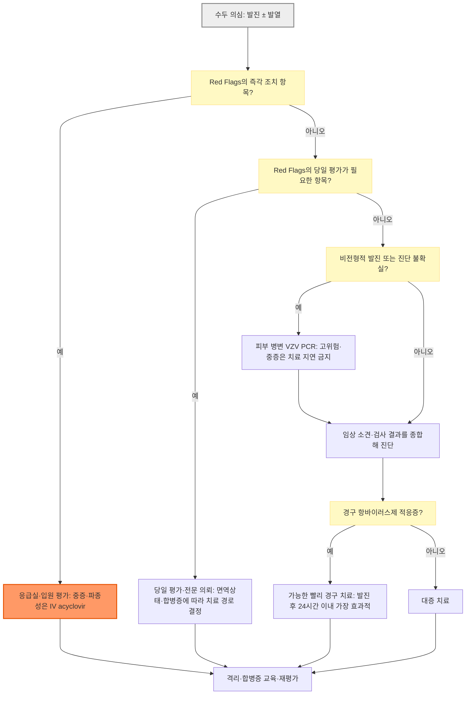

# 수두 Varicella, Chickenpox

## <mark style="color:green;">일반 사항</mark>

* 원인 바이러스 : varicella-zoster virus(VZV)의 일차 감염
* 전염 경로 : 호흡기 분비물·수포액에서 유래한 에어로졸의 흡입에 의한 공기 전파, 피부 병소의 수포액과 직접 접촉
* 잠복기 : 10\~21일(평균 14\~16일)
* 전염 기간 : 발진 발생 1\~2일 전부터 모든 병소가 가피로 덮일 때까지(보통 발진 후 4\~7일)
  * 돌파 수두로 가피가 생기지 않는 반점·구진만 있는 경우 : 24시간 동안 새로운 병변이 생기지 않을 때까지
* 호발 시기 : 연중 발생하며, 국내에서는 4\~7월과 11\~1월에 증가하는 경향
* 경과 : 건강한 소아에서는 대개 7\~10일 내 자연 치유하지만, 영아·청소년·성인·임신부·면역저하자는 중증 위험이 높음
* 재감염 : 평생면역이 흔하고 임상적 재감염은 드물지만 면역저하자에서 상대적으로 더 가능함
* 재활성화 : 감염 후 VZV가 감각신경절에 잠복하였다가 추후 대상포진으로 발현
* 주요 합병증
  * 소아 : 병변의 2차 세균감염(특히 *Streptococcus pyogenes*, *Staphylococcus aureus*), 드물게 괴사성근막염·패혈증
  * 성인 : 수두 폐렴 위험 증가
  * 모든 연령 : 소뇌실조, 뇌염·수막염, 간염, 혈소판감소·출혈성 수두
  * 임신 : 임신 초기 또는 임신 중기 초반 감염 시 선천수두증후군 위험 약 0.4\~2.0%; 분만 5일 전\~분만 2일 후 산모 발진 시 중증 신생아 수두 위험

## <mark style="color:green;">원인</mark>

* VZV의 일차 감염으로 발생하며, 감수성자는 수두 환자뿐 아니라 대상포진 환자의 병변에 노출되어도 수두가 발생할 수 있음
* 수두 백신 접종 후에도 야생형 VZV 감염에 의한 돌파 수두가 발생할 수 있음

## <mark style="color:green;">임상 양상</mark>

### <mark style="color:orange;">전구 증상</mark>

* 미열 또는 발열, malaise, 식욕부진, 두통, 복통
* 청소년·성인에서는 발진 1\~2일 전 전구 증상이 비교적 흔함
* 건강한 소아에서는 전구 증상 없이 발진이 첫 증상일 수 있음

### <mark style="color:orange;">피부 병소</mark>

* 가려움을 동반한 전신성 발진으로 피부와 점막을 침범
* 두피·얼굴·몸통에서 시작해 사지로 퍼지며, 몸통 중심 분포가 흔함
* 반점 → 구진 → 투명한 소수포(장미꽃잎 위의 이슬방울) → 농포 → 가피로 빠르게 진행
* 3\~5일 동안 병변이 여러 차례 무리지어 발생하므로 서로 다른 단계의 병변이 동시에 존재하는 것이 특징
* 구강·인두·결막·질 점막에 통증성 미란 또는 궤양이 생길 수 있음
* 세균성 2차 감염이 없으면 대개 심한 흉터 없이 치유되나 일시적 색소 변화가 남을 수 있음
* 아토피피부염 등 피부장벽 질환이 있으면 병변이 더 광범위하거나 심할 수 있음

### <mark style="color:orange;">돌파 수두 Breakthrough varicella</mark>

* 수두 백신 접종 후 42일 초과 시점에 야생형 VZV 감염으로 발생한 수두
* 대개 발열이 없거나 미열이고 병변 수가 적으며(흔히 ＜50개), 수포보다 반점·구진이 많고 기간이 짧음
* 병변이 적어도 전파 가능함. ＜50개이면 미접종 수두보다 전염력이 낮지만, ≥50개이면 미접종 수두와 비슷할 수 있으므로 동일한 격리 원칙을 적용
* 비전형적 발진으로 임상 진단이 어려워 의심 시 피부 병변 VZV PCR로 확인

***

### <mark style="color:$danger;">🚩 Red Flags!</mark>

<mark style="color:$danger;">**즉각 조치**</mark>

* 호흡곤란, 저산소증, 심한 기침·흉통 : 수두 폐렴 의심  `수두 폐렴`
* 의식 변화, 경련, 심한 두통·경부강직 또는 급성 보행실조  `중추신경계 합병증`
* 출혈성·괴사성 병변, 쇼크 또는 뚜렷한 전신독성  `중증 수두·쇼크`
* 심한 복통, 반복 구토, 현저한 탈수 또는 경구섭취 불가  `탈수·내장 침범`
* 빠르게 번지는 발적·열감·심한 통증, 고름, 연부조직 부종 : 침습성 세균감염·괴사성근막염 의심  `침습성 세균감염`
* 면역저하자에서 광범위·출혈성 병변 또는 내장 침범 의심  `중증 면역저하`
* 급격하거나 심한 시력 저하 : 즉시 안과 응급 평가  `안과 응급`

<mark style="color:$warning;">**당일~수일 내 평가**</mark>

아래 항목은 항바이러스 치료·노출 후 예방의 시급성을 고려해 **당일 평가**함.

* 임신부의 수두 또는 감수성 임신부의 유의한 VZV 노출  `임신·노출 후 예방`
* 면역저하자의 수두 또는 감수성 면역저하자의 유의한 노출  `면역저하·노출 후 예방`
* 생후 1세 미만의 수두, 특히 신생아·미숙아의 수두  `영아·신생아`
* 신생아·입원 중 미숙아의 유의한 노출 : 산모 면역·감염 시기, 재태주수와 출생체중을 확인해 VZIG 적응증 평가  `미숙아 노출`
* 분만 5일 전\~분만 2일 후 산모에게 수두 발진이 발생한 신생아  `주산기 노출`
* 12세 초과 청소년·성인의 수두 : 초기 증상이 가벼워도 항바이러스제의 조기 투여 여부를 당일 평가  `조기 항바이러스 치료`
* 만성 피부·폐질환, 장기 salicylate 치료 또는 단기간·간헐적·흡입 corticosteroid 사용 환자의 수두 : 발진 후 24시간 이내 치료 기회를 놓치지 않도록 가능하면 당일 항바이러스제 적응증 평가  `치료 적응증`
* 안구 통증·충혈·눈부심 또는 시력 변화 : 당일 안과 평가(급격하거나 심한 시력 저하는 즉각 조치)  `안구 침범`
* 4일 이상 지속되는 발열, 호전 후 재발열 또는 7일 이상 계속 생기는 새로운 병변  `비전형적 경과`
* 병변 주위에 국소 발적·열감·압통 또는 고름이 새로 생김 : 2차 세균감염 평가(빠른 확산·심한 통증·전신독성은 즉각 조치)  `2차 세균감염`

<mark style="color:$info;">**조기 평가 및 추적**</mark>

* 수분 섭취·소변량이 유지되는 경미한 구강병변 또는 소양증으로 수면장애가 있는 경우  `섭취·수면 장애`
* 보호자가 피부 병변·수분 섭취·전신상태의 악화 여부를 판단하기 어려운 경우 : 조기 재평가 계획 수립  `재평가 계획`
* 고위험군은 초기 상태가 안정적이어도 24\~48시간 이내 재평가를 고려  `고위험 추적`

***

## <mark style="color:green;">진단</mark>

* 전형적 발진과 역학적 연관성이 있으면 임상적으로 진단할 수 있으나, 돌파 수두·비전형적 발진·중증 또는 집단발생에서는 검사 확인의 가치가 큼

### <mark style="color:orange;">검사</mark>

* **우선검사 : 피부 병변 VZV PCR**
  * 권장 검체 : 가피, 수포액, 병변 바닥 세포 또는 반점구진 병변의 긁은 검체
  * 구인두/비인두 도말이나 혈액은 피부 병변 검체보다 민감도가 낮을 수 있음
  * 음성 결과라도 검체 채취가 불충분하거나 임상적 의심이 높으면 병변 검체 재채취·감별검사를 고려하며, 고위험·중증 환자에서는 결과를 기다리느라 치료를 지연하지 않음
* **VZV IgM** : PCR보다 민감도·특이도가 낮고 초감염과 재활성화를 구분하지 못하므로 확진을 위한 일상검사로 권장하지 않음
* **단일 VZV IgG** : 면역 여부 평가에 사용하며, 양성만으로 현재 발진이 급성 수두임을 확진하지 못함
* **급성기-회복기 VZV IgG** : ≥4배 상승은 특이도가 높지만 두 차례 채혈이 필요하고, 과거 감염·백신 접종자에서는 4배 상승이 나타나지 않을 수 있어 실용성이 제한적
* **CBC** : 일시적 leukopenia·lymphocytosis가 나타날 수 있으나 비특이적이며 일상적인 진단검사는 아님
* 뇌염·수막염 등 중추신경계 합병증 의심 시 : 뇌척수액 VZV PCR 등 전문 평가


피부 병변 PCR 우선 원칙과 법정감염병 신고의 검사기준은 구분함. 질병관리청 「2026 법정감염병 진단·신고 기준」에는 특이 IgM도 검사기준에 포함되지만, 임상적으로는 위양성·민감도 한계 때문에 확진 목적의 일상검사로 우선 선택하지 않음. 의사환자도 신고 대상이므로 PCR 결과를 기다리며 신고를 미루지 않음.


### <mark style="color:orange;">감별 진단</mark>

<table><thead><tr><th width="170">질환</th><th>주요 감별점</th></tr></thead><tbody><tr><td>돌파 수두</td><td>백신 접종 후 42일 초과 시점에 발생; 병변이 적고 반점구진성이 흔함. 병변 PCR이 유용</td></tr><tr><td>파종성 HSV / eczema herpeticum</td><td>통증성·단형성 군집 수포/미란, punched-out erosion; 아토피피부염 환자에서 특히 주의</td></tr><tr><td>파종성 대상포진</td><td>선행하는 피부분절성 통증·수포와 그 밖의 전신 산재 병변; 면역저하자에서 흔함</td></tr><tr><td>수족구병</td><td>구강병변과 손·발·둔부 병변; 손바닥·발바닥 침범이 흔함</td></tr><tr><td>엠폭스</td><td>깊고 단단하며 통증성인 병변, 같은 부위에서 병변 단계가 비교적 균일; 림프절병증·노출력 확인</td></tr><tr><td>농가진</td><td>국소적 수포·농포와 꿀색 가피, 노출 부위 중심; 전신에 여러 단계 병변이 퍼지는 양상은 드묾</td></tr><tr><td>벌레물림·구진성 두드러기</td><td>노출 부위 중심의 군집성 구진, 중심부 punctum; 점막병변 없음</td></tr><tr><td>옴</td><td>야간 소양증, 가족 동시 발생, 손가락 사이·손목·겨드랑이·생식기 burrow</td></tr><tr><td>약물발진</td><td>대칭성 반점구진 발진과 약물력; 전형적인 여러 단계의 수포·가피가 없음</td></tr></tbody></table>

***



<p align="center"><strong>수두 진료 흐름도</strong></p>

<p align="center"><em><mark style="color:$info;">Ref. CDC Clinical Guidance 2024; NIH VZV 2026; 질병관리청 진단·신고기준 2026; 국내 의약품 허가사항을 종합한 저자 정리</mark></em></p>

***

## <mark style="background-color:$warning;">Management</mark>


처방 시 최신 품목정보/급여기준 조회. 수두의 임상 치료 권고와 국내 제품의 허가 연령·적응증은 다를 수 있으므로 허가 외 사용 여부를 별도로 확인함.


### <mark style="color:orange;">치료 방침</mark>

* 건강한 소아의 전형적 비합병 수두 : 대증 치료가 원칙이며 항바이러스제를 일상적으로 권고하지 않음
* 통증·발열 : acetaminophen 우선
* 소양증 : 미지근한 목욕, 젖은 찜질, calamine, 필요 시 경구 H1-항히스타민제
* 손톱을 짧게 자르고 긁은 뒤 손 씻기; 피부를 청결하게 유지하여 2차 세균감염 예방
* 고위험군은 발진 발생 시점, 면역상태, 임신 여부, 합병증과 신기능을 확인해 항바이러스제 또는 입원 치료 결정


수두에서는 ibuprofen을 포함한 NSAID를 가능하면 피하고 acetaminophen을 우선 사용함. 특히 ibuprofen은 중증 세균성 피부·연조직 감염과의 연관성이 보고되어 회피를 권고함. Aspirin/acetylsalicylic acid는 Reye syndrome 위험 때문에 소아·청소년에서 금기임. <mark style="color:$info;">[CDC. How to Treat Chickenpox]</mark>


### <mark style="color:orange;">항바이러스제 대상과 경로</mark>

<table><thead><tr><th width="210">환자군</th><th>권장 접근</th></tr></thead><tbody><tr><td>건강한 소아의 전형적 비합병 수두</td><td>경구 항바이러스제를 일상적으로 권고하지 않음</td></tr><tr><td>면역정상 고위험 외래 환자</td><td>건강한 12세 초과 청소년·성인, 만성 피부/폐질환, 장기 salicylate 치료, 단기간 반복·간헐적 또는 흡입 corticosteroid 사용 환자에서 경구 acyclovir 또는 valaciclovir 고려</td></tr><tr><td>가족 내 2차 발생</td><td>중증도가 더 높을 수 있어 연령·위험인자와 발진 시점을 고려해 경구 치료를 개별 결정</td></tr><tr><td>임신부의 비합병 수두</td><td>당일 산과·감염 전문 평가. 일부 전문가는 특히 임신 2·3분기에 경구 acyclovir/valaciclovir를 고려</td></tr><tr><td>면역저하자</td><td>당일 전문 평가 및 입원 필요성 판단. 일반적으로 IV acyclovir를 권고하며, 특히 중증 면역저하·파종 또는 장기 침범에서는 입원·IV 치료. 면역기능이 비교적 유지되고 비합병 수두인 일부 HIV 감염인 등은 전문의 판단에 따라 경구 치료 가능</td></tr><tr><td>중증·파종성 수두</td><td>폐렴·뇌염·혈소판감소·중증 간염 등에서는 입원 및 IV acyclovir</td></tr><tr><td>임신 중 폐렴 등 합병증</td><td>입원 및 IV acyclovir</td></tr></tbody></table>

* 경구 치료는 최대 효과를 위해 발진 후 24시간 이내 시작
* 24시간이 지난 경우에도 고위험군 또는 새로운 병변이 계속 생기는 환자는 치료를 개별 고려하며, 중증·합병 수두에서는 경과 시간만으로 항바이러스 치료를 보류하지 않음
* 항바이러스제 투여 여부와 관계없이 모든 수포성 병변이 가피화될 때까지 격리. 24시간 동안 새 병변이 없다는 종료 기준은 가피가 생기지 않는 반점·구진만 있는 돌파 수두에 한해 적용
* 항생제는 일상적으로 투여하지 않으며, 2차 세균감염이 확인되거나 의심되는 경우에만 사용

***

## <mark style="color:green;">비-약물 치료 및 예방</mark>

### <mark style="color:orange;">법정감염병 신고</mark>

* 수두는 제2급 법정감염병
* 환자와 의사환자를 진단한 경우 24시간 이내 관할 보건소에 신고(팩스 또는 질병관리청 방역통합정보시스템). 돌파 수두도 포함하며 검사 확진을 기다리며 신고를 미루지 않음

### <mark style="color:orange;">환자 격리</mark>

* 모든 피부 병변에 가피가 생길 때까지 출근·등교·등원 제한(통상 발진 발생 후 5\~7일; 날짜만으로 격리 종료를 판단하지 않음)
* 돌파 수두로 가피가 생기지 않는 반점·구진만 있는 경우 : 24시간 동안 새로운 병변이 생기지 않을 때까지
* 임신부·면역저하자·신생아 등 고위험 감수성자와 접촉하지 않도록 안내


내원 전 전화로 수두 의심 사실을 알리도록 안내하고, 도착 즉시 일반 대기실에서 분리함. 표준주의에 더해 공기주의와 접촉주의를 적용하고, 가능한 경우 음압격리실을 사용함.


### <mark style="color:orange;">접촉자 조치</mark>

* **수두 면역의 증거** : 연령에 맞는 예방접종 기록, 검사실상 면역 또는 과거 감염의 검사실 확진, 의사가 확인한 수두·대상포진 병력 중 하나
  * 접종 기록의 충분성은 국내 접종 일정과 해당 시설의 접촉자 관리 기준을 적용해 판단하며, 의료종사자·청소년·성인은 2회 접종 기록을 확인
  * 상용 VZV IgG 검사는 백신 유도 면역을 검출하는 민감도가 충분하지 않아 위음성이 나타날 수 있음. 접종 후 일상적인 항체검사는 권장하지 않으며, 유효한 접종 완료 기록이 있으면 IgG 음성만으로 감수성자로 판단하지 않음
* **유의한 노출** : 가족 내 동거, 같은 실내 공간에서의 밀접·지속 접촉, 대면 접촉 또는 수두·대상포진 병변액과의 직접 접촉
  * 단순히 잠시 같은 건물을 이용한 것만으로는 일반적으로 유의한 노출로 보지 않으며, 노출 강도·거리·지속시간과 공기 공유 여부를 종합해 판단

#### <mark style="color:$primary;">노출 후 수두 백신</mark>

* 수두 또는 대상포진에 유의하게 노출된 뒤 수두 면역의 증거가 없고 생백신 금기가 없는 생후 12개월 이상 감수성자에게 가능한 한 빨리 접종
* 이상적으로 노출 후 72시간 이내, 최대 5일 이내 접종하면 이번 노출에 따른 발병을 예방하거나 중증도를 낮출 수 있음
* 5일이 지났더라도 발병하지 않았고 접종 대상이면 향후 노출에 대비한 면역 확보를 위해 접종. 이전에 1회 접종한 경우에는 연령·접종 간격·유행 관리 기준에 따라 2차 접종 필요성을 판단
* 임신부와 중증 면역저하자 등 생백신 금기자는 접종하지 않고 VZIG 적응증을 평가

#### <mark style="color:$primary;">수두-대상포진 면역글로불린 VZIG</mark>

* 투여 전제 : 수두 면역의 증거가 없고, 감염 가능성이 있는 유의한 노출이며, 중증 수두 고위험군이면서 생백신을 접종할 수 없는 경우. 신생아·미숙아는 아래 별도 기준을 적용하며, 불필요한 항체검사 때문에 투여를 지연하지 않음
* 임상적 대상(CDC 권고; 국내 제품의 허가 대상과 구분)
  * 면역의 증거가 없는 면역저하자
  * 면역의 증거가 없는 임신부
  * 산모가 분만 5일 전\~분만 2일 후 수두 발진을 보인 신생아
  * 입원 중인 재태주수 ≥28주 미숙아 : 산모에게 수두 면역의 증거가 없는 경우
  * 입원 중인 재태주수 ＜28주 또는 출생체중 ≤1,000 g 미숙아 : 산모 면역 여부와 관계없이
* 시기 : 가능한 한 빨리 투여함. CDC의 **미국 VariZIG** 권고는 이상적으로 96시간 이내, 늦어도 노출 후 10일 이내임
* **국내 제제와 구분** : <mark style="color:blue;">\[녹십자수두사람면역글로불린주]</mark>의 허가사항은 감수성이 높은 면역결핍 소아·해당 신생아의 수동면역을 대상으로 하며, 72시간 이내 근육주사와 산모에게 직접 투여하지 말 것을 명시함. 따라서 임신부·성인 사용이나 72시간 이후 투여를 국내 허가 용법으로 표기하지 않으며, 사용 가능한 제제·허가범위와 전문의 판단을 확인함. <mark style="color:$info;">[CDC VariZIG 권고; 국내 제품 허가사항·GC녹십자 제품설명서]</mark>
* 국내 제제 투여 전 중증 혈소판감소증, 근육주사가 금지된 혈액응고장애, IgA 결핍증, 사람면역글로불린·구성성분 과민반응 및 이미 알려진 VZV 면역 여부를 확인함. 해당 항목은 국내 허가상 금기이며, 혈전증·아나필락시스 위험도 평가
* 국내 제제의 체중별 IU 용량표와 mL 용법 문구를 함께 확인하고, 총량·분할량 해석에 의문이 있으면 제조사·투여기관에 확인함
* 건강한 만삭아의 생후 12개월 미만 지역사회 노출만으로 VZIG를 일률적으로 투여하지 않음. 주산기 노출·입원 미숙아·면역저하 등 위 적응증을 별도로 확인
* VZIG 투여 후 잠복기가 28일까지 연장될 수 있으므로 증상 발생을 관찰
* VZIG는 노출 후 예방용으로, 발병한 수두의 항바이러스 치료를 대체하지 않음. 예방 투여 후에도 발진·발열이 생기면 즉시 평가
* 국내 녹십자 제제의 허가문구는 생백신 접종을 투여 후 3개월 이상 연기하도록 명시함. CDC의 미국 VariZIG 투여 후 수두 생백신 권고는 최소 5개월임. 제제별 허가문구와 접종지침을 구분하고, 실제 접종 시에는 최신 국내 혈액제제·백신 간격표와 사용 제제·용량을 확인


국내에서는 VZIG가 모든 의료기관에 상시 구비되어 있지 않을 수 있다. 적응증이 의심되면 지체하지 말고 상급병원 감염내과·소아청소년과 및 관할 보건소에 연락하여 가용성과 투여 동선을 확인함. 확보가 어려우면 전문의와 IVIG 또는 항바이러스제를 이용한 대체 노출 후 예방 전략을 논의함(대상·시점·허가범위는 개별 판단).


#### <mark style="color:$primary;">접촉자 관찰·출입 제한</mark>

* 일반 지역사회 접촉자를 일률적으로 출근·등교 제한하지 않으며 면역 여부, 노출 강도와 시설 내 유행 상황에 따라 결정
* 의료기관 내 감수성 접촉자의 격리·업무제한이 필요한 경우 : 첫 노출 후 8일부터 마지막 노출 후 21일까지; VZIG 투여자는 마지막 노출 후 28일까지 연장
* 학교·보육시설 유행에서 접촉자의 등교·등원 제한은 접종력, 노출 후 접종과 추가 환자 발생을 고려하여 관할 보건소·시설의 관리 기준에 따름. 의료기관의 업무제한 기간을 그대로 일괄 적용하지 않음
* 의료종사자는 해당 연도 질병관리청 지침과 기관 감염관리 기준에 따라 노출 후 예방·업무제한 및 증상 관찰을 결정
  * CDC 2026 기준: 면역의 증거가 있으면 무증상 노출자의 업무제한은 필요하지 않으나 첫 노출 후 8일~마지막 노출 후 21일 매일 증상 관찰
  * 노출 전 1회 접종자가 노출 후 5일 이내에 유효한 간격으로 2차 접종한 경우에도 CDC는 업무제한 예외를 인정함. 국내 기관 적용은 감염관리실과 확인하며, 노출 후 처음 1차 접종한 경우와 혼동하지 않음

### <mark style="color:orange;">예방접종</mark>

☞ [예방접종](../231_/210_-vaccination.md#varicella)

* 국내 표준접종 : 생후 12\~15개월 1회
* 생후 12개월 이상 13세 미만 감수성 소아 : 1회
* 13세 이상 감수성 청소년·성인 : 4\~8주 간격 2회; 이전 1회 접종 기록이 있으면 유효한 간격을 확인해 1회 추가. 2차 접종이 늦어져도 처음부터 다시 접종하지 않음
* 생백신이므로 임신·중증 면역저하와 백신 성분에 대한 아나필락시스 병력에서는 금기; 경미한 면역저하·일부 HIV 감염인에서는 전문의 판단하 접종 가능
* 항체 함유 혈액제제 투여 후에는 제제와 용량에 따른 접종 간격 확인. 13세 이상 접종에는 해당 연령에 허가된 백신을 선택
* Acyclovir·valacyclovir·famciclovir는 수두 생백신의 효과를 낮출 수 있으므로 가능하면 접종 24시간 전부터 접종 후 14일까지 피함; 치료상 필수 약물을 임의로 중단하지 않고 접종 시기를 조정함. <mark style="color:$info;">[CDC General Best Practices: Special Situations]</mark>
* 소아·청소년에서는 접종 후 6주간 salicylate 사용을 피하도록 권고함. 장기 aspirin 치료 중이면 임의 중단하지 말고 담당 전문의와 접종·약물 계획을 조정
* 감수성 여성은 임신 전 또는 출산 후 접종하며, 접종 후에는 제품 허가사항에 따른 기간 동안 피임. 수유 중 접종은 가능


국내 예방접종 기준은 13세 미만 감수성 소아 1회, 13세 이상 감수성 청소년·성인 4\~8주 간격 2회이며([질병관리청 예방접종도우미](https://nip.kdca.go.kr/irhp/infm/goVcntInfo.do?menuCd=1108&menuLv=1) 기준), 미국 CDC/ACIP 등 다수 해외 지침의 소아 2회 접종(12\~15개월, 4\~6세)과 차이가 있다. 1회 접종만으로도 중증 수두 예방 효과는 크지만 돌파 수두는 상대적으로 흔히 발생할 수 있다. 국가예방접종 지원 연령·대상과 비용은 해당 연도 사업지침을 별도로 확인한다.


***

## <mark style="color:green;">약물 치료</mark>

### <mark style="color:orange;">가려움증</mark>

* 외용제 : calamine/zinc oxide 필요 시 또는 1일 수회 도포(눈·구강 등 점막에는 도포하지 않음) <mark style="color:blue;">[칼라민](../%EB%B9%84%EB%B3%B4%ED%97%98/)</mark>
* 경구 H1-항히스타민제 : 야간 소양증에는 진정성 1세대 제제가 도움이 될 수 있으나 연령·체중에 맞춰 투여 (☞ [항히스타민제](../231_/212_-antihistamines.md))
  * hydroxyzine <mark style="color:blue;">\[유시락스시럽]</mark> : 최소 유효용량을 최단 기간 사용. 졸림·항콜린성 이상반응에 주의하며, QT 연장·유의한 서맥·저칼륨/저마그네슘혈증 또는 QT 연장 약물 병용 시 금기. 임신·수유 중 금기. 급성 폐쇄각 녹내장, 포르피린증, 심혈관계 질환·급성 심장사 가족력 및 백당 함유 시럽의 관련 유전성 당 대사 이상도 금기 여부 확인
    * 고령자에서는 권장하지 않으며 불가피한 경우 감량하고 1일 50 ㎎을 넘지 않음. 간장애·중등도 이상 신장애에서도 감량 필요
    * 국내 유시락스시럽 허가사항에는 성인 용법만 명시되어 있어 소아 용법은 허가 외 사용임. 소아 투여 시 체중·신기능·병용약을 확인하며, EMA 안전성 기준상 체중 ≤40 ㎏에서는 최대 2 ㎎/㎏/d를 넘지 않음
  * chlorpheniramine <mark style="color:blue;">\[페니라민]</mark> : 졸림과 항콜린성 이상반응에 주의
* 국소 항히스타민제나 국소 마취제는 감작 위험 때문에 일상적으로 권고하지 않음

### <mark style="color:orange;">해열·진통제</mark>

* acetaminophen <mark style="color:blue;">\[타이레놀, 세토펜]</mark>
  * 성인 속방형 : 500\~1,000 ㎎ q6\~8hr PRN; 일반적으로 최대 3,000 ㎎/d, 정상 성인의 허가상 최대 4,000 ㎎/d를 넘지 않음. 고령·쇠약·저체중 또는 경증 간질환 등에서는 금기 여부를 먼저 확인하고 더 낮은 한도를 개별 결정하며 복합제 함량도 합산
  * 국내 타이레놀 허가사항상 심한 간장애·신장애·심장기능저하, 소화성궤양, aspirin 천식/병력, TCA·바르비탈계 약물 복용 등은 금기임; 음주 및 병용약 확인
  * 소아(국내 소아용 액제의 용량표는 4개월 이상) : 10\~15 ㎎/㎏/dose q4\~6hr PRN, 최대 5회/d 및 75 ㎎/㎏/d(단, 성인 최대용량을 넘지 않음)
* **피함 : ibuprofen 등 NSAID** - 중증 세균성 피부·연조직 감염과의 연관성이 보고됨
* **금기 : 소아·청소년의 aspirin/acetylsalicylic acid** - Reye syndrome 위험

### <mark style="color:orange;">경구 항바이러스제</mark>

* **acyclovir** <mark style="color:blue;">\[메노바]</mark>
  * 국내 허가 : 2세 이상 소아 수두에서 20 ㎎/㎏/dose(최대 800 ㎎/dose) qid ×5d
  * 성인 수두 참고 용법 : 800 ㎎ 1일 5회 ×7d - 국내 허가 외 사용이며 제품별 허가범위·급여 확인
* **valaciclovir** <mark style="color:blue;">\[발트렉스]</mark>
  * 국내 허가 : 면역기능이 정상인 2세 이상 18세 미만 소아 수두에서 20 ㎎/㎏/dose(최대 1 g/dose) tid ×5d
  * 성인 수두 1 g tid ×5\~7d는 국내 허가 외 사용이므로 근거·허가·급여를 확인하고 환자에게 설명
* **famciclovir** : 국내 허가사항에 수두 적응증이 없고(대상포진·생식기포진에 한정) 근거가 제한적이므로 일상적인 수두 치료 선택지로 권고하지 않음
* acyclovir·valaciclovir 또는 구성성분에 대한 과민반응 병력이 있으면 사용하지 않음
* acyclovir·valaciclovir는 신기능에 따라 감량하고 충분한 수분 섭취를 유지함. 고령자·신장애 환자에서는 급성 신손상과 혼돈·환각 등 신경독성에 특히 주의
* 2세 미만 수두의 경구 acyclovir·valaciclovir는 위 국내 허가 대상에 포함되지 않음. 소아 신장애에서 성인 대상포진 감량표를 그대로 적용하지 않으며, 발트렉스는 CrCl ＜50 mL/min/1.73 ㎡ 소아 투여 자료가 없음. <mark style="color:$info;">[국내 메노바·발트렉스 허가사항]</mark>

***

## <mark style="color:purple;">처방례</mark>

> **처방례 1.** 6세, 체중 20 ㎏, 만성 피부질환 등 경구 항바이러스제 적응증이 있는 면역정상 소아(발진 후 24시간 이내, 신기능 정상)
>
> ```
> 메노바 200 ㎎/T  8T #4 ×5d
> ※ 1회 2T(400 ㎎), 1일 4회; 정제를 안전하게 삼킬 수 있는 경우
>
> 세토펜 현탁액 32 ㎎/mL  1회 8 mL q4~6hr PRN ×3d
> ※ 1회 256 ㎎(12.8 ㎎/㎏); 최대 5회/d, 투여 전 잘 흔듦
>
> 유시락스시럽 2 ㎎/mL  1회 5 mL tid PRN ×3d
> ※ 소아 용법은 국내 허가 외 사용; 1일 최대 30 ㎎(1.5 ㎎/㎏/d)
> ※ 심한 소양증에 한해 필요 시 사용, 졸림·QT 위험 및 병용약 확인
>
> 칼라민 로션 30 mL  병변에 필요 시 1일 수회 도포 (비보험)
> ※ 눈·구강 등 점막에는 도포하지 않음
> ```

> **처방례 2.** 면역정상 성인 비합병 수두(신기능 정상) - valaciclovir 국내 허가 외 사용
>
> ```
> 발트렉스 500 ㎎/T  2T tid ×5d
> ※ 1회 1 g(2T), 1일 3회; 신기능에 따라 감량
> ※ 통상 5~7일; 병변이 계속 생기거나 호전이 느리면 재평가 후 기간 결정
>
> 타이레놀 500 ㎎/T  1~2T q6~8hr PRN ×3d
> ※ 일반적으로 최대 3,000 ㎎/d
>
> 페니라민 2 ㎎/T  2T hs PRN ×3d
> ※ 졸림·항콜린성 이상반응에 주의
> ```
>
> _✽성인 수두에서 valaciclovir 1 g tid는 국내 허가 외 사용이다(국내 허가는 면역정상 2세 이상 18세 미만 소아 수두로 한정). 발진 후 24시간 이내 시작할 때 효과가 가장 크며, 처방 전 환자에게 허가 외 사용임을 설명하고 급여 인정 여부를 확인한다._

***

## <mark style="color:red;">질병코드</mark>

B01　수두 (Varicella [chickenpox]) — 상위 분류; 실제 코딩은 합병증에 따른 하위 완전코드 사용

B01.0†　수두수막염 (Varicella meningitis; G02.0*)

B01.1†　수두뇌염 (Varicella encephalitis; G05.1*)

B01.2†　수두폐렴 (Varicella pneumonia; J17.1*)

B01.8　기타 합병증을 동반한 수두 (Varicella with other complications)

B01.9　합병증이 없는 수두 (Varicella without complication)

P35.8　기타 선천성 바이러스질환 (Other congenital viral diseases; 선천수두 포함)

✽ KCD-9 기준. B01.1에는 수두뇌척수염·수두후뇌염도 포함됨. P35.8은 선천감염에 적용하며, 출생 전후 노출 후 발병한 신생아 수두를 모두 선천수두로 코딩하지 않음.

✽ †는 원인질환 코드, *는 발현질환 코드이며 * 코드는 단독 사용하지 않음. 실제 청구 시 최신 KCD 분류와 청구 기준을 재확인

***

## <mark style="color:$success;">핵심 복약 지도</mark>

> **해열·진통제 선택**
>
> * acetaminophen을 우선 사용하고, ibuprofen 등 NSAID는 피하며 소아·청소년은 aspirin/acetylsalicylic acid를 사용하지 않습니다. 장기 aspirin/salicylate를 처방받은 경우에는 임의로 중단하지 말고 담당 의사와 즉시 상의합니다. NSAID는 중증 세균성 피부·연조직 감염과의 연관성이 보고되었고, aspirin은 소아·청소년에서 Reye 증후군 위험이 있습니다.

> **항바이러스제 복용**
>
> * 정해진 횟수와 기간을 끝까지 지켜 복용하고 탈수되지 않도록 수분을 섭취합니다. 심부전·투석 등으로 수분 제한 중이면 정해진 허용량을 따릅니다.
> * 발진 후 24시간 이내 시작할 때 가장 효과적입니다.
> * 복용 중 소변량 감소, 심한 구역, 혼돈·환각이 나타나면 즉시 진료받습니다.

> **가려움증 관리**
>
> * 진정성 항히스타민제(hydroxyzine, chlorpheniramine)는 졸릴 수 있으므로 복용 후 운전·위험한 작업을 피하도록 안내합니다.

> **언제 다시 병원을 방문해야 하나요?**
>
> * 숨이 차거나 심한 기침·흉통이 생기는 경우 - 즉시 내원
> * 의식 변화, 경련, 심한 두통·경부강직 또는 보행 이상이 생기는 경우 - 즉시 내원
> * 병변 주위가 빠르게 붉어지고 붓거나 고름이 생기는 경우 - 침습성 세균감염 의심, 즉시 내원
> * 4일 이상 열이 계속되거나, 호전 후 열이 다시 나거나, 새로운 병변이 7일 이상 계속 생기는 경우 - 당일 재평가
> * 발진이 약을 시작한 뒤 갑자기 악화되면서 심한 점막 헐음·피부 통증·벗겨짐이 동반되면 약물 중증 피부반응도 고려하여 해당 약을 중단하고 즉시 진료받습니다.

***

## <mark style="color:$info;">주요 참고문헌 및 확인 자료</mark>

### ＜임상 근거＞

* [질병관리청. 수두와 대상포진(2026-10-23 갱신)](https://health.kdca.go.kr/healthinfo/biz/health/gnrlzHealthInfo/gnrlzHealthInfo/gnrlzHealthInfoView.do?cntnts_sn=6679), [예방접종도우미: 수두](https://nip.kdca.go.kr/irhp/infm/goVcntInfo.do?menuCd=1108&menuLv=1)
* [질병관리청. 2026 법정감염병 진단·신고 기준, p.80](https://kdca.go.kr/bbs/kdca/55/307100/download.do)
* [질병관리청. 2026 국가예방접종 지침(보건소용)](https://www.kdca.go.kr/bbs/kdca/55/310052/download.do)
* [CDC. Clinical Guidance for People at Risk for Severe Varicella (2024)](https://www.cdc.gov/chickenpox/hcp/clinical-guidance/index.html)
* [CDC. Clinical Overview of Chickenpox (2024)](https://www.cdc.gov/chickenpox/hcp/clinical-overview/index.html), [Varicella Vaccine Recommendations (2024)](https://www.cdc.gov/chickenpox/hcp/vaccine-considerations/index.html)
* [CDC. Laboratory Testing for VZV (2024)](https://www.cdc.gov/chickenpox/php/laboratories/index.html)
* [CDC. How to Treat Chickenpox (2024)](https://www.cdc.gov/chickenpox/treatment/index.html) — ibuprofen 회피·aspirin 금기·재진 경고 증상
* [CDC. Infection Control in Healthcare Personnel: VZV (2026-03-23)](https://www.cdc.gov/infection-control/hcp/healthcare-personnel-epidemiology-control/varicella.html)
* [Public Health Agency of Canada. Canadian Immunization Guide: Varicella vaccines](https://www.canada.ca/en/public-health/services/publications/healthy-living/canadian-immunization-guide-part-4-active-vaccines/page-24-varicella-chickenpox-vaccine.html) — 건강한 12개월 미만 영아의 노출 후 조치 참고; 국내 제품 허가와 구분
* [CDC. Updated Recommendations for Use of VariZIG (2013)](https://www.cdc.gov/mmwr/preview/mmwrhtml/mm6228a4.htm) — 미국 제제·노출 후 예방 권고; 국내 품목 허가와 구분
* [CDC. General Best Practices: Special Situations](https://www.cdc.gov/vaccines/hcp/imz-best-practices/special-situations.html) — 수두 생백신과 항바이러스제 투여 간격
* [CDC/ACIP. Prevention of Varicella](https://www.cdc.gov/mmwr/preview/mmwrhtml/rr5604a1.htm) — 접종 후 salicylate 회피 권고
* [NIH. Varicella-Zoster Virus Disease: Adult and Adolescent OIs (2026)](https://clinicalinfo.hiv.gov/en/guidelines/hiv-clinical-guidelines-adult-and-adolescent-opportunistic-infections/varicella-zoster) — HIV 감염인의 치료 경로 참고

### ＜허가·급여 확인 자료＞

* [식품의약품안전처 의약품안전나라](https://nedrug.mfds.go.kr/) — 메노바, 발트렉스, 유시락스, 타이레놀, 부루펜, 녹십자수두사람면역글로불린 등 국내 허가사항
* 녹십자수두사람면역글로불린주(품목기준코드 200403376) — 제공된 약학정보원 품목정보의 식약처 허가문구를 2026-10-31 재확인: 국내 대상·72시간 이내 근육주사·산모 직접 투여 금지·주요 금기·생백신 간격. GC녹십자 제품설명서와도 대조; 유통·재고는 별도 확인
* 삼아제약. 세토펜현탁액 제품정보; 유한양행. 페니라민정 제품정보
* [EMA. Hydroxyzine referral (2015)](https://www.ema.europa.eu/en/medicines/human/referrals/hydroxyzine) — 소아 최대용량·QT 위험; 국내 소아 허가를 의미하지 않음
* 건강보험심사평가원. Acyclovir 제제 급여기준(고시 제2019-38호), 발트렉스 허가·급여 등재 정보 — 등재 자체가 성인 수두 허가 외 사용의 급여 인정을 의미하지 않음

✽ 확인일: 2026-10-31. 현재 유통·재고와 최신 허가·급여 인정 여부는 처방 시 별도 확인.

***

### <mark style="color:blue;">환자 안내서</mark>


**수두는 전염력이 매우 강하지만, 대부분 1\~2주 안에 저절로 좋아집니다**

수포성 발진과 가려움이 주요 증상이며, 모든 물집에 딱지가 앉을 때까지는 다른 사람에게 옮길 수 있습니다.


#### <mark style="color:$primary;">왜 수두에 걸리나요?</mark>

* 수두-대상포진바이러스(VZV)에 처음 감염되면 발생합니다. 호흡기 분비물이나 물집액에서 나온 바이러스가 공기를 통해 전파될 수 있고, 물집액과 직접 접촉해도 옮습니다.
* 노출 후 10\~21일(평균 14\~16일) 뒤에 증상이 나타납니다.

#### <mark style="color:$primary;">일상생활에서 어떻게 관리하나요?</mark>

* **손톱을 짧게 자르고, 긁은 뒤에는 비누와 물로 손을 씻으십시오.** 긁어서 생긴 상처로 세균이 2차 감염되는 것을 막기 위함입니다.
* **미지근한 물로 목욕하고, 칼라민 로션을 발라 가려움을 줄이십시오.**
* **수건, 침구, 옷은 다른 가족과 따로 사용하십시오.**
* **모든 물집에 딱지가 앉을 때까지 등교·등원·출근하지 않습니다.** 물집 없이 붉은 반점만 생기는 돌파 수두는 24시간 동안 새 병변이 없을 때까지 기다립니다.
* **임신부, 면역저하자, 신생아와는 접촉하지 마십시오.** 이미 접촉했다면 당사자가 가능한 한 빨리 의료진에게 노출 사실을 알려 예방 조치를 평가받도록 안내하십시오.
* **진료를 받으러 가기 전에 전화로 수두가 의심된다고 알려 주십시오.** 학교·보육시설에도 진단 사실을 알립니다.

#### <mark style="color:$primary;">약은 어떻게 써야 하나요?</mark>

* 열과 통증에는 acetaminophen을 사용하고, ibuprofen 등 NSAID는 피합니다. 소아·청소년은 aspirin을 사용하지 않습니다. 다른 질환으로 aspirin을 처방받았다면 임의로 중단하지 말고 담당 의사와 즉시 상의하십시오.
* 항바이러스제를 처방받았다면 정해진 횟수와 기간을 끝까지 지켜 복용합니다.

#### <mark style="color:$primary;">이럴 때는 즉시 병원을 방문하세요</mark>

* 숨이 차거나 심한 기침·흉통이 있는 경우
* 의식이 변하거나 경련, 심한 두통·목 경직, 걷기 어려운 경우
* 출혈성 물집이 생기거나 심한 복통·구토가 있는 경우
* 물집 주위가 빠르게 붉어지고 붓거나 고름이 생기는 경우
* 눈이 아프거나 시력이 떨어지는 경우(급격하거나 심한 시력 저하는 즉시 응급 평가)
