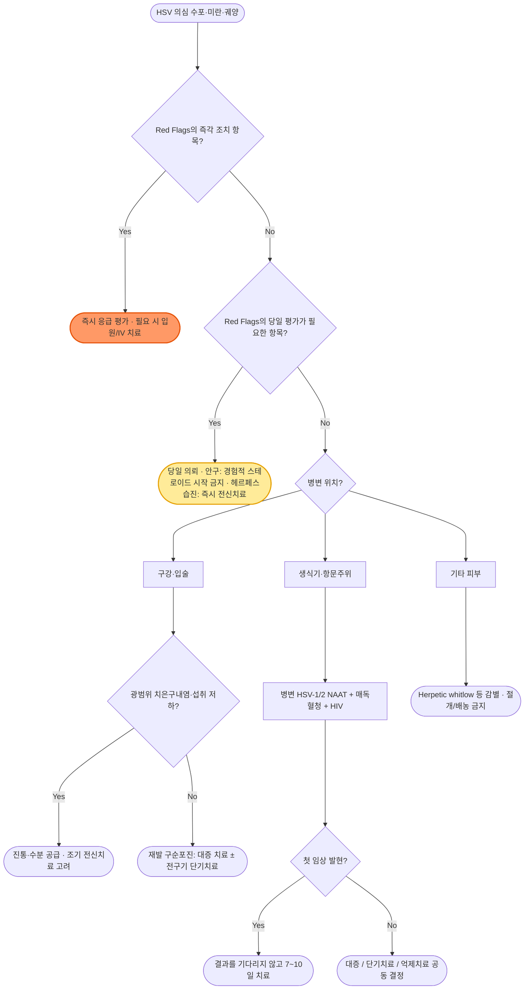

# 단순포진 Herpes Simplex

## <mark style="color:green;">일반 사항</mark>

* 단순포진바이러스(herpes simplex virus, HSV)는 피부·점막 감염 후 감각신경절에 잠복하며, 이후 재활성화되어 반복적인 수포·미란·궤양을 일으키는 만성 잠복 바이러스 감염
* HSV-1과 HSV-2 모두 구강·안면 및 항문생식기 감염을 일으킬 수 있음
  * HSV-1은 구강·안면 감염의 주된 원인이지만 생식기 헤르페스의 중요한 원인이기도 함(젊은 연령층에서 비중 증가)
  * HSV-2는 재발성 생식기 헤르페스의 주된 원인이며, 생식기 HSV-1보다 재발과 무증상 바이러스 배출이 흔함
* 전파 경로 : 감염된 피부·점막, 타액, 생식기 분비물과의 직접 접촉(키스, 구강성교, 성접촉 등)
* 활동성 병변이나 전구 증상이 있을 때 전파 위험이 가장 높지만, 병변이 없는 무증상 바이러스 배출 시에도 전파될 수 있음
* 항바이러스제는 증상과 바이러스 배출을 줄일 수 있으나 잠복 바이러스를 제거하거나 완치시키지는 못함

#### <mark style="color:$primary;">원발 감염 (Primary infection)</mark>

* HSV-1과 HSV-2 모두에 대한 기존 항체가 없는 환자에게 발생한 최초 HSV 감염
* 대부분 무증상 또는 경미하여 실제 감염 시점을 인지하지 못함

#### <mark style="color:$primary;">비원발성 첫 감염 (Non-primary first infection)</mark>

* 한 HSV type의 항체가 있는 환자에게 다른 HSV type의 감염이 새로 발생한 경우
  * 예 : 기존 HSV-1 항체가 있는 환자에게 새로 발생한 HSV-2 생식기 감염
* 기존 교차면역의 영향으로 원발 감염보다 증상이 가벼울 수 있음

#### <mark style="color:$primary;">첫 임상 발현 (First clinical episode)</mark>

* 환자가 처음 인지하거나 의료진이 처음 진단한 임상 episode
* 원발 감염, 비원발성 첫 감염 또는 과거 무증상 감염의 첫 인지 재발을 모두 포함할 수 있으므로 `첫 임상 발현 = 최근 감염`으로 단정하지 않음

#### <mark style="color:$primary;">재발·재활성화 (Recurrent infection/reactivation)</mark>

* 감각신경절에 잠복한 HSV가 재활성화되어 발생
* 재발 빈도와 무증상 바이러스 배출은 생식기 HSV-2에서 HSV-1보다 흔함

## <mark style="color:green;">원인 및 위험 인자</mark>

* 중증·비전형 감염 위험 : HIV 감염, 장기이식, 항암치료, 면역억제제 사용, 기타 중증 면역저하
* Eczema herpeticum 위험 : 아토피피부염 등 피부장벽이 손상된 광범위 피부질환
* 신생아 HSV 위험 : 분만 시 산모의 생식기 병변·전구 증상, 특히 임신 후반기에 새로 획득한 생식기 HSV
* 구순포진 재발 유발 요인 : 자외선, 발열성 질환, 국소 외상·시술, 월경, 스트레스 등
* 생식기 헤르페스 재발 유발 요인 : 발열성 질환, 스트레스, 마찰·외상 등

## <mark style="color:green;">임상 양상</mark>

### <mark style="color:orange;">구강·안면 헤르페스</mark>

#### <mark style="color:$primary;">원발성 헤르페스 치은구내염</mark>

* 주로 소아와 젊은 성인에서 발생하며 잠복기는 대개 2\~12일
* 발열, 권태감, 경부 림프절병증과 함께 잇몸·입술·혀·볼점막·구개 등 여러 부위에 통증성 수포와 궤양이 발생
* 수포는 빠르게 파열되어 황회색 위막으로 덮인 얕은 궤양으로 보일 수 있음
* 대개 10\~14일(때로 1\~3주) 이내 회복하지만, 소아에서는 통증과 섭취 부족으로 탈수가 발생할 수 있음
* 청소년·성인에서는 인두염·편도염 양상이 두드러질 수 있음

#### <mark style="color:$primary;">재발성 구순포진 (Herpes labialis)</mark>

* 입술 가장자리(vermilion border)에 가장 흔함
* 작열감·가려움·저림·통증 등의 전구 증상 후 군집성 수포 → 미란·궤양·딱지 순으로 진행
* 대개 수일\~2주 이내 자연 치유
* 정상 면역자의 재발성 구강 내 HSV는 흔하지 않으며, 주로 경구개·부착치은 등 각화점막에 발생
* 동일 수염 부위에 반복되는 단형성 수포·농포성 모낭염에서는 herpetic sycosis를 감별

### <mark style="color:orange;">생식기 헤르페스</mark>

#### <mark style="color:$primary;">첫 임상 발현</mark>

* 외음부·질·자궁경부, 음경·음낭, 요도, 항문·항문주위, 둔부 및 대퇴 등에 발생 가능
* 전형적으로 통증성 군집 수포, 농포, 미란 또는 궤양으로 나타나지만 병변이 없거나 균열·찰과상·홍반 등 비전형적 형태일 수 있음
* 발열, 권태감, 근육통, 배뇨통, 압통성 서혜부 림프절병증, 신경근통이 동반될 수 있음
* HSV 직장염에서는 항문·직장통, 뒤무직, 직장 분비물 등이 나타날 수 있으며, 특히 HIV 감염자에서는 외부 항문 궤양이 없어도 가능함
* 치료하지 않으면 2\~3주 이상 지속하거나 새 병변이 연속적으로 발생할 수 있음

#### <mark style="color:$primary;">재발성 생식기 헤르페스</mark>

* 첫 발현보다 병변 수와 전신 증상이 적고 회복이 빠른 경우가 많음
* 병변 전 엉덩이·대퇴·회음부의 저림, 작열감 또는 신경통이 선행할 수 있음
* 유증상 첫 발현 HSV-2 환자에서는 재발이 흔하지만, 생식기 HSV-1은 재발과 바이러스 배출이 상대적으로 적음

### <mark style="color:orange;">안구 헤르페스</mark>

* 안검염, 결막염, 상피각막염, 기질각막염, 내피염 또는 포도막염으로 나타날 수 있음
* 상피각막염에서는 형광염색 시 가지 모양의 수지상 각막궤양(dendritic corneal ulcer)이 관찰될 수 있음
* 대개 편측 안구통, 충혈, 눈물, 이물감, 눈부심 또는 시력저하를 호소
* 재발성 각막염은 각막혼탁과 영구적 시력손상을 일으킬 수 있으므로 의심 즉시 당일 안과 평가가 원칙

### <mark style="color:orange;">기타 임상형</mark>

* Herpetic whitlow : 손가락 말단의 통증성 수포·농포; 세균성 화농성 손발톱주위염과 혼동하기 쉬우나 **절개·배농하지 않음**
* Eczema herpeticum : 아토피피부염 등 기존 피부질환 부위에 갑자기 확산하는 단형성 수포와 천공성(punched-out) 미란; 발열이 없어도 의심 즉시 전신 항바이러스 치료와 당일 전문의 평가가 필요
* HSV 뇌염 : 주로 HSV-1; 발열·의식 또는 행동 변화·경련·국소 신경학적 징후
* HSV 수막염 : 주로 HSV-2; 심한 두통·눈부심·경부강직, 의식은 대체로 유지
* 신생아 HSV : 피부·눈·구강형, 중추신경계형, 파종형으로 분류되며 조기 인지가 예후를 좌우
* 면역저하자의 만성·비전형적 궤양 : 전형적 수포 없이 지속되는 궤양성 병변으로 나타날 수 있음

***

### <mark style="color:$danger;">🚩 Red Flags!</mark>

<mark style="color:$danger;">**즉각 조치**</mark>

* 의식 변화, 성격 변화, 경련, 국소 신경학적 결손, 심한 두통·경부강직 → HSV 뇌염·수막염 의심  `CNS 감염`
* 쇼크, 파종성 수포, 급격한 전신 악화, 중증 간염·폐렴 → 파종성 HSV 의심  `파종성 감염`
* 신생아 및 생후 6주 이내 영아의 수포·발열·저체온·수유 저하·처짐 또는 경련 → 피부 병변이나 산모의 알려진 HSV 병력이 없어도 신생아 HSV 평가 필요  `신생아·어린 영아`
* Eczema herpeticum에 전신독성, 급속한 진행 또는 광범위 병변이 동반된 경우  `중증 헤르페스습진`
* 요폐, 중증 탈수 또는 통증·섭취 불가로 외래에서 수분·경구약을 유지할 수 없는 경우  `입원·수액 치료`
* 급격하거나 심한 시력저하 → 즉각 안과 응급 평가  `안과 응급`

<mark style="color:$warning;">**당일 평가**</mark>

아래 항목은 **당일 평가·협진**함. 안구 침범·헤르페스습진·중증 면역저하에서는 검사 결과를 기다리느라 치료를 지연하지 않음.

* HSV가 의심되는 병변과 함께 안구통, 눈부심, 시력저하, 편측 충혈 또는 각막병변 의심 → 당일 안과 의뢰  `안구 침범`
* Eczema herpeticum 의심 → 발열 유무와 관계없이 즉시 전신 항바이러스제를 시작하고 당일 피부과 평가; 눈 주위 침범 시 당일 안과 평가도 시행  `헤르페스습진`
* 중증 면역저하자의 광범위·괴사성·비전형적 또는 지속성 병변  `중증 면역저하`
* 심한 생식기 통증·배뇨곤란 또는 탈수 위험이 있으나 수분·경구약 복용이 가능한 경우  `중증 생식기 증상`
* 임신 후반기에 처음 발생한 생식기 HSV, 또는 분만 시점의 생식기 병변·전구 증상 → 산과와 즉시 협진  `임신·분만`
* 적절한 항바이러스 치료 중 빠르게 진행하는 병변 또는 면역저하자에서 내성 HSV 의심  `치료 실패·내성`

<mark style="color:$info;">**조기 평가 및 추적**</mark>

* 첫 임상 발현 생식기 헤르페스 : 검사 결과를 기다리지 말고 즉시 치료하고 병변 치유까지 추적  `첫 임상 발현`
* 잦은 재발, 삶의 질 저하, 전파 불안 또는 임신 계획이 있는 환자 → 억제치료·파트너 상담 평가  `억제치료·상담`
* 2\~3주 이상 낫지 않는 구강·생식기 궤양 또는 비전형 병변 → 다른 감염, 염증성 질환 및 악성종양 재평가  `비치유 궤양`
* 치료 후에도 남는 안정된 병변 → 순응도·용량·대체 진단을 조기 재평가하고 필요 시 전문의 의뢰; 진행·전신 증상 또는 면역저하가 있으면 상위 등급으로 평가  `치료 반응 재평가`

***

## <mark style="color:green;">진단</mark>

* 전형적인 군집 수포와 통증성 미란·궤양은 HSV를 시사하지만, 임상 소견만으로 생식기 헤르페스를 확진하지 않음
* 생식기·항문·항문주위 궤양은 HSV와 매독의 중복감염이 가능하므로 통증 유무나 외형만으로 양자를 구분하지 않음
* 무증상 성인과 임신부에 대한 일률적인 HSV-2 혈청 선별검사는 권고하지 않음
* 정상 면역자의 전형적 재발성 구순포진·치은구내염은 임상 진단이 가능함. 생식기 병변, 비전형·비치유 병변, 중증 또는 면역저하자는 병변 검사를 적극 시행함

### <mark style="color:orange;">병변 검사</mark>

* 활동성 수포·미란·궤양이 있으면 기다리지 말고 병변 바닥에서 즉시 HSV-1/2 NAAT(PCR)를 채취
  * 온전한 수포는 개방한 뒤 병변 바닥을 충분히 문질러 채취
* NAAT가 가장 민감한 검사이며, 검출된 HSV는 HSV-1/2로 typing하여 예후와 상담에 활용
* 바이러스 배양은 NAAT를 사용할 수 없거나 항바이러스제 내성 검사가 필요한 경우 고려
  * 배양 민감도는 재발 병변과 치유 중인 병변에서 빠르게 감소
* NAAT 또는 배양 음성만으로 HSV를 배제하지 않음 : 오래된 병변, 부적절한 검체 또는 간헐적 바이러스 배출로 위음성 가능
* 병변이 없는 상태에서의 무작위(blind) 생식기 swab은 민감도가 낮아 진단 목적으로 시행하지 않음
* Tzanck smear와 직접면역형광검사는 민감도가 낮아 일상적 진단검사로 권고하지 않음
* 단순 생식기 감염 진단에 혈액 HSV PCR을 사용하지 않음; 중추신경계 감염은 CSF PCR, 파종성 감염은 혈액 PCR 등 임상 상황에 맞게 검사하며 응급 치료를 지연하지 않음
* **성인 HSV 뇌염은 발병 초기 CSF HSV PCR이 음성이어도 배제되지 않음.** 임상 의심이 높으면 경험적 IV acyclovir를 유지하고 신경과·감염내과와 재평가하며, CSF HSV PCR을 3\~7일 후 재검하는 방안을 고려함. 다중 병원체 CSF PCR panel 음성만으로 HSV 뇌염을 배제하거나 HSV 특이 PCR을 대체하지 않음. <mark style="color:$info;">[IDSA 2008; EAN/ESCMID 2026]</mark>

### <mark style="color:orange;">혈청검사</mark>

* 비형특이적 HSV 항체검사는 HSV-1과 HSV-2를 구분하지 못하므로 진단에 사용하지 않음
* 필요한 경우 gG 기반 type-specific HSV-1/2 IgG를 선택
  * 최근 감염이 의심되나 초기 음성이면 추정 노출 약 12주 후 재검 고려
  * 낮은 HSV-2 EIA index 양성(예: HerpeSelect 1.1\~3.0)은 위양성 가능성이 높아 Biokit 또는 Western blot 등 다른 검사법으로 확인한 뒤 해석; 기준은 검사법에 따라 다름
  * 확인검사를 이용할 수 없으면 위양성 가능성과 검사 한계를 설명하고 단일 저역가 양성만으로 확진하지 않음
* HSV IgM은 형 특이적이지 않고 원발감염과 재발을 구분하지 못하며 재발 때도 양성일 수 있음. 임상적 의미가 제한적이므로 HSV 진단에 사용하지 않음
* HSV-1 IgG 양성만으로 구강 감염과 생식기 감염의 위치를 구분할 수 없으며 민감도도 낮음. 생식기 HSV-1 확진에는 병변 NAAT 또는 배양을 사용
* IgG 양성만으로 감염 시점이나 특정 전파자를 판단하지 않음
* Type-specific HSV-2 IgG 고려 상황 : 반복되는 비전형적 생식기 증상이나 병변 PCR 음성, 검사 없이 임상 진단된 과거력, 성 파트너의 생식기 HSV

### <mark style="color:orange;">생식기·항문주위 궤양의 동반 검사</mark>

* 병변 HSV-1/2 NAAT와 함께 매독 혈청검사 및 HIV 검사를 시행
* 노출력과 증상에 따라 임질·클라미디아 등 다른 성매개감염 검사 고려
* 매독 검사의 전통적·역순 알고리듬과 결과 해석은 매독 관련 챕터 참조
* 첫 임상 발현 HSV가 의심되면 검체를 채취한 뒤 검사 결과를 기다리지 않고 경험적 항바이러스 치료 시작

### <mark style="color:orange;">부위별 주요 감별진단</mark>

* 구강 : 아프타성 구내염, 수족구병·헤르판지나, Behçet병, 다형홍반·Stevens–Johnson증후군 및 감염 관련 반응성 점막피부발진(RIME). 광범위 점막염·안구 침범·새 약물 복용력이 있으면 HSV로 단정하지 않음
* 생식기·항문주위 : 매독, 대상포진, mpox, 외상·접촉피부염, 고정약진, Behçet병·비성매개성 급성 생식기 궤양 및 악성종양. 편측 피부절을 따르는 수포는 VZV 검사를, 노출력이 있거나 깊은 병변·직장통·림프절병증이 동반되면 mpox 검사를 고려함; HSV 양성도 동반감염을 배제하지 않음. <mark style="color:$info;">[유럽 생식기 헤르페스 지침 2024; RCH 2025]</mark>

### <mark style="color:orange;">재발성 헤르페스성 구내염과 아프타성 구내염 감별</mark>

(☞ [구내염](../222_/054_-stomatitis.md))

<table><thead><tr><th width="110">구분</th><th width="230">재발성 아프타성 구내염</th><th>재발성 구강 헤르페스</th></tr></thead><tbody><tr><td>초기 병소</td><td>수포 없이 궤양으로 시작</td><td>소수포가 빠르게 파열되어 궤양 형성</td></tr><tr><td>호발 위치</td><td>볼·입술 안쪽, 구강바닥, 연구개, 구강전정 등 비각화·가동점막</td><td>구강 내: 경구개·부착치은 등 각화점막<br>구순포진: 입술 가장자리</td></tr><tr><td>병변 양상</td><td>경계가 뚜렷한 원형 궤양과 홍반성 테두리</td><td>군집성·점상 얕은 궤양</td></tr><tr><td>전구 증상</td><td>뚜렷하지 않은 경우가 많음</td><td>작열감·저림·가려움이 선행할 수 있음</td></tr><tr><td>통상 경과</td><td>대개 1\~2주</td><td>대개 수일\~2주</td></tr></tbody></table>

***



<p align="center"><strong>단순포진 의심 병변의 초진-검사-치료 알고리듬</strong></p>

<p align="center"><em><mark style="color:$info;">Ref. 질병관리청·대한요로생식기감염학회 성매개감염 진료지침 (2023); CDC STI Treatment Guidelines (2021); NICE CG57; RCH HSV Gingivostomatitis (2025)</mark></em></p>

***

## <mark style="background-color:$warning;">Management</mark>


**부위별 우선순위**\
구강·안면은 탈수·경구섭취 여부, 생식기는 "첫 임상 발현인가 재발인가", 안구는 "당일 안과 의뢰가 필요한가"를 가장 먼저 판단함.


## <mark style="color:green;">비-약물 치료 및 예방</mark>

### <mark style="color:orange;">구강·안면 감염 - 대증 치료</mark>

* 충분한 수분 섭취, 부드럽고 자극이 적은 음식, 입술 보호제
* 통증 조절 : acetaminophen 또는 적절한 NSAID를 사용하며 소아는 연령·체중, 탈수·신장애 여부를 확인; 진통 후 소량씩 자주 수분 공급
* 소아에서는 통증으로 인한 섭취량·소변량을 확인하고 탈수 위험을 재평가
* 세균성 2차 감염이 임상적으로 확인된 경우에만 국소 또는 전신 항생제 고려
* 구순포진 재발이 자외선으로 반복 유발되는 경우 입술과 입술 주변에 자외선차단제 사용 고려

### <mark style="color:orange;">생식기 감염 - 대증 치료</mark>

* 생리식염수 좌욕 또는 세척, petroleum jelly, 경구 진통제
* 심한 배뇨통은 물 또는 생리식염수에 외음부를 담근 상태에서 배뇨하면 완화될 수 있음
* Lidocaine gel·ointment는 제한적으로 고려할 수 있으나 benzocaine은 감작 위험이 커 피함
* 생식기 HSV에 국소 항바이러스제는 임상적 이득이 적어 권고하지 않음

### <mark style="color:orange;">안구 감염</mark>

* 콘택트렌즈 사용을 즉시 중단
* 국소 마취 안약은 외래 자가사용 목적으로 처방하지 않음(각막 독성·통증 감각 소실로 인한 손상 위험)

### <mark style="color:orange;">전파 예방·상담</mark>

* 구순포진의 전구기부터 완전 치유까지 키스·구강성교를, 생식기 헤르페스의 전구기부터 완전 치유까지 성접촉을 피함
* 병변 접촉 후 손 위생을 시행하고 눈·콘택트렌즈를 만지지 않음
* 콘돔은 전파 위험을 줄이지만 완전히 제거하지는 못함
* 증상이 없는 시기에도 바이러스가 배출되어 전파될 수 있음을 설명
* 증상이 있는 HSV-2 감염자와 감염되지 않은 이성 파트너 사이에서 감염자의 valacyclovir 500 ㎎ qd 억제치료는 전파 위험 감소에 도움이 될 수 있음
* 현재 성 파트너에게 알리고 새 파트너에게는 성접촉 전에 설명; 무증상 파트너에게는 병력 확인과 type-specific HSV-2 IgG 검사를 고려
* 비감염 파트너에게 항바이러스제 PEP 또는 PrEP를 투여하지 않음
* 신생아, 중증 면역저하자 및 광범위 아토피피부염 환자는 활동성 구순포진 병변과 직접 접촉하지 않도록 함
* 현재 HSV 예방 백신은 없음

## <mark style="color:green;">약물 치료</mark>

### <mark style="color:orange;">구강·안면 감염 - 국소 항바이러스제 (재발성 구순포진)</mark>

* 임상적 이득은 제한적이며 전구기 또는 병변 초기부터 사용해야 함
* acyclovir 5% cream : 5회/d ×5일, 미치유 시 5일 추가 가능 <mark style="color:blue;">\[바이버]</mark>; 국내 허가상 소아의 안전성·유효성은 확립되지 않았으며 수유 중에는 사용하지 않도록 되어 있음
* penciclovir 1% cream <mark style="color:blue;">\[펜시비어]</mark> : 2026년 2월 생산 중지·코드 불용 공지가 있어 기본 처방 선택지에서 제외함. 기존 국내 허가 용법은 16세 이상, 깨어 있는 동안 q2h ×4일임. <mark style="color:$info;">[대구파티마병원 약제부 공지 2026-02-19]</mark>
* docosanol 10% cream : 성인 및 12세 이상에서 5회/d(미국 일반의약품 허가 기준, 국내 제품 미확인)
* 피부용 cream은 눈·구강 안쪽 등 점막에 바르지 않음; 치은구내염에는 국소 acyclovir의 효과가 입증되지 않음

### <mark style="color:orange;">구강·안면 감염 - 경구 항바이러스제</mark>

* 건강한 정상 면역자의 경증 재발성 구순포진은 대증 치료로 충분한 경우가 많음. 병변이 심하거나 재발이 빈번하고 일상생활에 지장을 주는 경우 조기 경구 치료·억제요법의 이득을 개별 평가함. <mark style="color:$info;">[HSE 2026]</mark>

<table><thead><tr><th width="200">임상 상황</th><th width="230">예시 요법</th><th>비고</th></tr></thead><tbody><tr><td>성인 중증 원발성 치은구내염</td><td>acyclovir 200 ㎎ 5회/d ×5일<br>중증 초발 감염은 치유 반응에 따라 연장 가능(국내 피부·점막 HSV 허가)</td><td>조기 치료 고려; 탈수·섭취 불가 시 입원 평가. 아래 소아 지침 용량과 구분</td></tr><tr><td rowspan="3">재발성 구순포진 episodic therapy</td><td>valacyclovir 2 g bid ×1일<br>(성인·12세 이상 국내 허가; 정상 신기능)</td><td rowspan="3">전구 증상부터 즉시 시작; valacyclovir는 구진·수포·궤양 발생 후 시작했을 때의 유효성이 국내 허가사항상 확립되지 않음. Famciclovir 단회 요법은 성인 국외 근거 기반의 국내 허가 외 사용임. Acyclovir는 국내 피부·점막 HSV 허가 용법을 제시함</td></tr><tr><td>famciclovir 1,500 ㎎ 1회</td></tr><tr><td>acyclovir 200 ㎎ 5회/d ×5일<br>(국내 피부·점막 HSV 허가)</td></tr><tr><td>빈번하거나 중증인 재발의 억제치료</td><td>acyclovir 400 ㎎ bid 또는 valacyclovir 500 ㎎\~1 g qd</td><td>Acyclovir 400 ㎎ bid는 국내 정상 면역자의 피부·점막 HSV 예방 허가 용량과 일치함. Valacyclovir의 구순포진 억제는 국내 허가 외 사용임. 재발 빈도·중증도와 환자 선호에 따라 필요성 재평가</td></tr></tbody></table>


valacyclovir 2 g bid ×1일과 famciclovir 1,500 ㎎ 1회 요법은 **재발성 구순포진**의 episodic therapy이며, 원발성 헤르페스 치은구내염 용법이 아님. Famciclovir 1,500 ㎎ 1회는 국내 팜비어의 허가 용법에 포함되지 않음.


* 소아 원발성 치은구내염 : 정상 면역자는 대개 수분·진통 치료만으로 호전. 증상 발생 72시간 이내이며 심한 통증 또는 탈수가 있으면 경구 acyclovir 10 ㎎/㎏/회(최대 400 ㎎/회), 1일 5회 고려; 새 병변이 더 이상 생기지 않을 때까지 치료하고 경과에 따라 기간 결정. <mark style="color:$info;">[RCH 2025]</mark>
  * 국내 메노바의 소아 피부·점막 HSV 허가 용량(2세 이상 200 ㎎ 5회/d, 2세 미만 성인량의 1/2)과 다른 지침 용량으로 구분; 면역저하·섭취 불가·중증이면 소아과 협진 및 IV 치료 평가


아래 생식기 헤르페스 기본 요법은 **신기능이 정상인 정상 면역 성인**의 지침 용량임. 첫 임상 발현·억제치료는 국내 성매개감염 진료지침 2023과 CDC 2021이 일치하며, 재발 단기치료에는 CDC의 추가 선택 요법을 함께 제시함. 소아·HIV 감염자·기타 면역저하자·신장애 환자에게 동일 요법을 일률적으로 적용하지 않음.


### <mark style="color:orange;">국내 제품 허가 용법과 진료지침의 차이</mark>

<table><thead><tr><th width="110">성분명</th><th width="230">국내 허가 용법(주로 성인 기준)</th><th>국내 진료지침 2023·CDC 2021과 대조 시 주의</th></tr></thead><tbody><tr><td>acyclovir</td><td>피부·점막 HSV 치료 200 ㎎ 5회/d ×5일, 중증 초발 감염은 연장 가능<br>억제 200 ㎎ qid 또는 400 ㎎ bid</td><td>400 ㎎ tid는 정상 면역자의 국내 치료 허가 용량과 다름. 중증 면역저하·흡수장애의 허가상 증량 예외와 구분</td></tr><tr><td>famciclovir</td><td>생식기 첫 발현 250 ㎎ tid ×5일<br>재발 125 ㎎ bid ×5일<br>억제 250 ㎎ bid</td><td>CDC 첫 임상 발현 기간은 7\~10일. 처방 목적에 따라 국내 허가 용법과 구분 표기</td></tr><tr><td>valaciclovir</td><td>생식기 첫 발현 500 ㎎ bid, 최대 10일<br>재발 500 ㎎ bid ×5일<br>구순포진 2 g bid ×1일<br>생식기 억제: 정상 면역자 500 ㎎/d(500 ㎎ qd 또는 250 ㎎ bid), 면역저하자 500 ㎎ bid</td><td>국내 진료지침·CDC 첫 발현은 1 g bid ×7\~10일, 억제 1 g qd도 권고하나 국내 정상 면역자 허가 용량과 차이. 재발은 국내 지침 1 g qd ×5일, CDC는 500 ㎎ bid ×3일도 권고</td></tr></tbody></table>


**진료지침·제품 허가사항·건강보험 급여 인정기준은 각각 구분함. 처방 시 최신 품목정보/급여기준 조회.** 팜비어 허가사항의 6\~12개월 간격 휴약 문구와 CDC의 일률적 휴약 불필요 권고에도 차이가 있음. 지침에 따른 허가 외 용량·기간을 사용하는 경우 그 차이를 설명하고 급여 적용 여부를 구분함.


### <mark style="color:orange;">생식기 헤르페스 - 첫 임상 발현 (모든 환자 치료)</mark>

* 검사 결과를 기다리지 않고 임상적으로 의심되는 즉시 치료
* 발병 5일 이내에 내원했거나 계속 새 병변이 생기면 특히 적극적으로 치료
* 10일 후에도 치유가 불완전하면 치료 기간 연장 가능

<table><thead><tr><th width="170">성분명 [상품명]</th><th>CDC 2021 권장 요법</th></tr></thead><tbody><tr><td>acyclovir <mark style="color:blue;">\[메노바]</mark></td><td>400 ㎎ tid ×7\~10일<br>200 ㎎ 5회/d ×7\~10일도 효과적이나 잦은 복용으로 비선호</td></tr><tr><td>famciclovir <mark style="color:blue;">\[팜비어]</mark></td><td>250 ㎎ tid ×7\~10일</td></tr><tr><td>valaciclovir <mark style="color:blue;">\[발트렉스]</mark></td><td>1 g bid ×7\~10일</td></tr></tbody></table>

### <mark style="color:orange;">생식기 헤르페스 - 재발성 HSV-2 episodic therapy</mark>

* 전구기 또는 병변 발생 24시간 이내 환자가 즉시 시작할 수 있도록 미리 처방하거나 약을 준비하도록 교육

<table><thead><tr><th width="170">성분명 [상품명]</th><th>CDC 2021 권장 요법</th></tr></thead><tbody><tr><td>acyclovir <mark style="color:blue;">\[메노바]</mark></td><td>800 ㎎ bid ×5일 또는 800 ㎎ tid ×2일</td></tr><tr><td rowspan="3">famciclovir <mark style="color:blue;">\[팜비어]</mark></td><td>1 g bid ×1일</td></tr><tr><td>500 ㎎ 1회 → 12시간 후부터 250 ㎎ q12h, 총 4회<br>(처음 500 ㎎을 포함하여 총 5회 투여)</td></tr><tr><td>125 ㎎ bid ×5일</td></tr><tr><td rowspan="2">valaciclovir <mark style="color:blue;">\[발트렉스]</mark></td><td>500 ㎎ bid ×3일</td></tr><tr><td>1 g qd ×5일</td></tr></tbody></table>

### <mark style="color:orange;">생식기 헤르페스 - 재발 억제치료</mark>

* 재발 빈도·중증도, 삶의 질, 성생활, 전파 불안과 환자 선호를 바탕으로 공동 결정
* 빈번한 재발에서 재발 횟수를 약 70\~80% 감소시킴
* 생식기 HSV-1은 재발과 바이러스 배출이 적으므로 빈번한 재발 또는 상당한 심리적 고통이 있을 때 제한적으로 고려
* CDC는 정상 면역자의 지속 여부를 매년 재평가하며 일률적인 휴약·정기 검사실 모니터링은 요구하지 않음
  * 국내 acyclovir·famciclovir 허가사항에는 6\~12개월 간격의 치료 중단 문구가 있으므로 제품별 허가사항과 지침의 차이를 구분
  * 신장애·고령·탈수·신독성 약제 병용 등에서는 신기능을 개별적으로 추적
* 무증상 HSV-2 IgG 양성만으로 재발 예방 목적의 억제치료를 시작하지 않음; 상당한 심리적 고통이 있으면 공동 결정. 무증상 HSV-2 감염과 생식기 HSV-1의 전파 예방 효과는 입증되지 않음

<table><thead><tr><th width="170">성분명 [상품명]</th><th width="150">CDC 2021 권장 요법</th><th>주의</th></tr></thead><tbody><tr><td>acyclovir <mark style="color:blue;">\[메노바]</mark></td><td>400 ㎎ bid</td><td></td></tr><tr><td>famciclovir <mark style="color:blue;">\[팜비어]</mark></td><td>250 ㎎ bid</td><td>바이러스 배출 억제는 다소 덜 효과적일 수 있음</td></tr><tr><td rowspan="2">valaciclovir <mark style="color:blue;">\[발트렉스]</mark></td><td>500 ㎎ qd</td><td>연간 재발 ≥10회에서는 덜 효과적일 수 있음</td></tr><tr><td>1 g qd</td><td></td></tr></tbody></table>


**신장 기능 저하 환자**\
Acyclovir·valacyclovir·famciclovir는 신장으로 배설되므로 신기능 저하 시 용량 또는 투여 간격을 조절함. 조절 기준은 약제·적응증·요법별로 다르므로 제품별 허가사항의 CrCl 기준을 확인함. 고령자·탈수 환자는 약물 축적에 따른 신독성과 의식 변화·환각·떨림 등의 신경독성 위험이 증가함.


#### <mark style="color:$primary;">구순포진 valacyclovir 1일 요법의 신기능 조절</mark>

<table><thead><tr><th width="190">성인 CrCl (mL/min)</th><th>1회 용량·총 투여 횟수</th></tr></thead><tbody><tr><td>≥50</td><td>2 g씩 12시간 간격, 총 2회</td></tr><tr><td>30 이상 50 미만</td><td>1 g씩 12시간 간격, 총 2회</td></tr><tr><td>10 이상 30 미만</td><td>500 ㎎씩 12시간 간격, 총 2회</td></tr><tr><td>10 미만</td><td>500 ㎎ 1회만</td></tr></tbody></table>

* 위 표는 **성인 재발성 구순포진의 1일 요법**에 한정함; 생식기 감염·억제치료의 감량 기준과 혼용하지 않음
* 혈액투석일에는 투석 종료 후 투여함. 소아·청소년의 CrCl ＜50 mL/min/1.73 ㎡ 투여 자료가 없으므로 성인 감량표를 그대로 적용하지 않음. <mark style="color:$info;">[국내 발트렉스 허가사항]</mark>

### <mark style="color:orange;">헤르페스습진·손가락 헤르페스</mark>

* Eczema herpeticum : 의심 즉시 전신 항바이러스제를 시작하고 당일 피부과 의뢰; 검사 결과나 발열을 기다리지 않음. 전신 상태가 양호하고 경구 복용이 가능하면 경구 치료, 중증·광범위·급속 진행·면역저하·섭취 불가이면 입원·IV acyclovir 평가; 눈 주위 병변은 당일 안과 평가. <mark style="color:$info;">[NICE CG57; PCDS]</mark>
* Herpetic whitlow : 병변을 덮고 접촉을 피하며 진통 치료; 세균성 농양처럼 절개·배농하지 않음. 면역저하자·중증·재발 또는 초기 병변에서는 전신 항바이러스 치료 고려

### <mark style="color:orange;">HIV 감염자의 생식기 헤르페스</mark>

* 첫 임상 발현은 기본 요법으로 시작하되 병변 치유까지 치료 연장이 필요할 수 있음
* 재발 치료 : acyclovir 400 ㎎ tid 또는 famciclovir 500 ㎎ bid 또는 valacyclovir 1 g bid ×5\~10일
* 억제치료(국내 2023·CDC 2021) : acyclovir 400\~800 ㎎ bid\~tid 또는 famciclovir 500 ㎎ bid 또는 valacyclovir 500 ㎎ bid
  * NIH HSV 지침(2025 개정·2026 재검토)은 valacyclovir 500 ㎎ bid를 우선 요법으로, acyclovir 400 ㎎ bid 또는 famciclovir 500 ㎎ bid를 대안으로 제시함. 면역상태·재발 정도·순응도에 따라 전문의와 선택하며, 고용량 acyclovir를 일률 적용하지 않음. <mark style="color:$info;">[NIH HSV 지침]</mark>
* 신기능·면역 상태·치유 반응에 따라 조절; 다른 면역저하 상태는 원인·중증도에 따라 전문의와 결정. HIV 감염자의 억제치료는 증상 조절에 효과적이나 파트너에게 HSV-2 또는 HIV 전파를 줄이는 목적으로 사용하지 않음. <mark style="color:$info;">[국내 성매개감염 진료지침 2023; CDC 2021]</mark>

### <mark style="color:orange;">중증·파종성·CNS 감염</mark>

* 파종성 감염, 폐렴, 간염, 수막염·뇌염 또는 경구약 복용이 불가능한 중증 환자는 입원 후 IV acyclovir 5\~10 ㎎/㎏ q8h를 투여하며 신기능에 따라 조절
  * 중증 비-CNS 감염은 임상 호전 후 경구약으로 전환하여 총 10일을 초과하는 치료를 완료하며, 병변·장기 침범과 면역 상태에 따라 기간 결정
* HSV-2 수막염은 최적 치료 근거가 제한적이나 IV acyclovir 5\~10 ㎎/㎏ q8h로 시작하고 임상 호전 후 valacyclovir 1 g tid로 전환하여 총 10\~14일 치료. Valacyclovir 500 ㎎ bid는 재발 수막염 예방에 효과가 없어 이 목적으로 권고하지 않음
* 성인 HSV 뇌염은 IV acyclovir 10 ㎎/㎏ q8h로 통상 14\~21일 치료하며 신기능에 따라 조절하고 신경과·감염내과 협진; 의심 즉시 경험적 IV 치료를 시작하고 PCR 결과를 기다리지 않음
  * EAN/ESCMID 2026은 최소 14일 IV 치료를 제시하며, 임상 호전이 없거나 악화·면역저하가 있으면 21일 이상 연장과 반복 CSF 검사를 고려함. 성인에서 호전 중인 경우와 신생아 CNS 감염의 치료 종료 전 PCR 확인 원칙을 혼용하지 않음. 치료 후 다시 악화하면 바이러스 지속·재발 외에 감염 후 자가면역성 뇌염 등도 전문의와 재평가함. <mark style="color:$info;">[EAN/ESCMID 2026]</mark>
* IV acyclovir는 충분히 희석하여 최소 1시간에 걸쳐 주입하고 수분 상태·신기능을 추적함; 급속 정주를 피함
* 적절한 치료에도 병변이 지속·진행하면 먼저 순응도, 신기능에 맞는 용량, 대체 진단을 재평가함. 특히 면역저하자에서 치료 시작 7\~10일 내 호전이 시작되지 않으면 내성을 의심하고 바이러스 배양·감수성검사 및 감염내과 협진을 시행함. <mark style="color:$info;">[NIH HSV 지침]</mark>
  * acyclovir 내성주는 valacyclovir에도 내성이며 대부분 famciclovir에도 내성
  * CDC 2021·NIH HSV 지침의 acyclovir 내성 HSV 우선 구제요법은 IV foscarnet이며, cidofovir 등은 전문의가 상황에 따라 고려함. 두 약제 모두 신독성이 크므로 집중 모니터링이 필요함. 2026년 미국에서 허가된 pritelivir의 대상·국내 사용 가능 여부는 아래 국외 허가 항목과 구분함


**최신 국외 허가 동향**\
**Pritelivir [Hovilpri]는 2026년 10월 9일 미국 FDA 허가를 받음.** 허가 대상은 acyclovir, valacyclovir 또는 famciclovir 치료에 불응하는 피부·점막 HSV 감염이 있는 **면역저하 성인**이며, 내성 확인 유무와 관계없이 적용됨. Helicase-primase inhibitor 계열의 경구 약제로, PRIOH-1 무작위 공개 비교시험에서 28일 이내 전체 병변 치유율은 63% 대 34%였음. 정상 면역자의 통상적 구순포진·생식기 재발 치료나 CNS·신생아 HSV에 일반화하지 않음. 미국 허가와 국내 허가·공급은 별개이며 국내 사용 가능 품목을 확인하지 못했으므로 본 챕터의 국내 기본 처방에는 포함하지 않음. <mark style="color:$info;">[FDA 승인 안내 2026; Asahi Kasei 2026-10-13]</mark>

Amenamevir는 일본에서 2017년 대상포진, 2023년 재발성 단순포진의 환자 주도 치료(초기 증상 후 6시간 이내 식후 1,200 ㎎ 1회)로 허가됨. 이는 **일본 허가 용법**이며 국내 기본 처방으로 제시하지 않음. <mark style="color:$info;">[Maruho 2023]</mark>


### <mark style="color:orange;">임신·수유 및 신생아</mark>

* 임신 중 생식기 HSV 병력과 새 병변을 산과 의료진에게 알림
* 임신 중 첫 발현·재발 모두 필요 시 acyclovir로 치료; 중증은 IV 치료. Acyclovir는 임신·수유 중 사용 경험이 가장 많으며 국내 허가사항에 따라 치료상 이익과 위험을 평가; famciclovir는 임신 자료가 제한적이므로 우선 선택하지 않음
* 임신 3분기에 비감염 임신부는 생식기 HSV가 있는 파트너와 질성교를, 구순포진이 있는 파트너로부터 구강성교를 받는 것을 피하도록 상담
* 분만에 가까운 시기에 새로 획득한 생식기 HSV는 신생아 전파 위험이 약 30\~50%로 높으므로 모체태아의학·감염 전문의와 협진. 재발성 감염 또는 임신 전반기에 획득한 감염에서는 위험이 1% 미만
* 임신부의 발열과 원인 불명 중증 간염에서는 피부·생식기 병변이 없어도 파종성 HSV 간염을 고려하고 즉시 입원·경험적 IV acyclovir를 평가함. <mark style="color:$info;">[CDC 2021]</mark>
* 재발성 생식기 헤르페스의 임신 36주 이후 억제치료(국내 2023·CDC 2021) : acyclovir 400 ㎎ tid 또는 valacyclovir 500 ㎎ bid; 지침 용법이며 국내 비임신 정상 면역자의 허가 억제 용량과 구분
  * 최신 국외 지침 차이 : BASHH/RCOG 2024는 필요한 억제치료를 32주부터, 조산 고위험군은 22주부터 시작하도록 권고함. 국내·CDC의 36주 시작과 구분하고 실제 시작 시점·용량은 산과에서 조산 위험과 감염 시점을 반영하여 결정함
* 분만 진통 시 활동성 생식기 병변 또는 전구 증상이 있으면 국내 2023·CDC 2021에 따라 제왕절개를 권고하되, 제왕절개도 신생아 전파 위험을 완전히 제거하지는 못함. **기존 재발성 감염에서 병변·전구 증상이 없으면 질식분만 가능하나, 임신 3분기의 원발성·비원발성 첫 감염에서는 병변이 사라져도 바이러스 배출이 지속될 수 있어 분만 방법을 산과와 개별 결정함.** ACOG는 이 경우 제왕절개를 제안할 수 있다고 명시하며, 영국 2024 지침은 특히 감염 획득 후 6주 이내 분만 시 제왕절개를 권고함. 첫 임상 발현만으로 최근 감염으로 단정하지 않고 병변 typing·형특이 IgG·병력을 함께 판단함. <mark style="color:$info;">[ACOG PB 220, 2026 재확인; BASHH/RCOG 2024]</mark>
* 임신 후기 억제치료는 만삭 재발·제왕절개 필요성을 줄이나 신생아 감염을 완전히 예방하지는 못함. 생식기 HSV 병력이 없는 무증상 항체 양성 임신부에게 일률적으로 투여하지 않음
* Acyclovir의 수유 중 사용은 CDC에서 가능하다고 보지만 국내 메노바 허가사항에는 치료 중 수유 중단 문구가 있음; 지침과 국내 허가사항의 차이를 설명하고 산과·소아과와 약제 및 수유 계획 결정
* 유방에 활동성 HSV 병변이 있으면 해당 유방의 직접 수유와 유축유 수유를 병변 치유까지 중단하고 해당 유축유는 폐기; 병변을 완전히 덮고 손 위생을 지키면 반대쪽 정상 유방에서 수유 가능. <mark style="color:$info;">[CDC 2025]</mark>
* 신생아 HSV 의심 시 즉시 입원·소아감염 전문의 협진 및 IV acyclovir; 정상 신기능의 신생아 표준 예시 20 ㎎/㎏ q8h, 피부·눈·구강형 14일, CNS·파종형 최소 21일. 재태연령·신기능에 따라 간격 조절하며 급성기 경구 acyclovir로 대체하지 않음
  * 발병 초기 CSF HSV PCR 음성만으로 CNS 감염을 배제하지 않음. CNS형은 치료 종료 무렵 CSF PCR을 확인하고 양성이면 치료 연장·반복 검사를 시행함
  * 안구 침범 시 소아안과 협진하에 전신 IV 치료와 국소 항바이러스 치료를 병행하며, 아래 일반 상피각막염의 국소·경구 단독 치료와 구분함
  * CNS형은 급성기 치료 후 경구 acyclovir 억제치료 6개월과 신경발달·시력·청력 추적을 계획함. 피부·눈·구강형 또는 CNS 침범 없는 파종형도 재발 억제 목적의 치료 여부를 소아감염 전문의가 결정함; 체표면적·성장에 따른 용량 조정과 혈구·신기능 추적이 필요함. <mark style="color:$info;">[Canadian Paediatric Society 2025 개정·2026 재확인]</mark>

### <mark style="color:orange;">안구 감염</mark>


**HSV 의심 병변과 함께 안구 증상이 있거나 각막 HSV가 의심되면 당일 안과 의뢰함.**\
일차의료에서 경험적으로 국소 스테로이드를 시작하지 않음.


* 신생아를 제외한 국한된 활동성 상피각막염 : 국소 또는 경구 항바이러스제 단독 치료가 기본이며 국소 스테로이드는 금기
* 기질각막염·내피염·포도막염 : 안과 전문의 감독하에 항바이러스제를 병용하면서 국소 스테로이드를 사용할 수 있음
* 구체적인 점안제 선택·용량·치료기간은 병변 층과 범위에 따라 달라지므로 안과 진찰 후 결정; 재발성 기질각막염 등에서는 안과 전문의가 장기 경구 억제요법을 고려함

***

### <mark style="color:red;">질병코드</mark>

* KCD-9(2026-01-01 시행) 기준. **A60.0·B00.5는 상위분류이므로 아래 세부 완전코드를 선택함.**

<table><thead><tr><th width="105">코드</th><th width="300">KCD-9 명칭</th><th>임상 적용·발현 코드</th></tr></thead><tbody>
<tr><td>B00.0</td><td>헤르페스습진</td><td>Eczema herpeticum</td></tr>
<tr><td>B00.1</td><td>헤르페스바이러스 소수포피부염</td><td>입술·얼굴 단순헤르페스 포함</td></tr>
<tr><td>B00.2</td><td>헤르페스바이러스 치은구내염 및 인두편도염</td><td></td></tr>
<tr><td>B00.3†</td><td>헤르페스바이러스수막염</td><td>G02.0* 병기</td></tr>
<tr><td>B00.4†</td><td>헤르페스바이러스뇌염</td><td>G05.1* 병기</td></tr>
<tr><td>B00.50†</td><td>홍채섬모체염</td><td>헤르페스바이러스눈병의 세부코드; H22.0*</td></tr>
<tr><td>B00.51†</td><td>각막염</td><td>각막결막염·각막내피염·각막상피염·간질각막염 포함; H19.1*</td></tr>
<tr><td>B00.52†</td><td>결막염</td><td>헤르페스바이러스눈병의 세부코드; H13.1*</td></tr>
<tr><td>B00.58</td><td>눈의 기타 헤르페스바이러스병</td><td>헤르페스바이러스성 눈꺼풀 피부염은 B00.58†와 H03.1* 병기</td></tr>
<tr><td>B00.59</td><td>눈의 상세불명의 헤르페스바이러스병</td><td></td></tr>
<tr><td>B00.7</td><td>파종성 헤르페스바이러스병</td><td></td></tr>
<tr><td>B00.8</td><td>기타 형태의 헤르페스바이러스감염</td><td>헤르페스바이러스 생인손(herpetic whitlow)†: L99.8*; 헤르페스바이러스 간염†: K77.0*</td></tr>
<tr><td>B00.9</td><td>상세불명의 헤르페스바이러스감염</td><td></td></tr>
<tr><td>A60.01†</td><td>남성 비뇨생식기관의 헤르페스바이러스감염</td><td>N51.-* 중 실제 침범 장기에 맞게 선택; 남성생식관 침범은 N51.8*</td></tr>
<tr><td>A60.04†</td><td>여성 비뇨생식기관의 헤르페스바이러스감염</td><td>외음 궤양 N77.0*, 질염·외음염·외음질염 N77.1* 등 실제 발현에 맞게 선택</td></tr>
<tr><td>A60.1</td><td>항문주위피부 및 직장의 헤르페스바이러스감염</td><td></td></tr>
<tr><td>A60.9</td><td>상세불명의 항문생식기의 헤르페스바이러스감염</td><td></td></tr>
<tr><td>P35.2</td><td>선천성 헤르페스바이러스 [단순헤르페스] 감염</td><td>신생아 감염은 획득 시점·주산기 관련성과 진단 기록을 확인하여 선택</td></tr>
</tbody></table>

* †는 원인질환, \*는 발현질환 코드이며 \* 코드를 단독 사용하지 않음. 발현 코드가 연결된 경우 실제 진단 부위·형태에 맞추어 병기함. 생식기·항문생식기 HSV는 B00 계열 대신 A60 계열에서 선택함

***

## <mark style="color:purple;">처방례</mark>

* 신기능이 정상인 정상 면역 성인 예시. `T`는 정제 수를 뜻하며 아래 처방의 `nT #m`은 하루 총 n정을 m회로 나누어 복용한다는 의미임. 전체 처방 정수는 괄호에 별도 표기

> **처방례 1. 재발성 구순포진 - 전구기 또는 최초 증상 시**
>
> ```
> 발트렉스정 500 ㎎ 8T #2 ×1일 (총 8정)
> ※ 1회 4정, 12시간 간격으로 총 2회 복용
> ※ 전구 증상(따끔거림·가려움) 인지 즉시 복용해야 효과적
> ※ 성인 CrCl ≥50 mL/min 기준; 신장애에서는 위 감량표 적용, 1일 요법을 반복 연장하지 않음
> ```

> **처방례 2. 첫 임상 발현 생식기 헤르페스**
>
> ```
> 팜비어정 250 ㎎ 3T #3 ×7일 (총 21정)
> ※ 1회 1정, 1일 3회 복용
> ※ 검사 결과를 기다리지 않고 임상 의심 시 즉시 시작
> ```
>
> _✽국내 성매개감염 진료지침 2023·CDC 2021 기준 예시. 팜비어 국내 초발 허가 기간은 5일이므로 국내 허가 외 기간임을 구분_

> **처방례 3. 재발성 생식기 헤르페스 episodic therapy**
>
> ```
> 발트렉스정 500 ㎎ 2T #2 ×3일 (총 6정)
> ※ 1회 1정, 1일 2회 복용
> ※ 전구기 또는 병변 발생 24시간 이내 자가 복용 시작이 가장 효과적
> ```

> **처방례 4. 재발성 생식기 HSV-2 억제치료**
>
> ```
> 메노바정 200 ㎎ 4T #2 ×30일 (총 120정)
> ※ 1회 2정, 1일 2회 복용
> ※ 처방 지속 여부는 매년 재평가
> ```


처방례 2의 팜비어 7일, 처방례 3의 발트렉스 3일은 진료지침에 따른 **국내 허가 외 기간**임(각 제품의 국내 허가 기간은 5일). 처방례 4의 acyclovir 400 ㎎ bid는 국내 허가 용량과 일치함. 허가사항과 건강보험 인정기준은 별도로 확인함.


***

### <mark style="color:$success;">핵심 복약 지도</mark>

> **재발 치료약은 전구 증상 즉시 복용**
>
> * 구순포진·생식기 헤르페스 재발 치료제는 따끔거림·가려움 등 전구 증상이나 병변을 처음 느낀 즉시 복용해야 효과가 가장 좋습니다.
> * 정해진 1회량과 복용 횟수를 임의로 줄이지 마십시오. 구순포진 valacyclovir 2 g bid ×1일 요법은 500 ㎎ 정을 1회 4정씩, 12시간 간격으로 총 2회 복용합니다.

> **신기능에 따른 용량 조절**
>
> * acyclovir·valacyclovir·famciclovir는 신기능과 적응증에 따라 1회량 감량 또는 투여 간격 조절이 필요할 수 있습니다.
> * 고령자, 신장애 또는 탈수 환자에서는 신독성·신경독성 위험이 증가하므로 신기능에 맞게 용량을 조절하고 충분한 수분 섭취를 안내합니다.
> * 새로 발생한 의식 변화·환각·떨림 또는 소변량 감소는 약물 독성의 징후일 수 있으므로 즉시 재평가합니다.

> **억제치료 중에도 전파 가능**
>
> * 억제치료 중에도 무증상 바이러스 배출로 인한 전파 가능성이 완전히 없어지지 않으므로 병변·전구기 성접촉 회피와 콘돔 사용을 병행합니다.

> **언제 다시 병원을 방문해야 하나요?**
>
> * 적절한 용량으로 치료했는데도 치료 완료 후 병변이 치유되지 않거나 진행하는 경우 - 순응도·신기능별 용량·대체 진단을 재평가하고, 특히 면역저하자에서는 내성을 고려
> * 안구통·눈부심·시력저하가 새로 생긴 경우 - 즉시 안과 진료
> * 심한 두통, 의식 변화, 경부강직이 동반되는 경우 - 즉시 응급 평가
> * 임신 중 새로운 생식기 병변이 발생한 경우 - 즉시 산과 협진

***

## <mark style="color:$info;">주요 참고문헌 및 확인 자료</mark>

#### ＜임상 근거＞

* [질병관리청·대한요로생식기감염학회. 성매개감염 진료지침 2023 — 성기단순포진](https://stiguide.kr/성기단순포진-herpes/)
* [유럽 생식기 헤르페스 지침 2024 (2025 출판)](https://pmc.ncbi.nlm.nih.gov/articles/PMC11934026/) — 감별진단·단기 재발치료·상담
* [ACOG. Practice Bulletin No. 220 — Management of Genital Herpes in Pregnancy (2020, 2026 재확인)](https://www.acog.org/clinical/clinical-guidance/practice-bulletin/articles/2020/05/management-of-genital-herpes-in-pregnancy)
* [BASHH/RCOG. HSV in pregnancy and the neonate — 2024 update](https://doi.org/10.1177/09564624241280734) — 임신 후기 첫 감염·분만 계획·억제치료 시작 시점
* [EAN/ESCMID. Diagnosis and Management of Infectious Encephalitis in Adults (2026)](https://doi.org/10.1111/ene.70647)
* [IDSA. Management of Encephalitis (2008)](https://doi.org/10.1086/589747) — 높은 임상 의심에서 초기 HSV PCR 음성 시 3\~7일 후 재검
* [AAO. Herpes Simplex Virus Keratitis: A Treatment Guideline (2014)](https://www.aao.org/education/clinical-statement/herpes-simplex-virus-keratitis-treatment-guideline)
* [CDC. STI Treatment Guidelines — Genital Herpes (2021)](https://www.cdc.gov/std/treatment-guidelines/herpes.htm)
* [NIH. Herpes Simplex Virus: Adult and Adolescent OIs](https://clinicalinfo.hiv.gov/en/guidelines/hiv-clinical-guidelines-adult-and-adolescent-opportunistic-infections/herpes-simplex) — 2025 개정·2026 재검토; HIV 감염인의 치료·억제요법과 내성 평가 참고
* [RCH. HSV Gingivostomatitis (2025)](https://www.rch.org.au/clinicalguide/guideline_index/HSV_Gingivostomatitis/)
* [HSE. Recurrent cold sores guideline (2026)](https://healthservice.hse.ie/documents/7948/Recurrent_cold_sores_guideline.pdf) — 정상 면역자의 일상적인 경구 치료 제한 및 acyclovir 200 ㎎ 5회/d ×5일 참고
* [NICE CG57. Atopic eczema in under 12s — 헤르페스습진 즉시 치료·당일 의뢰](https://www.nice.org.uk/guidance/cg57/chapter/recommendations)
* [PCDS. Eczema herpeticum](https://www.pcds.org.uk/clinical-guidance/eczema-eczema-herpeticum)
* [NHS. Herpetic whitlow](https://www.nhs.uk/conditions/herpetic-whitlow/)
* [CDC. Herpes Simplex Virus and Breastfeeding (2025)](https://www.cdc.gov/breastfeeding-special-circumstances/hcp/illnesses-conditions/herpes.html)
* [Canadian Paediatric Society. Prevention and management of neonatal HSV infections](https://cps.ca/en/documents/position/prevention-management-neonatal-herpes-simplex-virus-infections) — 2025 개정·2026 재확인

#### ＜허가·급여 확인 자료＞

* [식품의약품안전처 의약품안전나라](https://nedrug.mfds.go.kr/) — 메노바·발트렉스·팜비어·바이버·펜시비어 등 국내 허가사항
* [FDA. Pritelivir(Hovilpri) 허가 안내 (2026)](https://www.fda.gov/drugs/news-events-human-drugs/fda-approves-drug-treat-lesions-caused-herpes-simplex-virus) — 미국 허가 대상·효과 확인
* [Asahi Kasei. Hovilpri FDA 승인 발표 (2026-10-13)](https://www.asahi-kasei.com/news/2026/e261013)
* [Maruho. Amenamevir 재발성 단순포진 일본 허가 (2023)](https://www.maruho.co.jp/english/information/20230224.html)
* [대구파티마병원 약제부. 펜시비어크림 생산 중지·코드 불용 공지 (2026-02-19)](https://www.fatima.or.kr/main/contents.do?a_num=88924595&b_num=3115&proc_type=view)
* [DailyMed. Acyclovir injection](https://dailymed.nlm.nih.gov/dailymed/lookup.cfm?setid=babdbce2-5cbd-4943-bc38-9ebdd696a77a) — 최소 1시간 주입·신독성 주의
* 한국표준질병·사인분류 제9차 개정(KCD-9, 2026-01-01 시행) — 질병코드 확인

***

## <mark style="color:blue;">환자 안내서</mark>


**단순포진, 재발할 수 있지만 조절할 수 있습니다**

단순포진은 매우 흔한 바이러스 감염이며, 한 번 감염되면 몸속 신경에 바이러스가 남아 있다가 컨디션이 떨어지거나 스트레스를 받을 때 다시 증상을 일으킬 수 있습니다. 약으로 바이러스를 완전히 없앨 수는 없지만, 재발 증상과 전염 위험은 충분히 줄일 수 있습니다.


#### <mark style="color:$primary;">왜 자꾸 재발하나요?</mark>

* 처음 감염된 이후 바이러스는 몸의 신경 속에 조용히 숨어 있습니다.
* 피로, 스트레스, 감기·발열, 자외선, 월경, 마찰 등이 재발 계기가 될 수 있습니다. 뚜렷한 계기가 없이 재발하기도 하며, 재발만으로 면역력이 심하게 떨어졌다는 뜻은 아닙니다.

#### <mark style="color:$primary;">일상생활에서 어떻게 관리하나요?</mark>

* **따끔거림이나 가려움이 느껴지면 바로 병원에 연락하거나 처방받은 약을 시작하십시오.** 물집이 생기기 전에 시작할수록 효과가 좋습니다.
* **입술포진은 따끔거림이 시작된 때부터 완전히 나을 때까지 키스·구강성교를, 생식기 포진은 같은 기간 성접촉을 피하십시오.** 물집이 없을 때도 바이러스가 나올 수 있고, 콘돔도 전염 위험을 완전히 없애지는 못합니다.
* 활동성 입술포진이 있으면 신생아에게 입맞춤하지 말고, 병변을 만진 뒤에는 손을 씻으십시오.
* **손을 자주 씻고, 병변을 만진 손으로 눈을 만지지 마십시오.** 눈에 옮으면 시력에 영향을 줄 수 있습니다.
* 자외선으로 입술포진이 반복된다면 입술용 자외선차단제를 사용하십시오. 충분한 수면과 스트레스 관리는 건강 유지에 도움이 되지만 재발을 확실히 예방하지는 못합니다.

#### <mark style="color:$primary;">약은 어떻게 써야 하나요?</mark>

* 처방받은 용량과 기간을 끝까지 지켜서 복용하십시오. 중간에 좋아졌다고 임의로 중단하면 효과가 떨어질 수 있습니다.
* 재발이 잦은 경우 매일 복용하는 예방(억제) 요법을 의사와 상의할 수 있습니다.

#### <mark style="color:$primary;">이럴 때는 즉시 병원을 방문하세요</mark>

* 눈이 아프거나 빛을 보기 어렵고 시야가 흐려지면 **당일** 진료를 받으십시오.
* 심한 두통, 의식이 흐려짐, 소변을 보지 못함, 빠르게 퍼지는 물집이 있으면 즉시 병원에 알리십시오.
* 임신 중이거나 임신을 계획한다면 생식기 헤르페스 병력을 반드시 산과 의료진에게 알려야 합니다.
* 신생아가 물집, 발열, 축 처짐, 잘 먹지 않는 증상을 보이면 즉시 응급 진료를 받으십시오.
