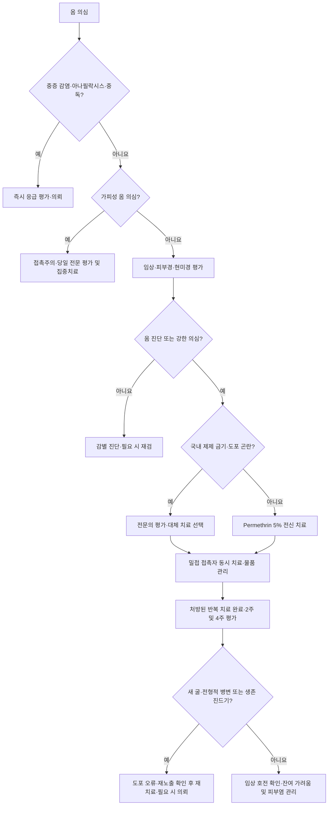

# 옴 Scabies

## <mark style="color:green;">일반 사항</mark>

* Sarcoptes scabiei var. hominis(옴진드기)의 피부 침투에 의해 발생하는 소양성 기생충 감염
* 모든 계절에 발생 가능; 국내에서는 요양병원·요양시설 등 집단생활 환경과 고령자에서 특히 주의
* 잠복기 : 최초 감염 시 보통 4\~6주(최대 8주), 재감염 시 1\~4일; 무증상 잠복기에도 전염 가능
* 전염 경로 : 주로 지속적인 밀접 피부 접촉(가족 간 접촉, 돌봄, 성 접촉 등); 일반 옴에서 물품에 의한 전파는 드물지만 가피성 옴에서는 중요함
  * 접촉 시간 15\~20분을 전염 여부의 절대 기준으로 사용하지 않음
* 경과 : 적절한 치료 후에도 과민반응 때문에 가려움이 수 주간, 일부에서는 약 6주까지 지속 가능; 치료 직후 가려움이 남았다는 이유만으로 실패로 판정하지 않음 <mark style="color:$info;">[BAD 전문가 합의 2026](https://cdn.bad.org.uk/uploads/2026/09/16160554/Scabies-guidance-Sep-2026.pdf)</mark>
* 가려움 기전 : 진드기·충란·배설물 등에 대한 과민반응과 관련

## <mark style="color:green;">원인 및 위험 인자</mark>

* 원인 기생충 : Sarcoptes scabiei var. hominis (암컷의 크기 약 0.4×0.3 ㎜)

### <mark style="color:orange;">위험 인자</mark>

* 밀집 생활, 가족 내 감염, 요양시설·의료기관 내 노출
* 감염자와의 밀접 피부 접촉 또는 신체 돌봄
* 고령, 면역 저하, 신경학적 질환 및 스스로 긁거나 증상을 표현하기 어려운 상태 : 가피성 옴 위험 증가
* 위생 상태와 무관하게 감염될 수 있음; 불결함이나 성생활 양상만으로 진단하지 않음

## <mark style="color:green;">임상 양상</mark>

### <mark style="color:orange;">심한 가려움</mark>

* 특히 밤 또는 뜨거운 샤워 후 심함
* 고령자·면역저하자 및 가피성 옴에서는 가려움이 경미하거나 없을 수 있음
* 치료 후 가려움 및 결절이 남을 수 있으며 새로운 굴·살아 있는 진드기 여부와 함께 평가
  * 옴 후 염증성 결절은 진드기 구제 후에도 수개월 남을 수 있어 결절만으로 치료 실패를 판정하지 않음

### <mark style="color:orange;">국소 병소</mark>

* 호발 부위 : 손가락 사이, 손목, 팔꿈치, 겨드랑이, 배꼽 주위, 허리, 엉덩이, 음경·음낭, 유두·유방
  * 건강한 성인의 일반 옴은 두경부 침범이 드묾
  * 영유아, 고령자, 면역저하자, 가피성 옴에서는 두피·얼굴·손발바닥도 침범 가능
* 붉은 작은 구진, 소수포, 굴(burrow)
  * 굴 : 수 ㎜\~약 1.5 ㎝ 길이의 가늘고 구불구불한 선; 긁거나 습진이 동반되면 발견하기 어려움
* 긁은 흔적(찰과상, 습진성 판), 농포, 결절; 농포만으로 세균 감염을 단정하지 않으며 농·열감·통증·확산성 발적 등을 함께 평가

### <mark style="color:$danger;">🚩 Red Flags!</mark>

<mark style="color:$danger;">**즉각 조치**</mark>

* 빠르게 퍼지는 발적·부종과 심한 통증, 괴사, 저혈압·의식 변화 등 중증 피부감염·패혈증 의심  `중증 감염`
* 약제 사용 후 호흡곤란·전신 두드러기·입술 또는 혀 부종, 실신 등 중증 과민반응  `아나필락시스`
* 구제제 섭취, 과량 사용 후 경련·의식 저하 등 중독 의심 : 추가 노출을 중단하고 응급 평가; 구토·자가 위세척을 시도하지 않음  `약물 중독`

<mark style="color:$warning;">**당일~수일 내 평가**</mark>

* 두꺼운 과각화성 판·가피·광범위 균열 등 가피성 옴 의심 : 즉시 접촉주의를 시작하고 **당일** 피부과·감염관리 평가; 가려움이 약해도 배제하지 않음  `가피성 옴`
* 농·열감·통증·진행하는 국소 발적 등 2차 세균감염 의심 **(당일)**  `이차 감염`
* 요양시설·의료기관에서 역학적으로 연결된 의심 환자가 발생 : 검사 결과를 기다리며 감염관리를 지연하지 않고 **당일** 노출 범위·동시 치료 계획 수립  `집단 발생`
* 2세 미만 소아·임부·수유부, 광범위 병변·면역저하 또는 자가 도포가 어려운 환자 : 국내 금기와 사용 가능한 대안을 평가한 뒤 치료 선택  `치료 선택 주의`

<mark style="color:$info;">**조기 평가 및 추적**</mark>

* 적절한 치료 후에도 새 굴·전형적 병변이 생기거나 살아 있는 진드기가 확인됨  `치료 실패·재감염`
* 가려움이 호전되다가 다시 악화되거나 치료 완료 후 2\~4주에도 호전 경향이 없음 : 재감염·도포 오류·옴 후 가려움·접촉피부염을 감별  `잔여 가려움 평가`
* 피부 긁음 검사가 음성이어도 전형적 분포와 접촉력이 뚜렷하거나 동거인 증상이 지속됨  `진단 재평가`

## <mark style="color:green;">진단</mark>

### <mark style="color:orange;">진단 기준</mark>

* 확진(A) : 다음 중 하나
  * A1 : 피부 검체의 광학현미경 검사에서 진드기, 충란 또는 배설물 관찰
  * A2 : 고배율 영상장치로 진드기, 충란 또는 배설물 관찰
  * A3 : dermoscopy로 진드기 관찰
* 임상적 진단(B) : 굴 관찰 OR 남성 생식기의 전형적 병변 OR 전형적 부위의 전형적 병변과 두 가지 병력 특징
* 의심(C) : 전형적 부위의 전형적 병변과 한 가지 병력 특징 OR 비전형적 부위/병변과 두 가지 병력 특징

* 병력 특징 : 가려움, 감염자 또는 옴이 의심되는 사람과의 접촉 병력
* 임상적 진단·의심 진단은 다른 질환보다 옴이 더 타당한 경우에 적용; 일반 옴의 **초기 진단**을 위한 기준이며 치료 후 완치 판정용이 아님. 가피성 옴·면역저하자·인지장애가 있는 고령자 등의 비전형적 옴은 이 기준만으로 배제하지 않음 <mark style="color:$info;">[IACS 2020](https://doi.org/10.1111/bjd.18943)</mark>

### <mark style="color:orange;">검사</mark>

* dermoscopy 및 굴·신선한 구진의 피부 긁음 검사(현미경 검사)가 우선; 접착테이프 검사도 활용 가능
* 음성 검사만으로 옴을 배제할 수 없음
* burrow ink test는 굴 확인의 보조 수단; 호산구 증가증은 비특이적이며 routine 혈액검사로 진단하지 않음
* 피부 조직 검사는 비전형적 병변 또는 다른 피부질환과의 감별이 필요한 경우에 고려

### <mark style="color:orange;">감별 진단</mark>

* 아토피피부염·접촉피부염·화폐상습진, 결절성 양진
* 머릿니·몸니·사면발니, 빈대·벼룩 등 곤충 교상에 의한 구진두드러기
* 고령자의 수포성 유천포창, 약물발진 및 전신질환 관련 가려움
* steroid 사용으로 형태가 변형된 옴(scabies incognito)은 습진처럼 보일 수 있음; 동거인 가려움·접촉력과 진드기 검사를 함께 검토

***



<p align="center"><strong>옴 평가 및 치료 알고리듬</strong></p>

* 음성 검사만으로 옴을 배제하지 않음. 가피성 옴은 일반 옴과 다른 집중 병용치료·격리 계획이 필요함.

***

## <mark style="background-color:$warning;">Management</mark>

### <mark style="color:orange;">치료 방침</mark>

* 의심·임상적 진단·확진 환자를 치료하고, 밀접 접촉자와 환경을 동시에 관리
* 시설의 접촉자 조사·동시 치료를 신속히 준비하되, 준비가 늦어진다는 이유로 환자의 초회 치료를 미루지 않음; 접촉자 치료가 지연되어 재노출되면 재치료 필요성을 평가함 <mark style="color:$info;">[UKHSA 2026]</mark>
* 일반 옴의 1차 치료 : permethrin 5% 크림; 사용이 어렵거나 실패한 경우 crotamiton 또는 경구 ivermectin 고려
* 국소 도포제는 가려운 병변에만 바르지 않고 정해진 전신 부위에 빠짐없이 적용
* 추적 관찰 : 치료 완료 후 2주 및 4주에 치료 반응 평가; 새 굴·병변, 가려움 악화, 집단 발생 시 조기 재평가
* 치료 실패 의심 : 새 굴/전형적 병변 발생, 살아 있는 진드기 확인, 호전 후 가려움 재악화
  * 잔여 가려움만 있으면 재감염, 약제 자극성 피부염, 옴 후 과민반응 등을 먼저 감별; 2\~4주 이상 지속 시 재평가 후 재치료 여부 결정
* 치료 불응을 곧바로 내성으로 판정하지 않고 충분한 도포량·빠뜨린 부위·세척 시점·접촉자 미치료·재노출을 먼저 확인함 <mark style="color:$info;">[BAD 전문가 합의 2026]</mark>
* 광범위한 각질성 병변으로 가피성 옴 의심 시 **당일 피부과·감염관리 평가**; 발열·빠르게 퍼지는 발적·심한 통증 등 2차 감염 소견도 신속히 평가

## <mark style="color:green;">비-약물 치료 및 예방</mark>

### <mark style="color:orange;">접촉자 조치</mark>

* 동거 가족, 성 접촉자, 직접 신체 돌봄 제공자 등 밀접 접촉자는 증상 유무와 관계없이 환자와 동시에 치료
* 국내 지침은 **무증상 밀접 접촉자에게 1회 예방 치료**를 권고하며, **마지막 노출일부터 6주간** 증상을 관찰함. 이미 증상이 있으면 환자의 전체 치료 요법을 적용하고, 지속 노출·집단 발생에서는 감염관리팀이 반복 치료 필요성을 결정함 <mark style="color:$info;">[대한피부과학회 옴 진료지침 2023 / Ewha Med J 2024](https://doi.org/10.12771/emj.2024.e72)</mark>
* 시설에서는 진단일로부터 **최대 8주 전**까지 접촉력을 조사하여 노출 범위·동시 치료 대상을 결정함. 가피성 옴은 오염 침구·의복·각질 노출자까지 넓게 평가함
* 국내 시설 지침상 **8주 이내 역학적 연관성이 있는 환자 2명 이상**이면 집단 발생에 해당하며, 마지막 환자 발생일부터 **12주간** 신규 환자가 없는지 감시함 <mark style="color:$info;">[질병관리청 2024]</mark>
* 국외 UKHSA 2026은 무증상 접촉자도 1주 간격 2회 치료를 권고하므로 국내의 1회 예방 치료 원칙과 구분함; 국내에서 반복 치료를 계획할 때는 노출 상황·약제·시설 지침에 따라 개별 결정함

### <mark style="color:orange;">접촉 물품 조치</mark>

* 치료 전 3일 동안 사용한 의복, 수건, 침구류를 우선 처리하고 치료 후 깨끗한 물품 사용
* 50℃ 이상에서 10\~20분 세탁 후 고온 건조 또는 드라이클리닝
* 세척할 수 없는 물품 : 비닐봉투에 밀봉하여 최소 7일 보관
* 옴진드기는 인체 밖에서 보통 2\~3일 생존 가능
* 가피성 옴에서는 떨어진 각질과 주변 환경을 매일 철저히 청소하고 세탁물은 흔들지 말고 밀봉하여 운반; 취급자는 장갑·가운 착용
* CDC는 일률적인 살충제 분무·훈증을 권하지 않음. 국내 질병관리청 2024 안내서에는 시설의 환경 살충 소독 문구도 있으므로, 시설에서는 감염관리팀·관할 담당기관의 계획에 따라 시행하며 가정에서 임의로 살충제를 분무하지 않음

### <mark style="color:orange;">의료진·돌봄 제공자 조치</mark>

* 환자 피부·의복·침구와 접촉할 때 일회용 장갑과 가운 착용
* 장갑을 벗은 뒤 비누와 물로 손을 씻고, 피부 접촉 전후 손 위생을 시행함; 손 위생만으로 전파를 막을 수 없으므로 장갑·가운과 접촉주의를 병행함
* 공용 진료 장비는 사용 후 표준 방법으로 소독

### <mark style="color:orange;">접촉주의·활동 제한</mark>

* 일반 옴 : 적절한 초회 치료 후 보통 다음 날 등교·출근 가능; **효과적인 치료 후 최소 24시간** 밀접 피부 접촉을 피함. 이는 반복 치료 생략이나 의료기관 접촉주의 해제를 뜻하지 않음
* 의료기관·요양시설 : 치료 기간 동안 접촉주의 유지; 국내 지침은 최종 도포 후 24시간 또는 의사가 전염력 감소를 확인할 때까지 권고
* 가피성 옴 : 초회 치료만으로 격리 해제하지 않음; 임상 호전과 **피부 긁음 검사 음성** 등을 확인하여 전문의·감염관리팀이 전염력 소실을 판단할 때까지 단독 또는 코호트 격리 유지 <mark style="color:$info;">[CDC 가피성 옴 감염관리]</mark>

## <mark style="color:green;">약물 치료</mark>

* 처방 시 최신 품목정보/급여기준 조회; 국내 허가 용법과 지침에 따른 허가 외 사용을 구분함

### <mark style="color:orange;">항기생충제</mark>

* 피부를 잘 건조시키고 식힌 뒤 도포; 목욕 직후 뜨겁고 젖은 피부에 바르지 않음
* 눈·입·코·점막 및 열린 상처를 피함; 도포자는 장갑 착용
* 국내 제품의 허가사항과 국외 지침의 연령·도포 부위·반복 요법을 구분함

**Permethrin 5% 크림**

* 국내 1차 선택제 <mark style="color:blue;">\[오메크린크림]</mark>(50 ㎎/g, 5%; 급여 여부는 처방 시 확인)
* 국내 허가 용법 : 머리·얼굴을 제외한 전신에 도포 → **12\~14시간 후 세척**
  * 손발가락 사이, 손목, 겨드랑이, 외부 생식기, 엉덩이 사이 및 손발톱 주위를 빠뜨리지 않음
  * 적용 후 8시간 이내에 손을 씻었으면 손에 다시 도포
  * 성인 및 12세 초과 : 1회 약 30 g; 5\~12세 : 약 15 g; 체표면적에 따라 조절
  * 국내 허가사항에는 2\~4세의 연령별 적용량이 별도로 제시되지 않아 체표면적·병변 범위를 고려한 개별 처방이 필요함
* 반복 치료 : 국내 지침은 약 1주 간격으로 2회 도포 권고; 국내 허가사항은 보통 1회 적용 후 살아 있는 진드기 또는 새 병변이 있으면 7\~10일 후 1회 반복
* 국내 허가상 **2세 미만, 임부·수유부는 사용하지 않음**; 성분·피레트로이드·피레트린·국화과 알레르기 시 금기
  * 미국 FDA 허가 연령은 ≥2개월이며 국외 지침은 임신·수유 중에도 우선 고려하나 국내 허가와 다름
  * 영유아 또는 두경부 침범 환자의 얼굴·두피 도포는 지침에 제시되지만 국내 제품 허가 범위 밖이므로 전문의 판단하에 시행
* 70세 이상 고령자 및 습진 치료 중인 환자는 사용 전 평가; 소아는 보호자 감독하에 도포
* 부작용 : 일시적 따가움, 가려움, 피부 자극·접촉피부염
* 치료율은 도포 정확도·접촉자 관리 등에 따라 달라지므로 일률적으로 ＞90%로 단정하지 않음

**Crotamiton 10%**

* 대체제; permethrin보다 치료 실패가 흔함 <mark style="color:blue;">\[유락신연고]</mark>(100 ㎎/g, 10%)
* 국내 유락신의 허가 적응증은 피부가려움이며 **옴 구제 목적은 허가 외 사용**
* 옴 치료는 국내 지침에 따라 전신에 1일 1회, 3\~5일 도포하는 요법 등을 고려; 구체적 세척·반복 일정은 처방 시 지정
* 국내 제품의 가려움 허가 용법 : 잘 건조된 피부에 1일 1회 도포, 필요시 24시간 후 반복
* 국내 허가사항상 영유아·소아에는 **광범위하게 적용하지 않음**; 고령자는 대량·장기간·광범위 적용을 피함. 어린 소아의 전신 옴 치료 대안으로 일률적으로 선택하지 않고 전문의가 판단함
* 성분 과민증·급성 루푸스성 피부염에서 금기; 화농성 피부염·미란 부위에는 직접 적용하지 않음
* 임신 중 안전성이 확립되지 않아 유익성이 위험성을 상회할 때만 제한적으로 고려하며, 수유 중 유방에는 바르지 않음

**Ivermectin 경구제**

* 일반 옴 : 200 ㎍/㎏/회, **7\~14일 간격으로 2회**; 살란 효과가 부족하므로 2차 투여 필요
* 옴 지침에서는 흡수 증가를 위해 식사와 함께 복용하도록 권고
* 도포 치료 실패·적용 곤란 또는 시설 내 집단 발생 시 고려
* 국내 지침에 따르면 <mark style="color:blue;">\[스트로멕톨정 3㎎]</mark>은 한국희귀·필수의약품센터를 통한 공급 대상; 일반 국내 허가·유통 약제로 제시하지 않으며 처방 전 현행 공급 요건 확인
* ＜15 ㎏ 소아·임신부의 안전성은 확립되지 않음; 수유부·중증 간질환자는 개별 평가
* 효과 비교 : 2026년 SCRATCH 시험에서 두 약을 각각 0·10일째 사용했을 때 28일째 **가구 단위 치유율**은 ivermectin 71.8%, permethrin 88.5%였으며 경구 ivermectin의 비열등성이 입증되지 않았고 permethrin이 통계적으로 우월했음. 다만 ＜15 ㎏ 소아는 배정군과 무관하게 permethrin을 사용했고, 시험의 permethrin은 두피·얼굴을 포함한 전신 도포였으므로 국내 허가 용법의 효과 수치로 그대로 인용하지 않음. 개인별 치유율과 구분하며 도포 가능 여부·접촉자 관리·국내 공급 여건을 함께 고려함 <mark style="color:$info;">[BMJ 2026](https://doi.org/10.1136/bmj-2025-086277)</mark>

**Sulfur 5\~10% 연고**

* 대체제; 국외 지침에서 2개월 미만 영아와 임신 중에도 고려되는 선택지. 국내 조제·수입 접근성을 고려하여 전문의가 치료를 계획함
* 3일 연속 밤에 도포하고 마지막 도포 다음 날 세척하는 요법 등을 사용
* 냄새·의복 오염·피부 자극 가능; 국내에서는 조제·수입 가능 여부 확인 필요

**기타 제제**

* benzyl benzoate 10\~25%, malathion 0.5%, spinosad 0.9% 등은 국외 치료 선택지; 국내 허가·공급 및 적용 연령을 확인한 경우에 사용
* ivermectin 외용제 : 국내 <mark style="color:blue;">\[수란트라크림1%]</mark>은 **1% 크림으로 성인의 구진·농포성 주사 치료제**; 옴 치료는 허가 외이며 표준 대체 처방으로 권하지 않음
* pyrethrin/piperonyl butoxide 이증 치료제를 옴의 통상적 2차 선택제로 제시하지 않음
* lindane : 신경독성 때문에 통상 처방에서 제외; 반복 도포 요법을 제시하지 않음

### <mark style="color:orange;">가려움</mark>

(☞ [만성가려움증](157_-chronic-pruritus.md))

#### <mark style="color:$primary;">경구 H1-항히스타민제</mark>

* 증상 완화용이며 진드기 구제 효과는 없음; 진정 효과만으로 1세대 제제가 더 효과적이라고 단정하지 않음
* 낮 시간·고령자에서는 진정·항콜린 부담이 적은 제제를 우선 고려
* hydroxyzine : 성인 피부과 허가 용량 30\~60 ㎎/d, 1일 2\~3회 분할 복용 <mark style="color:blue;">\[아디팜정 10㎎]</mark>; 최소 유효 용량으로 단기간 사용
  * 고령자는 권장되지 않으며 부득이한 경우 성인 권장 용량의 절반으로 시작(최대 50 ㎎/d)
  * 간장애는 1일 용량을 통상 용량의 2/3로 감량 권고; 신장애에서는 대사체 배설 감소를 고려하여 감량(허가사항 예: 중등증 1/2, 중증 1/4). 간·신장애가 겹치면 개별 평가
  * QT 연장 또는 QT 연장 위험인자(심혈관계 질환·유의한 저칼륨혈증/저마그네슘혈증·유의한 서맥·급성 심장사 가족력), QT 연장 유발 약물 병용, 급성 폐쇄각 녹내장·포르피린증, 임부·수유부 등 국내 금기에서는 사용하지 않음
* chlorpheniramine : **성인 1회 2\~6 ㎎, 1일 2\~4회; 최대 24 ㎎/d** <mark style="color:blue;">\[페니라민정 2㎎]</mark>; 졸음·요폐·구갈 등 주의
  * 녹내장, 전립선비대 등 하부요로폐색성 질환, 신생아·미숙아, MAO 억제제 투여 중에는 금기
* 1세대 항히스타민제끼리 중복 처방하지 않으며 음주·운전 주의

#### <mark style="color:$primary;">국소제</mark>

* 보습제 : 피부 건조와 옴 후 가려움에 사용
* calamine/zinc oxide : 필요시 1일 수회 도포(구제 효과 없음)
* 국소 steroid : 구제 후 남은 습진성 염증에 부위·연령별 적절한 역가를 선택하여 단기간 사용
  * 몸통·사지의 국소 습진성 병변은 적절한 역가 제제를 짧게 사용하고 얼굴·생식기는 저역가 제제를 우선 고려함
  * 진단 전 또는 활동성 옴에서 steroid만 사용하면 증상을 가리고 악화시킬 수 있음; 오메크린 허가사항은 치료 중 corticosteroid 사용을 보류하도록 함

### <mark style="color:orange;">기타</mark>

* 경구 steroid : 통상 사용하지 않음; 구제 완료 후에도 심한 가려움이 지속되는 예외적 경우에 전문의 판단하에 단기간 고려
* 항생제 : 2차 세균 감염(농, 통증, 열감, 확산성 발적 등) 시 사용; 예방적으로 일률 처방하지 않음 (☞ [피부감염](165_-skin-and-soft-tissue-infection.md))

## <mark style="color:green;">시술 및 기타 처치</mark>

### <mark style="color:orange;">가피성 옴 Crusted scabies (각질형 옴)</mark>

* 매우 많은 진드기가 기생하는 과각화성 옴; 고령·면역저하자·신경학적 질환 환자에서 주의
* 전염력이 매우 높고 짧은 접촉 및 오염 물품을 통해서도 전파되어 시설 내 집단 발생 가능
* 증상 : 두꺼운 각질성 판, 가피, 균열; 가려움이 약하거나 없을 수 있으며 S. aureus 등 2차 감염 위험
* 호발 부위 : 손, 발, 팔꿈치, 무릎; 두피·얼굴을 포함한 모든 부위 가능

#### <mark style="color:$primary;">치료</mark>

* 전문의·감염관리팀과 협의하여 격리 및 **국소제 + 경구 ivermectin 병용**
* permethrin 5% : 전신 도포; 예시 요법은 1일 1회 ×7일 → 이후 치유될 때까지 주 2회; 도포 빈도는 중증도에 따라 조절
* ivermectin : 200 ㎍/㎏/회; 첫 투여일을 1일째로 하여 1, 2, 8일(경증), 1, 2, 8, 9, 15일(중등도), 중증은 22, 29일 추가 등
* 각질용해제(예: urea)와 가피 제거로 국소제 침투를 보조; 2차 세균 감염 치료
* 일반 옴과 도포 횟수·두경부 적용 범위가 다르며 국내 허가 범위 밖의 집중 치료는 전문의 판단하에 시행
* 임상 호전 및 피부 긁음 검사 음성 등을 확인하여 치료 종료·격리 해제를 판단; 새 환자가 생기면 접촉자 조사와 동시 치료 계획을 다시 점검


**2026년 중증 옴 RCT의 해석**

성인 중증 옴(광범위 다발성 옴 또는 가피성 옴)에서 두 군 모두 permethrin 5%를 병용한 상태로 경구 ivermectin 400 ㎍/㎏과 200 ㎍/㎏을 비교했으며, 28일째 치유율은 각각 75%, 82%로 고용량의 우월성이 입증되지 않았음. 시험 요법은 경구제 0·7·14일, permethrin 0·7일 도포였으며 **매우 중증인 가피성 옴은 포함되지 않았음**. 이 결과로 ivermectin을 일률적으로 증량하지 않으며, **병용치료와 단독치료를 비교한 시험도 아님**. 실제 투여 횟수·간격은 가피성 옴의 중증도와 진드기 검사에 따라 전문의가 결정함. <mark style="color:$info;">[N Engl J Med 2026](https://doi.org/10.1056/NEJMoa2411721)</mark>


***

## <mark style="color:red;">질병코드</mark>

B86 옴 Scabies

***

## <mark style="color:purple;">처방례</mark>

> **처방례 1. 일반 옴 - 성인, 국내 금기 없는 경우**
>
> ```
> 오메크린크림 5%(permethrin 50 ㎎/g) 30 g/튜브
> 머리·얼굴을 제외한 전신에 충분히 도포, 12~14시간 후 세척
> 국내 지침에 따라 약 1주 후 1회 반복
> ```
>
> _✽ 성인 1회 약 30 g(체표면적에 따라 조절); 두 번의 전신 도포에 통상 30 g 튜브 2개가 필요함. 손발가락 사이·외부 생식기·엉덩이 사이·손발톱 주위를 포함함. 허가사항은 생존 진드기·새 병변이 있으면 7\~10일 후 1회 반복하도록 하며, 위의 계획된 2회 치료는 국내 지침에 따른 요법임. 2세 미만·임부·수유부 및 성분·관련 피레트로이드/피레트린·국화과 알레르기에서는 사용하지 않음. 접촉자 동시 치료·침구 처리와 치료 완료 후 2·4주 평가를 계획함._

> **처방례 2. 성인 일반 옴 - 국소 치료 실패·적용 곤란 시**
>
> ```
> Ivermectin 경구 200 ㎍/㎏/회, 식사와 함께 복용
> 7~14일 후 같은 용량 1회 반복
> ```
>
> _✽ 스트로멕톨정 3㎎의 희귀·필수의약품센터 공급 요건과 조달 가능 여부를 확인한 뒤 체중에 맞춰 정수를 결정함. ＜15 ㎏ 소아·임신부에는 통상 사용하지 않음; 수유부·중증 간질환은 개별 평가함. 접촉자·환경 관리를 병행하고 치료 완료 후 2·4주 평가함._

> **처방례 3. 구제 후 남은 가려움 - 성인, 금기 없는 경우**
>
> ```
> 보습제, 필요시 칼라민 로션 도포
> 필요시 아디팜정 10 ㎎ 1T tid, 단기간 사용 후 재평가
> ```
>
> _✽ 보습과 습진성 염증 관리가 우선이며 항히스타민제는 증상·환자 상태에 따라 선택함. 아디팜정은 고령자·QT 연장 위험·관련 약물 병용·임부·수유부에서는 피하고 간·신장애에서는 감량 여부를 확인하며 음주·운전을 제한함. 구제 완료 후 몸통·사지에 남은 국소 습진은 적절한 국소 steroid를 단기간 고려함. 가려움만으로 구제제를 임의 추가 도포하지 않음._

***

## <mark style="color:$success;">핵심 복약 지도</mark>

* 옴 크림은 가려운 곳에만 바르지 말고 처방받은 전신 범위에 빠짐없이 바릅니다. 피부가 뜨겁거나 젖어 있을 때 바르지 않습니다.
* 오메크린크림은 12\~14시간 뒤 씻습니다. 바른 뒤 8시간 이내 손을 씻었으면 손에 다시 바릅니다.
* 두 번째 치료 날짜를 지키고, 가렵다고 매일 추가로 바르지 않습니다.
* 함께 사는 가족과 밀접 접촉자도 증상이 없어도 같은 시기에 진료·치료받습니다.
* 임신·수유 중이거나 2세 미만 소아는 오메크린크림을 자가 사용하지 말고 치료 방법을 상담합니다.
* 가려움약은 졸음을 일으킬 수 있으므로 술·운전과 다른 졸음 유발 약물에 주의합니다.

## <mark style="color:$info;">주요 참고문헌 및 확인 자료</mark>

### <mark style="color:orange;">임상 근거</mark>

* [대한피부과학회 옴 진료지침 2023, Part 1의 영문 이차 출판. Ewha Med J. 2024;47(4):e73.](https://doi.org/10.12771/emj.2024.e73)
* [대한피부과학회 옴 진료지침 2023, Part 2의 영문 이차 출판. Ewha Med J. 2024;47(4):e72.](https://doi.org/10.12771/emj.2024.e72)
* [Engelman D, et al. The 2020 International Alliance for the Control of Scabies Consensus Criteria for the Diagnosis of Scabies. Br J Dermatol. 2020;183:808-820.](https://doi.org/10.1111/bjd.18943)
* [질병관리청. 2024년도 옴 예방관리 안내서(2024.6; 게시물 최종수정 2024.6.28)](https://www.kdca.go.kr/bbs/kdca/55/228221/artclView.do)
* [CDC. Treatment of Scabies (2024)](https://www.cdc.gov/scabies/treatment/)
* [CDC. Clinical Care of Scabies (2023)](https://www.cdc.gov/scabies/hcp/clinical-care/index.html)
* [CDC. Public Health Strategies for Scabies Outbreaks in Institutional Settings (2025)](https://www.cdc.gov/scabies/php/public-health-strategy/index.html)
* [CDC. Public Health Strategies for Crusted Scabies Outbreaks in Institutional Settings (2023)](https://www.cdc.gov/scabies/php/public-health-strategy-crusted/index.html)
* [UKHSA. Management of scabies cases and outbreaks in communal residential settings (2026.4.29 개정)](https://www.gov.uk/government/publications/scabies-management-advice-for-health-professionals/ukhsa-guidance-on-the-management-of-scabies-cases-and-outbreaks-in-long-term-care-facilities-and-other-closed-settings)
* [British Association of Dermatologists. Management of Scabies in the UK: Expert Consensus Guidance (September 2026)](https://cdn.bad.org.uk/uploads/2026/09/16160554/Scabies-guidance-Sep-2026.pdf) - 잔여 가려움·재감염·도포 오류 평가; 국내 허가와 다른 도포 범위·강화 요법을 그대로 적용하지 않음
* [Boralevi F, et al. Oral ivermectin versus 5% permethrin cream to treat children and adults with classic scabies: multicentre, assessor blinded, cluster randomised clinical trial. BMJ. 2026;392:e086277.](https://doi.org/10.1136/bmj-2025-086277)
* [Boralevi F, et al. Correction. BMJ. 2026;393:s587.](https://doi.org/10.1136/bmj.s587) - Fig. 1의 참여자 수 표기 정정; 주요 치유율 결론의 변경은 아님
* [Bernigaud C, et al. Combined Oral Ivermectin and 5% Permethrin Cream to Treat Severe Scabies. N Engl J Med. 2026;394(18):1814-1823.](https://doi.org/10.1056/NEJMoa2411721)

### <mark style="color:orange;">허가·급여 확인 자료</mark>

* [식품의약품안전처 의약품안전나라](https://nedrug.mfds.go.kr/) - 오메크린크림·유락신연고·아디팜정·페니라민정 등 처방 시 최신 품목정보/급여기준 조회; 이번 검토의 국내 허가 내용은 식약처 자료를 출처로 표시한 약학정보원 전재 자료 등으로 확인했으며, 식약처 개별 품목 원문 직접 열람이 제한된 범위는 별도 검증 내역에 명시함
* [한국희귀·필수의약품센터](https://www.kodc.or.kr/) - 경구 ivermectin의 국내 공급 경로는 국내 옴 지침에 근거함; 실제 처방 전 현행 공급 대상·신청 절차·재고·비용 확인 필요

***

## <mark style="color:blue;">환자 안내서</mark>

* 옴은 피부 접촉으로 누구에게나 옮을 수 있으며, 위생이 나쁘다는 뜻이 아닙니다.
* 치료가 잘되어도 가려움은 몇 주 남을 수 있습니다. 새로 생긴 가느다란 굴·발진이나 함께 사는 사람의 증상이 있는지 확인하십시오.
* 치료 전 3일간 사용한 옷·수건·침구를 뜨거운 물로 세탁하고 고온 건조합니다. 세탁하기 어려운 물건은 봉투에 밀봉하여 최소 7일 두십시오.
* 일반 옴은 적절한 첫 치료 다음 날 등교·출근할 수 있지만, 효과적인 치료 뒤 최소 24시간은 밀접한 피부 접촉을 피합니다. 요양시설·의료기관에서는 별도의 접촉주의 기간을 따릅니다.
* 두꺼운 각질·가피가 넓게 생기거나, 피부가 붉고 뜨겁게 번지거나, 고름·심한 통증·발열이 있으면 바로 진료받으십시오.
