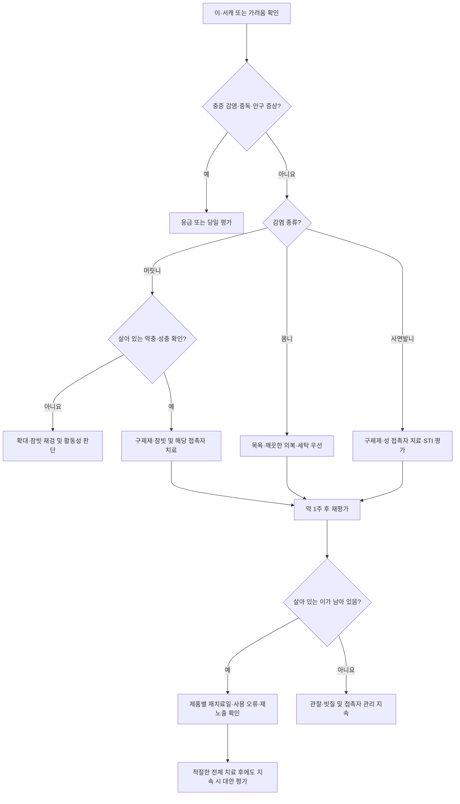

# 이감염증 Pediculosis, Lice

## <mark style="color:green;">일반 사항</mark>

* 이(lice)에 의한 흡혈성 체외 기생충 감염; 머릿니·몸니·사면발니로 구분
* 호발 : 머릿니는 학령전·학령기 소아, 사면발니는 주로 성인
* 전염 경로 : 머릿니는 주로 머리끼리 직접 접촉, 몸니는 사람 또는 오염 의복·침구와 접촉, 사면발니는 주로 성 접촉
* 서식 장소 : 머릿니·사면발니는 모발·체모, 몸니는 주로 의복의 솔기·주름에 서식
* 치료 효과는 약제 내성·사용법·재감염에 따라 달라지므로 일률적으로 ＞90%로 단정하지 않음
* 몸니는 발진티푸스, Bartonella quintana 감염, 이매개 재귀열을 전파할 수 있음; 머릿니·사면발니는 통상 질병을 매개하지 않음

## <mark style="color:green;">원인 및 위험 인자</mark>

### <mark style="color:orange;">원인 기생충</mark>

* 머릿니 : Pediculus humanus capitis; 몸니 : Pediculus humanus humanus(동의어 P. h. corporis); 길이 약 2\~4 ㎜
* 사면발니 : **Pthirus pubis**; 길이 약 1\~2 ㎜

### <mark style="color:orange;">위험 인자</mark>

* 머릿니 : 학교·유아원·가족 내 머리끼리의 접촉; 위생 상태나 모발 길이만으로 감염 여부를 판단하지 않음
* 몸니 : 밀집 생활, 깨끗한 의복·세탁·목욕 시설 이용의 어려움
* 사면발니 : 감염자와의 성 접촉
* 빗·모자·의복·침구 공유도 전파 가능하지만 머릿니에서는 직접 머리 접촉이 더 중요함

## <mark style="color:green;">임상 양상</mark>

* 머릿니는 초기 무증상일 수 있음; 최초 감염 시 가려움 발생까지 4\~6주 소요 가능
* 두피·체간·음부의 가려움, 긁은 흔적(미란), 작은 구진
* 머릿니는 귀 뒤·후두부에서 흔히 발견; 사면발니는 음모 외에 겨드랑이·수염·눈썹·속눈썹도 침범 가능
* 긁음에 의한 2차 세균 감염
* 몸니와 함께 발열·전신 증상이 있으면 매개 감염증도 평가

### <mark style="color:$danger;">🚩 Red Flags!</mark>

<mark style="color:$danger;">**즉각 조치**</mark>

* 구제제 섭취 또는 사용 후 경련·의식 저하·호흡곤란 등 중독 의심 : 추가 노출을 중단하고 응급 평가; 구토·자가 위세척을 시도하지 않음  `약물 중독`
* 약제 사용 후 전신 두드러기와 호흡곤란·입술/혀 부종·실신 등 중증 과민반응  `아나필락시스`
* 빠르게 확산하는 발적·부종, 심한 통증, 저혈압·의식 변화 등 중증 피부감염·패혈증 의심  `중증 감염`

<mark style="color:$warning;">**당일~수일 내 평가**</mark>

* 몸니 감염과 함께 발열·오한·발진·전신 쇠약 또는 심내막염 의심 소견 : 이매개 감염증 평가 **(당일)**  `매개 감염증`
* 고름·진물·진행하는 발적·열감 등 2차 감염 의심 **(당일)**  `이차 감염`
* 눈썹·속눈썹의 이·서캐 : 피부용 구제제를 사용하지 않고 안과 평가; 눈 통증·눈부심·시력 변화가 있으면 **당일** 평가  `안구 주위 감염`
* 소아 사면발니 : 비성접촉 전파 가능성도 고려하되 감염 경로와 성학대 가능성을 신중히 평가; 급성 손상·현재 안전 우려가 있으면 즉시 보호·평가  `소아 사면발니`
* 영유아·임부·수유부 또는 피부 손상이 넓은 환자 : 자가 약물치료 전에 적합한 치료 선택  `치료 선택 주의`

<mark style="color:$info;">**조기 평가 및 추적**</mark>

* 충분한 양·정확한 도포시간과 예정된 재치료를 지켜도 살아 있는 이가 지속됨  `치료 실패·내성 평가`
* 가족 내 반복 감염 또는 같은 침대를 쓰는 사람의 미치료  `재노출`
* 서캐·가려움만 남아 활동성 감염 여부가 불확실함  `과잉치료 예방`

## <mark style="color:green;">진단</mark>

* 머릿니 : **살아 있는 약충 또는 성충 발견이 가장 확실한 활동성 감염 근거**; 참빗·확대경으로 검사
  * 서캐는 모발에 단단히 부착; 두피에서 약 6 ㎜ 이내의 서캐는 활동성 감염을 시사
  * 살아 있는 이 없이 두피에서 멀리 떨어진 서캐·빈 껍질만 있으면 과거 감염일 수 있어 자동으로 치료하지 않음
* 사면발니 : 음모·기타 체모에서 이 또는 서캐 확인
* 몸니 : 의복의 솔기·주름에서 성충/충란 확인; 흡혈할 때 피부로 이동하므로 피부에서 찾기 어려움
* 주변 환자 발생은 접촉 검사 계기이며 그 자체로 확진 근거는 아님

### <mark style="color:orange;">감별 진단</mark>

* 머릿니 : 비듬, 모발 원주(hair casts), 지루피부염
* 몸니 : 옴, 빈대 물림, 습진
* 사면발니 : 항문생식기 가려움, 접촉피부염, 습진

***



<p align="center"><strong>이감염증 평가 및 치료 알고리듬</strong></p>

* 오래된 서캐·빈 껍질만으로 활동성 감염이나 치료 실패를 확정하지 않음. 눈썹·속눈썹은 별도의 안과적 치료를 적용함.

***

## <mark style="background-color:$warning;">Management</mark>

### <mark style="color:orange;">치료 방침</mark>

* 감염 종류를 구분하고 활동성 감염자·해당 접촉자를 동시에 관리
* 1주 전후 재평가; 재치료 시점은 약제별 살란 효과와 제품 지시에 따름
* 치료 8\~12시간 후 이가 느리게 움직이면 즉시 추가 도포하지 않고 참빗으로 제거
* 치료 전과 같은 활발한 움직임이 지속되거나 적절한 전체 치료 후에도 살아 있는 이가 남으면 적용량·도포시간·재감염·내성 가능성을 평가
  * 같은 약제를 임의로 반복하거나 여러 구제제를 동시에 사용하지 않음
* 머릿니에서 서캐·가려움만 남은 경우 곧바로 약제 내성으로 판정하지 않음
* pyrethrin 내성이 의심되면 동일 성분의 다른 상품으로 바꾸는 것만으로 해결된다고 보지 않음; 정확한 사용·재노출을 점검한 뒤 피부과에서 다른 기전의 치료 또는 기계적 제거 계획을 평가함
* 사면발니 치료 실패 시 다른 체모 부위를 확인; 머릿니 환자에게 일률적 전신 도포는 필요하지 않음
* 사면발니 환자는 HIV·매독·임질·클라미디아 등 다른 성매개감염 평가
* 눈썹·속눈썹 감염은 안과 평가; 소아 사면발니는 접촉·감염 경로를 신중히 평가하고 필요시 아동 보호 평가

## <mark style="color:green;">비-약물 치료 및 예방</mark>

### <mark style="color:orange;">접촉 물품 조치</mark>

* 머릿니 : 치료 전 2일 동안 사용한 의복·수건·침구·모자 등을 처리
* 사면발니 : 치료 전 2\~3일 동안 사용한 속옷·의복·침구 등을 처리
* 뜨거운 물(약 55℃ 이상)로 세탁하고 고온 건조 또는 드라이클리닝
* 세척할 수 없는 물품은 비닐봉투에 밀봉하여 2주 보관
* 빗·브러시는 약 55℃ 이상의 물에 5\~10분 담금
* 가구·바닥은 진공청소; 광범위한 환경 소독·살충제 분무·훈증은 불필요
* 몸니는 의복 교체·세탁·고온 건조 및 정기적인 목욕이 핵심

### <mark style="color:orange;">접촉자 조치</mark>

* 머릿니 : 동거 가족·밀접 접촉자를 검사하고 활동성 감염자 및 같은 침대를 사용하는 사람은 동시에 치료
* 몸니 : 의복·침구를 공유하는 사람을 평가하고 목욕·세탁·의복 교체 여건을 함께 마련
* 사면발니 : 최근 **1개월 내 성 접촉자는 증상이 없어도 치료**; 환자·파트너 치료와 의복·침구 처리 완료, 지속 감염 배제 전까지 성 접촉 피함

### <mark style="color:orange;">환자의 활동 제한</mark>

* 머릿니 : 발견 당일 조퇴·격리는 불필요; 적절한 치료를 시작한 뒤 등교 가능
* 서캐가 남았다는 이유만으로 등교를 금지하는 no-nit policy는 권하지 않음
* 사면발니 : 위 조건이 충족될 때까지 성 접촉 제한

### <mark style="color:orange;">물리적 제거</mark>

* 머릿니 : 촘촘한 참빗으로 이·서캐 제거; 약물 세척 후 모발을 나누어 빗질
  * 2\~3일마다 확인·제거하며 2\~3주 추적; 약제별로 서캐 제거가 필수인지 구분
  * 젖은 빗질은 기계적 제거에 도움; 구제제 직전 컨디셔너 사용은 약효를 떨어뜨릴 수 있어 제품 지시 확인
* 사면발니 : 이·서캐 제거를 보조할 수 있으나 **면도·제모만으로 구제되지 않음**
* 몸니 : 깨끗한 의복 교체, 세탁·고온 건조와 정기적 목욕만으로 해결되는 경우가 많음

## <mark style="color:green;">약물 치료</mark>

* 약제·제형에 따라 건조 모발 또는 젖은 모발 적용 지시가 다름; 모든 외용제에 동일 사용법을 적용하지 않음
* 눈·코·입·질·점막을 피함; 세척은 뜨거운 물 대신 따뜻한 물로 시행하고 전신 노출을 줄임

<mark style="color:blue;">\[오메크린크림]</mark>은 permethrin 5% 옴 치료제이며, <mark style="color:blue;">\[수란트라크림]</mark>은 ivermectin 1% 성인 구진·농포성 주사(rosacea) 치료제임. 이를 각각 permethrin 1% 이증용 제제 또는 ivermectin 0.5% 이증용 로션으로 대체하지 않음.


### <mark style="color:orange;">머릿니</mark>

**Pyrethrin 0.33% & Piperonyl butoxide 4%**

* 국내 제품 예 : <mark style="color:blue;">\[라이센드플러스액]</mark> 160 g/병(비급여). 피레트린엑스 0.66 g/100 g은 총 피레트린으로서 0.33 g/100 g에 해당하고, piperonyl butoxide는 4 g/100 g임
* 기존 <mark style="color:blue;">\[감마린디액]</mark>은 약학정보원 품목정보에 **취소일 2026-07-01**이 표시되어 현재 치료제 예시·처방례에서 제외함 <mark style="color:$info;">[약학정보원 품목정보]</mark>
* 용법 : **건조 모발**의 두피·모발에 충분히 도포 → 10분 유지(초과하지 않음) → 따뜻한 물로 거품을 내어 충분히 세척 → 참빗으로 이·서캐 제거
* 성충에 효과가 있으나 충란에는 불충분; 국외 지침은 9\~10일 후 2차 치료 권고, 국내 제품 설명서는 완치되지 않은 경우 **10일 후 반복**
* 1회 사용량 : 짧은 모발 28\~60 g, 어깨선 정도 60\~85 g, 긴 모발 85\~110 g; 충분히 적시는 양 사용
* 부작용 : 피부 자극·알레르기; 국화과(국화·돼지풀 등) 알레르기 주의
* 미국 pyrethrin 제제 허가 연령은 ≥2세임. 확인한 국내 라이센드플러스액 허가정보에는 수치로 된 최저 연령이 명시되어 있지 않고 소아는 보호자 지도·감독하에 사용하도록 함; 미국 기준을 국내 허가 연령으로 표시하지 않으며 영유아는 사용 전 의료진 평가를 받도록 함

**국외 머릿니 치료 선택지 — 국내 표준 처방례와 구분**

* 아래 농도·제형·연령은 주로 미국 허가 제제 기준이며 국내에서 같은 성분이 있다고 같은 처방으로 대체하지 않음

**Permethrin 1% 로션/크림 린스**

* 샴푸 후(컨디셔너 없이) 수건으로 물기를 제거한 모발에 적용 → 10분 후 세척; 필요시 약 9일 후 반복
* 미국 허가 연령 ≥2개월; 오메크린 5% 크림을 이 제제로 표기하지 않음

**Malathion 0.5% 로션**

* 8\~12시간 적용 후 세척; 7\~9일 후 살아 있는 이가 남으면 반복; 미국 허가 연령 ≥6세
* 자극·악취; 인화성이 있어 흡연·드라이어·전기 고데기 및 화기 금지

**Benzyl alcohol 5% 로션**

* 10분 적용 후 세척 → 7일 후 반복(살란 효과 부족); 미국 허가 연령 ≥6개월
* 피부 자극; 60세 초과에서 안전성 자료 제한 <mark style="color:$info;">[CDC Clinical Care of Head Lice 2025]</mark>

**Spinosad 0.9% 현탁액**

* 건조 모발·두피에 10분 적용 후 세척; 7일 후 살아 있는 이가 있을 때만 반복; 미국 허가 연령 ≥6개월
* 성충·충란에 효과가 있어 통상 서캐 빗질이 필수는 아님

**Ivermectin 0.5% 로션**

* 건조 모발·두피에 10분 적용 후 세척; 보통 1회 치료, 임의 반복 금지; 미국 허가 연령 ≥6개월
* 수란트라 1% 크림으로 대체하지 않음

**Ivermectin 경구제**

* 적절한 국소 치료에 실패한 경우 전문의 판단하에 고려
* 머릿니 국외 요법 : 200 또는 400 ㎍/㎏/회 → **9\~10일 후 반복**; 이증 치료는 허가 외 사용
* 경구 ivermectin은 국내 일반 유통 약제가 아니며, 옴에 대한 희귀·필수의약품센터 공급 경로가 머릿니·사면발니에도 자동 적용되는 것은 아님; 국내 일차의료 처방례에는 포함하지 않음
* ＜15 ㎏ 소아·임신부에는 사용하지 않음; 수유부는 개별 평가

**Lindane**

* 신경독성과 낮은 안전성 때문에 권하지 않음; 린단 로션을 머릿니용 샴푸처럼 사용하거나 반복하는 처방은 제외

### <mark style="color:orange;">몸니</mark>

* 보통 정기적 목욕, 깨끗한 의복 교체, 의복·침구 세탁·고온 건조로 해결되며 구제제가 필수는 아님
* 지속 감염·중증 감염 또는 동반 머릿니·사면발니가 있으면 구제제 사용을 개별 판단
* pyrethrin/piperonyl butoxide <mark style="color:blue;">\[라이센드플러스액]</mark>은 국내 몸니 적응증을 포함; 사용 시 제품 지시에 따르며 전신에 수 시간 방치하지 않음
* 가려움·습진 : 구제 후 저역가 국소 steroid를 짧게 사용
* 발열·전신 증상·심내막염 의심 시 이매개 감염증 평가 및 적절한 치료

### <mark style="color:orange;">사면발니</mark>

* 이환된 음모·항문 주위의 체모에 적용; 필요시 겨드랑이 등 다른 이환 체모도 치료하되 점막은 피함

#### <mark style="color:$primary;">1차 선택제</mark>

* pyrethrin 0.33% & piperonyl butoxide 4% : 10분 적용 후 세척 <mark style="color:blue;">\[라이센드플러스액]</mark>; 국내 제품은 완치되지 않은 경우 10일 후 반복
* permethrin **1% 크림 린스/로션** : 10분 적용 후 세척; 국내 해당 제제 허가·공급 확인 후 선택(오메크린 5%와 구분)

#### <mark style="color:$primary;">대체제</mark>

* malathion 0.5% 로션 : 8\~12시간 적용 후 세척; 국내 허가·공급 확인 필요
* ivermectin 경구 : **250 ㎍/㎏/회 → 7\~14일 후 반복**, 식사와 함께 복용(CDC STI 2021 요법); 사면발니에서도 허가 외 사용이며 머릿니 요법·국내 옴 공급 요건과 구분함 <mark style="color:$info;">[CDC STI Treatment Guidelines 2021](https://www.cdc.gov/std/treatment-guidelines/ectoparasitic.htm)</mark>
* 임신·수유 중에는 국외 지침에서 pyrethrin/piperonyl butoxide 또는 permethrin 1%를 우선 고려함; 경구 ivermectin은 통상 선택하지 않으며 국내 permethrin 5% 옴 크림으로 대체하지 않음
* 1주 후 증상이 지속되면 재평가; 살아 있는 이 또는 모발-피부 경계의 충란이 있으면 재치료 고려

### <mark style="color:orange;">눈썹·속눈썹</mark>

* 안과에서 이·서캐를 기계적으로 제거하고 필요시 **안과용 petrolatum 연고**를 눈꺼풀 가장자리에 1일 2\~4회 ×10일 적용
* 일반 바셀린을 눈에 사용하지 않음; permethrin·pyrethrin 등 피부용 구제제를 눈 주변에 도포하지 않음

***

### <mark style="color:red;">질병코드 (KCD-9)</mark>

B85.0 머릿니에 의한 이감염증 Pediculosis due to Pediculus humanus capitis

B85.1 몸니에 의한 이감염증 Pediculosis due to Pediculus humanus corporis

B85.3 사면발니증 Phthiriasis

B85.4 혼합 이감염증 및 사면발니증 Mixed pediculosis and phthiriasis

***

## <mark style="color:purple;">처방례</mark>

> **처방례 1. 활동성 머릿니 감염**
>
> ```
> 라이센드플러스액 160 g/병 (비급여)
> 건조된 두피·모발에 충분히 도포, 10분 유지 후 따뜻한 물로 거품을 내어 세척
> 참빗으로 이·서캐 제거
> ```
>
> _✽ 10분을 초과하지 않음. 국내 허가사항상 완치되지 않으면 10일 후 반복하며, 살란 효과가 불충분하므로 1주 전후 재평가하여 2차 치료 필요성을 판단함. 1회량은 짧은 모발 28\~60 g, 어깨선 정도 60\~85 g, 긴 모발 85\~110 g임. 중간 길이의 2회 총량은 120\~170 g, 긴 모발은 170\~220 g으로 160 g 한 병이 부족할 수 있어 필요한 병수를 산정함. 동거인 검사 및 같은 침대를 쓰는 사람의 동시 치료를 시행함._

> **처방례 2. 몸니 — 의복·생활환경 관리 우선**
>
> ```
> 정기적인 목욕 및 깨끗한 의복으로 교체
> 의복·침구를 뜨거운 물로 세탁 후 고온 건조
> ```
>
> _✽ 생활 여건 개선과 접촉자 관리가 핵심이며 지속 감염 시 구제제 추가를 판단함. 발열·전신 증상이 있으면 이매개 감염증을 평가하고 필요한 치료를 병행함._

> **처방례 3. 사면발니 — 눈·점막 침범 없는 경우**
>
> ```
> 라이센드플러스액 160 g/병 (비급여)
> 건조된 음모·이환 체모에 충분히 도포, 10분 후 세척
> 완치되지 않은 경우 국내 제품 지시에 따라 10일 후 반복
> ```
>
> _✽ 최근 1개월 성 접촉자를 동시에 치료하고 다른 성매개감염을 검사함. 환자·파트너 치료와 환경 처리 완료, 지속 감염 배제 전까지 성 접촉을 피함. 눈썹·속눈썹에는 피부용 구제제를 바르지 않고 안과 평가를 의뢰함._

***

### <mark style="color:$success;">핵심 복약 지도</mark>

* 라이센드플러스액은 젖은 머리가 아닌 **마른 두피·모발**에 바릅니다. 충분히 적신 뒤 10분만 두었다가 따뜻한 물로 거품을 내어 씻습니다.
* 모발 길이에 맞는 충분한 양을 사용합니다. 한 병이 두 번 치료하기에 부족할 수 있습니다.
* 참빗으로 이·서캐를 제거하고 2\~3일마다 확인합니다. 서캐만 남았다고 약을 바로 더 바르지 않습니다.
* 치료 직전 컨디셔너를 사용하지 않고, 재치료 날짜·방법은 처방 또는 제품 지시를 따릅니다.
* 눈썹·속눈썹과 눈·코·입·생식기 점막에는 바르지 않습니다. 눈에 들어가면 즉시 충분한 물로 씻고 자극·통증이 남으면 진료받습니다.
* 여러 구제제를 섞거나 권장시간을 넘겨 사용하지 않습니다. 약을 삼켰다면 구토를 유도하지 말고 즉시 진료받습니다.

### <mark style="color:blue;">환자 안내서</mark>

* 머릿니는 청결하게 씻어도 생길 수 있으며 주로 머리끼리 닿을 때 옮습니다. 이는 뛰거나 날지 않습니다.
* 서캐는 치료 후에도 모발에 붙어 있을 수 있습니다. 살아 움직이는 이가 남아 있는지 확인하는 것이 중요합니다.
* 머릿니는 발견 당일 조퇴시킬 필요가 없으며 적절한 치료를 시작하면 등교할 수 있습니다. 서캐가 완전히 없어질 때까지 결석할 필요는 없습니다.
* 최근 사용한 옷·수건·침구를 뜨거운 물로 세탁하고 고온 건조합니다. 세탁하기 어려운 물건은 봉투에 밀봉하여 2주 보관하십시오.
* 집 안에 살충제를 뿌리거나 훈증할 필요는 없습니다. 반려동물은 사람의 머릿니를 옮기지 않습니다.
* 사면발니는 면도만으로 없어지지 않습니다. 최근 성 접촉자도 증상이 없어도 치료받아야 하며 다른 성매개감염 검사도 받으십시오.
* 몸니가 있으면서 열이 나거나 전신 상태가 나쁘면 약만 바르지 말고 당일 진료받으십시오.

***

## <mark style="color:$info;">주요 참고문헌 및 확인 자료</mark>

### <mark style="color:orange;">임상 근거</mark>

* [American Academy of Pediatrics. Head Lice. Pediatrics. 2022;150(4):e2022059282.](https://doi.org/10.1542/peds.2022-059282)
* [CDC. Clinical Care of Head Lice (2025)](https://www.cdc.gov/lice/hcp/clinical-care/index.html)
* [CDC. Treatment of Head Lice (2024)](https://www.cdc.gov/lice/treatment/index.html)
* [CDC. About Head Lice](https://www.cdc.gov/lice/about/head-lice.html)
* [CDC. About Body Lice (2024)](https://www.cdc.gov/lice/about/body-lice.html)
* [CDC. STI Treatment Guidelines: Ectoparasitic Infections — Pediculosis Pubis (2021)](https://www.cdc.gov/std/treatment-guidelines/ectoparasitic.htm)
* [CDC. Treatment of Pubic Lice (2024)](https://www.cdc.gov/lice/treatment/pubic-lice.html)

### <mark style="color:orange;">허가·급여 확인 자료</mark>

* [식품의약품안전처 의약품안전나라](https://nedrug.mfds.go.kr/) — 라이센드플러스액의 성분·용법·사용상 주의사항, 감마린디액의 품목 상태; 접속 가능한 식약처 자료 및 약학정보원의 식약처 허가정보 전재 자료를 대조함
* [한국희귀·필수의약품센터](https://www.kodc.or.kr/) — 경구 ivermectin의 공급 경로; 옴의 공급 요건을 이감염증에 그대로 확대 적용하지 않음
