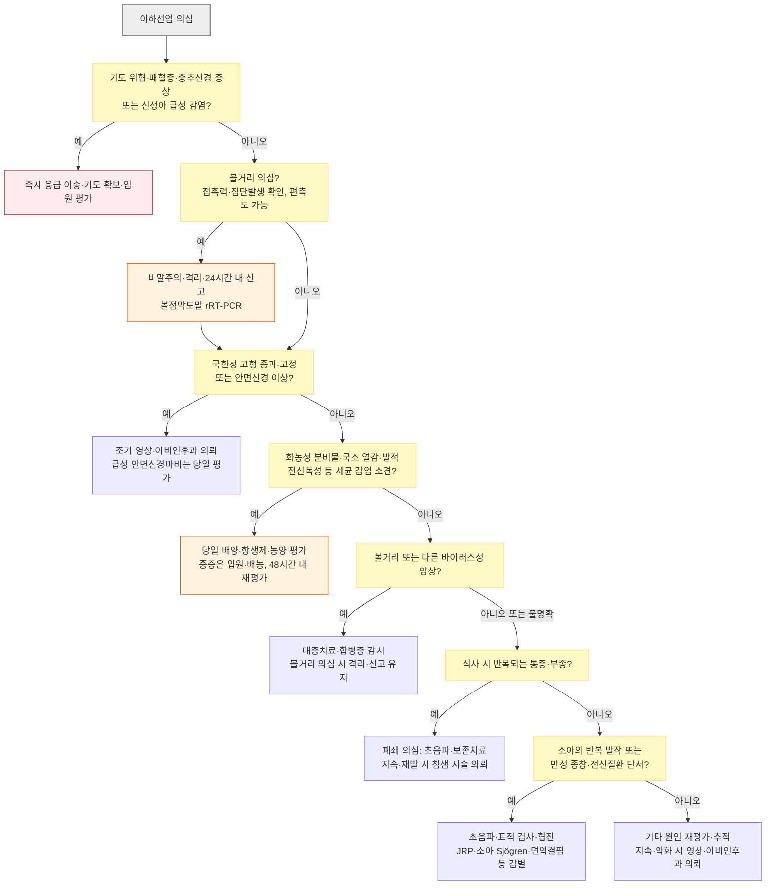

# 이하선염 Parotitis

## <mark style="color:green;">일반 사항</mark>

* 여러 가지 원인에 의한 이하선(귀밑샘)의 염증
* 용어 구분 : sialadenitis(침샘염)는 모든 침샘의 염증을 통칭하는 용어이며, 이하선염은 그중 이하선에 국한된 형태
* 병태생리 : 탈수, 섭취 감소, 구강건조 등으로 침 분비와 세척(clearance) 작용이 감소하면 구강 상재균이 Stensen duct를 통해 역행성으로 침입할 수 있음. 이하선 타액은 장액성으로 악하선·설하선 타액보다 점액(mucin) 등 항미생물 성분이 적어, 세균성 침샘염이 이하선에 잘 생기는 이유로 설명됨
* 분류 : 감염성(바이러스성/세균성/진균성) vs 비감염성(폐쇄성, 자가면역, 약물, 대사성 등); 급성 vs 만성·재발성
* 경과 : 바이러스성은 흔히 자연 호전되지만, 세균성·폐쇄성·종양성 원인은 별도 치료 또는 평가가 필요
* 의뢰 대상 : 중증(예: 화농성 이하선염, 심경부 확산 의심), 만성, 재발성, 진단이 불명확한 편측성 종괴

## <mark style="color:green;">원인 및 위험 인자</mark>

* 감염성 : 볼거리 및 기타 바이러스, 세균; 진균은 매우 드묾
* 폐쇄성 : 침돌증, 침샘관 협착·외상
* 비감염성 : 소아 재발성 이하선염, Sjögren syndrome·IgG4 관련 질환·sarcoidosis, 약물 등
* 무통성 비대에서는 종양과 sialadenosis(비염증성 침샘증)도 감별

### <mark style="color:orange;">위험 인자</mark>

* 침 정체 : 탈수, 쇠약, 식욕 부진, 거식증, 자가면역 질환(예: Sjögren syndrome)
* 면역 저하, 화학요법, 방사선 치료, 영양실조, 알코올 남용
* 조산아, 저체중 출산아 - 특히 NICU 입원 신생아에서 급성 화농성 이하선염 위험 ↑
* 구강 위생 불량, 침샘관의 선천적 구조 이상

## <mark style="color:green;">임상 양상</mark>

### <mark style="color:orange;">감염성</mark>

* 갑자기 발생
* 국소 통증, 부종; 침 분비 유발 음식(매운 음식, 신 음식)이나 저작에 의해 증상 악화
* 국소 부종으로 인하여 trismus, mandible angle 둔화, 귓바퀴의 후상방 이동

#### <mark style="color:$primary;">바이러스</mark>

* 바이러스 감염에 동반하여 이하선 염증·부종 발생; 볼거리에서는 침샘 종창 없이 고환염·수막염 등 합병증으로 발현할 수도 있음
* 볼거리(mumps)는 비말·타액·직접 접촉으로 전파되며, 다른 바이러스는 병원체에 따라 전파경로가 다를 수 있음
* 병원체 : mumps virus, parainfluenza virus types 1 & 3, influenza A, coxsackievirus, Epstein-Barr virus(EBV), cytomegalovirus(CMV), adenovirus (☞ [볼거리](197_-mumps.md))
* 소아 급성 이하선염에서 주요 원인이나, MMR 접종률·유행 상황과 소아 재발성 이하선염 등을 함께 고려
* 전구 증상 : malaise, 식욕 부진, 두통, 근육관절통, 발열
* 흔히 양측 이환하나, 볼거리는 약 25\~30%에서 편측으로만 나타날 수 있음 - "양측=바이러스, 편측=세균/폐쇄"로 단순화하지 않음
* 국소 열감·홍반은 대개 없음; Stensen duct 개구부에서의 고름 배출 없음


**⚠️ 유행성이하선염(볼거리) 의심 시 즉시 조치**

국내에서는 유행성이하선염 환자 및 의사환자 모두 **제2급 법정감염병으로 24시간 이내 신고 대상**이며, **이하선 또는 다른 침샘 종창이 발현한 날을 0일(D0)로 하여 5일째(D+5)까지 격리**가 필요함.

* 마스크 및 비말주의, 다른 환자와 즉시 분리
* 관할 보건소 신고 및 검체 채취 - 가능한 한 빨리 **볼점막도말(buccal swab) rRT-PCR**을 우선 시행
* RT-PCR이 우선 검사이며, IgM은 보조적 검사임. **국내 신고 기준에서는 합당한 임상증상과 특이 IgM 양성이 확인되면 환자로 분류**하나, CDC에서는 IgM을 단독 확진 근거로 인정하지 않으므로 기준을 구분. IgG 단회 양성은 급성 감염과 기존 면역을 구분하지 못함
* 백신 접종자에서는 PCR·IgM이 모두 음성이라도 볼거리를 배제할 수 없음
* 종창 발현일을 D0로 하여 D+5까지 격리; 상태가 호전되면 D+6부터 복귀 (☞ [볼거리](197_-mumps.md))


#### <mark style="color:$primary;">세균</mark>

* 원인균 : S. aureus, 구강 상재균(streptococci, anaerobes 등), S. pneumoniae
* 고령자, 신생아(특히 조산아), 수술 후 호발
* 보통 편측 이환
* 국소 경결, 열감, 홍반; 간혹 Stensen duct 개구부에서의 고름 배출
* 발열이 동반될 수 있으나 고령자·면역저하자에서는 없을 수 있음
* 만성·재발성 세균 감염에서는 Actinomyces(그람양성 세균, 방선균)를 고려 - 외상력·충치 병력과 연관

#### <mark style="color:$primary;">진균</mark>

* Candida 등 진균성 침샘 감염은 매우 드묾; 중증 면역저하자에서 감별하되 구강 칸디다 집락만으로 진균성 이하선염을 진단하지 않고 배양·조직 소견을 함께 평가

### <mark style="color:orange;">비감염성</mark>

#### <mark style="color:$primary;">Juvenile recurrent parotitis</mark>

* 원인 불명
* 편측 또는 양측에 통증·부종이 반복되며, 대개 비화농성임; 2차 세균 감염 시 농성 분비물이 나타날 수 있음
* 개별 발작은 대개 수일 내 호전되며, 일부는 1\~2주 지속 가능; 세균감염 소견이 없으면 항생제를 일률적으로 사용하지 않음
* 보통 유아기·학령전기에 시작하며, 다수는 사춘기에 가까워지며 호전하나 모든 환자가 자연 관해하는 것은 아님
* 반복되는 소아 이하선염을 곧바로 소아 재발성 이하선염으로 단정하지 않고 폐쇄·감염·면역결핍·소아 Sjögren 질환을 감별; 소아 Sjögren 질환은 뚜렷한 구강·안구건조 없이 재발성 이하선염이 먼저 나타날 수 있음 <mark style="color:$info;">[Rheumatology (Oxford) 2025]</mark>

#### <mark style="color:$primary;">비감염성 전신 질환</mark>

* Sjögren syndrome, IgG4 관련 질환, sarcoidosis 등은 흔히 양측성이나 편측으로도 나타날 수 있음
* 알코올 남용·섭식장애·당뇨병·영양실조와 관련된 무통성 양측 비대는 sialadenosis(비염증성 침샘증)를 감별

#### <mark style="color:$primary;">물리적 폐쇄</mark>

* 원인 : 침돌증, ductal stenosis, 외상
* 편측 이환

**침돌증(Sialolithiasis)**

* 급성 부종, 통증; 식사에 의해 악화
* 재발성; submandibular gland에 보다 흔하게 발생

#### <mark style="color:$primary;">약물</mark>

* 항콜린제, 항히스타민제, TCA, 일부 항정신병제 등은 구강건조·침 정체를 통해 감염 위험을 높일 수 있음; 이뇨제는 탈수 여부를 함께 평가
* 요오드 조영제 관련 침샘 종창(iodide mumps), clozapine 관련 이하선 종창 등은 별도의 약물 반응으로 감별; 원인 약물 변경은 처방의와 협의

#### <mark style="color:$primary;">기타</mark>

* pneumoparotid : 악기 연주·유리 불기·반복적인 볼 부풀리기 등으로 구강 내 압력이 상승하여 이하선관에 공기가 역류; 염증을 동반하면 pneumoparotitis로 부름

### <mark style="color:orange;">만성</mark>

* 편측 또는 양측 이하선의 재발성 또는 만성 비압통성 부종
* 발생 연령과 경과는 원인에 따라 다르며, 특정 중년 연령대로 한정하지 않음
* 원인 : Sjögren syndrome, sarcoidosis, HIV(양성 림프상피 낭성 병변), 결핵, IgG4 관련 질환(IgG4-related disease)
  * ✽IgG4 관련 질환의 경화성 침샘염은 주로 악하선에서 기술되어 흔히 Küttner tumor로 불리나, 이하선을 포함한 침샘 전반에서도 나타날 수 있음. 혈청 IgG4 상승이나 조직에서 IgG4+ 형질세포가 관찰된다고 해서 단독으로 확진하지 않으며, storiform fibrosis도 항상 관찰되는 소견은 아님 - 임상·영상·혈청·조직 소견을 종합하고 림프종, Sjögren syndrome 등 다른 질환을 배제하는 **다학제적 평가**가 필요 → 류마티스내과 협진
* 경과 : 원인에 따라 수 주\~수년간 지속하거나 재발할 수 있으며, 자연 완화를 전제로 관찰하지 않고 폐쇄·자가면역·감염·종양 여부를 평가

***

### <mark style="color:$danger;">🚩 Red Flags!</mark>

<mark style="color:$danger;">**즉각 조치**</mark>

* 급속히 진행하는 경부 부종과 호흡곤란·연하곤란  `기도 폐쇄`
* 종창의 급속한 확산, 흉통 등 심경부 감염 확산 시사 소견  `심경부 감염` `종격동염`
* 감염이 의심되면서 저혈압·의식 변화·빈호흡 등 장기기능 이상 또는 심한 전신독성 동반(고열이 없어도 가능)  `패혈증`
* 심한 두통·경부강직·의식 변화·경련 동반  `볼거리 수막염·뇌염`
* 볼거리 의심 환자의 갑작스럽고 심한 편측 음낭 통증·부종  `고환염전`
* 신생아(특히 조산아)의 급성 화농성 이하선염 의심 소견  `신생아 화농성 이하선염` `패혈증`

<mark style="color:$warning;">**당일 평가**</mark>

* 파동성 종괴, 국소 열감·발적, Stensen duct 개구부의 화농성 분비물  `화농성 이하선염` `농양`
  * ✽농양은 이하선의 피막·심부 위치로 인해 파동감이 뚜렷하지 않을 수 있어 "파동감 없음"이 농양 배제를 의미하지 않음
* 급성 안면신경마비 동반, 특히 종괴·경부 림프절·피부 고정을 동반한 경우  `악성 종양` `침샘 심부 감염`
* 면역저하 환자의 급성 이하선 부종  `기회감염` `진균 감염`
* 볼거리 의심 환자의 새로 발생한 고환 통증·부종, 심한 복통·구토 또는 갑작스러운 청력저하  `볼거리 고환염` `췌장염` `돌발성 난청`
* 경험적 항생제 투여 48시간 후에도 임상 호전 없음  `치료 실패` `농양` `침샘관 폐쇄`

<mark style="color:$info;">**조기 평가 및 추적**</mark>

* 처음부터 국한성 고형 종괴로 촉지되거나, 급성 염증이 가라앉은 뒤에도 남는 편측 무통성 종괴  `침샘 종양`
* 반복되는 이하선염  `소아 재발성 이하선염` `폐쇄성 침샘염`
* 지속되는 만성·양측성 무통성 종창  `Sjögren syndrome` `IgG4 관련 질환` `sialadenosis`

## <mark style="color:green;">진단</mark>

* 이하선 종창을 확인한 뒤 감염성·폐쇄성·자가면역·종양성·비염증성 원인을 감별
* 병력·진찰 : 발병 시점, 식사와의 연관성, 재발·접촉력·MMR 접종력, 구강·안구건조, 약물·탈수 여부를 확인. 구강·치아와 Stensen관 개구부, 안면신경 기능, 경부 림프절을 함께 평가

### <mark style="color:orange;">검사</mark>

* 배양 검사 : Stensen duct에서 배출되는 농성 분비물을 가능하면 항생제 투여 전 채취; 패혈증·전신독성 시 혈액배양도 고려. 검체 채취 때문에 중증 감염의 항생제 투여를 지연하지 않음
  * 농양 흡인과 종양 의심 시 초음파 유도 세침흡인(FNA)·중심바늘생검은 목적이 다르므로 이비인후과에서 구분하여 시행
* CBC·CRP : 전신증상·세균성 감염이 의심되면 고려하되, 정상 수치만으로 감염을 배제하지 않음; 탈수·중증 감염 또는 신독성 약물 사용 시 전해질·신기능도 평가
* amylase : routine 진단검사로 권장하지 않음; 복통이 동반되면 급성 췌장염 감별을 위해 lipase 검사를 함께 고려
* mumps 검사 : 볼거리 의심 즉시 볼점막도말 rRT-PCR을 채취하며, **종창 시작 0\~3일 이내**가 가장 적절함. 채취 전 이하선을 약 30초간 부드럽게 마사지; **3일이 지났으면 PCR 검체와 혈청 IgM을 함께 고려**하고 실제 의뢰는 보건소·검사기관 지침에 따름. 너무 이른 IgM 음성·백신 접종자의 음성 결과로 배제하지 않음 <mark style="color:$info;">[CDC]</mark>
  * IgG 단회 양성은 급성 감염 확진이나 완전한 방어면역의 증거가 아님. 볼거리 의심 경과 중 반대편 종창이 새로 생기면 재발성 이하선염으로만 처리하지 않고 재검체 채취·격리기간을 보건소와 재평가
* 만성·재발성의 표적 검사 : 구강·안구건조, 관절증상, 반복 감염, 노출력 등에 따라 anti-SSA/Ro·ANA, 면역글로불린, HIV·결핵 검사 등을 선택하고 류마티스내과·소아청소년과·이비인후과와 협진. 모든 급성 이하선염에 일률적으로 시행하지 않음
* 영상 검사
  * 초음파 : 영상이 필요한 경우의 1차 선택; 방사선 노출 없이 농양·결석·종양 감별에 유용. 전형적이고 합병증 없는 바이러스성 이하선염에서 일률적 영상검사는 필요하지 않음. 촉지되는 국한성 종괴는 호전을 기다리지 않고 영상 평가
  * CT : 심부 농양·심경부 확산이 우려되거나 초음파로 충분히 평가되지 않으면 조영증강 CT. 결석 검출이 주목적이면 비조영 CT 등 검사법을 영상의학과와 선택; 단순 X선·초음파 음성만으로 작은 이하선관 결석을 배제하지 않음
  * Sialography : 급성 감염기에는 duct 천공·감염 악화 위험으로 금기; 만성·재발성에서 ductal stricture, sialectasis 평가에 사용되어 왔으나 최근 MR sialography나 진단·치료를 겸하는 sialendoscopy로 대체되는 추세

### <mark style="color:orange;">감별 진단</mark>

* 이하선 종창의 원인 및 유사 질환 감별

<table><thead><tr><th width="140">질환</th><th width="260">이하선염과의 차이점</th><th>핵심 감별 포인트</th></tr></thead><tbody><tr><td>경부 림프절염</td><td>이하선 실질이 아닌 림프절의 종대; 하악각 부근에 결절형 종괴로 촉지</td><td>초음파에서 경계가 뚜렷한 결절형 종괴; Stensen duct 이상 없음</td></tr><tr><td>침샘 종양(양성/악성)</td><td>대개 무통성, 서서히 자라는 편측 종괴; 급성 염증 징후 없음</td><td>안면신경마비, 고정된 경결감 동반 시 악성 강력 의심 → 조직검사</td></tr><tr><td>Sialadenosis(침샘증)</td><td>염증·종양이 아닌 비염증성 대사성 종창; 무통성·양측성 침샘 비대</td><td>알코올 남용, 거식증·폭식증, 당뇨병, 영양실조 등 대사·전신 질환과 연관; 압통·발적 없음, 급성 염증 소견 없음</td></tr><tr><td>Masseter 근육 비대</td><td>저작근 비대로 인한 종창, 이갈이·과도한 저작과 연관</td><td>이악물기 시 종괴가 단단해짐; 침샘 부위와 촉진상 구분됨</td></tr><tr><td>치성 감염·농양</td><td>치아·치은 병소에서 기원, 부종이 하악 주변에 국한</td><td>구강 내 원인 치아 확인, 치과적 병력</td></tr><tr><td>유행귀밑샘염(볼거리)</td><td>이하선염의 원인이자 감별이 필요한 대상; 편측도 25\~30%에서 가능, 전신 전구증상 동반, 미접종자·집단발생과 연관</td><td>볼점막도말 rRT-PCR로 확진; 접촉력·집단발생 확인 (☞ [볼거리](197_-mumps.md))</td></tr></tbody></table>

***



<p align="center"><strong>임상 양상 기반 진단·초기 대응 알고리듬</strong></p>

<p align="center"><em><mark style="color:$info;">저자 재구성 (참고 문헌 : Can Fam Physician 2023; CDC Laboratory Testing for Mumps; Rheumatology (Oxford) 2025)</mark></em></p>

***

## <mark style="background-color:$warning;">Management</mark>


**단계별 접근**

기도 위협·패혈증·신생아 급성 감염과 볼거리 가능성을 먼저 확인함. 세균성이 의심되면 가능하면 배양 후 경험적 항생제를 투여하고 48시간 내 반응을 재평가함. 화농성 병소는 당일 농양 평가, 기도 위협·패혈증은 즉시 응급 이송이 필요함.


## <mark style="color:green;">비-약물 치료 및 예방</mark> <a href="#non-drug-treatment" id="non-drug-treatment"></a>

* 온찜질 및 부드러운 마사지 : 이하선에서 Stensen관 개구부 방향으로 압력을 가볍게 가함
* 금연, 음주 제한
* 적절한 수분 섭취
* 침 분비 유도 : 세균성·폐쇄성 질환에서 무설탕 껌·사탕을 고려하되, 통증·종창이 악화되면 중단하고 폐쇄 여부 재평가
  * 볼거리 등 급성 바이러스성 이하선염에서는 신 음식·자극적인 음식이 통증을 악화할 수 있어 피하고 부드러운 음식 섭취
  * 어린 소아에게 단단한 사탕을 주지 않으며, 저작·연하 곤란 시 고형식을 억지로 권하지 않음
* 구강 위생 관리
* 볼거리 예방 : MMR 접종력을 확인하고 미접종·불완전 접종은 국가예방접종 기준에 따라 보완(소아 기본접종 생후 12\~15개월·4\~6세 총 2회). 접촉 후 MMR 접종이 이번 노출로 인한 발병을 확실히 막는 조치는 아니므로 격리·증상 감시를 대체하지 않음 (☞ [볼거리](197_-mumps.md))

## <mark style="color:green;">약물 치료</mark> <a href="#drug-treatment" id="drug-treatment"></a>

### <mark style="color:orange;">항생제</mark>

* 전신상태가 안정되고 농양·심부 확산·경구섭취 장애가 없는 경증\~일부 중등도 외래 감염
  * amoxicillin/clavulanate 625 ㎎(amox 500/clav 125) tid <mark style="color:blue;">\[오구멘틴정625㎎]</mark> - MSSA·구강 streptococci·혐기성균까지 커버하는 실용적 1차 선택
  * cephalexin 500 ㎎ qid <mark style="color:blue;">\[팔렉신캡슐500㎎]</mark> - 배양·임상 소견으로 MSSA 등 감수성 균을 확인하고 혐기성균·치성 감염 가능성이 낮을 때의 좁은 스펙트럼 대안; 유통 제품은 1캡슐 500 ㎎
  * clindamycin 300 ㎎ q6h <mark style="color:blue;">\[훌그램캡슐(150 ㎎/C)]</mark> - 즉시형 페니실린 과민반응 등으로 다른 적절한 항생제를 사용할 수 없을 때 선택적으로 고려. **허가사항은 경미한 세균감염에서 사용하지 않도록 경고**하므로 알레르기만으로 경증 환자에게 일률적으로 선택하지 않음; 1회 2캡슐 필요. 지역 내 내성률 및 C. difficile 위험을 함께 고려; erythromycin 내성·clindamycin 감수성 포도구균은 유도성 내성(D-test) 결과 확인
  * amoxicillin/clavulanate : 베타락탐계 중증 과민반응, 해당 약 또는 페니실린에 의한 황달·간기능장애 병력에서는 금기; EBV 전염단핵구증이 의심되면 피하고 세균성 감염 여부를 재평가
  * 신장애 : amoxicillin/clavulanate는 CrCl ＜30 ㎖/min에서 감량·투여간격 조정이 필요하며, cephalexin도 신기능에 따라 감량·간격을 조정; 정상 신기능 성인 용량을 그대로 적용하지 않음
  * amoxicillin/clavulanate·cephalexin은 MRSA를 치료하지 못함. MRSA 의심 또는 배양 확인 시 감수성·중증도에 따라 변경하며, clindamycin도 감수성 확인 없이 MRSA 치료제로 단정하지 않음
  * ✽소아(생후 2개월 이상, 신부전 없음) : **7:1 제형인 오구멘틴듀오시럽**의 amoxicillin 성분 기준 25 ㎎/㎏/d(경증\~중등도) 또는 45 ㎎/㎏/d(중증 허가 용량)를 **bid**로 투여. 4:1 등 다른 제형은 용량·분복 횟수가 다르므로 그대로 환산하지 않음. **7:1 시럽은 생후 2개월 미만 및 신부전 소아에 적합하지 않음** <mark style="color:$info;">[허가사항]</mark>
  * 위 소아 용량은 제형별 허가용량을 제시한 것이며, 이하선염에 특화된 비교시험으로 확립된 용량은 아님. 80\~90 ㎎/㎏/d는 이 챕터의 통상 용량으로 제시하지 않음; 신생아·중증 소아·농양 의심 환자는 입원 평가 대상
* 화농성 분비물은 당일 평가·배양 대상이나 그 소견만으로 모든 환자에게 입원이 필수인 것은 아님. 농양·심부 확산, 전신독성, 경구 섭취 불가, 중증 면역저하 또는 신생아에서는 입원·정주 항생제를 우선
  * 경험적 선택 : ampicillin/sulbactam (구강균·혐기균 포함)
  * 중증 면역저하·의료관련 감염·그람음성균 위험에서는 항녹농균 치료 필요성도 감염내과와 협의
  * MRSA 위험 요인이 있는 경우 vancomycin 등을 병용 추가 - nafcillin·vancomycin 단독을 모든 화농성 이하선염의 정형화된 처방으로 두지 않음
  * 농양이 확인되면 항생제만 반복하지 않고 배농 여부를 함께 판단; 접근 가능한 국한성 농양은 영상유도 흡인을 고려할 수 있으며, 흡인 실패 또는 심부·다방성·큰 농양은 절개 배농(I\&D)
* 치료 반응 평가
  * 화농성 분비물이 있으면 가능하면 항생제 투여 전 배양을 먼저 시행
  * 투여 48시간 후 임상 반응을 재평가; 악화하면 즉시 재평가
  * 외래 항생제는 초기 7\~10일을 고려하되 표준화된 단일 치료기간은 없으므로 중증도·배양 결과·배농 여부·반응에 따라 조정
  * 호전이 없거나 악화되면 배양 결과·복약순응도·폐쇄/결석/농양 여부를 재평가하고 초음파·조영증강 CT 및 의뢰를 고려 - 배양 없이 항생제만 경험적으로 연속 교체하지 않음

### <mark style="color:orange;">진통제, 해열제</mark>

* ibuprofen <mark style="color:blue;">\[부루펜]</mark>, dexibuprofen <mark style="color:blue;">\[애니펜]</mark>, naproxen <mark style="color:blue;">\[아나프록스]</mark> 중 한 가지를 필요시 단기간 사용; NSAID끼리는 병용하지 않음
* **Ibuprofen(부루펜정200㎎) 금기** : 위장관 궤양·출혈 또는 그 병력, 기관지천식 또는 그 병력, aspirin·다른 NSAID에 의한 천식·두드러기·알레르기 반응 병력, 심한 혈액이상·간장애·신장애·심장기능부전·고혈압, CABG 전후 통증, 고용량 methotrexate 항암요법 중, 임신 말기 3개월 등에서는 투여하지 않음. 임신 20주 이후에는 태아 신기능·양수 감소 위험으로 원칙적으로 피함. 다른 NSAID는 해당 품목의 금기·주의사항을 별도로 확인 <mark style="color:$info;">[허가사항]</mark>
* 탈수·신장질환·위장관 출혈 위험 또는 항응고제 복용 시 NSAID를 피하거나 신중히 사용; acetaminophen을 대안으로 고려
* **Acetaminophen(타이레놀정500㎎ 기준)의 주요 금기** : 소화성궤양, 심한 간·신장장애·심장기능저하·혈액 이상, aspirin 천식 또는 그 병력, 바르비탈계·삼환계 항우울제 복용 등에서는 투여하지 않음; 음주 중 복용하지 않음. NSAID가 부적절하더라도 acetaminophen의 금기를 별도로 확인함 <mark style="color:$info;">[허가사항]</mark>

* 소아는 체중별 제형·용량을 사용하고 아래 성인 정제 처방을 그대로 적용하지 않음 (☞ [볼거리](197_-mumps.md))

### <mark style="color:orange;">침 분비 자극제</mark>

* pilocarpine <mark style="color:blue;">\[살라겐정(5 ㎎)]</mark> : 급성 감염 치료·일반 재발성 이하선염 예방 목적으로 사용하지 않음; Sjögren syndrome 또는 두경부 방사선치료 후 구강건조 등 허가 적응증에 한하여 고려
  * **천식환자, 필로카르핀 과민증, 급성 홍채염·폐쇄각녹내장 등 축동이 부적절한 상태는 금기**. 천식의 조절 여부로 금기를 완화하지 않음; 만성기관지염·COPD·심혈관질환에서는 전문의 감독하에 신중히 사용 <mark style="color:$info;">[허가사항]</mark>
  * 모든 녹내장을 같은 금기로 취급하지 않음; 발한·탈수 및 야간 시야장애를 설명하고, 소아에서는 안전성·유효성이 확립되지 않았으므로 소아 재발성 이하선염에 일률적으로 처방하지 않음

## <mark style="color:green;">시술 및 기타 처치</mark>

* Sialendoscopy 중 생리식염수 세척 ± 관내 corticosteroid 주입 : juvenile recurrent parotitis에서 보존치료 후에도 반복되는 경우 고려; 근거 수준은 연구마다 이질적
  * 2026년 소아 후향연구에서도 시술 후 증상 호전을 보고했으나, 대조군 부재·환자보고 평가·자연관해 가능성을 고려해야 함. 중증도·재발 빈도·일상생활 영향을 평가하여 선택적으로 의뢰 <mark style="color:$info;">[Aust J Otolaryngol 2026]</mark>
* Sialendoscopy : 협착·결석의 진단과 세척·확장 치료를 동시에 수행할 수 있어 보존치료 후에도 반복되는 재발성 이하선염·폐쇄성 질환에서 고려 - 모든 재발성 이하선염의 일률적 1차 치료로 단정하지 않음
* 침돌증 위치별 처치
  * 원위부, 유두부에 가까운 결석 : 침샘내시경 또는 경구강 접근으로 제거 고려; 특히 이하선관은 협착·안면신경 손상 위험을 고려하여 침샘 시술 경험이 있는 이비인후과에서 시행
  * 이동 가능한 작은 관내 결석 : sialendoscopy를 이용한 basket extraction
  * 근위부·폐문부·실질 내 결석 또는 크기가 큰 결석 : 내시경 보조 복합 접근, 관내 쇄석술, 또는 체외충격파쇄석술(ESWL)을 위치·크기·이동성과 기관 가용성에 따라 선택 (✽침샘 ESWL·관내 쇄석술의 시행 가능 여부를 사전에 확인하여 의뢰)
* 급성 화농성 감염 중에는 elective sialendoscopy·관내 corticosteroid 주입을 피하고, 항생제·필요시 배농으로 먼저 감염을 조절
* ductoplasty 또는 내시경 보조 시술 : 확인된 협착·폐쇄에 따라 선택. Parotidectomy는 침샘 보존 치료에도 반응하지 않는 난치성 질환에서 안면신경 손상 위험을 설명한 뒤 최종적으로 고려; duct ligation·sclerotherapy를 모든 만성 이하선염의 통상 치료로 제시하지 않음
* 화농성 이하선염에서 뚜렷한 농양 형성(초음파/CT 확인) 시 절개 배농(I\&D) 또는 영상 유도 흡인

***

## <mark style="color:red;">질병코드</mark>

* K11.20 급성 타액선염 Acute sialoadenitis
* K11.21 급성 재발성 타액선염 Acute recurrent sialoadenitis
* K11.22 만성 타액선염 Chronic sialoadenitis
* K11.29 상세불명의 타액선염 Sialoadenitis, unspecified
* K11.3 침샘의 농양 Abscess of salivary gland
* K11.5 타석증 Sialolithiasis
* B26.9 합병증 없는 볼거리 Mumps without complication

✽K11.2는 '타액선염'의 상위 분류이므로 진단 내용에 맞는 완전코드를 선택 (KCD-9, 2026.1.1 시행)

✽볼거리는 원인에 맞는 B26 계열 코드를 사용하며, 고환염·수막염·뇌염 등 합병증이 있으면 B26.9 대신 해당 합병증 코드를 선택 (☞ [볼거리](197_-mumps.md))

***

## <mark style="color:purple;">처방례</mark>

* 아래는 정상 신기능 성인의 예시임(소아 시럽 예시는 별도 주석). 진통제는 금기·탈수를 확인한 뒤 선택하며 ibuprofen의 1일 1,200 ㎎은 이 예시의 보수적 상한임.

> **처방례 1. 성인 외래 경증\~중등도 세균성 이하선염 (실용적 1차)**
>
> ```
> 오구멘틴정625㎎  3T  #3  (7~10일)
> 부루펜정200㎎  1~2T  q6~8hr PRN 통증·발열 (1일 최대 6T=1,200 ㎎, 단기간)
> ```
>
> _✽구강 혐기성균·치성 감염 가능성을 배제하기 어려운 상황에서의 실용적 1차 선택. 48시간 후 반응 재평가; 화농성 분비물이 있었다면 투여 전 배양 결과를 함께 확인. 식사 시작과 함께 복용; 신기능 저하 시 투여 간격 조정 필요_
> _✽생후 2개월 이상이고 신부전이 없으며 경구치료가 가능한 소아 : 오구멘틴듀오시럽228㎎/5㎖(amoxicillin 200 ㎎+clavulanate 약 28.5 ㎎/5㎖), 경증\~중등도는 0.3125 ㎖/㎏/회 bid(하루 총 0.625 ㎖/㎏). 예: 20 ㎏ 소아 6.25 ㎖/회 bid. 중증 허가 용량은 0.5625 ㎖/㎏/회 bid이나, 화농성·중증 소아는 먼저 입원 필요성 평가_

> **처방례 2. 성인, 감수성 균 확인 후 혐기성균·치성 감염 가능성이 낮은 경우**
>
> ```
> 팔렉신캡슐500㎎/C  4C  #4  (7~10일)
> 부루펜정200㎎  1~2T  q6~8hr PRN 통증·발열 (1일 최대 6T=1,200 ㎎, 단기간)
> ```
>
> _✽좁은 스펙트럼 대안. 48시간 후에도 호전이 없으면 배양 결과·복약순응도·폐쇄/농양 여부를 재평가한 뒤 항생제 변경(예: amoxicillin/clavulanate)을 고려_

> **처방례 3. 성인, 즉시형 페니실린 과민반응 등으로 다른 적절한 항생제를 사용할 수 없는 선택된 세균 감염**
>
> ```
> 훌그램캡슐(150㎎/C)  8C  #4  (1회 2C, 7~10일)
> 부루펜정200㎎  1~2T  q6~8hr PRN 통증·발열 (1일 최대 6T=1,200 ㎎, 단기간)
> ```
>
> _✽clindamycin은 페니실린 계열이 아니므로 즉시형 과민반응 환자에게 사용 가능; 훌그램캡슐은 150 ㎎ 제제이므로 1회 300 ㎎ 투여 시 2캡슐. 경미한 세균감염에는 투여하지 않는다는 허가사항 경고를 적용하고, 처방 전 지역 내 내성률 및 C. difficile 위험을 고려_

> **처방례 4. 성인 바이러스성 이하선염 (해열·통증 조절)**
>
> ```
> 부루펜정200㎎  1~2T  q6~8hr PRN 통증·발열 (1일 최대 6T=1,200 ㎎)
> ```
>
> _✽세균성 합병증이 없으면 항생제는 불필요; 온/냉찜질, 수분 섭취·부드러운 음식 권장. 볼거리에서는 신맛 사탕·레몬을 피함. 소아 재발성 이하선염은 소아 체중별 용량을 적용. 볼거리 의심 소견(접촉력, 집단발생, 편측 이환 포함)이 있으면 격리·신고 절차를 우선 적용; Stensen duct 화농성 분비물, 국소 열감·발적 등 2차 세균 감염 시사 소견이 없는지 재평가 필요_

***

### <mark style="color:$success;">핵심 복약 지도</mark>

> **항생제는 처방대로 복용**
>
> * 증상이 좋아져도 임의로 중단·연장하지 않고 처방대로 복용함. 다만 심한 설사·혈변·수포성 발진·호흡곤란 등 중대한 이상반응이 의심되면 투약을 중단하고 즉시 진료받도록 안내
> * amoxicillin/clavulanate는 식사 시작과 함께 복용함. 오구멘틴듀오시럽은 복용 전 흔들고 조제 후 냉장보관하여 7일 이내 사용하며, 7일을 넘겨 치료하면 새로 조제함. 신부전 소아에는 이 7:1 시럽을 사용하지 않음
> * Clindamycin은 충분한 물과 함께 복용하고 복용 직후 눕지 않음. 복용 중 또는 종료 후 심한 수양성 설사·혈변·복통이 생기면 C. difficile 감염을 평가하며 지사제를 임의로 복용하지 않도록 설명
> * 48시간 후에도 부종·통증·발열이 호전되지 않거나 악화되면 재내원하여 배양 결과·농양·폐쇄 및 입원 필요성 재평가; 항생제 변경은 평가 결과에 따라 결정

> **침 분비를 자극하는 자가 관리**
>
> * 세균성·폐쇄성 질환에서는 무설탕 껌·사탕으로 침 분비를 유도; 볼거리 환자는 신맛 사탕·레몬을 피하도록 안내
> * 빨아 먹을 때 통증·부종이 오히려 심해지면 억지로 계속하지 말고 폐쇄 여부를 재평가
> * 저작·연하가 어렵다면 부드러운 음식과 온찜질·부드러운 마사지를 병행; 볼거리 환자는 신 음식·신맛 사탕을 피하고 어린 소아에게 단단한 사탕을 주지 않도록 설명
> * 탈수는 침 정체와 감염 위험을 높이므로 충분한 수분 섭취 강조

> **언제 다시 병원을 방문해야 하나요?**
>
> * 항생제 복용 48시간 후에도 부종·통증·발열이 호전되지 않는 경우
> * 종괴가 말랑말랑해지거나(파동감) 피부 발적·열감이 심해지는 경우 - 농양 의심, 즉시 재내원
> * 호흡곤란, 삼킴 곤란, 입 벌리기 어려움(trismus 악화)이 새로 생기는 경우 - 즉시 응급실
> * 증상이 반복되거나 2주 이상 지속되는 경우 - 이비인후과 의뢰 고려

***

## <mark style="color:green;">주요 참고문헌 및 확인 자료</mark>

### <mark style="color:orange;">임상 근거</mark>

* 질병관리청. 2026년도 예방접종 대상 감염병 관리 지침(2026.6.11. 수정 게시본), 유행성이하선염. [공식 게시 및 첨부](https://www.kdca.go.kr/bbs/kdca/55/311032/artclView.do).
* Moore J, Simpson MTW, Cohen N, Beyea JA, Phillips T. [Approach to sialadenitis](https://pmc.ncbi.nlm.nih.gov/articles/PMC10426371/). Can Fam Physician. 2023;69(8):531–536. doi:10.46747/cfp.6908531.
* Lenehan N, Flame A, Hobson M. [Sialendoscopy for recurrent sialadenitis: a 9-year retrospective review at a tertiary paediatric centre](https://www.theajo.com/article/view/5169/html). Aust J Otolaryngol. 2026;9:18. doi:10.21037/ajo-25-68.
* CDC. [Laboratory Testing for Mumps](https://www.cdc.gov/mumps/php/laboratories/index.html); [Mumps Specimen Collection](https://www.cdc.gov/mumps/php/laboratories/specimen-collection.html); [Mumps Vaccine Recommendations](https://www.cdc.gov/mumps/hcp/vaccine-considerations/index.html).
* Stern SM, et al. [Diagnosing a child presenting with symptoms suggesting Sjögren’s disease: a tool for clinical practice](https://pubmed.ncbi.nlm.nih.gov/39673525/). Rheumatology (Oxford). 2025;64(5):3039–3047. doi:10.1093/rheumatology/keae640.
* 질병관리청. [홍역, 볼거리, 풍진 - 국가건강정보포털](https://health.kdca.go.kr/healthinfo/biz/health/gnrlzHealthInfo/gnrlzHealthInfo/gnrlzHealthInfoView.do?cntnts_sn=5283); [예방접종 대상 감염병 - 격리 및 주의사항](https://www.kdca.go.kr/kdca/3247/subview.do); [예방접종도우미 - 유행성이하선염](https://nip.kdca.go.kr/irhp/infm/goVcntInfo.do?menuCd=1121&menuLv=1).

### <mark style="color:orange;">허가·급여 확인 자료</mark>

* [식품의약품안전처. 의약품안전나라 - 의약품 품목허가정보.](https://nedrug.mfds.go.kr/index) - 제품별 적응증·용법·금기 및 허가 상태 확인
* 질병코드 : KCD-9(2026.1.1 시행).

***

## <mark style="color:blue;">환자 안내서</mark>


**이하선염, 원인에 따라 치료가 달라집니다**

이하선염은 귀 앞쪽·아래쪽에 있는 귀밑샘(이하선)에 생기는 염증입니다. 바이러스, 세균, 침샘 관 막힘, 자가면역질환 등 다양한 원인으로 생기며, 원인에 따라 치료 방법과 경과가 다릅니다.


#### <mark style="color:$primary;">왜 귀밑이 붓고 아프나요?</mark>

* 침이 줄어들고 입안이 마르면 입속 세균이 침샘관을 따라 거슬러 올라가 염증을 일으킬 수 있습니다.
* 신맛 음식이나 매운 음식을 먹거나 씹을 때 침 분비가 늘면서 통증이 심해질 수 있습니다.

#### <mark style="color:$primary;">일상생활에서 어떻게 관리하나요?</mark>

* **화상을 입지 않을 정도의 따뜻한 찜질과 부드러운 마사지를 해 주십시오.** 귀 앞·아래에서 볼 안쪽 침샘관 입구 방향으로 가볍게 마사지하고, 세게 짜지 마십시오. 볼거리에서는 따뜻하거나 시원한 찜질 중 편안한 방법을 선택할 수 있습니다.
* **세균성·폐쇄성 질환에서는 무설탕 껌이나 사탕이 침 배출에 도움이 될 수 있습니다.** 통증·붓기가 심해지면 중단하십시오. **볼거리에서는 신맛 사탕·레몬을 피하십시오.** 어린 소아에게는 단단한 사탕을 주지 마십시오.
* **물을 충분히 마시십시오.** 탈수는 증상을 악화시킬 수 있습니다.
* **담배와 술은 피하십시오.** 입안 자극을 줄이고, 탈수를 피하며, 구강을 청결하게 유지하십시오.

#### <mark style="color:$primary;">항생제는 어떻게 써야 하나요?</mark>

* 세균 감염으로 진단된 경우에 항생제가 처방됩니다. 증상이 좋아져도 임의로 중단하거나 연장하지 말고 처방대로 복용하십시오. 다만 심한 설사·혈변·심한 발진이 생기면 복용을 중단하고 즉시 진료받으십시오. 호흡곤란·입술이나 혀의 부종은 응급실로 가십시오.
* 가벼운 부작용이나 치료 반응이 부족한 경우에는 처방 변경이 필요한지 의료진과 상의하십시오.

#### <mark style="color:$primary;">볼거리로 진단(의심)되었다면</mark>

* 의심 단계부터 마스크를 착용하고, 등교·출근과 다른 사람과의 밀접 접촉을 피해 주십시오. 검사 결과를 기다리거나 첫 검사 음성만으로 임의로 격리를 끝내지 마십시오.
* 의료진과 보건소의 신고·격리 안내를 따라 주십시오. 침샘이 붓기 시작한 날을 0일로 하여 5일째까지 격리하며, 상태가 좋아지면 6일째부터 복귀할 수 있습니다.

#### <mark style="color:$primary;">이럴 때는 병원을 다시 방문하세요</mark>

* 🔥 열이 심해지거나 오한이 동반될 때 - 당일 재진; 의식 저하·심한 처짐이 동반되면 즉시 응급실
* 😖 부은 부위가 물렁물렁해지거나 피부가 붉고 뜨거워질 때 - 당일 재진(농양 의심)
* 😮‍💨 숨쉬기 힘들거나 음식을 삼키기 어려울 때, 입이 잘 안 벌어질 때 - **즉시 응급실**
* 🔁 증상이 반복되거나 2주 넘게 지속될 때 - 외래 재진; 딱딱한 덩이가 만져지거나 얼굴 한쪽이 잘 움직이지 않으면 2주를 기다리지 말고 진료받으십시오.
* 👂 갑자기 잘 안 들리거나 고환이 붓고 아플 때, 심한 복통이 생길 때 - 당일 진료; 갑자기 심한 고환 통증, 심한 두통·목 뻣뻣함·의식 변화는 즉시 응급실
