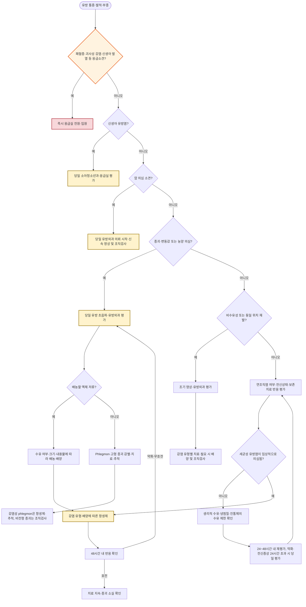

# 유방염 Mastitis

## <mark style="color:green;">일반 사항</mark>

* 유방염은 유선과 주위 간질에 발생하는 염증으로, 수유기에는 **유관 협착(ductal narrowing) → 염증성 유방염 → 세균성 유방염 → 염증성 종괴(phlegmon) 또는 농양**으로 진행할 수 있는 스펙트럼으로 이해함. 모든 환자가 각 단계를 순차적으로 거치는 것은 아님 <mark style="color:$info;">Ref. ABM Clinical Protocol #36, 2022</mark>.
* 모유 수유 여성의 약 3\~20%에서 발생하며, 출산 후 첫 6주에 흔하지만 수유 기간 중 어느 때나 발생할 수 있음.
* 염증성 유방염의 발열·오한·빈맥은 감염 없이도 나타날 수 있으므로, 발열만으로 세균성 유방염을 진단하지 않음.
* 세균성 유방염·유방 농양 자체는 일반적으로 수유 중단의 이유가 아님. 치료약이 수유에 적합하고 감염 조직과의 접촉을 피할 수 있으면 이환측 수유를 계속할 수 있으며, 모유를 일률적으로 짜서 버리지 않음. 약제별 국내 수유 제한과 영아의 상태는 별도로 평가함.
* 다만 아기의 입이나 유축기 깔때기가 고름, 열린 감염 조직 또는 배액관 삽입부와 직접 접촉하지 않도록 하고, 해당 부위는 깨끗하고 마른 드레싱으로 덮음. 접촉을 피할 수 없으면 감염 부위가 더 이상 전염성이 없다고 판단될 때까지 이환측 모유를 유축해 버리고 반대쪽 수유는 계속함. 미숙아·중환자실 입원아·면역저하 영아는 별도의 감염관리 지침에 따름. <mark style="color:$info;">Ref. CDC MRSA and Breastfeeding</mark>.
* 비수유성 유방염에는 유관주위염(periductal mastitis), 유륜주위 농양, 육아종성 유방염(granulomatous mastitis) 등이 포함되며 수유 유방염과 원인·검사·치료가 다름.
* 유방 농양은 배농이 필요한 감염성 액체 저류이며, 급성 수유 유방염 환자의 약 3\~11%에서 발생함. 농양이 형성되면 발열이 일시적으로 호전될 수도 있으므로 전신증상만으로 배제하지 않음.
* 합병증 : 재발성 유방염, phlegmon·농양, 만성 유관 누공(비수유성), 조기 이유

## <mark style="color:green;">원인 및 위험 인자</mark>

### <mark style="color:orange;">수유 유방염</mark>

* 흔한 원인균 : *Staphylococcus aureus*, coagulase-negative *Staphylococcus*, *Streptococcus* spp.
* MRSA는 과거 MRSA 감염·보균, 최근 입원 또는 의료기관 노출, 의료종사자, 반복 감염, 지역 내 높은 유병률, 1차 항생제 무반응 때 고려함.
* 관련 요인
  * 이전 유방염 병력
  * 모유 과다생산 또는 필요량을 초과하는 반복 유축
  * 수유 간격의 갑작스러운 변화, 급격한 이유
  * 유두 손상, 부적절한 젖물림 또는 유축기 깔때기 크기·과도한 흡인으로 인한 외상
  * 유방에 지속되는 국소 압박
* 위 요인 중 상당수는 관찰연구에서 확인된 연관성이며, 개별 환자에서 직접적인 원인으로 단정하지 않음.


**Candida 유관 감염** 또는 **mammary candidiasis**라는 진단을 뒷받침하는 과학적 근거는 부족함. <mark style="color:$info;">Ref. ABM Clinical Protocol #36, 2022</mark>. 찌르거나 타는 듯한 유방통만으로 칸디다 감염을 진단하거나 nystatin, gentian violet, fluconazole을 경험적으로 투여하지 않음. 다음을 먼저 감별함.

* 유두 외상·피부염 : 육안으로 확인되는 균열·발진·표피 손상
* 부적절한 젖물림 : 수유 자세·라치(latch) 교정으로 통증이 호전되는지 확인
* 혈관연축(Raynaud's phenomenon of the nipple) : 수유 직후 또는 추위 노출 시 유두 창백과 통증, 이후 청색·발적이 나타날 수 있음. 전형적인 3상성 변화가 모두 있어야 진단하는 것은 아님
* 세균성 유방염 : 국소 발적·부종·발열이 동반되는지 확인
* 과도한 유축 : 유축 빈도·강도가 아기가 먹는 양을 초과하는지 확인
* 신경병성 통증 : 작열감이 수유와 무관하게 지속되고 allodynia를 동반


### <mark style="color:orange;">비수유성 유방염</mark>

* 유관주위염 및 유륜주위 농양 : 흡연, 당뇨, 비만, 함몰·갈라진 유두, 유두 피어싱과 관련되며, 재발 시 혼합균과 혐기성균을 고려함.
* 육아종성 유방염 : 감염, 특발성 염증 및 드물게 결핵·진균 등이 원인이 될 수 있음. Cystic neutrophilic granulomatous mastitis(CNGM)는 *Corynebacterium*과 연관될 수 있음.
* 사춘기 유방 감염 : 피부 외상, 면도, 유두 피어싱, 표피낭종 감염 및 유관 이상 등이 원인이 될 수 있음. 유방 발달 조직의 손상을 피하도록 초음파와 소아청소년과·유방외과 평가를 고려함.

## <mark style="color:green;">임상 양상</mark>

<table><thead><tr><th width="150">상태</th><th>주요 임상 소견</th></tr></thead><tbody><tr><td>생리적 유방울혈<br>(engorgement)</td><td>양측성, 산후 3~5일경 흔함. 미만성 팽만·압통·부종이 중심이며 피부 발적이나 경미한 체온 상승이 동반될 수 있음. 지속되는 고열·오한이나 진행하는 국소 병변은 재평가. 수유 유지와 대증 관리로 충분</td></tr><tr><td>유관 협착</td><td>국소 압통·경결, 경미한 발적. 전신증상은 없음</td></tr><tr><td>염증성 유방염</td><td>분절성 통증·발적·부종이 진행하며 발열, 오한, 빈맥이 동반될 수 있음. 감염 없이도 전신 염증반응 가능</td></tr><tr><td>세균성 유방염</td><td>경계가 비교적 뚜렷하고 진행하는 연조직염, 경결 또는 종괴. 지속되는 전신증상 또는 보존치료 무반응</td></tr><tr><td>Phlegmon</td><td>변동감 없이 단단한 종괴처럼 만져지는 불명확한 염증성 저류. 초음파로 확인</td></tr><tr><td>유방 농양</td><td>국소 종창·압통·변동감 또는 명확한 종괴. 발열이 지속·재발하거나 농양이 벽으로 둘러싸이면서 발열이 호전될 수도 있음</td></tr><tr><td>염증성 유방암 의심</td><td>진행하는 광범위 발적·부종, peau d'orange, 유방 또는 유두 함몰·변형, 액와림프절. 적절한 치료에도 호전되지 않음</td></tr></tbody></table>

### <mark style="color:$danger;">🚩 Red Flags!</mark>


**즉각 조치**

응급실 평가·안정화와 입원 필요성 판단을 즉시 시행함. 괴사성 감염은 영상검사 때문에 외과 평가를 지연하지 않으며, 신생아 발열·전신상태 저하는 국소 유방 감염만으로 설명하지 않고 전신 감염을 함께 평가함

* 저혈압, 의식 변화, 호흡곤란, 심한 빈맥 등 전신독성 또는 혈역학적 불안정  `패혈증`
* 빠르게 확산하는 발적·부종, 외견에 비해 심한 통증, 피부 괴사·수포·염발음  `괴사성 감염`
* 경구 수분·약물 섭취 불가와 심한 탈수·전신상태 저하  `중증 탈수`
* 중증 면역저하 환자의 급속히 진행하는 유방 감염  `고위험 진행성 감염`
* 신생아의 38℃ 이상 발열 또는 저체온·처짐·수유량 감소 등 전신상태 저하  `신생아 전신 감염`



**당일~수일 내 평가**

농양 의심·진행성 감염·치료 무반응과 국소 신생아 유방염은 당일 평가함. 농양은 초음파·배농을, 치료 무반응은 배양·약제 재평가를 함께 시행함. 암 의심 소견은 당일 의뢰 절차를 시작하여 신속히 영상·조직검사를 진행하고 항생제 반응을 기다리며 미루지 않음

* 변동감, 뚜렷한 종괴 또는 phlegmon·농양 의심  `농양·염증성 종괴`
* 넓게 진행하는 연조직염, 보존치료 중 악화 또는 24시간 넘게 지속되는 발열·빈맥 등 전신증상  `악화·전신증상`
* 적절한 1차 항생제 투여 48시간 후에도 호전되지 않는 상태  `항생제 무반응`
* 발열·전신상태 저하 없이 국소 발적·열감·압통이 있는 신생아  `국소 신생아 유방염`
* 광범위 peau d'orange, 새 유방·유두 함몰·변형 또는 의심스러운 액와림프절  `유방암 의심`



**조기 평가 및 추적**

안정된 경증 염증성 수유 유방염은 대증치료 후 24–48시간, 항생제를 시작한 경우 48시간 내 반응을 확인함. 비수유성·반복 재발 또는 잔존 종괴는 조기 영상·유방외과 평가를 계획하고 완전 소실까지 추적함. 농양·진행성 감염은 당일 평가로 전환함

* 전신상태가 안정된 경증 염증성 수유 유방염  `염증성 유방염`
* 항생제를 시작한 안정된 세균성 유방염  `치료 반응`
* 안정된 비수유성 유방염 또는 동일 위치 반복 재발  `재발·비수유성`
* 염증 호전 후에도 남은 종괴  `잔존 종괴`


## <mark style="color:green;">진단</mark>

* 전형적인 경증 수유 유방염은 임상적으로 진단하며 일률적인 혈액검사나 영상검사가 필요하지 않음.
* CBC와 CRP는 염증 표지자일 뿐 세균성 여부를 특이적으로 구별하지 못함.
* 혈액배양은 패혈증·균혈증이 의심되는 중증 환자에서 시행함.

### <mark style="color:orange;">모유 및 배액물 배양</mark>

* 1차 항생제 투여 후 48시간 내 뚜렷한 호전이 없음
* 반복 또는 재발성 유방염
* MRSA 또는 다제내성균 위험이 높음
* 면역저하 영아 또는 신생아중환자실 영아에게 모유를 제공함
* 농양을 흡인하거나 배액함 : 배액물의 Gram 염색, 호기성·혐기성 배양 및 감수성검사를 시행

* **검체 채취·해석** : 손 위생 후 유두·유륜을 깨끗이 하고, 멸균 용기에 유두나 손이 닿지 않도록 손유축하여 채취함. 정상 피부·모유에도 세균이 존재하므로 균 검출만으로 감염을 확정하지 않고 임상상과 함께 해석함. <mark style="color:$info;">Ref. ABM Clinical Protocol #36, 2022</mark>

### <mark style="color:orange;">영상검사 및 조직검사</mark>

* **유방 초음파**
  * 감염성 유방염과 함께 종괴가 만져지거나 농양·phlegmon이 의심됨
  * 연조직염이 대증치료 또는 항생제에 반응하지 않음
  * 비수유성 유관주위염이 처음 발생함
* **유방촬영술**
  * 증상이 치료에 반응하지 않아 악성 종양을 배제해야 함
  * 연령에 따른 유방암 선별검사 대상이며 통증 때문에 검사가 불가능하지 않음
  * PDM-SMOLD 환자에서 30세 이상이며 초음파 소견이 임상상과 불일치하거나 1\~2주 치료에 반응하지 않으면 고려함. 30세 미만도 암 의심·고위험이면 연령에 맞춰 영상·조직검사를 진행함
* **Core needle biopsy**
  * 임상·영상 소견이 비전형적이거나 치료에 반응하지 않음
  * 동일 위치에서 반복 재발함
  * Phlegmon이 적절한 치료 후 1개월 이상 해소되지 않음. 암 의심 소견이 있으면 1개월을 기다리지 않음
  * 육아종성 유방염 또는 악성 종양이 의심됨
* 육아종성 유방염이 의심되면 농양벽의 core needle biopsy와 배양을 시행하고, 임상 상황에 따라 호기성·혐기성균, *Corynebacterium*, 항산균·결핵, 비결핵항산균 및 진균을 평가함.

### <mark style="color:orange;">감별 진단</mark>

* 유방염 스펙트럼과 임상상이 겹칠 수 있는 질환들의 감별. 특히 비수유 여성의 유방염이나 치료 무반응 사례에서는 염증성 유방암을 적극적으로 배제함.

<table><thead><tr><th width="150">질환</th><th width="250">감별 포인트</th><th>비고</th></tr></thead><tbody><tr><td>Galactocele</td><td>경계가 뚜렷하고 무통성인 낭성 종괴, 발적·발열 없음</td><td>초음파로 확인; 이차 감염되면 유방염 소견 동반 가능</td></tr><tr><td>Fibroadenoma</td><td>경계가 명확하고 잘 움직이는 고형 종괴</td><td>급성 염증 소견 없음. 임신·수유 중 커지거나 처음 발견될 수 있으며, 필요 시 초음파·조직검사</td></tr><tr><td>육아종성 유방염</td><td>반복되는 염증성 종괴·농양·누공, 항생제 반응이 일정하지 않음</td><td>core needle biopsy로 확진; 감염·악성 종양 배제 필요</td></tr><tr><td>염증성 유방암</td><td>광범위 peau d'orange, 유두 함몰, 치료에 반응하지 않는 발적·부종</td><td>비수유 여성 또는 적절한 치료 무반응 시 강력히 의심 → 즉시 영상·조직검사</td></tr></tbody></table>

***



<p align="center"><strong>진단 및 치료 알고리듬</strong></p>

<p align="center"><em><mark style="color:$info;">Ref. ABM Clinical Protocol #36 (2022); ASBrS/SBI/CAP 2025 Guidelines for the Management of Infectious and Inflammatory Lesions of the Breast (JAMA Surgery, 2026년 게재)</mark></em></p>


3 cm 기준은 ASBrS/SBI/CAP 2025 지침(2026년 *JAMA Surgery* 게재)의 **수유성 감염성 유방염에서 발생한 액체 저류**에 대한 합의 기준임. 원문은 3 cm 미만과 초과를 구분하며 정확히 3 cm인 경우의 별도 기준은 제시하지 않음. 경계 크기에서는 내용물·다방성·피부 상태·시술 여건에 따라 유방외과가 흡인 또는 배액관을 결정함. PDM-SMOLD 유륜하 농양에는 초음파 유도 흡인을 우선할 수 있어 같은 기준을 일률 적용하지 않음.


***

## <mark style="background-color:$warning;">Management</mark>

### <mark style="color:orange;">치료 방침</mark>

* 염증성 수유 유방염 : 생리적 수유, 냉찜질 및 약제별 수유 제한을 고려한 진통제 등 대증치료를 먼저 시행함.
* 전신증상이 24시간 넘게 지속되거나 보존치료 24\~48시간 후에도 뚜렷한 호전이 없으면 **당일 재평가**함. 발열의 지속만으로 항생제를 자동 시작하지 않고 진행하는 연조직염·경결·종괴와 임상 경과를 함께 판단함. 경증이며 호전 중이면 완전 소실까지 며칠 걸릴 수 있음을 설명함. <mark style="color:$info;">Ref. ABM 2022; ASBrS/SBI/CAP 2025 지침, 2026 게재</mark>
* 세균성 유방염 : 진행하는 연조직염 등으로 임상적으로 의심되면 항생제를 투여함. 초기부터 명확한 세균 감염이나 중증 소견이 있으면 24\~48시간을 기다리지 않음.

**24–48시간 무호전 시 항생제 결정: 지침의 차이**

ABM 2022는 항생제를 세균성 유방염에 한정하는 원칙을 제시함. ASBrS/SBI/CAP 2025 지침(2026년 게재)은 비감염성 유방염도 24–48시간 내 호전되지 않으면 항생제를 투여하도록 합의함. 이 챕터에서는 무호전 시 당일 재평가하여 국소 진행·전신상태·농양 및 대체 진단을 확인하고 항생제 시작을 적극 검토함. 명확한 세균성 감염·중증 소견은 재평가 시점까지 치료를 미루지 않음

<mark style="color:$info;">Ref. ABM Clinical Protocol #36, 2022; ASBrS/SBI/CAP 2025 Guideline, JAMA Surg. 2026.</mark>


* 감염성 phlegmon : 초음파로 확인하고 적어도 10일간 항생제를 투여하되 임상 반응에 따라 기간을 조정함. 배농할 공동이 없는 상태에서 절개하지 않으며, 농양으로 이행하는지 진찰·초음파로 추적함.
* 유방 농양 : 항생제만 투여하지 말고 흡인 또는 배액으로 source control을 시행함.
* 비수유성 유방염 : 유관주위염, 육아종성 유방염 및 악성 종양을 구분한 뒤 각각 치료함.

## <mark style="color:green;">비-약물 치료 및 예방</mark>

### <mark style="color:orange;">수유 유방염</mark>

* 휴식, 적절한 수분과 영양을 공급함.
* 아기가 원하는 생리적 수유를 유지함. 수유 횟수를 일률적으로 줄이지 않음.
* 유방을 "완전히 비우기" 위한 추가 수유·반복 유축은 하지 않음.
* 불편감이 심하면 손으로 소량만 짜내고, 유축이 필요한 경우 아기가 먹는 빈도와 양 정도로 제한함.
* 유륜 부종이 심해 아기가 젖을 물 수 없거나 모유가 나오지 않으면 이환측을 억지로 반복 자극하지 않음. 반대쪽으로 수유하면서 이환측은 편안함을 위한 소량 손유축 후 부종이 가라앉으면 다시 수유함.
* 냉찜질 또는 천으로 감싼 얼음팩을 피부 손상이 생기지 않도록 짧게 반복함.
* 냉찜질을 우선하며 온찜질을 치료 목적으로 일률 권고하지 않음. 특히 장시간·반복 가열은 부종을 악화시킬 수 있음. <mark style="color:$info;">Ref. ASBrS/SBI/CAP 2025 지침, 2026 게재</mark>
* 깊은 조직 마사지, 강한 압박, 진동기·전동 마사지기 사용을 피함. 필요한 경우 피부 표면을 가볍게 쓸어주는 정도로 하며 효과 근거가 제한적임을 설명함.
* 잘 맞는 지지성 브래지어를 사용하되 국소 압박을 주는 조이는 의복은 피함.
* 유두를 반복 소독하거나 가정용품을 일률적으로 멸균하지 않음. 손 위생과 매 사용 후 유축기 부품 세척을 시행함. 생후 2개월 미만·미숙아·면역저하 영아에게 사용하는 유축기 부품은 CDC 지침에 따라 매일 추가 살균하고 완전히 건조함.
* 유두 bleb를 바늘로 터뜨리거나 짜내지 않음.
* 급격한 이유는 피하고 필요한 경우 점진적으로 수유량을 줄임.

## <mark style="color:green;">약물 치료</mark>

### <mark style="color:orange;">진통제</mark>

* Acetaminophen 500\~1,000 ㎎ q6\~8h prn <mark style="color:blue;">\[타이레놀정 500 ㎎]</mark>
  * 이 챕터의 단기 처방례는 1일 3,000 ㎎ 이내로 제시함. 건강한 성인의 국내 허가 최대량은 4,000 ㎎/d이며, 감기약·복합진통제에 포함된 양까지 합산함.
  * 중증 간장애는 금기이며, 간질환·과음·저체중·영양불량에서는 상한을 개별적으로 낮춤. 국내 허가상 삼환계 항우울제·바르비탈계 약물 복용 환자, aspirin 천식 병력 등 금기를 확인함.
  * 650 ㎎ 서방정은 8시간 간격, 1일 최대 6정이며 일반 정제 용법과 혼용하지 않음.
* Ibuprofen 400 ㎎ tid pc <mark style="color:blue;">\[부루펜정 200 ㎎]</mark> : 국제 지침에서 사용하는 소염진통제 용법
  * ABM과 LactMed는 수유 중 사용할 수 있는 약으로 평가하지만, **국내 부루펜정 허가사항에는 수유 또는 약물 투여를 중단하도록 기재되어 있음**. 국내 허가와 국제 수유 안전성 평가를 구분하고 대체약 및 수유 계획을 결정함. 이 챕터의 기본 처방례는 acetaminophen으로 제시함. <mark style="color:$info;">Ref. 식약처 품목정보; LactMed—Ibuprofen 2025</mark>
  * 위장관 궤양·출혈 또는 그 병력, 기관지천식 또는 그 병력, aspirin·다른 NSAID 과민반응, 중증 신장·간·심장 장애 및 심한 고혈압 등 국내 금기에 해당하면 사용하지 않음.
  * 탈수·신기능 저하에서는 급성 신손상 위험을 평가함. 다른 NSAID와 중복하지 않으며 최소 유효용량을 단기간 사용함.

### <mark style="color:orange;">수유기 세균성 유방염의 경험적 항생제</mark>

(☞ [피부 및 연조직감염](165_-skin-soft-tissue-infection.md))

* 배양검사와 지역 내 감수성 자료가 있으면 이에 따라 선택·조정함.
* ABM은 통상 10\~14일, ASBrS/SBI/CAP 2025 지침(2026년 게재)은 1차 약제 10일을 제시함. 처방례는 10일로 시작하고 임상 반응과 농양 배농 여부에 따라 조정함. 급성 비화농성 림프관염·연조직염의 5일 기본 요법을 세균성 수유 유방염에 그대로 적용하지 않음.
* 전신상태 불량·경구 치료 불가·내성균에 의한 치료 실패는 입원·정주 항생제 필요성을 평가함.
* 아래 cephalexin 500 ㎎ qid는 ABM 권고 용법임. 국내 팔렉신 허가의 통상 용법은 500 ㎎ bid\~tid이며 1일 1\~4 g 범위에서 증량할 수 있으므로, qid가 일률적으로 허가 외 용량이라는 뜻은 아님. 신기능에 따라 조정함.

<table><thead><tr><th width="160">구분</th><th width="260">성인 예시 용법</th><th>주의사항</th></tr></thead><tbody><tr><td>1차 선택</td><td>Cephalexin 500 ㎎ qid ×10\~14d <mark style="color:blue;">\[팔렉신캡슐 500 ㎎]</mark></td><td>중증 즉시형 β-lactam 과민반응 병력을 확인</td></tr><tr><td>국제 지침의 1차 선택</td><td>Dicloxacillin 또는 flucloxacillin 500 ㎎ qid ×10\~14d</td><td>국내 유통·수급 여부를 확인. 국내에서 바로 사용할 수 있는 처방례로 제시하지 않음</td></tr><tr><td>MRSA 위험 또는 중증 β-lactam 알레르기</td><td>Clindamycin 300 ㎎ qid ×10\~14d <mark style="color:blue;">\[훌그램캡슐 150 ㎎ 2캡슐]</mark></td><td>국내 제품 허가사항은 투여 중 수유하지 않도록 규정하지만 LactMed(2025)은 수유 중단이 반드시 필요하지 않다고 평가하여 자료가 서로 다름. 가능한 경우 대체약을 우선하고, 사용 시 영아의 설사·아구창·기저귀발진 및 드문 혈변을 관찰함. 지역 감수성과 C. difficile 감염에 주의함. Erythromycin 내성·clindamycin 감수성 균주는 D-test로 유도내성을 확인함.</td></tr><tr><td>국제 지침의 MRSA 대안<br>국내 수유부 금기</td><td>TMP/SMX 160/800 ㎎ bid ×10\~14d <mark style="color:blue;">\[셉트린정 80/400 ㎎ 2정]</mark></td><td><strong>국내 셉트린정 허가에서 수유부는 금기</strong>이며 유방염·피부연조직감염은 허가 적응증에 명시되어 있지 않음. ABM 및 LactMed는 건강한 만삭아의 신생아기 이후 수유 중 사용을 허용할 수 있다고 평가하여 국내 허가와 차이가 있음. 수유부에게 일률적으로 처방하지 말고 배양·대체약·수유 계획을 전문의와 결정. 미숙아·황달·아프거나 스트레스 상태의 영아는 대체약 우선, G6PD 결핍 영아에게 수유 중이면 피함</td></tr></tbody></table>


Amoxicillin/clavulanate는 단순 수유 유방염의 일률적 1차 약제로 사용하지 않음. 비수유성 유륜주위 감염 등 혼합균·혐기성균을 고려할 때 사용할 수 있으나 MRSA를 치료하지 못함. 사용할 경우 `500/125 ㎎ tid` 또는 `875/125 ㎎ bid`처럼 clavulanate 용량까지 명시함.


* TMP/SMX 단독은 β-용혈성 사슬알균 치료 신뢰도가 충분하지 않음. 유방염의 주된 원인균을 표적으로 하는 요법과, 광범위 비화농성 연조직염·림프관염이 동반되어 사슬알균도 치료해야 하는 상황을 구분함. 후자에서는 감수성에 맞는 약제 선택 또는 β-lactam 병용 등을 검토함


**TMP/SMX의 주요 국내 금기·신기능 기준**

셉트린정은 임부·임신하고 있을 가능성이 있는 여성·수유부·G6PD 결핍 등에 금기임. CrCl 15–30 ㎖/min은 통상 용량의 1/2, 15 ㎖/min 이하는 투여가 권장되지 않음; 혈중 농도를 모니터할 수 없는 중증 신부전은 금기임. **Methotrexate와 병용하지 않음**. 육아종성 유방염 치료 중 methotrexate를 사용하는 환자에서도 반드시 구분함. 신기능·혈청 K를 확인하고 ACEi/ARB·spironolactone의 고칼륨혈증, warfarin의 INR 상승을 추적함. 새 발진·수포·점막 병변은 즉시 중단·평가 대상임

<mark style="color:$info;">Ref. 셉트린정 국내 품목정보.</mark>


* 1차 항생제 투여 후 48시간 내 호전되지 않으면
  * 모유배양 및 감수성검사
  * MRSA·내성균 및 비전형 병원체 평가
  * 유방 초음파로 phlegmon·농양 확인
  * 염증성 유방암, 육아종성 유방염 등 감별

### <mark style="color:orange;">비수유성 유관주위염·유륜주위 농양</mark>

* 첫 진단 시 유방 초음파를 시행함.
* 고름이 있으면 가능하면 항생제 투여 전에 호기성·혐기성 배양을 시행함.
* PDM-SMOLD는 유관 편평상피화생(squamous metaplasia of lactiferous ducts)에 따른 폐쇄·유륜하 농양·누공을 특징으로 하는 별도 질환임.
* ASBrS/SBI/CAP 지침은 첫 발병 PDM-SMOLD의 발적·농양에 TMP/SMX를 경험적 선택지로 제시함. 모든 비수유성 유방염에 이를 적용하지 않으며 국내 허가 적응증·임신 및 수유 금기와 배양·감수성을 확인함.
* 유륜하 농양은 초음파 유도 흡인·배양을 우선 고려함. 여러 차례 흡인 후에도 지속되거나 피부가 얇아져 파열 위험이 있으면 절개배농을 고려함.
* 재발성 농양은 혼합균·혐기성균을 고려하여 TMP/SMX에 metronidazole 또는 clindamycin 병용을 고려하되, 배양 결과와 지역 감수성에 따라 조정함.
* 흡연 중단을 권고하고 유두 피어싱은 영구적으로 제거함.
* 반복 농양, 지속되는 유관 누공 또는 치료 무반응은 유방외과에 의뢰함. 최종 유관·누공 절제는 급성 염증이 가라앉은 안정기에 시행함.

### <mark style="color:orange;">육아종성 유방염</mark>

* Core needle biopsy로 진단하고 감염 및 악성 종양을 배제함.
* 원인균이 확인되면 배양·감수성에 맞춰 치료함. 특징적 병리 소견이 있는 CNGM에서는 배양 음성이어도 *Corynebacterium* 감염을 배제할 수 없으며, 전문의가 doxycycline 등의 경험적 치료를 고려함. 검사실에 균명을 알려 특수 배양 조건을 확인하고 임신·수유 여부를 고려함.
* 국내 doxycycline 품목(예: 신일모노독시엠)은 임부·수유부, 통상적 치료에서 12세 미만 소아, 신부전·중증 간기능 이상·중증 근무력증 및 레티노이드 병용에 금기임. CNGM의 장기 치료 계획은 국내 품목의 제한과 간·신기능·혈구수 모니터링을 반영하여 전문의가 결정함 <mark style="color:$info;">Ref. 신일모노독시엠 국내 품목정보.</mark>
* CNGM 소견이나 원인균이 없는 특발성 육아종성 유방염에는 경험적 항생제를 일률적으로 사용하지 않음.
* 감염을 배제한 특발성 육아종성 유방염은 경증이면 관찰할 수 있으며, 악화·지속 시 병변 내 스테로이드 주사를 우선 고려함. 불응성 질환의 전신 스테로이드·면역조절 치료는 유방외과·류마티스내과 등에서 결정함. 임신·수유 중 치료약 선택과 치료 기간은 별도로 검토함.
* 반복 절개배농이나 광범위 절제는 변형·누공 위험이 있어 일률적으로 시행하지 않음.

## <mark style="color:green;">시술 및 기타 처치</mark>

### <mark style="color:orange;">수유성 유방 농양의 배농</mark>

* ASBrS/SBI/CAP 2025 지침(JAMA Surgery, 2026년 게재)
  * 3 ㎝ 미만 액체 저류 : 초음파 유도 흡인 및 배양을 시도할 수 있으나 반복적인 연속 흡인은 권하지 않음.
  * 정확히 3 ㎝ : 내용물·다방성·피부 상태에 따라 흡인 또는 배액관을 개별 결정함.
  * 3 ㎝ 초과 또는 첫 흡인 실패 : 작은 절개와 중력 배액관 삽입을 고려하며 배액관은 통상 3\~5일 후 제거함.
  * 심한 다방성 또는 고형화된 내용물, 외래 시술을 견딜 수 없는 경우 : 수술실 배농을 고려함.
* 절개는 가능한 작게 하고 유두·유륜 복합체에서 떨어진 위치를 선택함.
* 일률적인 상처 패킹과 음압상처치료는 피하고 중력 배액을 사용함.
* 배농 후에도 절개나 배액관 위치가 수유를 방해하지 않으면 이환측 수유를 계속할 수 있음. 다만 아기의 입이나 유축기 깔때기가 고름·열린 감염 조직·배액관 삽입부에 직접 닿지 않도록 하고, 열린 부위는 깨끗하고 마른 드레싱으로 덮음.
* 주위 연조직염이 빠르게 해소되면 항생제 기간을 단축할 수 있으나, 일반적으로 10\~14일을 사용하며 임상 반응에 따라 결정함.

## <mark style="color:green;">신생아 유방염</mark>

* 출생 후 생리적인 유방 비대와 구분함. 생리적 유방 비대는 발적·열감·압통이 뚜렷하지 않음.
* 유방을 짜거나 마사지하면 조직 손상과 세균 감염 위험이 증가하므로 금지함.
* 발적, 열감, 압통, 고름 또는 종괴가 있으면 당일 소아청소년과 또는 응급실 평가가 필요함. 신생아의 38℃ 이상 발열 또는 저체온·처짐·수유량 감소 등 전신상태 저하는 즉시 응급 평가 대상임 <mark style="color:$info;">Ref. RCH, Recognition of the seriously unwell neonate and young infant.</mark>.
* 전신상태, 연령, 발열 및 검사 결과에 따라 혈액·소변·뇌척수액 평가와 항포도알균 정맥 항생제 여부를 결정함. MRSA 위험과 지역 감수성을 고려함.
* 농양이 의심되면 초음파와 배농을 고려함.

***

### <mark style="color:red;">질병코드</mark>

N61 유방의 염증성 장애

O91.0 출산과 관련된 유두의 감염

O91.1 출산과 관련된 유방의 농양

O91.2 출산과 관련된 비화농성 유방염

P39.0 신생아의 감염성 유방염

***

## <mark style="color:purple;">처방례</mark>

✽ 성인·정상 신기능 예시임. 각 약제는 **1회 투여량, 1일 횟수, 투여 기간**을 명시함. 영아·소아에는 성인 처방례를 적용하지 않음.

> **처방례 1.** 전신상태가 안정된 염증성 수유 유방염
>
> ```
> 타이레놀정 500 ㎎/T  2T  tid prn × 3일
> ※ 2T tid prn(통증·발열 시), 최대 3일; 이 처방례의 1일 상한은 6정(3,000 ㎎)
> ※ 다른 acetaminophen 함유약 중복 및 간장애·병용약 금기 확인
> ※ 냉찜질과 생리적 수유 유지; 유방을 완전히 비우기 위한 추가 유축·깊은 마사지는 피함
> ※ 24~48시간 내 재평가; 악화 또는 무호전 시 세균성 유방염 여부를 재평가한 뒤 항생제 투여 고려
> ```

> **처방례 2.** 세균성 수유 유방염 - 경험적 1차 항생제
>
> ```
> 팔렉신캡슐 500 ㎎/C  1C  qid × 10일
> 타이레놀정 500 ㎎/T  2T  tid prn × 3일
> ※ 팔렉신 1C qid ×10일, 타이레놀 2T tid prn(통증·발열 시), 최대 3일
> ※ 다른 acetaminophen 함유약을 합산하여 이 처방례에서는 1일 3,000 ㎎ 이내
> ※ 항생제 시작 48시간 내 반응 확인
> ※ 악화하거나 호전되지 않으면 모유배양·유방 초음파 시행 후 MRSA·농양 평가
> ```

> **처방례 3.** 수유하지 않는 성인의 MRSA 의심 유방 감염 - 국제 지침에 따른 허가 외 사용 예시
>
> ```
> 셉트린정 80/400 ㎎/T  2T  bid pc × 10일
> ※ 2T bid pc ×10일
> ※ 가능하면 배양검사를 우선 시행
> ※ 국내 셉트린정의 유방염 사용은 허가 외이며 임부·수유부는 금기; 이 처방례를 수유부에게 그대로 적용하지 않음
> ※ 신기능·고칼륨혈증 위험 및 병용약 확인; methotrexate와 병용하지 않음; 농양이면 배농을 병행
> ```

> **처방례 4.** 첫 발병 비수유성 유관주위염·유륜주위 농양(PDM-SMOLD, MRSA 위험 고려)
>
> ```
> 셉트린정 80/400 ㎎/T  2T  bid pc × 10일
> ※ 2T bid pc ×10일
> ※ 첫 진단 시 유방 초음파 시행; 고름이 있으면 배농하고 가능하면 항생제 투여 전 호기성·혐기성 배양 시행
> ※ 재발성 농양은 배양 결과와 지역 감수성에 따라 metronidazole 또는 clindamycin 병용 고려
> ※ 국내 허가 외 적응증 사용; 임부·수유부 금기, 신기능·병용약 확인; methotrexate와 병용하지 않음
> ※ 흡연 중단 권고, 유두 피어싱은 영구 제거; 재발성 농양·누공은 유방외과 의뢰
> ```

***

### <mark style="color:$success;">핵심 복약 지도</mark>

> **약 복용과 수유**
>
> * 유방염 때문에 항생제가 필요해도 수유를 계속할 수 있는 약이 많습니다. 다만 ibuprofen·clindamycin·TMP/SMX 등은 국내 허가의 수유 제한과 국제 자료가 다르므로 약제별 수유 계획을 확인합니다.
> * 다만 아기의 입이나 유축기 깔때기가 고름·열린 감염 부위·배액관 삽입부에 닿지 않도록 하고, 열린 부위는 깨끗하고 마른 드레싱으로 덮습니다. 접촉을 피할 수 없으면 이환측 수유 방법을 의료진과 상의합니다.
> * 처방받은 기간을 채워 복용하고, 증상이 좋아졌다고 임의로 중단하지 않습니다.

> **경과 관찰**
>
> * 항생제 시작 48시간 내 반응을 확인합니다. 호전이 없거나 종괴가 커지면 재진합니다.
> * 심한 설사, 전신 발진, 호흡곤란이 나타나면 즉시 복용을 중단하고 진료받도록 안내합니다.

> **TMP/SMX 처방 시**
>
> * 국내 셉트린정은 수유부 금기이므로 수유부에게 일률적으로 처방하지 않습니다. 국제 자료에 따라 예외적인 사용을 검토할 때에는 대체약과 영아의 연령·미숙아·황달·질환·G6PD 결핍 여부를 확인하여 전문의와 수유 계획을 결정합니다.

> **언제 다시 병원을 방문해야 하나요?**
>
> * 항생제 시작 48시간 후에도 호전이 없는 경우
> * 종괴가 커지거나 새로 변동감이 생기는 경우
> * 발열이 지속되거나 전신상태가 나빠지는 경우

### <mark style="color:blue;">환자 안내서</mark>


**유방염, 대부분 모유 수유를 계속하면서 좋아집니다**

유방염은 유방 조직의 염증으로, 세균 감염이 없어도 생길 수 있습니다. 유방염이나 고름이 생겨도 대부분 모유 수유를 중단하거나 모유를 버릴 필요가 없습니다.


#### <mark style="color:$primary;">왜 유방염이 생기나요?</mark>

* 유방 조직의 부종·염증으로 유관이 좁아질 수 있습니다. 모유 생성과 배출의 불균형 또는 필요량을 넘는 과도한 유축은 증상을 악화시킬 수 있습니다.
* 산후 유방울혈이 심하거나 수유·유축 패턴이 갑자기 바뀌면 통증과 부종이 심해질 수 있습니다.

#### <mark style="color:$primary;">일상생활에서 어떻게 관리하나요?</mark>

* **아기가 원할 때 평소처럼 수유하십시오.** 염증이 있는 유방을 "완전히 비우려고" 반복해서 수유하거나 유축하지 마십시오.
* **불편하면 손으로 소량만 짜내십시오.** 유축기로 과도하게 짜내면 증상이 오히려 악화될 수 있습니다.
* **천으로 감싼 냉찜질을 사용하십시오.** 통증과 부종을 줄이는 데 도움이 됩니다.
* **유방을 세게 누르거나 깊게 마사지하지 마십시오.** 진동기·전동 마사지기 사용도 피하십시오. 조직 손상 위험이 있습니다.
* 온찜질을 치료 목적으로 반복하지 마십시오. 열로 인해 부종이 더 심해질 수 있습니다.
* 갑자기 수유를 중단하지 말고, 이유가 필요하면 점진적으로 줄이십시오.

#### <mark style="color:$primary;">약은 어떻게 써야 하나요?</mark>

* 처방받은 진통제나 항생제는 지시된 용법과 기간을 지켜 복용하십시오. 타이레놀 성분이 든 감기약·진통제를 중복해서 먹지 마십시오.
* 세균성 유방염 자체는 일반적으로 수유를 중단할 이유가 아닙니다. 다만 진통제·항생제 종류에 따라 국내 허가의 수유 제한이 있으므로 의료진이 정한 약제별 수유 계획을 따르십시오.
* 다만 아기의 입이나 유축기 깔때기가 고름·열린 감염 조직·배액관 삽입부에 직접 닿지 않도록 하고, 열린 부위는 깨끗하고 마른 드레싱으로 덮으십시오. 직접 접촉을 피할 수 없거나 아기가 미숙아·중환자실 입원아·면역저하 상태라면 의료진의 별도 지침을 따르십시오.
* 셉트린정은 국내 허가에서 수유부 금기입니다. 수유 중임을 미리 알리고 대체약 또는 수유 계획을 확인하십시오. 아기의 연령, 미숙아·황달·질환 여부도 알려주십시오.

#### <mark style="color:$primary;">아기에게 유방 부종이 있다면</mark>

* 갓 태어난 아기는 호르몬의 영향으로 양쪽 유방이 잠시 부풀 수 있으며, 이는 정상이고 대개 저절로 가라앉습니다.
* 한쪽만 발적·열감이 있거나 만지면 아파하고, 고름처럼 보이는 것이 나오면 그날 바로 소아청소년과 진료를 받으십시오.
* 아기의 유방을 짜거나 마사지하지 마십시오. 조직이 손상되고 감염 위험이 높아질 수 있습니다.
* 갓 태어난 아기가 38℃ 이상 열이 나거나, 축 처지고 잘 먹지 않거나 몸이 비정상적으로 차가우면 즉시 응급실로 가십시오.

#### <mark style="color:$danger;">이럴 때는 즉시 응급실로 가세요</mark>

* 어지럽거나 의식이 흐려지고, 숨이 차거나 기운이 급격히 떨어짐
* 발적과 부종이 빠르게 퍼지거나 피부가 검게 변함

#### <mark style="color:$warning;">이럴 때는 당일 진료가 필요합니다</mark>

* 단단한 종괴 또는 말랑한 고름주머니가 만져짐
* 대증치료 중 언제든 악화하거나, 24\~48시간이 지나도 뚜렷한 호전이 없음
* 항생제 시작 48시간 후에도 좋아지지 않음
* 발열·오한이 하루 넘게 지속됨
* 유방 피부가 오렌지 껍질처럼 변하거나 유방·유두가 새로 함몰됨. 그날 의료진에게 연락하여 신속한 유방 전문 진료를 받으십시오. 항생제 반응을 기다리며 검사를 미루지 마십시오.

#### <mark style="color:$info;">이럴 때는 빠른 유방 전문 진료를 예약하세요</mark>

* 같은 위치에서 반복되거나 염증이 가라앉은 뒤에도 종괴가 남음


## <mark style="color:green;">주요 참고문헌 및 확인 자료</mark>

### <mark style="color:orange;">임상 근거</mark>

1. Academy of Breastfeeding Medicine. [Clinical Protocol #36: The Mastitis Spectrum, Revised 2022](https://www.bfmed.org/assets/ABM%20Protocol%20%2336.pdf). *Breastfeed Med*. 2022;17(5):360–376. doi:10.1089/bfm.2022.29207.kbm.
2. Mitchell KB, et al. [American Society of Breast Surgeons, Society of Breast Imaging, and College of American Pathology 2025 Guidelines for the Management of Infectious and Inflammatory Lesions of the Breast](https://doi.org/10.1001/jamasurg.2026.0613). *JAMA Surg*. 2026;161(6):637–645. 합의·전문가 의견을 포함하며 수유성 유방염, 육아종성 유방염 및 PDM-SMOLD를 구분하여 적용함. 농양의 3 ㎝ 기준은 보편적 절대 기준으로 확대하지 않음.
3. CDC. [MRSA and Breastfeeding](https://www.cdc.gov/breastfeeding-special-circumstances/hcp/illnesses-conditions/mrsa.html); [About Breast Pump Hygiene](https://www.cdc.gov/hygiene/about/about-breast-pump-hygiene.html).
4. National Library of Medicine. LactMed: [Ibuprofen](https://www.ncbi.nlm.nih.gov/books/NBK500986/); [Clindamycin](https://www.ncbi.nlm.nih.gov/books/NBK501208/); [Trimethoprim-Sulfamethoxazole](https://www.ncbi.nlm.nih.gov/books/NBK501289/). 국내 허가사항과 구분하여 적용함.
5. Royal Children’s Hospital Melbourne. [Recognition of the seriously unwell neonate and young infant](https://www.rch.org.au/clinicalguide/guideline_index/Recognition_of_the_seriously_unwell_neonate_and_young_infant/). 신생아 발열·전신상태 저하의 즉시 평가 기준

### <mark style="color:orange;">허가·급여 확인 자료</mark>

* 식품의약품안전처. [의약품안전나라](https://nedrug.mfds.go.kr/). 팔렉신캡슐 500 ㎎, 훌그램캡슐, 셉트린정, 신일모노독시엠캡슐, 부루펜정 200 ㎎ 및 타이레놀정 500 ㎎의 용법·금기·수유 관련 주의사항 확인에 사용함.
