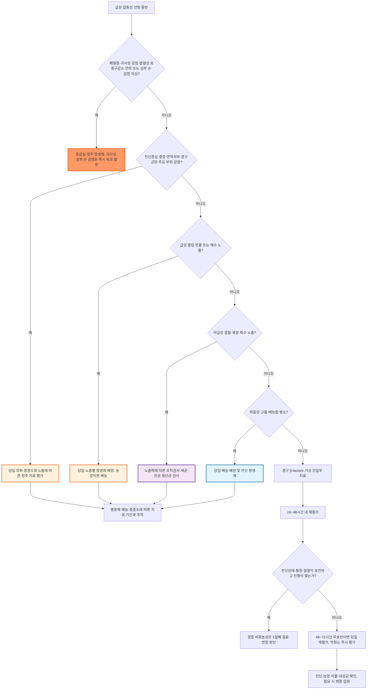

# 급성 세균성 림프관염 Acute Bacterial Lymphangitis

## <mark style="color:green;">일반 사항</mark>

* 피부 장벽 손상이나 원위부 피부·연조직 감염에서 세균이 표재 림프관을 따라 근위부로 확산하면서 발생하는 급성 염증
* 전형적으로 원발 병소에서 소속 림프절 방향으로 빠르게 진행하는 압통성 선형 홍반을 보이며, 연조직염과 동반되는 경우가 많음.
* 이 챕터는 **급성 세균성 림프관염**을 다룸. 만성·아급성 림프관염 및 결절성 림프관염은 원인·검사·치료가 다르므로 구분함.
* 합병증 : 국소 농양, 균혈증·패혈증, 반복 발생 후 이차성 림프부종
* 정확한 인구 기반 유병률 자료는 제한적이며, 상처 감염이나 연조직염에 동반되어 발생하는 경우가 흔함.

## <mark style="color:green;">원인</mark>

* **Streptococcus pyogenes**(group A β-hemolytic streptococcus, GAS)가 가장 흔함.
* **Staphylococcus aureus**는 감염된 상처, 농양 또는 화농성 원발 병소가 있을 때 고려함.
* 전형적인 비화농성 감염에서는 MRSA가 흔하지 않음. 다만 관통상, 주사약물 사용, MRSA 감염·집락 병력, 다른 부위의 MRSA 감염, 화농성 병변 또는 전신염증반응이 있으면 MRSA 위험을 별도로 평가함.
* 국가 감시자료는 국내 내성 추세를 파악하는 참고자료이지만 외래 피부연조직감염의 원인균 분포를 직접 나타내지는 않음. 실제 경험적 치료에는 해당 지역·기관의 피부·연조직 검체 감수성 자료와 환자의 MRSA 위험인자를 우선 적용함.

### <mark style="color:orange;">위험 인자 및 진입부</mark>

* 찰과상, 열상, 자상, 수술 상처, 벌레 물림 및 피부 궤양
* 발가락 사이 무좀·짓무름, 습진, 피부 균열, 수두 등 피부 장벽 손상
* 림프부종, 정맥부전, 수술 또는 방사선치료 후 림프배액 장애
* 당뇨병, 비만, 장기간의 전신 steroid 사용, 항암치료 및 기타 면역저하
* 말초혈관 카테터, 주사약물 사용
* 동물·사람 물림, 민물·해수 노출 등 특수 노출

## <mark style="color:green;">임상 양상</mark>

### <mark style="color:orange;">국소 소견</mark>

* 원발 상처나 피부감염에서 소속 림프절 방향으로 이어지는 불규칙하고 선형인 발적, 열감 및 압통
* 소속 림프절의 압통과 종대
* 주변 연조직염과 부종이 동반될 수 있음.
* **파동성 또는 화농성 분비물은 림프관염 자체의 전형적 소견이 아니라 동반 농양이나 화농성 원발 병소를 시사함.** 이 경우 배농 가능성을 우선 평가함.

### <mark style="color:orange;">전신 소견</mark>

* 발열, 오한, 권태감, 식욕 저하
* 두통, 근육통, 빈맥
* 피부소견이 작아 보여도 전신 증상이 더 빠르고 심하게 나타날 수 있음.

### <mark style="color:$danger;">🚩 Red Flags!</mark>


**즉각 조치**

즉시 응급실·관련 전문과 평가와 필요한 정주 항생제 치료를 시행함. 괴사성 감염·심부 손 감염은 신속히 외과·수부외과 평가를 받도록 하며 영상검사 때문에 수술적 평가를 지연하지 않음

* 저혈압, 의식 변화, 빈호흡 등 혈역학적 불안정·장기기능장애를 시사하는 전신독성  `패혈증`
* 피부소견에 비해 현저히 심한 통증 또는 시간 단위의 급속한 진행  `괴사성 감염`
* 수포·괴사·반상출혈·염발음 또는 피하기종  `조직 괴사·가스`
* 호중구감소 환자의 발열 또는 전신상태 저하  `호중구감소성 감염`
* 안구운동통·시력저하·복시·안구돌출 등 눈 주위 감염의 안와 침범 소견  `안와 감염`
* 심부 손 감염·급성 화농성 굴곡건초염·화농성 관절염 또는 구획증후군 의심  `심부 손 응급질환`



**당일~수일 내 평가**

아래 급성 감염은 당일 평가함. 배농·항생제 투여·경구 수분 섭취·추적이 외래에서 어렵거나 전신증상이 뚜렷하면 의뢰·입원을 고려함. 새 응급소견은 즉각 조치로 전환함

* 고열·오한을 동반한 근위부 진행  `전신증상·진행성 감염`
* 발열·전신상태 저하가 없는 중증 면역저하 또는 호중구감소증의 감염  `고위험 숙주`
* 손가락 운동 제한 또는 눈·코 주변 감염, 단 즉각 조치 소견은 없음  `주요 부위 감염`
* 동물·사람 물림, 민물·해수 노출  `특수 노출`
* 주사약물 사용과 함께 심부농양·균혈증 의심 또는 경구 섭취 불가  `복잡성 감염·경구 곤란`
* 파동성·고름 등 배농할 병소  `농양`
* 경구 항생제 시작 48–72시간에 호전이 시작되지 않는 상태  `항생제 무반응`



**조기 평가 및 추적**

경증 외래 환자도 24–48시간 내 재평가함. 전신상태·통증·발열이 호전하고 확산이 멎으면 경구 치료를 지속하고 5일째 종료·연장 여부를 판단함. 잔여 홍반만으로 실패를 판단하지 않으며, 48–72시간 무호전은 당일 재평가로 전환함

* 안정된 경증 외래 환자의 초기 치료 경과  `초기 추적`
* 전신상태·통증·발열이 호전하고 확산이 멎은 상태  `치료 반응`


## <mark style="color:green;">진단</mark>

* 전형적인 급성 세균성 림프관염은 병력과 진찰로 진단함.
* 원발 병소, 진행 방향, 소속 림프절, 농양 여부와 감염 범위를 확인하고 활력징후 및 전신 상태를 평가함.
* 하지 병변에서는 발가락 사이 균열·인설·짓무름과 무좀을 확인함.
* 병변의 외곽을 일회용 피부용 마커로 표시하거나 사진으로 기록하면 진행 여부를 판단하는 데 도움이 됨. 상처·벗겨진 피부 위에는 표시하지 않음.

### <mark style="color:orange;">검사</mark>

* **전형적인 경증 환자 :** CBC, 혈액배양 또는 피부 흡인·면봉배양을 일률적으로 시행하지 않음.
* **CBC, CRP 등 :** 전신 증상, 중등증 이상, 면역저하 또는 입원 여부를 판단할 때 선택적으로 시행함.
* **혈액배양 :** 고열·저혈압 등 중증 전신 소견, 항암치료·호중구감소증, 중증 세포매개면역저하, 동물 물림 또는 물 노출에서 고려함. 가능하면 항생제 투여 전에 채취하되, 패혈증이나 중증 감염에서는 배양 때문에 항생제 투여를 지연하지 않음.
* **창상·농 배양 :** 배농할 고름이나 임상적으로 의미 있는 삼출물이 있을 때 시행함. 정상 피부를 면봉으로 문지른 검체는 진단 가치가 낮음.
* **초음파 :** 농양이 의심되지만 진찰만으로 불확실하거나 표재성 혈전정맥염·DVT 감별이 필요할 때 고려함.
* **CT/MRI :** 심부 감염이나 괴사성근막염이 의심될 때 고려하되, 응급 외과 평가를 지연시키지 않음.
* **LRINEC score**(CRP, WBC, Hb, Na, Cr, glucose 기반)는 괴사성근막염 조기 감별에 보조적으로 활용될 수 있으나 민감도가 낮아, 임상적 의심이 높으면 점수와 무관하게 외과 협진을 진행함.
* Lymphangiography는 급성 세균성 림프관염의 통상적 진단검사가 아님. 만성 림프부종 평가는 별도의 전문 진료 영역임.

### <mark style="color:orange;">감별 진단</mark>

<table><thead><tr><th width="175">질환</th><th>감별 단서</th></tr></thead><tbody><tr><td>연조직염·단독</td><td>경계가 불명확하거나 비교적 선명한 면상 홍반이 중심이며, 림프관염이 동반될 수 있음.</td></tr><tr><td>피부농양</td><td>국소 파동성, 중심부 고름·배액; 절개배농이 치료의 핵심</td></tr><tr><td>표재성 혈전정맥염</td><td>표재정맥을 따라 만져지는 단단한 압통성 cord; 필요 시 혈관초음파</td></tr><tr><td>접촉피부염·절지동물 반응</td><td>가려움이 두드러지고 노출 모양과 일치; 발열·소속 림프절염은 흔하지 않음</td></tr><tr><td>결절성 림프관염</td><td>수일\~수주에 걸쳐 근위부 방향으로 불연속적인 결절이나 궤양이 발생; 특수 노출력 확인</td></tr><tr><td>고양이할큄병</td><td>고양이 접촉 후 접종 부위 구진과 아급성 소속 림프절염; 전형적 급성 선형 림프관염과 구분</td></tr><tr><td>림프관성 종양 침범</td><td>항생제에 반응하지 않는 지속성·재발성 병변, 암 병력 또는 비전형적 분포</td></tr><tr><td>괴사성근막염</td><td>피부소견보다 심한 통증, 빠른 진행, 전신 독성, 수포·괴사·반상출혈·염발음 또는 피하기종</td></tr></tbody></table>

### <mark style="color:orange;">결절성 림프관염의 노출력</mark>

<table><thead><tr><th width="195">노출</th><th>주요 병원체</th><th>접근</th></tr></thead><tbody><tr><td>장미가시·식물·흙, 감염된 고양이</td><td><em>Sporothrix</em> spp.</td><td>진균배양 또는 조직검사 고려</td></tr><tr><td>어항·물고기·기수</td><td><em>Mycobacterium marinum</em></td><td>항산균배양; 낮은 배양온도 필요 여부를 검사실에 알림</td></tr><tr><td>토양 접종</td><td><em>Nocardia</em> spp.</td><td>조직·배양검사 고려</td></tr><tr><td>중남미 등 유행지역 여행</td><td><em>Leishmania</em> spp.</td><td>감염내과·피부과 의뢰 및 특이검사</td></tr><tr><td>야생동물·진드기 노출</td><td><em>Francisella tularensis</em></td><td>의심 시 검사실과 감염내과에 미리 알림</td></tr></tbody></table>

> 결절성 림프관염은 일반적인 amoxicillin이나 cephalexin에 반응하지 않을 수 있음. 반복적인 경험적 β-lactam 투여보다 노출력에 따른 조직검사·세균·진균·항산균 검사를 우선함.

***



<p align="center"><strong>진단 및 치료 알고리듬</strong></p>

<p align="center"><em><mark style="color:$info;">Ref. 질병관리청 2026 피부·연조직 감염 실무지침; IDSA SSTI (2014); CDC GAS Cellulitis (2025); NICE NG141</mark></em></p>

***

## <mark style="background-color:$warning;">Management</mark>


**단계별 접근**: 응급 소견(괴사성근막염·패혈증) 배제 → 배농이 필요한 화농성 병소 확인 → 특수 노출·결절성 병변 감별 → 중증도에 따른 항생제 선택 → 24\~48시간 재평가


## <mark style="color:green;">비-약물 치료 및 예방</mark>

* 원발 상처를 세척하고 이물이나 괴사조직을 제거함.
* 농양이 있으면 절개배농을 우선함.
* 환부를 심장보다 높게 거상하고 무리한 사용을 줄임.
* 발가락 사이 무좀·짓무름, 습진, 궤양, 부종 및 정맥부전 등 진입부와 재발 요인을 함께 치료함.
* 동물·사람 물림이나 오염된 상처에서는 파상풍 예방접종 상태를 확인하고, 동물 노출에 따라 광견병 예방 필요성을 평가함.
* 상처 관리, 피부 보습, 무좀 치료 및 림프부종 관리로 재발 위험을 줄임.
* 고름·삼출물이 있는 상처에서는 손 위생을 철저히 하고, 수건·면도기 등 피부에 닿는 개인 물품은 다른 사람과 공유하지 않음. 비화농성 림프관염 자체가 일상적 접촉으로 전파되는 것은 아님.

## <mark style="color:green;">약물 치료</mark>

### <mark style="color:orange;">항생제 선택 원칙</mark>

* 전형적인 경증 비화농성 림프관염은 GAS를 표적으로 하는 경구 β-lactam으로 치료함. 림프관염 자체의 직접 근거는 제한적이므로 동반 연조직염·단독 지침을 임상상에 맞춰 적용함.
* NICE는 림프관염을 병원 의뢰 또는 전문가 자문 고려 대상으로 제시함. 안정된 경증 환자를 외래 치료할 때에도 빠른 진행·심부감염 가능성을 확인하고 24\~48시간 내 재평가가 가능해야 함. <mark style="color:$info;">Ref. NICE NG141</mark>
* 넓은 면상 연조직염·감염창이 동반되거나 MSSA도 고려해야 하면 cephalexin 등 1세대 cephalosporin을 우선 고려함. 질병관리청 2026 지침은 일반 연조직염에서 연쇄구균·MSSA를 함께 포괄하고, amoxicillin은 단독(erysipelas) 또는 연쇄구균 중심 감염에 제시함. <mark style="color:$info;">Ref. 질병관리청 2026</mark>
* 단순 선형 발적만으로 MRSA 치료제를 일률적으로 추가하지 않음.
* 물림, 물 노출, 결절성 병변은 병원체 범위가 다르므로 아래의 일반 요법만 적용하지 않음.
* **국내 2026 및 IDSA·CDC 연조직염 지침을 적용한 경증 비화농성 사례는 5일을 기본**으로 하되, 5일째 호전이 불충분하면 진단·농양·병원체를 재평가하고 흔히 7\~10일로 연장함. 중증·균혈증·농양·특수 노출은 병원체와 감염 범위에 따라 기간을 따로 결정함.
* 5일 기본 요법은 이 챕터의 경증 비화농성 감염에 적용함. 세균성 수유 유방염의 10–14일 요법과는 대상 질환·근거가 다르며 서로 대체하지 않음. 정주에서 경구로 바꿀 때는 유효한 정주 치료 일수를 합산하고 경구 전환일부터 기간을 새로 시작하지 않음
* 호전 판단은 발열·통증·전신상태와 확산 중단을 함께 봄. 치료 초기 24\~48시간에는 염증이 일시적으로 더 뚜렷해질 수 있고, 홍반·부종이 완전히 없어지는 데는 더 오래 걸림. 잔여 홍반만으로 항생제를 변경·연장하지 않되, 급속한 확산·심한 통증·전신 악화는 즉시 재평가함.


**Cephalexin 용법 - 제품 허가와 국내·국외 지침을 구분하여 적용**\
국내 팔렉신 허가는 성인 1일 1\~4 g, 통상 500 ㎎ bid\~tid이며 중증도에 따라 증량 가능함. 질병관리청 2026 연조직염 지침과 국제 지침은 500 ㎎ qid를 제시함. 이 챕터의 표·처방례는 qid로 통일함. 이는 국내 허가의 1일 용량 범위에도 포함되므로 일률적으로 허가 외 용량이라고 해석하지 않음. 국내 허가는 대부분의 급성 감염에서 증상 소실 후 최소 2일 추가 투여를 기술하므로 5일 기본 지침과 함께 임상 반응을 판단함.


<table><thead><tr><th width="145">상황</th><th width="265">성인 예시 용법</th><th>주요 고려사항</th></tr></thead><tbody><tr><td>전형적 경증 비화농성<br/>GAS 중심</td><td>Amoxicillin 500 ㎎ tid × 5일<br/><mark style="color:blue;">\[파목신캡슐 500 ㎎]</mark></td><td>국내 허가 용법은 1회 250\~500 ㎎, 1일 3회. 화농성 병소나 S. aureus 가능성이 높으면 단독 선택을 재검토함.</td></tr><tr><td>경증, MSSA도 고려</td><td>Cephalexin 500 ㎎ qid × 5일<br/><mark style="color:blue;">\[팔렉신캡슐 500 ㎎]</mark></td><td>국내 통상 용법은 500 ㎎ bid\~tid, 1일 1\~4 g 범위. 국내 2026 연조직염 지침의 500 ㎎ qid를 예시로 제시함. 신기능에 따라 용량·간격을 조정함.</td></tr><tr><td>정주 치료가 필요한<br/>일반 비화농성 감염</td><td>Cefazolin 2 g IV q8h<br/>(정상 신기능 성인 예시)</td><td>국내 2026 지침의 정주 선택지. 신기능에 따라 조정함. Ampicillin/sulbactam 또는 nafcillin도 임상상에 따라 고려함. MRSA·특수 노출은 별도 치료</td></tr><tr><td>1일 1회 주사가 필요한<br/>선택적 대안</td><td>Ceftriaxone 1\~2 g IV/IM q24h<br/><mark style="color:blue;">\[대화세프트리악손주 1 g]</mark></td><td>CDC가 제시하는 정주 선택지이며, 단순 비화농성 감염에서 좁은 범위 약제를 사용할 수 있으면 이를 우선함. <strong>단회 치료가 아님.</strong> 매일 재평가하고 호전 시 경구제로 전환함. 중증 환자의 입원 치료를 단순 외래 주사로 대체하지 않음.</td></tr><tr><td>비중증 지연형<br/>penicillin 알레르기</td><td>Cephalexin 고려</td><td>단순 발진과 즉시형·중증 지연형 반응을 구분함. Ampicillin 등과 cephalexin의 유사 측쇄로 교차반응할 수 있어 알레르기 원인약을 확인함. 즉시형 또는 중증 지연형 병력이면 경험적으로 선택하지 말고 전문가와 대안을 결정함.</td></tr><tr><td>즉시형 중증<br/>β-lactam 알레르기</td><td>Clindamycin을 지역 감수성과<br/>국내 허가사항에 따라 제한적으로 고려</td><td>Azithromycin을 일률적인 대체약으로 사용하지 않음. 감수성 자료가 불확실하면 대안을 전문가와 협의함. 중증·빠른 진행·경구 치료 부적합이면 입원하여 vancomycin 등 MRSA·연쇄구균 활성 약제를 결정함. 알레르기나 감수성 자료 부재만으로 모두 입원시키지는 않음.</td></tr><tr><td>MRSA 위험 동반 감염<br/>또는 중증 감염</td><td>MRSA·streptococcus 활성 약제 선택<br/>중증이면 입원·vancomycin 등 정주 치료</td><td>관통상, 주사약물 사용, MRSA 병력·집락, 다른 부위 MRSA 감염 또는 전신염증반응을 확인함. MRSA 위험만으로 입원을 결정하지 않고 중증도에 따라 경구 또는 정주 치료를 선택함. 경증에서 TMP/SMX·doxycycline을 선택하면 연쇄구균 치료를 위해 β-lactam 병용을 고려함. 중증 면역저하나 괴사성 감염 의심 시 더 넓은 경험적 치료가 필요함.</td></tr></tbody></table>


**Clindamycin 제품 허가와 국내·국외 지침의 차이**\
국내 <mark style="color:blue;">\[훌그램캡슐 150 ㎎]</mark> 허가 용법은 중증감염 150 ㎎ q6h, 심한 중증감염 300\~450 ㎎ q6h이며, β-용혈성 사슬알균 감염은 최소 10일 이상 계속 투여하는 것이 바람직하다고 기재함. 국내 2026 및 국제 비화농성 cellulitis 지침의 5일 기본 원칙과 차이가 있으므로 제품 허가사항, 중증도 및 감수성 자료를 함께 고려함. 이 문서에서는 일률적인 clindamycin 처방례를 제시하지 않음.



**⚠️ 특수 노출 항생제 분기**

* **동물·사람 물림 :** 호기성·혐기성균을 함께 포괄하는 amoxicillin/clavulanate(경구) 또는 ampicillin/sulbactam(정주)
* **민물 노출(*Aeromonas*) :** fluoroquinolone 또는 감수성이 있는 3세대 cephalosporin 등을 임상상과 배양 결과에 따라 선택함. 단순 amoxicillin·1세대 cephalosporin으로 치료하지 않음. **괴사성 감염**에는 국내 2026 지침의 ciprofloxacin 또는 cefotaxime/ceftriaxone과 doxycycline 병합 등을 감염내과·외과와 결정함. <mark style="color:$info;">Ref. 질병관리청 2026</mark>
* **해수 노출(*Vibrio*, 특히 *V. vulnificus*) :** doxycycline 100 ㎎ PO/IV bid + ceftazidime 1\~2 g IV/IM q8h가 CDC의 대표 권고이며 통상 7\~14일을 제시함. 대안으로 3세대 cephalosporin + fluoroquinolone 또는 fluoroquinolone 단독을 고려함.

간질환·면역저하 환자에서 *V. vulnificus* 감염은 급속히 진행하는 괴사성 병변과 패혈증으로 이어질 수 있어 의심 시 즉시 응급 평가·항생제와 외과적 감염원 통제가 필요함. 배양 결과나 협진을 기다리며 치료를 지연하지 않음. <mark style="color:$info;">Ref. CDC Vibriosis</mark>



**⚠️ Clindamycin 내성자료의 적용 한계**\
미국 침습성 GAS 감시자료에서는 erythromycin·clindamycin 내성이 증가하고 있으나, 이를 국내 비침습성 피부·림프관 감염의 내성률로 직접 적용할 수 없음. 이 챕터가 다루는 비화농성 GAS 중심 감염에서는 TMP-SMX 단독의 연쇄구균 활성이 불확실함. 즉시형 중증 β-lactam 알레르기이면서 중증 감염이면 입원하여 vancomycin 또는 linezolid 등 대안을 감염내과와 결정함.



**경구 MRSA 약제를 선택할 때의 국내 제한**

TMP/SMX(셉트린)의 피부·연조직 감염 치료는 국내 허가 외 사용이며 임부·임신하고 있을 가능성이 있는 여성·수유부·G6PD 결핍 등에 금기임. **Methotrexate와 병용하지 않음**. CrCl 15–30 ㎖/min은 통상 용량의 1/2, 15 ㎖/min 이하는 투여가 권장되지 않으며 혈중 농도 모니터링이 불가능한 중증 신부전은 금기임. 신기능·K와 ACEi/ARB·spironolactone·warfarin 등 병용약을 확인함

Doxycycline 국내 품목(예: 신일모노독시엠)의 피부·연조직 감염 치료도 허가 외 사용임. 임부·수유부, 통상적 치료에서 12세 미만 소아, 신부전·중증 간기능 이상·중증 근무력증·레티노이드 병용 금기를 적용함. 일반 경증 림프관염에 이 약제들을 일률적으로 추가하지 않음

<mark style="color:$info;">Ref. 셉트린·신일모노독시엠 국내 품목정보.</mark>


### <mark style="color:orange;">정주 치료 후 경구 전환</mark>

* 정주 치료 시작 후 48시간 이내 첫 전환 평가를 하고 이후 매일 재평가함. 활력징후가 안정되고, 24시간 이상 해열되며, 통증·홍반이 감소하거나 확산이 멎고 경구 섭취·흡수가 가능하면 경구 전환을 고려함. 균혈증·심부감염은 별도 판단함. CRP·WBC의 정상화만을 기다리지 않음. <mark style="color:$info;">Ref. 질병관리청 2026</mark>
* Ceftriaxone은 칼슘 함유 수액과 혼합·동시 투여하지 않으며 제품별 희석·투여법을 준수함. 리도카인으로 용해한 근육주사용 용액을 정주하지 않음.

### <mark style="color:orange;">신기능·임신·소아 고려</mark>

* **신기능 저하 :** 투여 전 신기능을 확인하며, 이하 수치는 국제 허가자료의 성인·비투석 예시로 국내 제품 및 기관 용량표와 함께 적용함. Amoxicillin은 GFR 10\~30 mL/min에서 250\~500 ㎎ q12h, ＜10 mL/min에서 감염 중증도에 따라 250\~500 ㎎ q24h로 조정함. Cephalexin은 CrCl 30\~59 mL/min에서 1일 최대 1 g, 15\~29 mL/min에서 250 ㎎ q8\~12h, 5\~14 mL/min에서 250 ㎎ q24h가 미국 허가자료의 예시임. 국내 팔렉신 허가는 CrCl ≤10 mL/min에서 별도 감량을 명시하므로 **10 mL/min 이하에서만 감량이 필요하다는 뜻으로 해석하지 않음**. 투석 환자는 투석 방식·투여 시점을 따로 확인하며, 250 ㎎ 용량이 필요하면 해당 함량·액제를 확보하거나 대체약을 선택함. 500 ㎎ 캡슐의 내용물을 임의로 반으로 나누지 않음. Ceftriaxone은 1일 2 g 이하 용량에서는 신장애 단독일 때 통상 감량하지 않지만, 중증 신장애와 간기능장애가 함께 있으면 2 g/day를 초과하지 않고 면밀히 모니터링함.
* **임신 :** Amoxicillin, cephalexin은 임상적으로 임신 중 흔히 선택하는 β-lactam이며 국내 허가의 유익성·위험 평가 원칙을 따름. 국내 훌그램 허가사항은 임부·임신하고 있을 가능성이 있는 여성에게 투여하지 않는 것이 바람직하다고 기재하므로, 임신 중 임의 대체약으로 선택하지 않고 전문가와 결정함. Doxycycline 등 tetracycline 계열은 임신 중 피함.
* **수유 :** Amoxicillin, cephalexin은 대체로 수유 중 사용할 수 있음. 국내 <mark style="color:blue;">\[훌그램캡슐]</mark> 허가사항은 clindamycin의 모유 이행과 신생아 이상반응 가능성 때문에 수유하지 않도록 규정함. 이는 수유 지속을 허용하는 일부 국제 자료와 차이가 있음. TMP/SMX도 국내 셉트린정 허가에서는 수유부 금기이므로 국제 지침만 보고 수유부에게 일률 적용하지 않음.
* **소아 :** 연령에 맞는 시럽·현탁액을 선택하고 해당 제품의 조제 후 농도와 실제 mL를 확인함. 국내 <mark style="color:blue;">\[파목신]</mark> 허가 기준은 체중 20 ㎏ 미만에서 amoxicillin 20\~40 ㎎/㎏/day를 tid로 분할하고, 20 ㎏ 이상에서는 성인 용법인 1회 250\~500 ㎎ tid를 적용함. <mark style="color:blue;">\[팔렉신]</mark>은 25\~50 ㎎/㎏/day를 qid로 분할하며, 중증 또는 감수성이 낮은 경우 50\~100 ㎎/㎏/day를 qid로 분할함. 성인 최대 용량을 넘지 않음.

### <mark style="color:orange;">해열·진통제</mark>

* Acetaminophen을 우선 고려하며, NSAID는 해당 제품의 금기·위험을 평가하여 선택적으로 단기간 사용함
* **Acetaminophen 일반정 :** 500\~1,000 ㎎ q6\~8h 필요 시 <mark style="color:blue;">\[타이레놀정 500 ㎎]</mark>. 이 챕터에서는 1일 3,000 ㎎ 이내로 사용하며, 건강한 성인의 국내 허가 최대량은 4,000 ㎎/d임. 저체중·영양불량·간질환·과음에서는 한도를 낮추고, 중증 간장애 등 국내 금기 및 삼환계 항우울제·바르비탈계 약물 병용 금기를 확인함. 감기약·복합진통제의 acetaminophen까지 합산함.
* **Acetaminophen 650 ㎎ 서방정 :** 2정 q8h로 사용하는 제품은 1일 6정을 초과하지 않음. 일반정 용법과 혼동하지 않음.
* **Ibuprofen :** 200\~400 ㎎ tid 필요 시 <mark style="color:blue;">\[부루펜정 200 ㎎]</mark>. 통증이 심하거나 악화하면 우선 감염 진행·농양·괴사성 감염을 재평가하며 진통제만 증량하지 않음.
* **Dexibuprofen :** 300 ㎎ bid\~tid 필요 시 <mark style="color:blue;">\[애니펜정 300 ㎎]</mark>. 국내 허가는 300 ㎎ 1일 2\~4회, 최대 1,200 ㎎/d임. Ibuprofen이나 다른 NSAID와 병용하지 않음.
* **NSAID 금기·주의 :** 국내 부루펜은 위장관 궤양·출혈 또는 그 병력, 기관지천식 또는 그 병력, NSAID 과민반응, 중증 신장·간·심장 장애 및 심한 고혈압 등이 금기임. 애니펜도 위장관 궤양·재발 병력, 출혈, 천식 병력 및 중증 장기장애 등이 금기임. 금기 환자에게 단순히 감량하여 사용하지 않음. 탈수·신기능 저하, 고령, 항응고제 복용에서는 위험을 별도로 평가함.
* **임신·수유와 NSAID :** 임신 약 20주 이후에는 태아 신기능·양수 감소 위험으로 원칙적으로 회피함. 국내 부루펜은 임신 말기 3개월, 애니펜은 임신 6개월 이상에서 금기임. 두 제품 모두 국내 허가에 수유 또는 약물 투여를 중단하도록 기재되어 있으므로 임신·수유 중에는 대체약과 치료 계획을 결정함. Ibuprofen을 수유 중 선호약으로 평가하는 LactMed와 국내 허가의 차이를 구분함. <mark style="color:$info;">Ref. 식약처 품목정보; LactMed—Ibuprofen</mark>

***

### <mark style="color:red;">질병코드</mark>

**⚠️ I89.1은 급성 세균성 림프관염에는 사용하지 않음.** 급성은 병변 위치에 따라 L03.- 하위 코드를 사용함.

<table><thead><tr><th width="125">코드</th><th>분류</th></tr></thead><tbody><tr><td><mark style="color:red;">L03.-</mark></td><td>연조직염 및 급성 림프관염. 병변 위치에 따라 세부 코드를 선택함.</td></tr><tr><td>L03.0</td><td>손가락 및 발가락의 연조직염·급성 림프관염</td></tr><tr><td>L03.1</td><td>사지 기타 부분의 연조직염·급성 림프관염</td></tr><tr><td>L03.2</td><td>얼굴의 연조직염·급성 림프관염</td></tr><tr><td>L03.3</td><td>몸통의 연조직염·급성 림프관염</td></tr><tr><td>L03.8</td><td>기타 부위의 연조직염·급성 림프관염</td></tr><tr><td>L03.9</td><td>상세불명의 연조직염·급성 림프관염</td></tr><tr><td>I89.1</td><td>만성·아급성·상세불명 림프관염. <strong>급성 세균성 림프관염에는 사용하지 않음.</strong></td></tr></tbody></table>

***

## <mark style="color:purple;">처방례</mark>

✽ 성인·정상 신기능 예시임. 처방례 1·2의 NSAID는 **비임신·비수유이며 해당 제품의 금기가 없는 환자**에 한해 사용함. 금기 또는 고위험이면 진통제를 개별 선택하며, 항생제 용량은 신기능에 따라 조정함.

> **처방례 1. 전형적 경증 비화농성**
>
> ```
> 파목신캡슐 500 ㎎  1C  tid × 5일
> 부루펜정  200 ㎎  2T  tid × 3일, 통증·발열 시
> ```
>
> _✽Amoxicillin 500 ㎎ tid로 GAS를 표적. 24\~48시간 내 재평가하며, 화농성 병소나 S. aureus 가능성이 높으면 약제 선택을 재검토함._

> **처방례 2. 감염된 상처, MSSA 동반 가능성**
>
> ```
> 팔렉신캡슐 500 ㎎  1C  qid × 5일
> 애니펜정  300 ㎎  1T  tid × 3일, 통증·발열 시
> ```
>
> _✽Cephalexin 500 ㎎ qid는 국내 2026 연조직염 지침 용법이며 1일 총량은 2 g임. 24\~48시간 내 재평가하고 5일째 종료·연장 여부를 판단함. Dexibuprofen은 ibuprofen과 병용하지 않음._

> **처방례 3. 정주 치료가 필요하고 1일 1회 투여를 선택한 성인**
>
> ```
> 대화세프트리악손주 1 g/V  1~2V  IV/IM  q24h
> ```
>
> _✽Ceftriaxone은 단회 치료가 아님. 일반 비화농성 감염에서는 cefazolin 등 더 좁은 범위의 정주 약제를 우선 고려함. 입원 필요성을 먼저 판단하고, 외래 정주 치료는 안정적이며 매일 평가가 가능한 환자에서 선택함. 48시간 이내 경구 전환 가능성을 평가함._

***

### <mark style="color:$success;">핵심 복약 지도</mark>

> **항생제 복용 원칙**
>
> * 정해진 간격과 기간(전형적인 경증에서는 5일 기본)을 지키도록 안내합니다. 5일째 호전이 불충분하면 7\~10일까지 연장할 수 있습니다.
> * Amoxicillin, cephalexin은 음식과 관계없이 복용할 수 있습니다.
> * 남은 항생제를 임의로 재사용하거나 타인과 나누지 않도록 안내합니다.

> **재평가 시점**
>
> * 24\~48시간 이내 반드시 임상 경과를 확인합니다. 악화 시 예정된 방문일까지 기다리지 않습니다.
> * 48\~72시간에 호전이 시작되지 않으면 진단, 순응도, 농양·이물, 결절성 림프관염 가능성, 항생제 내성균을 재평가합니다. 초기의 가벼운 홍반 증가나 남아 있는 홍반만으로 치료 실패를 판단하지 않습니다.
> * ⚠️ **괴사성근막염·패혈증이 의심되면 영상검사 결과를 기다리느라 외과적 평가를 지연하지 않습니다.**

> **부작용 모니터링**
>
> * 항생제 복용 후 호흡곤란, 얼굴·입술 부종, 전신 두드러기 → 즉시 중단, 응급 진료
> * 심한 설사, 혈변, 지속되는 복통 → 항생제 관련 장염 가능성 평가
> * Ibuprofen과 dexibuprofen은 같은 계열의 NSAID이므로 함께 복용하지 않도록 안내합니다. 위장관 출혈·검은 변·소변량 감소가 생기면 중단하고 진료받도록 안내합니다. 임신·수유 중임을 미리 알리도록 안내합니다.

> **언제 다시 병원을 방문해야 하나요?**
>
> * 24\~48시간 이내 예정된 재평가
> * 48\~72시간에 호전이 시작되지 않는 경우 - 당일 재방문
> * 통증·발열·전신상태가 악화하거나 빠르게 번지는 경우 - 예정된 재진일까지 기다리지 않음
> * 고름, 물렁한 덩이가 만져지는 경우 - 배농 필요성 평가
> * 손의 심한 통증·운동 제한 - 심부 감염이면 즉시 응급 평가; 눈·코 주변 병변, 동물·사람 물림, 경구 섭취 불가 - 당일 재평가

***

### <mark style="color:blue;">환자 안내서</mark>


**급성 림프관염, 항생제와 함께 상처·피부 관리가 중요합니다**

상처나 피부감염에서 세균이 림프관을 따라 퍼지면서 붉고 아픈 선이 생기는 질환입니다. 대부분 경구 항생제로 호전되지만, 정해진 기간을 지켜 복용하고 정해진 날짜에 다시 진료받는 것이 중요합니다.


#### <mark style="color:$primary;">왜 이런 증상이 생기나요?</mark>

* 상처나 무좀 등으로 피부 장벽이 손상되면 세균이 표재 림프관을 따라 몸 중심부 또는 소속 림프절 방향으로 퍼지면서 붉은 선, 통증, 발열이 나타납니다. 붉은 선 자체가 곧 패혈증을 뜻하는 것은 아니지만 빠르게 진행하거나 전신 증상이 생기면 신속한 평가가 필요합니다.

#### <mark style="color:$primary;">일상생활에서 어떻게 관리하나요?</mark>

* **팔·다리를 심장보다 높게 올리십시오.** 부기와 통증을 줄이고 회복을 돕습니다.
* **상처를 깨끗이 씻고 적절한 드레싱으로 덮으십시오.** 드레싱이 젖거나 오염되면 교체하십시오.
* **번진 부위의 가장자리를 피부용 마커로 표시하거나 사진을 찍어두십시오.** 상처나 벗겨진 피부 위에는 펜을 대지 마십시오. 다음 진료 때 퍼지는 속도를 비교하는 데 도움이 됩니다.
* **무좀, 습진 등 피부 문제를 함께 치료하십시오.** 재발을 막는 가장 중요한 방법입니다.

#### <mark style="color:$primary;">항생제는 어떻게 복용하나요?</mark>

* 처방받은 간격과 기간(전형적인 경증에서는 보통 5일)을 지켜 복용합니다. 증상이 좋아져도 임의로 중단하지 않습니다.
* 이전에 처방받고 남은 항생제를 다시 사용하지 않습니다.

#### <mark style="color:$primary;">이럴 때는 즉시 응급실을 방문하세요</mark>

* 통증이 급격히 심해지거나 붉은 부위가 빠르게 퍼지는 경우
* 어지럼·실신·의식 저하·호흡곤란 등 전신상태가 나빠지는 경우
* 손가락이 심하게 붓고 구부린 채 펴기 어렵거나 움직일 때 극심한 통증이 있는 경우
* 물집이나 검붉은 변색, 피부가 벗겨지는 듯한 소견이 나타나는 경우

#### <mark style="color:$primary;">이럴 때는 당일 다시 진료받으세요</mark>

* 새 고열·오한이 생기는 경우
* 고름이 잡히거나 물렁한 덩이가 만져지는 경우(배농이 필요할 수 있음)
* 항생제를 시작하고 2\~3일이 지나도 좋아지기 시작하지 않는 경우
* 붉은 범위가 계속 넓어지거나 통증·발열이 악화되는 경우. 치료 첫날에는 피부 변화가 일시적으로 더 뚜렷해질 수 있으나 빠르게 번지면 기다리지 마십시오.
* 손의 심한 통증·운동 제한, 눈·코 주변 병변, 동물·사람 물림 또는 경구 섭취가 어려운 경우

## <mark style="color:green;">주요 참고문헌 및 확인 자료</mark>

### <mark style="color:orange;">임상 근거</mark>

1. 질병관리청. [2026 피부·연조직 감염 항생제 적정사용을 위한 실무지침](https://kdca.go.kr/bbs/kdca/55/306857/download.do). 단독·연조직염의 경험적 약제·용량, 5일 기본 치료, 정주·경구 전환 및 특수 노출 감염에 참고함. 급성 림프관염에 직접 시행한 임상시험과 구분하여 적용함.
2. Stevens DL, et al. [Practice Guidelines for the Diagnosis and Management of Skin and Soft Tissue Infections: 2014 Update by the IDSA](https://www.idsociety.org/practice-guideline/skin-and-soft-tissue-infections/). *Clin Infect Dis*. 2014;59(2):e10–e52.
3. CDC. [Clinical Guidance for Group A Streptococcal Cellulitis](https://www.cdc.gov/group-a-strep/hcp/clinical-guidance/cellulitis.html). 2025.
4. NICE. [Cellulitis and erysipelas: antimicrobial prescribing, NG141](https://www.nice.org.uk/guidance/ng141/chapter/Recommendations). 림프관염의 의뢰·전문가 자문 고려, 2\~3일 무호전 및 언제든 악화 시 재평가에 참고함.
5. CDC. [Yellow Book 2026: Post-Travel Dermatologic Conditions—Lymphocutaneous or Sporotrichoid Spread of Infection](https://www.cdc.gov/yellow-book/hcp/post-travel-evaluation/post-travel-dermatologic-conditions.html). 2025년 공개된 2026판임.
6. CDC. [Clinical Overview of Vibriosis—Treating Wound Infection](https://www.cdc.gov/vibrio/hcp/clinical-overview/index.html).
7. 질병관리청. [제2기(2020–2022년) 국가 항균제 내성균 조사(Kor-GLASS) 운영 결과](https://kdca.go.kr/bbs/kdca/263/306528/download.do). *주간 건강과 질병*. 2024;17(24). 외래 피부연조직감염의 원인균·내성률로 직접 적용하지 않음.
8. Khan DA, et al. [Drug Allergy: A 2022 Practice Parameter Update](https://doi.org/10.1016/j.jaci.2022.08.028). β-lactam 알레르기 병력과 측쇄 교차반응 평가에 참고함.
9. National Library of Medicine. LactMed: [Clindamycin](https://www.ncbi.nlm.nih.gov/books/NBK501208/); [Ibuprofen](https://www.ncbi.nlm.nih.gov/books/NBK500986/). 국내 허가사항과 구분하여 적용함.

### <mark style="color:orange;">허가·급여 확인 자료</mark>

* 식품의약품안전처. [의약품안전나라](https://nedrug.mfds.go.kr/). 파목신캡슐 500 ㎎, 팔렉신캡슐 500 ㎎, 훌그램캡슐, 셉트린정, 신일모노독시엠캡슐, 부루펜정 200 ㎎, 애니펜정 300 ㎎, 타이레놀정 500 ㎎ 및 ceftriaxone 주사제의 품목정보에 참고함.
* National Library of Medicine. [DailyMed](https://dailymed.nlm.nih.gov/dailymed/). Cephalexin·amoxicillin 신장애 용량에 사용한 국외 허가자료이며 국내 제품 허가와 구분하여 적용함.
* WHO. [ICD-10 Version 2019](https://icd.who.int/browse10/2019/en). 급성 림프관염의 L03.- 분류 및 I89.1 제외 관계에 참고함.
