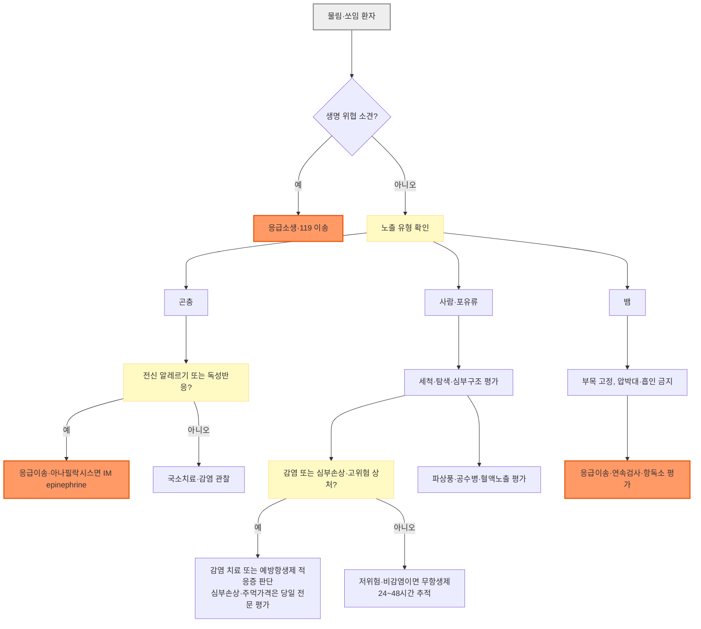

# 물림 Bites

## <mark style="color:green;">일반 사항</mark>

* 이 챕터는 곤충 물림·쏘임, 사람·동물 물림 및 뱀 교상을 다룸.
* 진료 시 손상 시각과 기전, 가해 동물, 발생 지역, 상처 깊이와 오염, 신경·혈관·힘줄·관절 손상, 기저질환, 파상풍 접종력 및 공수병 노출 가능성을 함께 평가함.
* 진드기·진드기매개감염 및 거미·해양동물 독성 손상은 해당 챕터의 원칙을 따름.

## <mark style="color:green;">임상 양상</mark>

* 곤충 물림·쏘임은 국소 가려움·홍반·부종부터 전신 아나필락시스·다수 쏘임의 독성반응까지 나타남
* 사람·동물 물림은 열상·천공·압궤와 심부구조 손상 및 감염이 문제이며, 뱀 교상은 국소 진행과 지연성 응고장애·전신 중독을 함께 평가함

### <mark style="color:$danger;">🚩 Red Flags!</mark>


**즉각 조치**

기도·호흡·순환을 안정화하고 즉시 119 요청·응급실 이송을 시행함. 아나필락시스는 IM epinephrine을 우선하며, 독사 가능 교상은 움직임을 최소화하고 항독소 평가가 가능한 기관으로 이송함.

* 기도부종, 천명·지속적 기침, 호흡곤란, 저혈압·실신 또는 급속한 전신반응; 벌 쏘임 후 심한 지속성 복통·반복 구토 포함  `아나필락시스`
* 구강·인두 쏘임 또는 진행하는 혀·목 부종  `기도 폐쇄 위험`
* 조절되지 않는 출혈, 쇼크·패혈증 또는 전신 독성을 동반한 급속 감염  `중증 출혈·패혈증`
* 혈관 손상·허혈, 개방골절, 구획증후군 또는 괴사성 연조직감염 의심  `사지 위협 손상·괴사성 감염`
* 심한 수동 신전 통증·건초를 따른 압통·손가락 굴곡 자세·방추형 부종 또는 급성 관절통·운동 제한을 동반한 감염  `화농성 건초염·화농성 관절염 의심`
* 안구·두개·기도를 침범한 물림 또는 심한 얼굴·목 손상  `주요 구조 손상`
* 모든 독사 가능 교상 또는 독사 여부를 확실히 배제할 수 없는 교상  `독사 교상 의심`
* 다수 쏘임 뒤 심한 근육통·갈색뇨·소변 감소 또는 전신상태 악화  `독액 독성·횡문근융해`



**당일~수일 내 평가**

아래 심부손상·감염·공수병 고위험 노출은 당일 평가함. 세척 후 수부외과·정형외과 또는 PEP 가능 기관·보건당국에 연계하며, 동물 관찰·검사 결과 때문에 필요한 PEP를 임의로 지연하지 않음.

* 주먹가격 손상 또는 힘줄·관절낭·골 침범 의심  `심부 물림 손상`
* 야생 포유류·박쥐·해외 유행지역 등 공수병 위험 노출  `공수병 PEP 평가`
* 손·발·얼굴·외음부 또는 골·관절·힘줄 인접 물림  `고위험 부위 물림`
* 새 감각저하·저림·운동 이상  `신경 손상 의심`
* 고양이·사람 물림, 깊은 천공·열상, 압궤·괴사조직 또는 이물·치아 조각 의심  `고위험 물림`
* 일차봉합 평가가 필요한 상처 또는 8시간 이상 지연된 고위험 상처  `복잡·지연 물림`
* 면역저하, 무비증·비장기능저하, 알코올사용장애·간경변 또는 조절되지 않는 당뇨병  `고위험 숙주`
* 눈·입 주위의 매우 큰 국소반응 또는 이차 세균감염 의심  `큰 국소반응·상처 감염`
* 항생제 시작 후 24~48시간 내 호전이 없거나 악화하는 상처  `치료 반응 부족`



**조기 평가 및 추적**

안정된 저위험 물림도 통상 24~48시간 내 감염·신경혈관 기능을 재평가함. 뱀 교상 퇴원 후에는 검사·관찰 계획을 지키고, 출혈·혈뇨·멍·부종 재진행 등 새 증상은 즉시 재내원 기준으로 안내함.

* 응급·당일 평가 소견이 없는 얕은 저위험 물림  `저위험 물림 추적`
* 전신반응·감염·기능장애가 없는 안정된 국소 가려움·홍반·부종  `단순 곤충 국소반응`
* 응급 평가·관찰 후 퇴원하여 연속검사 또는 항독소 반응 추적이 계획된 경우  `뱀 교상 퇴원 후 추적`


***


## <mark style="color:green;">진단</mark>

* 기도·호흡·순환과 아나필락시스·독성반응을 먼저 평가함. 전신 상태가 안정적이어도 손·얼굴·관절·신경혈관 손상 및 공수병 고위험 노출은 당일 평가함
* 노출 동물·부위·기전·시간, 감염 소견, 기저질환·복용약, 파상풍·공수병 접종력 및 혈액노출을 확인함. 검사는 의심되는 심부손상·감염·독성 증후군에 맞춰 선택함
* 급속한 가려움 중심 반응과 지연성 세균감염을 구분하되, 통증·전신상태·진행속도를 함께 평가함. 뱀 교상은 정상 초회 소견만으로 독 주입을 배제하지 않음

***



<p align="center"><strong>물림·쏘임 초기 평가 알고리듬</strong></p>

<p align="center"><em><mark style="color:$info;">Ref. NICE NG182/NG184; WHO Snakebite Envenoming Treatment; 질병관리청 2026년도 인수공통감염병 관리지침</mark></em></p>

***

## <mark style="background-color:$warning;">Management</mark>

### <mark style="color:green;">곤충 물림·쏘임 Insect Bites and Stings</mark>

#### <mark style="color:orange;">임상 양상</mark>

* 일반적인 국소반응 : 가려움, 구진, 홍반, 부종, 통증 또는 작은 수포가 수분\~수시간 내 발생하고 지연성 구진이 동반될 수 있음. 대개 수일 내 호전하지만 홍반·가려움은 약 10일까지 지속 가능
* 큰 국소반응(large local reaction) : 쏘이거나 물린 부위 주위의 부종이 10 ㎝를 초과하며 수시간에 걸쳐 확대되고, 보통 24~48시간에 가장 심해진 뒤 수일간 지속될 수 있는 알레르기성 국소반응
  * <mark style="color:red;">병변 크기만으로 세균감염으로 판단하지 않음.</mark>
  * 화농, 지속·진행하는 통증, 발열·전신증상 또는 시간 경과상 감염이 의심되면 이차 세균감염을 평가함. 열감·홍반이나 붉은 줄 모양의 비감염성 림프관 반응도 알레르기성 국소반응에서 나타날 수 있으므로 이 소견만으로 항생제를 처방하지 않음
* 전신 알레르기반응 : 전신 두드러기·혈관부종, 복통·구토, 호흡곤란, 저혈압·실신 등
* 다수의 벌에 집단으로 쏘인 경우에는 알레르기 병력이 없어도 독액 자체에 의한 용혈, 횡문근융해, 급성 신손상 및 응고장애 등 전신 독성반응(toxic reaction)이 발생할 수 있음. 횟수만으로 안전 여부를 판단하지 않으며, 소아·노인·기저질환자는 비교적 적은 횟수에서도 전신 독성이 발생할 수 있으므로 응급 평가를 고려함.

##### <mark style="color:$primary;">벌침 제거</mark>

* 벌침이 보이면 가능한 한 빨리 제거함. 카드로 긁어내거나 핀셋으로 뽑는 방법보다 제거 속도가 중요함.
* 비누와 물로 씻고 천으로 감싼 냉찜질을 10\~20분씩 시행함.
* <mark style="color:red;">압박대, 절개·흡인 및 물린 병소 내 epinephrine 주입은 시행하지 않음.</mark>

#### <mark style="color:orange;">약물 치료</mark>

※ 아래 경구 용량과 처방례는 성인 기준이며, 소아는 체중·연령과 제품 허가사항에 따라 조절함.

* 가려움 : cetirizine 10 ㎎ qd <mark style="color:blue;">\[지르텍]</mark> 등 비진정성 2세대 H1-항히스타민제
* 국소 염증 : 부위·연령에 맞는 역가의 외용 corticosteroid를 얇게, 보통 3\~5일 사용하며 제품별 도포 횟수를 따름
  * mometasone furoate 0.1% <mark style="color:blue;">\[모리코트 크림]</mark> : **1일 1회**; 국내 허가상 2세 이하 금기
  * desoximetasone 0.05% <mark style="color:blue;">\[데메타손 겔]</mark> : 제형·농도별 역가와 허가 용법을 확인함
  * 얼굴·눈꺼풀·피부주름에는 저역가 제제를 우선하며 안구·점막·궤양·감염 부위에 임의 도포하지 않음
* 매우 큰 국소반응으로 기능장애가 있는 경우에 한해 감염을 배제하고 prednisolone 30\~40 ㎎ qd를 3\~5일 고려함. 경구 steroid는 모든 큰 국소반응에 필요하지 않으며, 눈 주위 부종에서는 안와 감염·시력 이상을 먼저 평가함. <mark style="color:$info;">Ref. ASCIA Large Local Reactions</mark>
* 위 경구 steroid는 알레르기성 국소반응의 선택적 대증치료임. 165장의 세균성 연조직염 보조 steroid와 구분하며, 감염이 배제되지 않았거나 진행하는 통증·전신증상이 있으면 재평가를 우선함
* 통증 : acetaminophen 또는 금기가 없으면 ibuprofen을 최소 유효용량으로 단기간 사용. 국내 ibuprofen 대표 제품은 위장관 궤양·출혈 또는 그 병력, 기관지천식 또는 그 병력, aspirin/NSAID 과민반응, 심한 신장애·간장애·심부전·고혈압, 임신 말기 및 고용량 methotrexate 병용 등이 금기임(☞ [203 압박 손상](203_-pressure-injury.md)의 진통제 주의사항)
* 국소 항히스타민제와 steroid/항생제 복합제는 비감염성 반응에 일률적으로 사용하지 않음.
* 항생제는 임상적으로 이차 세균감염이 확인되거나 강하게 의심될 때만 사용함.

##### <mark style="color:$primary;">아나필락시스</mark>

* Epinephrine **1 ㎎/㎖(1:1,000)** 제제를 **0.01 ㎎/㎏(성인 최대 0.5 ㎎)** 대퇴부 전외측 IM 투여하고, 기도·호흡·순환 이상이 지속되면 **5분 간격**으로 반복함. 119 요청, 안전한 자세·기도·산소·수액 처치를 병행하며 일차 진료에서 IV bolus로 투여하지 않음(☞ 아나필락시스 챕터).
* 항히스타민제와 corticosteroid는 기도·호흡·순환 이상을 치료하지 못하며 epinephrine을 대체하지 않음.
* 세부 용량·재투여·관찰은 (☞ [아나필락시스](188_-anaphylaxis.md)) 챕터를 따름.

#### <mark style="color:orange;">벌독 알레르기 사후관리</mark>

* 벌독에 의한 아나필락시스 또는 피부 이외 전신반응 병력이 있으면 epinephrine 자가주사기 처방·사용교육 및 알레르기내과 의뢰를 고려함.
* 벌독 특이 IgE/피부검사와 venom immunotherapy 적응증을 평가함.
* 큰 국소반응만 있었던 환자에게는 자가주사기·면역치료를 일률적으로 권하지 않음.

#### <mark style="color:orange;">예방</mark>

* 향수·향이 강한 제품과 밝은 꽃무늬 옷을 피하고, 풀·숲 활동 시 장갑·긴 바지·장화를 착용함.
* 벌집은 직접 제거하지 말고 전문가에게 의뢰함.
* 모기장을 사용함. 일반적인 곤충기피제는 벌·말벌을 막지 못하며, 모기·진드기 등 흡혈성 절지동물 기피에 주로 사용함.
  * DEET : 농도가 높을수록 지속시간이 길어질 뿐 효과 자체가 비례해 강해지지는 않음. 국내 허가사항에 따라 DEET 10% 이하 제품은 생후 6개월 이상, 10% 초과\~30% 제품은 만 12세 이상에서 사용하며, 생후 6개월 미만에는 사용하지 않음. 제품별 연령 제한과 사용 횟수를 확인함.
  * Permethrin : 모기·진드기 예방용 의류·모기장 처리 제품은 허가된 용도와 설명서에 맞게 사용하며, 의류 처리용을 피부에 직접 도포하지 않음. 옴 치료용 피부 도포제와 혼동하지 않음.
  * DEET 제품과 자외선차단제를 함께 사용할 때는 자외선차단제를 먼저 바르고 DEET를 나중에 도포함.

***

### <mark style="color:green;">사람·동물 물림 Human and Animal Bites</mark>

#### <mark style="color:orange;">주요 특성</mark>

* 고양이 물림 : 좁고 깊은 천공 상처가 흔하며 감염 위험이 높음. _Pasteurella multocida_가 빠르게 연조직염을 일으킬 수 있음.
* 사람 물림 : _Eikenella corrodens_, streptococci, _S. aureus_ 및 구강 혐기성균의 혼합감염이 흔함.
* 개 물림 : 압궤·열상 및 골절 위험이 있으며 _Pasteurella_, streptococci, staphylococci, 혐기성균을 고려함.
* _Capnocytophaga canimorsus_ : 특히 무비증·비장기능저하, 알코올사용장애·간경변 및 면역저하 환자에서 전격성 패혈증 위험이 있음.
* 설치류 : _Streptobacillus moniliformis_ 또는 _Spirillum minus_에 의한 rat-bite fever를 고려함.

#### <mark style="color:orange;">초기 평가</mark>

1. 손상 시각·기전·장소, 가해 동물의 종류·상태·예방접종 여부와 관찰 가능성, 해외 노출 여부를 확인함.
2. 출혈, 말초혈행, 감각·운동 기능, 힘줄·관절·골 손상 및 이물을 평가함.
3. 손가락 관절 위 상처는 크기가 작아도 주먹가격 손상 가능성을 확인함. 손을 편 자세와 주먹 쥔 자세에서 상처와 힘줄·관절의 관계를 평가함.
4. 면역저하, 무비증, 간질환·알코올사용장애, 당뇨병 및 약물 알레르기를 확인함.
5. 파상풍 접종력, 공수병 위험 및 사람 물림의 혈액매개감염 노출을 평가함.
6. 상처 위치·크기·깊이와 신경혈관 상태를 기록하고 필요하면 동의하에 촬영함.
7. 환자나 보호자에게 동물을 잡거나 죽여 가져오도록 지시하지 않음. 필요하면 보건당국·동물방역기관·경찰에 신고함.

#### <mark style="color:orange;">검사</mark>

##### <mark style="color:$primary;">미생물 검사</mark>

* 감염 소견이 없는 상처는 경과 시간이나 동물 종류만을 이유로 배양하지 않음.
* 화농성 또는 비화농성 분비물, 농양·괴사, 중증 감염, 면역저하자의 비전형적 감염 또는 경험적 치료 실패 시 배양함.
* 가능하면 항생제 투여 전에 농·흡인물 또는 깊은 조직을 채취함. 표면 검체는 가볍게 세척하여 표면 오염을 제거한 후 적절한 부위에서 채취하고, 표면 면봉 결과만으로 심부 원인균을 단정하지 않음. 중증 감염에서는 검체 채취 때문에 치료를 지연하지 않음.
* 진균·Nocardia·비결핵항산균 검사는 만성·비전형·치료 불응 사례에서 임상 소견에 따라 선택함.
* 패혈증·균혈증이 의심되면 항생제 투여 전 혈액배양을 시행하되 치료를 지연하지 않음.

##### <mark style="color:$primary;">영상검사</mark>

* X선 : 골·관절 인접 손상, 주먹가격 손상, 골절 또는 치아·이물 의심
* 초음파 : 농양·액체저류
* CT : 심한 두부·안면 손상 또는 깊은 구조 침범
* MRI : 골수염·건초염·심부감염 의심

#### <mark style="color:orange;">상처 관리</mark>

##### <mark style="color:$primary;">세척·탐색·변연절제</mark>

* 모든 물림 상처를 비누와 물로 씻고 충분한 양의 생리식염수 또는 깨끗한 물로 세척함.
* 천공 상처도 세척 대상임. 다만 좁고 깊은 천공에 카테터를 삽입해 강한 압력으로 주입하거나 맹목적으로 probing하지 않음.
* 국소마취 후 깊이와 방향, 힘줄·관절·신경혈관 손상 및 이물을 확인함.
* 오염물·치아 조각과 명백한 괴사조직은 제거하되, 생존 가능한 안면·손 조직은 과도하게 절제하지 않음.
* 농양은 배농하고, 관절·건초·골 침범이나 광범위 압궤는 수술적 세척·변연절제를 의뢰함.

##### <mark style="color:$primary;">공수병 가능 상처</mark>

* 즉시 비누와 흐르는 물로 최소 15분간 충분히 세척하고, 가능하면 포비돈요오드 등 바이러스 불활화 소독제를 사용함. 이는 일반 외상성 상처의 일상적 소독과 구분되는 공수병 예방 목적이며, 안구·점막 노출은 물·생리식염수로 충분히 세척하고 피부용 소독제를 넣지 않음. <mark style="color:$info;">Ref. 질병관리청 2026; CDC Rabies PEP</mark>
* 불필요한 봉합은 피함. 봉합이 꼭 필요하고 HRIG 적응증이 있으면 상처 내·주위 침윤을 **봉합 전에 시행**한 뒤 느슨하게 최소한으로 봉합함. 적응증이 없는 기접종자에게 봉합을 이유로 HRIG를 투여하지 않음.
* 공수병 면역글로불린이 필요한 미접종자에서는 가능한 한 모든 상처와 주위에 침윤함. **질병관리청 2026 지침은 HRIG 20 IU/㎏을 1회 투여하고 잔여량은 백신과 다른 부위에 IM 투여**하도록 함. 손가락 등 좁은 부위는 과도한 주입으로 허혈이 생기지 않도록 함. WHO의 상처 침윤 중심 용량절감 전략과 혼용하지 않으며, 첫 백신과 같은 부위·주사기로 투여하지 않음.

##### <mark style="color:$primary;">봉합</mark>

* 감염된 상처, 깊은 천공·압궤, 손·발·관절 부위 및 대부분의 사람·고양이 물림은 개방하여 이차유합을 고려함.
* 얼굴·두피의 신선하고 감염되지 않은 상처는 충분한 세척·탐색·변연절제 후 예방적 항생제와 함께 1차 봉합을 고려할 수 있음.
* 비안면부의 저위험 개 열상은 전문의 판단으로 느슨한 변연 접합 또는 선별적 일차봉합을 고려할 수 있으나, IDSA는 원칙적으로 얼굴 외 물림의 일차봉합을 권하지 않음. 손상 후 8~12시간·안면부 24시간 등은 안전한 봉합을 보장하는 컷오프가 아님. 오염도, 기전·깊이, 세척·변연절제의 적절성, 조직 생존도와 추적 가능성을 종합하며 고양이·사람 물림, 천공 및 손·발 등 고위험 부위에는 이 예외를 적용하지 않음.
* 힘줄·신경·혈관·관절·골 침범 또는 주먹가격 손상은 전문과에 의뢰함.
* 감염 상처는 감염이 조절된 뒤 임상 상태에 따라 지연봉합 여부를 결정함. 정해진 날짜에 자동으로 봉합하지 않음.

##### <mark style="color:$primary;">고정·추적</mark>

* 부종이 있는 사지는 거상하고 필요하면 기능적 자세로 단기간 고정함.
* 저위험 상처도 24\~48시간 내 재평가함. 감염 의심 또는 손 상처는 더 짧은 간격으로 추적함.

#### <mark style="color:orange;">항생제</mark>

##### <mark style="color:$primary;">예방적 항생제 적응증</mark>

* 사람 물림으로 피부가 뚫리고 출혈이 발생한 경우. 출혈이 없어도 손·발·얼굴 등 고위험 부위 또는 고위험 기저질환이면 고려함
* 고양이 물림으로 피부가 뚫리고 출혈이 발생한 경우. 출혈이 없어도 깊은 천공이 가능하면 예방적 항생제를 고려함<mark style="color:$info;">Ref. NICE NG184</mark>
* 손·발·얼굴·외음부, 골·관절·힘줄 인접 부위
* 깊은 천공·열상, 압궤·부종·괴사조직, 개방골절, 일차 봉합 예정
* 손상 후 8시간 이상 지연된 고위험 상처
* 면역저하, 무비증·비장기능저하, 간경변·알코올사용장애, 조절되지 않는 당뇨병
* 인공심장판막 등 감염성 심내막염 고위험 상태 또는 물림 부위에 인접한 인공관절 등은 환자별 감염 위험을 추가 평가함. 이는 모든 물림에 심내막염 예방 항생제를 별도로 일률 투여한다는 뜻이 아님
* 얕고 오염이 적은 저위험 개 물림에는 일률적으로 투여하지 않음.

##### <mark style="color:$primary;">경험적 치료</mark>

<table><thead><tr><th width="150">상황</th><th width="270">성인 예시</th><th>비고</th></tr></thead><tbody><tr><td>1차 경구</td><td>amoxicillin/clavulanate 500/125 ㎎ tid</td><td><em>Pasteurella</em>, <em>Eikenella</em>, streptococci, MSSA 및 혐기성균 포괄; 국내 <mark style="color:blue;">\[오구멘틴정625]</mark> 1정씩 8시간마다; 식사 시작 시 복용. 7:1 제제와 정수·용량을 단순 치환하지 않음</td></tr><tr><td>중증·입원 1차 IV</td><td>ampicillin/sulbactam 3 g IV q6h</td><td>패혈증, 심부구조 침범 또는 수술적 세척 필요 시</td></tr><tr><td>Penicillin 알레르기의 경구 대안(비임신 성인)</td><td>doxycycline 100 ㎎ bid + metronidazole 500 ㎎ tid</td><td>IDSA 용량 범위를 참고한 병합 예시이며 NICE NG184의 doxycycline 부하·유지 용량 및 metronidazole 400 ㎎ tid와 구분함. 중증 즉시형 알레르기는 전문가와 선택하며 아래 국내 금기·허가 외 사용 주의사항을 적용함</td></tr><tr><td>MRSA 위험·확인</td><td>기본 bite-flora 치료에 TMP-SMX 등 감수성 있는 MRSA 약제를 추가하거나 전체 병합요법을 재구성; 중증·입원 시 vancomycin/linezolid 등을 추가 고려</td><td>TMP-SMX·doxycycline 등은 혐기성균·연쇄구균 포괄이 불완전하므로 단독 사용하지 않음</td></tr></tbody></table>

* **165장과의 적용 범위** : 물림 감염은 비화농성으로 보여도 동물 구강 내 호기성·혐기성균을 고려함. 165장의 단순 비화농성 연조직염용 amoxicillin 또는 cephalexin 단독요법으로 대체하지 않음. MRSA는 과거 감염·집락, 적절한 배농·초기 치료 실패와 배양 등으로 위험을 판단하며, 고름만으로 일률적으로 추가하지 않음. MRSA 약제를 추가해도 기존 물림 혼합균 치료를 유지함(☞ [165 피부·연조직 감염](165_-skin-soft-tissue-infection.md)). <mark style="color:$info;">Ref. IDSA SSTI 2014</mark>
* 예방 : **3\~5일**. NICE NG184는 3일, IDSA는 고위험군 3\~5일을 권고함. 처방례는 3일로 시작하여 24\~48시간 내 재평가하는 예이며, 202 상처 관리 챕터의 3\~5일과 같은 범위임. <mark style="color:$info;">Ref. NICE NG184; IDSA SSTI 2014</mark>
* 감염 치료 : **호전하는 경증·비복잡성 물림 감염은 기본 5일**이며, 조직손상·심부 침범 또는 반응 지연 시 재평가 후 보통 7일까지 연장함. 단순 부종만으로 자동 연장하지 않으며 그 이상은 감염 범위·합병증·배양과 반응에 따라 결정함. IV에서 경구로 전환해도 총 투여기간을 계산함. <mark style="color:$info;">Ref. NICE NG184</mark>
* 농양은 배농이 우선임. 건초염·화농성 관절염·골수염·균혈증은 배양과 전문과 판단에 따라 장기 치료함.
* 신·간기능과 병용약물에 따라 용량을 조절함. Amoxicillin/clavulanate는 β-lactam 중증 과민반응 또는 이 약 관련 담즙정체성 황달·간기능장애 병력이 있으면 피함. 소아는 성인 정수를 적용하지 않고 amoxicillin 성분량·clavulanate 노출량과 제형별 허가 용법으로 계산함.
* <mark style="color:red;">1세대 cephalosporin, macrolide, clindamycin 또는 metronidazole 단독요법은 물림 상처의 혼합균을 충분히 포괄하지 못함.</mark>
* ticarcillin/clavulanate 및 dicloxacillin은 국내 처방 선택지로 제시하지 않음. 실제 처방은 현재 허가·공급되는 제품으로 결정함.
* 임신부의 중증 즉시형 β-lactam 알레르기는 azithromycin 단독요법으로 일반화하지 말고 감염내과·산부인과와 상의함.


**Doxycycline·TMP-SMX의 국내 허가와 금기**

* 국내 doxycycline 대표 품목에는 물림 감염·피부농양·연조직염이 명시 적응증에 없어 해당 사용은 지침 근거의 허가 외 사용임. 임신·수유, 12세 미만 소아의 통상 사용, 신부전, 중증 간기능 이상, 중증 근무력증 및 retinoid 병용 등의 금기를 적용함. 신기능 저하와 신부전을 구분하며, 국외의 “신장애에서 조절 불필요” 문구로 국내 신부전 금기를 대체하지 않음. 충분한 물과 앉거나 선 자세로 복용하고 취침 직전 복용을 피하며 광과민·식도 손상을 교육함
* TMP-SMX의 피부·연조직 감염 사용도 국내 대표 품목의 허가 외 사용임. 165장의 TMP/SMX 320/1,600 ㎎ bid(80/400 ㎎ 정제 1회 4정)는 물림 감염의 자동 추가 용량이 아님. 국내 일반 감염 허가량을 초과하는 고용량이므로 감수성·중증도·신기능에 따라 별도로 결정함. 임신·임신 가능 여성·수유, G6PD 결핍 등의 금기와 methotrexate 병용금기를 적용하고, 신기능·K 및 ACEi/ARB·spironolactone·warfarin 상호작용을 평가함

<mark style="color:$info;">Ref. 국내 doxycycline·TMP-SMX 품목정보; 165 피부·연조직 감염</mark>


#### <mark style="color:orange;">고양이긁힘병 Cat-scratch Disease</mark>

* _Bartonella henselae_ 감염으로, 단순한 고양이 긁힘 상처와 구별함.
* 접촉 부위 구진·농포가 먼저 생긴 뒤 보통 1\~3주 이내 구역 림프절병과 미열·권태가 나타날 수 있음.
* 면역정상자의 전형적인 국소 림프절형은 대부분 자연 호전함. 단순 긁힘 직후 azithromycin을 예방적으로 투여하지 않음. 단기 azithromycin은 림프절 크기를 더 빨리 줄일 수 있으나 소규모 시험에서 전체 임상 결과의 차이는 확인되지 않음. <mark style="color:$info;">Ref. CDC Cat Scratch Disease 2026</mark>
* 진단은 접촉력과 임상양상을 중심으로 하며, 혈청검사 역가 기준은 검사실마다 다름. 비전형·중증 사례에서는 혈청검사, PCR, 영상 또는 림프절 생검을 선택함.
* 증상이 뚜렷해 치료를 선택한 면역정상 성인(체중 ＞45 ㎏) : azithromycin 500 ㎎ qd 1일 → 250 ㎎ qd 4일. 고양이긁힘병에 대한 국내 허가 외 사용임. <mark style="color:$info;">Ref. IDSA SSTI 2014; 국내 azithromycin 품목정보</mark>
* 심하게 아프고 화농한 림프절은 진단·증상 완화를 위한 흡인을 선택적으로 고려함. 단순 물림 농양의 절개·배농 원칙을 고양이긁힘병 림프절에 그대로 적용하지 않음. <mark style="color:$info;">Ref. CDC Cat Scratch Disease 2026</mark>
* Macrolide를 사용할 수 없는 전형적 국소 림프절형은 대증치료와 관찰이 가능함. 항생제 치료가 필요하거나 비전형적 질환이 의심되면 감염내과와 상의하여 증후군별 치료제를 선택함.
* 면역저하 또는 신경계·안과·간비장·골·심내막 침범은 감염내과에 의뢰하며, 중증·비전형 사례는 doxycycline+rifampin 등 병합·장기 치료를 증후군별로 결정함.

#### <mark style="color:orange;">Rat-bite Fever</mark>

* 설치류 접촉 후 발열, 오한, 구토, 반구진성·점상출혈성 발진, 이동성 관절통·관절염이 발생하면 의심함.
* 심내막염·수막염·폐렴 등 합병증이 가능하므로 의심 시 혈액배양과 감염내과 평가를 고려함.
* penicillin 계열이 표준 치료이며, 알레르기 시 doxycycline 등은 감수성과 임상 상황에 따라 선택함.

#### <mark style="color:orange;">파상풍 예방</mark>

* 사람·동물 물림은 타액에 오염된 dirty/major wound로 분류함.

<table><thead><tr><th width="180">기본접종 상태</th><th width="120">마지막 접종</th><th width="110">Td/Tdap</th><th>TIG</th></tr></thead><tbody><tr><td>완료</td><td>5년 미만</td><td>불필요</td><td>불필요*</td></tr><tr><td>완료</td><td>5년 이상</td><td>추가 접종</td><td>불필요*</td></tr><tr><td>미접종·불완전·불명</td><td>해당 없음</td><td>접종 시작·완료</td><td>250 IU IM</td></tr></tbody></table>

* 예방 목적의 TIG 용량은 250 IU IM을 적용하며, 국내 최신 지침과 제품 허가사항을 따름.

\* **HIV 감염 또는 중증 면역결핍의 dirty/major wound에서는 기본접종 완료 여부와 관계없이 TIG를 투여함.**
* ＜7세는 연령에 맞는 DTaP 계열을 사용함. ≥7세는 접종력·연령과 기본접종 완료 여부에 따라 Td/Tdap을 선택함. **7\~9세 Tdap은 국내 통상 허가연령(10세 이상)과 구분**하며, 기본접종 미완료자의 Tdap 따라잡기는 질병관리청 실시기준에 따른 허가 외 사용임. 기본접종 완료자의 7\~9세 상처 추가접종에는 Td 등 연령에 맞는 백신을 선택함(☞ 202 상처 관리). TIG와 백신은 다른 부위·별도 주사기로 투여하며 미완료자는 기본접종 일정을 끝까지 완성함.
* 자세한 접종 일정은 (☞ [예방접종](210_-vaccination.md)) 챕터를 따름.

#### <mark style="color:orange;">공수병 노출 후 예방</mark>

* 질병관리청 2026 지침에 정리된 국내 현황은 사람 공수병 2004년, 동물 광견병 2013년이 마지막 발생임. 이를 모든 국내 물림의 무위험 근거로 삼지 않으며 해외 유행지역·야생동물·박쥐 노출과 노출 당시의 보건당국 위험평가를 함께 적용함.
* 상처를 즉시 비누와 흐르는 물로 최소 15분간 씻고 포비돈요오드 등으로 소독함.
* 동물의 종, 건강상태·행동, 예방접종력, 노출 지역, 물림의 유발 여부, 관찰·검사 가능성을 보건당국과 함께 평가함.
* 건강한 개·고양이를 신뢰성 있게 관찰할 수 있으면 통상 10일간 관찰함. 관찰 중 이상행동·질병·폐사가 발생하면 즉시 보건당국에 알리고 PEP를 재평가함.
* 박쥐·너구리·여우 등 야생 포유류, 관찰할 수 없는 의심 동물, 해외 유행지역 노출, 머리·목의 중증 노출은 결과를 기다리며 PEP를 임의로 지연하지 않음.
* PEP는 노출 범주와 기존 접종력에 따라 결정함. 광견병 의심 동물과 접촉한 경우 온전한 피부 핥기 등 범주 Ⅰ은 PEP 불필요, 출혈 없는 경미한 긁힘·찰과상(범주 Ⅱ)은 백신, 경피적 물림·할큄 또는 타액의 손상 피부·점막 노출·박쥐 직접 접촉(범주 Ⅲ)은 미접종자에서 백신과 HRIG가 필요함.
* **국내 PEP 일정(질병관리청 2026)** : 미접종자는 베로랍주 0.5 ㎖ IM을 0·3·7·14일에 투여하며, 면역저하자는 28일 1회 추가함. 면역정상자로 적절한 접종 완료 이력이 확인되면 0·3일 2회 접종하고 HRIG는 투여하지 않음. 백신은 삼각근(소아 대퇴 전외측)에 투여하며 둔부에는 투여하지 않음. 다른 제품은 해당 허가 용량을 적용함.
* 면역저하자는 접종 완료 후 중화항체 반응 확인이 필요함. 과거 접종력이 있더라도 충분한 항체 반응 기록이 없거나 이후 면역상태가 악화한 경우에는 2회 접종·HRIG 생략을 자동 적용하지 않고 감염내과·보건당국과 전체 일정 및 HRIG 필요성을 결정함. <mark style="color:$info;">Ref. CDC Rabies PEP 2026; Yellow Book 2026, Immunocompromised Travelers</mark>
* HRIG 누락 시 초회 백신 접종 후 7일까지 투여할 수 있음. HRIG 구비 여부 때문에 필요한 백신 시작을 지연하지 않음. 임신·수유는 필요한 PEP의 금기가 아님. 관할 보건소에 백신·HRIG 보유 의료기관을 확인함.
* 공수병 PEP의 0일은 물린 날이 아니라 **첫 백신 접종일**임. 늦게 내원했더라도 증상이 없고 노출 위험이 인정되면 PEP 필요성을 평가하며, 단순 일정 지연만으로 전 과정을 처음부터 재시작하지 않고 다음 접종 간격을 조정함. <mark style="color:$info;">Ref. CDC Rabies PEP 2026</mark>
* 자세한 방법은 [질병관리청 2026 지침](https://www.kdca.go.kr/bbs/kdca/55/306017/download.do)과 (☞ [예방접종](210_-vaccination.md)) 챕터를 따름.

#### <mark style="color:orange;">사람 물림과 혈액매개감염</mark>

* 물린 사람과 문 사람 모두 상대방 혈액에 노출되었는지 양방향으로 평가함.
* 혈액이 보이지 않는 타액 노출은 통상 HIV PEP 적응증이 아님.
* 육안적으로 혈액이 섞인 타액이 손상된 피부·점막에 노출되고 감염원이 HIV 양성 또는 고위험이면 가능한 한 빨리 HIV PEP를 평가함. 적응증이 있으면 이상적으로 24시간 이내, 늦어도 **노출 후 72시간 이내** 시작하여 28일간 투여하며 검사 결과를 기다려 첫 투여를 지연하지 않음. 혈액이 보인다는 이유만으로 자동 처방하지 않고 감염원의 바이러스 억제 상태·노출 정도를 함께 판단함.
* HBV는 감염원의 HBsAg와 노출자의 백신·anti-HBs 상태에 따라 백신 및 HBIG를 결정함.
* HCV 예방약은 없으며 감염원과 노출자의 기저검사 및 추적검사를 시행함.

***

### <mark style="color:green;">뱀 교상 Snakebite</mark>

#### <mark style="color:orange;">국내 주요 독사</mark>

* 살모사(_Gloydius brevicaudus_), 쇠살모사(_G. ussuriensis_), 까치살모사(_G. saxatilis_) 및 유혈목이(_Rhabdophis tigrinus_)
* 살모사류는 통증·부종·출혈·조직손상 및 응고장애를 일으킬 수 있음.
* 유혈목이는 후방 독니를 가지며 초기 국소 소견이 경미해도 수시간\~수일 뒤 심한 소모성 응고장애와 출혈이 나타날 수 있음.
* <mark style="color:red;">국내 살무사 항독소를 유혈목이 교상의 해독제로 적용하지 않음.</mark> 유혈목이 의심 또는 원인불명의 중증 응고장애는 즉시 중독 전문가와 상의함.

#### <mark style="color:orange;">진단 원칙</mark>

* 삼각형 머리, 동공 모양, 독니 자국 또는 U자형 치흔만으로 독사·무독사를 판정하지 않음.
* 뱀을 잡거나 죽여 가져오게 하지 않음. 안전한 거리에서 이미 촬영한 사진은 참고할 수 있으나 치료를 지연하지 않음.
* 8\~12시간 동안 증상이 없다는 사실만으로 dry bite를 확정하지 않음. 국소 진행, 전신증상 및 연속 혈액검사를 함께 평가함.

#### <mark style="color:orange;">임상 양상</mark>

* 국소 : 통증, 부종, 반상출혈, 수포, 림프관을 따른 진행, 근육·연조직 괴사
* 혈액학적 : 교상부 지속출혈, 잇몸출혈, 비출혈, 혈뇨·위장관출혈, 혈소판감소, 저fibrinogen혈증, 응고시간 연장
* 전신 : 구역·구토·복통, 저혈압·쇼크, 급성 신손상, 횡문근융해
* 신경독성 : 안검하수, 복시, 구음·연하장애, 근력저하, 호흡부전

#### <mark style="color:orange;">현장·이송 전 처치</mark>

1. 환자를 뱀에게서 안전하게 이동시키고 119에 연락함.
2. 환자를 안정시키고 걷거나 뛰지 않게 함. 물린 사지를 부목으로 고정하고 이동을 최소화함.
3. 반지·시계·팔찌·조이는 신발과 의복을 제거함.
4. 사지는 고정된 중립 또는 심장 높이 정도로 유지함. 의도적으로 심장보다 낮추거나 과도하게 올리지 않음.
5. 구토·의식저하에 대비하여 기도·호흡을 관찰함. 호흡이 유지되는 의식저하 환자는 기도가 막히지 않도록 회복자세로 두며, 호흡정지 시 즉시 소생술을 시행함.
6. <mark style="color:red;">절개, 입 또는 기계적 흡인기, 냉찜질·얼음, 전기자극, 압박대·동맥성 지혈대 및 민간요법은 시행하지 않음.</mark>
7. 증상이 없더라도 항독소와 응급소생이 가능한 의료기관으로 이송함.

#### <mark style="color:orange;">의료기관 평가</mark>

* 기저치 및 임상 경과에 따른 연속검사 : CBC·혈소판, PT/INR, aPTT, fibrinogen, D-dimer/FDP, 전해질, BUN/creatinine, AST/ALT, CK, 요검사
* 중증·출혈 위험 시 혈액형·교차시험을 시행함.
* 물린 시각, 국소 부종의 경계를 표시하고 둘레·진행속도, 통증, 감각·운동·말초혈행을 반복 평가함.
* 사지 부종이 심해 보여도 임상 인상만으로 구획증후군을 진단하지 않음. 구획압 측정 등 객관적 근거 없이 시행한 근막절개술은 오히려 예후를 악화시킬 수 있음.
* NSAID와 aspirin은 응고장애·출혈 위험 때문에 피함. 통증에는 acetaminophen 또는 필요 시 의료진 감시하 opioid를 사용함.
* 예방적 항생제는 일률적으로 투여하지 않음. 괴사·감염이 확인되면 배양 후 치료함.
* 파상풍 예방을 평가함. 응고장애·활동성 출혈이 있으면 불필요한 IM 주사·침습 처치를 피하고 예방접종·TIG의 시기와 경로는 출혈 위험을 고려하여 결정함.
* 증상이 없더라도 독사 가능성·뱀의 종류·연속검사와 지역 중독 프로토콜에 따라 관찰·입원 여부를 결정함. 유혈목이 가능성이 있거나 종을 모르면 정상 초회 응고검사만으로 조기 퇴원하지 않으며 퇴원 후 재검·재내원 계획을 명시함.

#### <mark style="color:orange;">항뱀독소</mark>

* 적응증은 단순 경과시간이 아니라 다음을 종합해 결정함.
  * 빠르게 진행하거나 사지를 따라 확장되는 부종·조직손상
  * 자발출혈 또는 임상적으로 의미 있는 응고장애
  * 혈소판감소, fibrinogen 감소 등 진행하는 혈액학적 이상
  * 저혈압·쇼크, 신경독성·호흡장애, 급성 신손상 등 전신 중독
* 항독소는 가능한 한 조기에 투여하지만, 24시간 이상 경과했다는 이유만으로 임상적으로 필요한 치료를 배제하지 않음.
* 국내 제품 예는 <mark style="color:blue;">\[보란건조살무사항독소주]</mark>(6,000 IU/vial; 보란파마, 대한뉴팜 공급)임. 과거 코박스 상품명을 현행 제품명으로 일률 표기하지 않음. <mark style="color:$info;">Ref. 대한뉴팜 제품자료</mark>
* 제품정보의 용법은 첨부용제(0.6% 염화나트륨주사액) 20 ㎖에 완전히 용해한 뒤 초기 약 6,000단위를 교상 국소부위를 피하여 IM/SC 또는 IV 투여하거나 생리식염수 등에 희석하여 점적정맥주사함. 호전이 없으면 2\~3시간 후 3,000\~6,000단위 추가가 기재되어 있음. 이는 허가상 용법 설명이며 모든 중독에 같은 양·경로를 자동 적용한다는 뜻이 아님.
* **임상적으로 의미 있는 중독에서는 감시하 IV 투여를 우선**함. IM/SC는 흡수가 느리고 불확실하며 응고장애에서 혈종 위험이 있어 IV와 동등한 임상 선택지로 제시하지 않음. 실제 희석·속도·추가량은 제품정보와 기관 중독 프로토콜로 결정함.
* 제품정보에는 투여 전 혈청 과민반응시험이 기재되어 있으나, **WHO는 피부·결막 시험으로 초기·후기 항독소 반응을 신뢰성 있게 예측할 수 없어 권고하지 않음.** 두 기준의 차이를 구분하고, 음성 결과를 안전 보장으로 해석하지 않음. <mark style="color:$info;">Ref. 국내 제품정보; WHO Snakebites 2016</mark>
* <mark style="color:red;">중증 중독에서는 피부시험 결과만으로 필요한 항독소를 보류하거나 투여를 지연하지 않음.</mark> 국내 첨부문서, 기관 프로토콜 및 응급의학·중독 전문가 판단을 함께 적용함.
* 소아도 주입된 독의 양을 중화해야 하므로 항독소를 체중 비례로 단순 감량하지 않음. 투여량은 중독 정도·치료반응과 해당 제품·전문가 지침에 따르고, 희석액 부피는 소아의 체액 허용량을 고려함. <mark style="color:$info;">Ref. WHO Snakebites 2016</mark>
* Epinephrine, 기도관리·소생장비 및 지속감시를 준비함. 투여 중 아나필락시스가 발생하면 항독소를 일시 중단하고 IM epinephrine을 우선하며, 안정화 후 필요한 항독소 재투여는 전문가가 결정함. 수일\~수주 뒤 발열·발진·관절통 등 혈청병이 발생할 수 있음을 설명함.

***

### <mark style="color:red;">질병코드</mark>

<mark style="color:red;">W50</mark> 타인에 의해 맞음, 부딪힘, 차임, 비틀림, 물림 또는 찰과

<mark style="color:red;">W54</mark> 개에 물림 또는 부딪힘

<mark style="color:red;">W55</mark> 기타 포유류에 물림 또는 부딪힘

<mark style="color:red;">W57</mark> 무독액성 곤충 및 기타 무독액성 절지동물에 물림 또는 쏘임

<mark style="color:red;">X20</mark> 독사 및 독도마뱀과의 접촉

<mark style="color:red;">T63.0</mark> 뱀독의 독성효과

<mark style="color:red;">T63.4</mark> 기타 절지동물 독액의 독성효과

<mark style="color:red;">T63.8</mark> 기타 독액성 동물과의 접촉의 독성효과

* W·X 코드는 외인코드이며 손상·독성효과의 진단코드를 대신하지 않음. 해부학적 손상은 부위·깊이에 맞는 S-code, 독성효과는 해당 T-code를 함께 검토함. 벌·말벌 독액 반응은 W57로 일률 코딩하지 않으며, 아나필락시스는 해당 진단코드를 추가 검토함.

***

## <mark style="color:purple;">처방례</mark>

> **처방례 1. 곤충 쏘임의 큰 국소반응 - 아나필락시스·감염 없음**
>
> ```
> 지르텍정 10 ㎎  1T  qd ×5일
> 모리코트 크림 0.1%  환부에 얇게  qd ×3~5일
> ※ 체부·사지 국소반응의 성인 예시; 얼굴·눈꺼풀에는 저역가 제제 우선
> ```
>
> _✽ 기능장애를 유발하는 매우 심한 부종에서만 prednisolone 30\~40 ㎎ qd ×3\~5일을 추가 고려함._\
> _✽ 아나필락시스는 이 처방례가 아니라 즉시 IM epinephrine과 응급처치가 필요함._

> **처방례 2. 고위험 동물 물림의 예방 - 감염 소견 없음**
>
> ```
> 오구멘틴정 625 ㎎  1T  tid(8시간마다, 식사 시작 시) ×3일
> ```
>
> _✽ 손·발·얼굴, 깊은 천공·압궤, 고양이·사람 물림, 봉합 예정 또는 고위험 기저질환 등 예방 적응증을 확인함._\
> _✽ 성인 예시이며 예방 기간은 3\~5일 범위에서 정함. 파상풍·공수병 예방 필요성을 별도로 평가함._

> **처방례 3. 감염된 동물 물림 - 경증 외래**
>
> ```
> 오구멘틴정 625 ㎎  1T  tid(8시간마다, 식사 시작 시) ×5일
> 타이레놀정 500 ㎎  1T  tid  prn
> ```
>
> _✽ 단순 물림 농양은 배농하고 분비물이 있으면 가능하면 항생제 투여 전 배양함. 고양이긁힘병의 화농 림프절은 별도 원칙을 따름._\
> _✽ 24\~48시간 내 호전이 없으면 재평가함. 심부구조 침범·전신증상 또는 급속 악화가 있으면 이 시간을 기다리지 않고 당일 전문 평가하며, 쇼크·패혈증·괴사성 감염이면 즉시 이송함._
>
> _✽ Acetaminophen은 성인 단기 총량 4,000 ㎎/d 이내이며 고령·저체중·영양불량은 통상 3,000 ㎎/d 이하, 간경변은 통상 2,000 ㎎/d 이하로 개별화함. 다른 함유 약제와 중복을 피함. 국내 대표 제품의 금기에는 소화성궤양, 심한 혈액 이상·간장애·신장애·심장기능저하, 아스피린 천식, 바르비탈계·삼환계 항우울제 복용 및 음주 등이 포함됨(☞ 202 상처 관리)._

> **처방례 4. 전형적 고양이긁힘병 - 면역정상 성인(체중 ＞45 ㎏), 치료를 선택한 경우**
>
> ```
> 지스로맥스정 250 ㎎  2T  qd ×1일 → 1T  qd ×4일
> ```
>
> _✽ 단순 고양이 긁힘 상처의 예방 처방이 아님. 국소 구진 후 구역 림프절병 등 전형적 임상소견이 있고 증상이 뚜렷하여 치료를 선택한 경우에 한함. 고양이긁힘병에 대한 국내 허가 외 사용임._

***

### <mark style="color:$success;">핵심 복약 지도</mark>

* 벌침 제거는 방법보다 속도가 중요함을 설명하고, 압박대·절개흡인·병소 내 epinephrine 주입을 하지 않도록 안내함.
* 큰 국소반응(10 ㎝ 초과)은 알레르기성 반응이며 그 자체로 항생제 적응증이 아님을 설명하고, 열감 증가·화농·발열 등 감염 징후가 나타나면 재진하도록 안내함.
* 벌독 아나필락시스 병력이 있는 환자에게는 epinephrine 자가주사기 사용법을 교육하고 항상 휴대하도록 권고함.
* 동물 물림 항생제는 예방 3\~5일·감염 치료 5일을 기준으로 개별화하고 24\~48시간 내 반응을 확인함. 급속 악화·전신증상·심부손상은 이 시간을 기다리지 않고 즉시 또는 당일 평가함.
* 고양이긁힘병 치료는 전형적 국소 림프절형 중 증상이 뚜렷한 경우에 한하며, 단순 긁힘에 예방적으로 처방하지 않음.
* 뱀 교상 환자에게는 절개·흡인·압박대·냉찜질·전기자극 등 민간요법이 모두 무효하거나 유해함을 설명하고, 증상이 없어도 반드시 의료기관에서 평가받도록 강조함.
* 항독소는 피부시험 결과만으로 필요한 투여를 보류하지 않으며, 아나필락시스 대비가 된 상태에서 지속 감시하에 투여함을 원칙으로 함.

***

### <mark style="color:blue;">환자 안내서</mark>

#### <mark style="color:$primary;">곤충 물림·쏘임</mark>

* 벌침이 보이면 방법에 관계없이 가능한 한 빨리 제거하고 비누와 물로 씻으십시오.
* 얼음은 천으로 감싸 10\~20분씩 대십시오. 압박대를 묶거나 상처를 째고 빨아내지 마십시오.
* 부종이 10 ㎝보다 크더라도 알레르기성 큰 국소반응일 수 있으며, 크기만으로 세균감염을 의미하지는 않습니다. 다만 점점 더 뜨겁고 아프거나 고름·발열이 생기면 진료를 받으십시오.
* 숨이 차거나 목이 조이고, 혀가 붓거나 어지럽고 쓰러질 것 같으면 즉시 119를 부르십시오. 처방받은 epinephrine 자가주사기가 있으면 즉시 허벅지 바깥쪽에 사용하고, 서거나 걷지 마십시오. 벌 쏘임 뒤 심한 지속성 복통·반복 구토도 응급 평가가 필요합니다.
* 곤충기피제는 농도가 높다고 효과가 비례해서 강해지지 않으며 지속시간만 길어집니다. 국내에서는 DEET 10% 이하 제품은 생후 6개월 이상, 10% 초과\~30% 제품은 만 12세 이상에서 사용할 수 있습니다. 제품의 연령 제한과 사용 횟수를 확인하십시오.

#### <mark style="color:$primary;">사람·동물 물림</mark>

* 즉시 비누와 흐르는 물로 충분히 씻으십시오. 공수병 가능성이 있으면 최소 15분간 세척하십시오.
* 상처가 작아도 손가락 관절·손·발·얼굴의 상처, 고양이·사람 물림, 깊은 천공은 당일 진료를 받으십시오.
* 일반적인 물림 상처에 고름이 고이면 의료진의 절개·배농이 필요할 수 있습니다. 고양이긁힘병으로 부은 림프절은 진단과 처치가 다릅니다. 집에서 직접 짜거나 찌르지 말고 진료를 받으십시오.
* 처방받은 항생제는 정해진 기간 복용하십시오. 진통제는 통증이 있을 때만 필요한 만큼 복용하면 됩니다. 24\~48시간 내 호전이 없거나 발적·부종·통증이 퍼지면 다시 진료받으십시오.
* 동물을 직접 잡거나 죽이려 하지 말고, 관찰·신고 및 공수병 예방 필요성을 의료진·보건당국과 상의하십시오. 국내에서는 사람 공수병 발생이 드물지만, 해외 여행 중 노출되었거나 박쥐·너구리 등 야생동물에게 물렸다면 반드시 평가받으십시오.
* 사람에게 물렸거나 사람을 문 경우, 서로의 혈액에 노출되었을 가능성이 있으면 감염 검사가 필요할 수 있으니 진료 시 상황을 정확히 말씀해 주십시오.
* 얕은 고양이 긁힘만으로 고양이긁힘병 치료 항생제가 항상 필요한 것은 아닙니다. 그러나 피부를 뚫은 고양이 물림, 특히 깊은 천공 상처는 감염 위험이 높아 예방적 항생제가 필요할 수 있으므로 당일 진료를 받으십시오.

#### <mark style="color:$primary;">뱀 교상</mark>

* 걷거나 뛰지 말고 물린 사지를 움직이지 않게 고정한 뒤 즉시 119를 부르십시오.
* 반지·시계·조이는 의복을 제거하십시오.
* 상처를 째거나 빨아내지 말고, 흡인기·얼음·압박대·전기자극·민간요법을 사용하지 마십시오.
* 뱀을 잡으려 하지 마십시오. 어떤 뱀에게 물렸는지 확실하지 않아도, 증상이 없어도 반드시 응급실에서 항독소 필요 여부를 평가받아야 합니다.
* 진통제는 반드시 의료진의 지시에 따라 사용하십시오. 임의로 복용하지 마십시오.
* 퇴원 후 출혈·혈뇨·멍, 부종·통증의 재악화가 생기면 즉시 재내원하십시오. 항독소 투여 후 수일\~수주 안에 발열·발진·관절통이 생겨도 진료받으십시오.

## <mark style="color:green;">주요 참고문헌 및 확인 자료</mark>

### <mark style="color:orange;">임상 근거</mark>

* [질병관리청. 2026년도 인수공통감염병 관리지침: 공수병.](https://www.kdca.go.kr/bbs/kdca/55/306017/download.do)
* [BSSH. Flexor Sheath Infection: 응급 수부외과 평가·세척 원칙.](https://www.bssh.ac.uk/_userfiles/pages/files/professionals/Trauma%20standards/10%20Flexor%20sheath%20infection.pdf)
* [NICE NG184. Human and animal bites: antimicrobial prescribing.](https://www.nice.org.uk/guidance/ng184/chapter/Recommendations)
* [NICE NG182. Insect bites and stings: antimicrobial prescribing.](https://www.nice.org.uk/guidance/ng182/chapter/Recommendations)
* [IDSA. Skin and soft tissue infections guideline (2014): animal bites, cat-scratch disease.](https://www.idsociety.org/practice-guideline/skin-and-soft-tissue-infections/)
* [WHO. Guidelines for the management of snakebites, 2nd edition (2016).](https://www.who.int/publications/i/item/9789290225300)
* [CDC. Rabies Post-exposure Prophylaxis Guidance (2026).](https://www.cdc.gov/rabies/hcp/clinical-care/post-exposure-prophylaxis.html)
* [CDC Yellow Book 2026. Immunocompromised Travelers: Rabies.](https://www.cdc.gov/yellow-book/hcp/travelers-with-additional-considerations/immunocompromised-travelers.html)
* [CDC. Clinical Overview of Cat Scratch Disease (2026).](https://www.cdc.gov/bartonella/hcp/clinical-overview/cat-scratch-disease.html)
* [CDC. nPEP Recommendations (2025).](https://www.cdc.gov/mmwr/volumes/74/rr/rr7401a1.htm)
* [ASCIA. Large Local Reactions to Insect Stings or Bites.](https://www.allergy.org.au/patients/insect-allergy-bites-and-stings/large-local-reactions)
* [Australian Immunisation Handbook. Recognition and treatment of anaphylaxis.](https://immunisationhandbook.health.gov.au/resources/tables/table-recognition-and-treatment-of-anaphylaxis)

### <mark style="color:orange;">허가·급여 확인 자료</mark>

* [식품의약품안전처 의약품안전나라.](https://nedrug.mfds.go.kr/) 항생제·항독소·외용 steroid·진통제·백신의 국내 품목정보.
* [식품의약품안전처. 모기기피제 성분별 사용연령 안내 (2024).](https://www.mfds.go.kr/webzine/202407/sub02.html)
