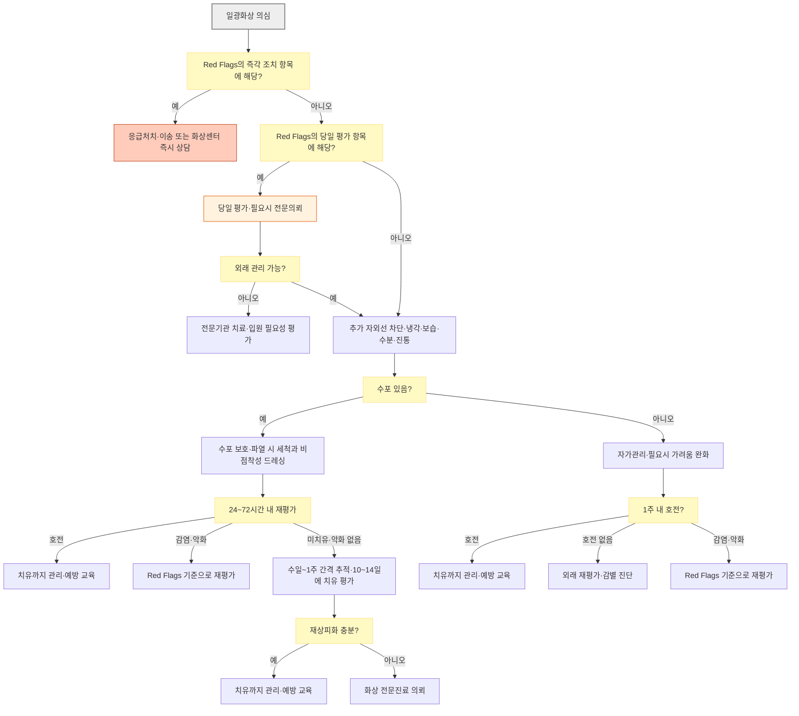

# 일광화상 Sunburn

## <mark style="color:green;">일반 사항</mark>

* 자연광 또는 태닝기기 등 인공 자외선에 과도하게 노출되어 발생하는 급성 피부 손상 및 염증 반응
* 기전 : 자외선에 의한 각질형성세포의 DNA 손상과 이에 따른 염증매개물질 방출
* 분류 : 표재성 화상(홍반 위주) - 표재성 부분층 화상(수포 동반)
* 경과 : 대부분 경증은 자연 치유되며, 치료 목적은 통증·열감·가려움 완화와 탈수·감염 등 합병증 예방임. 이미 발생한 자외선 DNA 손상을 되돌리거나 치유기간을 확실히 단축하는 치료는 없음.
* 합병증 : 반복·누적된 자외선 노출은 광노화, 일광탄력섬유증(solar elastosis), 광선각화증, 편평세포암·기저세포암 및 흑색종 위험 증가와 관련됨.
* 모든 피부색에서 발생할 수 있음. 피부색이 짙으면 홍반이 뚜렷하지 않을 수 있으므로 열감·압통·부종·수포를 함께 평가함.

#### <mark style="color:$primary;">자외선의 종류와 특성</mark>

* UVB(280\~315 nm) : 지표면 자외선의 약 5%를 차지하며 일반 유리창에 대부분 차단됨. 비타민 D 합성에 관여하며 **일광화상의 주된 원인**이고, 색소침착과 피부암에도 관여함.
* UVA(315\~400 nm) : 지표면 자외선의 약 95%를 차지하며 구름과 일반 유리창을 상당 부분 통과함. 즉시형 색소침착, 광노화, 광과민반응 및 피부암에 주로 관여하며, 일광화상에 대한 기여는 UVB보다 작고 주로 고용량 노출에서만 나타남.
  * UVA2는 단파장 UVA로 UVB와 일부 생물학적 작용이 겹침. 의학 문헌에서는 UVA·UVB 경계를 320 nm로 구분하기도 하며, 이때 UVA2는 320\~340 nm, UVA1은 340\~400 nm로 표기함.
* UVC(100\~280 nm) : 대기와 오존층에 대부분 흡수되어 자연 상태에서는 지표면에 거의 도달하지 않음. 살균용 UVC 기기나 용접광 등 인공 광원은 피부·각막 손상을 일으킬 수 있음.

## <mark style="color:green;">원인</mark>

### <mark style="color:orange;">위험 인자</mark>

* 밝은 피부색, 쉽게 타는 피부, 밝은 머리색·눈동자색
* 정오 무렵, 낮은 위도, 높은 고도, 봄·여름철, 장시간 야외 활동
* 눈·물·모래·밝은 건물 표면 등에 의한 자외선 반사
* 태닝기기 등 인공 자외선 노출
* 광과민 약물 사용
  * 예 : tetracycline계(특히 doxycycline), fluoroquinolone계, sulfonamide계, thiazide·loop 이뇨제, amiodarone, phenothiazine계, 일부 NSAID, voriconazole, 일부 retinoid 및 항암제
  * 약물별 광과민 위험은 다름. 새로 시작한 약물과 증상 발생 시점, 햇빛 노출 부위의 분포를 확인하며 환자가 임의로 약을 중단하지 않도록 함.

## <mark style="color:green;">임상 양상</mark>

### <mark style="color:orange;">국소 증상</mark>

* 경증 : 노출 부위의 경계가 비교적 명확한 홍반, 열감, 압통·통증, 건조감
* 부분층 화상 : 현저한 부종과 수포
* 보통 노출 수 시간 후 증상이 나타나 12\~24시간에 가장 심하고, 3\~5일에 걸쳐 완화되면서 인설과 피부 벗겨짐이 나타날 수 있음.
* 경증은 대개 흉터 없이 회복함. 광범위한 수포, 이차감염 또는 반복적인 피부 손상이 있으면 색소침착이 오래 지속되거나 드물게 흉터가 남을 수 있음.

### <mark style="color:orange;">전신 증상</mark>

* 광범위하거나 심한 일광화상에서는 오한, 발열, 두통, 피로, 구역·구토, 어지럼 및 탈수가 동반될 수 있음.
* 의식 변화, 실신, 경련, 고체온, 저혈압 등이 있으면 일광화상 자체로만 판단하지 말고 열사병 등 열질환을 즉시 평가함.

### <mark style="color:orange;">지연 멜라닌 형성 Delayed melanogenesis</mark>

* 자외선 노출 후 멜라닌 생성과 표피 내 이동이 증가하면서 보통 2\~3일 후 피부색이 짙어지고 수 주간 지속될 수 있음.
* 이는 자외선 손상 후 나타나는 방어반응임. 후속 자외선에 대한 보호 효과는 제한적이며, 탄 피부를 건강하거나 안전한 자외선 노출의 지표로 해석해서는 안 됨.

### <mark style="color:$danger;">🚩 Red Flags!</mark>

<mark style="color:$danger;">**즉각 조치**</mark>

* 고체온, 의식 변화·심한 혼돈, 실신 또는 경련  `열사병` `열 질환`
* 저혈압·쇼크 징후, 심한 탈수, 핍뇨 또는 지속되는 구토로 수분 섭취 불가  `저혈량성 쇼크` `중증 탈수`
* 시력저하 또는 심한 안구통  `각막 손상` `중증 광각막염`
* 호흡곤란, 얼굴·기도의 현저한 부종  `혈관부종` `아나필락시스`
* 적절한 진통에도 조절되지 않는 통증, 또는 화상 치료에 영향을 주는 중대한 기저질환·동반 외상  `고위험 화상`
* 부분층 화상 ≥10% TBSA, 전층 화상 또는 얼굴·손·발·생식기·회음부·관절의 심부 화상(단순 홍반은 TBSA에서 제외)  `광범위·심부 화상`

<mark style="color:$warning;">**당일 평가**</mark>

* 영유아 및 소아의 광범위한 일광화상(TBSA 수치와 무관)  `소아 탈수` `열 질환`
* 얼굴·눈 주위, 손, 발, 생식기·회음부 또는 주요 관절을 침범한 유의한 표재성 부분층 화상(심부·전층 화상은 즉각 조치)  `특수 부위 화상`
* 강한 자외선 노출 후 눈 통증·이물감·눈부심·눈물  `광각막염`
* 즉각 조치 기준에 해당하지 않는 광범위한 부종·수포  `부분층 일광화상`
* 발열·오한, 반복되는 구토, 현저한 두통·어지럼 등 유의한 전신 증상  `전신 일광화상 반응` `열탈진`
* 고령자, 임신부, 면역저하자 또는 중증 심장·신장질환 환자의 광범위한 일광화상  `탈수` `열 질환`
* 농성 삼출·악취, 주변 홍반 확대, 열감·통증 증가(저혈압·의식저하가 동반되면 즉각 조치)  `이차감염` `연조직염`

<mark style="color:$info;">**조기 평가 및 추적**</mark>

* 통증·홍반·수포가 1주 이상 뚜렷하게 호전되지 않음  `치유 지연` `광독성 약물반응`
* 색소침착이 수개월간 감소하지 않거나 비전형적인 색소·피부 병변이 지속됨  `염증후 색소침착` `피부암`
* 외래에서 관리하는 수포 동반 부분층 일광화상  `치유 지연` `이차감염`


즉각 조치는 응급처치·이송 또는 화상센터와의 즉시 상담이 필요한 상태임. 열사병이 의심되면 체온 수치 확인 때문에 응급처치를 지연하지 않음. 시력저하·심한 안구통은 긴급 안과 평가, 광각막염 의심은 당일 안과 평가를 시행함. 영유아·소아는 체온조절 미숙, 빠른 탈수 진행, 국소 처치의 어려움 등으로 의뢰 역치를 낮게 적용함. 수포 동반 부분층 일광화상은 24\~72시간 내 범위·깊이·드레싱과 감염 여부를 재평가함. 두 번째 단계의 항목은 모두 당일 평가가 필요하므로 표제를 ‘당일 평가’로 함. 3단계 평가 시점은 임상 위험도에 따른 저자 정리이며 ABA의 공식 3단계 분류는 아님.


## <mark style="color:green;">진단</mark>

* 대부분 노출력과 임상 양상으로 진단함.
* 노출 시간·시간대, 자외선지수, 태닝기기 사용, 고도·반사면, 자외선 차단 방법 및 광과민 약물을 확인함.
* 수포가 있으면 부분층 화상을 시사하므로 깊이·범위와 부위를 평가함. TBSA(total body surface area) 산정에는 단순 홍반만 있는 표재성 화상을 포함하지 않음. 작은 산재 병변은 환자 자신의 손가락을 포함한 손바닥 면을 약 1%로 추정할 수 있으며, 소아의 넓은 화상은 Lund–Browder 도표를 사용함.
* 창백하고 압박 후 혈색 회복이 느리거나 없고, 감각이 감소한 병변은 심부 화상을 의심함. 심부 가능성이 있는 화상은 크기와 무관하게 화상센터와 상담함. 부분층 화상이 10% 미만이어도 전문기관 상담 대상이 될 수 있으며, 작은 표재성 병변의 실제 의뢰·추적 방법은 지역 진료 역량과 환자 상태에 따라 정함.
* 광범위한 병변이나 전신 증상이 있으면 활력징후, 수분 상태, 소변량과 열질환 동반 여부를 평가함. 임상적으로 필요하면 전해질·신기능·간기능·CK 등을 검사함.
* 강한 자외선 노출 후 눈 통증·이물감·심한 눈부심·눈물 또는 시력저하가 있으면 광각막염(photokeratitis)을 의심하고 당일 안과 평가를 시행함. 시력저하나 심한 통증이 있으면 긴급 평가함.

### <mark style="color:orange;">감별 진단</mark>

<table><thead><tr><th width="170">질환</th><th>감별 단서</th></tr></thead><tbody><tr><td>광독성 약물반응</td><td>평소보다 적은 노출 후 심한 일광화상 유사 병변, 새 약물과의 시간적 연관, 노출 부위에 국한</td></tr><tr><td>식물광피부염</td><td>라임 등 감귤류·식물 즙이 묻은 뒤 UVA에 노출, 물방울·선상·손자국 모양 홍반·수포와 이후 색소침착. 알레르기 감작 없이 생기는 광독성 반응</td></tr><tr><td>광알레르기성 접촉피부염</td><td>가려움이 두드러지는 습진성 병변, 자외선 차단제·향료·외용제 사용력, 노출 경계를 넘어 퍼질 수 있음</td></tr><tr><td>다형광발진</td><td>봄·초여름 반복, 노출 수 시간\~수일 후 구진·판·소수포, 일광화상보다 가려움이 현저</td></tr><tr><td>피부홍반루푸스</td><td>지속되는 광과민성 발진, 원반모양 병변·관절통·구강궤양 등 동반 가능</td></tr><tr><td>접촉피부염</td><td>접촉 물질의 분포와 일치, 자외선 노출과 무관한 부위에도 발생 가능</td></tr><tr><td>열질환</td><td>고체온, 의식 변화, 실신, 저혈압, 심한 무력감·구토·근육증상; 피부 병변의 정도와 무관하게 응급 평가</td></tr></tbody></table>

***



<p align="center"><strong>일광화상 중증도 평가 및 치료 알고리듬</strong></p>

<p align="center"><em><mark style="color:$info;">저자 재구성 (참고 문헌 : American Burn Association. Guidelines for Burn Patient Referral; American Academy of Dermatology. How to treat sunburn). 평가 시점과 추적 경로는 저자 정리. 열사병 의심 시 전신 냉각과 응급이송을 병행함</mark></em></p>

***

## <mark style="background-color:$warning;">Management</mark>

### <mark style="color:orange;">치료 방침</mark>

* 즉시 추가 자외선 노출을 중단하고 서늘한 장소로 이동함.
* 열사병이 의심되면 119를 요청하고, 이송을 준비하면서 옷을 느슨하게 하거나 벗긴 뒤 피부를 물로 적시고 송풍하는 등 신속한 전신 냉각을 시행함. 의식저하·반복 구토가 있으면 경구 수분을 강제로 주지 않음. 해열진통제는 열사병의 고체온 치료를 대신하지 않음.
* 통증·열감·가려움 완화, 수분 보충과 상처 보호를 중심으로 치료함.
* 이미 발생한 피부 손상을 되돌리거나 치유기간을 확실히 단축하는 약물은 없음.
* 광범위한 수포, 탈수, 열질환 또는 이차감염이 있으면 각각의 중증도에 따라 치료·의뢰함. (☞ [화상](206_-burn.md#management))

## <mark style="color:green;">비-약물 치료 및 예방</mark> <a href="#non-drug-treatment" id="non-drug-treatment"></a>

### <mark style="color:orange;">급성기 관리</mark>

* 시원한 물로 샤워하거나 시원하고 젖은 천을 10\~15분씩 반복 적용하여 증상을 완화함. 얼음·얼음물을 일광화상 피부에 직접 적용하지 않으며 소아·고령자에서는 저체온을 예방함. 열화상 응급처치의 ‘손상 후 3시간 이내 20분 냉각’ 기준을 일광화상에 그대로 적용하지 않음.
* 온전한 피부가 약간 젖어 있을 때 무향 보습제 또는 알로에 함유 보습제를 바를 수 있음. 알코올·향료 함유 제품은 피함. 칼라민 로션은 온전한 피부의 가려움에 선택적으로 고려하되 피부가 건조해지면 중단함.
* 의식이 명료하고 구토 없이 마실 수 있으면 물을 충분히 섭취함. 발한이 많거나 경증 탈수가 동반되면 경구수분보충액을 고려함. 심장·신장질환 등으로 수분 제한 중인 환자는 기존 지침을 따름. 경구 섭취가 불가능하거나 탈수가 심하면 정맥 수액 필요성을 평가함.
* 벗겨지는 피부를 억지로 뜯지 않음.
* 온전한 수포는 터뜨리지 않음.
* 수포가 있는 부위에는 자외선 차단제나 자극성 화장품을 직접 바르지 말고 의복·드레싱·그늘로 보호함.
* 수포가 저절로 파열되면 물과 순한 세정제로 부드럽게 씻고, 냉각 후 얇은 petrolatum과 비점착성 드레싱으로 보호함. 크고 팽팽하거나 관절 운동·깊이 평가를 방해하는 수포는 의료진이 처치 필요성을 판단함(☞ [화상](206_-burn.md#management)).
* 수포 동반 부분층 일광화상은 24\~72시간 내 재평가하며, 10\~14일에도 재상피화가 충분하지 않거나 2\~3주 이상 치유가 지연될 것으로 예상되면 화상 전문진료를 의뢰함.
* benzocaine·lidocaine 등 국소마취제는 자극성 또는 알레르기성 접촉피부염을 일으킬 수 있어 일률적으로 사용하지 않음.

### <mark style="color:orange;">자외선 노출 예방</mark>

* 기상정보의 자외선지수(UVI)를 확인하고 UVI ≥3이면 복합적인 자외선 보호조치를 시행함.
* 태양 정오 전후에는 노출을 줄이고 그늘을 이용함. 구름이나 그늘도 산란·반사 자외선을 완전히 차단하지 못함.
* 촘촘히 짜인 건조한 옷 또는 UPF 표시 의류, 얼굴·귀·목을 가리는 챙 넓은 모자, UV400 또는 UVA·UVB 99\~100% 차단 선글라스를 사용함.
* 눈·물·모래 주변이나 높은 고도에서는 반사 자외선에 특히 주의함.
* 태닝기기 사용을 피함.
* 광과민 약물 복용 중이거나 광선각화증·피부암 병력이 있는 고위험 환자는 위 조치를 더 엄격히 적용함.
* 자외선 차단제는 그늘·의복과 함께 노출된 피부를 보호하는 수단으로 사용하며, 더 오래 햇빛에 머물기 위한 목적으로 사용하지 않음. 비타민 D를 얻기 위해 의도적으로 피부를 태우거나 태닝기기를 사용하지 않음.

### <mark style="color:orange;">자외선 차단제 Sunscreen</mark>

#### <mark style="color:$primary;">SPF와 PA</mark>

* SPF(sun protection factor)는 자외선 차단제를 표준량인 2 ㎎/cm²로 도포한 피부와 도포하지 않은 피부에서 최소홍반을 유발하는 자외선 조사량(MED)의 비이며 주로 UVB 차단 성능을 나타냄.
* SPF는 햇빛에 노출될 수 있는 안전한 시간의 배수를 뜻하지 않음.
* PA(protection grade of UVA)는 UVA 차단 성능을 나타내며 PA+부터 PA++++까지 표시함.
* 일반적으로 SPF ≥30이면서 PA+++ 이상인 UVA·UVB 차단 제품을 선택함. 장시간 야외활동·물놀이·강한 자외선 노출 또는 광과민질환·광과민 약물 사용 시 SPF 50+·PA++++ 제품을 우선 고려함. 기능성화장품 표시와 제품 사용법을 확인함.

#### <mark style="color:$primary;">자외선 필터</mark>

* 유기 자외선 필터와 무기 자외선 필터 모두 주로 자외선을 흡수하고 일부는 반사·산란함. 단순히 '화학적 흡수제'와 '물리적 반사제'로 이분하는 것은 실제 작용을 충분히 설명하지 못함.
* 무기 필터에는 zinc oxide와 titanium dioxide가 있음. 대체로 자극·알레르기 위험이 낮지만 백탁이 생길 수 있음.
* 유기 필터는 성분별로 흡수 파장과 광안정성이 달라 여러 성분을 조합함. PABA는 과거 사용되었으나 피부반응 등의 문제로 현재는 거의 사용하지 않음.
* 개별 성분보다 제품에 표시된 SPF·PA·내수성, 피부유형과 사용 목적을 기준으로 선택함.

#### <mark style="color:$primary;">영유아</mark>

* 생후 6개월 미만은 직사광선을 피하고 그늘, 긴 옷과 챙 넓은 모자를 우선함.
* 불가피하게 노출되는 작은 부위에 사용할 필요가 있으면 의사와 상의하고, 자외선 차단제로 표시된 제품을 소량 사용함.
* 기저귀 발진 보호제 등 zinc oxide 함유 일반 외용제를 자외선 차단제 대신 사용하지 않음.

#### <mark style="color:$primary;">도포량</mark>

* 표시된 차단 성능은 2 ㎎/cm²를 기준으로 함. 적게 바르면 실제 차단 효과가 표시 SPF보다 현저히 낮아질 수 있음.
* 수영복을 입은 일반 성인의 전신 도포량은 체격에 따라 약 30\~35 ㎖임. 아래 7-teaspoon rule은 약 35 ㎖에 해당하는 실용적 기준이며 실제 노출 면적에 맞춤.
* 7-teaspoon rule : 얼굴·목·귀 1 teaspoon, 각 팔 1 teaspoon, 각 다리 1 teaspoon, 몸통 앞·뒤 각 1 teaspoon

#### <mark style="color:$primary;">도포 방법</mark>

* 제품 표시사항에 따라 대개 외출 15\~30분 전에 노출 피부에 충분히 균일하게 바름. 이는 진피까지 흡수되기 위한 시간이 아니라 피부 표면에 균일한 도포막이 형성되고 정착되도록 하기 위한 것임.
* 야외에서는 약 2시간마다 다시 바르고, 수영·다량의 발한·수건 사용 후에는 즉시 다시 바름.
* 국내 물놀이용 제품은 ‘내수성’ 또는 ‘지속내수성’ 표시를 확인함. 식약처 안내에 따라 물놀이 중에는 1\~2시간마다 덧바르되, 수영·다량의 발한·수건 사용 후에는 즉시 다시 바름. 해외 제품의 ‘water resistant 40 min/80 min’은 해당 국가의 시험·표시 기준이며 국내 표시와 구분함. 어느 표시도 완전 방수나 표시 시간 동안 재도포가 불필요하다는 뜻은 아님.
* 귀, 코, 입술, 목 뒤, 손등, 발등, 머리숱이 적은 두피 등 빠뜨리기 쉬운 부위를 확인함.
* 분사·분무형은 흡입하지 않도록 하며 얼굴에는 직접 분사하지 않고 손에 덜어 바름. 도포량을 확인하기 쉬운 로션·크림 제형을 우선 고려함.
* 자극이나 습진성 발진이 생기면 사용을 중단하고 성분을 확인함. 반복되거나 심하면 광알레르기성 접촉피부염을 평가함.
* 사용기한과 보관조건을 확인하고 고온의 차량 안 등에 두지 않음. 분리·변색·냄새 변화 등 변질이 의심되면 사용하지 않음.

## <mark style="color:green;">약물 치료</mark> <a href="#drug-treatment" id="drug-treatment"></a>

### <mark style="color:orange;">진통제</mark>

* 통증과 부종 완화를 위해 단기간 사용할 수 있으나 일광화상의 치유기간을 단축하지 않음.
* ibuprofen : 200\~400 ㎎ q6\~8hr PRN. 일광화상에서는 1일 1,200 ㎎ 이내를 우선하며, 제시 용법에서 최대 1,600 ㎎/day를 넘지 않음. 더 많은 용량이 계속 필요하면 화상 깊이·감염·드레싱 상태를 재평가함. 부루펜의 경증·중등도 통증 허가 용법은 1회 200\~400 ㎎, 1일 3\~4회임. 관절질환의 고용량 상한을 화상 통증에 그대로 적용하지 않음. <mark style="color:blue;">\[부루펜]</mark>
* dexibuprofen 300 ㎎ 정제 : 1회 300 ㎎, 1일 2\~4회, 최대 1,200 ㎎/day(성인 허가 용법). Dexibuprofen은 ibuprofen의 약리활성 S(+)-enantiomer이나 두 성분을 일정 비율로 단순 환산하지 않으며 제품별 허가 용량을 따름.
* NSAID가 부적합하면 acetaminophen 500\~1,000 ㎎ q6\~8hr PRN을 고려함. 본 장에서는 단기 외래 사용 시 성인 최대 3,000 ㎎/day를 보수적 상한으로 제시하며, 제품 허가 최대량과 구분함. 간질환·과음·고령·저체중에서는 추가 감량을 고려하고, 간경변에서는 통상 최대 2,000 ㎎/day로 제한함. 심한 간장애·신장애, 소화성궤양, aspirin 천식 등 선택 제품의 금기를 확인하며 해당 금기에서는 사용하지 않음. 복합감기약 등 병용약의 acetaminophen 함량도 합산함.
* 소아는 성분별로 용량 체계가 다르므로 구분하여 적용함.
  * ibuprofen : 제품·제형별 허가연령과 체중별 용량을 확인하며, 통상 5\~10 ㎎/㎏/dose q6\~8hr를 기준으로 하며, 외래에서는 최소 유효 용량으로 하루 30 ㎎/㎏ 이내 사용을 우선함. 제품 허가 최대량이 더 낮으면 이를 우선하며 1회 400 ㎎을 넘지 않음. 생후 6개월 미만, 탈수·구토·신장기능 저하가 의심되는 소아에서는 사용하지 않음.
  * dexibuprofen 150 ㎎ 정제 : 6세 이상, 약 15 ㎎/㎏/day를 2\~4회 분할 투여하며, 체중 30 ㎏ 미만은 최대 300 ㎎/day. (300 ㎎ 정제는 성인 허가 용법만 제시되어 있어 소아에게 확대 적용하지 않음.)
  * acetaminophen : 10\~15 ㎎/㎏/dose q4\~6hr PRN. 어린이타이레놀현탁액의 허가 용량표는 생후 4개월부터 제시됨. 4개월 미만은 자가 투여하지 말고 진료를 우선하며, 2세 미만은 의사·약사와 상의함. 본 장에서는 하루 60 ㎎/㎏ 이내를 보수적 외래 상한으로 제시함(해당 제품 허가 상한은 1일 5회·75 ㎎/㎏). 성인 최대량과 더 낮은 제품별 상한을 넘지 않음.
  * 시럽 농도(㎎/㎖)를 확인하여 투여량을 계산하고 계량주사기를 사용함. 성분이 다른 ibuprofen과 dexibuprofen의 용량을 서로 환산하거나 함께 투여하지 않음.
* 일부 실험에서 NSAID의 자외선 홍반 감소가 관찰되었더라도 DNA 손상·피부암 예방이나 안전한 햇빛 노출을 보장하지 않음. 자외선 노출 전 예방적 복용은 권장하지 않음.


**NSAID의 제품별 금기 확인**

* 부루펜: 위장관궤양·출혈 또는 그 병력, 기관지천식 또는 그 병력, NSAID 과민반응 병력, 중증 신·간·심장기능장애·고혈압, CABG 전후 통증, 심한 혈액이상, 고용량 methotrexate 항암요법 중에는 금기임.
* 애니펜: 위장관궤양·그 징후 또는 재발 병력, 활동성 출혈, 과거 NSAID 관련 위장관 출혈·천공, 기관지천식 또는 그 병력, NSAID 과민반응 병력, 중증 신·간기능장애·심부전·고혈압, CABG 전후 통증, 크론병·궤양성대장염 및 심한 혈액이상은 금기임.
* 임신 20주 이후에는 NSAID를 원칙적으로 피하며, 불가피하면 의료진 판단으로 최소 용량·최단기간 사용함. 임신 30주 이후에는 사용하지 않음.
* 유당 함유 제제의 특정 유전성 당대사질환 등 첨가제 관련 금기도 확인함.
* 탈수·핍뇨, 항응고제·항혈소판제 사용, 고령·쇠약은 추가 위험요인임. 금기와 구분해 평가하며, 탈수·신손상이 의심되면 수분 상태와 신기능 평가를 우선함. ibuprofen과 dexibuprofen을 포함해 NSAID끼리 병용하지 않음.


### <mark style="color:orange;">국소 스테로이드</mark>

(☞ [국소스테로이드](../231_/211_-topical-corticosteroids.md))

* 냉각·보습·진통을 기본으로 하며 국소 스테로이드를 일률적으로 처방하지 않음. 노출 6시간 또는 23시간 후 투여한 임상시험에서는 급성 일광화상 반응의 임상적으로 유용한 감소가 입증되지 않았음. <mark style="color:$info;">[Arch Dermatol 2008]</mark>
* CDC Yellow Book 2026 등은 hydrocortisone 1%의 증상 완화 사용을 허용하므로 ‘모든 경우에 효과가 없다’고 단정하지 않음. 제품의 허가·금기와 병변 상태를 확인하여 제한적으로 판단함.
* 피부가 온전한 제한된 병변에서 가려움·염증이 심하면 저역가 제제를 수일간 선택적으로 고려할 수 있음. 효과가 제한적임을 설명하고 수포·미란·감염 부위에는 사용하지 않음. 전신 스테로이드는 일광화상에 일률적으로 사용하지 않음.

### <mark style="color:orange;">H1-항히스타민제</mark>

(☞ [항히스타민제](../231_/212_-antihistamines.md))

* 가려움이 심할 때만 선택적으로 고려하며, 일광화상 후 가려움에 대한 효과 근거는 제한적임. 피부 손상이나 치유기간을 개선하는 치료는 아님.
* 진정이 적은 2세대 제제를 우선 고려하되 cetirizine도 졸릴 수 있음을 설명함.
  * cetirizine : 성인 10 ㎎ qd, 지르텍정 허가 용법은 취침 전 복용. <mark style="color:blue;">\[지르텍]</mark>
  * 성인 CrCl 30\~49 ㎖/min: 5 ㎎ qd; 10\~29 ㎖/min: 5 ㎎ q48hr; ＜10 ㎖/min 또는 투석 환자: 금기. 지르텍정은 6세 미만 및 cetirizine·hydroxyzine·piperazine계 과민증 병력 등에도 금기임.
* hydroxyzine은 진정·항콜린작용과 QT 연장 위험을 평가한 뒤 제한적으로 고려함. 아디팜정의 성인 피부과 허가 용법은 30\~60 ㎎/day를 2\~3회 분할하고 연령·증상에 따라 조절하는 방식임. 일광화상에 일률적으로 이 용량을 투여할 필요는 없으며, 사용할 경우 최소 유효 용량·최단기간으로 개별화함. <mark style="color:blue;">\[아디팜]</mark>
* 1세대 제제는 졸림, 인지저하, 구갈·요폐 및 낙상 위험이 있어 고령자에서는 가급적 피함. 운전·음주를 피하고 신·간장애에서는 감량함.
* Hydroxyzine은 급성 폐쇄각녹내장, 포르피린증, QT 연장 또는 관련 고위험 상태에서 사용하지 않음. 심혈관질환, 유의한 서맥·저칼륨혈증·저마그네슘혈증, 급성 심장사 가족력, QT 연장 유발 약물(예: escitalopram, levofloxacin, moxifloxacin) 병용 등을 확인함. Cetirizine과 hydroxyzine을 일률적으로 병용하지 않음.

### <mark style="color:orange;">수포 및 이차감염</mark>

(☞ [화상](206_-burn.md#management))

* 단순 수포 또는 수포 파열만으로 국소 항생제를 예방적으로 사용하지 않음.
* 제한된 표재성 세균감염이 확인되면 mupirocin 2%를 선택적으로 고려함. 에스로반 허가 용법은 bid\~tid, 10일간 소량 도포이며, 3\~5일 내 호전이 없으면 재평가하고 필요한 최소기간만 사용함. <mark style="color:blue;">\[에스로반연고]</mark>
* 에스로반은 신질환 및 성분·기제 과민증에 금기임. 폴리에틸렌글리콜 기제가 손상된 피부에서 흡수될 수 있어 광범위 화상에는 일률적으로 사용하지 않으며 눈·코 등 점막을 피함.
* 주변 홍반 확대, 심한 통증 증가, 발열 등 연조직염이 의심되면 국소제만 사용하지 말고 전신 항생제와 당일 의뢰 필요성을 평가함.
* silver sulfadiazine은 단순 일광화상이나 작은 표재성 수포에 사용하지 않음. 실마진1%크림은 경증 화상에 금기임.

## <mark style="color:green;">시술 및 기타 처치</mark>

* 단순 일광화상에는 시술이 필요하지 않음. 크거나 통증이 심한 수포의 배액·괴사조직 처치가 필요하면 의료진이 깊이와 감염 여부를 평가하고 시행함. 가능한 수포 덮개를 보호함.
* 수포 파열·미란으로 피부 장벽이 손상된 부분층 화상에서는 파상풍 예방접종력을 확인하고, 창상 상태와 면역 상태에 따라 백신·면역글로불린 필요성을 판단함. 단순 홍반만 있는 온전한 피부의 일광화상에 창상 예방처치를 일률적으로 적용하지 않음. (☞ [화상](206_-burn.md#management))

***

## <mark style="color:red;">질병코드</mark>

* L55.0 1도 일광화상 Sunburn of first degree
* L55.1 2도 일광화상 Sunburn of second degree
* L55.2 3도 일광화상 Sunburn of third degree
* L55.8 기타 일광화상 Other sunburn
* L55.9 상세불명의 일광화상 Sunburn, unspecified

* KCD-9 완전코드와 대조함. L55는 하위 코드가 있는 분류항목이므로 확인된 깊이·진단에 맞는 완전코드를 선택함. L55.8을 깊이가 불명확한 일광화상의 대체 코드로 사용하지 않음.
* 표피와 진피 전층을 침범하는 전층(3도) 일광화상은 극히 드묾. 전층화상이 의심되면 면적과 관계없이 화상 전문진료를 의뢰함.

***

## <mark style="color:purple;">처방례</mark>


다음은 성인의 예시 처방임. 연령, 임신 여부, 간·신장 기능, 탈수, 위장관 출혈 위험과 병용약물을 확인하여 조정함. 대부분의 경증 일광화상은 약물 없이 냉각·보습·수분 섭취만으로 관리할 수 있음.


> **처방례 1. 통증이 있는 경증 일광화상**
>
> ```
> 애니펜정 300 ㎎/T   9T   1T q8hr PRN, 1일 최대 3회, 최대 3일간
> ```
>
> _✽dexibuprofen 300 ㎎ 정제의 성인 허가 용법은 1회 300 ㎎, 1일 2\~4회(최대 1,200 ㎎/day)이며, 본 처방은 최대 복용 시 900 ㎎/day로 그 범위 내임. Dexibuprofen은 ibuprofen의 약리활성 S(+)-enantiomer이나 두 성분을 일정 비율로 단순 환산하지 않음. 위 NSAID 경고 박스의 애니펜 금기(궤양·천식 병력 조건, 중증 신·간·심장질환 등)를 확인함. 탈수·핍뇨에서는 피하며 임신 20주 이후는 원칙적으로 사용하지 않음. 부적합하면 acetaminophen 등 대안을 고려함._

> **처방례 2. 가려움이 동반된 경우(선택적 처방)**
>
> ```
> 지르텍정 10 ㎎/T   3T   1T hs PRN, 1일 최대 1회, 최대 3일간
> ```
>
> _✽항히스타민제는 모든 환자에게 필요하지 않으며 일광화상의 경과를 단축하지 않음. 위 처방은 신기능이 정상 또는 경도로 저하된 성인 기준이며, CrCl 30\~49 ㎖/min은 5 ㎎ qd, 10\~29 ㎖/min은 5 ㎎ q48hr로 조정하고 ＜10 ㎖/min 또는 투석 환자에게는 사용하지 않음. 졸림·음주·운전 및 제품별 과민증 금기를 확인함._

> **처방례 3. 제한된 파열 수포에 표재성 세균감염이 확인된 경우**
>
> ```
> 에스로반연고 10 g/tube   환부에 소량 bid~tid, 최대 10일간
> ※ 3~5일 내 호전이 없으면 재평가
> ※ 신질환 및 성분·기제 과민증에는 사용하지 않음
> ```
>
> _✽생리식염수와 순한 세정제로 세척 후 도포하며, 단순 수포 파열만으로는 사용하지 않음. 주변 홍반 확대·발열·통증 증가가 있으면 연조직염을 의심하고 전신 항생제 필요성과 당일 의뢰를 평가함._

***

### <mark style="color:$success;">핵심 복약 지도</mark>

> **진통제 복용 시**
>
> * 통증이 있을 때만 필요한 기간 동안 복용하며, 탈수되거나 소변량이 줄었으면 NSAID를 복용하지 말고 진료받습니다. 다른 소염진통제와 중복 복용하지 않습니다.
> * 신장질환, 위장관 출혈 위험 또는 임신 중에는 진통제 선택을 의료진과 상의합니다. 특히 임신 20주 이후에는 NSAID를 임의로 복용하지 않습니다.

> **항히스타민제 복용 시**
>
> * 복용 후 졸리면 운전하거나 술을 마시지 않습니다.
> * 모든 환자에게 필요한 약은 아니며 가려움이 심할 때만 사용하고, 일광화상 자체의 치유기간을 단축하지는 않습니다.

> **수포와 상처 관리**
>
> * 물집을 일부러 터뜨리지 말고, 저절로 터지면 물과 순한 세정제로 씻은 뒤 보호 드레싱을 유지합니다. 물집이 있는 화상은 24\~72시간 내 다시 진료받습니다.
> * 항생제 연고는 감염 징후가 있을 때만 사용하며 임의로 반복 사용하지 않습니다.

> **국소 스테로이드 사용 시**
>
> * 모든 일광화상에 필요한 약이 아니며, 처방받은 부위와 기간(보통 며칠 이내)만 사용합니다.
> * 수포가 터졌거나 감염이 의심되는 부위에는 사용하지 않습니다.

> **언제 다시 병원을 방문해야 하나요?**
>
> * 의식이 흐려지거나, 고열·반복 구토·소변량 감소가 있는 경우 - 즉시 응급실
> * 물집이 넓게 생기거나 얼굴·눈·손·발·생식기 부위가 심하게 탄 경우 - 당일 진료
> * 강한 햇빛 노출 후 눈이 심하게 아프거나 잘 안 보이면 즉시, 이물감·눈부심·눈물이 있으면 당일 안과 진료
> * 호전되던 통증·발적이 다시 심해지거나 고름·악취가 생기는 경우 - 감염 가능성, 진료 필요
> * 통증·홍반·수포가 1주 이상 뚜렷하게 호전되지 않는 경우 - 재평가 필요

***

## <mark style="color:green;">주요 참고문헌 및 확인 자료</mark>

### <mark style="color:orange;">임상 근거</mark>

* American Burn Association. [Guidelines for Burn Patient Referral](https://www.ameriburn.org/burn-care-team/resources/guidelines-for-burn-patient-referral). 현행 온라인 기준 확인. 본 장의 3단계 평가 시점 및 추적 경로는 저자 정리이며, 열화상 의뢰 기준을 수포·심부 일광화상 평가에 참고함.
* American Academy of Dermatology. [How to treat sunburn](https://www.aad.org/public/everyday-care/injured-skin/burns/treat-sunburn). Updated May 20, 2024.
* WHO. [Ultraviolet radiation](https://www.who.int/news-room/fact-sheets/detail/ultraviolet-radiation). 2022.
* CDC Yellow Book 2026. [Sun Exposure in Travelers](https://www.cdc.gov/yellow-book/hcp/environmental-hazards-risks/sun-exposure-in-travelers.html). 2025-04-23. 광보호·약물 광과민·수포 관리 및 증상 완화 치료.
* CDC/NIOSH. [Heat-related Illnesses](https://www.cdc.gov/niosh/heat-stress/about/illnesses.html). 2026-03-03.
* Faurschou A, Wulf HC. [Topical corticosteroids in the treatment of acute sunburn: a randomized, double-blind clinical trial](https://pubmed.ncbi.nlm.nih.gov/18490588/). Arch Dermatol. 2008;144(5):620–624.
* Royal Children's Hospital Melbourne. [Acute pain management](https://www.rch.org.au/clinicalguide/guideline_index/Acute_pain_management/). Updated October 2024. 소아 용량 참고; 국내 제품의 허가연령·금기·최대량을 우선 적용함.
* Cancer Council Australia. [Advice on how to choose, apply and store sunscreen](https://www.cancer.org.au/cancer-information/causes-and-prevention/sun-safety/sunscreen/advice). 성인 전신 약 35 ㎖·7 teaspoons, 재도포·보관.
* EMA. [New restrictions to minimise the risks of effects on heart rhythm with hydroxyzine-containing medicines](https://www.ema.europa.eu/en/news/new-restrictions-minimise-risks-effects-heart-rhythm-hydroxyzine-containing-medicines). 2015.
* FDA. [NSAID 사용과 임신 20주 이후 태아 신기능·양수 감소 위험](https://www.fda.gov/drugs/drug-safety-and-availability/fda-recommends-avoiding-use-nsaids-pregnancy-20-weeks-or-later-because-they-can-result-low-amniotic). 2020; 2022 update.
* Rogal SS, et al. [AASLD Practice Guidance: Palliative care and symptom-based management in decompensated cirrhosis](https://pmc.ncbi.nlm.nih.gov/articles/PMC9942270/). Hepatology. 2022;76(3):819–853. 간경변 환자의 acetaminophen 상한 및 전신 NSAID 회피.
* CDC. [Clinical Guidance for Wound Management to Prevent Tetanus](https://www.cdc.gov/tetanus/hcp/clinical-guidance/index.html). 피부 장벽이 손상된 화상에서 접종력·창상·면역 상태별 예방처치.

### <mark style="color:orange;">허가·급여 확인 자료</mark>

* [식품의약품안전처. 의약품안전나라 - 의약품 품목허가정보.](https://nedrug.mfds.go.kr/index) - 제품별 적응증·용법·금기 및 허가 상태 확인
* 식품의약품안전처. [자외선차단제, 제대로 발라야 효과↑…올바른 사용법은?](https://www.korea.kr/news/policyNewsView.do?newsId=148965990). 2026-06-05. 국내 기능성화장품·SPF·PA·내수성 표시와 도포 안내.
* KCD-9: 사용자 제공 「KCD9_251216(6).xlsx」의 ‘상병분류기호(전체)’ 및 ‘상병분류기호(완전코드)’ 시트. L55.0·L55.1·L55.2·L55.8·L55.9의 코드·한글명·영문명·완전코드 여부 대조(2026-01-01 시행).

* 온라인 자료 확인일: 2026-11-03.

***

## <mark style="color:blue;">환자 안내서</mark>


**일광화상, 햇빛에 탄 피부를 식히고 보호하는 것이 우선입니다**

일광화상은 자외선에 오래 노출되어 피부가 붉어지거나 화끈거리고 아픈 상태입니다. 피부색이 짙으면 붉은 기운이 뚜렷하지 않을 수 있습니다. 대부분 며칠 안에 저절로 좋아지지만, 심하면 물집이 생기고 회복까지 1주 이상 걸릴 수 있습니다.


#### <mark style="color:$primary;">왜 일광화상이 생기나요?</mark>

* 햇빛(자외선)에 오래 노출되면 피부 세포가 손상되어 염증 반응이 일어납니다.
* 피부색이 밝을수록, 특정 약을 복용 중일수록 더 쉽게 발생합니다.

#### <mark style="color:$primary;">일상생활에서 어떻게 관리하나요?</mark>

* **시원한 샤워나 젖은 수건으로 피부를 식히십시오.** 얼음을 피부에 직접 대지 마십시오.
* **샤워 후 피부가 약간 젖어 있을 때 무향 보습제를 바르십시오.**
* **물을 충분히 드십시오.** 특히 넓은 부위가 탄 경우 탈수되기 쉽습니다. 심장·신장질환으로 물을 제한하고 있다면 기존 지침을 따르십시오. 의식이 흐리거나 구토가 계속되면 억지로 마시지 말고 즉시 진료받으십시오.
* **물집은 터뜨리지 말고, 벗겨지는 피부를 억지로 떼지 마십시오.**
* 며칠간 추가 햇빛 노출을 피하고 외출 시 옷·모자로 가리십시오.

#### <mark style="color:$primary;">약은 어떻게 써야 하나요?</mark>

* 통증이 심하면 진통제를 필요한 기간만 복용합니다. 탈수되거나 소변량이 줄었으면 소염진통제를 임의로 복용하지 말고 진료받으십시오. 임신 중이라면 소염진통제를 복용하기 전에 의료진과 상의하십시오.
* 가려움이 심할 때만 항히스타민제를 고려하며, 졸릴 수 있는 약은 운전 전에 피합니다. 항히스타민제는 가려움을 줄일 뿐 일광화상이 낫는 기간 자체를 단축하지는 않습니다.
* 스테로이드나 항생제 연고는 의사가 처방한 경우에만, 처방받은 기간만 사용합니다.

#### <mark style="color:$primary;">즉시 또는 당일 진료가 필요한 경우</mark>

* 의식이 흐려짐, 실신, 고열, 반복되는 구토, 소변 감소 - 열사병 등 다른 응급 질환과의 감별이 필요할 수 있습니다.
* 물집이 넓게 생기거나 얼굴·눈·손·발·생식기 부위가 심하게 탄 경우 - 당일 진료
* 강한 햇빛에 노출된 후 눈이 심하게 아프거나 잘 안 보이면 즉시, 이물감·눈부심·눈물이 있으면 당일 안과 진료를 받으십시오.
* 호전되던 통증·붉은 기운이 다시 심해지거나 고름·악취가 생기는 경우

#### <mark style="color:$primary;">다음 외출부터는 이렇게 예방하세요</mark>

* 외출할 때는 그늘·긴 옷·모자·선글라스를 함께 이용하십시오. 생후 6개월 미만 아기는 직사광선을 피하고, 자외선 차단제를 쓰기 전에 의사와 상의하십시오.
* 노출된 피부에는 SPF 30 이상, PA+++ 이상의 자외선 차단제를 충분히 바르고 약 2시간마다 다시 바르십시오. 장시간 야외활동에는 SPF 50+·PA++++ 제품을 고려하십시오. 물놀이에는 내수성·지속내수성 표시를 확인하고, 수영·땀·수건 사용 뒤에는 즉시 다시 바르십시오. 물집이나 벗겨진 상처에는 직접 바르지 말고 옷·드레싱으로 가리십시오. SPF 숫자가 높다고 해서 그만큼 오래 햇빛에 있어도 된다는 뜻은 아닙니다.
* 자외선지수(UVI)가 3 이상이면 보호조치를 하십시오. 특히 태양이 가장 강한 정오 전후(대략 오전 10시\~오후 4시)에는 노출을 더욱 줄이십시오.
